# Chapter: Distributed Transactions

Part: [07 — System Design and Distributed Systems](PART_OVERVIEW.md) · Status: Drafted

## 1. Introduction

Every relational engine ships with a promise: wrap a set of statements in
`BEGIN ... COMMIT` and the database guarantees the whole block is atomic,
consistent, isolated, and durable — the Atomicity, Consistency, Isolation,
Durability (ACID) properties taught in full by
[Transactions](../06_Databases_and_Storage/CH08_Transactions.md). That
promise is delivered by a single node's write-ahead log (WAL) and lock
manager, and it quietly assumes something an architect must never forget:
every piece of state the transaction touches lives inside that one node's
transaction boundary. The instant a business operation needs to touch state
that lives on a *different* node — a different shard, a different database
engine, or, most commonly today, a different microservice with its own
independently-owned database — that single-node guarantee stops applying,
and nothing automatically replaces it. This is the **distributed
transaction problem**: coordinating an all-or-nothing outcome for a logical
operation whose steps are physically scattered across independently-failing
systems, none of which can see or lock the others' state.

This chapter is the system-design-level extension of
[Transactions](../06_Databases_and_Storage/CH08_Transactions.md)' database-
internal teaching. That chapter already owns, and fully teaches, Two-Phase
Commit (2PC)'s prepare/commit protocol and its coordinator-crash blocking
weakness (Section 4.14), and the Saga pattern's mechanism-level
choreography-versus-orchestration mechanics and compensating-transaction
design (Section 4.15) — this chapter recaps both rather than re-deriving
them, and instead focuses on what genuinely widens once the problem moves
from "two shards of the same logical database" to "N independently deployed
microservices, each owned by a different team, each free to be down,
overloaded, or mid-deploy at any moment." Four things are new here that
[Transactions](../06_Databases_and_Storage/CH08_Transactions.md) does not
cover: the **dual-write problem** as the specific failure mode that makes
"just write to two systems" unsafe; the **in-doubt transaction** problem —
the concrete, ops-facing shape 2PC's coordinator-crash blocking failure
takes in a real distributed deployment, including how transaction managers
actually recover from it; **Three-Phase Commit (3PC)**, 2PC's
non-blocking-but-more-complex successor, taught here for the first time in
this book; and the **transactional outbox pattern**, the pattern that lets a
service reliably publish an event alongside a local database write without
ever needing 2PC, 3PC, or a Saga at all. A sibling chapter, [Saga
Pattern](CH13_Saga_Pattern.md), is scheduled immediately after this one in
this same part specifically to go deeper on choreography-versus-
orchestration design and compensating-transaction craftsmanship than either
[Transactions](../06_Databases_and_Storage/CH08_Transactions.md) or this
chapter attempt — this chapter introduces Saga only at the level needed to
compare it against 2PC/3PC/outbox as a distributed-transaction *alternative*,
and forward-references that chapter for the deepest mechanics.

By the end of this chapter you should be able to recognize when a design has
silently created a distributed transaction, explain precisely why 2PC blocks
and how production systems detect and recover from an in-doubt transaction,
explain 3PC's non-blocking improvement and its own residual weakness under a
network partition, implement a transactional outbox to solve the dual-write
problem, and — the single most valuable skill this chapter teaches — know
when the right answer is to avoid a distributed transaction entirely by
redrawing the service or data boundary instead of reaching for heavier
coordination machinery.

## 2. Historical Evolution

- **1976-1981 — System R and the first two-phase locking/commit
  protocols.** IBM's System R project (recapped from
  [Transactions](../06_Databases_and_Storage/CH08_Transactions.md) Section 2)
  established two-phase locking for single-node concurrency control; as
  networked database nodes started appearing in the same decade, researchers
  recognized that committing a transaction spanning multiple nodes needed an
  analogous "two-phase" discipline at the network level, not just the lock
  level — this is the direct intellectual ancestor of 2PC.
- **1978 — Lampson and Sturgis describe the atomic-commit problem.** Butler
  Lampson and Howard Sturgis's technical report "Crash Recovery in a
  Distributed Data Storage System" gave one of the first formal treatments
  of what a coordinator/participant commit protocol needs to survive
  arbitrary node crashes, and is the paper most historians credit with the
  first clear articulation of 2PC's blocking weakness.
- **1981-1982 — Skeen formalizes Three-Phase Commit.** Dale Skeen's papers
  "Nonblocking Commit Protocols" (1981) and, with Michael Stonebraker, "A
  Formal Model of Crash Recovery in a Distributed System" (1983) introduced
  3PC as a provably non-blocking alternative to 2PC under a crash-only
  (no-network-partition) failure model — a caveat that, as Section 4.3
  explains, turned out to matter enormously in practice.
- **1991 — X/Open XA standardizes 2PC for commercial deployment.** The
  X/Open Company's XA (eXtended Architecture) specification standardized the
  interface between a **transaction manager** (the coordinator) and
  **resource managers** (participants — typically relational databases and
  message queues), letting heterogeneous vendors' products participate in
  the same distributed transaction. XA is still the interface most
  commercial 2PC deployments (Java Transaction API (JTA)-compliant
  application servers, for example) use today.
- **Late 1990s-2000s — 3PC largely stays academic; industry keeps choosing
  2PC or avoids distributed transactions altogether.** Despite being
  provably non-blocking under crash failures, 3PC saw little commercial
  adoption — its extra network round trip and, more importantly, its own
  vulnerability to network partitions (Section 4.3) meant most production
  systems either accepted 2PC's blocking risk for small, tightly-controlled
  participant sets, or began avoiding cross-node transactions altogether as
  service-oriented architectures grew.
- **2000s-2010s — microservices make the problem universal, and the Saga
  pattern (and the outbox pattern alongside it) become the default
  answer.** As independently deployed, independently owned services with
  their own databases became the mainstream architecture (recapped from
  [Micro Frontends](../04_Frontend_Architecture/CH08_Micro_Frontends.md)'s
  backend-analogue framing and this book's future microservices-architecture
  chapters), the distributed-transaction problem stopped being a rare
  cross-shard edge case and became a routine, daily design question for
  almost every non-trivial system — and the industry's answer shifted
  decisively away from XA/2PC toward Sagas plus the transactional outbox
  pattern, both purpose-built to avoid ever needing a blocking coordinator.
- **2010s-present — NewSQL systems re-legitimize 2PC-like coordination
  behind an abstraction.** Google Spanner (2012 paper), CockroachDB, and
  YugabyteDB all use 2PC-family protocols internally (often layered on top
  of Paxos/Raft consensus, recapped from
  [Consensus](CH07_Consensus.md)) to give applications a genuine
  cross-node ACID transaction, hiding the coordinator behind a driver that
  looks like a normal SQL client — proof that 2PC's core idea was never
  wrong, only that hand-rolling it at the application layer across
  independently-owned microservices is usually the wrong place to pay its
  cost.

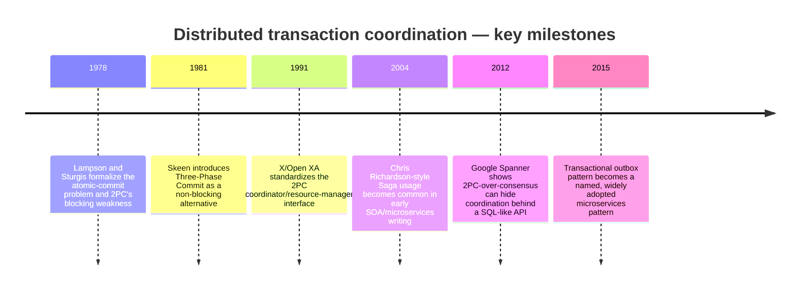

## 3. Why It Exists

Distributed transaction coordination exists because splitting a system into
independently deployable, independently owned services or shards — a choice
made for entirely good reasons (team autonomy, independent scaling,
technology fit, blast-radius isolation) — destroys the one thing a
single-node ACID transaction gave application developers for free: a shared
lock manager and a shared write-ahead log that could make an all-or-nothing
guarantee. Once that guarantee is gone, *someone* has to explicitly rebuild
some equivalent of it, or the system must be redesigned so it is never
needed. Two-Phase Commit, Three-Phase Commit, the Saga pattern, and the
transactional outbox pattern are four different points on the same
spectrum — from "rebuild something extremely close to single-node ACID
guarantees, at the cost of coupling and availability" (2PC/3PC) to
"accept eventual consistency and design explicitly around it" (Saga,
outbox) — and the single most valuable architectural skill this chapter
teaches is recognizing which point on that spectrum a given business
requirement actually needs, rather than defaulting to whichever pattern is
most familiar.

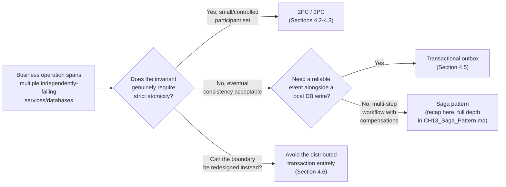

## 4. Core Concepts

### 4.1 The distributed transaction problem and the dual-write problem

**Definition.** A **distributed transaction** is a logical unit of work whose
steps must succeed or fail together, but whose steps execute against two or
more independently-failing resources — separate database shards, separate
database engines, or, most commonly, separate microservices each fronting
its own database. The **dual-write problem** is the specific, narrower
failure mode that makes the naive approach to this — "just perform both
writes, one after the other, in application code" — unsafe: because the two
writes are not covered by any shared atomicity mechanism, there is always a
window between them during which the first write has durably succeeded but
the second has not yet been attempted, attempted-and-failed, or
attempted-and-timed-out-ambiguously, and the application process itself can
crash in that exact window.

**Mechanism.** Consider the single most common concrete instance of the
dual-write problem: a service that must both (a) save a row to its own
relational database and (b) publish an event describing that change to a
message broker so other services can react. The service's code executes
these as two separate network calls — one to the database, one to the
broker — and there is no protocol tying them together. Four distinct
failure interleavings are possible: both succeed (the happy path); the
database write succeeds but the broker publish fails or times out (the
database now holds a change no other service will ever learn about, a
silent data-loss bug); the database write fails but the code mistakenly
still publishes the event (downstream services react to a change that never
actually happened); or the process crashes between the two calls, leaving
the outcome truly undefined until someone inspects both systems by hand. The
same shape of problem appears any time two independently-failing systems
must be updated to reflect one logical fact: two databases, a database and a
cache, a database and a search index, or two entirely separate
microservices' own databases as part of one cross-service business
operation (recapped from
[Transactions](../06_Databases_and_Storage/CH08_Transactions.md) Section
4.13, which frames the identical root cause purely in terms of horizontally
sharded data within a single logical database — this chapter widens the same
root cause to the service-ownership boundary, which is the shape almost
every architect meets in practice today).

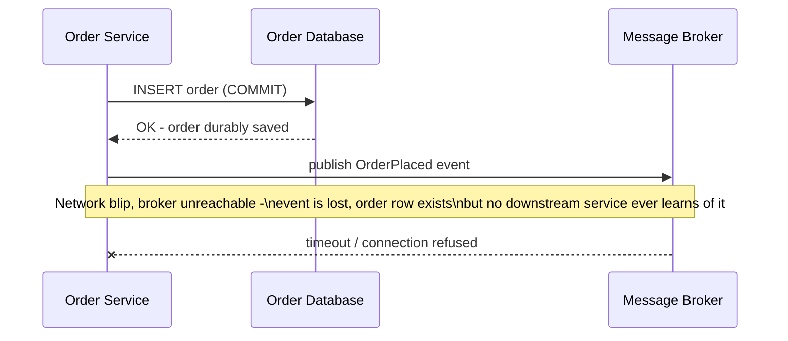

**Decision implications.** Recognizing that a design contains a distributed
transaction is a prerequisite to choosing any of Sections 4.2-4.6's tools
correctly — a design that never names this problem explicitly tends to
either accidentally accept silent data loss (the failure mode above) or
overreact by reaching for 2PC/XA across every service boundary in the
system, coupling services that were deliberately split apart for
independence in the first place. The architecturally disciplined response
is always to first ask "does this specific business invariant actually
require strict, synchronous cross-service atomicity, or can it tolerate a
bounded window of eventual consistency if that window is made safe and
observable?" before picking a mechanism.

**Common failure mode.** Treating "at-least-once" delivery assumptions as if
they were "exactly-once," and vice versa — a service that assumes its
message-broker publish call either fully succeeds or fully fails, with no
possibility of "succeeded but the acknowledgment was lost," will build a
dual-write-safe-looking design that is still unsafe, because the true
failure surface of any network call is always three-way (success,
definite failure, ambiguous timeout), not two-way.

**Scenario.** An e-commerce checkout service inserts a row into its `orders`
table and then calls `publish()` on a Kafka producer to emit an
`OrderPlaced` event that a separate fulfillment service consumes to start
packing the order. Under normal load this works every time in testing; in
production, a brief broker-side leader election causes the publish call to
time out on roughly one request in ten thousand — the order is placed, the
customer is charged, but fulfillment never learns about it, and the gap is
only discovered days later when a customer calls asking where their order
is.

### 4.2 Two-Phase Commit (2PC) recap and the distributed in-doubt-transaction problem

**Recap (fully owned by
[Transactions](../06_Databases_and_Storage/CH08_Transactions.md), Section
4.14).** 2PC coordinates an atomic outcome across participants through two
sequential phases: a **prepare (voting) phase**, in which every participant
durably readies its local change and votes `YES` or `NO`, and a **commit/
abort (decision) phase**, in which the coordinator collects every vote,
durably logs the single global decision, and broadcasts it to every
participant, so that either all participants commit or all abort, never a
mix. If the coordinator crashes after every participant has voted `YES` but
before it broadcasts the decision, every participant is stuck holding its
prepared locks indefinitely, unable to safely guess whether the true
decision was `COMMIT` or `ABORT` — 2PC is formally a **blocking protocol**.
See that chapter's Section 4.14 for the full protocol mechanics, sequence
diagram, and decision implications; this section does not re-derive them.

**What is genuinely new here — the in-doubt transaction problem in
production.** In a real deployment spanning independently owned services,
"the coordinator crashes at exactly the wrong instant" is not a rare
academic edge case — it is a routine operational event (a coordinator pod
gets rescheduled, a host is OOM-killed, a deploy restarts the process), and
someone has to actually operate the system through it. The industry term
for a participant stuck in this state is an **in-doubt transaction**: a
transaction that has been prepared (durably logged and locked) at a
participant, but for which that participant has not yet received, and
cannot safely infer, the coordinator's final decision. XA-compliant
transaction managers handle this with a specific recovery discipline rather
than leaving it to manual intervention alone:

1. **Presumed abort as a default optimization.** Most XA transaction
   managers implement **presumed abort**: if a participant queries the
   coordinator about a transaction ID and the coordinator has no record of
   it at all (rather than an explicit logged decision), the participant is
   told — and safely assumes — `ABORT`, because the coordinator's log
   write for `COMMIT` always happens *before* any participant is told to
   commit, so "no record" can only mean the coordinator crashed before
   ever reaching a commit decision, or the transaction never existed. This
   optimization means the coordinator does not need to durably log `ABORT`
   decisions at all (only `COMMIT` decisions), roughly halving its steady-
   state log-write volume.
2. **Coordinator crash-recovery on restart.** When a coordinator process
   restarts after a crash, it replays its own durable transaction log,
   identifies every transaction it had logged a `COMMIT` decision for but
   had not yet confirmed every participant's acknowledgment, and re-sends
   `COMMIT` to those participants — this is exactly the recovery path
   [Transactions](../06_Databases_and_Storage/CH08_Transactions.md)
   Section 4.14's scenario describes, restated here at the level of what
   the transaction manager's recovery code actually does on startup.
3. **Participant-side heuristic decisions as the last resort.** If a
   participant has been holding an in-doubt, prepared transaction for
   longer than an operationally unacceptable window (the coordinator is
   unreachable and shows no sign of recovering — a permanently lost host,
   for example), an operator can issue a **heuristic decision**: manually
   telling that one participant to commit or abort its prepared
   transaction based on best available evidence, explicitly accepting the
   risk that this guess might not match what other participants
   eventually receive from a recovered coordinator (a **heuristic mixed
   outcome** — some participants committed, others aborted, for what
   should have been one atomic transaction). XA exposes this exact
   capability through heuristic-outcome reporting (`XA_HEURCOM`,
   `XA_HEURRB`, `XA_HEURMIX` return codes) specifically because it is a
   known, sanctioned escape hatch, not a bug.

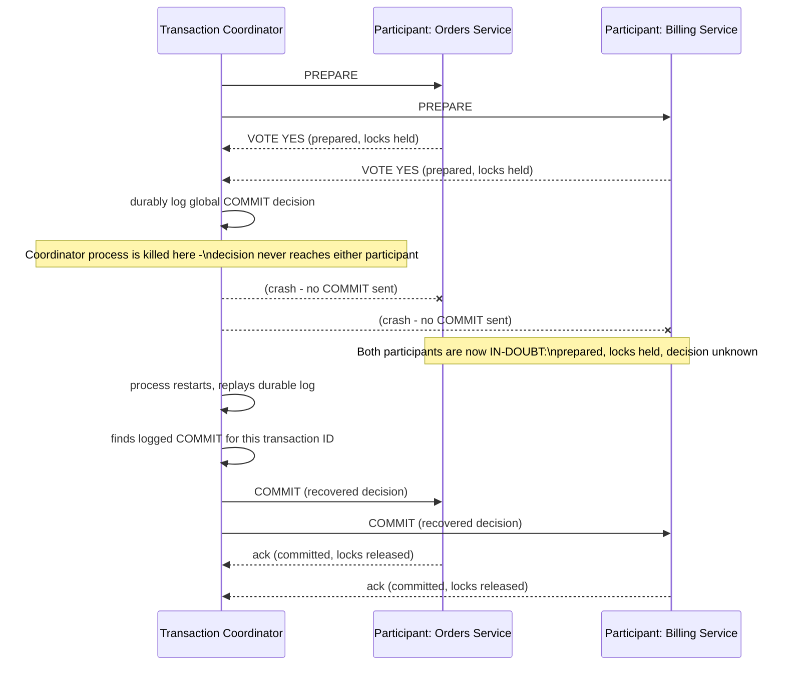

**Decision implications.** Adopting XA/2PC across service boundaries means
adopting its full operational discipline, not just its happy-path protocol:
someone must monitor in-doubt-transaction age (Section 14), define the
maximum acceptable in-doubt window before a heuristic decision is even
considered, and accept that heuristic decisions are a deliberate,
documented trade of consistency for availability at exactly the moment a
system is already in trouble — the worst possible time to be improvising.
This operational weight is the single strongest practical argument for
preferring the Saga pattern (Section 4.4) or the outbox pattern (Section
4.5) whenever the business invariant can tolerate eventual consistency
instead.

**Common failure mode.** Deploying an XA coordinator without a durable,
crash-recoverable log of its own — if the coordinator's decision log lives
only in memory, or in storage that is not itself durably fsync'd before
acknowledging the client, a coordinator crash does not just create a
temporary in-doubt window, it creates a **permanently unrecoverable**
in-doubt transaction, because there is no record for the recovery step
above to replay; every in-doubt participant then requires a manual
heuristic decision.

**Scenario.** A payments platform's XA-based transaction coordinator is
deployed as a single Kubernetes pod with no persistent volume, logging its
transaction decisions only to an in-memory data structure. A routine node
drain evicts the pod; it restarts on a different node with an empty log.
Every transaction that was in the prepare phase at the moment of eviction is
now permanently in-doubt — the new coordinator process has no record of
them at all, and (under presumed abort) every participant safely times out
and aborts, correctly avoiding a heuristic mixed outcome, but at the cost of
silently rolling back transactions that customers believed had completed
seconds earlier.

### 4.3 Three-Phase Commit (3PC) — a non-blocking successor to 2PC

**Definition.** Three-Phase Commit is a commit protocol that inserts an
additional phase between 2PC's prepare and commit phases specifically to
eliminate the blocking failure mode of Section 4.2: a **CanCommit
(voting) phase** identical in spirit to 2PC's prepare vote, a **PreCommit
(acknowledged-intent) phase** in which the coordinator, having seen all
`YES` votes, tells every participant "the group has decided to commit" and
waits for every participant to acknowledge having durably recorded that
intent, and a final **DoCommit phase** in which the coordinator tells every
participant to actually apply the commit. The extra round trip's entire
purpose is to guarantee that by the time *any* participant reaches the
PreCommit state, every other participant is guaranteed to eventually reach
either PreCommit or a state from which it can safely commit on its own —
removing the single point of total uncertainty that makes 2PC block.

**Mechanism.** In Phase 1 (CanCommit), the coordinator asks every
participant to vote, exactly as in 2PC's prepare phase. In Phase 2
(PreCommit), if every vote was `YES`, the coordinator sends a `PRECOMMIT`
message (rather than immediately committing) and waits for every
participant to acknowledge it; a participant that acknowledges PreCommit
has durably recorded "the group-wide decision is to commit, I am just
waiting for the final go-ahead," and — critically — a participant in this
state can time out waiting for Phase 3 and **safely commit unilaterally**,
because acknowledging PreCommit is only possible if every other participant
also voted `YES`, so no other correctly-functioning participant will ever
independently decide to abort after this point. In Phase 3 (DoCommit), the
coordinator sends the final `COMMIT` message once it has every PreCommit
acknowledgment; a participant that has not yet reached PreCommit and times
out instead safely aborts, since a global commit could not have been
decided without its own vote.

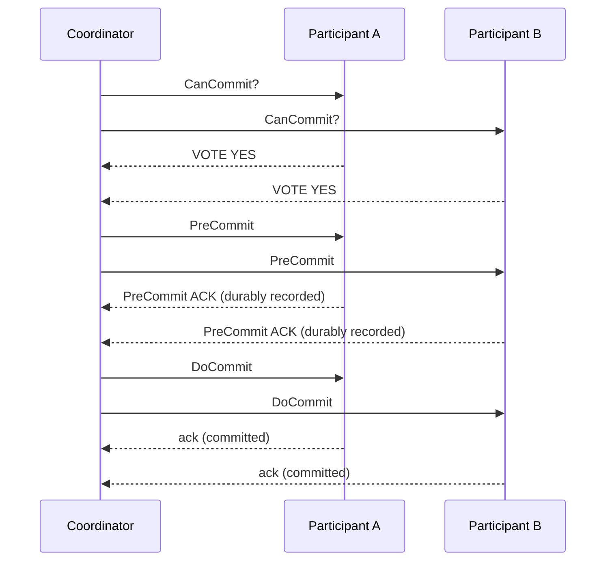

**Non-blocking recovery under a coordinator crash.** This is 3PC's entire
reason to exist: if the coordinator crashes after every participant has
acknowledged PreCommit but before sending DoCommit, every participant
independently times out waiting for DoCommit and **safely commits on its
own**, without needing to contact the coordinator or any other participant
at all — no locks are held indefinitely, and no operator intervention or
heuristic decision (Section 4.2) is ever required.

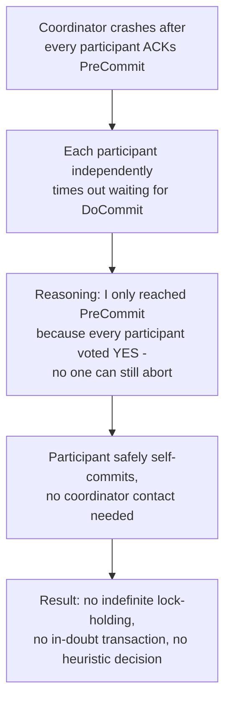

**Decision implications.** 3PC trades one additional network round trip
(and the added implementation complexity of a three-state participant
machine instead of two) for eliminating 2PC's blocking failure entirely
*under a crash-only failure model* — meaning the protocol's non-blocking
proof assumes that a node either behaves correctly or stops entirely, and
that messages, while they may be delayed, are never permanently and
selectively dropped in a way that partitions the network into two live-but-
mutually-unreachable groups. In practice, this is 3PC's decisive weakness
and the reason it never displaced 2PC commercially.

**Common failure mode — the network-partition split-brain risk.** If a
network partition splits participants into two groups right at the
PreCommit boundary — one group that already acknowledged PreCommit and
therefore times out and self-commits, and another group that never received
PreCommit (because the partition dropped that message) and therefore times
out and self-aborts — 3PC produces **exactly** the mixed outcome it was
designed to prevent: some participants commit, others abort, with no
coordinator crash required at all, only a network partition. This failure
mode is why 3PC is often summarized as "non-blocking under crash failures,
but not partition-tolerant," and why systems that need both properties
reach for a genuine consensus protocol (recapped from
[Consensus](CH07_Consensus.md), which solves a strictly harder version of
this same underlying agreement problem) instead of hand-rolling 3PC.

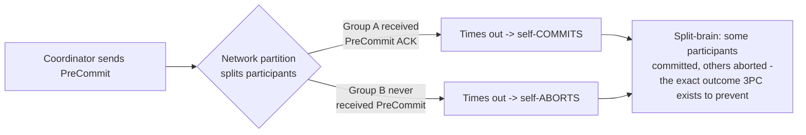

**Scenario.** A five-participant 3PC transaction reaches PreCommit; three
participants receive and acknowledge it before a data-center network link
fails, isolating the remaining two participants from the coordinator. The
three isolated-together-with-the-coordinator-side participants eventually
time out and self-commit per the non-blocking guarantee; the two
partitioned-away participants, having never received PreCommit, time out on
their own separate clock and self-abort — the transaction is now split:
three-fifths committed, two-fifths aborted, and no single node's local log
even shows this has happened until the partition heals and cross-participant
reconciliation runs.

### 4.4 The Saga pattern at the system-design level (recap and forward reference)

**Recap (mechanism-level detail fully owned by
[Transactions](../06_Databases_and_Storage/CH08_Transactions.md), Section
4.15; full choreography-versus-orchestration design depth and compensating-
transaction craftsmanship owned by the forthcoming sibling chapter [Saga
Pattern](CH13_Saga_Pattern.md)).** A Saga replaces one atomic cross-node
transaction with a sequence of local transactions, each on a single
service's own database, where every step with a side effect defines a
**compensating transaction** to semantically undo it if a later step fails.
Unlike 2PC/3PC, a Saga never holds cross-service locks for the sequence's
whole duration; intermediate, partially-applied states are visible to the
rest of the system while the saga is in progress. There are two structural
variants — **choreography**, where services react to each other's published
events with no central coordinator, and **orchestration**, where a central
orchestrator explicitly calls each step and owns compensating-action
sequencing — and
[Transactions](../06_Databases_and_Storage/CH08_Transactions.md) Section
4.15 already works a full order-placement example (inventory reservation,
payment charge, compensating release) with both a sequence diagram and an
orchestrator-state flowchart; this chapter does not repeat that worked
example.

**What this chapter adds — Saga as one point on this chapter's
decision spectrum, not a fully re-taught pattern.** The purpose of covering
Saga here at all is narrow: an architect facing the distributed-transaction
problem (Section 4.1) needs to be able to place Saga correctly alongside
2PC, 3PC, and the outbox pattern on a single decision spectrum, choosing it
specifically when (a) the workflow has multiple sequential steps across
independently owned services, (b) each step's side effect can realistically
be compensated (Section 4.1's dual-write problem is a *single*-step version
of this same question), and (c) the business can tolerate the intermediate,
partially-applied states a Saga necessarily exposes. When the requirement is
narrower — one local database write that must reliably trigger one
downstream notification, with no multi-step compensating workflow at all —
the transactional outbox pattern (Section 4.5) is a strictly simpler tool
that should be preferred over standing up a full saga orchestrator for a
single step.

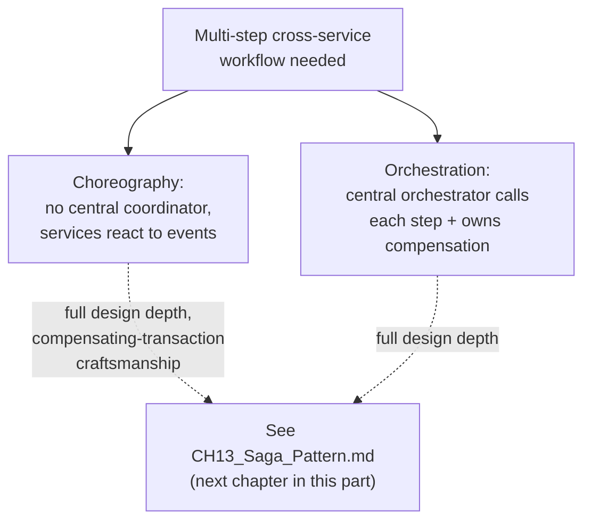

**Decision implications, common failure mode, and scenario** for choosing
Saga over 2PC/3PC are exactly the trade-offs
[Transactions](../06_Databases_and_Storage/CH08_Transactions.md) Section
4.15 already documents in full (availability and loose coupling traded for
only-eventual consistency and mandatory idempotent, defensively-written
compensations) — restating them here would violate the concept-ownership
rule this book enforces (see
[STYLE_GUIDE.md](../STYLE_GUIDE.md)); readers making this specific decision
should read that section directly, then continue to
[Saga Pattern](CH13_Saga_Pattern.md) for implementation-level guidance once
it is drafted.

### 4.5 The transactional outbox pattern — solving the dual-write problem

**Definition.** The transactional outbox pattern solves Section 4.1's
dual-write problem for its most common single-step shape — "commit a local
database change and reliably publish an event describing it" — by writing
the outgoing event as a row in an **outbox table** inside the *exact same*
local, single-node ACID transaction as the business data change (so
Section 4.1's two independently-failing writes become one single-node write,
with all the atomicity guarantees
[Transactions](../06_Databases_and_Storage/CH08_Transactions.md) already
teaches in full), and then relying on a separate, asynchronous **publisher**
process to read committed outbox rows and actually deliver them to the
message broker, marking each row published only once the broker has
acknowledged it.
[Transactions](../06_Databases_and_Storage/CH08_Transactions.md) Section 7
introduces this pattern briefly as one of its listed architecture patterns;
this section is where the book teaches its definition, mechanism, decision
implications, failure mode, and scenario in full first-principles depth (see
this chapter's staging file for the explicit recap-boundary recommendation).

**Mechanism.** The application's single local transaction inserts both the
business row (for example, a new `orders` row) and an `outbox` row
containing the event payload, an event type, and a `published` flag
defaulted to false — because both inserts are part of the same local
transaction, they are atomic with respect to each other by construction: if
the transaction commits, both rows exist; if it rolls back, neither does.
Two structural variants exist for the separate publisher process. A
**polling publisher** periodically queries the outbox table for
unpublished rows (ordered by insertion order, typically using a
monotonically increasing ID or timestamp to preserve delivery order),
publishes each to the broker, and marks it published (or deletes it) only
after receiving the broker's acknowledgment — if the publisher itself
crashes between publishing and marking-published, the row is simply
republished on the next poll, which is why every downstream consumer must
be built to tolerate duplicate delivery (recapped from
[Transactions](../06_Databases_and_Storage/CH08_Transactions.md)'s repeated
theme that distributed coordination of any kind pushes an idempotency
requirement onto whoever receives the result). A **change-data-capture
(CDC) publisher** instead taps the database's own replication/write-ahead
log stream (recapped from
[Replication](../06_Databases_and_Storage/CH07_Replication.md)'s streaming-
replication mechanics) to detect new outbox rows the instant they commit,
avoiding polling latency and load entirely at the cost of needing a CDC
connector (Debezium is the most widely deployed open-source example)
deployed and operated alongside the database.

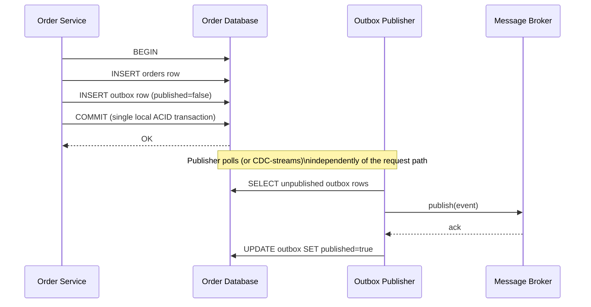

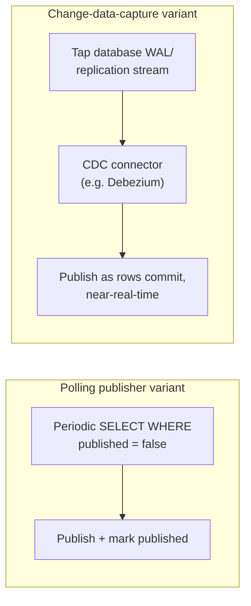

**Decision implications.** The outbox pattern sidesteps 2PC/3PC/Saga
complexity entirely for this specific, narrower problem shape, at the cost
of only ever guaranteeing **at-least-once** delivery (never exactly-once —
recapped from the general at-least-once-vs-exactly-once distinction this
part's future `CH17_Exactly_Once_Processing.md` will own in full), which
pushes an idempotent-consumer requirement onto every downstream service.
It also adds one moving part (the publisher process or CDC connector) that
must itself be monitored for lag, since a stalled publisher means committed
business data silently stops propagating even though the database itself
looks perfectly healthy. CDC-based publishing scales better and has lower
latency than polling for high-throughput services, but requires
operational investment in a CDC pipeline that a smaller team may not want to
take on for a low-volume service, where a simple polling publisher is
often the pragmatically correct choice despite being architecturally less
elegant.

**Common failure mode.** Forgetting to make the outbox-row insert and the
business-row insert part of the *same* local transaction — a surprisingly
common implementation mistake where a developer, reaching for a message
broker client library's own "transactional producer" feature, ends up with
two separate commits again (one to the database, one to the broker's
internal transaction), silently reintroducing the exact dual-write problem
(Section 4.1) the outbox pattern exists to eliminate. A second common
failure is a publisher that reads and publishes outbox rows out of
insertion order under concurrent writers, delivering events in a sequence
downstream consumers were not built to tolerate — solved by always
publishing in strict insertion order (a monotonic ID or `commit`-ordered
CDC stream) per originating table/aggregate.

**Scenario.** A ride-sharing platform's trip service must update a trip's
status to `completed` and notify a billing service to charge the rider.
Using the outbox pattern, the status update and an `TripCompleted` outbox
row are inserted in one local transaction; a CDC connector tails the
database's replication stream, publishes the event to Kafka within
milliseconds of commit, and the billing service — built to safely ignore a
duplicate `TripCompleted` event for a trip it has already charged — consumes
it exactly once from the platform's perspective even though the underlying
delivery guarantee is only at-least-once.

### 4.6 Avoiding distributed transactions entirely — redesigning the boundary

**Definition.** The single highest-leverage decision this chapter teaches is
recognizing when a distributed transaction is not actually required by the
business invariant at all, but only by an accidental choice of service or
data boundary — and that redrawing that boundary, rather than adding
coordination machinery across it, is often both simpler and more reliable.

**Mechanism.** Three concrete redesign techniques recur across real
systems. **Co-locating genuinely-coupled data.** If two pieces of data are
*always* written together and never independently, that is strong evidence
they were split across a service or shard boundary prematurely — moving
them back into the same service/database turns a distributed transaction
back into a single-node ACID transaction, at the cost of whatever
independent-scaling or team-ownership benefit the split originally
provided (an explicit trade-off, not a free win). **Single-writer
ownership with asynchronous propagation.** Instead of two services each
needing to atomically agree on one fact, designate exactly one service as
the sole owner and source of truth for that fact, and have every other
service consume an asynchronous, eventually-consistent copy (via the
outbox pattern, Section 4.5) rather than participating in a synchronous
cross-service transaction at all — this is the same "single-writer" framing
this book's future `CH14_CQRS.md` will formalize for read/write-side
separation specifically. **Idempotent, retriable operations instead of
atomic ones.** Many apparent atomicity requirements ("charge the card and
create the order together, atomically") can be reframed as "make the
overall operation safely retriable to the point of eventual completion"
(recapped from this part's future `CH16_Idempotency.md`), converting a hard
distributed-transaction requirement into a softer eventual-completion one
that a much simpler retry-with-idempotency-key mechanism satisfies.

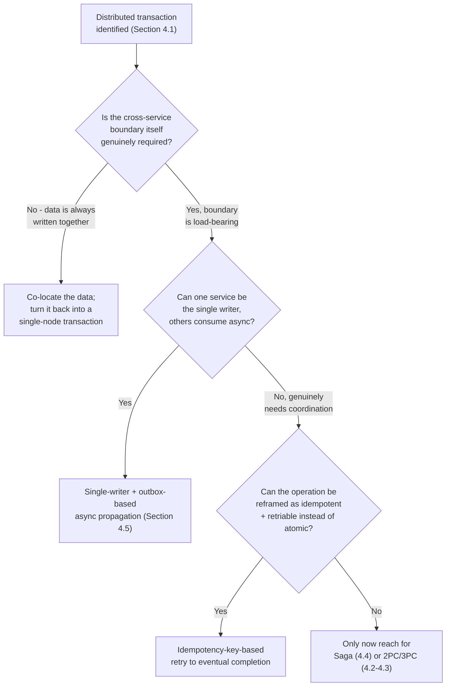

**Decision implications.** This reframing should always be attempted
*before* Sections 4.2-4.5's coordination mechanisms, not after — every one of
those mechanisms adds real operational cost (in-doubt-transaction
monitoring for 2PC, an extra network round trip and residual partition risk
for 3PC, compensating-action design and eventual-consistency tolerance for
Saga, a publisher/CDC pipeline for outbox), and the cheapest distributed
transaction is the one that was designed out of existence. This is also
precisely why the decision flowchart in Section 3 places "can the boundary
be redesigned instead?" as a first-class branch, not an afterthought.

**Common failure mode.** Treating boundary redesign as a one-time exercise
performed only at initial system design, rather than revisiting it whenever
a distributed-transaction pain point (frequent in-doubt transactions,
saga-compensation complexity growing unmanageable, an ever-expanding
2PC participant list) recurs — the presence of recurring coordination pain
around the same boundary is itself strong evidence that boundary was drawn
in the wrong place, and is a signal architects should treat as actionable,
not merely tolerate with better tooling.

**Scenario.** A retailer's original design has a `Cart` service and a
`Pricing` service as separate microservices, requiring a distributed
transaction (originally implemented as 2PC) every time a cart's line items
change, because price calculations must always reflect the cart's exact
current contents atomically. After repeated in-doubt-transaction incidents,
the team recognizes that cart contents and their priced total are, in
practice, *never* independently useful — nothing in the system ever reads
raw cart contents without also needing the current price — and merges
`Pricing`'s cart-total calculation directly into the `Cart` service as a
single-node computation, eliminating the distributed transaction (and the
service) entirely, while keeping `Pricing`'s catalog-wide price-rule
management as a separate, asynchronously-consumed data source the merged
service reads from (not writes to atomically).

## 5. Internal Working

This section connects Section 4's individual mechanisms into the concrete
shape of a production distributed-transaction coordination layer, using an
XA-style transaction manager as the running example.

**The transaction manager's own durable log is the coordination
protocol's single point of truth.** Exactly as
[Transactions](../06_Databases_and_Storage/CH08_Transactions.md) Section 5
describes a single storage engine's WAL as the system of record for
crash recovery, a distributed transaction coordinator needs its own
durable, fsync'd log — every `PREPARE` sent, every vote received, and
critically, every global `COMMIT` decision, written and fsync'd *before*
that decision is broadcast to any participant. This is the log Section
4.2's recovery step replays on restart, and it is the single most important
piece of infrastructure separating a production-grade coordinator from a
demo that merely "works until something crashes."

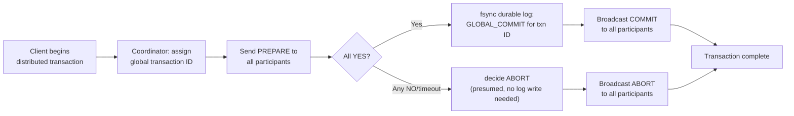

**Participant-side recovery state machine.** Each participant's own local
storage engine (its WAL, recapped in full from
[Transactions](../06_Databases_and_Storage/CH08_Transactions.md) Section 5)
must persist not just its own prepared-state redo/undo records but also the
association between its local prepared transaction and the coordinator's
global transaction ID, so that on its own restart it can query the
coordinator (or apply presumed abort, Section 4.2) using the correct
identifier — losing this association turns a normal in-doubt-transaction
recovery into an unrecoverable heuristic-decision situation, exactly as
Section 4.2's scenario describes for a coordinator with no durable log.

**Where 3PC's extra state lives.** A 3PC participant's implementation adds
exactly one additional durable state — "PreCommit acknowledged" — between
"prepared" and "committed," and it is precisely the durability of *this*
extra state that lets a participant self-commit on timeout (Section 4.3):
without it, a participant timing out after prepare would have no way to
distinguish "the group decided to commit and I just haven't heard yet" from
"the group decided to abort," which is exactly 2PC's blocking ambiguity.

## 6. Design Principles

- **Name the distributed transaction explicitly before choosing a
  mechanism.** Every design review should ask, for any workflow spanning
  more than one independently-failing resource, "have we explicitly
  identified this as a distributed transaction, and consciously chosen a
  mechanism from Section 4, rather than writing sequential network calls
  and hoping?"
- **Prefer boundary redesign (Section 4.6) over coordination machinery
  whenever the invariant allows it** — every mechanism in Sections 4.2-4.5
  is strictly more operationally expensive than not needing one at all.
- **When a reliable event must accompany a local write, default to the
  outbox pattern (Section 4.5), not a hand-rolled dual write** — this is
  the single most common distributed-transaction shape in modern systems
  and has the cheapest, best-understood correct solution.
- **Reserve 2PC/3PC for small, well-controlled participant counts where
  strict atomicity is genuinely non-negotiable** (classic examples: funds
  transfers between financial ledgers under regulatory atomicity
  requirements), and prefer a NewSQL engine's built-in 2PC-over-consensus
  (Section 2) over hand-rolling an XA coordinator, since correctly
  implementing coordinator crash-recovery (Section 4.2) and, if attempted,
  3PC's three-state participant machine (Section 4.3) is subtle enough
  that a battle-tested implementation is almost always preferable to a
  bespoke one.
- **Design every compensating action and every consumer of an at-least-once
  event stream to be idempotent by construction**, restating
  [Transactions](../06_Databases_and_Storage/CH08_Transactions.md)'s
  design principle at the service-to-service level: this single discipline
  is what makes Saga's compensations, 2PC/3PC's redelivered messages, and
  the outbox pattern's at-least-once delivery all safe in the presence of
  retries.
- **Monitor coordination-layer health as a first-class production
  concern, not an afterthought** — in-doubt-transaction age (2PC/3PC),
  outbox-publisher lag (Section 4.5), and stuck-saga-instance count are all
  leading indicators of a coordination mechanism failing silently before it
  becomes a customer-visible incident (Section 14).

## 7. Architecture Patterns

- **XA/JTA distributed-transaction coordinator pattern.** For the narrow
  set of workloads that genuinely require 2PC's strict atomicity across
  heterogeneous resource managers, use a standard, battle-tested
  XA-compliant transaction manager (a Java application server's built-in
  JTA implementation, for example) rather than hand-rolling the
  coordinator/participant protocol — correctly handling in-doubt-
  transaction recovery (Section 4.2) is subtle enough that a mature
  implementation's years of production hardening are worth far more than
  the marginal flexibility of a custom one.
- **NewSQL 2PC-over-consensus pattern.** Where the data genuinely needs
  cross-node ACID transactions but the team wants to avoid operating a
  bespoke coordinator, a NewSQL engine (recapped from Section 2 —
  Spanner/CockroachDB/YugabyteDB) hides 2PC-style coordination behind a
  Paxos/Raft-replicated log (recapped from
  [Consensus](CH07_Consensus.md)) and a familiar SQL client interface,
  trading some throughput ceiling for a dramatically simpler application
  programming model.
- **Saga orchestration/choreography pattern.** As recapped in Section 4.4,
  favored whenever the workflow can tolerate eventual consistency and
  every side-effecting step has a realistic compensating action; see
  [Saga Pattern](CH13_Saga_Pattern.md) for the full pattern-level design
  guidance.
- **Transactional outbox pattern with polling or CDC publisher.** As taught
  in Section 4.5, the default pattern for reliably propagating a single
  local write as an event without any cross-service coordination at all.
- **Boundary-redesign pattern (data co-location, single-writer ownership,
  idempotent-retry reframing).** As taught in Section 4.6, the pattern that
  should be attempted first, before any of the above.

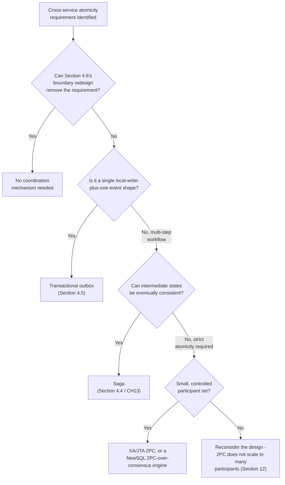

## 8. Production Architecture

A production distributed-transaction architecture typically layers all four
mechanisms side by side, applied to different parts of the same system
based on each workflow's actual requirements, rather than picking one
mechanism globally. A representative e-commerce platform might use: the
transactional outbox pattern (with a CDC connector) for every service that
needs to reliably notify others of state changes; a Saga orchestrator for
the multi-step checkout workflow (inventory reservation, payment, shipping
label creation) where partial, compensable progress is acceptable; and a
narrowly-scoped XA/2PC transaction, or a NewSQL engine's native cross-node
transaction, only for the ledger-posting step where regulatory or financial
correctness genuinely requires strict atomicity across a small, fixed
participant set (a general ledger and a sub-ledger, for example).

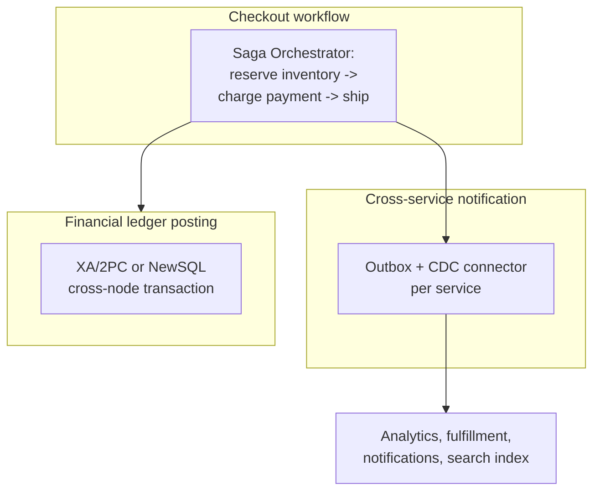

**Observability integration point.** Every one of these mechanisms should
emit the same class of signal into the platform's existing observability
stack (recapped from Part 12's forthcoming Observability chapters): a
named metric for in-flight coordination state (in-doubt-transaction count,
outbox publish lag, stuck-saga-instance count), so an operator sees one
consistent picture of "how much unresolved cross-service coordination is
currently outstanding" regardless of which mechanism produced it.

## 9. Implementation

Implementing any of Section 4's mechanisms correctly requires, at minimum:
a durable, fsync'd coordination log (for 2PC/3PC) or a durable outbox table
with a strictly ordered read path (for the outbox pattern); idempotent
participant/consumer handling of redelivered messages; explicit timeout and
recovery logic (presumed abort for 2PC, self-commit-on-timeout for 3PC,
retry-with-backoff for outbox publishers); and monitoring for every
mechanism's specific stuck-state signal. Section 10's code examples
implement the two mechanisms most teams build themselves in practice — the
transactional outbox pattern (almost every team eventually needs this) and
a 3PC coordinator/participant simulation (built here purely to make the
non-blocking mechanism and its partition weakness concrete, since almost no
team should hand-roll 3PC in production) — plus a 2PC in-doubt-transaction
recovery simulation demonstrating presumed abort and coordinator-crash
recovery end to end.

## 10. Complete Code Examples

All examples are in Python and live under
[`code/python/distributed-transactions-chapter/`](../../code/python/distributed-transactions-chapter/).

**Example 1 — the dual-write problem, demonstrated and then fixed with a
transactional outbox**, showing the exact failure interleaving from Section
4.1 first without the pattern, then with it:
[`code/python/distributed-transactions-chapter/01_dual_write_problem_demo.py`](../../code/python/distributed-transactions-chapter/01_dual_write_problem_demo.py).

**Example 2 — a complete transactional outbox implementation**, using
SQLite for the local durable transaction and an in-memory broker stand-in,
including a polling publisher, at-least-once redelivery, and an idempotent
consumer:
[`code/python/distributed-transactions-chapter/02_transactional_outbox.py`](../../code/python/distributed-transactions-chapter/02_transactional_outbox.py).

**Example 3 — a Two-Phase Commit coordinator/participant simulation with
in-doubt-transaction recovery**, modeling a coordinator crash immediately
after logging its COMMIT decision but before broadcasting it, and the
presumed-abort/recovery-replay logic from Section 4.2:
[`code/python/distributed-transactions-chapter/03_two_phase_commit_in_doubt_recovery.py`](../../code/python/distributed-transactions-chapter/03_two_phase_commit_in_doubt_recovery.py).

**Example 4 — a Three-Phase Commit coordinator/participant simulation**,
demonstrating both the non-blocking self-commit-on-timeout recovery path
and, in a second scenario, the network-partition split-brain failure mode
from Section 4.3:
[`code/python/distributed-transactions-chapter/04_three_phase_commit_simulation.py`](../../code/python/distributed-transactions-chapter/04_three_phase_commit_simulation.py).

Run any example directly:

```bash
python code/python/distributed-transactions-chapter/01_dual_write_problem_demo.py
python code/python/distributed-transactions-chapter/02_transactional_outbox.py
python code/python/distributed-transactions-chapter/03_two_phase_commit_in_doubt_recovery.py
python code/python/distributed-transactions-chapter/04_three_phase_commit_simulation.py
```

## 11. Performance

2PC's per-transaction latency is bounded by its slowest participant plus two
full network round trips (prepare, then commit/abort); 3PC adds a third
round trip on top of that for the PreCommit phase, meaning every 3PC
transaction is unconditionally slower than the equivalent 2PC transaction
even on the happy path, in exchange for the non-blocking guarantee — a
trade-off that is rarely worth paying given 3PC's residual partition
weakness (Section 4.3), which is the core reason this book, like most
production systems, does not recommend 3PC as a default choice. The
outbox pattern decouples the request-path latency (a single local
transaction, as fast as any other single-node commit) from event-delivery
latency (bounded by publisher poll interval or CDC lag, typically
milliseconds to low seconds), which is the primary reason it scales so much
better under load than any synchronous cross-service coordination
mechanism. Sagas similarly decouple each step's local commit latency from
the overall workflow's end-to-end completion time, at the cost of that
end-to-end time now including every step's network round trip in sequence
(mitigated, where steps are independent, by executing them in parallel
inside the orchestrator rather than strictly sequentially).

## 12. Scalability

2PC and 3PC's coordinator is a scalability bottleneck by construction —
every additional participant increases the coordinator's fan-out and the
probability that at least one participant is slow, unavailable, or in
network trouble at any given moment, directly increasing both blocking-
window and (for 3PC) partition-split-brain risk. Neither protocol should be
used across more than a small, well-controlled participant count (single
digits, in most production deployments); systems attempting to coordinate
dozens of independently owned services synchronously should treat that as a
strong signal to redesign toward Section 4.6's boundary redesign or Section
4.4/4.5's asynchronous mechanisms instead. The outbox pattern and Sagas both
scale horizontally far better, since no participant blocks on any other's
availability — the corresponding cost, restated from Section 4.4/4.5, is
that both require explicit compensating-action or idempotent-consumer
design work the coordination-based mechanisms's atomicity guarantee would
otherwise have made unnecessary.

## 13. Security

A distributed-transaction coordinator (an XA/JTA transaction manager, a saga
orchestrator, or an outbox publisher) is a high-value attack target: a
compromised coordinator can force arbitrary commit/abort decisions or
replay/reorder events across every participant it touches. Production
deployments should apply mutual Transport Layer Security (mTLS, recapped
from [TLS](../05_Networking_and_OS/CH06_TLS.md)) between the coordinator/
orchestrator/publisher and every participant, network-segment the
coordination layer so it is not reachable from untrusted network zones, and
apply the principle of least privilege to the coordinator's own credentials
(an outbox publisher, for example, needs read access to one table and
publish access to one broker topic, never broad database or broker
administrative rights). Outbox and event payloads that carry sensitive data
should be encrypted at rest in the outbox table and treated with the same
data-classification discipline as the source business record, since the
outbox table is, by design, a durable copy of that data sitting in a second
location.

## 14. Observability

Every mechanism in Section 4 needs its own specific health signal exposed to
the platform's monitoring stack: 2PC/3PC coordinators should expose
in-doubt-transaction count and oldest-in-doubt-transaction age (a rising
value here is the single clearest leading indicator of Section 4.2's
blocking failure occurring in production); the outbox pattern needs
publisher lag (time between a row's commit and its successful publish) and
unpublished-row count; Sagas need stuck-saga-instance count and the
distribution of how long instances spend in each step. All four should be
correlated with distributed tracing (a trace ID propagated through every
participant call) so an operator investigating a slow or stuck cross-service
operation can see the entire coordination flow's timeline in one view rather
than reconstructing it from separate services' logs after the fact.

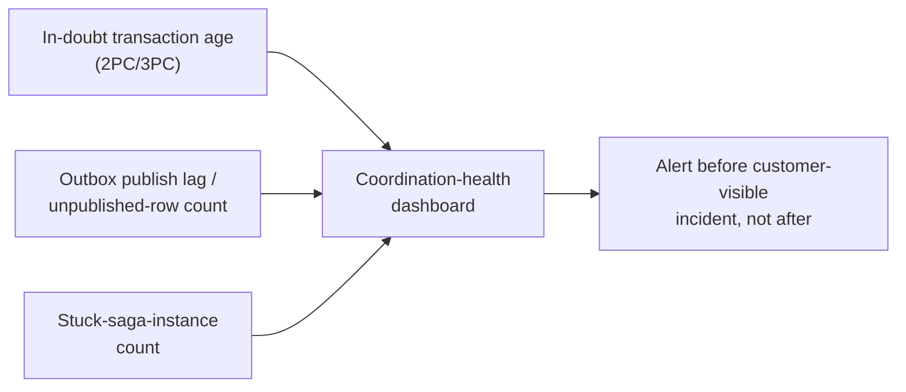

## 15. Failure Scenarios

- **Coordinator crash after prepare, before decision broadcast (2PC).**
  Every participant is in-doubt (Section 4.2); recovery requires either the
  coordinator's own crash-recovery log replay or, if the log is
  unrecoverable, a manual heuristic decision with an accepted risk of a
  heuristic mixed outcome.
- **Network partition at the PreCommit boundary (3PC).** Some participants
  self-commit, others self-abort — the exact split-brain outcome 3PC was
  designed to prevent, occurring specifically because 3PC's non-blocking
  proof assumes a crash-only failure model, not a partition-tolerant one
  (Section 4.3).
- **Outbox publisher stalls silently.** Business writes continue to
  succeed and look completely healthy from the writing service's
  perspective, while downstream consumers silently stop receiving events —
  detectable only by the publisher-lag metric in Section 14, never by
  the writing service's own health checks.
- **Saga orchestrator crash mid-workflow.** Unlike a 2PC coordinator crash,
  already-committed local transactions at each completed step remain
  committed; recovery means resuming or compensating from wherever the
  orchestrator's durable saga-state store left off (recapped from
  [Transactions](../06_Databases_and_Storage/CH08_Transactions.md) Section
  4.15), not blocking any participant.
- **A compensating action assumes a forward action's outcome is
  unambiguous.** A forward action can time out from the orchestrator's
  perspective while having actually committed remotely; a compensation
  written to assume "the forward action definitely happened" or
  "definitely didn't happen" (rather than "may or may not have happened,
  compensate defensively and idempotently") produces an incorrect
  double-compensation or a missed one.

## 16. Testing

Distributed-transaction coordination logic should be tested with explicit
chaos-style fault injection, not only happy-path unit tests: kill the
coordinator process at each of 2PC's/3PC's distinct phase boundaries and
assert the correct recovery behavior (in-doubt state and eventual correct
recovery for 2PC, self-commit-on-timeout for 3PC); simulate a partition at
the PreCommit boundary and assert 3PC's split-brain failure mode actually
reproduces (proving the test harness itself is capable of catching this
class of bug); kill an outbox publisher mid-batch and assert every consumer
correctly de-duplicates the resulting redelivery; and kill a saga
orchestrator mid-workflow and assert compensations correctly resume from
the durable saga-state store. Section 10's four code examples are written
specifically to make each of these fault-injection scenarios runnable and
observable directly, rather than only described in prose.

## 17. Common Mistakes

- **Writing sequential network calls to two systems and calling it "good
  enough" without recognizing the dual-write problem exists at all**
  (Section 4.1).
- **Reaching for XA/2PC by default for every cross-service write**, coupling
  services that were split apart specifically to be independent, without
  first attempting Section 4.6's boundary redesign.
- **Deploying an XA coordinator without a durable, fsync'd decision log**,
  turning a temporary in-doubt window into a permanently unrecoverable one
  (Section 4.2's common failure mode).
- **Choosing 3PC believing it fully solves 2PC's blocking problem**,
  without understanding its network-partition split-brain weakness
  (Section 4.3) — a genuinely dangerous half-understanding that is worse
  than knowingly accepting 2PC's simpler, better-understood blocking risk.
- **Building a full saga orchestrator for a single local-write-plus-one-
  event workflow**, where the transactional outbox pattern (Section 4.5)
  would have been strictly simpler and sufficient.
- **Writing non-idempotent compensating actions or consumers**, breaking
  under the at-least-once delivery guarantee every one of Section 4's
  asynchronous mechanisms actually provides.

## 18. Best Practices

- Explicitly name every distributed transaction in a system's architecture
  documentation, along with which of Section 4's mechanisms was chosen and
  why (Section 6).
- Attempt boundary redesign (Section 4.6) before reaching for any
  coordination mechanism.
- Default to the transactional outbox pattern (Section 4.5) for the
  single-write-plus-event shape; default to Saga (Section 4.4/CH13) for
  multi-step, compensable workflows; reserve 2PC/3PC (Sections 4.2-4.3) for
  small, well-controlled participant sets with a genuine strict-atomicity
  requirement.
- Build idempotency into every compensating action and every consumer of an
  at-least-once event stream as a non-negotiable requirement, not an
  optional hardening pass.
- Monitor in-doubt-transaction age, outbox publisher lag, and stuck-saga-
  instance count as first-class production signals (Section 14).
- Prefer a mature, battle-tested XA/JTA implementation or a NewSQL engine's
  native cross-node transaction over hand-rolling a 2PC or 3PC coordinator.

## 19. Anti-Patterns

- **The distributed monolith via synchronous cross-service 2PC.** Wiring
  every cross-service write through a shared XA coordinator to preserve a
  monolith's single-transaction mental model defeats the independent-
  failure-isolation reason microservices were adopted in the first place.
- **The silent dual write.** Two sequential, uncoordinated writes to
  independently-failing systems, with no outbox, saga, or coordination
  mechanism at all, relying on "it usually works" (Section 4.1).
- **The saga-as-distributed-monolith.** A saga orchestrator so tightly
  coupled to every participant's internal implementation detail (rather
  than only its public compensating-action contract) that it recreates the
  same coupling 2PC would have caused, just with extra steps.
- **Hand-rolled 3PC in production.** Given 3PC's residual partition
  weakness and the extra implementation complexity of a three-state
  participant machine, a team implementing 3PC from scratch for a
  production system, rather than reaching for a mature consensus-backed
  alternative, is very likely solving the wrong problem with the wrong
  tool.

## 20. Trade-off Analysis

| Mechanism | Atomicity strength | Availability | Coupling | Operational cost |
|---|---|---|---|---|
| 2PC | Strict, but blocking on coordinator crash | Low (coordinator is a synchronization point) | Tight (synchronous, cross-service locks) | Moderate — in-doubt-transaction monitoring/recovery |
| 3PC | Strict, non-blocking under crash-only failures; split-brain risk under partitions | Low-moderate | Tight | High — extra round trip, three-state participant machine, partition-risk awareness |
| Saga | Eventual (compensable), never strict | High (no cross-service locks) | Loose | Moderate — compensating-action design, saga-state durability |
| Transactional outbox | Eventual, at-least-once | High | Loose | Low-moderate — publisher/CDC pipeline, idempotent consumers |
| Boundary redesign | Whatever the resulting single-node transaction provides | Whatever the resulting single-node transaction provides | Depends on the new boundary | Design effort only, no runtime coordination cost |

## 21. Comparison Table

| Dimension | 2PC | 3PC | Saga | Outbox |
|---|---|---|---|---|
| Coordinator failure behavior | Blocks (in-doubt) | Non-blocking (crash-only model) | Non-blocking (no cross-service locks) | N/A (no synchronous coordinator) |
| Network partition behavior | Blocks | Split-brain risk | Degrades gracefully per step | Delivery delayed, not lost |
| Cross-service locks held | Yes, for full round trip | Yes, for full (longer) round trip | No | No |
| Intermediate visible states | No (all-or-nothing) | No | Yes | N/A (single local write) |
| Typical use case | Financial ledger posting, small participant set | Rarely used in production | Multi-step microservices workflow | Single write + reliable event |

## 22. Real-World Case Study

A mid-size logistics platform originally implemented order placement as a
synchronous XA/2PC transaction spanning the `orders`, `inventory`, and
`billing` services, chosen early on because it most closely resembled the
team's prior monolithic-database mental model. As the platform grew from
three to over a dozen services touched during checkout, the coordinator's
in-doubt-transaction rate rose sharply — not because any individual service
became less reliable, but because 2PC's blocking-window probability grows
with participant count (Section 12), and any one of a dozen services being
briefly slow during a deploy was now enough to stall the whole checkout
coordinator. The team's redesign, informed by exactly this chapter's
decision spectrum, split the problem three ways: `orders` and `inventory`
were recognized as genuinely always co-written together and merged back
into one service (Section 4.6's boundary redesign), eliminating one
distributed transaction entirely; the remaining checkout workflow (payment,
shipping-label creation, warehouse-pick-ticket generation) was rebuilt as an
orchestrated Saga with a durable saga-state store and defensively-written
compensations; and every service's downstream notifications (to analytics,
customer-notification, and search-indexing services) were rebuilt on the
transactional outbox pattern with a CDC connector. In-doubt-transaction
incidents dropped to zero (there was no longer a 2PC coordinator in the
checkout path at all), at the accepted cost of the checkout process now
taking a bounded number of additional milliseconds for its sequential saga
steps, and of every downstream consumer needing to be idempotent — a
trade the team judged, and post-incident data confirmed, was
overwhelmingly worth making.

## 23. Interview Questions

1. What specifically makes a transaction "distributed," and why doesn't a
   single node's ACID guarantee automatically extend across a service
   boundary?
2. Explain the dual-write problem with a concrete example, and explain why
   "just retry the second write if it fails" does not fully solve it.
3. Walk through 2PC's two phases, then explain precisely what an "in-doubt
   transaction" is and how a production transaction manager recovers from
   one.
4. What does Three-Phase Commit add over Two-Phase Commit, and under what
   specific failure condition does it still fail to prevent a split-brain
   outcome?
5. When would you choose a Saga over 2PC, and when would you choose the
   transactional outbox pattern over a full Saga?
6. Describe a design where the correct answer to "we have a distributed
   transaction problem" is to redesign the service boundary rather than add
   a coordination mechanism.
7. Why must every consumer of an outbox-published event, or every
   compensating action in a Saga, be idempotent?

## 24. Hands-on Exercises

1. Run this chapter's Example 1
   (`code/python/distributed-transactions-chapter/01_dual_write_problem_demo.py`)
   and observe the exact failure interleaving from Section 4.1 before the
   fix is applied.
2. Run Example 2's transactional outbox implementation, then deliberately
   kill the publisher mid-batch (per the script's instructions) and confirm
   the idempotent consumer correctly handles the resulting redelivery.
3. Run Example 3's 2PC simulation for all three of its scenarios (happy
   path, coordinator crash with successful log-replay recovery, and
   coordinator crash with an unrecoverable log requiring a heuristic
   decision) and describe, in your own words, exactly which state each
   scenario leaves every participant in.
4. Run Example 4's 3PC simulation for both its non-blocking-recovery
   scenario and its network-partition split-brain scenario, and explain why
   the same protocol produces two such different outcomes.
5. Modify Example 2's outbox publisher to introduce out-of-order
   publishing under concurrent writers, and observe (and then fix) the
   downstream ordering violation this chapter's failure-mode discussion
   warns about.

## 25. Design Exercises

1. Design the coordination strategy for a hotel-booking system that must
   atomically decrement room availability and create a reservation across
   two independently owned services — justify your choice among 2PC,
   Saga, outbox, or boundary redesign, referencing this chapter's decision
   spectrum (Section 3, Section 7).
2. Design a transactional-outbox architecture for a service that must
   commit an inventory adjustment and reliably notify three separate
   downstream consumers (pricing, analytics, and a search index), each
   with different tolerance for delivery latency.
3. Design monitoring and alerting for a production 2PC coordinator that
   specifically detects and pages on-call before an in-doubt-transaction
   incident becomes customer-visible.
4. A team proposes 3PC as their coordination mechanism specifically to
   "avoid 2PC's blocking problem." Write a short design memo either
   approving or pushing back on this proposal, referencing Section 4.3's
   partition weakness explicitly.
5. Design a boundary redesign for a system where a `Cart` service and a
   `Pricing` service currently require a distributed transaction on every
   cart mutation, following the worked scenario in Section 4.6.

## 26. Architecture Review Questions

1. For every cross-service or cross-shard write in this design, has the
   team explicitly identified it as a distributed transaction and chosen a
   specific mechanism from Section 4, rather than writing sequential calls
   without a named strategy?
2. Has boundary redesign (Section 4.6) been genuinely attempted and ruled
   out, with a documented reason, before any coordination mechanism was
   adopted?
3. If this design uses 2PC or 3PC, what is the maximum participant count,
   and is there monitoring in place for in-doubt-transaction age?
4. If this design uses a Saga, does every side-effecting step have a
   defined, idempotent, defensively-written compensating action, and is
   saga state durably tracked?
5. If this design uses the transactional outbox pattern, is the outbox-row
   insert genuinely part of the same local transaction as the business
   write, and is the publisher's lag monitored?
6. Are all consumers of any asynchronous event stream in this design built
   to tolerate at-least-once (duplicate) delivery?

## 27. Summary

Once a business operation's steps are physically scattered across
independently-failing services or database shards, a single node's ACID
guarantee no longer applies, and an architect must explicitly choose how to
restore some equivalent of it — or, better, ask whether the boundary that
created the problem should exist at all. Two-Phase Commit, fully taught by
[Transactions](../06_Databases_and_Storage/CH08_Transactions.md), gives
strict cross-node atomicity at the cost of becoming a blocking protocol
whose coordinator-crash failure mode produces the in-doubt transactions this
chapter's Section 4.2 showed how production transaction managers actually
detect and recover from, via durable logging, presumed abort, and, as a
last resort, an operator's heuristic decision. Three-Phase Commit closes
2PC's blocking gap under a crash-only failure model by adding a PreCommit
phase that lets every participant safely self-commit on timeout, but its
own split-brain vulnerability under a genuine network partition is the
reason it never displaced 2PC commercially. The Saga pattern, whose
mechanism [Transactions](../06_Databases_and_Storage/CH08_Transactions.md)
already teaches in full, trades strict atomicity for availability and loose
coupling by sequencing local transactions with compensating actions instead
of holding cross-service locks — this chapter placed it correctly on the
same decision spectrum as 2PC/3PC/outbox rather than re-teaching it, and
forward-referenced [Saga Pattern](CH13_Saga_Pattern.md) for its deepest
choreography-versus-orchestration and compensating-transaction-design
mechanics. The transactional outbox pattern solves the narrower, extremely
common dual-write problem — reliably publishing an event alongside a local
database write — by folding both into one single-node ACID transaction and
relying on an asynchronous publisher, sidestepping heavier coordination
machinery entirely for that specific shape. And the highest-leverage skill
of all is recognizing, before reaching for any of these mechanisms, whether
the distributed transaction is actually required by the business invariant,
or only by an accidental service or data boundary that redesign could
eliminate.

## Further Reading

- [Transactions](../06_Databases_and_Storage/CH08_Transactions.md) — full
  ACID/isolation/MVCC teaching, and the full mechanism-level 2PC and Saga
  treatment this chapter recaps rather than repeats.
- [Consensus](CH07_Consensus.md) — the formally harder agreement problem
  that Spanner/CockroachDB/YugabyteDB-style systems build their 2PC-over-
  consensus transactions on top of.
- [Leader Election](CH08_Leader_Election.md) — the general leader/
  coordinator-selection problem underlying who acts as a transaction
  coordinator in a highly available deployment.
- [Sharding](../06_Databases_and_Storage/CH06_Sharding.md) and
  [Partitioning](../06_Databases_and_Storage/CH05_Partitioning.md) — the
  horizontal data-distribution strategies that create cross-shard
  distributed transactions inside a single logical database.
- [Replication](../06_Databases_and_Storage/CH07_Replication.md) — the
  related-but-distinct problem of keeping copies of the *same* data
  consistent, whose streaming-replication log this chapter's outbox CDC
  variant taps into.
- `CH13_Saga_Pattern.md` — the dedicated sibling chapter (next in this
  part) for full choreography-versus-orchestration design depth and
  compensating-transaction craftsmanship (forward reference, not yet
  drafted at the time this chapter was authored).
- `CH16_Idempotency.md` and `CH17_Exactly_Once_Processing.md` — the
  general idempotency and delivery-guarantee theory every mechanism in
  this chapter depends on (forward references, not yet drafted at the time
  this chapter was authored).
- `CH14_CQRS.md` — the read/write-side separation pattern this chapter's
  Section 4.6 single-writer-ownership technique is a special case of
  (forward reference, not yet drafted at the time this chapter was
  authored).
