# Chapter 13: Saga Pattern

## 1. Introduction

A **Saga** is a way of achieving a business-level outcome that spans multiple
independently owned services without ever holding a single, system-wide
distributed lock. Instead of one atomic cross-node transaction, a saga is a
sequence of local transactions, each committed on a single service's own
database, where every step that has a side effect defines a **compensating
transaction** — a semantically inverse action invoked if a later step fails.

This chapter assumes you have already read the mechanism-level treatment in
[Transactions](../06_Databases_and_Storage/CH08_Transactions.md) Section
4.15 (choreography vs. orchestration, the basic definition of a compensating
transaction) and the system-design placement in
[Distributed Transactions](CH12_Distributed_Transactions.md) Section 4.4
(when to reach for a saga instead of 2PC/3PC or the transactional outbox
pattern). Neither of those chapters teaches what a production saga
implementation actually looks like once the happy-path diagram is no longer
enough: how does an orchestrator survive its own crash mid-workflow? What
happens when a compensating action cannot literally undo its forward step
because a courier has already physically collected a package? How do you
even tell, from a dashboard, whether saga instance `order-48213` is healthy,
stuck, or silently corrupting data? This chapter owns exactly that layer —
**production-grade saga orchestrator design, compensating-transaction
craftsmanship, saga-specific failure-recovery patterns, and saga
observability/testing** — the pattern-library depth a staff engineer needs
to actually build and operate a saga in production, not just recognize the
pattern in a system-design interview.

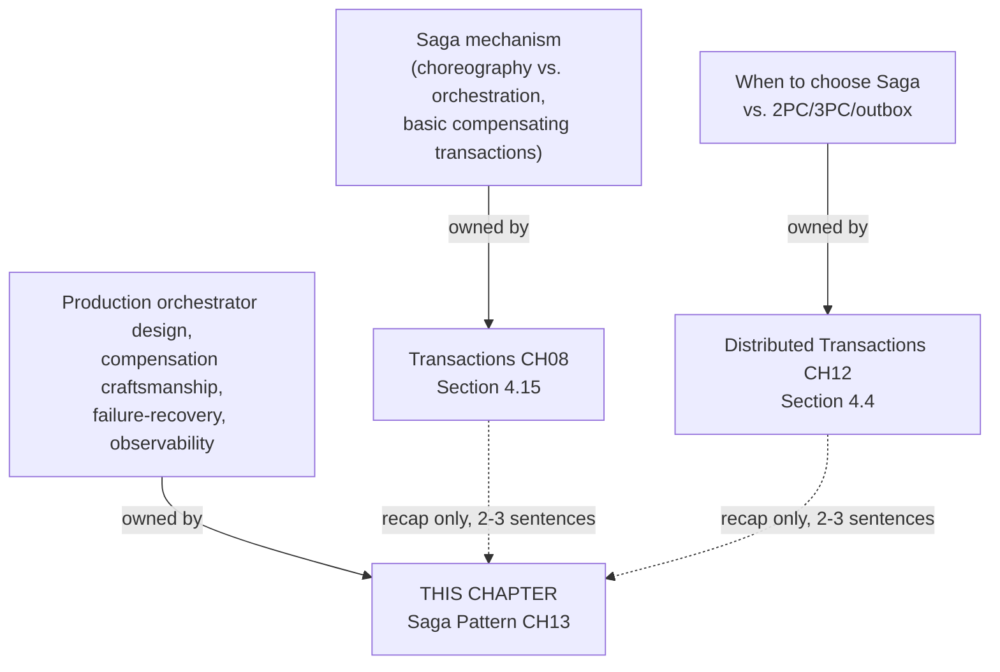

## 2. Historical Evolution

The term "Saga" for a long-lived business transaction predates
microservices by more than two decades. Hector Garcia-Molina and Kenneth
Salem introduced Sagas in their 1987 paper *Sagas*, proposing them as a way
to break a single, long-running database transaction into a sequence of
shorter sub-transactions with compensations, specifically to avoid holding
locks for the whole duration of a long transaction inside **one** database
system. The original motivation had nothing to do with distributed
microservices — it was about reducing lock contention inside a single
relational engine running long batch-style transactions.

The pattern was dormant in mainstream architecture literature through the
1990s and early 2000s, resurfacing as Service-Oriented Architecture (SOA)
and later microservices made cross-service coordination a routine
architectural problem rather than a niche one. Chris Richardson's writing
and conference talks (roughly 2015 onward, later consolidated into his book
*Microservices Patterns*) are the most direct lineage for how the pattern is
taught today: he reframed the 1987 Saga concept specifically for
microservices, formalized the choreography-versus-orchestration structural
split, and popularized the orchestrator-with-a-durable-state-store design
that production implementations converge on. Frameworks like Netflix
Conductor (open-sourced 2016), Camunda/Zeebe, AWS Step Functions, and
Temporal (spun out of Uber's Cadence in 2019) are the direct descendants of
that reframing — each is, at its core, a durable saga-orchestrator runtime.

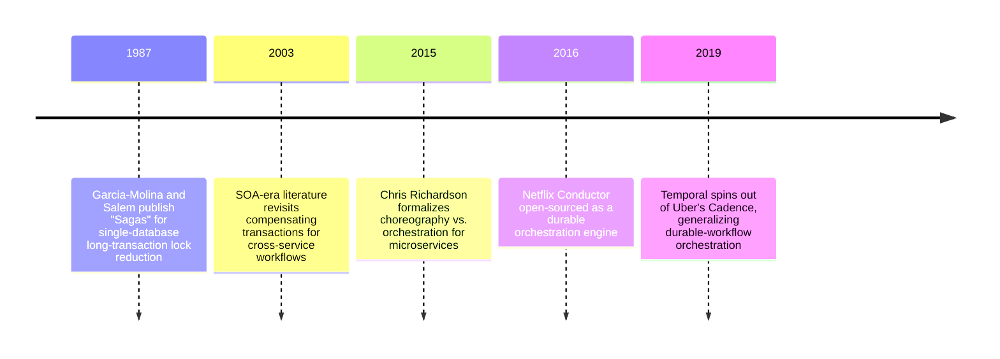

## 3. Why It Exists

Once a business capability spans services that each own their own database
— the entire premise of microservice architecture — no single ACID
transaction can span all of them without either (a) a distributed
transaction coordinator that blocks participants across a network (2PC/3PC,
already shown in
[Distributed Transactions](CH12_Distributed_Transactions.md) to trade
availability for atomicity) or (b) accepting eventual consistency and
designing explicitly around it. The Saga pattern exists to make option (b)
tractable: instead of pretending a multi-service workflow is one
transaction, it names the workflow's individual local transactions
explicitly, and forces the architect to design an explicit, testable answer
to "what do we do if step 3 fails after steps 1 and 2 already committed?"
for every single step, up front, rather than discovering the answer during
an incident.

The reason this chapter exists as a *separate* chapter from Transactions
CH08 and Distributed Transactions CH12 is that "know what a saga is"
(CH08) and "know when to choose a saga" (CH12) are necessary but
insufficient for actually running one in production. A saga orchestrator is
itself a piece of production software with its own failure modes — it needs
a durable state store, a retry policy per step, a way to classify failures
as retriable or not, a way to escalate the cases automation cannot resolve,
and a way for an operator to see, at 3 a.m., exactly which of 40,000 saga
instances are stuck and why. Those are pattern-library-level engineering
concerns, not conceptual ones, and that gap is what this chapter closes.

## 4. Core Concepts

### 4.0 Recap of concepts owned elsewhere (read first)

**Saga mechanism (owned by
[Transactions](../06_Databases_and_Storage/CH08_Transactions.md) Section
4.15).** A saga replaces one atomic cross-service transaction with a
sequence of local transactions, each with a compensating transaction to
semantically undo it. **Choreography** has no central coordinator — each
service reacts to events published by the previous one. **Orchestration**
has a central orchestrator that explicitly calls each step and owns
compensation sequencing. Read that section first if you have not: this
chapter builds directly on top of it and does not re-derive it.

**When to choose Saga over 2PC/3PC/outbox (owned by
[Distributed Transactions](CH12_Distributed_Transactions.md) Section 4.4).**
Choose a saga when a workflow has multiple sequential steps across
independently owned services, each step's side effect can realistically be
compensated, and the business can tolerate the intermediate, partially
applied states a saga necessarily exposes. If the requirement is narrower —
one local write that must reliably trigger one downstream notification —
the simpler transactional outbox pattern (CH12 Section 4.5) is the correct
tool, not a full saga orchestrator.

**Idempotency (forward reference to the sibling
[Idempotency](CH16_Idempotency.md) chapter, this same batch).** Every saga
step and every compensating action must be safe to execute more than once
with the same effect as executing it exactly once, because network
ambiguity means an orchestrator can never be certain whether a timed-out
call actually executed remotely. Section 4.5 below revisits this
specifically at the saga level; the full idempotency-key mechanism,
request-deduplication store design, and natural-vs-synthetic idempotency
key selection are that chapter's to teach in depth.

### 4.1 Production saga orchestrator design: state machine and state store

**Definition.** A production saga orchestrator is a long-running,
crash-tolerant state machine: at any instant, a saga instance occupies
exactly one of a small, fixed set of states, and the orchestrator's entire
job is to durably record which state each instance is in and to drive valid
transitions between states, re-deriving "what should happen next" purely
from the last durably recorded state rather than from any in-memory
variable that a crash would lose.

**Mechanism.** The state machine has, at minimum, these states: `RUNNING`
(steps are still being executed forward), `COMPENSATING` (a failure
triggered backward compensation), `COMPLETED` (every step succeeded),
`COMPENSATED` (every completed step was successfully undone), and `FAILED`
(a step failed at or after the pivot point and cannot be compensated —
Section 4.3 defines pivot steps in depth). Each saga *instance* additionally
tracks, per step, one of `PENDING`, `COMPLETED`, `COMPENSATED`, or `FAILED`.
Crucially, every state transition is written to a durable **saga state
store** — a database table, not an in-memory dictionary — *before* the
orchestrator proceeds to the next action, using exactly the write-ahead
discipline Transactions CH08 Section 5 taught for a single engine's WAL:
record the intent durably, then act, so that a crash between "recorded" and
"acted" can always be safely retried without ambiguity about whether the
recorded step already executed.

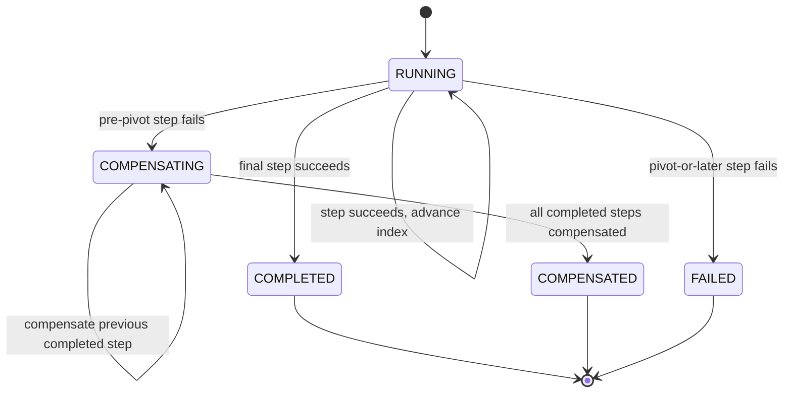

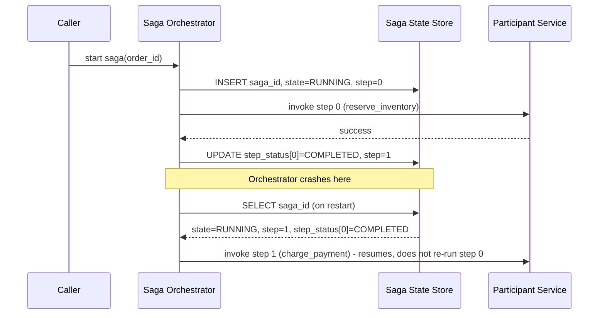

**Decision implications.** Because the orchestrator re-derives its next
action entirely from the state store, the orchestrator process itself
becomes stateless and horizontally scalable — any orchestrator worker
instance can pick up any saga instance's next step purely by reading its
current row, which is exactly why frameworks like Temporal, AWS Step
Functions, and Netflix Conductor separate "the workflow definition" from
"the workflow execution engine": the engine is just a fleet of stateless
workers polling a durable state store. This also means the state store's
schema (saga id, current state, current step index, per-step status,
saga-level context payload) is itself a piece of production API surface
that must be versioned carefully, because in-flight saga instances are
running against whatever schema existed when they started — a schema
migration that drops a column a `RUNNING` saga still references will strand
that instance.

**Failure mode.** A common mistake is keeping saga progress only in
process memory (or in a message queue's implicit position) rather than in
a queryable, durable store. This makes two things impossible: resuming a
crashed orchestrator's in-flight sagas (they simply vanish, silently
leaving inventory reserved with no payment ever charged or refunded), and
answering the operational question "how many saga instances are currently
stuck in `COMPENSATING`?" without replaying an entire event log by hand.

**Scenario.** An orchestrator process handling 500 concurrent order sagas
is killed mid-deployment by a rolling restart. Because every state
transition was durably written before the corresponding action, the
replacement orchestrator process starts up, queries the state store for
every saga instance in `RUNNING` or `COMPENSATING` state, and resumes each
one from its last completed step index — no saga is lost, none is
accidentally re-run from step 0, and no customer is double-charged.

### 4.2 Compensating-transaction craftsmanship: semantic vs. literal compensation, and non-reversible actions

**Definition.** Not every compensating transaction is "the forward action
run backward." There are three distinct categories a saga designer must
classify every side-effecting step into: **literal compensation** (the
forward effect can be exactly undone within the same domain, e.g.
incrementing a counter back after decrementing it), **semantic
compensation** (the forward effect cannot be undone, but an equivalent
corrective action restores the business invariant, not the literal prior
state), and **non-reversible actions** (the forward effect has an
irreversible real-world consequence, and no automated compensation exists
at all).

**Mechanism.** Literal compensation is the easy, mechanical case: "reserve
inventory" pairs with "release inventory," and both operate on the same
row in the same database, so the compensation is a straightforward inverse
SQL statement or API call. Semantic compensation requires the designer to
step back from "undo this exact action" to "what corrective action, given
that this one cannot be undone, restores the customer's and the business's
expectations?" — sending a confirmation email cannot be unsent, so the
compensation is a *different* email ("your order was cancelled, here is
your refund confirmation") that produces an equivalent-but-not-identical
end state. Non-reversible actions require the designer to accept, in
advance, that no code path exists to auto-compensate, and to design an
explicit **escalation path** instead — routing the failed saga instance to
a dead-letter queue or an operator-facing manual-intervention workflow
(Section 4.3 covers this escalation mechanism in depth) rather than letting
the orchestrator either silently swallow the failure or retry a compensation
that can never succeed.

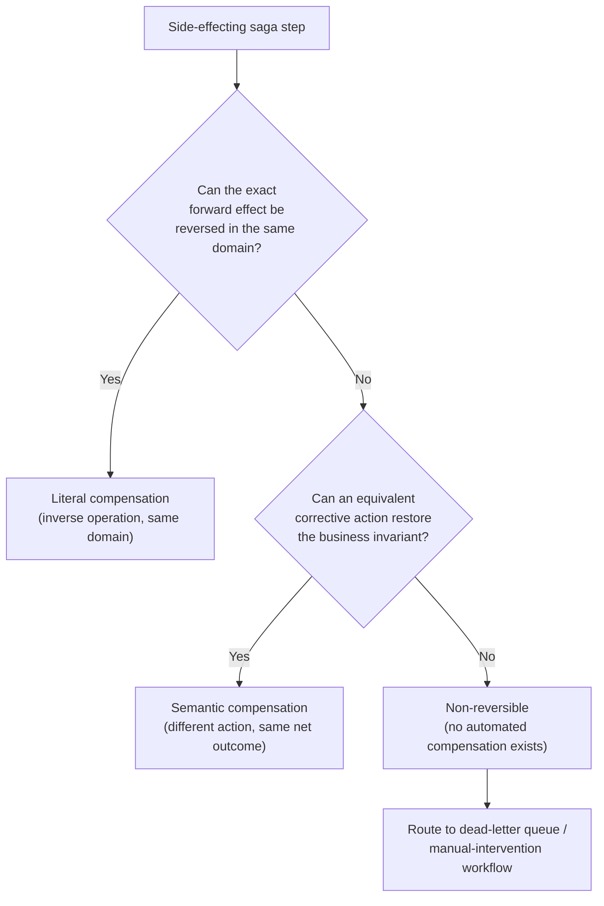

**Decision implications.** Classifying every step at design time — before
the saga is deployed, not during an incident — forces two disciplines: (1)
every literal and semantic compensation must be written idempotently, since
a compensation can itself be retried after a partial failure (a compensation
that assumes "the reservation definitely still exists" will error out on a
second attempt if the first attempt actually succeeded but the
acknowledgment was lost); and (2) every non-reversible step must have a
pre-agreed escalation owner and Service Level Agreement (SLA), because
"automated compensation" is simply not an option for that step's failure
mode, and pretending otherwise means the failure gets discovered by a
customer complaint instead of a monitored queue.

**Common failure mode.** Writing a compensation that assumes the forward
action either fully succeeded or fully failed, with no in-between. In
reality a forward action can time out from the orchestrator's perspective
while it actually committed on the remote side — a classic network
ambiguity — so every compensation must be written defensively ("release
this reservation *if it exists*," not "release this reservation, which
definitely exists") and must itself be idempotent, exactly as Transactions
CH08 Section 4.15's failure mode already warned for the basic mechanism;
this chapter's addition is that *literal* and *semantic* compensations both
need this defensive idempotent design, and *non-reversible* steps need an
escalation SLA instead of a compensation at all.

**Scenario.** An order saga has three side-effecting steps: reserve
inventory (literal), send order-confirmation email (semantic), and dispatch
courier pickup (non-reversible once the courier has physically collected
the package). A downstream fraud check fails after all three steps have
run. The orchestrator releases the inventory reservation (literal), sends a
cancellation-and-refund email superseding the earlier confirmation
(semantic), and — because the package is already in the courier's
possession — routes the saga instance to a reverse-logistics dead-letter
queue for a human operator to initiate an intercept-in-transit request,
rather than attempting (and failing) to auto-compensate a physical pickup
that already happened. See
[`02_compensating_transaction_craftsmanship.py`](../code/python/saga-pattern-chapter/02_compensating_transaction_craftsmanship.py)
for a runnable version of exactly this classification and escalation flow.

### 4.3 Saga failure-recovery patterns: pivot transactions, retriable vs. non-retriable steps, dead-letter escalation

**Definition.** A **pivot transaction** is the step in a saga after which
the workflow is committed to moving forward — it is the last point at which
backward compensation is still a valid recovery strategy. Before the pivot,
a step failure triggers compensation of everything already completed;
at or after the pivot, a step failure can only be retried forward or
escalated, never compensated backward, because either the pivot step itself
has an irreversible real-world effect, or a later, non-compensable step has
already executed.

**Mechanism.** Identifying the pivot step is a design-time decision, not a
runtime one: the architect walks the saga's step sequence and marks the
first step whose effect cannot be compensated (Section 4.2's
non-reversible category, or a step business rules simply forbid reversing,
such as "payment has settled with the acquiring bank"). Every step before
the pivot is compensable and participates in backward recovery; every step
at or after the pivot is **forward-only** — a failure there must be retried
(if the failure is classified as retriable) or escalated to a dead-letter
queue for manual intervention (if retries are exhausted or the failure is
classified as non-retriable), because there is no valid backward path left.
This requires classifying every failure a step can produce into
**retriable** (transient — a network timeout, a 503 from a dependency, a
temporary lock conflict) or **non-retriable** (permanent — a validation
failure, a business-rule violation, a 4xx-class rejection) *before*
deciding how many times and how aggressively to retry it; retrying a
non-retriable failure wastes time and can mask the real problem, while
failing fast on a retriable one causes unnecessary saga failures for
conditions that would have resolved themselves.

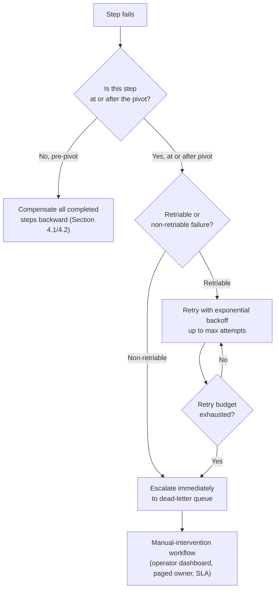

**Decision implications.** Placing the pivot as early as possible in the
sequence maximizes the fraction of failures that can be automatically
compensated rather than escalated, so architects should order steps to push
non-reversible actions (physical shipment, an external payment settlement,
an irrevocable regulatory filing) as late as the business logic allows —
every step ahead of that point stays cheaply and automatically recoverable.
A dead-letter queue is not merely a place failed messages go to die; it
must be paired with an operator-facing workflow (a dashboard listing stuck
instances with enough context to act, an on-call rotation with an SLA for
response time, and a way to manually mark an instance resolved once a human
has taken the corrective action) or it becomes an invisible pile of
silently abandoned business transactions.

**Common failure mode.** Treating every failure as retriable with a fixed
retry count regardless of error type, which causes two distinct problems:
non-retriable failures (a permanently invalid shipping address) burn
through the full retry budget before finally escalating, delaying the
correct outcome; and retriable failures near the pivot without a
sufficiently generous retry budget escalate to manual intervention for
conditions (a brief carrier API outage) that would have resolved within
seconds on the next attempt, flooding the manual-intervention queue with
false positives an operator has to triage under load.

**Scenario.** A courier-dispatch step (the saga's pivot, since a physically
collected package cannot be un-collected) experiences a five-minute carrier
API outage. The orchestrator correctly classifies the resulting errors as
retriable, retries with exponential backoff across the outage window, and
succeeds on the sixth attempt without ever escalating — versus a
misconfigured saga that treats the same failure as immediately
non-retriable, escalating hundreds of in-flight orders to a human queue for
a problem that resolved itself. See
[`03_saga_failure_recovery_patterns.py`](../code/python/saga-pattern-chapter/03_saga_failure_recovery_patterns.py)
for a runnable demonstration of all three classification outcomes
(transient-succeeds, permanent-fails-fast, post-pivot-exhausts-and-escalates).

### 4.4 Saga observability: distributed tracing across saga steps

**Definition.** Saga observability is the operational ability to answer,
for any saga instance and for the saga type as a whole, "what state is this
in, how long has each step taken, where exactly did it fail, and how many
instances are currently stuck?" — questions a saga's durable state store
(Section 4.1) can answer for a single instance in isolation, but which
require **distributed tracing** to answer across the multiple services a
single saga instance actually calls, because each step's execution happens
inside a different service's own process and log stream.

**Mechanism.** Every saga instance is assigned one **trace identifier**
(trace ID) at the moment it starts, and that trace ID is propagated as
metadata on every call the orchestrator makes to every participant service
— exactly the same trace-context-propagation mechanism used for ordinary
request tracing, applied to a workflow that can span minutes or hours
instead of milliseconds. Each step execution becomes one **span** — a
named, timed unit of work tagged with the shared trace ID, its own start
and end timestamps, and its outcome (success, retry, failure, compensated)
— so a tracing backend (Jaeger, Tempo, or a cloud provider's distributed
tracing service) can reconstruct the entire saga instance's timeline as one
connected trace, even though the individual spans were emitted by different
services at different times.

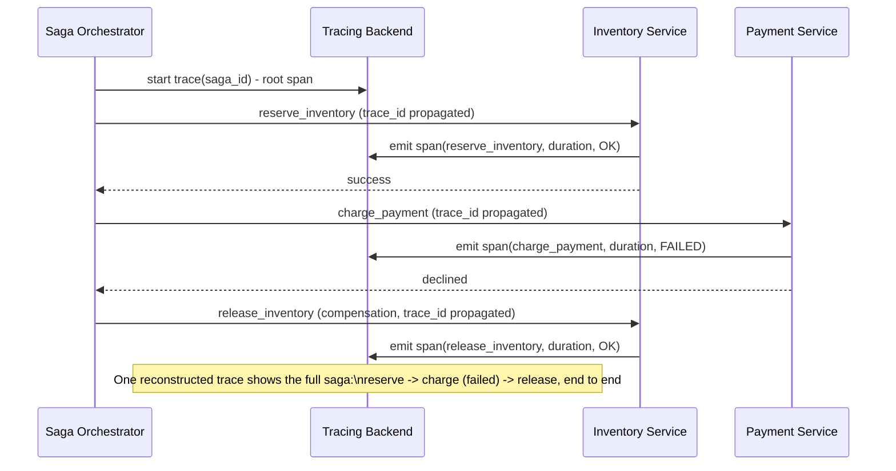

**Decision implications.** Because a saga instance can legitimately remain
in a non-terminal state for a long time — minutes for a fast-moving order
saga, potentially days for a saga involving human approval steps — saga
observability requires two dashboards a request-scoped trace alone does not
give you: a **per-instance timeline** (the trace view above, for debugging
one specific stuck or failed instance) and an **aggregate health view**
across all instances of a saga type — count currently `RUNNING`, count
`COMPENSATING`, count stuck longer than an expected Service Level Objective
(SLO), and count sitting in the dead-letter queue. The aggregate view is
what actually pages an on-call engineer; the per-instance trace is what
that engineer opens next to diagnose the specific failure.

**Failure mode.** Treating each step's own service-level logs as sufficient
observability, without a shared trace ID linking them. This makes it
impossible to answer "show me everything that happened to saga instance
`order-48213`" without manually correlating timestamps across every
participant service's independent log stream — exactly the same failure
mode ordinary microservice request tracing solves for a single request,
except worse, because a saga's steps are spread across a much longer
window and separated by asynchronous retries and compensations that make
timestamp-based correlation unreliable.

**Scenario.** A customer reports an order stuck "processing" for ten
minutes. An operator searches the tracing backend by the saga's trace ID
(surfaced in the orchestrator's own dashboard, itself keyed by the saga
state store's primary key) and immediately sees the full timeline: inventory
reservation succeeded in 40 milliseconds, payment charging failed twice
with a timeout before succeeding on a third attempt, and the shipment
dispatch step has been retrying every 30 seconds against a carrier API that
is returning 500s — all visible as one connected trace instead of three
separate service teams each checking their own logs and reporting "looks
fine on our end." See
[`04_saga_observability_and_idempotency.py`](../code/python/saga-pattern-chapter/04_saga_observability_and_idempotency.py)
for a minimal, runnable stand-in for a tracer emitting exactly these spans.

### 4.5 Saga-and-idempotency interplay

**Definition.** Idempotency — the property that executing an operation
more than once produces the same effect as executing it exactly once — is
not optional for a saga's steps or compensations; it is a structural
requirement, because the orchestrator can never be certain, after a timeout,
whether a step's forward or compensating action actually executed remotely
before the acknowledgment was lost. This section recaps only the
saga-specific implication; the general idempotency-key mechanism,
request-deduplication store design, and natural-vs-synthetic key selection
guidance are owned in full by the sibling
[Idempotency](CH16_Idempotency.md) chapter, drafted in this same batch.

**Mechanism.** Every step invocation the orchestrator makes must carry an
**idempotency key** derived from the saga instance's identity and the step
name (not from the attempt number, since every retry of the same logical
step must reuse the same key), so the receiving service can recognize "I
have already processed this exact request" and return the previously
recorded outcome instead of re-executing the side effect. The same
requirement applies symmetrically to compensating actions: a compensation
retried after its own partial failure must produce the same end state,
whether it runs once or five times.

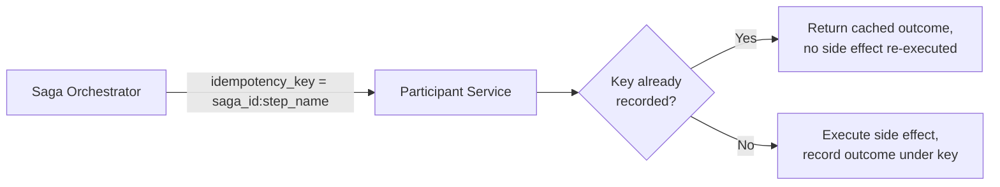

**Decision implications.** Because the same key must survive across
retries that can be separated by the orchestrator's own crash and restart
(Section 4.1), the idempotency key itself must be derived deterministically
from durable saga state, not generated fresh per attempt in memory — this
is exactly why Section 4.1's state store schema needs to durably persist
enough context (saga id, step name) for the orchestrator to reconstruct the
same key after a crash, rather than treating idempotency as a purely
in-process concern.

**Common failure mode.** Generating a new idempotency key on every retry
attempt (for example, keying on a UUID minted per HTTP call rather than per
logical step), which defeats the entire purpose of the mechanism — the
downstream service sees each retry as a brand-new request and executes the
side effect again, silently reintroducing the double-charge or
double-reservation bug idempotency exists to prevent.

**Scenario.** The orchestrator calls the payment service's `charge_payment`
endpoint, the call times out from the orchestrator's perspective, and the
retry policy (Section 4.1) fires a second attempt using the same
`{saga_id}:charge_payment` idempotency key. The payment service recognizes
the key from its first (successful, but slow-to-acknowledge) attempt and
returns the cached "charged" outcome without charging the card twice — the
saga proceeds correctly even though the network made it impossible for the
orchestrator to know, at the moment of the timeout, whether the first
attempt had actually succeeded.

## 5. Internal Working

Putting Sections 4.1 through 4.5 together, a production saga orchestrator's
internal request-handling loop looks like this end to end:

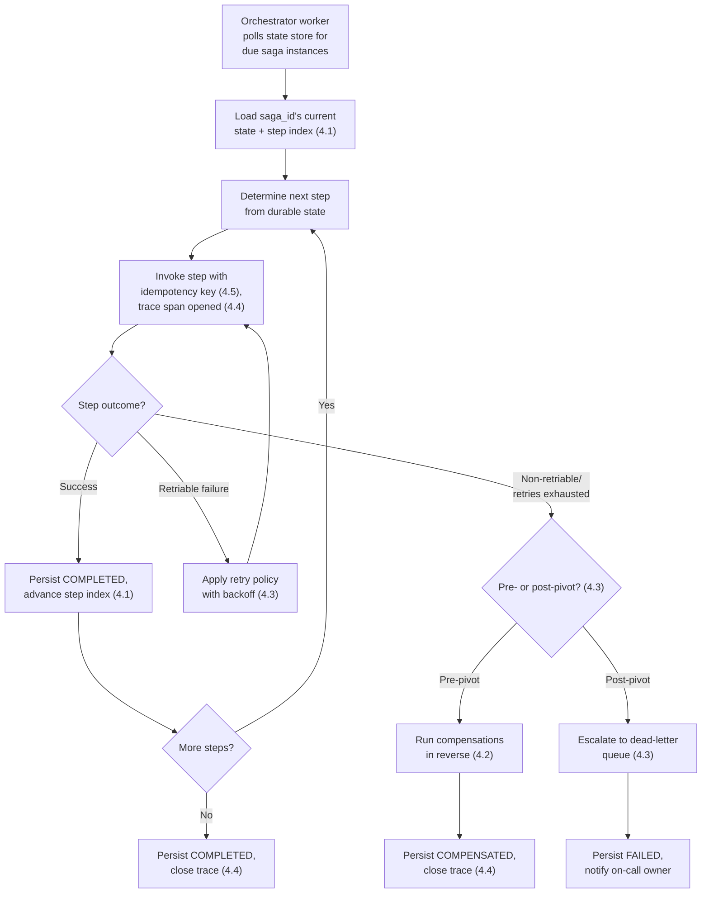

The worker-poll design (rather than a single long-lived in-memory process
per saga instance) is what makes the orchestrator itself horizontally
scalable and independently deployable from the participant services it
calls: any stateless worker process can pick up any due saga instance
purely by querying the state store, exactly the property Section 4.1 called
out as the payoff of durable, re-derivable state.

## 6. Design Principles

- **Mark exactly one pivot step, as early in the sequence as possible.**
  Every step before it stays cheaply, automatically compensable; pushing
  non-reversible actions as late as business logic allows maximizes the
  fraction of failures the system recovers from without a human.
- **Classify every failure mode a step can produce as retriable or
  non-retriable before deploying the saga**, not while debugging an
  incident — this decision drives both the retry policy and how urgently a
  failure should escalate.
- **Every step and every compensation must be idempotent**, keyed on the
  saga instance and step identity, never on a per-attempt value (Section
  4.5) — recapped in depth by the sibling
  [Idempotency](CH16_Idempotency.md) chapter.
- **Treat the saga state store as a schema with backward-compatibility
  obligations**, since in-flight saga instances run against whatever schema
  existed when they started; a migration that a `RUNNING` instance cannot
  tolerate will strand it.
- **Pair every dead-letter queue with an operator-facing workflow and an
  SLA**, not just a place failed messages accumulate — an unmonitored
  dead-letter queue is an invisible backlog of abandoned business
  transactions.
- **Propagate one trace ID for the whole saga instance's lifetime**, not a
  fresh one per step, so a single connected trace reconstructs the entire
  workflow across every participant service it touches.

## 7. Architecture Patterns

- **Orchestration-first for anything with a pivot step or more than a
  handful of steps.** Choreography's implicit, emergent workflow shape
  becomes difficult to reason about precisely where this chapter's added
  depth matters most — knowing which step is the pivot, what the current
  retry state is, and where to escalate requires one place that holds the
  whole picture, which is the orchestrator's state store by design.
- **Orchestrator-as-a-workflow-engine pattern.** Rather than hand-rolling
  the state machine, retry policy, and state store described in Section
  4.1, production systems commonly adopt a dedicated durable-workflow
  engine (Temporal, AWS Step Functions, Netflix Conductor, Camunda/Zeebe)
  that provides exactly this machinery as a reusable runtime, letting teams
  write step logic and compensation logic without re-implementing crash
  recovery, retry backoff, and state persistence from scratch.
- **Dead-letter-queue-as-first-class-citizen pattern.** The dead-letter
  destination is modeled as its own bounded context with a dashboard, an
  owner, and an SLA — not as an afterthought table nobody queries — because
  Section 4.3 established it as the mandatory escalation path for
  non-reversible and retry-exhausted failures.

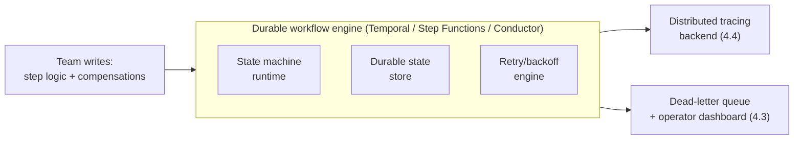

## 8. Production Architecture

A production saga deployment typically separates three concerns into three
independently scalable components: the **orchestrator worker fleet**
(stateless processes polling the state store, per Section 5's loop), the
**saga state store** (a dedicated, highly available database — often a
separate database from any single participant service's own database, to
avoid coupling the saga engine's availability to any one participant), and
the **participant services** themselves (each exposing an idempotent
step-execution endpoint and, where relevant, a compensation endpoint).

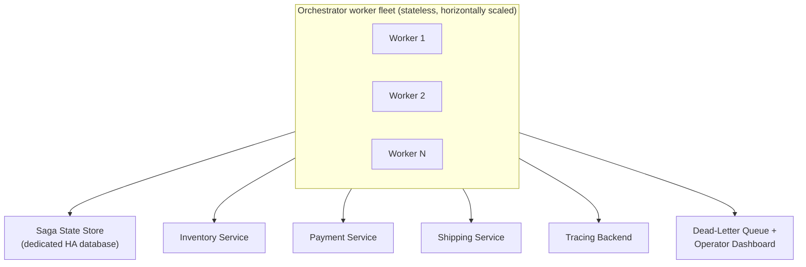

The state store's availability requirement is often stricter than any
single participant's: if the state store is unreachable, no orchestrator
worker can safely decide what to do next for *any* saga instance, so it is
common to run this store with its own dedicated replica set and stricter
durability guarantees (synchronous replication, per
[Replication](../06_Databases_and_Storage/CH07_Replication.md)) than a
typical participant's own database might use.

## 9. Implementation

Implementing the design from Sections 4-8 requires four concrete building
blocks, each demonstrated in Section 10's code examples: (1) a `SagaStep`
definition that pairs a forward action with its compensation, retry policy,
timeout, and pivot flag; (2) a durable `SagaStateStore` abstraction (backed,
in production, by a real database table rather than the in-memory
dictionary the demo code uses for clarity); (3) a compensation-classification
scheme (literal/semantic/non-reversible) attached to each step at design
time; and (4) a tracer that tags every step invocation with the saga's
shared trace ID and an idempotency key derived from `{saga_id}:{step_name}`.

## 10. Complete Code Examples

All four examples are runnable, dependency-free Python (standard library
only) under
[`code/python/saga-pattern-chapter/`](../code/python/saga-pattern-chapter/):

1. [`01_saga_orchestrator_state_machine.py`](../code/python/saga-pattern-chapter/01_saga_orchestrator_state_machine.py)
   — a production-shaped saga orchestrator: explicit state machine, durable
   state store, exponential-backoff retry policy, timeout handling, and a
   crash-recovery scenario that resumes a saga instance from a
   mid-workflow durable state instead of restarting from step 0.
2. [`02_compensating_transaction_craftsmanship.py`](../code/python/saga-pattern-chapter/02_compensating_transaction_craftsmanship.py)
   — classifies a catalog of steps into literal, semantic, and
   non-reversible compensation categories, and routes the non-reversible
   step to a dead-letter queue instead of attempting an impossible
   automated compensation.
3. [`03_saga_failure_recovery_patterns.py`](../code/python/saga-pattern-chapter/03_saga_failure_recovery_patterns.py)
   — demonstrates retriable-succeeds, non-retriable-fails-fast, and a
   post-pivot step that exhausts its retry budget and escalates to a
   dead-letter queue rather than attempting backward compensation.
4. [`04_saga_observability_and_idempotency.py`](../code/python/saga-pattern-chapter/04_saga_observability_and_idempotency.py)
   — a minimal in-process stand-in for a distributed tracer emitting one
   span per saga step under a shared trace ID, plus an idempotency-key
   store preventing a retried step from double-charging a payment.

Every example was executed end to end during authoring; none require
network access or external services.

## 11. Performance

The orchestrator's polling interval directly trades latency for load: a
short poll interval (sub-second) makes step transitions feel near-instant
but increases read load on the state store proportional to the number of
in-flight saga instances, while a longer interval (seconds) reduces load at
the cost of added end-to-end saga latency. Production systems commonly use
a hybrid: a fast, event-driven trigger for the common case (a step's
completion event immediately wakes the next poll for that specific saga
instance) with a slower fallback poll (catching missed events, stuck
timeouts) running at a coarser interval. The idempotency-key lookup
(Section 4.5) itself must be a fast, indexed point lookup — if it becomes a
full-table scan under load, it can become the saga's own bottleneck,
ironically defeating the purpose of a pattern designed to avoid holding
locks.

## 12. Scalability

Because orchestrator workers are stateless and re-derive everything from
the state store (Section 4.1), scaling the orchestrator fleet horizontally
is straightforward — add workers, and each competes to claim due saga
instances (typically via a `SELECT ... FOR UPDATE SKIP LOCKED`-style claim
query or an equivalent lease mechanism, recapping
[Locking](../06_Databases_and_Storage/CH10_Locking.md)'s pessimistic
concurrency control pattern applied to work-queue claiming rather than
row-level business data). The state store itself is the harder scaling
problem: it is a single logical database of record for every in-flight saga
across the whole system, and at very high saga-instance volume it may need
the same partitioning/sharding treatment
([Partitioning](../06_Databases_and_Storage/CH05_Partitioning.md),
[Sharding](../06_Databases_and_Storage/CH06_Sharding.md)) as any other
high-throughput transactional table, typically sharded by saga type or by a
hash of the saga ID.

## 13. Security

Every participant service's step-execution and compensation endpoints must
authenticate the orchestrator's calls (mutual Transport Layer Security
(TLS), per [TLS](../05_Networking_and_OS/CH06_TLS.md), or a signed
service-to-service token) — an unauthenticated compensation endpoint is a
direct path to fraud, since an attacker who can call "release_inventory" or
"refund_payment" arbitrarily can manufacture free inventory or reverse
legitimate charges. Idempotency keys (Section 4.5) must also not be
guessable or attacker-controlled in a way that lets a malicious caller reuse
another customer's key to read that customer's cached outcome; deriving the
key from a server-issued saga ID (never a client-supplied value) closes
that gap.

## 14. Observability

Section 4.4 covered the distributed-tracing mechanism in depth. In
addition, production dashboards for a saga type should surface, at
minimum: count of instances in each state (`RUNNING`, `COMPENSATING`,
`COMPLETED`, `COMPENSATED`, `FAILED`), the age of the oldest non-terminal
instance (a proxy for stuck sagas), dead-letter-queue depth and its own
age-of-oldest-item metric, and per-step latency percentiles (recapping
[Non-Functional Requirements](CH02_Non_Functional_Requirements.md)'
p50/p95/p99 framing) to catch a specific step silently degrading before it
starts timing out and triggering compensations across the fleet.

## 15. Failure Scenarios

- **Orchestrator crashes mid-step with the durable state not yet updated.**
  On restart, the replacement worker re-reads the last durably recorded
  state and retries the same step — correct only because the step (and its
  idempotency key) is safe to invoke again (Section 4.5).
- **A compensation itself fails.** The orchestrator must retry the
  compensation with the same retriable/non-retriable classification logic
  as forward steps (Section 4.3); a compensation that exhausts its retry
  budget must also escalate to the dead-letter queue, since an
  un-compensated pre-pivot step is just as much an inconsistency as an
  un-compensable post-pivot one.
- **The saga state store itself becomes unavailable.** No orchestrator
  worker can safely decide what to do next for any instance; this is why
  the state store's own availability design (Section 8) is often held to a
  stricter Service Level Agreement (SLA) than any individual participant.
- **A step's idempotency key collides across two logically distinct saga
  instances** (a key-derivation bug, not a network retry). One saga
  instance silently receives another's cached outcome — this is why
  Section 4.5 insists the key be derived from the saga's own durably
  assigned identity, never from client input or a value that could repeat
  across instances.

## 16. Testing

Testing a saga requires three distinct test categories beyond ordinary unit
tests of each step's business logic: **compensation correctness tests**
(for every step, assert that running its compensation after its forward
action leaves the system in the expected state, including when the
compensation itself is invoked twice — idempotency, Section 4.5);
**failure-injection tests** (deterministically force each step to fail at
each possible point — before execution, after partial execution, after full
execution but before acknowledgment — and assert the orchestrator reaches
the correct terminal state); and **crash-recovery tests** (kill the
orchestrator process at a specific point mid-saga, restart it against the
same state store, and assert it resumes correctly without re-executing
already-completed, non-idempotent side effects or skipping steps). All
three categories are exercised, in miniature, by Section 10's code
examples' multiple scenarios.

## 17. Common Mistakes

- Treating all failures as retriable with one fixed retry count, ignoring
  the retriable/non-retriable classification (Section 4.3).
- Writing a compensation that assumes the forward action definitely
  succeeded or definitely failed, with no allowance for network ambiguity
  (Section 4.2).
- Keeping saga progress only in process memory or in an ephemeral queue
  position rather than a durable, queryable state store (Section 4.1).
- Building a dead-letter queue with no dashboard, owner, or SLA attached —
  effectively a silent pile of abandoned transactions (Section 4.3).
- Minting a fresh idempotency key per retry attempt instead of per logical
  step, defeating deduplication entirely (Section 4.5).
- Placing the pivot step earlier or later than the actual point of
  irreversibility, either over-restricting recovery options or exposing a
  false sense of compensability past the true point of no return.

## 18. Best Practices

- Classify every step's compensation category (literal/semantic/
  non-reversible) and retry classification (retriable/non-retriable) in the
  saga's design document before implementation begins.
- Adopt a durable-workflow engine (Temporal, Step Functions, Conductor,
  Camunda/Zeebe) rather than hand-building the state machine and retry
  engine from scratch, unless the organization has a specific reason not
  to.
- Instrument every step and compensation with a shared trace ID and an
  idempotency key from day one, not retrofitted after the first production
  incident.
- Build the dead-letter-queue dashboard and paging policy before the saga
  ships, not after the first stuck instance is discovered by a customer
  complaint.
- Version the saga state store schema additively (new nullable columns,
  never destructive renames) so in-flight instances survive deployments.

## 19. Anti-Patterns

- **The distributed monolith saga.** A saga orchestrator so tightly coupled
  to every participant's internal schema and behavior that no participant
  service can deploy independently without breaking the saga — the
  opposite of the loose coupling sagas exist to provide.
- **The silent dead-letter pile.** A dead-letter queue nobody dashboards,
  pages on, or has an SLA against — functionally equivalent to swallowing
  every unrecoverable failure.
- **Retrying a non-retriable failure indefinitely.** Burning a fixed retry
  budget against a permanent validation error before finally escalating,
  delaying the correct outcome for no benefit.
- **Compensation-as-afterthought.** Designing the forward happy path first
  and bolting on compensations later, rather than classifying every step's
  compensation category at design time (Section 4.2) — this is precisely
  where non-reversible steps get missed until an incident surfaces them.

## 20. Trade-off Analysis

| Dimension | Choreography | Orchestration |
| --- | --- | --- |
| Central visibility | Low — workflow shape is emergent | High — one place shows the whole workflow |
| Coupling | Looser (event contracts only) | Tighter (orchestrator knows every step) |
| Debuggability at scale | Harder as participant count grows | Easier — durable state store is one query away |
| Best fit | Very few steps, simple reactive chains | Multi-step, pivot-bearing, production-critical workflows (this chapter's focus) |

## 21. Comparison Table

| Pattern | Atomicity guarantee | Cross-service locks held | Manual-intervention path | Best fit |
| --- | --- | --- | --- | --- |
| 2PC (recap, CH08/CH12) | Strict, all-or-nothing | Yes, for the whole protocol | Rare (blocking, not escalating) | Single trusted network, strong consistency required |
| Transactional outbox (recap, CH12) | Local write + reliable single event | No | Not typically needed | One write, one downstream notification |
| Saga — choreography | Eventual, compensable | No | Ad hoc per service | Few steps, no central coordinator needed |
| Saga — orchestration (this chapter) | Eventual, compensable | No | Dead-letter queue + operator workflow (Section 4.3) | Multi-step, production-grade workflows with a clear pivot |

## 22. Real-World Case Study

Uber's Cadence (2016) and its successor Temporal (2019, an independent
fork/continuation by much of the original Cadence team) are the most
direct production validation of this chapter's design: both exist
specifically to provide durable, crash-recoverable workflow orchestration
as a reusable platform, because Uber's own internal experience running
ad hoc saga orchestrators for trip-lifecycle and payment workflows
repeatedly hit exactly the failure modes Sections 4.1-4.3 describe —
orchestrators losing in-flight state on crash, retry logic re-implemented
inconsistently per team, and no shared answer for how to classify and
escalate unrecoverable failures. Temporal's core abstraction — a
"workflow" function whose every side-effecting call is automatically
checkpointed to a durable event history, letting the workflow's code
resume from exactly where it left off after a crash — is a direct,
productized answer to Section 4.1's state-machine-plus-state-store design,
generalized beyond any single company's saga implementation.

## 23. Interview Questions

1. What is the difference between choreography and orchestration, and when
   would you choose one over the other? (Recap — see
   [Transactions](../06_Databases_and_Storage/CH08_Transactions.md)
   Section 4.15.)
2. Why must a compensating transaction be idempotent, and what network
   condition makes this necessary rather than merely good practice?
3. What is a pivot transaction, and why does a saga stop being able to
   compensate backward after it?
4. Give an example of a saga step whose forward action cannot be literally
   compensated, and describe the semantic compensation you would design
   instead.
5. How would you design the durable state a saga orchestrator needs to
   survive its own crash mid-workflow?
6. How do you distinguish a retriable failure from a non-retriable one in a
   saga step, and why does that classification matter for retry policy
   design?
7. What does a dead-letter queue need beyond just "a queue" to actually
   function as a production escalation path?
8. How would you trace a single saga instance's execution across five
   different participant services to diagnose why it is stuck?

## 24. Hands-on Exercises

1. Extend
   [`01_saga_orchestrator_state_machine.py`](../code/python/saga-pattern-chapter/01_saga_orchestrator_state_machine.py)
   with a fourth step and verify that a crash simulated after step 2
   resumes correctly from the durable state rather than re-running earlier
   steps.
2. Modify
   [`02_compensating_transaction_craftsmanship.py`](../code/python/saga-pattern-chapter/02_compensating_transaction_craftsmanship.py)
   to add a fourth step of your own choosing, classify its compensation
   category, and justify the classification in a comment.
3. Modify
   [`03_saga_failure_recovery_patterns.py`](../code/python/saga-pattern-chapter/03_saga_failure_recovery_patterns.py)
   so the post-pivot step succeeds on its final retry attempt instead of
   exhausting its budget, and confirm the dead-letter queue stays empty.
4. Add a second idempotency key collision scenario to
   [`04_saga_observability_and_idempotency.py`](../code/python/saga-pattern-chapter/04_saga_observability_and_idempotency.py)
   involving a different step, and verify the tracer's report still shows
   one span per attempt with the correct deduplication status.

## 25. Design Exercises

1. Design the saga for a ride-hailing trip lifecycle (match driver, reserve
   fare hold, start trip, complete trip, charge fare, pay driver). Identify
   the pivot step, classify each step's compensation category, and specify
   your retry policy per step.
2. Design the dead-letter-queue operator workflow for the courier-dispatch
   scenario in Section 4.2/4.3: what information does the on-call engineer
   need on the dashboard, what is the SLA, and what does "resolved" mean
   for this specific escalation type?

## 26. Architecture Review Questions

1. Does every side-effecting step in this saga have an explicitly
   classified compensation category (literal/semantic/non-reversible)?
2. Is exactly one step marked as the pivot, and is it placed as early as
   the business logic allows?
3. Is every step and every compensation idempotent, keyed on saga-instance
   identity rather than attempt number?
4. Is the saga's state durably persisted before each action, not only in
   process memory?
5. Does the dead-letter queue have a dashboard, an owner, and a paging SLA?
6. Is a single trace ID propagated across the whole saga instance's
   lifetime, across every participant service it calls?

## 27. Summary

A saga replaces one atomic cross-service transaction with a sequence of
compensable local transactions — a mechanism already taught by
[Transactions](../06_Databases_and_Storage/CH08_Transactions.md) Section
4.15 and placed on the distributed-transaction decision spectrum by
[Distributed Transactions](CH12_Distributed_Transactions.md) Section 4.4.
This chapter closed the gap between recognizing the pattern and actually
operating it in production: a durable state-machine-plus-state-store design
that survives orchestrator crashes (Section 4.1); a three-way
classification of every compensating transaction into literal, semantic, or
non-reversible, each demanding a different design response (Section 4.2); a
pivot-transaction-driven failure-recovery strategy that distinguishes
retriable from non-retriable failures and escalates what cannot be
automatically resolved to a properly staffed dead-letter queue (Section
4.3); distributed tracing that reconstructs a single saga instance's full
timeline across every participant service it touches (Section 4.4); and the
idempotency guarantee every step and compensation depends on, recapped here
and owned in full by the sibling
[Idempotency](CH16_Idempotency.md) chapter (Section 4.5). Together, these
five subsections are what separate a saga diagram on a whiteboard from a
saga orchestrator an on-call engineer can actually trust at 3 a.m.
