# Chapter 14: CQRS (Command Query Responsibility Segregation)

## 1. Introduction

Command Query Responsibility Segregation (CQRS) is a system-level
architecture pattern that splits a system's *write model* — the part that
accepts commands and enforces business invariants — from its *read model* —
the part that answers queries and returns data — into two separate models,
and potentially into two entirely separate physical stores. The two halves
can be optimized independently: the write model for correctness and
invariant enforcement, the read model for the exact shape and speed a query
needs, with no obligation that either model resemble the other's schema.

This is not a small idea bolted onto CRUD (Create, Read, Update, Delete).
It is a genuine architectural fork in the road: instead of one model that
tries to serve both "make sure this state transition is valid" and "render
this data as fast and as conveniently as possible for this specific screen
or report," CQRS says these are different jobs with different pressures,
and a single shared model is a compromise that gets worse as a system
scales in either write complexity or read variety.

CQRS sits at the intersection of two ideas this book has already partially
introduced. Part 06's [Denormalization](../06_Databases_and_Storage/CH02_Denormalization.md)
chapter already touched a "CQRS-style" read-model-duplication row in the
concept registry, because building a purpose-built read table is itself a
denormalization technique. Part 06's
[Caching](../06_Databases_and_Storage/CH09_Caching.md) chapter drew a
distinction between an ephemeral, application-managed cache and a durable,
engine-managed materialized view — and a CQRS read model is conceptually
much closer to the materialized-view side of that distinction than to a
cache. This chapter does not re-derive either of those ideas; it recaps
both explicitly (Section 4.1) and then teaches what is genuinely new here:
CQRS as a deliberate, system-wide architectural commitment to maintaining
two (or more) models of the same underlying business data, the mechanisms
that keep them synchronized, and the consistency and operational
consequences of that choice.

CQRS also has a well-known and easily confused sibling: Event Sourcing,
covered in the very next chapter of this same batch,
[CH15_Event_Sourcing.md](CH15_Event_Sourcing.md). The two patterns are
frequently deployed together and frequently taught as if they were one
pattern, which causes real confusion in practice. This chapter draws a hard
line between them from the first mention: CQRS is about *how many models
you have and how they're shaped*; Event Sourcing is about *how the write
model persists its own state* (as an append-only sequence of events rather
than as current-state rows). You can do CQRS with a completely
conventional, current-state-only write model. You can do Event Sourcing
without CQRS at all, serving reads directly off event replay. They compose
extremely well together, but neither requires the other, and this chapter
treats that composability as a design decision to be justified, not a
default.

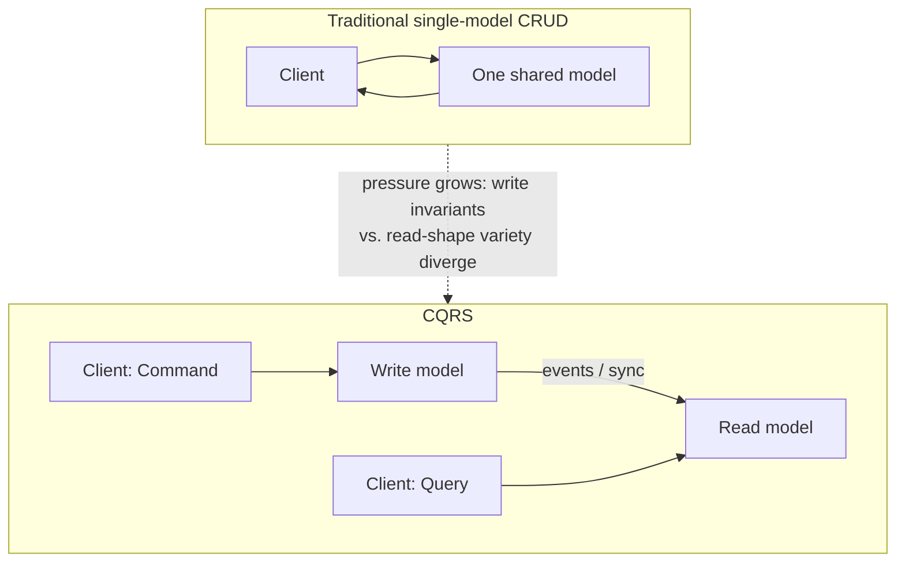

By the end of this chapter you should be able to explain, from first
principles, why command/query asymmetry exists, where on the adoption
spectrum a given system should sit, how a projection actually keeps a read
model current, what "eventually consistent" concretely means for a user
staring at a screen, when CQRS is the right call, and — just as
importantly — when it is architectural overkill that will slow a team down
for no real benefit.

## 2. Historical Evolution

The conceptual root of CQRS is **Command-Query Separation (CQS)**, a
principle Bertrand Meyer articulated in the late 1980s as part of the
Eiffel programming language's design philosophy: every method on an object
should either be a *command* that changes state and returns nothing, or a
*query* that returns data and changes nothing, but never both. CQS is a
method-level discipline inside a single object or class — it says nothing
about having two different models, let alone two different databases.

Greg Young, building on discussions with Udi Dahan and the broader
Domain-Driven Design (DDD) community in the mid-2000s, generalized CQS from
the method level to the *architectural* level around 2010, naming the
result CQRS. His key move was to stop asking "should this one method mutate
or return data" and start asking "should this one *model* be responsible
for both validating changes and answering every possible read." Once
posed that way, the answer for sufficiently complex systems was no — and
CQRS as an architecture pattern (distinct read/write models, and often
distinct read/write databases) was born.

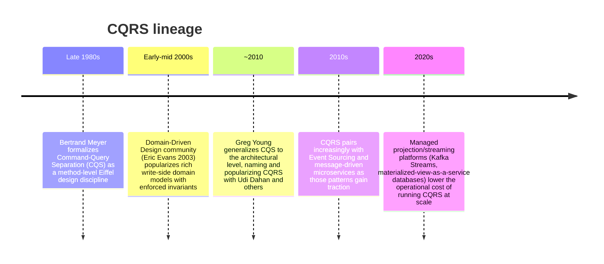

The pattern's adoption tracked two broader industry shifts. First, the rise
of Domain-Driven Design gave teams a vocabulary and discipline for building
rich write-side domain models that actively enforce invariants (aggregates,
entities, value objects) — a natural fit for a write model whose entire job
is correctness. Second, the shift toward microservices and event-driven
architectures made "publish an event when something changes, let other
components react asynchronously" a normal, expected integration style
rather than an exotic one, which made the projection mechanism CQRS depends
on (Section 4.3) far less unusual to operate than it would have been in a
single-database, single-transaction era.

## 3. Why It Exists

CQRS exists because a single shared model optimized for correctness is
frequently a bad model for speed and shape, and a single shared model
optimized for query convenience is frequently a bad model for enforcing
invariants — and as a system grows, this tension does not stay flat, it
gets worse.

Consider an e-commerce order system. The write side needs to enforce: an
order cannot be placed for a product with zero inventory, a discount code
cannot be applied twice, a payment must be authorized before the order
transitions to "confirmed." These are relational, invariant-heavy,
transaction-scoped concerns. Meanwhile the read side needs to answer:
"show me this customer's order history sorted by date," "show me total
revenue per product category this month," "show me the current state of
every order that's been stuck in `processing` for more than 2 hours." These
are aggregation-heavy, filter-heavy, often cross-entity concerns that have
nothing to do with whether any single write was valid.

Trying to serve both from one normalized relational schema forces
compromises in both directions: query performance suffers because the
schema is shaped for write-side correctness (normalized, foreign-key-heavy,
optimized for point updates) rather than for read-side aggregation; and
write-side correctness work gets harder to reason about because the schema
also has to carry denormalized columns and indexes added purely to make
some report run fast.

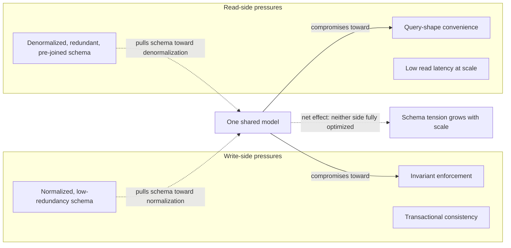

CQRS resolves the tension by refusing to compromise: the write model stays
exactly as normalized and invariant-focused as correctness requires, and
the read model is free to be however denormalized, redundant, or
differently-indexed it needs to be — even stored in a completely different
kind of database — because it is no longer the same model. The cost, which
this chapter treats with equal weight to the benefit, is that you now
maintain two models and a synchronization mechanism between them, and you
give up the guarantee that a read immediately reflects the very latest
write (Section 4.4). CQRS is a trade of schema-tension pain for
operational and consistency complexity — worth it only when the schema
tension is actually severe (Section 17 covers the common failure mode of
applying it when it isn't).

## 4. Core Concepts

### 4.1 The core CQRS principle and command/query asymmetry

**Definition.** CQRS splits a system's model in two along the command/query
axis. A **command** is a request to change state — "withdraw $40," "place
this order," "cancel this subscription" — and it either succeeds (state
changes, an event or acknowledgment is returned) or fails validation (an
error is returned, state is unchanged); a command never returns query-shaped
data as its primary output. A **query** is a request to read data — "what
is this account's balance," "list this customer's last 10 orders" — and it
never changes state. Under CQRS, commands are handled by a distinct
**write model** and queries are handled by a distinct **read model**, and
the two are allowed to diverge completely in schema, storage engine, and
even physical location.

**Mechanism.** The write model exposes a *narrow* command API — a small,
closed set of business operations (`OpenAccount`, `Withdraw`, `Deposit`),
each one validated against the current state and business rules before it
is allowed to take effect. This is exactly the discipline DDD calls an
**aggregate**: a consistency boundary that only permits state changes that
keep its own invariants true. The read model, in total contrast, exposes a
*wide, flexible* query API shaped around actual consumption patterns —
one table (or document, or index) per distinct way the data needs to be
looked up or aggregated, with no obligation to be normalized or to match
the write model's structure at all.

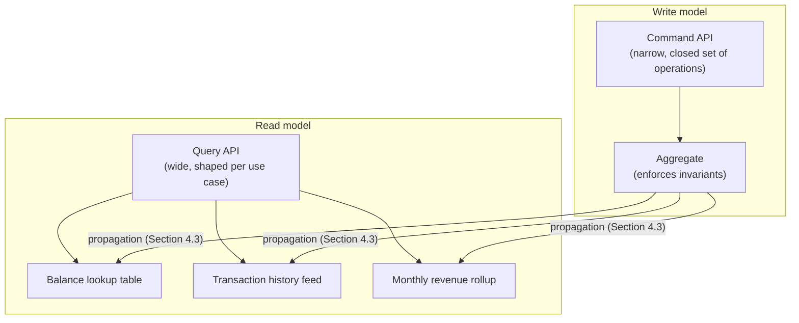

The concrete code walkthrough in
[01_command_side.py](../code/python/cqrs-chapter/01_command_side.py) and
[02_query_side.py](../code/python/cqrs-chapter/02_query_side.py) (Section 10)
shows exactly this split: `AccountCommandHandler` is the only code in the
entire system permitted to check "would this withdrawal breach the
overdraft limit," while `AccountQueryHandler` never performs that check —
by the time a query runs, that decision has already been made and baked
into the read model.

**Decision implications.** The asymmetry is worth introducing when the two
sides' pressures are genuinely pulling in opposite directions — many
distinct query shapes over the same underlying entities, or a write side
whose invariants are complex enough that a rich domain model materially
helps (versus a query side that just wants simple, fast, denormalized
lookups). If a system has one dominant query shape that already matches
the write schema reasonably well, this asymmetry buys little and Section 17
applies.

**Common failure mode.** Treating command/query asymmetry as "different
method names on the same class/table" without ever actually diverging the
underlying model is not CQRS in any meaningful architectural sense — it is
just a naming convention. This is the shallow end of Section 4.2's
spectrum, and while it is a legitimate (and often correct) starting point,
teams sometimes stop there and believe they have gained CQRS's benefits
(read-model flexibility, independent scaling) without ever actually
introducing the separate read model that provides them.

**Scenario.** A support dashboard needs "all orders currently stuck in
`processing` for over 2 hours, joined with customer tier and last support
ticket." Building this against the write-side normalized order schema means
a multi-table join with a time-window filter running directly against the
same tables that are handling live order-placement writes — every
dashboard refresh competes with production traffic for locks and I/O
bandwidth. A dedicated read model, pre-joined and indexed exactly for this
query, removes that contention entirely and can be refreshed on whatever
cadence the dashboard actually needs (seconds, not necessarily
transactionally-instant).

### 4.2 CQRS adoption spectrum: light to full separation

**Definition.** CQRS is not a single on/off architectural switch; it is a
spectrum of how far the write model and read model are actually pulled
apart, from "same class, two differently-named methods" all the way to
"physically separate databases, separate deployment units, asynchronous
projection between them."

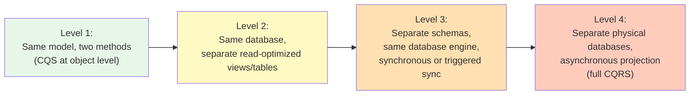

**Mechanism.** At **Level 1**, a class or service has `place_order(...)`
(a command method) and `get_order(...)` (a query method) operating over the
same in-memory model and the same underlying tables — this is plain CQS,
not architectural CQRS, but it is the honest starting point most systems
are already at. At **Level 2**, the write side still owns the tables of
record, but the team adds database views, materialized views, or separate
read-optimized tables inside the *same* database, refreshed by triggers or
scheduled jobs — read-shape flexibility appears, but there is still one
database to operate and one transactional boundary to reason about. At
**Level 3**, the read model moves to its own schema (possibly its own
database instance) but stays synchronously or near-synchronously updated —
for example, a database trigger fires on every write-side commit and
updates a separate summary table in the same transaction, or a
change-data-capture (CDC) pipeline replicates with sub-second lag. At
**Level 4**, the read model is a fully separate physical database (often a
different engine entirely — e.g. Elasticsearch or Redis serving reads while
PostgreSQL is the write-side system of record), updated purely
asynchronously through the projection mechanism in Section 4.3, with no
transactional coupling between a command's success and the read model
reflecting it.

**Decision implications.** Moving right along this spectrum buys
increasing read-model freedom (different storage engine, independent
scaling, independent schema evolution, independent availability) at the
cost of increasing operational surface (a separate deployment, a
projection pipeline to monitor, and — critically, once asynchronous —
eventual rather than immediate consistency, Section 4.4). Most systems
should start at Level 1 or 2 and move right only when a concrete pain point
justifies it: a query pattern that hurts write-side performance, a need to
scale reads and writes independently, or a read shape that a relational
schema genuinely cannot serve efficiently (full-text search, graph
traversal, geospatial queries) at all.

**Common failure mode.** Jumping straight to Level 4 — separate databases,
asynchronous projection, the works — for a system whose actual query
variety and write-invariant complexity would have been perfectly well
served at Level 1 or 2. This front-loads the full operational cost of
CQRS (a projection pipeline, monitoring for projection lag, a second
database to run migrations against) before there is any real problem it is
solving, and is the single most common way teams burn effort on CQRS with
nothing to show for it.

**Scenario.** A startup's internal admin tool queries the same
PostgreSQL tables the order-service writes to (Level 1) for its first two
years — completely fine, because query volume is low and shapes are
simple. When customer-facing analytics dashboards launch and need
sub-second aggregate queries across millions of orders, the team adds
materialized views refreshed every 5 minutes inside the same database
(Level 2) — a small, targeted move up the spectrum in response to an actual
measured need, not a wholesale re-architecture.

### 4.3 Projection mechanisms for building read models

**Definition.** A **projection** is the mechanism that transforms write-side
changes into read-model updates. It is called a projection because it
takes the full, invariant-focused write-side state (or the stream of
changes to it) and *projects* — maps, reshapes, filters, aggregates — a
subset of that information into whatever shape a specific read model needs,
the same way a 3D object is projected onto a 2D shadow: information is
deliberately discarded, and the result is shaped for a specific viewing
angle, not for completeness.

**Mechanism.** There are three broad families of projection mechanism, in
increasing order of decoupling from the write side:

1. **Synchronous, in-transaction projection** — a database trigger or the
   application code itself updates the read-model table in the *same*
   transaction as the write. This gives immediate (not eventual)
   consistency between write and read, at the cost of coupling the read
   model's write path to the write transaction's latency and failure
   modes — a slow read-model update can now make a write slower or even
   fail it.
2. **Change Data Capture (CDC)** — a tool (e.g. Debezium) tails the write
   database's transaction log (the same write-ahead log mechanism
   introduced in Part 06's
   [Transactions](../06_Databases_and_Storage/CH08_Transactions.md)
   chapter and [Replication](../06_Databases_and_Storage/CH07_Replication.md)
   chapter) and turns each committed row change into an event, without the
   write-side application code needing to know a read model exists at all.
3. **Explicit domain events** — the write model's command handlers
   explicitly publish domain events ("AccountOpened," "FundsWithdrawn") to
   a message broker or log (Kafka, an outbox table), and one or more
   independent projection workers subscribe, consume those events, and
   update their own read models entirely asynchronously.

This chapter's code walkthrough (Section 10) implements the third family,
because it is the one most directly reusable if the write side later adopts
Event Sourcing (Section 4.5) — but all three are legitimate, and the choice
depends on how much decoupling and independent scalability the read side
actually needs (per the adoption-spectrum trade-off in Section 4.2).

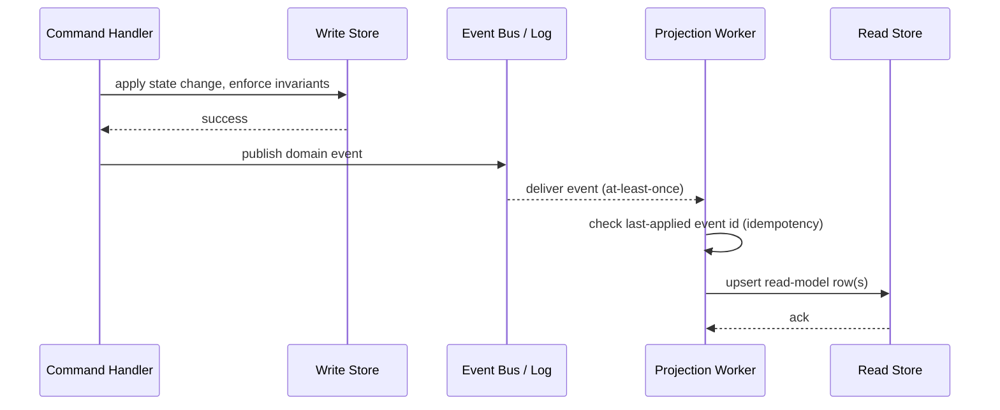

A projection worker must be **idempotent**: because most event-delivery
mechanisms guarantee at-least-once delivery (a crash-and-restart can
redeliver an already-processed event), the worker has to detect and skip
events it has already applied rather than double-applying them — exactly
what
[03_projection_worker.py](../code/python/cqrs-chapter/03_projection_worker.py)
demonstrates by tracking the last-applied event ID per aggregate and
treating a re-delivered older event as a safe no-op.

**Decision implications.** Choose synchronous/in-transaction projection
only when the read model is small, simple, and lives in the same database —
otherwise its latency and failure modes leak into the write path, defeating
much of CQRS's point. Choose CDC when you want projection with zero
write-side application code changes (useful when retrofitting CQRS onto an
existing system) but accept that you are now operationally dependent on a
log-tailing pipeline. Choose explicit domain events when the write side is
already event-driven, when multiple independent read models need to
subscribe to the same events, or when Event Sourcing is planned.

**Common failure mode.** Forgetting idempotency. A projection worker that
assumes exactly-once delivery will double-count a redelivered "deposit
$100" event after a crash-restart, silently corrupting the read model's
balance — a bug that often only surfaces under production failure
conditions (worker crashes, network partitions triggering redelivery)
rather than in a clean local test run.

**Scenario.** An e-commerce read model for "products low on inventory"
subscribes to `InventoryDecremented` events from the write-side order
service. If the projection worker restarts mid-batch and the broker
redelivers the last 50 events, an idempotency-unaware worker would
decrement the read-model's stock count a second time for those 50 items,
making the dashboard report far less inventory than actually exists —
exactly the kind of subtle read-side bug that CQRS's separation makes
possible if projection idempotency is skipped.

### 4.4 Consistency implications: eventual consistency between write and read

**Definition.** In any Level 3 or Level 4 CQRS deployment (Section 4.2),
the read model is **eventually consistent** with the write model: a
successful command is guaranteed to be durably recorded on the write side
immediately, but the corresponding read-model update happens after some
delay (the projection lag), during which a query can return data that does
not yet reflect that command.

**Mechanism.** This is the same eventual-consistency concept already
introduced generally by Part 07's
[CAP Theorem](CH05_CAP_Theorem.md) and
[PACELC](CH06_PACELC.md) chapters — CQRS is simply one very common,
concrete place that trade-off shows up, because a projection pipeline is,
structurally, an asynchronous replication channel between two data stores.
The size of the "eventually" window is a direct function of the projection
mechanism chosen in Section 4.3: synchronous/in-transaction projection has
effectively zero lag (it is really Level 3, not Level 4, precisely because
it gives up asynchrony to buy consistency); CDC and event-driven projection
both have a lag bounded by broker/consumer throughput and worker health,
typically milliseconds to low seconds in a healthy system, but unbounded if
the projection worker falls behind or fails.

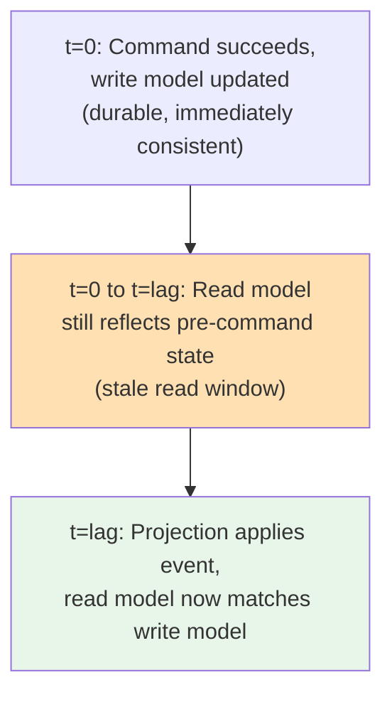

[04_eventual_consistency_lag_demo.py](../code/python/cqrs-chapter/04_eventual_consistency_lag_demo.py)
in Section 10 makes this window directly observable rather than
theoretical: a background thread plays the projection worker with a
deliberate artificial delay, and the main thread shows a query issued
immediately after a successful command failing to find the new data, then
succeeding once the delay has elapsed — the exact shape of the read-your-
own-writes problem discussed next.

**Decision implications.** Eventual consistency is not free to ignore in
the user experience: the classic failure case is **read-your-own-writes
violation** — a user submits a form (command succeeds), the UI immediately
redirects to a page that reads from the lagging read model, and the user
sees their own just-submitted change missing or stale. Mitigations include:
routing the immediate post-write read back to the write model itself
(bypassing the read model for that one request), returning the
command's result directly to the client instead of re-querying, or
displaying an optimistic UI update client-side while the projection
catches up in the background. The right mitigation depends on how
strict "read your own writes" needs to be for that specific user flow —
not every screen needs it.

**Common failure mode.** Building a UI flow that silently assumes strong
consistency (assume-and-forget: submit, redirect, re-query) without
picking one of the mitigations above, so that under real production
projection lag (which is always nonzero and occasionally elevated under
load or during a worker restart), users intermittently see their own
change appear to have been lost, file support tickets, and sometimes
resubmit — compounding the problem.

**Scenario.** A user updates their shipping address and clicks Save. The
command succeeds and is durably recorded on the write side. The
confirmation page queries the read model to display "your updated address,"
but the projection has not caught up yet, so the page renders the *old*
address for a few hundred milliseconds to a few seconds — long enough, on a
slow projection pipeline under load, for the user to reasonably conclude
the save failed and click Save again.

### 4.5 CQRS-vs-Event-Sourcing relationship: independent but complementary patterns

**Definition.** CQRS and Event Sourcing answer two different architectural
questions and neither implies the other. CQRS answers "how many models does
this system have, and how are they synchronized?" Event Sourcing answers
"how does the write model persist its own state — as current-state rows,
or as the append-only sequence of events that produced that state?" A
system can have exactly one of these patterns without the other, or both
together — all four combinations are real and used in production.

**Mechanism.** A **conventional write model without Event Sourcing** stores
current state directly (an `accounts` table with a `balance` column that is
updated in place); this is what
[01_command_side.py](../code/python/cqrs-chapter/01_command_side.py) in
Section 10 actually implements — it emits domain events purely as a
*propagation channel* to the read side, but the write model's own source
of truth is the in-memory/persisted `Account.balance_cents` field, not the
event log. An **event-sourced write model**, by contrast, stores *only* the
event log as the system of record — there is no `balance` column anywhere;
current balance is derived by replaying every event for that account from
the beginning (or from a snapshot). CH15_Event_Sourcing.md, the very next
chapter, is the full first-principles treatment of that replay mechanism,
snapshotting, and the specific consistency and auditability properties
Event Sourcing provides — this chapter deliberately does not re-derive any
of that.

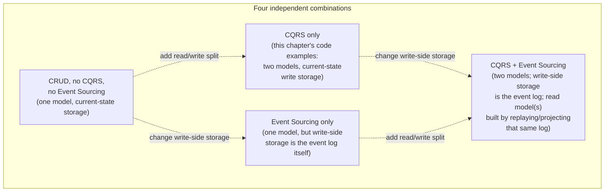

The reason the two patterns are so often deployed *together* (Q4) is
mechanical convenience rather than necessity: if the write model is already
producing a durable, ordered event log as its system of record (Event
Sourcing), that log is an excellent, already-existing input for a CQRS
projection pipeline — you get the propagation channel almost for free,
instead of having to bolt explicit domain-event publishing onto a
conventional current-state write model as this chapter's own examples do.

**Decision implications.** Adopt CQRS without Event Sourcing when the
driver is read-model shape/scaling flexibility, and the write side's
current-state storage and standard transactional guarantees are already
adequate for its invariant-enforcement needs — this is the more common,
lower-risk starting point. Adopt Event Sourcing (with or without CQRS)
separately when the driver is a genuine business need for a complete,
replayable audit history of every state transition, or temporal queries
("what was this account's balance last Tuesday"), independent of whether
you also need a separate read model. Adopt both together when both drivers
are present, or when an already event-sourced write side makes CQRS's
projection mechanism close to free to add.

**Common failure mode.** Treating "we're doing CQRS" and "we're doing Event
Sourcing" as synonyms in team communication, design docs, or ADRs. This
routinely causes real confusion: a team that says "we use CQRS" when they
mean "our write model is event-sourced and we happen to also project reads
from it" will mislead a new engineer into assuming a conventional
current-state write model exists, when in fact there is no `balance` column
to query directly at all — everything is event replay. Name each pattern
explicitly in architecture documentation rather than treating the pairing
as automatic.

**Scenario.** A financial ledger system needs both an immutable, replayable
audit trail of every transaction (a regulatory requirement, pointing toward
Event Sourcing) and fast account-summary dashboards that must not
compete for database load with transaction processing (pointing toward
CQRS). Here the two drivers coincide, and building the write model as an
event-sourced aggregate whose event stream is also the CQRS projection
source is a natural, well-justified combination — but the team should still
document each decision (why Event Sourcing, why CQRS) separately, because a
future maintainer needs to be able to reason about the audit-trail
requirement and the read-scaling requirement independently.

## 5. Internal Working

Zooming into a single command's full lifecycle end-to-end makes explicit
what Sections 4.1-4.4 described conceptually: where validation happens,
where the durability boundary is, how the event crosses from write to read,
and where the eventual-consistency window actually begins and ends.

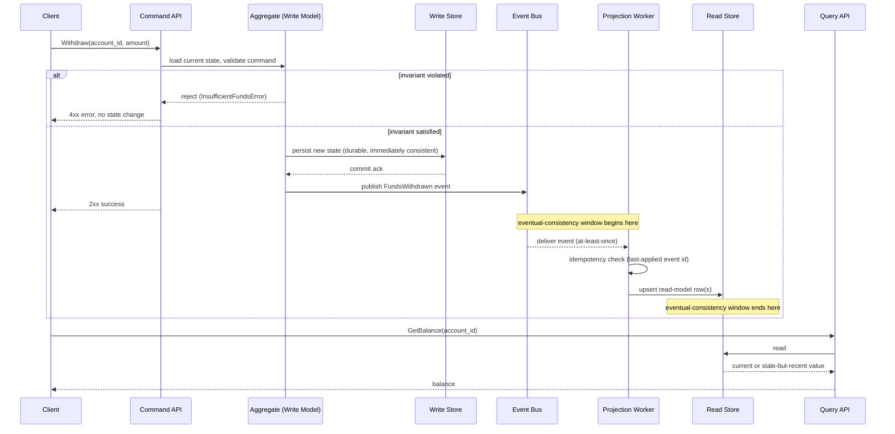

Three properties are worth calling out explicitly from this diagram, since
they are the source of most CQRS production incidents:

1. **The client receives success as soon as the write store commits**, not
   once the read model is updated — meaning a "2xx success" response
   carries no guarantee that a subsequent read will reflect it.
2. **The projection worker is the single point of failure for read-model
   freshness.** If it crashes, falls behind, or its idempotency check has a
   bug, the read model silently diverges from the write model in a way
   that clients cannot detect from the write path at all — this is why
   Section 14 (Observability) treats projection-lag monitoring as a first-
   class production metric, not an afterthought.
3. **The invariant check happens exactly once, in exactly one place** (the
   aggregate) — this is the entire point of the write-model concentration
   described in Section 4.1, and it is what allows the read side to be as
   simple and denormalized as it wants to be without ever re-validating
   anything.

## 6. Design Principles

- **Single source of truth for invariants.** Exactly one component — the
  write-model aggregate — is authorized to decide whether a state change is
  valid. No read model, cache, or downstream consumer should ever
  re-implement or second-guess that decision.
- **Read models are disposable and rebuildable.** Because a read model is
  purely derived from write-side events (or CDC of write-side state), it
  should always be safe to delete a read model's storage and rebuild it
  from scratch by replaying history — if it isn't, something has leaked
  write-side-only logic or state into the read side.
- **One read model per genuinely distinct access pattern**, not one giant
  read model trying to serve everything — the entire benefit of CQRS's
  read-model flexibility (Section 4.1) is lost if all queries are forced
  back through a single shared read schema.
- **Idempotent projections, always** — treat at-least-once event delivery
  as the default assumption, not the exception, per Section 4.3's failure
  mode.
- **Make eventual consistency visible, not silent** — expose projection lag
  as an observable metric (Section 14) and design UI flows that
  acknowledge the read-your-own-writes gap (Section 4.4) rather than
  papering over it.
- **Match the adoption-spectrum level to actual pain, not aspiration** —
  moving further right on Section 4.2's spectrum should always be a
  response to a measured problem (query latency, write contention, scaling
  ceiling), never a default starting posture.

## 7. Architecture Patterns

CQRS is frequently deployed alongside several other patterns already
covered or forward-referenced in this book, each addressing a different
part of the pipeline:

- **Outbox pattern** (full first-principles depth owned by Part 07's
  [Distributed Transactions](CH12_Distributed_Transactions.md) chapter,
  Section 4.5 there): guarantees that a write-side state change and its
  corresponding domain-event publication either both happen or neither
  does, avoiding the dual-write problem where a database commit succeeds
  but the event publish to the broker fails (or vice versa) — a critical
  reliability foundation for the projection mechanism in Section 4.3.
- **Materialized view** (owned by Part 06's
  [Denormalization](../06_Databases_and_Storage/CH02_Denormalization.md)
  chapter, and recapped again in Part 06's
  [Caching](../06_Databases_and_Storage/CH09_Caching.md) chapter's
  cache-vs-materialized-view distinction): a CQRS read model *is*
  conceptually a materialized view — durable, engine- or
  application-managed, systematically kept current from a source of
  truth — as opposed to an ephemeral, eviction-driven cache. This chapter
  does not re-teach materialized-view mechanics; it draws the connection
  explicitly and moves on.
- **Event-driven microservices**: CQRS's explicit-domain-event projection
  family (Section 4.3) is the same publish/subscribe integration style
  microservice architectures use generally, meaning a CQRS read model can
  live in an entirely different service or team's ownership boundary than
  the write model that produces its source events.
- **Saga pattern** (owned by the sibling chapter in this same batch,
  [CH13_Saga_Pattern.md](CH13_Saga_Pattern.md)): where a single business
  operation spans multiple write-model aggregates or services, a saga
  coordinates the multi-step command sequence; CQRS is orthogonal to this —
  each individual write within a saga step still goes through its own
  command/query split.

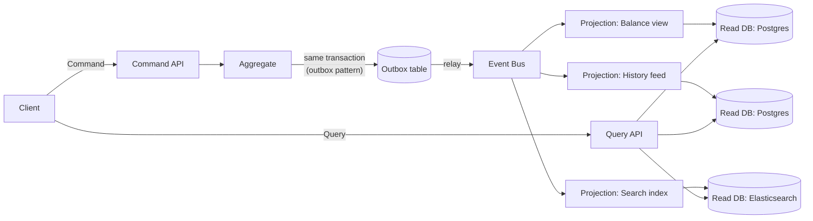

## 8. Production Architecture

A production CQRS deployment at Level 4 of the adoption spectrum typically
looks like the topology above, made concrete with real infrastructure
choices:

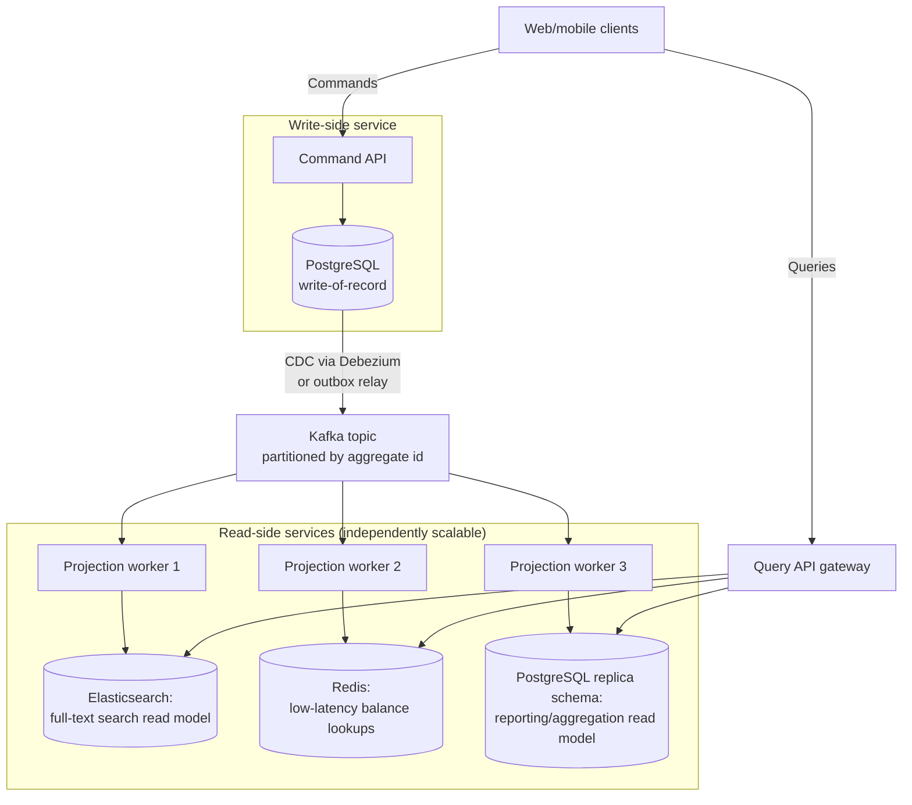

Key production characteristics: the write side is deliberately the
smallest, simplest, most conservatively-scaled piece of the system (it only
needs to handle command throughput, which is usually far lower than query
throughput); each read model can use whatever storage engine best fits its
access pattern and can be scaled, cached, or even taken offline for
maintenance independently of the others and independently of the write
side, because none of them are ever in the write path; and the Kafka topic
(or equivalent broker) is partitioned by aggregate ID specifically to
preserve per-aggregate event ordering — a projection that processes
`AccountOpened` after `FundsWithdrawn` for the same account would corrupt
that account's read model, so ordering within an aggregate's event stream
must be guaranteed even though ordering *across* different aggregates does
not matter.

## 9. Implementation

Implementing CQRS practically proceeds through the following decision
sequence, which also functions as a checklist before adding read-model
complexity to a system:

```mermaid
flowchart TD
    Q1{"Does one query shape\nalready serve reads well\nagainst the write schema?"}
    Q1 -->|Yes| Stop1[Stay at Level 1/CQS.\nNo separate read model needed yet.]
    Q1 -->|No| Q2{"Can a same-database\nmaterialized view/index\nfix it (Level 2)?"}
    Q2 -->|Yes| Stop2[Add materialized views/read tables\nin the same database.]
    Q2 -->|No| Q3{"Does the read side need a\ndifferent storage engine,\nor independent scaling/availability?"}
    Q3 -->|No| Stop3["Move to Level 3:\nseparate schema, low-lag sync\n(trigger or fast CDC)"]
    Q3 -->|Yes| Q4{"Is the write side already\nevent-sourced, or can it\ncheaply publish domain events?"}
    Q4 -->|Yes| Full[Full Level 4 CQRS:\nasync projection, separate\nphysical read store(s)]
    Q4 -->|No| Outbox["Introduce the outbox pattern\nfirst (CH12_Distributed_Transactions),\nthen Full Level 4 CQRS"]
```

Once Level 3 or 4 is justified, the implementation steps are: (1) define
the command API as a small, closed set of intention-revealing operations,
never a generic `update(fields)`; (2) implement the aggregate's invariant
checks as the single authority for validity; (3) choose and implement the
projection mechanism (Section 4.3); (4) design each read model's schema
purely around its consuming query, ignoring the write schema entirely; (5)
instrument projection lag as a first-class metric before shipping to
production, not after an incident makes it necessary.

## 10. Complete Code Examples

The four runnable Python examples below (all under
[code/python/cqrs-chapter/](../code/python/cqrs-chapter/), stdlib-only, no
external dependencies) build a small account/ledger system incrementally,
each file's docstring explaining exactly which Section 4 concept it
demonstrates:

1. **[01_command_side.py](../code/python/cqrs-chapter/01_command_side.py)**
   — the write model: `AccountCommandHandler` enforces the overdraft-limit
   invariant and is the only code in the system that ever performs that
   check; a minimal in-memory `EventStore` records what happened as an
   append-only log. Demonstrates Section 4.1's command/query asymmetry —
   this file contains zero query methods by design.

   ```python
   class AccountCommandHandler:
       """Owns write-side invariants; the read side never enforces these."""

       def withdraw(self, account_id: str, amount_cents: int) -> None:
           account = self._accounts[account_id]
           floor = -account.overdraft_limit_cents
           if account.balance_cents - amount_cents < floor:
               raise InsufficientFundsError(
                   f"withdrawing {amount_cents} would breach overdraft limit"
               )
           account.balance_cents -= amount_cents
           self._store.append(
               lambda eid: FundsWithdrawn(eid, account_id, amount_cents, account.balance_cents)
           )
   ```

2. **[02_query_side.py](../code/python/cqrs-chapter/02_query_side.py)** —
   the read model: two differently-shaped read tables (`BalanceReadModel`
   for O(1) point lookups, `TransactionHistoryEntry` for a newest-first
   feed) built from the *same* underlying events, demonstrating that a
   single write-side truth can back multiple, independently-shaped read
   models (Section 4.1 and 4.2).

   ```python
   class AccountQueryHandler:
       def get_balance(self, account_id: str) -> int:
           return self._reads.balances[account_id].balance_cents

       def get_recent_transactions(self, account_id: str, limit: int = 10):
           entries = self._reads.history.get(account_id, [])
           return list(reversed(entries[-limit:]))
   ```

3. **[03_projection_worker.py](../code/python/cqrs-chapter/03_projection_worker.py)**
   — the projection mechanism itself (Section 4.3): `ProjectionWorker`
   drains new events from the write-side `EventStore` into two independent
   projections, each tracking its own last-applied event ID per aggregate
   so that re-polling an already-consumed range of events is a safe,
   idempotent no-op — directly demonstrating the at-least-once-delivery
   assumption discussed in Section 4.3's failure mode.

   ```python
   class BalanceProjection:
       def apply(self, event) -> None:
           last_id = self._last_applied.get(event.account_id, 0)
           if event.event_id <= last_id:
               return  # already applied - idempotent replay guard
           # ... update read-model row ...
           self._last_applied[event.account_id] = event.event_id
   ```

4. **[04_eventual_consistency_lag_demo.py](../code/python/cqrs-chapter/04_eventual_consistency_lag_demo.py)**
   — wires all three together with a background thread simulating
   realistic asynchronous projection delay, and makes Section 4.4's
   eventual-consistency window directly observable: a query issued
   immediately after a successful command raises `KeyError` (the read
   model has not caught up yet), then succeeds once the simulated
   projection delay elapses.

All four files were executed end-to-end during authoring (`python
01_command_side.py`, `02_query_side.py`, `03_projection_worker.py`,
`04_eventual_consistency_lag_demo.py`) and produce the output shown in each
file's own comments; there are no external service dependencies (no real
Kafka, Postgres, or Redis) so the examples run anywhere Python 3.9+ is
installed.

## 11. Performance

CQRS's central performance argument is that read and write throughput can
be scaled and tuned **independently**, because they are no longer
contending for the same tables, locks, indexes, or even the same database
server. A write-heavy workload (many small, validated transactions) and a
read-heavy workload (large aggregations, full-text search, high query
concurrency) have opposite performance profiles — write throughput favors
fewer indexes and normalized schemas to minimize write amplification, while
read throughput favors more indexes, denormalization, and even different
storage engines (columnar stores, search indexes) entirely. Under a shared
model, tuning for one side directly hurts the other; under CQRS, each side
can be tuned to its own profile without compromise. The performance cost is
the projection pipeline's own resource consumption (broker throughput,
worker CPU/memory) and the latency of that pipeline, which becomes the
system's new bottleneck for "freshness" even as raw query and write
throughput both improve.

## 12. Scalability

Because the write and read models are physically decoupled at Level 3/4 of
the adoption spectrum, each can be scaled using the technique best suited
to its own load shape: the write side scales primarily through
partitioning/sharding (per Part 07's
[Partitioning](CH11_Partitioning.md) chapter) since commands must still be
routed to the correct aggregate's consistency boundary, while each read
model can be scaled through simple read-replica fan-out, a
horizontally-scaled search cluster, or an in-memory cache tier — whichever
matches that specific read model's access pattern — entirely independently
of how the write side is partitioned. A system that outgrows a single
database's combined read+write capacity but has read traffic an order of
magnitude larger than write traffic (a very common real-world shape,
e.g. 100:1 or 1000:1 read:write ratios in consumer applications) benefits
enormously from being able to scale the read fleet without touching the
write fleet at all.

## 13. Security

The command API is the correct place to enforce authorization for state
changes — "can this user withdraw from this account" belongs on the write
side, next to the invariant checks it logically extends, not duplicated or
reinvented on the read side. Query-side security instead centers on
**data-shape leakage**: because read models are deliberately denormalized
and often duplicate data across multiple differently-shaped tables/indexes,
a security review must check that each individual read model enforces the
correct row-level or field-level access control on its own terms (e.g. a
search-index read model must not expose a field that the equivalent
relational read model correctly redacts), rather than assuming a single
access-control layer protects every read model uniformly. Projection
pipelines that move data across trust boundaries (e.g. into a third-party
analytics or search SaaS product) also need explicit review for what
data is allowed to leave the write side's security perimeter at all.

## 14. Observability

**Projection lag** — the delay between a command's write-side commit and
its corresponding read-model update — is CQRS's single most important
production metric and should be tracked per read model, not just
in aggregate: expose it as a gauge (current lag in event count and in
wall-clock time) plus alerting thresholds tuned to what each specific read
model's consumers actually tolerate. A search-index read model feeding a
"browse recent items" page can usually tolerate seconds of lag; a
fraud-detection read model consuming the same event stream may need
sub-second lag guarantees instead.

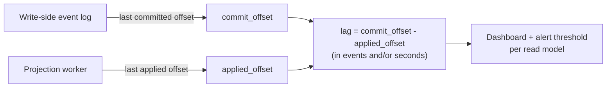

Beyond lag, instrument: projection worker error/retry rates (a spiking
retry rate on one projection often signals a schema mismatch or a
malformed event, not a transient blip), dead-letter queue depth for events
a projection could not apply after retries, and per-read-model query
latency/error rate as its own independent Service Level Indicator (SLI),
since a slow search-index read model should never be conflated with a slow
write path in an on-call engineer's mental model of where a problem lives.

## 15. Failure Scenarios

- **Projection worker crash mid-batch.** Handled correctly by the
  idempotency guard in Section 4.3 — the worker resumes from its
  last-applied offset and safely re-processes any events it had picked up
  but not yet fully applied before crashing.
- **Poison-pill event.** A malformed or unexpected event repeatedly fails
  to apply, and a naive projection worker retries it forever, blocking
  every event behind it in that partition. The correct mitigation is a
  dead-letter queue: after a bounded retry count, move the offending event
  aside and continue processing, alerting an operator rather than stalling
  the entire read model.
- **Broker/queue outage.** Commands continue to succeed (the write side is
  independent of the broker's availability), but projection lag grows
  unboundedly until the broker recovers — this is exactly why lag must be
  monitored as a leading indicator, not discovered only when a user
  complains their data is missing.
- **Schema drift between write-side event shape and projection code.** A
  write-side event schema change (a renamed or removed field) that a
  projection worker was not updated to handle will either crash the
  worker or silently write incorrect data — version domain events
  explicitly and treat event-schema changes with the same rigor as an API
  contract change.

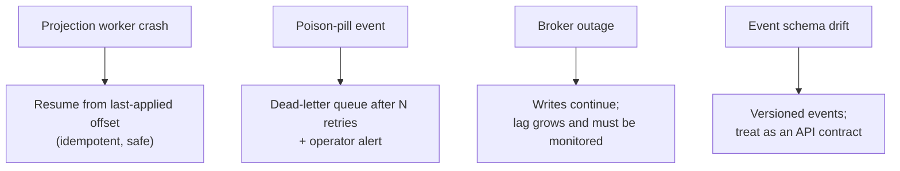

## 16. Testing

Write-model testing should focus entirely on invariant enforcement: given a
starting state and a command, assert the resulting state (or the rejection)
is correct — exactly the kind of test
`InsufficientFundsError` in Section 10's example demonstrates. Read-model
testing should focus on projection correctness: given a sequence of
events (including duplicates, to test idempotency, and out-of-order
delivery within reasonable bounds), assert the resulting read-model state
matches expectations — this is a fundamentally different test shape than
write-model testing, and conflating the two (e.g. testing invariant logic
by querying the read model) reintroduces exactly the coupling CQRS is
meant to remove. Integration tests should additionally verify the full
pipeline end-to-end, including a deliberate assertion of the
eventual-consistency window (a query immediately after a command should
not be assumed to reflect it, and a test suite that assumes otherwise will
be flaky against a real asynchronous projection pipeline in ways that are
easy to mistake for a bug in the system rather than in the test).

## 17. Common Mistakes

- **Applying full CQRS to a simple CRUD system.** The most common failure
  mode this chapter has flagged repeatedly: a small system with one
  dominant, well-served query shape gains nothing from a separate read
  model and asynchronous projection pipeline, but pays the full
  operational cost (a projection pipeline to build, deploy, and monitor; a
  second data store to run migrations against; eventual consistency to
  reason about in every UI flow) for that non-existent benefit. If Section
  9's decision flowchart resolves to "Stop1" or "Stop2," stop there.
- **Conflating CQRS with Event Sourcing** (Section 4.5's common failure
  mode) — leading to confused documentation and onboarding.
- **Non-idempotent projections** (Section 4.3's common failure mode) —
  leading to silent read-model corruption under at-least-once delivery.
- **No projection-lag monitoring** — leading to lag discovered only via
  user complaints rather than an alert (Section 14).
- **Letting the read model leak back into write-side decisions** — e.g. a
  command handler that queries its own read model to decide whether an
  action is valid, reintroducing a dependency the read/write split was
  supposed to remove and creating a circular consistency dependency.
- **Ignoring read-your-own-writes UX** — building a submit-then-redisplay
  flow with no mitigation for the eventual-consistency window (Section
  4.4), producing intermittent, hard-to-reproduce "my change disappeared"
  bug reports.

## 18. Best Practices

- Start at the lowest point on the adoption spectrum (Section 4.2) that
  solves the actual, currently-measured problem; move right only in
  response to new measured pain.
- Design every read model's schema purely around its consuming query — if
  you find yourself joining or reshaping data at query time inside the
  read model, the read model's shape is wrong.
- Make every projection idempotent by design from day one, even before a
  real incident forces the issue.
- Version domain events explicitly and treat event-schema evolution with
  the same discipline as a public API contract.
- Instrument projection lag per read model before shipping to production.
- Document explicitly, in an Architecture Decision Record (ADR, full
  template owned by Part 01's
  [Architecture Thinking](../01_Architecture_Mindset/CH03_Architecture_Thinking.md)
  chapter), whether the write model is event-sourced and whether CQRS is
  in use — never assume the reader will infer either from the other.

## 19. Anti-Patterns

- **"CQRS-lite" masquerading as full CQRS** — two method names, one
  shared model, no actual read-model divergence, described in
  architecture diagrams as if the full pattern's benefits (independent
  scaling, storage-engine freedom) were present when they are not.
- **The "big read model" anti-pattern** — a single denormalized read
  schema that tries to serve every query shape at once, recreating the
  exact compromise CQRS exists to eliminate (Section 3), just on the read
  side instead of the shared side.
- **Synchronous cross-database projection** — updating a separate physical
  database inside the same transaction as the write-side commit, which
  couples the write path's latency and availability to the read
  database's, eliminating most of CQRS's isolation benefit while still
  paying its full operational cost.
- **Silent read-model drift** — no reconciliation or rebuild-from-source
  process exists, so once a projection bug causes drift, nobody notices
  until a user-visible data discrepancy is reported.

## 20. Trade-off Analysis

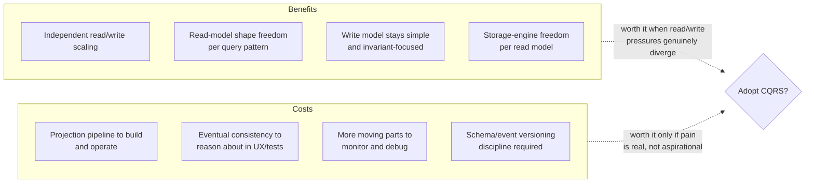

The trade-off is fundamentally about *when* complexity is paid: a shared
model pays complexity cost gradually and diffusely, as schema compromises
accumulate over time; CQRS pays complexity cost up front and explicitly, as
a dedicated pipeline and a second (or third) data store to operate — a
worthwhile trade only when the diffuse cost of staying with a shared model
has become, or is clearly about to become, larger than the concentrated
cost of separating it.

## 21. Comparison Table

| Approach | Write/Read coupling | Consistency | Read-model flexibility | Operational cost | Best fit |
|---|---|---|---|---|---|
| Plain CRUD (no CQRS) | Same model/schema | Immediate | Low (schema shaped for writes) | Lowest | Simple systems, one dominant query shape |
| CQS (Level 1) | Same model, distinct methods | Immediate | Low | Low | Honest starting point for most systems |
| Same-DB read views (Level 2) | Same database, separate schema/views | Immediate to seconds (refresh cadence) | Medium | Low-medium | Reporting/aggregation pain within one DB |
| Low-lag sync (Level 3) | Separate schema, sync/near-sync | Near-immediate | Medium-high | Medium | Need schema separation, can't tolerate much lag |
| Full async CQRS (Level 4) | Fully separate physical stores | Eventually consistent | Highest | Highest | Divergent read shapes, independent scaling, different storage engines needed |
| CQRS + Event Sourcing | Fully separate; write side is the event log | Eventually consistent | Highest | Highest (plus replay/snapshot machinery) | Above, plus audit/replay/temporal-query requirements |

## 22. Real-World Case Study

A widely cited real-world pattern (documented in Microsoft's own
architecture guidance and echoed across large e-commerce platforms) is
splitting an online retailer's order-management system into a
conventional, ACID-transactional order-write service backed by a
relational database, and a set of independently-scaled read services: an
Elasticsearch-backed product/order search index, a Redis-backed
"current cart and recent orders" low-latency lookup cache, and a
data-warehouse-backed nightly (later near-real-time via CDC) reporting
read model for business intelligence. During peak sales events (Black
Friday-scale traffic), the write side's load profile (order placement,
payment authorization, inventory decrement) is bursty but bounded by
actual purchase volume, while read traffic (browsing, searching, cart
viewing) is an order of magnitude larger and highly cacheable/scalable
independently. Splitting these let the team scale the search and cache
tiers horizontally to absorb browsing load without adding any capacity —
or any additional operational risk — to the transactional order-write path
that must remain strictly correct under contention. The lesson generalizes:
the case for CQRS was not "our schema was ugly," it was a measured,
order-of-magnitude difference in read vs. write load shape that a shared
model could not have absorbed without either over-provisioning the write
database for read load it didn't otherwise need, or accepting read
latency that would have hurt conversion.

## 23. Interview Questions

1. Explain the core CQRS principle in one sentence, and then explain why
   command/query asymmetry causes a single shared model to become
   increasingly strained as a system grows.
2. Where does "CQRS" stop being just Command-Query Separation (CQS) at the
   method level and become an architectural pattern? Describe the adoption
   spectrum from Level 1 to Level 4.
3. What is a projection, mechanically? Name the three broad families of
   projection mechanism and the trade-off between them.
4. Why must a projection worker be idempotent, and what production failure
   mode results if it is not?
5. What does "eventually consistent" concretely mean for a CQRS read
   model, and what is the read-your-own-writes problem? Name two
   mitigations.
6. Explain the relationship between CQRS and Event Sourcing. Give an
   example of a system that uses one without the other.
7. What CORE_CONCEPTS.md-owned pattern is a CQRS read model conceptually
   equivalent to, and how does it differ from an application-level cache?
8. Describe a concrete scenario where CQRS is clearly the wrong choice, and
   explain what "just add a materialized view" (Level 2) would achieve
   instead.
9. How would you monitor a production CQRS deployment to detect read-model
   staleness before a user reports it?
10. Walk through what happens, end-to-end, when a projection worker crashes
    mid-batch and then restarts — what must be true about the system for
    this to be safe?

## 24. Hands-on Exercises

1. Run all four scripts in
   [code/python/cqrs-chapter/](../code/python/cqrs-chapter/) in order and
   confirm the output matches each file's docstring description.
2. Modify [03_projection_worker.py](../code/python/cqrs-chapter/03_projection_worker.py)
   to remove the idempotency guard (`if event.event_id <= last_id: return`),
   then modify [04_eventual_consistency_lag_demo.py](../code/python/cqrs-chapter/04_eventual_consistency_lag_demo.py)
   to call `worker.poll_and_apply()` twice in a row on purpose, and observe
   the read model's balance become incorrect — this reproduces Section
   4.3's failure mode directly.
3. Add a third read model, `LowBalanceAlertProjection`, that maintains a
   set of account IDs whose balance has dropped below a configurable
   threshold, subscribing to the same event stream as the existing two
   projections — this demonstrates Section 4.1's claim that multiple,
   differently-shaped read models can be built from one write-side event
   stream at no cost to the write side.
4. Extend `AccountCommandHandler` with a new command, `TransferFunds`,
   that withdraws from one account and deposits into another, and reason
   through (in writing) what invariant-enforcement and event-ordering
   guarantees are needed across two aggregates for this to be safe —
   note where this connects to Part 07's
   [Saga Pattern](CH13_Saga_Pattern.md) chapter for the case where the two
   accounts live in different services entirely.

## 25. Design Exercises

Design a CQRS architecture for a ride-sharing platform's trip system, where
the write side must enforce "a driver cannot accept two simultaneous trips"
and "a trip cannot be marked complete before it has been marked started,"
while the read side must simultaneously serve: a rider's live map view
showing nearby available drivers (extremely latency-sensitive, high read
volume), a rider's trip-history screen (moderate volume, needs full-text
search over pickup/dropoff addresses), and a finance team's monthly
driver-payout report (low volume, heavy aggregation across millions of
trips). For each of the three read models, justify a storage engine choice
and a projection mechanism, and identify where in this design an
eventual-consistency window would be most user-visible and what mitigation
you would apply there.

## 26. Architecture Review Questions

- Does this system's actual, measured read/write load and query-shape
  variety justify moving further right on the adoption spectrum (Section
  4.2), or would a same-database materialized view suffice?
- Is every projection in this design idempotent, and is that idempotency
  actually tested against duplicate and out-of-order delivery, not just
  asserted in a design doc?
- Is projection lag instrumented per read model, with alert thresholds
  tuned to what each read model's actual consumers require?
- Does any UI flow assume immediate read-your-own-writes consistency
  without an explicit mitigation?
- Is the relationship between this system's write-model persistence
  strategy (conventional current-state vs. event-sourced) and its use of
  CQRS documented explicitly, so a new engineer cannot conflate the two
  patterns?
- Is there a working, tested process for rebuilding any read model from
  scratch by replaying write-side history, proving that read model is
  genuinely disposable and derived rather than a hidden second source of
  truth?

## 27. Summary

CQRS separates a system's write model — narrow, invariant-focused,
optimized for correctness — from its read model — wide, flexible,
optimized for query shape and speed — because those two concerns pull in
opposite modeling directions as a system grows, and a single shared model
eventually compromises both. The pattern is a spectrum, not a binary: most
systems should start at the lightest end (distinct methods, or same-database
read views) and move toward fully separate, asynchronously-projected read
models only in response to measured pain, not aspiration. The projection
mechanism — synchronous, CDC-based, or explicit-domain-event-based — is
what keeps read models current, and it must be idempotent given
at-least-once delivery guarantees. That asynchrony makes the read side
eventually, not immediately, consistent with the write side, a trade-off
that must be made visible in monitoring and handled explicitly in UX rather
than assumed away. CQRS is related to, but strictly independent of, Event
Sourcing — the two compose well but answer different architectural
questions, and the sibling
[Event Sourcing](CH15_Event_Sourcing.md) chapter is the place to learn how
an event-sourced write model persists its own state. Above all, CQRS is a
trade of one kind of complexity (schema compromise) for another
(operational and consistency complexity), and the central engineering
judgment call this chapter asks you to make, every time, is whether that
trade is currently worth it — not whether the pattern is impressive.

## Further Reading

- Greg Young, *CQRS Documents* (original pattern write-up)
- Martin Fowler, ["CQRS"](https://martinfowler.com/bliki/CQRS.html)
- Bertrand Meyer, *Object-Oriented Software Construction* (Command-Query
  Separation origin)
- [CH02_Denormalization.md](../06_Databases_and_Storage/CH02_Denormalization.md)
  — materialized views and read-model-duplication mechanics this chapter
  recaps rather than re-teaches
- [CH09_Caching.md](../06_Databases_and_Storage/CH09_Caching.md) — the
  cache-vs-materialized-view distinction this chapter builds on
- [CH12_Distributed_Transactions.md](CH12_Distributed_Transactions.md) —
  the outbox pattern used to make event publication reliable
- [CH13_Saga_Pattern.md](CH13_Saga_Pattern.md) — coordinating multi-step
  commands across aggregates or services
- [CH15_Event_Sourcing.md](CH15_Event_Sourcing.md) — the sibling pattern
  for write-model persistence as an event log
- [CH05_CAP_Theorem.md](CH05_CAP_Theorem.md) and
  [CH06_PACELC.md](CH06_PACELC.md) — the general consistency/availability
  trade-off framework this chapter's eventual-consistency section applies
