# Chapter 15: Event Sourcing

## 1. Introduction

Every system that has ever stored an entity — an `Account`, an `Order`, a
`Shipment` — has, by default, answered one narrow question well: *what is
this thing's state right now?* A row in a table, a document in a
collection, a cached object — all of these are **current-state
persistence**: the system keeps the latest snapshot of an entity and
overwrites it in place every time something changes. The previous state is
gone the instant the new one is written.

Event Sourcing rejects that default. Instead of persisting an entity's
current state, an event-sourced system persists **every event that ever
happened to that entity**, in the order it happened, and treats the
current state as something you *compute*, not something you *store*. The
event log — an ordered, immutable, append-only sequence of facts — becomes
the single source of truth. The `Account` balance you see on screen is not
a fact retrieved from storage; it is the *result* of replaying (folding)
every `AccountOpened`, `FundsDeposited`, and `FundsWithdrawn` event from
the beginning.

This is a genuinely different architectural bet, not merely an
implementation detail. It changes what your system remembers (everything,
forever, versus only the latest state), what a bug means (a wrong
*current* value can be diagnosed by inspecting exactly which historical
event produced it), and what a new requirement costs (a new read model is
usually "replay the existing log through a new lens" rather than a
migration that touches every stored row).

This chapter teaches Event Sourcing as a **system-level architectural
pattern**: how to design an event store, how optimistic concurrency keeps
concurrent writers safe, how snapshotting keeps replay affordable at
scale, how event schemas survive years of domain-model change, and how
the pattern relates to — but remains genuinely independent of — CQRS
(Command Query Responsibility Segregation). It deliberately does **not**
re-teach two topics this Part 07 already assigns elsewhere:

- The class/module-level **Domain Event** building block (a single
  `OrderPlaced` object raised by an aggregate and dispatched in-process to
  observers) is owned by
  [Low-Level Design](CH04_Low_Level_Design.md#416-ddd-tactical-patterns--domain-events)
  Section 4.16 — Event Sourcing operates one level of abstraction higher:
  a *durable, replayable log of every event an aggregate has ever raised*,
  not the shape of one event class.
- The CQRS read/write split, projection mechanics, and staleness
  trade-offs are owned by the sibling
  [CQRS](CH14_CQRS.md) chapter — this chapter recaps that relationship in
  Section 4.5 rather than re-deriving it, framing Event Sourcing as *one*
  way (not the only way) to implement a CQRS write side.

## 2. Historical Evolution

The idea of "the log is the truth, state is derived" did not begin with
distributed systems architecture — it is older than most databases in
production today, and tracing that lineage clarifies why the pattern looks
the way it does.

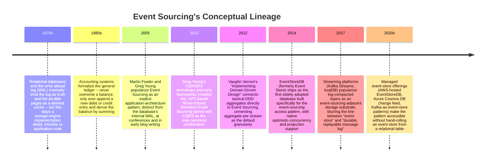

The accounting analogy above is worth dwelling on because it is not a
metaphor invented for teaching purposes — it is the literal historical
precedent. A general ledger never lets a bookkeeper cross out yesterday's
balance and write a new one; every change is a new, dated, signed entry,
and the "current balance" is always a *derived* number, recomputed by
summing entries whenever anyone asks. Double-entry bookkeeping has worked
this way for centuries specifically because it makes every change
auditable, reversible-by-compensating-entry (never by editing history),
and reconstructable independently by anyone who trusts the entries and the
arithmetic. Event Sourcing brings exactly that discipline to software
state.

The write-ahead log (WAL) precedent matters for a different reason: it
shows that "log as truth, state as a derived cache" is not a fringe idea —
it is how the database engines underneath most current-state systems
already work internally (see
[Transactions](../06_Databases_and_Storage/CH08_Transactions.md) for full
WAL/ACID mechanics). Event Sourcing simply moves that same discipline up
from the storage engine's implementation detail into the application's own
domain model, where the *application* — not just the database internals —
gets to reason about the full history of what happened.

## 3. Why It Exists

Current-state persistence is not wrong; it is optimized for a narrower
set of questions than many systems eventually need to answer. Event
Sourcing exists to solve four recurring problems that current-state
persistence structurally cannot answer without extra, often bolted-on,
machinery.

**Problem 1 — "What was the state at time T, and why did it change?"**
A current-state row can tell you the balance is $8,500 right now. It
cannot tell you, without a separate audit-log table that someone
remembered to write to consistently, that the balance was $10,000 at
9:00am, a $1,500 fee was applied at 9:15am because of a chargeback, and a
$4,000 withdrawal happened at 9:30am to a specific external account.
Regulated domains (finance, healthcare, insurance) frequently *require*
this level of provable history — not "we log changes as a best-effort
side channel" but "the history is the record, not the current value."

**Problem 2 — Retroactive requirements changes.**
Six months into a project, a product manager asks: "Can we show a report
of how often customers cancel an order within 5 minutes of placing it?"
With current-state persistence, if nobody stored the timestamp of the
cancel event relative to the placement event, that data is simply gone —
it was overwritten. With Event Sourcing, `OrderPlaced` and
`OrderCancelled` are both permanently in the log with their own
timestamps; a brand-new report is a new way of *reading* history that
already exists, not a new column that has to be back-filled from nothing.

**Problem 3 — Debugging "how did we get into this bad state?"**
When a current-state system ends up in an inconsistent state — an order
marked `shipped` with a negative quantity, say — the only artifact left to
debug with is the bad state itself. An event-sourced system lets an
engineer replay the exact sequence of commands and events that produced
that state, one step at a time, turning "why is this wrong?" from
guesswork into a deterministic replay.

**Problem 4 — Multiple, divergent read shapes from one write history.**
A current-state row is one shape. If the search team wants a
denormalized search index, the reporting team wants a columnar analytics
table, and the mobile team wants a lightweight summary cache, current-state
systems typically build brittle, hand-written synchronization code (or a
Change Data Capture (CDC) pipeline bolted on after the fact) to keep those
derived shapes in sync. An event-sourced system's log is *already* a
durable, ordered, replayable feed — building a new read shape is "start a
new projection from event 1" (see Section 4.5 and the sibling
[CQRS](CH14_CQRS.md) chapter).

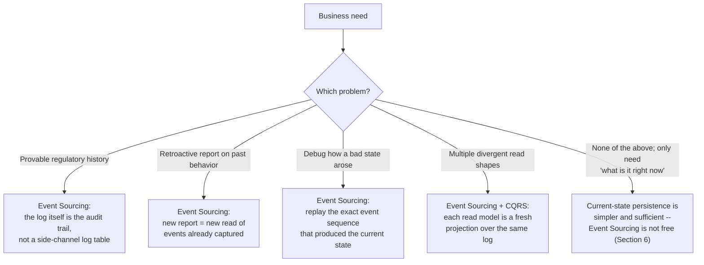

That last branch matters as much as the first four: Event Sourcing is not
a universal upgrade. Section 6 (Design Principles) and Section 19
(Anti-Patterns) return repeatedly to the discipline of choosing it only
where one of these four problems is real, not reflexively.

## 4. Core Concepts

### 4.1 The Core Event-Sourcing Principle — Log as Truth, State as Replay

**Definition.** In Event Sourcing, the *only* durably persisted fact about
an aggregate is its ordered sequence of events. Current state — the thing
a UI displays or a business rule checks — is never itself a stored fact;
it is a **projection**, computed by starting from an aggregate's empty
initial state and folding (applying) each event, in the order it
occurred, until the sequence is exhausted. "Folding" here is the same
operation as a functional `reduce`: `state = fold(apply, initial_state,
events)`.

**Mechanism.** Every state-changing operation on an aggregate follows the
same three-step shape:

1. **Load**: read the aggregate's event stream and replay it to compute
   current state (or start from an empty state for a brand-new
   aggregate).
2. **Decide**: run a command against that current state, checking
   business invariants (e.g. "can't withdraw more than the balance") using
   the values the replay just produced.
3. **Append**: if the command is valid, it produces one or more new
   events, which are appended to the stream — never a direct field
   mutation written to a "current state" row anywhere.

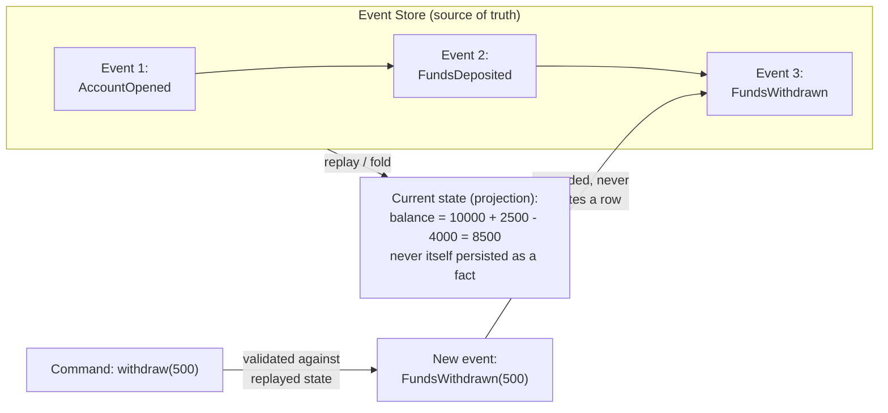

**Decision implications.** This principle has a load-bearing consequence
that is easy to underestimate: because state is *always* recomputed from
events, there is no such thing as "the state got corrupted by a bad
manual UPDATE statement." A DBA cannot silently hand-edit a balance in an
event-sourced system the way they could edit a current-state row, because
there is no row that *is* the balance — only events. This is a genuine
integrity advantage, but it is also why event-sourced systems tend to
push back hard against any "just fix it in prod" workflow: the only
legitimate way to correct history is to append a new, honest,
compensating event (e.g. `BalanceCorrected`), never to edit or delete a
past one.

**Failure mode.** The single most common event-sourcing failure is
**accidentally storing derived state as if it were a fact** — for
example, persisting a `balance` field directly on the event-store row
"for convenience" alongside the events, and then reading that field
instead of replaying. The moment any code path reads a stored current-state
field instead of computing it from events, the system has silently
reverted to current-state persistence with an extra, redundant event log
bolted on — and the two can drift out of sync, at which point neither is
trustworthy.

**Scenario.** See
[01_event_sourced_aggregate.py](../code/python/event-sourcing-chapter/01_event_sourced_aggregate.py):
`Account.replay()` folds `AccountOpened`/`FundsDeposited`/`FundsWithdrawn`
events into a fresh `Account` instance with no stored balance anywhere
except the event log itself; `Account.apply()` is the single point where
state is ever mutated, and it is always driven by an event.

### 4.2 Event Store Design and Optimistic Concurrency

**Definition.** An **event store** is the durable, append-only log that
holds every aggregate's event history. Structurally, it is organized as
many independent **streams**, one per aggregate instance (e.g. one stream
per `Account`, identified by `account-1234`), each stream being a strictly
ordered, monotonically versioned sequence of events specific to that one
aggregate. **Optimistic concurrency** is the mechanism that keeps two
concurrent writers from corrupting a stream: every append specifies the
*expected version* of the stream (the version the writer last saw when it
loaded and replayed), and the store atomically rejects the append if the
stream's actual current version has moved on since then.

**Mechanism.** Concretely, an event store's append operation is
conceptually a single atomic check-and-insert:

```text
APPEND events TO stream(aggregate_id)
  WHERE current_version(stream) == expected_version
  ELSE reject with ConcurrencyConflict
```

A relational implementation typically enforces this with a unique
constraint on `(aggregate_id, version)` — the writer's `INSERT` naturally
fails if another writer already inserted at that exact version, with zero
extra locking required. Purpose-built event stores (e.g. EventStoreDB)
and stream-native platforms (e.g. a Kafka partition keyed by
`aggregate_id`) provide this same guarantee natively.

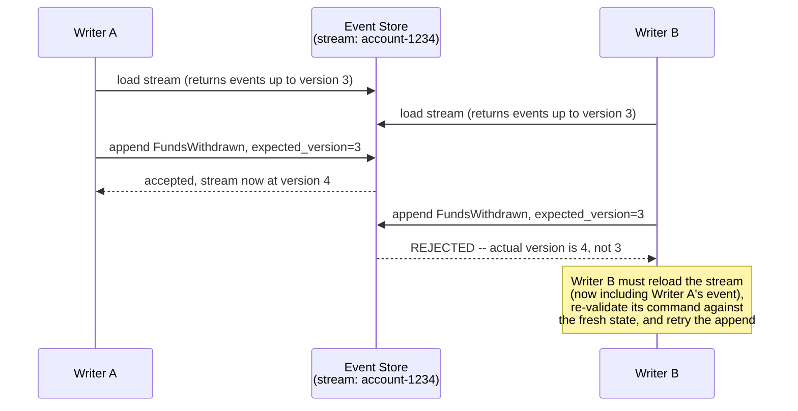

**Decision implications.** Optimistic concurrency (reject-and-retry) is
chosen over pessimistic locking (acquire-a-lock-before-reading) because
event streams are typically read far more often than they are
concurrently contended, and holding a distributed lock across a
network round trip for every load is expensive and adds an entirely new
failure mode (a crashed writer holding a lock forever) for a case that is
usually rare. The trade-off: the *application* must handle the retry
path — reload, re-validate the command's invariants against the newly
current state, and re-attempt the append — rather than the infrastructure
making the conflict invisible. Choosing the stream granularity (one
stream per aggregate instance, not one giant stream for an entire entity
type) is what keeps this contention rare in the first place: two
customers' `Account` streams never contend with each other, only
concurrent writers to the *same* account do.

**Failure mode.** Choosing a stream boundary that is too coarse (for
example, one single stream for "all orders in the system" instead of one
stream per order) turns every unrelated write into an artificial
concurrency conflict, because every writer is competing for the same
expected-version check regardless of whether their changes are actually
related. This mistake usually surfaces as mysteriously high retry rates
under load that have nothing to do with genuine business contention —
the fix is almost always to narrow the stream boundary to match the
aggregate boundary (see
[Low-Level Design](CH04_Low_Level_Design.md#44-single-responsibility-principle-srp)'s
aggregate-boundary reasoning), not to add more retry logic.

**Scenario.** See
[01_event_sourced_aggregate.py](../code/python/event-sourcing-chapter/01_event_sourced_aggregate.py)'s
`EventStore.append()`, which raises `ConcurrencyConflictError` when
`expected_version` does not match the stream's actual last version, and
the `main()` demo showing a stale writer's append being correctly
rejected after a concurrent writer's append succeeds.

### 4.3 Snapshotting

**Definition.** A **snapshot** is a periodic, materialized checkpoint of
an aggregate's derived state at a specific event version, stored purely
as a performance optimization: loading an aggregate becomes "load the
most recent snapshot, then replay only the events that occurred *after*
that snapshot's version," instead of replaying the aggregate's entire
history from event 1 on every single load.

**Mechanism.** A snapshotting policy runs, typically asynchronously and
off the write path's critical latency, after every N events (or every T
seconds, or both) for a given stream: it replays the full stream once to
compute current state, then stores that computed state tagged with the
version it represents. The very next load for that aggregate finds the
snapshot, starts from it instead of an empty initial state, and replays
only the (usually small) tail of events appended since.

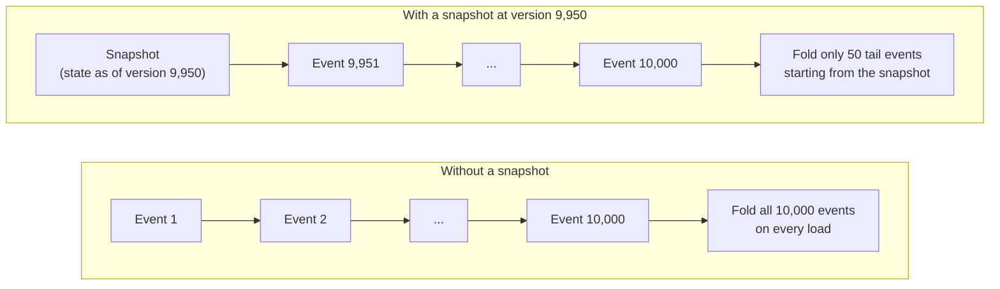

**Decision implications.** A snapshot is unconditionally a *cache*, never
a fact — this is the property that keeps the core principle (Section 4.1)
intact even with snapshotting in place: the snapshot could be deleted
entirely at any time and the system would still recompute the exact same
current state by replaying the full event log from scratch (slower, but
identical). Choosing the snapshot cadence (every N events) is a direct
latency-versus-storage trade-off: a small N keeps replay tails short but
multiplies snapshot storage and write overhead; a large N keeps
snapshotting cheap but lets replay tails grow long between checkpoints.
Most teams start with "snapshot every few hundred to few thousand events"
and tune from production replay-latency measurements rather than guessing
up front.

**Failure mode.** The most damaging snapshotting bug is a **silent schema
drift between a stored snapshot and the aggregate's current in-memory
shape** — if a snapshot was taken before a new field was added to the
aggregate's state, and the loading code naively deserializes the old
snapshot into the new shape without a default, the load either crashes or
(worse) silently produces a wrong value for the new field. The mitigation
is to version snapshots exactly the way events are versioned (Section
4.4) and to always keep a "replay from event 1, ignoring any snapshot"
fallback path available and periodically exercised — never trust a
snapshot format that has never been proven reconstructable from raw
events.

**Scenario.** See
[02_snapshotting.py](../code/python/event-sourcing-chapter/02_snapshotting.py):
`EventStoreWithSnapshots` takes a snapshot every 50 events, `load()`
resumes from the latest snapshot and replays only the tail, and the demo
explicitly proves the caching invariant by asserting that a full
from-scratch replay produces an identical result to the snapshot-assisted
load.

### 4.4 Event Schema Evolution — Upcasting and Versioning

**Definition.** **Event schema evolution** is the discipline of handling
changes to an event's shape (a renamed field, a new required field, a
split field) over the years an event-sourced system runs in production,
given the hard constraint that **stored events can never be deleted or
rewritten** — they are the permanent historical record, and rewriting
history to match a new schema would falsify exactly the audit trail
Section 3 identified as one of the pattern's core motivations. An
**upcaster** is a small, pure transformation function that converts one
older event schema version into the next schema version, and a chain of
upcasters is applied at read time to bring any historical event, no
matter how old, up to the shape the current code actually understands.

**Mechanism.** Every stored event carries an explicit schema version
alongside its type name and payload. When an event is read back, the
event store (or a deserialization layer sitting in front of it) checks
that version against the current version the code expects; if it is
behind, it runs the event through the chain of upcaster functions —
version 1 to version 2, version 2 to version 3, and so on — one hop at a
time, until it reaches the current shape. The aggregate's `apply()`
method, and every other reader, only ever has to understand the single,
current shape; the version-history complexity is entirely contained
inside the upcaster chain.

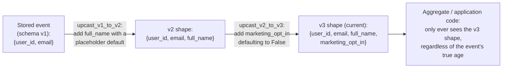

**Decision implications.** Upcasting can only ever **widen or default** a
shape — it can never invent data that was genuinely never captured at the
time an old event was written. This is the sharpest, most distinctive
hard problem in event schema evolution compared to a current-state
system's schema migration: a relational migration can run a backfill
query against still-current live data, but an old event genuinely does
not know a fact that did not exist in the domain model when it was
recorded. Every upcaster must therefore choose an explicit, defensible,
auditable default (e.g. "pre-GDPR events default `marketing_opt_in` to
`False`, the safe compliance choice, never a guess"), and that choice
belongs in the code and the chapter's own documentation, not silently
buried in a migration script nobody remembers writing.

**Failure mode.** Renaming or repurposing an event *type name* (rather
than adding a new schema version of the same type) without a translation
layer is the single most catastrophic event-evolution mistake: every
already-stored event of the old type name becomes permanently
undeserializable the instant the code stops recognizing that name,
because — unlike a current-state migration — there is no way to rewrite
the stored events to the new name; the only fix is to keep the old type
name's deserialization path (and its upcasters) alive indefinitely, for
as long as any stored event with that name might still need to be
replayed (which, for an audit-critical system, can mean forever).

**Scenario.** See
[03_event_upcasting.py](../code/python/event-sourcing-chapter/03_event_upcasting.py):
three raw `UserRegistered` events are frozen at schema versions 1, 2, and
3 exactly as they were originally written; `upcast_to_current()` walks
each one through the appropriate chain of upcasters, and the demo
explicitly proves that a v1 event's missing `full_name` gets an
auditable placeholder rather than fabricated data, while a pre-GDPR v2
event's `marketing_opt_in` defaults to the compliance-safe `False`.

### 4.5 Event Sourcing and CQRS — A Natural Pairing, Not the Same Pattern

**Definition.** CQRS is the general architectural pattern of splitting a
system's write path (commands, which change state) from its read path
(queries, which return state), letting each be modeled, scaled, and
optimized independently. Event Sourcing is one specific, natural way to
implement the **write side** of a CQRS split: the append-only event log
*is* the write model, and one or more **projections** — read-optimized
structures built by folding the event log into a different shape — serve
as the CQRS **read model(s)**. The two patterns are explicitly
**independent**: a system can use CQRS with ordinary current-state
persistence on the write side (no event log at all), and a system can use
Event Sourcing with a single combined read/write model (no CQRS split at
all, simply replaying events on every read). They are frequently used
together because each solves a problem the other creates cleanly, not
because either requires the other.

**Mechanism.** The event store's `append()` is the only write operation
in the whole system; every projection subscribes to the stream of
committed events (synchronously in a toy example, but in production
almost always asynchronously — via a message broker, the store's own
subscription/catch-up-feed API, or a Change Data Capture pipeline) and
folds each new event into its own purpose-built shape as it arrives.

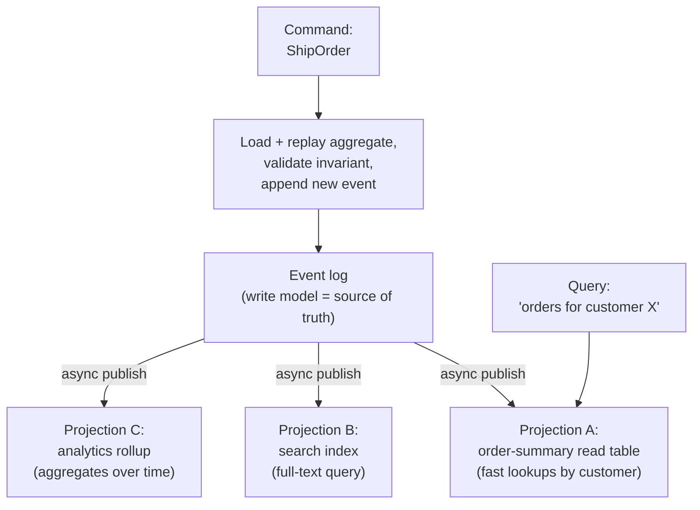

**Decision implications.** Because projections are built asynchronously
from the log, every CQRS read model built this way is, by construction,
**eventually consistent** with the write model — a query issued
microseconds after a command commits may not yet reflect it. This
staleness window, the specific consistency guarantees a projection can
realistically offer, and the concrete techniques for rebuilding or
versioning a projection are the sibling
[CQRS](CH14_CQRS.md) chapter's full teaching responsibility; this chapter
stops at the seam — "the event log is a write model that projections
subscribe to" — and explicitly defers everything about designing,
scaling, or reasoning about the read side to that chapter rather than
re-deriving it here.

**Failure mode.** Treating Event Sourcing and CQRS as one inseparable
package — for example, assuming a system that adopts Event Sourcing must
therefore stand up a separate read-model database, message broker, and
eventual-consistency handling on day one — routinely over-engineers a
system that would have been perfectly well served by a single, small
projection built and queried synchronously in-process, deferring the
distributed, asynchronous read-model machinery until the read-side load
or shape genuinely demands it.

**Scenario.** See
[04_event_store_and_projection.py](../code/python/event-sourcing-chapter/04_event_store_and_projection.py):
`EventStore` is the write model with commands appending `OrderPlaced`/
`OrderShipped`/`OrderCancelled` events; `Projection` is a read model built
purely by folding those events into a `customer_id`-queryable shape; and
the demo proves the read model can always be discarded and rebuilt from
scratch by replaying the raw log, exactly as Section 4.1's core principle
requires.

## 5. Internal Working

This section traces one complete command through an event-sourced system
end to end — placing and then cancelling an order — showing every moving
part from Sections 4.1-4.5 working together.

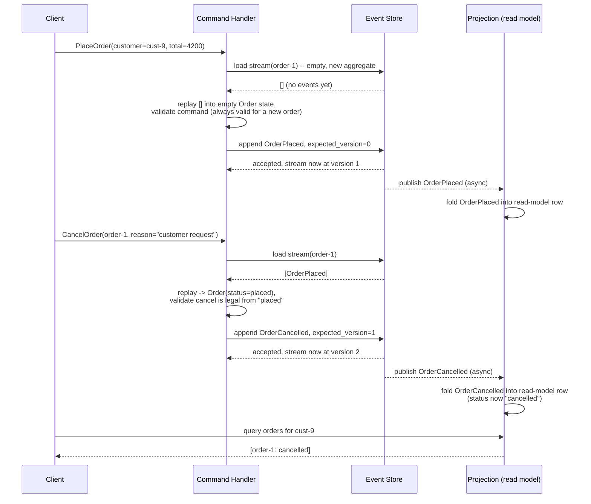

Three details in this trace are easy to skim past but matter operationally:

1. **The command handler always replays before validating.** Even for the
   `CancelOrder` command, the handler does not trust any cached notion of
   "this order is currently placed" — it reloads the stream and folds it
   fresh, so the invariant check ("can only cancel from `placed`, not from
   `shipped`") is always evaluated against truly current state, never a
   potentially stale in-memory copy.
2. **The append's `expected_version` is exactly the version the replay
   just produced.** This is what makes optimistic concurrency (Section
   4.2) automatic rather than a separate step the developer has to
   remember: the version used to validate the command *is* the version
   used to guard the append.
3. **The projection update is decoupled from the append's success.** The
   moment `append()` returns successfully, the command is durably
   committed regardless of whether any projection has processed it yet —
   this is the seam Section 4.5 described, and it is why a query issued
   immediately after a command can, correctly, still show stale data.

## 6. Design Principles

- **Model events as facts, not commands.** An event's name and shape
  should describe something that has *already happened*
  (`OrderCancelled`, past tense) and should never be designed as a
  disguised command or an instruction to another service — that
  distinction is more than naming style; it determines whether the log
  remains a truthful history or quietly becomes a workflow queue in
  disguise.
- **Choose the aggregate boundary before choosing the stream boundary.**
  Section 4.2's optimistic-concurrency guidance follows directly: the
  stream boundary should match the transactional consistency boundary the
  business actually needs (typically one aggregate instance), never
  broader "for convenience" and never narrower than what a single command
  needs to validate atomically.
- **Design event payloads to be complete, not minimal.** An event should
  carry every piece of data a plausible future consumer would need,
  because unlike a current-state system's query, a consumer of an old
  event cannot "go look up more detail" from the aggregate as it existed
  at that historical moment — that state is gone; only the event's own
  payload remains. (This is the same discipline
  [Low-Level Design](CH04_Low_Level_Design.md#417-event-modeling-at-the-classmodule-level)
  Section 4.17 teaches at the single-event, in-process level; here it
  applies to a payload that must remain self-sufficient for years.)
- **Never branch business logic on schema version inside the aggregate.**
  Version-specific handling belongs entirely inside the upcaster chain
  (Section 4.4); the aggregate's `apply()` method should only ever see
  the single current shape, or its logic will accumulate the same kind
  of version-conditional sprawl a current-state system's schema
  migrations are trying to avoid in the first place.
- **Treat the event store's durability guarantee as the whole system's
  durability guarantee.** Because there is no separate "current state"
  copy to fall back on, the event store's own replication and backup
  strategy (see
  [Replication](../06_Databases_and_Storage/CH07_Replication.md) and
  [Replication (Distributed Systems)](CH10_Replication.md)) is not an
  optional hardening step — it *is* the system's data-loss boundary.

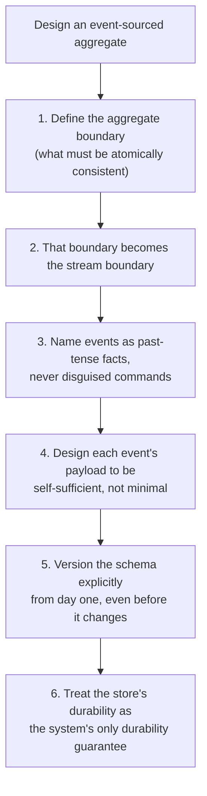

## 7. Architecture Patterns

- **Aggregate-per-stream (the default).** Each aggregate instance owns
  exactly one event stream, keyed by its aggregate ID — the pattern shown
  throughout Section 4 and used by all four code examples. This is the
  right default whenever the business's own consistency boundary is a
  single entity instance.
- **Event Sourcing + CQRS (the canonical pairing, recapped from Section
  4.5).** The write side is an event-sourced aggregate; one or more
  independent projections subscribe to committed events and build
  read-optimized shapes. See [CQRS](CH14_CQRS.md) for the full read-model
  design space this pairing opens up.
- **Process managers / sagas over an event log.** A long-running,
  multi-aggregate workflow (e.g. an order-fulfillment saga spanning
  `Order`, `Inventory`, and `Payment` aggregates) can be driven entirely
  by subscribing to events from each participating aggregate's stream and
  issuing new commands in response — this pattern is recapped here only;
  full Saga mechanics (choreography vs. orchestration, compensating
  actions) are owned by
  [Transactions](../06_Databases_and_Storage/CH08_Transactions.md) and
  this part's forthcoming dedicated Saga Pattern chapter (see
  [PART_OVERVIEW.md](PART_OVERVIEW.md)).
- **Event-carried state transfer between services.** Rather than a
  downstream service calling back into the event-sourced service's API to
  fetch current state, the downstream service subscribes to the upstream
  event stream directly and maintains its own local, denormalized copy —
  reducing runtime coupling at the cost of eventual consistency, the same
  trade-off Section 4.5 describes for in-process projections, applied
  across a service boundary instead.

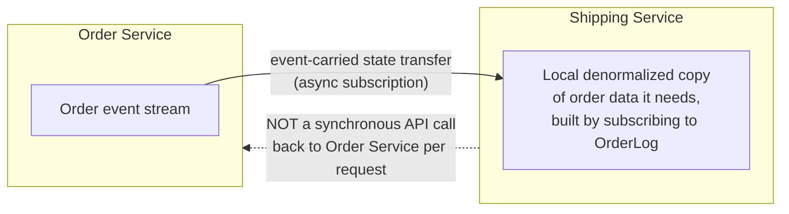

## 8. Production Architecture

A production event-sourcing deployment separates three concerns that the
in-memory demos in this chapter's code examples collapse into a single
process for teaching clarity: durable storage, asynchronous projection
building, and operational visibility into replay health.

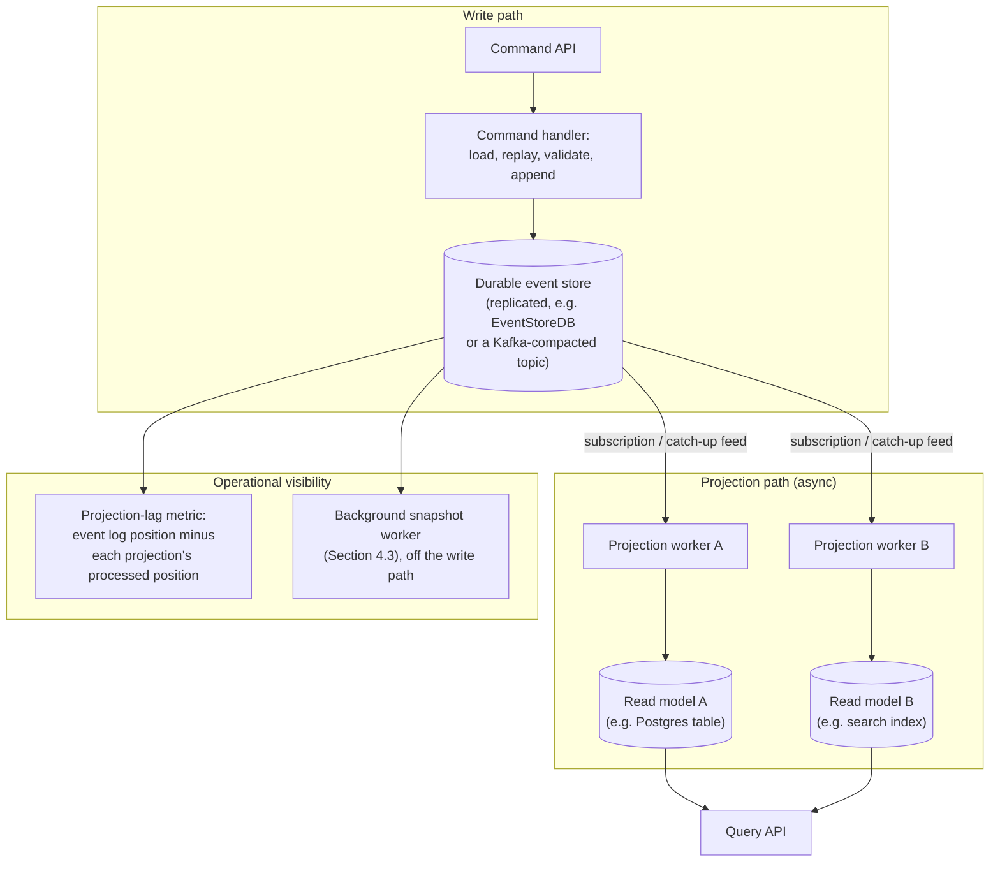

Two production concerns deserve explicit emphasis beyond the diagram:

- **Projection lag is a first-class metric, not an afterthought.** Because
  every read model is eventually consistent by construction (Section
  4.5), operators need to know, at all times, how far behind each
  projection currently is relative to the log's latest committed event —
  without this metric, "why does the UI show stale data" becomes
  undebuggable guesswork instead of a number on a dashboard.
- **Snapshotting runs as its own background process, never inline with
  writes.** Coupling snapshot creation to the write path (Section 4.3)
  would add latency to every command for a benefit (faster future reads)
  the writer making that particular write does not need.

## 9. Implementation

Implementing event sourcing from scratch (rather than adopting a
purpose-built event-store product) requires deciding, deliberately, how
each of the following is represented:

1. **Event serialization format.** JSON is the most common choice for
   readability and schema flexibility (supports Section 4.4's upcasting
   naturally, since a JSON payload can gain fields without breaking older
   readers); binary formats (Protocol Buffers, Avro) trade some
   readability for compactness and built-in schema-registry tooling.
2. **Stream storage substrate.** A relational table with a
   `(aggregate_id, version, event_type, schema_version, payload,
   recorded_at)` schema and a unique constraint on `(aggregate_id,
   version)` is a perfectly viable starting point (this is exactly what
   the `EventStore` classes in this chapter's code examples model, minus
   the durability); a Kafka topic partitioned by `aggregate_id` with log
   compaction is a common streaming-native alternative; a purpose-built
   product (EventStoreDB) provides both natively along with built-in
   subscriptions and projections.
3. **Idempotent projection application.** Because a projection worker
   can crash and restart, it must track the last event position it
   successfully applied and resume from there — reapplying an event it
   already processed must never double-count (e.g. store the applied
   position transactionally alongside the projection's own write).
4. **Command-handler retry policy.** The optimistic-concurrency reject
   path (Section 4.2) needs an explicit, bounded retry policy (reload,
   re-validate, re-attempt, with a maximum attempt count and backoff) —
   an unbounded retry loop under sustained contention can itself become
   an availability problem.

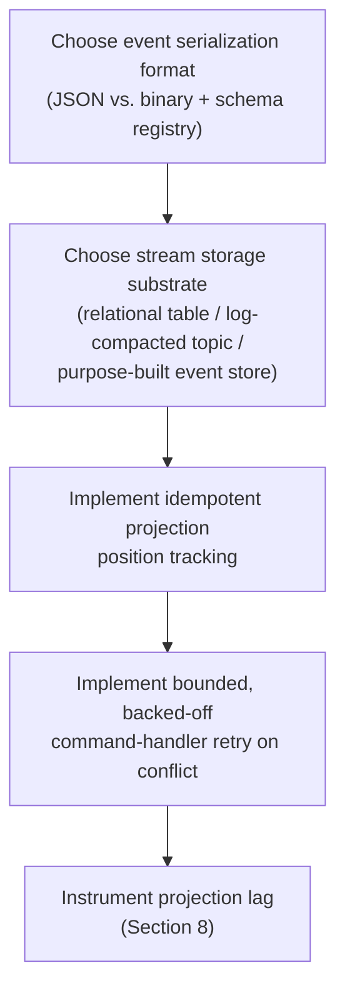

## 10. Complete Code Examples

Four runnable, self-contained Python examples accompany this chapter under
[code/python/event-sourcing-chapter/](../code/python/event-sourcing-chapter/):

1. **[01_event_sourced_aggregate.py](../code/python/event-sourcing-chapter/01_event_sourced_aggregate.py)**
   — a complete event-sourced `Account` aggregate: `apply()`/`replay()`
   folding, command methods that validate against replayed state and
   return new events, an in-memory `EventStore` enforcing
   optimistic-concurrency via expected-version checks, and a demonstrated
   `ConcurrencyConflictError` when a stale writer's append is correctly
   rejected.
2. **[02_snapshotting.py](../code/python/event-sourcing-chapter/02_snapshotting.py)**
   — an `InventoryCounter` aggregate accumulating 175 events, an
   `EventStoreWithSnapshots` that snapshots every 50 events, a
   load-with-snapshot-then-replay-tail implementation, a measured latency
   comparison between full replay and snapshot-assisted load, and an
   explicit assertion proving the snapshot-assisted result is identical
   to a from-scratch replay (the caching invariant from Section 4.3).
3. **[03_event_upcasting.py](../code/python/event-sourcing-chapter/03_event_upcasting.py)**
   — three raw `UserRegistered` events frozen at schema versions 1, 2,
   and 3 exactly as originally written, an `upcast_to_current()` chain
   walking each through the appropriate upcaster functions, and explicit
   demonstrations of the sharp edge from Section 4.4: a v1 event's
   missing name field gets an auditable placeholder (never fabricated
   data), and a pre-GDPR v2 event's consent field defaults to the
   compliance-safe `False`.
4. **[04_event_store_and_projection.py](../code/python/event-sourcing-chapter/04_event_store_and_projection.py)**
   — an `EventStore` as the CQRS write model for `Order` aggregates, a
   `Projection` read model built purely by folding published events into
   a customer-queryable shape, and a proof that the projection can always
   be discarded and rebuilt from scratch by replaying the raw log —
   illustrating Section 4.5's write-model/read-model seam without
   re-teaching full CQRS mechanics.

All four were executed end-to-end during authoring and produce the output
shown in each file's inline comments; none require any external
dependency beyond the Python standard library.

## 11. Performance

Event sourcing's dominant performance lever is the one Section 4.3
already introduced — snapshotting — but three additional considerations
matter in practice:

- **Append latency scales with stream contention, not stream length.**
  Appending to a stream with 10 million historical events is not
  inherently slower than appending to a brand-new stream, because the
  append itself is a single insert guarded by a version check — what
  actually costs latency is *replay* time on load, which snapshotting
  bounds.
- **Batch-append where a single command produces multiple events.** Some
  commands legitimately produce more than one event (e.g. a bulk-import
  command producing many `ItemAdded` events); appending them as a single
  atomic batch under one expected-version check, as
  [02_snapshotting.py](../code/python/event-sourcing-chapter/02_snapshotting.py)'s
  batched `append()` calls do, is both more efficient and preserves
  atomicity — either the whole batch commits or none of it does.
- **Projection throughput, not event-store throughput, is usually the
  first bottleneck at scale.** A single event store can typically sustain
  very high append throughput; a projection worker doing expensive
  per-event work (a network call to enrich data, a slow database write)
  falls behind the log far sooner, which is exactly why Section 8 treats
  projection lag as a first-class operational metric rather than an edge
  case.

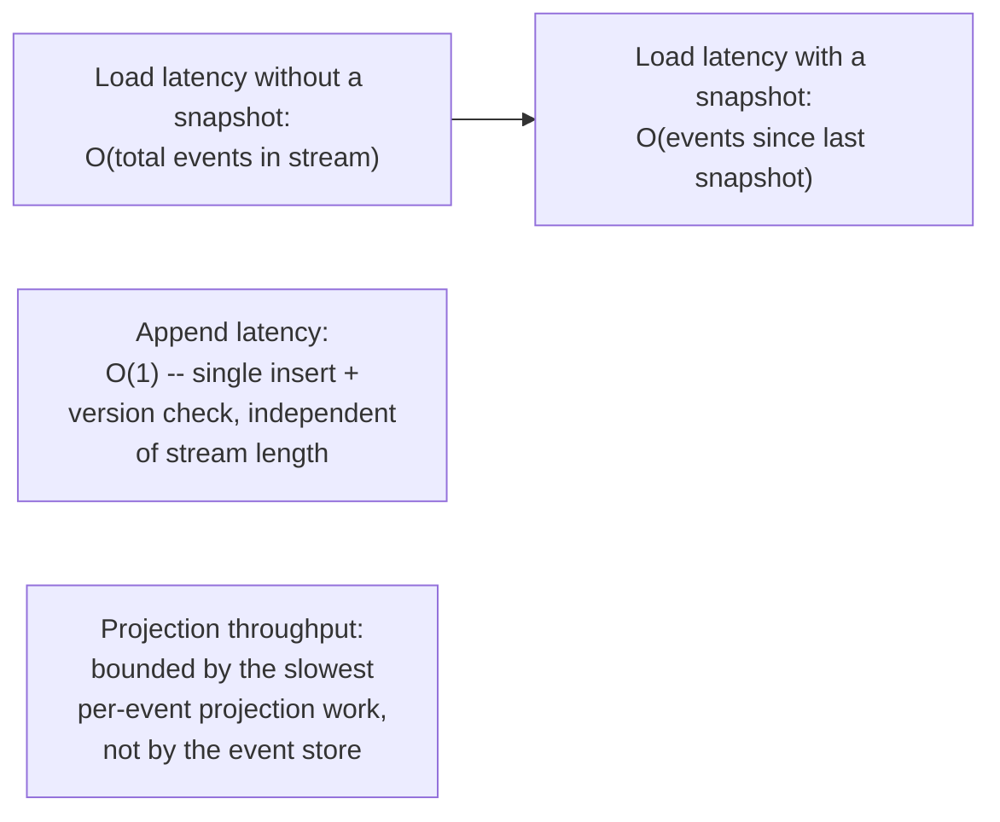

## 12. Scalability

- **Streams scale horizontally by aggregate ID.** Because each aggregate
  owns its own independent stream, an event store can shard/partition by
  aggregate ID exactly the way [Sharding](../06_Databases_and_Storage/CH06_Sharding.md)
  and [Partitioning (Distributed Systems)](CH11_Partitioning.md) already
  teach generically for any keyed data — there is no cross-stream
  coordination required for ordinary appends, so this scales the write
  path close to linearly with the number of independent aggregates.
- **Projections scale independently of the write path.** A slow or
  expensive projection can be scaled out (more workers, partitioned by
  aggregate ID or by a hash of it) without touching the write path at
  all — this separation of write-scaling and read-scaling concerns is
  precisely the operational benefit CQRS (Section 4.5,
  [CQRS](CH14_CQRS.md)) is built to deliver.
- **A single "hot" aggregate remains a scaling ceiling.** If one specific
  aggregate instance (e.g. a single, extremely popular product's
  inventory count) receives disproportionate write traffic, no amount of
  horizontal stream sharding helps, because all of that aggregate's
  writes are still serialized through its one stream's version check —
  this is the same hot-partition problem
  [Partitioning](../06_Databases_and_Storage/CH05_Partitioning.md) and
  [Cassandra](../06_Databases_and_Storage/CH18_Cassandra.md) both
  recapped for their own keyed-write scenarios, applied here to event
  streams specifically.

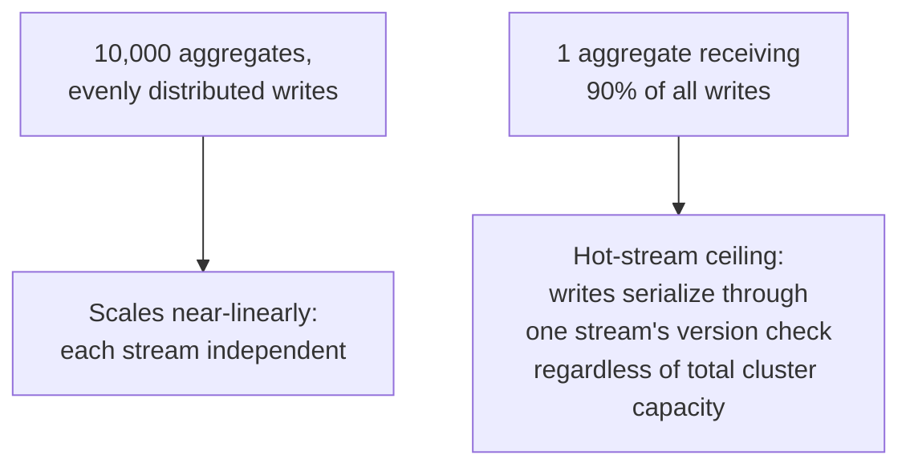

## 13. Security

- **The event log is itself sensitive data, permanently.** Because events
  are never deleted, any personally identifiable information (PII)
  captured in an event payload (an email address, a full name) remains in
  the system forever by default — this directly conflicts with data
  regulations that grant a "right to erasure" (e.g. GDPR Article 17), and
  the resolution is almost always architectural rather than
  after-the-fact: encrypt PII fields per-subject with a key that can
  itself be destroyed (crypto-shredding) so the event payload becomes
  permanently unreadable without ever literally deleting the event.
- **Access control belongs on the command and query APIs, not on
  individual events inside the log.** An event store is rarely the right
  place to enforce row-level authorization directly; the command handler
  (validating who may issue a command) and the query API (validating who
  may read a projection) are the natural enforcement points, consistent
  with how [OAuth](../05_Networking_and_OS/CH19_OAuth.md) and
  [OIDC](../05_Networking_and_OS/CH20_OIDC.md) already teach
  authorization/authentication generally.
- **Encrypt the event store at rest and in transit.** Given that the
  event log is the *only* durable copy of history in this architecture
  (Section 6), its encryption-at-rest and TLS-in-transit posture (see
  [TLS](../05_Networking_and_OS/CH06_TLS.md)) is not optional hardening —
  it is protecting the system's sole source of truth.

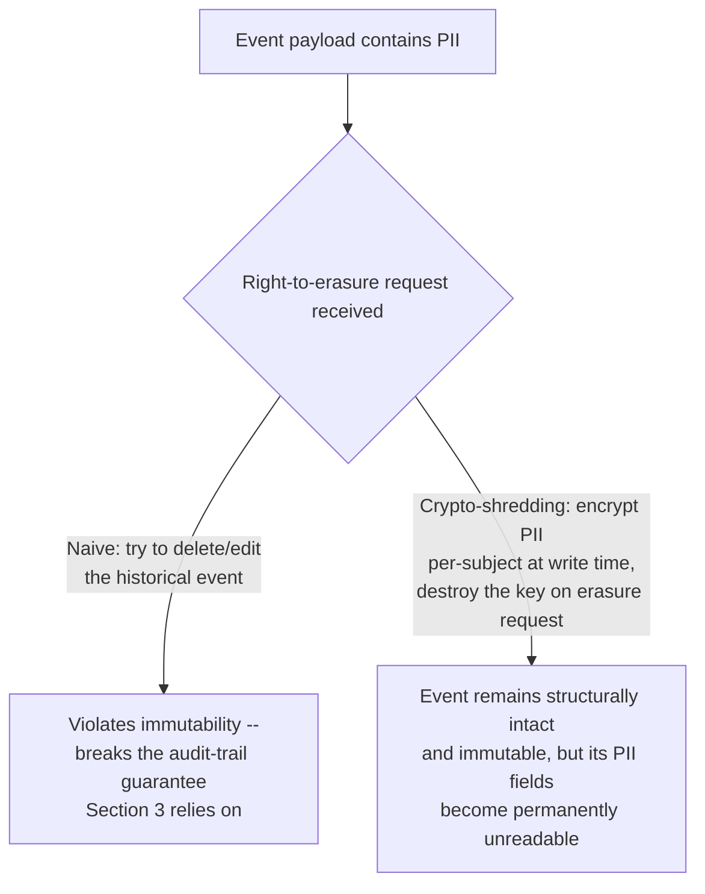

## 14. Observability

- **Projection lag** (Section 8) is the single most important
  event-sourcing-specific metric: the gap, in event count or wall-clock
  time, between the log's latest committed position and each
  projection's last-processed position.
- **Concurrency-conflict rate** on append surfaces genuine business
  contention (multiple users editing the same aggregate concurrently) or
  a stream-boundary design mistake (Section 4.2's failure mode) — a
  sudden spike in this metric after a deploy is a strong signal to check
  whether a recent change accidentally widened a stream's scope.
- **Replay duration percentiles** on aggregate load reveal whether the
  current snapshot cadence (Section 4.3) still matches the aggregate's
  actual event-accumulation rate — a creeping p99 replay latency is the
  earliest warning that a snapshot interval needs tightening before it
  becomes a user-facing latency problem.
- **Upcaster invocation counts by schema version** give visibility into
  how much of the live traffic is still touching genuinely old event
  shapes, informing when (or whether) an old upcaster can safely be
  retired versus needing indefinite support (Section 4.4's failure mode).

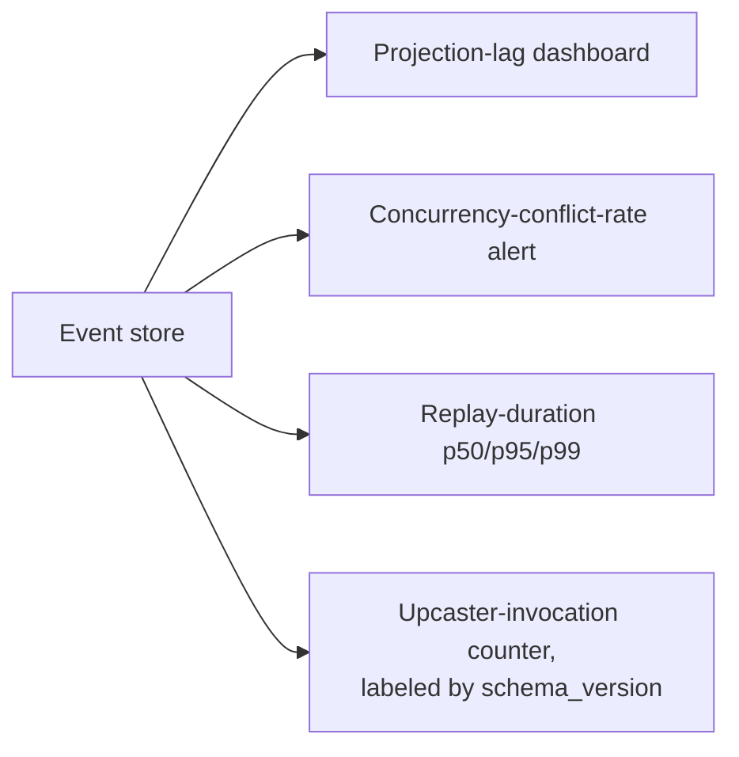

## 15. Failure Scenarios

- **Stale reads immediately after a write.** A client that writes a
  command and then immediately queries a projection may see the
  pre-command state, because projection application is asynchronous
  (Section 4.5) — the mitigation, when the UX genuinely requires
  read-your-own-writes, is typically to have the command API return the
  new version and have the client's subsequent query wait for (or poll
  until) the projection reaches that version, not to make projections
  synchronous by default.
- **A poison event blocks an entire projection.** If one malformed or
  unexpectedly-shaped event causes a projection worker to throw an
  unhandled exception, and the worker's retry logic simply retries the
  same event forever, the *entire* projection stalls behind that one bad
  event — the standard mitigation is a dead-letter path (log the poison
  event, skip it, alert, and let a human intervene) rather than an
  infinite blocking retry.
- **A runaway event-producing bug floods a stream.** A bug that
  repeatedly appends the same event in a retry loop (for example, a
  client that doesn't correctly detect its own earlier success and
  resubmits) can inflate a single stream's version count dramatically —
  idempotency keys on commands (see the forthcoming
  [Idempotency](PART_OVERVIEW.md) chapter) are the standard defense,
  rejecting a duplicate command before it ever produces a duplicate
  event.
- **Snapshot/event-log divergence after a bug fix.** If a bug in the
  `apply()` fold logic is fixed, existing snapshots taken with the *buggy*
  fold logic are now silently wrong relative to a correct replay —
  snapshots must be invalidated (or all recomputed) whenever fold logic
  itself changes, not just when the event schema changes.

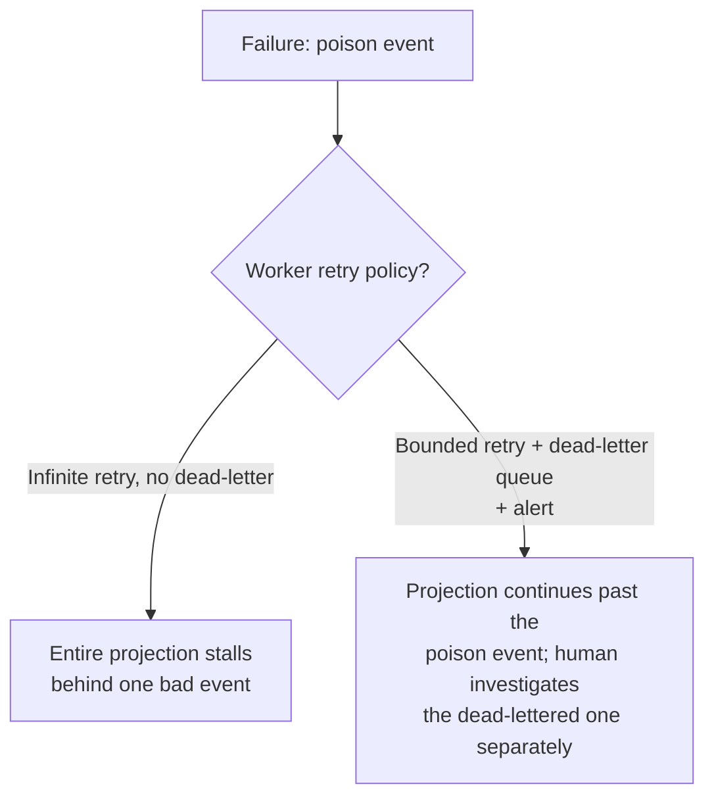

## 16. Testing

- **Given/When/Then aggregate tests map directly onto event sourcing's
  own shape.** "Given these prior events, When this command is issued,
  Then these new events should result (or this specific exception should
  be raised)" is a natural, precise unit-test structure for an
  event-sourced aggregate, because the aggregate's entire public
  contract is exactly "replay events, validate a command, produce
  events" — see
  [01_event_sourced_aggregate.py](../code/python/event-sourcing-chapter/01_event_sourced_aggregate.py)'s
  `Account.deposit()`/`withdraw()`/`close()` methods, each independently
  testable this way without any event-store dependency at all.
- **Property-based replay tests catch fold-function bugs.** Generating
  random valid event sequences and asserting that replaying them twice
  (or replaying a snapshot-assisted subset versus a full from-scratch
  replay, as
  [02_snapshotting.py](../code/python/event-sourcing-chapter/02_snapshotting.py)'s
  final assertion does) always produces identical state is a
  high-leverage test category specific to this pattern.
- **Upcaster chain tests must pin exact historical payloads.** Because a
  production event store may contain events written years ago in a
  format no longer produced, upcaster tests should use literal,
  hand-written raw payloads captured from (or representative of) real
  historical data — never only synthetic events generated by the
  *current* code, which would never exercise the old shapes upcasting
  exists to handle.
- **Concurrency-conflict tests should simulate the interleaving
  explicitly**, not rely on real thread races — deterministically load
  two aggregate copies, append from one, then assert the second's append
  is rejected, exactly as
  [01_event_sourced_aggregate.py](../code/python/event-sourcing-chapter/01_event_sourced_aggregate.py)'s
  `main()` demonstrates.

## 17. Common Mistakes

- **Storing a "current state" column alongside the events "for
  convenience"** and reading from it instead of replaying — silently
  reintroducing current-state persistence with a redundant, driftable
  log (Section 4.1's failure mode).
- **Choosing a stream boundary broader than the true consistency
  boundary**, creating artificial concurrency conflicts between unrelated
  writes (Section 4.2's failure mode).
- **Renaming an event type in place** instead of adding a new schema
  version, permanently orphaning every already-stored event of the old
  name (Section 4.4's failure mode).
- **Coupling snapshot creation to the write path**, adding latency to
  every command for a benefit only future reads receive (Section 8).
- **Assuming Event Sourcing requires CQRS (or vice versa)**, and
  over-engineering a full asynchronous read-model pipeline for a system
  that only ever needed a single, synchronous, in-process projection
  (Section 4.5's failure mode).
- **Designing minimal event payloads** that force every future consumer
  to re-fetch additional context that no longer exists at the time it's
  needed (Section 6).

## 18. Best Practices

- Name every event in the past tense, and design its payload to be
  self-sufficient (Section 6).
- Match the stream boundary to the true transactional consistency
  boundary — usually exactly one aggregate instance (Section 4.2).
- Version every event's schema explicitly from the very first event
  type you write, even before you have any reason to believe it will
  ever change (Section 4.4) — retrofitting versioning onto
  already-unversioned historical events is far harder than starting with
  it.
- Snapshot asynchronously, off the write path, and periodically verify
  that a from-scratch replay still matches the snapshot-assisted result
  (Section 4.3's invariant, proven directly in
  [02_snapshotting.py](../code/python/event-sourcing-chapter/02_snapshotting.py)).
- Instrument projection lag, concurrency-conflict rate, and replay
  duration from day one (Section 14) — these are the metrics that make
  the difference between "we noticed the read model was stale" and "a
  customer noticed first."
- Keep every version of every upcaster alive indefinitely, or until a
  deliberate, documented decision retires support for events that old
  (Section 4.4).

## 19. Anti-Patterns

- **Event Sourcing as a default, not a deliberate choice.** Applying the
  pattern to every aggregate in a system regardless of whether any of
  Section 3's four motivating problems actually apply is the single
  costliest anti-pattern — the operational complexity (durable event
  store, projection infrastructure, upcasting discipline) is real and
  ongoing, and should be paid for only where the audit trail, retroactive
  querying, deterministic-replay debugging, or multi-shape read
  requirements are genuine, present needs.
- **Using the event log as a synchronous inter-service RPC mechanism.**
  Treating "publish an event" as equivalent to "call another service and
  wait for its response" defeats the asynchronous decoupling the pattern
  is built to provide and reintroduces tight coupling through a
  misleadingly indirect-looking channel.
- **"Fixing" bad historical data by mutating stored events directly**
  instead of appending an honest compensating event — this is the
  single fastest way to destroy the audit-trail guarantee that
  motivated adopting the pattern in the first place (Section 3).
- **One giant, un-versioned event schema evolving informally over time**
  with no upcaster discipline, until the codebase accumulates ad hoc
  `if "old_field" in payload:` branches scattered throughout business
  logic instead of contained inside a proper upcaster chain (Section
  4.4's design principle).

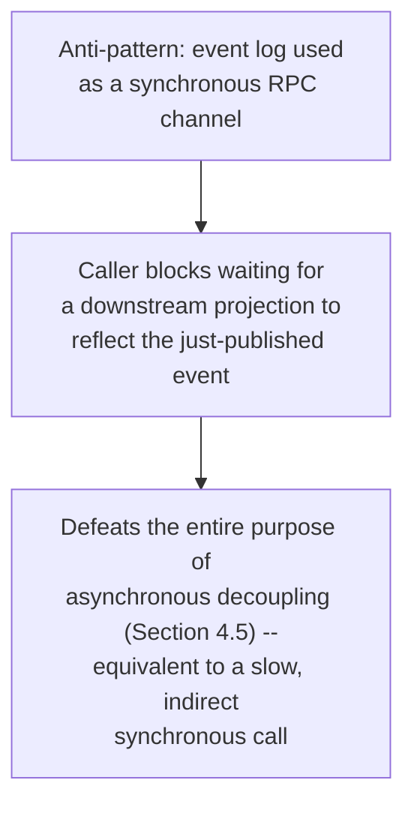

## 20. Trade-off Analysis

| Dimension | Current-state persistence | Event Sourcing |
|---|---|---|
| Historical/audit queries | Requires a separate, bolted-on audit log | Native — the log *is* the history |
| Debugging a bad current state | Only the bad state itself is available | Deterministic replay of the exact producing sequence |
| New read-model requirements | Often a schema migration + backfill | New projection over already-captured events |
| Storage growth | Bounded by current entity count | Unbounded (mitigated, not eliminated, by snapshotting) |
| Query-path complexity | Simple — read the current row directly | Requires replay or a maintained projection |
| Right-to-erasure (GDPR) compliance | Straightforward row deletion | Requires crypto-shredding or similar (Section 13) |
| Schema change cost | Migration script, applies once | Upcaster chain, must be maintained indefinitely (Section 4.4) |
| Operational surface area | Smaller (one storage system) | Larger (event store + projection infrastructure) |

## 21. Comparison Table

| Approach | Write model | Read model | Best fit |
|---|---|---|---|
| Plain current-state persistence | Row/document, overwritten in place | Same row/document | Simple CRUD (Create, Read, Update, Delete) with no audit/history requirement |
| Current-state persistence + audit log table | Row overwritten + a separate append-only audit table | Current row (audit table rarely queried directly) | Compliance needs bolted onto an existing simple system |
| Event Sourcing, no CQRS | Event log per aggregate | Same aggregate, rebuilt by in-process replay on each read | Audit/replay needs, but only one simple read shape |
| Event Sourcing + CQRS (Section 4.5) | Event log per aggregate | One or more independently-scaled, purpose-built projections | Audit/replay needs *and* divergent read-shape or read-scale requirements |
| CQRS without Event Sourcing | Current-state persistence | Denormalized read replica/table kept in sync via Change Data Capture (CDC) | Read/write scaling split needed, but no audit/replay requirement |

## 22. Real-World Case Study

**LMAX Exchange's Disruptor-based trading architecture (published
2010-2011).** LMAX, a UK-based foreign-exchange trading venue, published
a widely cited architecture built around the same "log is truth, state is
derived" principle taught in this chapter, at extreme throughput and
extreme correctness requirements: every incoming order is written, in
strict sequence, to a durable input-event journal before any matching
logic runs against it; the entire order book's current state is rebuilt
by replaying that journal, single-threaded, deterministically, in memory.
The single-threaded replay (no concurrent writers to reason about,
sidestepping locking overhead entirely) combined with the journal's
strict ordering let LMAX process millions of orders per second on
commodity hardware while retaining the ability to replay the exact
sequence of trading events that produced any historical order-book
state — precisely the debugging and audit guarantees Section 3
identifies as Event Sourcing's core motivations, demonstrated at a scale
and correctness bar (real money, real regulatory scrutiny) that leaves no
room for an approximate or "close enough" replay.

The lesson generalizes beyond finance: LMAX's architecture is frequently
cited as proof that "the log is the single source of truth, state is a
derived, replayable projection" is not merely an academic ideal but a
production-proven approach capable of extreme performance specifically
*because* of, not despite, its strict sequencing discipline — the same
discipline this chapter's
[01_event_sourced_aggregate.py](../code/python/event-sourcing-chapter/01_event_sourced_aggregate.py)
demonstrates at a much smaller, illustrative scale.

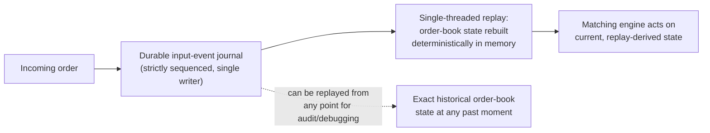

## 23. Interview Questions

1. Explain, in your own words, why current state in an event-sourced
   system is described as "derived" rather than "stored." What would go
   wrong if a developer added a `current_balance` column directly to the
   event-store table and read from it?
2. Walk through what happens, step by step, when two concurrent writers
   attempt to append to the same aggregate's stream at the same expected
   version. Why is this handled optimistically rather than with a
   distributed lock?
3. A team wants to snapshot every single event (N=1) to keep replay as
   fast as theoretically possible. What is wrong with this choice, and
   what would you recommend instead?
4. An event's schema needs a new required field. Walk through exactly how
   you would introduce that change without breaking any already-stored
   event, and explain why a straightforward relational-style migration
   script is not available to you here.
5. Is Event Sourcing the same thing as CQRS? Justify your answer with a
   concrete example of a system that uses one without the other.
6. A regulator asks your team to prove that a specific account's balance
   was correctly computed on a specific historical date. How does an
   event-sourced system answer this question, and how would a
   current-state system with only a nightly backup answer it?
7. What does "eventually consistent read model" mean in the context of a
   projection built from an event log, and what is one concrete UX
   mitigation for the read-your-own-writes problem it can cause?

## 24. Hands-on Exercises

1. Extend [01_event_sourced_aggregate.py](../code/python/event-sourcing-chapter/01_event_sourced_aggregate.py)
   with a new event type, `AccountFrozen`, and a `freeze()` command
   method that raises it; update `apply()` to handle it, and add a
   business rule that both `deposit()` and `withdraw()` must reject any
   command once an account is frozen, mirroring the existing
   `AccountClosedError` pattern.
2. Modify [02_snapshotting.py](../code/python/event-sourcing-chapter/02_snapshotting.py)'s
   snapshot cadence to trigger on wall-clock time elapsed since the last
   snapshot in addition to event count, and measure how the total number
   of snapshots taken changes for a simulated burst of 175 events
   arriving within one second versus spread across several minutes.
3. Add a fourth schema version to [03_event_upcasting.py](../code/python/event-sourcing-chapter/03_event_upcasting.py)
   (for example, splitting `full_name` into `first_name`/`last_name`),
   write the corresponding `upcast_v3_to_v4` function, and verify all
   three original v1/v2/v3 raw events still upcast correctly through the
   now-three-hop chain.
4. In [04_event_store_and_projection.py](../code/python/event-sourcing-chapter/04_event_store_and_projection.py),
   add a second projection that maintains a running count of cancelled
   orders per cancellation reason, and prove — the same way the existing
   demo proves the first projection — that it can be rebuilt from
   scratch by replaying the raw event log.

## 25. Design Exercises

1. Design the event schema and stream boundary for a ride-hailing
   platform's trip lifecycle (`TripRequested`, `DriverAssigned`,
   `TripStarted`, `TripCompleted`, `TripCancelled`). Identify what should
   be one aggregate/stream per trip versus what needs its own separate
   stream (for example, should a driver's real-time location updates
   live in the same stream as trip lifecycle events, or a separate one?
   Justify your answer using Section 4.2's stream-boundary guidance.).
2. A finance team needs a report showing, for every calendar month over
   the last three years, how many accounts were opened and immediately
   closed within 24 hours. Design how this report would be produced in
   an event-sourced system versus in the current-state system it is
   replacing, and identify what data the current-state system's team
   would have to admit does not exist.
3. Design an upcasting strategy for an event whose meaning fundamentally
   changed, not just gained a field — for example, an original
   `PaymentProcessed` event that assumed a single payment method, later
   needing to represent split payments across multiple methods. Where
   does upcasting reach its limit, and what alternative approach (a new
   event type entirely, versus an upcaster) would you choose, and why?
4. Design the operational runbook for the poison-event failure scenario
   in Section 15: what specific alert fires, what dashboard does the
   on-call engineer check first, and what is the exact sequence of
   actions to safely skip the poison event without silently losing data
   or blocking the projection indefinitely?

## 26. Architecture Review Questions

- Does every event in this design read as a fact that already happened,
  in the past tense, or does any of them secretly function as a command
  or instruction to another service?
- Is the proposed stream boundary the same as the aggregate's true
  transactional consistency boundary, or is it broader (creating
  artificial contention) or narrower (unable to enforce a real
  invariant atomically)?
- Is every event's schema explicitly versioned, with an upcaster chain
  design in place, before the first event of that type is ever written
  to production?
- Is snapshot creation fully decoupled from the write path, and is there
  a periodic, automated check proving snapshot-assisted state matches a
  from-scratch replay?
- Does this design actually need Event Sourcing (per Section 3's four
  motivating problems), or would CQRS alone, or plain current-state
  persistence, satisfy the real requirement with less operational
  complexity?
- Is projection lag instrumented and alerted on, and has the team
  explicitly decided how read-your-own-writes UX expectations will be
  handled given eventual consistency?
- Is there a documented, tested plan for handling personally
  identifiable information (PII) inside event payloads given the
  right-to-erasure requirement (Section 13)?

## 27. Summary

Event Sourcing replaces "store the current state" with "store every fact
that ever happened, and derive current state by replaying it" — a genuine
architectural bet, not a storage-layer implementation detail. The event
log is the single source of truth (Section 4.1); an event store enforces
safe concurrent writes per aggregate stream via optimistic-concurrency
expected-version checks (Section 4.2); snapshotting keeps replay
affordable at scale without ever compromising the log's status as the
sole fact (Section 4.3); event schema evolution demands upcasting rather
than the in-place rewrites a current-state migration would use, because
historical events can never be deleted or rewritten (Section 4.4); and
the pattern pairs naturally, but not necessarily, with CQRS, serving as
one specific implementation of a CQRS write side (Section 4.5, fully
taught in the sibling [CQRS](CH14_CQRS.md) chapter). The pattern earns its
real operational cost — durable event-store infrastructure, projection
pipelines, and permanent upcasting discipline — specifically where audit
history, retroactive querying, deterministic-replay debugging, or
multiple divergent read shapes are genuine requirements (Section 3), and
should be deliberately avoided as a reflexive default everywhere else
(Section 19).

## Further Reading

- [Low-Level Design](CH04_Low_Level_Design.md) — the class/module-level
  Domain Event building block this chapter builds one level of
  abstraction above.
- [CQRS](CH14_CQRS.md) — the full read/write split, projection design
  space, and staleness trade-offs this chapter's Section 4.5 recaps.
- [Transactions](../06_Databases_and_Storage/CH08_Transactions.md) — the
  write-ahead log (WAL) precedent (Section 2) and the Saga pattern
  recapped in Section 7.
- [Distributed Transactions](CH12_Distributed_Transactions.md) — the
  transactional outbox pattern, a common companion to event publication
  from a service that is not itself fully event-sourced.
- [Replication (Distributed Systems)](CH10_Replication.md) — queue/log
  replication mechanics relevant to an event store's own durability
  guarantees (Section 6).
- [Time Series Databases](../06_Databases_and_Storage/CH22_Time_Series_Databases.md)
  — a different domain that also relies on write-optimized, append-only,
  time-ordered storage, contrasted briefly in this chapter's staging
  file.
