# Chapter 16: Idempotency

## 1. Introduction

Distributed systems repeat work. A client can send a request, lose its connection before the reply arrives, and have no way to know whether the server committed the operation. A broker can deliver a message again after a consumer commits its database write but crashes before acknowledging the delivery. A worker can time out while a downstream service continues running. In all three cases, retrying is often the only practical path to progress, but repeating a non-idempotent effect can charge a customer twice, create two orders, or apply the same inventory decrement twice.

**Idempotency** is the reliability property that makes such repetition safe: applying the same logical operation one or more times has the same externally meaningful effect as applying it once. It does not mean the handler executes only once, nor does it promise that every intermediate observation is identical. It means the system recognizes repeat attempts as the same logical operation or expresses the state change so that repetition converges to the same result.

This chapter owns idempotency as a general application and distributed-systems pattern: operation identity, request-key design, durable result replay, atomic deduplication, naturally repeat-safe writes, guarded state transitions, and idempotent message consumers. The [HTTP chapter](../05_Networking_and_OS/CH01_HTTP.md) remains the owner of HTTP (Hypertext Transfer Protocol) method semantics. This chapter briefly recaps its narrower method-level contract and generalizes beyond HTTP verbs to business operations, jobs, events, and side effects. It also distinguishes an exactly-once *effect* built on at-least-once delivery from exactly-once processing as a broader end-to-end systems claim. Future [Exactly-Once Processing](CH17_Exactly_Once_Processing.md) and [Deduplication](CH19_Deduplication.md) chapters are forward references for their full treatments.

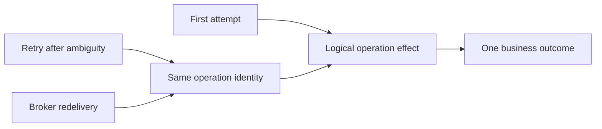

Idempotency is not a substitute for authorization, validation, transactional integrity, or concurrency control. It is a design property at the boundary where work can be repeated. A correct implementation starts by stating what counts as the *same logical operation*, what outcome must remain stable, and which side effects are inside the guarantee.

## 2. Historical Evolution

The word *idempotent* comes from algebra, where applying an operation repeatedly does not change its result beyond the first application. In software, the term first became operationally familiar through mathematical functions, command-line administration, and declarative configuration: “ensure this account exists” can run repeatedly, while “increment this counter” cannot. Networked applications made the distinction more consequential because failure could occur after the receiver acted but before the sender learned the outcome.

HTTP formalized a related but deliberately narrower use. Its method semantics classify methods by whether repeating the same request has the same intended effect on the target resource. That property supports safe protocol-level retry decisions; it does not automatically make every downstream side effect or business workflow repeat-safe. See [HTTP method semantics](../05_Networking_and_OS/CH01_HTTP.md) for the owned definition and protocol details.

As APIs, payment integrations, asynchronous queues, and service-oriented systems grew, applications needed operation identity that was independent of a transport method. A payment-creation operation may use HTTP POST, yet still need repeat safety after an ambiguous timeout. A message broker may redeliver a command that has no HTTP request at all. Idempotency keys, unique constraints, conditional writes, and processed-message records emerged as complementary ways to preserve one business outcome across those retries.

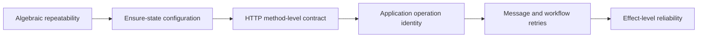

Modern practice treats idempotency as a contract spanning caller, service, persistence, and side-effect boundaries. The key itself is not magic: it must be stable across retries, scoped to the right principal and operation, retained long enough, and committed atomically with the effect it protects. The current pattern is therefore not merely “add a header,” but “design an operation identity and a durable convergence rule.”

## 3. Why It Exists

A timeout describes what the caller observed, not what the receiver did. The service may have committed and lost the response, or it may have failed before committing. The caller cannot distinguish those possibilities from the timeout alone. If it retries with a new identity, it can create a duplicate. If it never retries, it can abandon an operation that never happened. Idempotency lets the caller retry while allowing the receiver to resolve that uncertainty safely.

At-least-once delivery makes the same problem explicit. Systems commonly prefer redelivery to silent message loss: a broker or scheduler keeps trying until it receives an acknowledgment. This shifts the contract from “the message arrives once” to “the message may arrive more than once.” When consumer effects are idempotent, at-least-once delivery can yield one durable business outcome without requiring the transport to provide a magical global single execution.

The pattern is especially valuable when an operation is costly, irreversible, externally visible, or difficult to reconcile: charging a payment, provisioning a cloud resource, issuing a refund, placing an order, sending a notification, or updating a projection. It is less useful for a pure read or a naturally convergent assignment such as “set desired replica count to five,” unless repeated evaluation itself has meaningful cost or side effects.

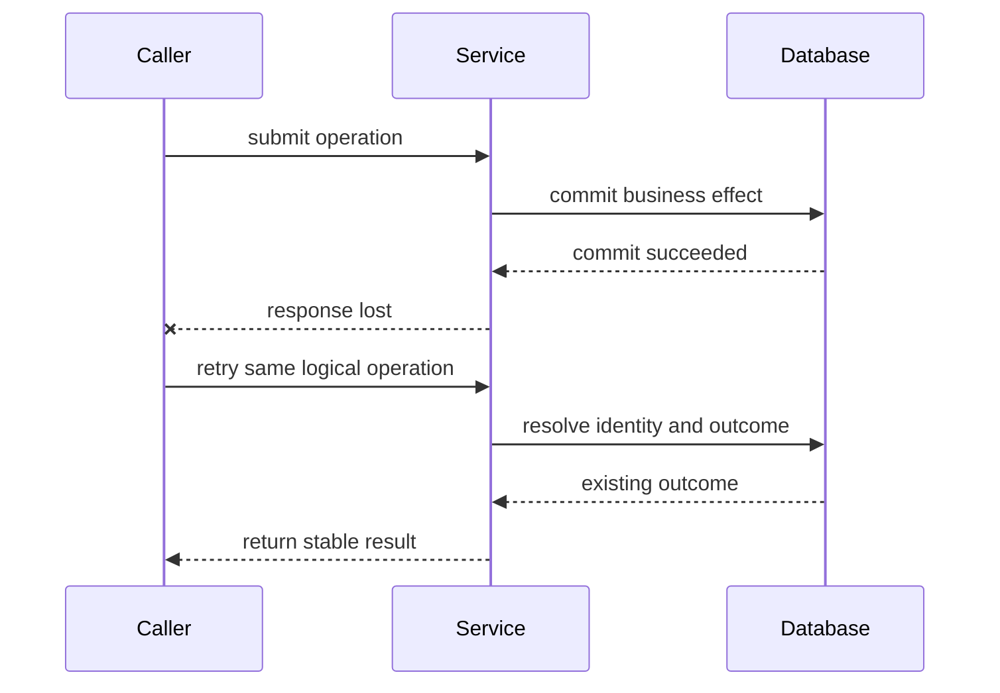

The architecture needs an explicit answer to four questions: where operation identity originates; where it is stored; how a claim and effect are made atomic; and how long duplicate attempts remain recognizable. The rest of this chapter turns those into concrete choices.

## 4. Core Concepts

### 4.1 General operation idempotency versus HTTP method semantics

**Definition.** General operation idempotency is a property of a logical application action: repeating the same operation, with the same intent and relevant inputs, produces no additional business effect after the first successful application. HTTP method idempotency is a narrower protocol-level classification of the intended effect of repeating a request to a target resource. This subsection recaps the latter only; [HTTP](../05_Networking_and_OS/CH01_HTTP.md) owns method semantics, including the safety and idempotency distinctions for GET, PUT, and DELETE.

**Mechanism.** A verb does not, by itself, identify a business operation across time. A state-setting request such as PUT can be method-idempotent when it sets a resource representation to a fixed value, while a POST request to create a payment may require a caller-supplied key to ensure repeated submissions map to the same payment. Likewise, a broker command, scheduled job, Saga step, or administrative action can be idempotent without any HTTP request or method involved. The application-level contract names the operation and its identity; transport semantics remain an input, not the whole guarantee.

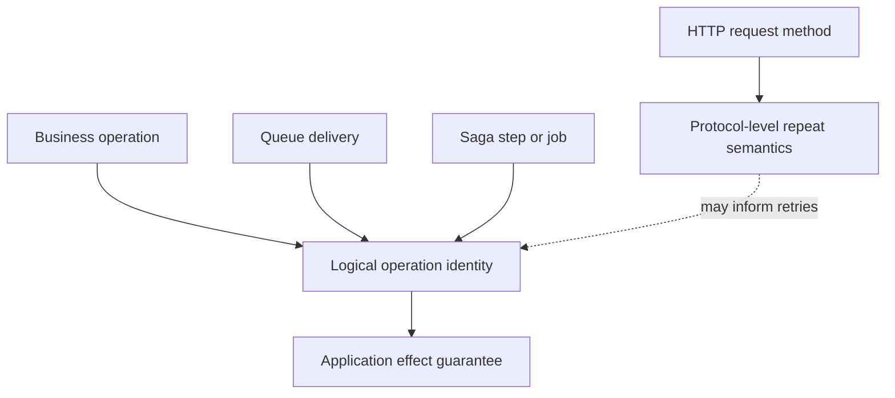

**Decision implications.** Keep method semantics in the HTTP layer and make application idempotency explicit where a business action can be retried. A service should not infer “safe to repeat” only from POST versus PUT, nor should it force every operation through an idempotency-key table. Use a key or a naturally idempotent state transition when a retry could otherwise create another meaningful effect. Preserve an operation's HTTP method according to its resource contract rather than changing verbs to simulate deduplication.

**Common failure mode.** Assuming that an idempotent HTTP method makes the complete request path idempotent. A repeated DELETE may leave the target resource absent both times but still send two billing events or two external notifications if those effects are not protected. The reverse mistake is assuming POST can never be retried safely; the protocol method does not prevent an application from defining stable operation identity and replaying its result.

**Scenario.** A client sends `POST /payments` with an idempotency key. The first request creates payment `p-41`, but its reply is lost. The second request has the same key and payload; the service returns the outcome for `p-41` without charging again. The HTTP method remains POST, while the application-level contract makes this particular payment-creation operation retry-safe.

### 4.2 The operation model: identity, effect, and outcome

**Definition.** An idempotent operation has three separable parts: **identity** (which logical intent is being retried), **effect** (the state mutation or external action), and **outcome** (the result the caller or consumer observes). Idempotency concerns sameness of the logical operation and convergence of its effect; it is not merely duplicate detection by payload equality.

**Mechanism.** The system maps repeated attempts to a stable identity, then either returns a stored outcome or evaluates a guarded mutation whose preconditions ensure that only the intended transition can occur. A request fingerprint can bind an identity to the material inputs, preventing accidental key reuse with a different amount or target. Identity scope often includes tenant, authenticated principal, operation type, and key, because a globally unscoped key can collide across unrelated callers. The operation's outcome may be a response body, a resource identifier, a terminal status, or a durable receipt.

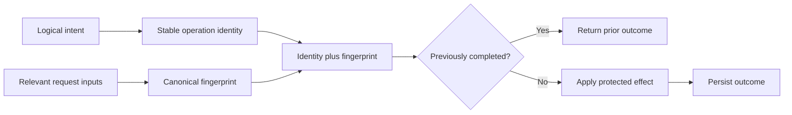

**Decision implications.** Define “same operation” at the business boundary before selecting a storage mechanism. A payload hash alone is usually not an identity: a customer may intentionally make the same purchase twice, while a retry may serialize equivalent data in a different order. A caller-generated identifier is appropriate when the caller knows retries are one intent; a server-generated identifier returned only after success cannot resolve a lost first response. Decide whether a failed validation is stored, whether transient failures can be retried under the same identity, and which response fields are stable.

**Common failure mode.** Treating all equal-looking requests as duplicates. If a customer buys the same item twice, payload equality must not suppress the second purchase. Conversely, comparing raw JSON bytes can treat harmless key ordering or whitespace changes as a new request. The logical identity must come from the caller or business domain, while canonicalization is used only to detect a key being reused with incompatible material inputs.

**Scenario.** A checkout page assigns a stable `checkout_attempt_id` when the customer presses Place Order. A network retry reuses that identifier; a second deliberate purchase creates another. The service scopes the identifier by customer and operation, binds it to currency and total, and returns the same order ID for the retry.

### 4.3 Caller-generated idempotency keys and stored outcomes

**Definition.** An **idempotency key** is a caller-generated, stable identifier for one logical operation. The caller generates it before the first attempt and sends the same value on every retry. The receiver stores the key, a request fingerprint, execution state, and the outcome needed to answer future attempts consistently.

**Mechanism.** A typical lifecycle is: authenticate and scope the key; validate the request envelope; atomically claim the key; execute the business effect; persist the effect and terminal outcome; then return the outcome. A duplicate with a matching fingerprint receives the stored outcome. A matching key with a different fingerprint is rejected as a conflict. Concurrent duplicates must wait, receive an in-progress response, or safely observe the eventual committed outcome; they must not both pass a non-atomic “check then insert.”

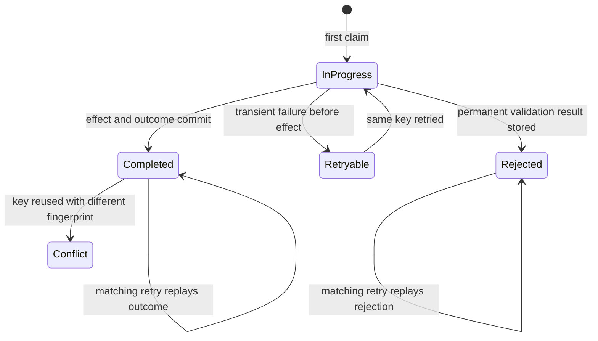

**Decision implications.** A key should be unpredictable enough to avoid cross-customer guessing, but it is not an authorization credential: every retry still requires authentication and authorization. Specify maximum key length and accepted character set; scope it by tenant/principal and operation; bind it to relevant inputs; choose which status codes and response headers are replayed; and publish the retention window. Return a stable operation or resource identifier so callers can reconcile if their local state is lost. Clients should persist the key across process restarts when the user-visible action remains pending.

**Common failure mode.** Generating a fresh random key inside each retry loop. The server then sees each attempt as a new operation and faithfully executes each one. Other common defects are caching an error before the effect's true status is known, replaying a response without rechecking the caller's authorization, or returning a generic “duplicate” response that omits the original resource ID the caller needs.

**Scenario.** A mobile banking client creates a transfer intent with key `tx-7f...` before opening the network request. The request times out after the transfer commits. On app restart, the pending intent retains the same key; the API returns the original transfer reference and terminal status, while a different amount under that key is rejected.

### 4.4 Unique-key deduplication table, atomic claim, and TTL

**Definition.** A deduplication table stores one record per operation identity and acts as a durable arbitration point among concurrent attempts. An **atomic claim** means the unique-key insert, state transition, business effect, and outcome are coordinated so only one execution can become authoritative. A Time To Live (TTL) is the retention duration after which the system may remove the record.

**Mechanism.** In a relational store, a unique constraint on `(scope, operation, key)` arbitrates races. A transaction inserts or claims the identity and applies the business mutation plus stored result in the same database transaction. The losing attempt reads the winning record and replays or waits. For an external side effect that cannot join this transaction, the record alone cannot make the side effect atomic; use a transactional outbox, a downstream idempotency key, a durable state machine, or reconciliation. The claim can use explicit states such as `IN_PROGRESS`, `COMPLETED`, and `RETRYABLE_FAILURE`, with leases or fencing tokens if ownership can expire.

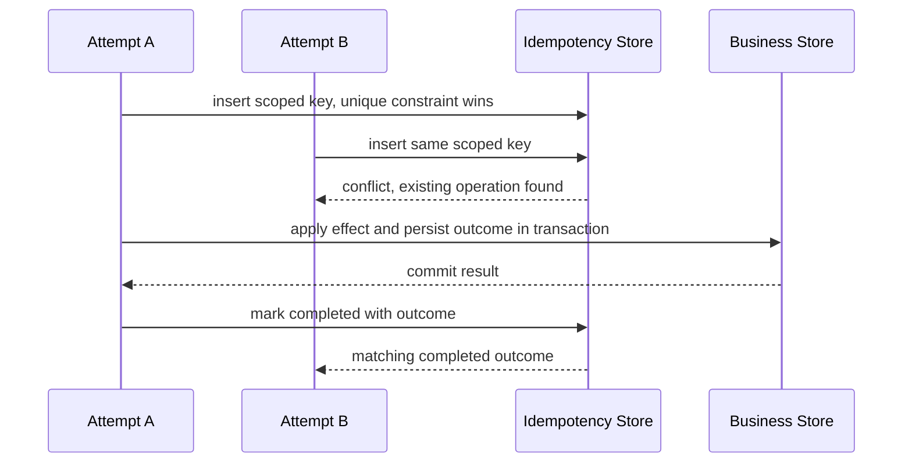

**Decision implications.** Choose a database-local table when the protected effect is in that database and the expected key volume, contention, and retention are manageable. The retention period must exceed the longest legitimate retry/redelivery/reconciliation window, including delayed queues and disaster recovery replay. TTL is a correctness boundary, not just cleanup: after deletion, a very late duplicate may execute again. Partition or archive records deliberately, monitor expiration volume, and decide how long clients may safely retry. An in-progress lease must not permit two owners to act concurrently after a pause; use a monotonically increasing fencing token or rely on a truly atomic local transaction.

**Common failure mode.** Implementing `SELECT` followed by `INSERT` without a unique constraint or transaction. Two concurrent requests both see no row, both run the side effect, and then race to record the result. Another failure is committing the business mutation and dedup row in separate transactions: a crash between them leaves either an effect with no record (duplicate risk) or a record with no effect (lost operation or stuck key). TTL shorter than queue retention recreates the duplicate precisely when delayed redelivery arrives.

**Scenario.** A payment API writes both `idempotency_operations` and a local payment ledger in one serializable database transaction. The unique key chooses one winner; the winner writes payment `p-41` and a response snapshot before commit. Concurrent requests block or read the committed snapshot. A 48-hour retry window is backed by a 7-day record retention, exceeding the processor's documented retry and reconciliation window.

### 4.5 Natural idempotency: upserts and conditional writes

**Definition.** A naturally idempotent write has the desired repeat-safe behavior in its state transition itself, without a separate idempotency-key registry. Setting a field to a specific desired value, inserting under a domain uniqueness constraint, or using an upsert keyed by a stable business identifier can make repeated application converge to one state.

**Mechanism.** For example, `ensure_subscription(customer_id, plan)` can upsert the subscription keyed by `(customer_id, plan)`; repeated calls leave one row. A conditional write can apply only when a precondition holds, such as changing a reservation from `HELD` to `CONFIRMED` only if it is still `HELD`. The database's uniqueness and compare-and-set semantics arbitrate concurrent attempts. However, “subtract 500” is not idempotent just because it is an atomic update: repeating the increment or decrement repeats the effect. An operation that needs one debit still requires an operation identity or a version/state guard tied to that debit.

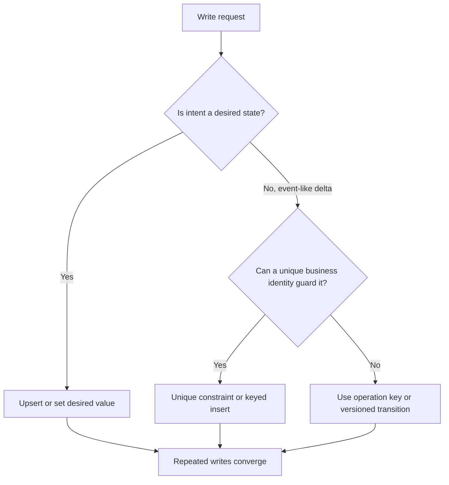

**Decision implications.** Prefer natural idempotency when the domain already has a stable unique identity and the operation means “ensure this fact exists” or “set this state to X.” It reduces a separate table, lookup, and retention policy. Prefer explicit request identity when the operation is an additive or externally visible event and identical payloads can be intentional. A uniqueness conflict must be inspected: same key and same meaning is a successful no-op; same key and different material data is a conflict, not silent success. Model uniqueness in the authoritative store, not only in application memory.

**Common failure mode.** Calling a conditional update “idempotent” when its condition only prevents invalid state, not repeated application. A debit guarded by `balance >= amount` can still be applied twice if funds remain after the first debit. Similarly, an upsert can overwrite fields in a way that changes on each call (for example, setting `updated_at` to now) or can silently accept a reused business key with a different payload. State explicitly which fields are part of the operation's effect.

**Scenario.** A provisioning controller repeatedly reconciles a service to `replicas=5`. The write is naturally idempotent because it expresses desired state. The same controller creates a billable virtual machine only once by using the deployment's stable resource name as a unique key and checking that a duplicate request's configuration matches the existing resource.

### 4.6 Versioned state transitions and compare-and-set

**Definition.** A versioned transition applies a state change only from an expected state and version. It uses optimistic concurrency as an idempotency guard: after one attempt advances the version, a retry carrying the original expected version no longer matches and cannot advance the entity again.

**Mechanism.** A conditional update can be expressed as `UPDATE orders SET status = :next, version = version + 1 WHERE id = :id AND status = :expected AND version = :expected_version`. The affected-row count distinguishes an applied transition from a stale attempt. On zero rows, the caller reads current state to classify the result: the intended transition may already have succeeded; another writer may have made a different valid transition; or the entity may not exist. Returning “already applied” requires enough stored transition identity or a state comparison; a version mismatch alone is not proof that this specific command succeeded.

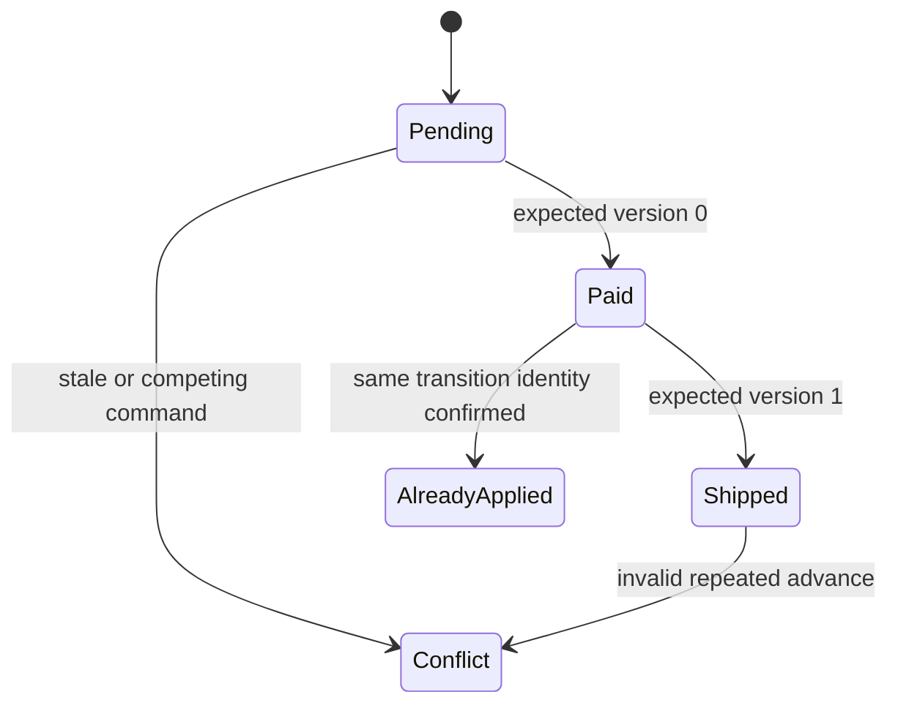

**Decision implications.** Use state-and-version guards when the operation is a legal transition in an entity lifecycle and the caller can retain the expected version. Include an operation or command ID if the system must distinguish “my previous transition committed” from “some other command moved the entity.” Keep transition validation in the transaction that performs the update. Decide how callers recover from concurrency conflicts: reload and present a conflict, recompute intent, or resolve a recorded command result. This is especially useful for state machines, reservations, approvals, and workflow steps.

**Common failure mode.** Re-reading current state on every retry and interpreting “advance” again. A request intended to move `PENDING -> PAID` can then move `PAID -> SHIPPED` on its retry. Another common error is treating any zero-row update as success; it may instead indicate a missing entity or a competing transition. Version checks prevent stale writes, but do not by themselves preserve the exact outcome of the original command.

**Scenario.** An order service reads `PENDING`, version 0, then issues `mark_paid` with expected version 0. The database commits `PAID`, version 1, but the reply is lost. The retry uses the same expected version and command ID. It cannot advance again; the service finds the matching command receipt and returns the original success. A different command that changed the order is surfaced as a conflict.

### 4.7 Idempotent message consumers and the effect-ack boundary

**Definition.** An idempotent consumer processes a message more than once while applying its business effect no more than once per logical message identity. The relevant identity is usually a producer-assigned message ID or event ID that remains stable across broker redelivery, not a delivery-attempt number or queue offset that changes with topology.

**Mechanism.** The consumer begins a local database transaction, inserts the message ID into an inbox/processed-message table protected by a unique constraint, applies the business mutation, records any outcome, and commits. Only after commit does it acknowledge the broker. If it crashes before commit, redelivery performs the work. If it crashes after commit but before acknowledgement, redelivery loses the unique-key race and becomes a no-op. The mutation and inbox record must be in the same transactional resource. If handling publishes another message, a transactional outbox ties that publication to the local mutation; the outbox pattern is fully owned by [Distributed Transactions](CH12_Distributed_Transactions.md).

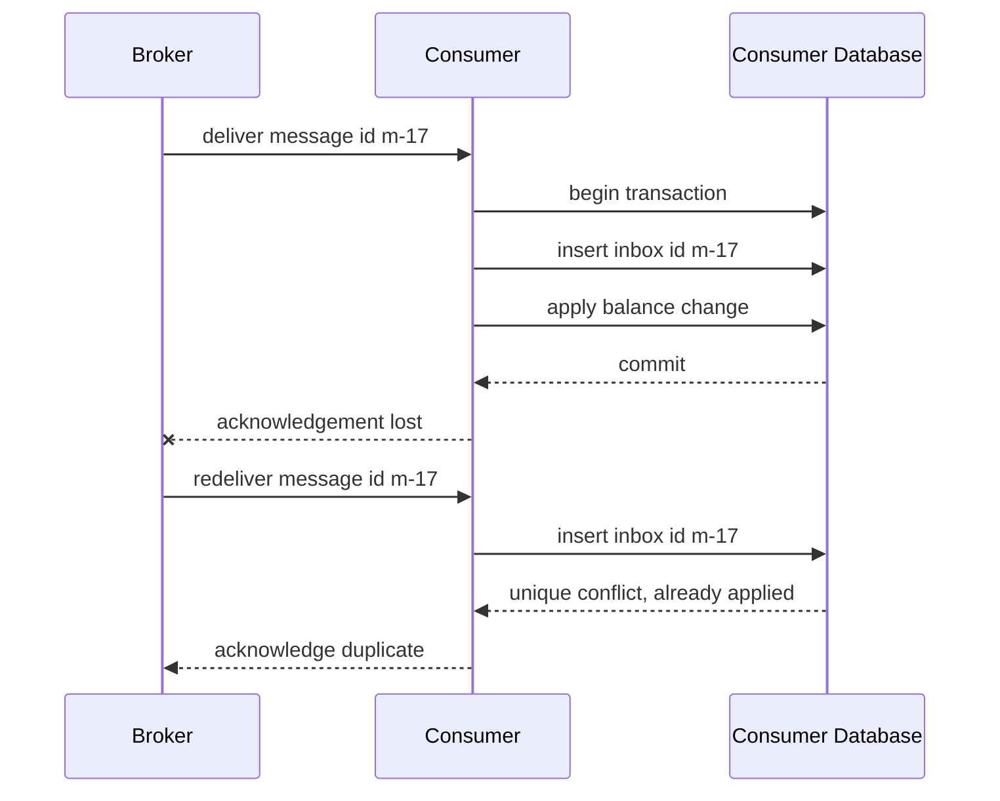

**Decision implications.** Treat the broker acknowledgment as a separate boundary from the business commit. Acknowledge too early and a crash can lose the effect; acknowledge too late without idempotency and a crash can duplicate it. Choose inbox retention to exceed the broker's replay horizon, including administrative replay and disaster recovery. If one message produces multiple database effects, commit all together. If an effect targets an external payment or email provider, pass the same stable key downstream when supported or model the call as a durable workflow with reconciliation; a local inbox cannot atomically commit a remote effect.

**Common failure mode.** Recording `processed_message_id` after applying the business effect in a separate transaction. A crash in between leaves the effect applied but no dedup record, so redelivery applies it again. The reverse ordering can lose work if the record commits first and the effect does not. An in-memory set is also insufficient across restarts, replicas, and concurrent consumer instances.

**Scenario.** A queue consumer credits customer balances from settlement events. The broker may redeliver after an acknowledgment timeout. A unique inbox row and balance update commit in one database transaction; the broker acknowledgment follows. A second delivery observes the inbox conflict and acknowledges without crediting again.

### 4.8 Exactly-once effect semantics and the forward boundary

**Definition.** **Exactly-once effect semantics** means a particular logical operation's externally meaningful effect is committed once, even when attempts or deliveries occur multiple times. It is an end-to-end outcome claim bounded by a named operation identity, state store, and side-effect boundary. It is not equivalent to exactly one handler invocation, exactly one network transmission, or a universal exactly-once guarantee across arbitrary independent systems.

**Mechanism.** The common construction is at-least-once attempts plus durable identity and atomic effect application. A producer or caller retries until it learns the outcome; a consumer may receive duplicate deliveries; the receiver uses a unique claim, natural key, conditional transition, or downstream idempotency contract to converge. For an effect inside one transactional database, the claim and effect can share a commit. For multiple independent effects, use an outbox/inbox chain, idempotency at each boundary, or a workflow that records progress and reconciles ambiguous outcomes. Each boundary narrows the guarantee; no local table can atomically include a remote card network or physical-world action.

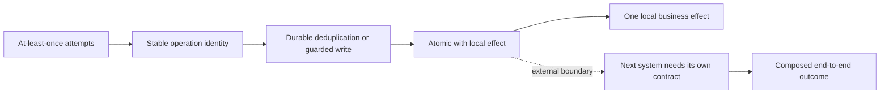

**Decision implications.** State guarantees precisely: “one ledger debit per transfer ID within the ledger transaction,” not “the platform is exactly once.” Identify the effect boundary and retention period, list what is atomic, and define reconciliation for outcomes that cannot be observed. This chapter establishes the foundational effect-level model. The future [Exactly-Once Processing](CH17_Exactly_Once_Processing.md) chapter owns the broader processing and transport semantics; future [Deduplication](CH19_Deduplication.md) owns the general deduplication problem, identity windows, and associated structures. This chapter forward-references both rather than consuming their full topics.

**Common failure mode.** Advertising exactly-once processing because a broker has producer idempotence or transactional offsets, while an external database, email service, or payment gateway remains outside that transaction. The system may process one record once at the broker and still apply the side effect twice after a crash. Another failure is claiming exact effect without specifying the deduplication horizon; after the record expires, a replay may apply again.

**Scenario.** An order service consumes an at-least-once `OrderAccepted` event, atomically records its event ID and creates one shipment request in its database, then emits the shipment command through an outbox. The shipping service independently deduplicates that command. The design promises one shipment record per order command; physical pickup remains a separately reconciled real-world effect.

## 5. Internal Working

An idempotent request path is easiest to reason about as a state machine with a single durable decision point. The transport can retry; application workers can restart; only the persisted operation identity, effect, and result determine whether the work is new, in progress, completed, or conflicting.

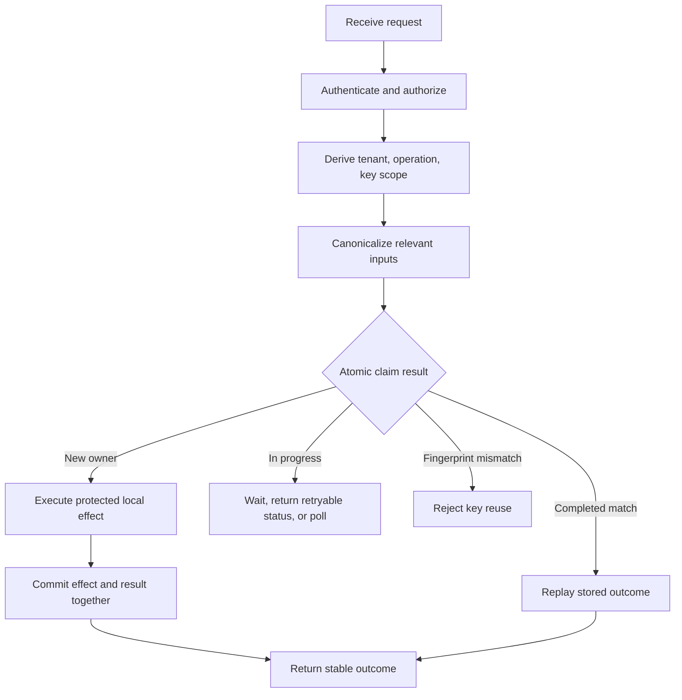

The ordering is important. Authentication and authorization happen on every request; a replayed response must not leak data to a caller whose permissions have changed. Input normalization and fingerprinting must be deterministic and include all fields that change the effect. The claim operation must be atomic across instances. The effect and terminal outcome should commit together when they share a database. If the response is lost after commit, the next retry reads the committed outcome rather than inferring success from an in-memory flag.

The difficult case is an external effect. Consider a local worker that inserts `IN_PROGRESS`, calls a payment gateway, receives no response, and crashes. On restart, the local record cannot tell whether the gateway charged the card. Retrying with a new downstream identity risks a second charge; marking completion without evidence risks pretending the charge happened. The design must propagate the same key to a gateway that supports idempotency, query the gateway by merchant reference, or route the operation into an explicit reconciliation state. A timeout is uncertainty, not failure.

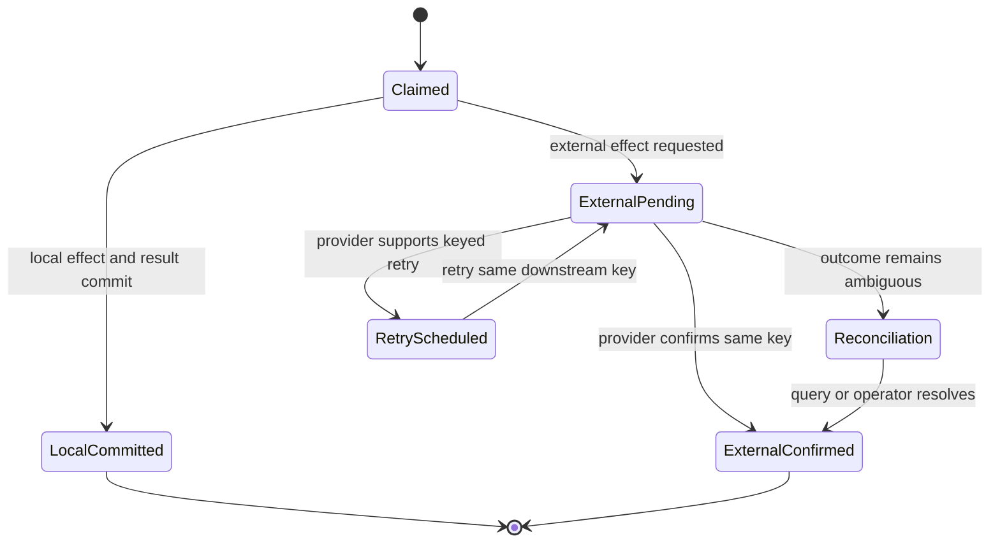

Concurrent attempts create another boundary: the request that wins the claim may pause, lose its lease, and then resume after another worker takes over. A lease is not a correctness primitive by itself. Fencing tokens, conditional updates, or downstream idempotency prevent an expired owner from applying stale work. A robust state record usually includes a state, attempt/lease metadata, fingerprint, created/updated timestamps, terminal outcome, and optional provider reference. State transitions are conditional and observable.

On message consumers, the same shape moves the acknowledgment after durable effect commit. On a Saga, the operation key is derived from stable Saga instance and step identity, never attempt count; the sibling [Saga Pattern](CH13_Saga_Pattern.md) chapter already recaps this boundary and owns Saga orchestration and compensation design. On Event Sourcing, a command ID can prevent duplicate command effects, but event-stream optimistic concurrency and event identity have their own semantics; see [Event Sourcing](CH15_Event_Sourcing.md) for its owned treatment. Idempotency complements those patterns rather than replacing them.

## 6. Design Principles

1. **Name the logical operation before choosing the mechanism.** State which retries share one identity and which repeated actions are distinct user intent.
2. **Keep identity stable across every retry.** Generate or derive it before the first request and persist it wherever the caller's pending intent survives.
3. **Scope keys.** Include tenant/principal and operation type in the uniqueness boundary; authenticate every attempt independently.
4. **Bind identity to material input.** Reject key reuse with a different effect rather than returning a misleading cached success.
5. **Make claim and local effect atomic.** Use one transaction and a unique constraint when possible. “Check then act then record” is a race, not idempotency.
6. **Preserve original outcomes.** A repeated request should receive a stable resource ID and status, not an ambiguous duplicate marker.
7. **Design for ambiguous outcomes.** Timeouts after sending a request do not prove non-execution. Retry with the same identity or reconcile.
8. **Treat TTL as part of correctness.** Retain operation identities beyond all expected retry and replay windows; document what happens after expiration.
9. **Use natural idempotency where it matches the domain.** Do not build a key registry for a simple desired-state assignment; do not mistake additive effects for assignments.
10. **Protect external effects at their own boundary.** A local dedup table cannot atomically govern another organization's system or the physical world.
11. **Expose the guarantee precisely.** Bound “once” by operation, store, effect, and retention window.
12. **Test crash points, not only duplicate calls.** Exercise crash-before-commit, crash-after-commit-before-reply, concurrent claims, and expiry.

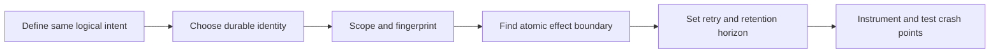

## 7. Architecture Patterns

Idempotency is a cross-cutting property that can be implemented at several boundaries. Choose the narrowest boundary that owns the effect rather than adding a generic middleware layer that cannot see business semantics.

- **API key registry.** A service stores a caller-generated key, request fingerprint, state, and response. This fits command APIs with ambiguous client timeouts, especially when the response contains a resource identifier that must be replayed.
- **Domain uniqueness.** A database uniqueness constraint or natural key ensures one record per business identity. This fits “create this named resource if absent” and avoids duplicating a domain invariant in another table.
- **Compare-and-set transition.** An expected state/version admits only one transition from a particular observed state. This fits state machines, while command receipts may still be needed to replay the exact outcome.
- **Inbox plus outbox.** The inbox records consumed message identities with local effects; the outbox publishes resulting messages atomically with those effects. The outbox pattern itself is owned by [Distributed Transactions](CH12_Distributed_Transactions.md).
- **Provider key propagation.** A stable operation identity is forwarded to a downstream provider that supports idempotent commands. This is necessary when the external provider owns the ultimate side effect.
- **Reconciliation workflow.** An ambiguous external outcome becomes a durable state to query or resolve, rather than an automatic blind retry.

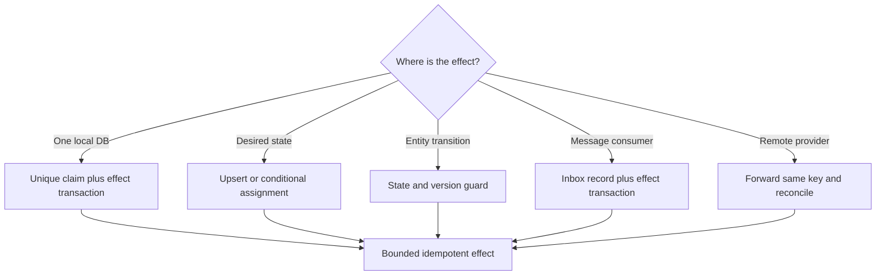

A centralized idempotency platform can reduce duplicated plumbing, but it cannot decide whether two requests represent the same intent, which input fields change the effect, whether a failed attempt should be cached, or how an external timeout is reconciled. Those decisions remain owned by the domain service.

## 8. Production Architecture

A production deployment commonly has clients or producers, an API/consumer boundary, an authoritative operation store, a business database, and possibly external providers or brokers. The authoritative store must be shared by all service replicas handling a given scope; a process-local cache can optimize lookups but cannot arbitrate across pods or survive restart.

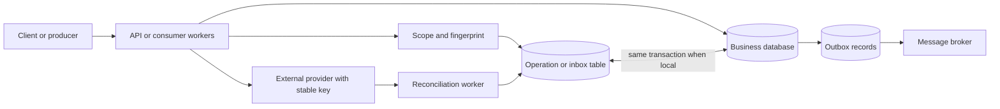

For database-local effects, a single database transaction is the cleanest boundary: insert the key under a unique constraint, apply business writes, and persist the terminal result before commit. The key and business data should be in the same authoritative region or consistency domain. If active-active multi-region writes are possible, regional uniqueness is not global uniqueness; route an operation identity to one home region, use a globally consistent uniqueness primitive, or partition identities so collisions cannot cross regions.

For message processing, store the inbox record alongside the mutation and acknowledge only after commit. If the transaction can emit another message, commit an outbox row alongside the mutation and relay it asynchronously. The downstream consumer repeats the same pattern. This creates a chain of local guarantees without pretending that a transaction spans every service.

Operational requirements include bounded record growth, table/index partitioning appropriate to key volume, data-protection controls for stored responses, rolling-compatible schema migrations, and availability behavior when the idempotency store is unavailable. Fail closed for high-value non-repeatable effects if the authoritative store cannot verify identity. For low-risk desired-state reconciliation, a retry may be safer than blocking, provided the operation is actually convergent.

## 9. Implementation

Implementation begins with a written contract. Define the key's namespace, key format and size, authenticated scope, fingerprint fields, response replay rules, terminal and retryable states, retention duration, and behavior for an in-progress duplicate. Specify which failures are recorded: a deterministic validation rejection is often safe to replay, while a transient dependency failure may need to return to retryable state. A process crash must not silently strand `IN_PROGRESS` forever; define leases, recovery ownership, or reconciliation.

For a relational implementation, a representative schema is:

```sql
CREATE TABLE idempotency_operations (
    tenant_id       TEXT NOT NULL,
    operation_name  TEXT NOT NULL,
    idempotency_key TEXT NOT NULL,
    request_hash    TEXT NOT NULL,
    state           TEXT NOT NULL,
    response_status INTEGER,
    response_body   TEXT,
    created_at      TIMESTAMP NOT NULL,
    expires_at      TIMESTAMP NOT NULL,
    PRIMARY KEY (tenant_id, operation_name, idempotency_key)
);
```

The primary key is the concurrency arbiter. Application code should not implement a check-then-insert race around it. A transaction should attempt the unique insert, handle the conflict, compare fingerprints, and return or wait for the stored outcome. For a local effect, the claim, mutation, and outcome commit together. For a consumer inbox, the inbox insertion and business mutation commit together. Database-specific upsert syntax differs; the invariant does not.

Canonicalize only semantically relevant input. Normalize currencies, decimal representations, default values, and unordered object fields before hashing; do not hash volatile headers, tracing IDs, or timestamps unless they alter business meaning. Store a version for the fingerprint algorithm if it may evolve. Keep responses minimal and privacy-aware: a stored body may contain personal or financial data and must inherit the original system's access-control and retention policies.

The examples in Section 10 are executable standard-library references, not production persistence adapters. Example 01 demonstrates a database-local atomic claim, effect, outcome, and lost-response retry. Example 02 demonstrates an inbox record committed with the consumer effect before acknowledgment. Example 03 shows domain uniqueness and the limits of conditional writes. Example 04 demonstrates a fixed expected-version transition and contrasts blind re-advancement.

## 10. Complete Code Examples

Four runnable Python examples live under [code/python/idempotency-chapter/](../code/python/idempotency-chapter/). They use only the Python standard library and SQLite in-memory databases, so each demonstrates a real transactional boundary without requiring a broker, web framework, or live database server.

1. [01_idempotency_key_middleware.py](../code/python/idempotency-chapter/01_idempotency_key_middleware.py) implements a framework-neutral request wrapper backed by a SQLite idempotency table and ledger. It atomically claims a scoped key, validates a canonical request fingerprint, stores the original result with the effect, and demonstrates a response lost after commit followed by a retry that replays the same charge ID.
2. [02_message_consumer_deduplication.py](../code/python/idempotency-chapter/02_message_consumer_deduplication.py) compares a naive redelivery consumer with an inbox-backed consumer. The inbox identity and account credit share a SQLite transaction; acknowledgment occurs only after the commit, and a crash-after-commit redelivery becomes a no-op.
3. [03_natural_idempotency_upsert_and_conditional_writes.py](../code/python/idempotency-chapter/03_natural_idempotency_upsert_and_conditional_writes.py) uses a unique business key and upsert for one order row, then contrasts a guarded debit with the fact that a balance precondition alone does not deduplicate a valid repeated debit.
4. [04_versioned_state_transition.py](../code/python/idempotency-chapter/04_versioned_state_transition.py) applies a state transition using a pinned expected version and expected source state. It shows the retry as a safe detectable no-op and contrasts an unversioned “advance” handler that double-advances.

Run each independently from the repository root:

```powershell
.\.venv\Scripts\python.exe code\python\idempotency-chapter\01_idempotency_key_middleware.py
.\.venv\Scripts\python.exe code\python\idempotency-chapter\02_message_consumer_deduplication.py
.\.venv\Scripts\python.exe code\python\idempotency-chapter\03_natural_idempotency_upsert_and_conditional_writes.py
.\.venv\Scripts\python.exe code\python\idempotency-chapter\04_versioned_state_transition.py
```

The examples deliberately avoid claiming a local SQLite transaction can atomically include a remote payment provider, email service, broker, or physical fulfillment action. For those boundaries, forward the stable identity to the downstream system where possible and explicitly model ambiguous outcomes and reconciliation.

## 11. Performance

Idempotency adds work: a key lookup or unique insert, request canonicalization, durable outcome storage, and potentially a wait for a concurrent in-progress operation. The overhead is usually small compared with the protected side effect, but high-volume APIs can make the dedup store a meaningful part of the write path. Measure the full path, not only the handler body.

If a key arrives at rate $r$ operations per second and records are retained for $T$ seconds, the approximate live-record population is $N \approx rT$, before accounting for retries, index overhead, payloads, and skew. Response snapshots often dominate storage; store only stable fields needed for replay, or persist a reference to a durable result. A compact hash and resource ID may be sufficient for some operations; others require the exact status and body.

The unique index is on the hot path. Keep the key width bounded, use a composite scope with practical cardinality, and avoid indexing large response data. If idempotency records are partitioned by expiry, ensure the uniqueness arbiter still spans the full identity window. A cache can accelerate completed-key reads but must not become the source of truth for claims.

Concurrency contention concentrates on hot identities when many retries arrive simultaneously. Use database conflict handling, bounded wait time, and a defined “in progress” response or polling contract. Do not let duplicate requests consume the same expensive downstream capacity while waiting. Instrument lookup latency, unique-conflict rate, concurrent duplicate count, response replay rate, and lock/transaction wait time.

## 12. Scalability

The main scaling question is how identities are distributed and where global uniqueness is enforced. A single relational database provides a clear uniqueness boundary but may become a throughput or availability bottleneck. Horizontal partitioning is possible when a deterministic scope or key routes all attempts for the same operation to the same partition. If the same key can land in different shards or regions, duplicate prevention becomes a distributed coordination problem.

Partition by stable tenant or operation identity so retries are co-located. Avoid routing solely by a mutable attribute. In multi-region systems, choose among home-region routing, globally consistent writes, or an explicitly weaker regional guarantee with reconciliation. Replicating completed records asynchronously does not prevent two regions from independently claiming the same key before replication converges.

Message consumers can scale by partitioning the broker stream and maintaining inbox uniqueness in the database. The consumer's database key must still be global for the message identity if a rebalance can route a duplicate to a different worker. Use the message's stable event ID, not the consumer's local offset alone, when independent replay or topic migration is possible.

Retention and cleanup also scale. Deleting expired records in a massive foreground transaction can create lock pressure and replication lag. Use bounded batches or time partitions, but only delete records after the maximum supported retry/replay horizon. Capacity planning should include long-tail retries, manual redrive, backup restore, and delayed messages, not just the ordinary API timeout.

## 13. Security

Idempotency keys are untrusted input. Enforce size and character limits, rate-limit key creation, and scope keys by authenticated principal or tenant and operation. Never let possession of a key authorize a request or reveal a stored response. Authenticate and authorize every retry; permissions may have changed since the original request.

Request fingerprints should be computed after validation and normalization, and should not expose raw sensitive payloads. Hashes of low-entropy or sensitive fields can still leak through offline guessing, so avoid treating a plain hash as encryption. Do not place secrets, payment card numbers, or access tokens in a key. If keys are logged, redact or irreversibly tokenize them; otherwise logs can become a cross-request correlation or data-exposure surface.

Stored outcomes are data at rest and need retention, access control, encryption, and deletion rules appropriate to their contents. Minimize replayed personal data and consider storing a resource reference then re-authorizing retrieval. A mismatch response should not reveal another tenant's key existence. Use constant-shape errors where key enumeration is plausible.

A compromised or malicious caller can intentionally submit many unique keys to exhaust storage. Apply quotas, per-principal request budgets, bounded response snapshots, and cleanup monitoring. Security review should also cover key collision, key reuse across endpoint versions, and whether a new deployment can reinterpret an old fingerprint differently.

## 14. Observability

A useful idempotency dashboard distinguishes first executions, completed replays, in-progress duplicates, fingerprint conflicts, expired-key reuses, claim failures, and reconciliations. A single “duplicate request” counter cannot reveal whether retries are healthy, clients are misconfigured, or the store is rejecting legitimate work.

Record operation type, a privacy-safe scoped identity hash, attempt number, state transition, provider reference, and correlation/trace context. Do not log raw secrets or full sensitive responses. For each operation, expose age of the oldest in-progress record and the number of records past their expected completion time. Alert on rising in-progress age, conflict spikes, duplicate-effect reconciliation, and storage latency or availability degradation.

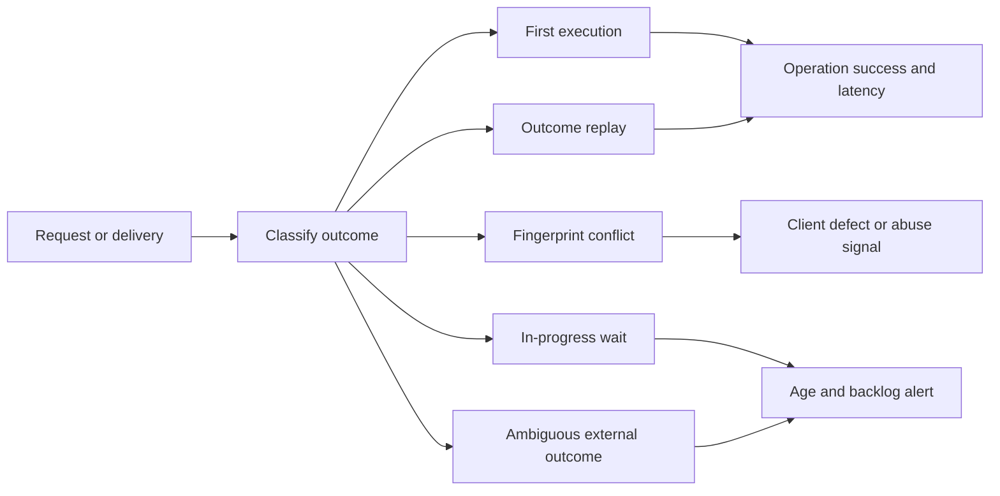

Tracing should keep one logical operation identifier across retries while recording distinct attempt spans. That makes it possible to see a request timeout, server commit, lost response, and replay as one operation with multiple attempts. Avoid using the raw idempotency key as a high-cardinality metric label; keep it in protected traces or structured logs with suitable retention.

## 15. Failure Scenarios

**Lost response after commit.** The client times out after the local transaction commits. Retry with the same identity, load the completed outcome, and return it. A fresh key would create a duplicate.

**Crash before transaction commit.** The database rolls back the claim and local effect. The same key can be claimed on retry. This is safe only when no external side effect escaped before rollback.

**Crash after external provider acts.** Local state remains ambiguous. Retry only with the same provider-supported key, query by stable merchant reference, or enter reconciliation. Never assume timeout means failure.

**Concurrent duplicate first attempts.** A unique constraint chooses one owner. The other attempt must wait, poll, or return a documented retryable response; it must not run the effect while the winning attempt is in progress.

**Expired dedup record followed by late replay.** The old request can appear new. Retention must exceed the declared retry and replay horizon. If unlimited replay is required, retain a compact tombstone or a domain-level permanent uniqueness record.

**Fingerprint mismatch.** The caller reused an identity for a changed amount, recipient, or operation. Reject it; do not replay the old response as though it matched and do not apply the new effect under the same identity.

**Store unavailable.** For irreversible effects, fail closed or queue work durably before returning acceptance. Bypassing the store “temporarily” drops the guarantee exactly during an incident, when retries are most likely.

**Failover or multi-region split.** Two regions may both accept a key if uniqueness is local. Route a key to one owner or use a globally coordinated uniqueness mechanism, and make the trade-off explicit.

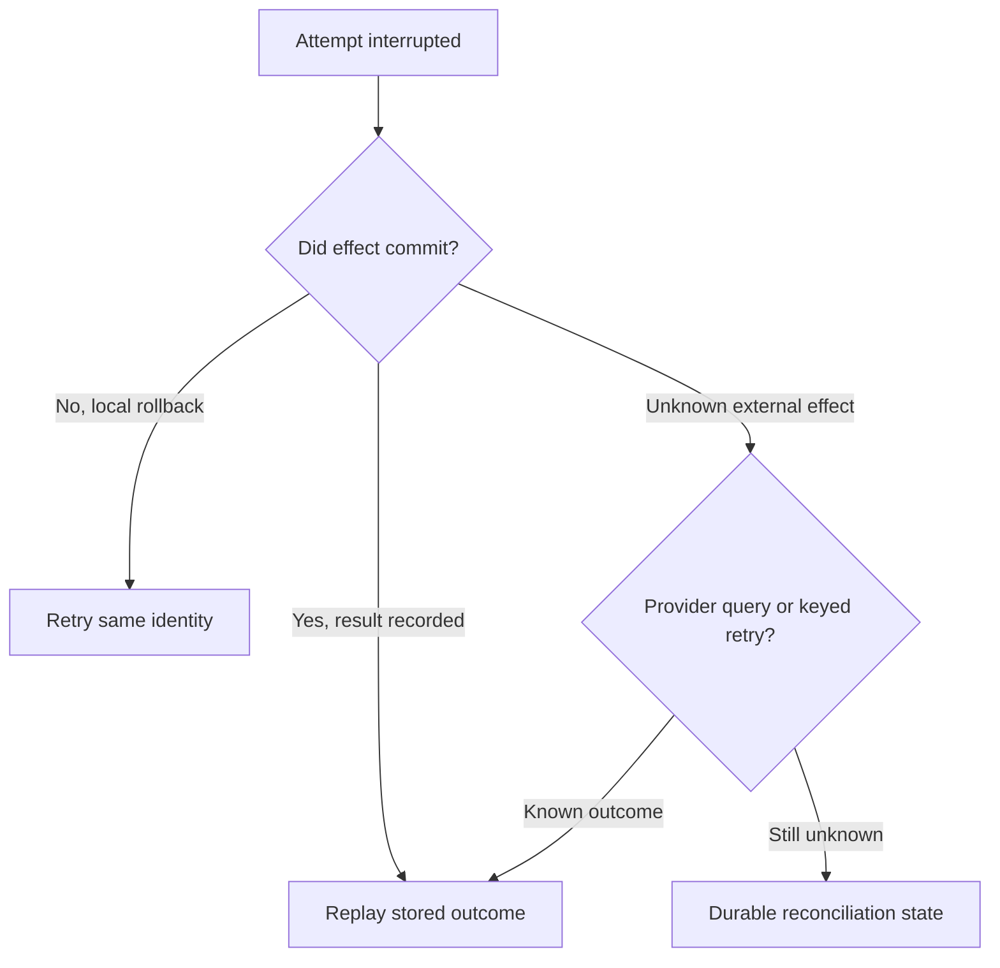

## 16. Testing

Test idempotency as a behavioral invariant: for an operation identity and fixed material inputs, any permitted sequence of retries produces the same final business state and stable outcome as one successful execution. The test suite must verify persisted state, not merely count handler calls.

Core cases include: first attempt then identical retry; same key with changed fingerprint; two concurrent first attempts; crash before local commit; crash after commit before response; consumer crash after commit before acknowledgment; broker redelivery after restart; terminal rejection replay; retryable failure recovery; and key expiry at the documented boundary. For a provider integration, use a fake that records provider-side effects by downstream key and can lose responses independently of whether it committed.

Use barriers or deterministic scheduling to force simultaneous claims. A sleep-based concurrency test may pass without ever overlapping. Verify there is exactly one business row/effect, all successful callers receive the same resource or outcome, and the losing attempt follows the documented in-progress behavior. Run the tests against the actual database engine used in production because uniqueness, isolation, and conflict syntax differ.

Property-based testing can generate sequences of duplicate and reordered deliveries. For ordered message contracts, preserve ordering assertions separately; idempotency does not make reordering safe. Add a retention test that proves behavior both before and after expiry, including a late retry that demonstrates the documented boundary rather than leaving it implicit.

## 17. Common Mistakes

- Generating a new key for each retry rather than each user intent.
- Using payload equality as operation identity, suppressing legitimate repeated purchases.
- Using a payload hash without canonicalization, treating equivalent payloads as different.
- Checking for a key and inserting later without an atomic uniqueness claim.
- Committing the dedup record separately from the local effect.
- Recording the key before the effect and never recovering an abandoned in-progress operation.
- Treating an expired lease as proof the old worker stopped; it may resume late.
- Using TTL shorter than broker retention, retry horizon, or disaster-recovery replay window.
- Treating every zero-row conditional update as “already succeeded.”
- Replaying stored data without re-authenticating and re-authorizing.
- Assuming broker offset transactions cover an unrelated database or external provider.
- Acknowledging a message before committing the consumer effect.
- Saying “exactly once” without naming the boundary, identity, and retention horizon.

The root correction is to write down the operation contract, then choose an atomic mechanism at the effect-owning boundary. A generic middleware library can help only after those semantics are explicit.

## 18. Best Practices

1. Generate operation IDs before the first attempt and persist them with the caller's pending action.
2. Use namespaced keys such as `(tenant, operation, key)` and bind them to canonical material inputs.
3. Back uniqueness with an authoritative database constraint or equivalent atomic primitive.
4. Store only the response data needed to produce a stable replay; include a resource ID and terminal status.
5. Co-commit local effects, operation records, and outcome snapshots.
6. For consumers, co-commit inbox identity with the state mutation and acknowledge after commit.
7. Propagate the same identity to capable downstream providers; otherwise model uncertainty explicitly.
8. Distinguish deterministic terminal errors from transient failures and define retry semantics for each.
9. Set retention from the longest supported retry, queue redrive, and recovery horizon, with margin.
10. Make in-progress ownership recoverable and protect against stale workers with conditional state changes or fencing.
11. Re-authorize each request and protect stored outcomes as sensitive data.
12. Observe replay, conflicts, in-progress age, expiration, and reconciliation separately.
13. Test forced crash windows, concurrency, replay, mismatch, and expiry against the production database engine.
14. Phrase the guarantee narrowly: one defined effect per identity at one defined boundary.

## 19. Anti-Patterns

**The check-then-act wrapper.** A middleware layer reads “key absent,” performs an effect, then writes the key. Parallel attempts both pass the check. Fix it with a unique atomic claim and an effect transaction, or move to a naturally unique state change.

**The in-memory processed set.** A set works only in one process lifetime. Restarts, replicas, failover, and rebalances erase or bypass it. Keep the authoritative identity record in durable shared storage.

**The universal idempotency key.** Reusing one key across operation types or tenants creates collisions and can expose outcomes. Scope by authenticated principal and action.

**The blind retry.** Retrying an external call after timeout with a new identity can repeat the effect; retrying with the same identity is safe only if the provider honors it. Otherwise reconcile before repeating.

**The infinite retention table.** Retaining every full response forever creates privacy, cost, and operational problems. Choose a documented horizon and preserve only what long-term business uniqueness requires.

**The too-short TTL.** Deleting a key before delayed messages or customer retries expire silently reopens duplicate execution. TTL is a guarantee boundary, not merely a storage knob.

**The “exactly-once broker” shortcut.** Broker-level deduplication or transactional offset commits do not include arbitrary external effects. Describe the true boundary and compose local guarantees.

**The false natural-idempotency claim.** An increment, append, debit, or notification is not repeat-safe simply because it is wrapped in an upsert or conditional statement. Verify the repeated operation reaches the same business state.

## 20. Trade-off Analysis

Idempotency trades storage and coordination cost for retry safety and simpler recovery. A key table adds write-path latency, storage, cleanup, and another availability dependency, but lets a caller resolve the most dangerous timeout ambiguity. Natural idempotency removes that registry but may require a suitable domain key or may not represent event-like actions. Versioned transitions protect lifecycle changes but often need an operation receipt to replay an exact result. Consumer inboxes make redelivery safe but add a write for every unique message and require retention aligned to replay policy.

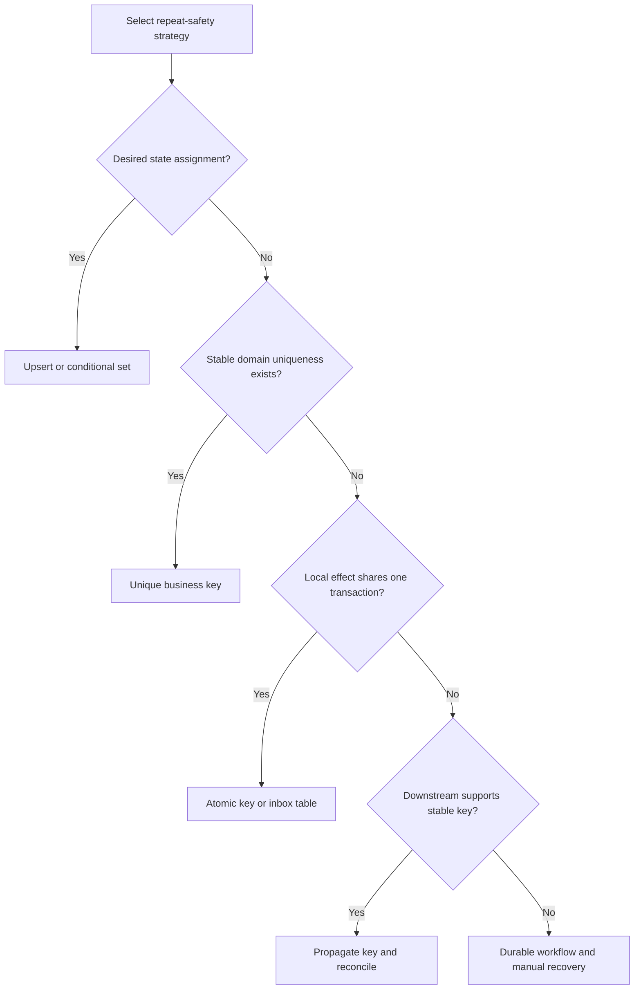

The decision should consider operation value, duplicate harm, retry frequency, maximum replay delay, key cardinality, result size, database topology, and provider capabilities. For low-impact, naturally convergent operations, key-table overhead may be unnecessary. For financial or irreversible actions, accepting a bounded duplicate risk may be unacceptable; the architecture must retain identity or provide a reconciliation path.

No design eliminates all cost. Strong global uniqueness across regions requires routing or coordination. Long retention increases storage and privacy burden. Short retention weakens late-replay protection. Waiting duplicates reduce redundant work but increase latency and connection occupancy. Returning “in progress” improves throughput but transfers polling complexity to clients. Make these costs explicit in the operation contract and service-level objectives.

## 21. Comparison Table

| Strategy | Best fit | Atomic boundary | Primary benefit | Main failure risk |
|---|---|---|---|---|
| Idempotency-key record and stored outcome | API command with ambiguous client retries | Key claim, local effect, and result in one transaction | Stable result replay, clear identity | Race or split commit if not atomic; retention expiry |
| Unique business key/upsert | Ensure-one-resource or naturally unique domain entity | Unique constraint on authoritative entity | No separate dedup registry | Reused key with changed inputs may be silently accepted |
| Conditional desired-state write | Reconciliation to a target value | Conditional database/API write | Repeated calls converge | Mistaking additive effects for assignments |
| Versioned state transition | Lifecycle/state machine command | Expected state/version update | Prevents stale repeat transition | Cannot prove same command succeeded without receipt |
| Consumer inbox/dedup record | At-least-once message delivery | Inbox insert and consumer effect transaction | Safe redelivery after crash | Record/effect split or too-short replay horizon |
| Provider key propagation | External side effect with provider support | Provider's own idempotency boundary | Extends identity beyond local service | Provider retention/semantics differ |
| Reconciliation workflow | Ambiguous external outcome without provider key | Durable workflow state plus query/operator action | Avoids unsafe guessing | Operational backlog if not monitored |

## 22. Real-World Case Study

A payment service accepts a transfer request while an upstream mobile client has intermittent connectivity. Initially, the service uses a conventional create endpoint: the request writes a ledger entry and calls a payment processor, then returns the transfer ID. Under load, the processor succeeds but the response to the service is delayed beyond the client's timeout. The client retries, creating a second ledger entry and a second processor call. The failure is not a broken network; it is an undefined identity contract around an ambiguous outcome.

The revised design assigns a stable transfer intent ID on the client before the first network attempt. The API scopes it to the authenticated account and operation, canonicalizes amount, currency, and destination, and stores the fingerprint. A unique constraint arbitrates concurrent retries. The local transfer row and operation result are committed together. The processor receives the same transfer intent as its own idempotency reference. If the processor call times out, the transfer enters a durable `PENDING_PROVIDER_CONFIRMATION` state rather than being treated as failed or blindly repeated with a new key.

The client may retry and receive the same transfer reference. If it accidentally resubmits a changed amount with the same intent ID, the API returns a conflict. If the processor's documented key retention is shorter than the service's retry window, the service queries by merchant reference before attempting another charge. A reconciliation worker alerts on operations that remain ambiguous beyond the expected provider latency.

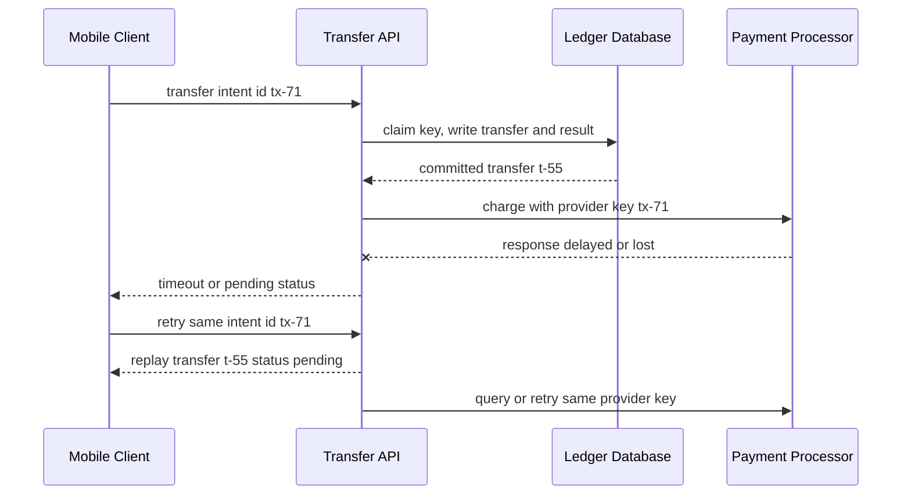

The key architecture result is not a claim that the request executes once. The API may receive many attempts, the processor may receive retries, and reconciliation may run repeatedly. The system makes the transfer identity durable at each boundary so repeated work resolves to one intended transfer outcome. Monitoring focuses on duplicate conflicts, provider-ambiguous age, retry counts, and ledger uniqueness violations.

## 23. Interview Questions

1. Define idempotency for a distributed operation. How is that broader than HTTP method semantics?
2. Why can a timeout not be treated as proof that the operation failed?
3. Who should generate an idempotency key, and why must it exist before the first attempt?
4. Why is checking for a key and then inserting it not sufficient under concurrency?
5. Which writes can be naturally idempotent, and why is a repeated debit not one?
6. How does an expected-version update prevent double advancement? What ambiguity remains?
7. Where should a message consumer commit its inbox record relative to the business effect and broker acknowledgment?
8. What does an idempotency TTL mean for the actual correctness guarantee?
9. How would you handle a payment-provider timeout when the provider does not support idempotency keys?
10. What can a broker's exactly-once feature guarantee, and which side effects remain outside its boundary?
11. How do you prevent cross-tenant key collisions and response disclosure?
12. How would multi-region failover affect a uniqueness constraint that is only locally enforced?

Strong answers name identity, effect, and outcome separately; locate the atomic boundary; handle the crash-after-commit case; and state the retention and external-system limits rather than relying on a generic “exactly once” phrase.

## 24. Hands-on Exercises

1. Run all four examples in Section 10 and identify the exact assertion that proves each implementation's intended property.
2. In Example 01, add a test where the same key is used with a changed amount. Confirm it conflicts without adding a ledger row.
3. Add two threads that attempt the same key concurrently. Prove there is exactly one ledger effect and both callers receive the same charge ID.
4. Modify Example 02 to simulate a crash after the inbox/effect transaction commits but before the broker acknowledgment. Redeliver the same message and verify the balance changes once.
5. Make the consumer's inbox insertion and balance write separate commits, then force a crash between them. Document which ordering causes duplicate effects and which causes lost work.
6. Add an expiry boundary to a test and demonstrate what happens when a duplicate arrives immediately before and after expiration.
7. Extend Example 04 with a command receipt table so a stale retry can distinguish “this command already succeeded” from “another command changed the state.”
8. Write a fingerprint canonicalizer that treats JSON object key order as irrelevant but treats changed currency or destination as material.

## 25. Design Exercises

1. **Order placement API.** Design retries for a mobile client that can restart after a timeout. Specify key creation, scope, request fingerprint, response replay, retention, and behavior for an in-progress duplicate.
2. **At-least-once settlement stream.** Design a consumer that updates a ledger and emits a downstream notification. Identify the inbox, transaction, outbox, acknowledgment, and replay boundaries.
3. **Cloud resource controller.** Classify which operations are desired-state assignments and which are additive effects. Choose a natural key or explicit operation key for each.
4. **Multi-region payment API.** Compare home-region routing, globally consistent uniqueness, and regional acceptance with later reconciliation. State the availability and duplicate-risk trade-offs.
5. **Provider without idempotency support.** Design a durable workflow for a timed-out external charge. Identify safe queries, ambiguity states, operator actions, and customer-visible responses.
6. **Retention and compliance.** Size an operation table for peak write rate, replay horizon, and stored response. Propose partitioning, deletion, and the minimum audit tombstone needed after response expiry.

## 26. Architecture Review Questions

- What is the exact logical operation identity, and who creates it before execution?
- Is the key scoped by tenant, principal, and operation type?
- Which request fields affect the business effect, and how are they normalized and fingerprinted?
- What happens when a matching key arrives while the first attempt is still in progress?
- Are the unique claim, local effect, and terminal result committed atomically?
- If an external provider is involved, does it accept the same stable identity? If not, what reconciles ambiguity?
- Does the consumer acknowledge only after its business effect and inbox record commit?
- Is every retry, redrive, restore, and regional failover inside the documented retention horizon?
- What happens after TTL expiry, and is that boundary acceptable for the business risk?
- Can the same identity be claimed in two regions at once?
- Does every retry re-authenticate and re-authorize without exposing stored data?
- Are in-progress age, replay rate, key conflicts, expiry, and reconciliation observable?
- Do tests force concurrent first attempts and crashes on both sides of commit?
- Does documentation say exactly-once *effect* at a bounded local boundary rather than exactly-once execution everywhere?

## 27. Summary

Idempotency makes retries safe by making repeated attempts for one logical operation converge to one business effect. The crucial design decision is operation identity: a stable caller-generated key, a natural domain key, or a guarded state/version transition. The implementation must arbitrate concurrent attempts atomically, bind identity to the inputs that define the effect, preserve a stable outcome, and retain the identity for the full supported retry and replay horizon.

HTTP's method-level idempotency remains owned by [HTTP](../05_Networking_and_OS/CH01_HTTP.md); this chapter owns the broader application and distributed-operation pattern. At-least-once delivery plus an idempotent effect can provide exactly-once effect semantics at a named boundary, but does not imply one execution or a global transaction across services. The future [Exactly-Once Processing](CH17_Exactly_Once_Processing.md) and [Deduplication](CH19_Deduplication.md) chapters own the deeper neighboring topics. For external side effects, propagate stable identities where possible and reconcile what cannot be known from a timeout.
