# Chapter 17: Exactly-Once Processing

## 1. Introduction

Distributed systems retry because failures leave outcomes uncertain. A producer may send a record and lose the acknowledgment; a broker may redeliver after a consumer commits work but before its acknowledgment reaches the broker; a worker may repeat a database write after restarting from an old offset; and an external provider may perform an action while its response is lost. “Exactly once” is often used to describe all of these situations, but it hides several different counts and boundaries.

This chapter owns the end-to-end processing guarantee model: how delivery, handler execution, state transitions, and externally visible effects differ; what an atomic offset-and-state commit means; how Apache Kafka transactions and stream-processing checkpoints define bounded exactly-once behavior; and how guarantees compose across a pipeline. It does not promise literal single execution across independent failure domains. In practice, exactly-once semantics mean either (a) input progress and the protected state/output are committed atomically, or (b) at-least-once attempts are made to produce an idempotent effect at a named boundary.

The neighboring ownership boundaries are deliberate. [Idempotency](CH16_Idempotency.md) owns operation identities, idempotency keys, and repeat-safe effects; this chapter recaps those tools only where an external sink requires them. [Distributed Transactions](CH12_Distributed_Transactions.md) owns the transactional outbox and distributed-transaction mechanisms. [Command Query Responsibility Segregation (CQRS)](CH14_CQRS.md) owns read/write-model separation and projections, while [Event Sourcing](CH15_Event_Sourcing.md) owns durable event logs, replay, snapshots, and event evolution. [Deduplication](CH19_Deduplication.md) owns general deduplication structures and windows; here, identity records appear only as a bounded processing mechanism.

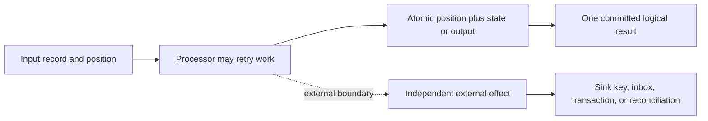

The useful architecture question is not “does this product support exactly once?” It is “which input position, state mutation, and visible effect are committed together, and what happens in every gap outside that commit?”

## 2. Historical Evolution

The phrase “exactly once” grew from message-queue delivery discussions, where systems were often classified as at-most-once, at-least-once, or exactly-once. The taxonomy is useful for describing transport behavior, but it encouraged an overly broad inference: that a message arriving once implies a handler running once and its downstream business effect occurring once. Those are separate properties.

The practical shift came as distributed logs and stream processors made progress explicit as offsets, sequence numbers, and checkpoints. A processor could persist its output and the input position that produced it as one transaction, or it could restore an earlier checkpoint and replay input. This made exactly-once *results* achievable inside a controlled transactional boundary without requiring the code to execute only once.

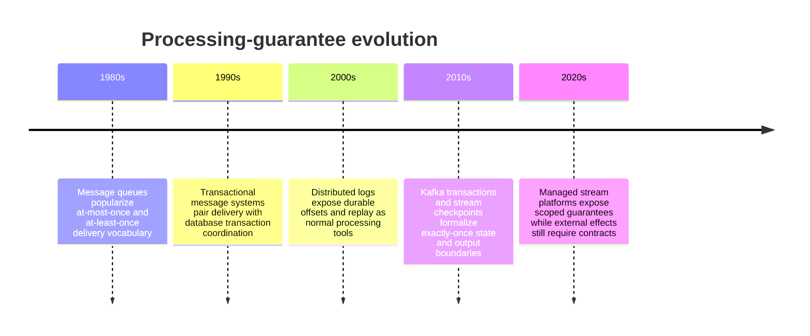

Modern systems therefore treat exactly-once as a scoped semantic property rather than a universal network guarantee. A broker can atomically publish outputs and advance its own consumer offsets. A stream processor can snapshot operator state and source positions. Neither fact automatically includes a separate database, an email provider, a payment network, or a physical action.

## 3. Why It Exists

At-least-once delivery is a sensible availability choice: when a receiver’s acknowledgment is uncertain, retry rather than silently lose work. The cost is duplicate attempts. If the effect is non-idempotent, duplicates can debit twice, increment an aggregate twice, create duplicate shipments, or notify a customer twice. At-most-once delivery avoids some duplicates by declining to retry, but it can lose work. Applications need a way to choose both progress and a correct result.

Exactly-once semantics address the gap between replayable delivery and business correctness. They are particularly important for financial ledgers, inventory movements, billing, fraud scoring, and derived state where a duplicate transition is materially harmful. They are less valuable for naturally replaceable state such as “set desired replicas to five,” where repeating the assignment already converges to the same state.

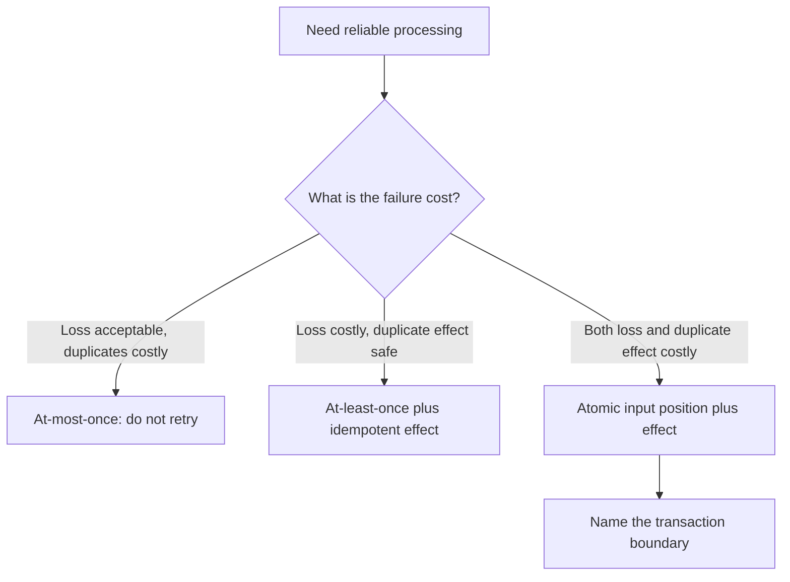

The guarantee is also an operational contract. Recovery must know which input records are committed, what state corresponds to them, and whether a downstream side effect may already have happened. Explicit semantics make replay and incident response deterministic; vague “exactly once” labels turn every timeout into a manual guess.

## 4. Core Concepts

### 4.1 Precise exactly-once terminology: four different counts

**Definition.** Four quantities must be kept separate. **Delivery count** is how many times a transport presents an item to a consumer. **Handler invocation count** is how many times application code begins or resumes handling it. **State-transition count** is how many durable transitions the protected state store commits because of it. **Externally visible effect count** is how many effects outside that state boundary are observed, such as a charge, email, webhook, or shipment request. A system can have multiple deliveries and invocations but one state transition and one externally visible effect. A stable event identifier (ID) denotes the logical input across redelivery, not one delivery attempt.

**Mechanism.** A lost acknowledgment can cause redelivery even after the handler completed. A process restart can invoke the handler again after its prior state commit. Atomic offset-and-state commit lets recovery replay an input if the transaction aborted, or skip it if the transaction committed. The code may consequently run more than once, while only one committed state transition is visible. External effects require their own inclusion in the transaction or a separate repeat-safe contract.

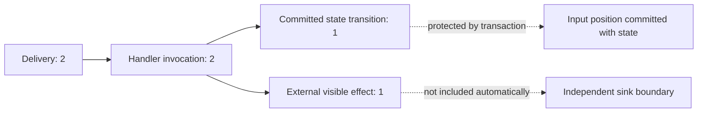

**Decision implications.** Every guarantee statement should name the counted quantity and boundary: for example, “the ledger contains one debit per transfer ID” or “one committed output record per input offset in the Kafka transaction.” Avoid “the handler runs once,” because crash recovery frequently re-executes code. Decide whether duplicate delivery is expected, whether handler execution can repeat, which state transition is authoritative, and how a user or downstream system observes the result.

**Common failure mode.** A team sees one visible output in a happy-path test and concludes that only one delivery or invocation occurred. Production retries can invoke the handler again, and external effects can repeat even while internal output appears unique. Another mistake is to count broker acknowledgments as business effects; an acknowledgment is transport progress, not proof that an unrelated sink committed.

**Scenario.** A consumer reads offset 41, updates a local account projection, commits its database transaction, then crashes before the broker sees the offset acknowledgment. It receives offset 41 again. Delivery count and handler invocation count are both two; if the offset and projection update were atomic in the same database transaction, the second invocation observes the committed position and does not apply a second state transition. A separately sent email still has no such protection.

### 4.2 At-least-once plus idempotent-effect semantics

**Definition.** At-least-once plus idempotent-effect semantics permits repeated delivery and repeated handler execution while ensuring that the same logical operation has one business outcome at a named sink. This is not literal single execution. It is repeat-safe convergence built on a stable identity and a sink-side rule that prevents an additional effect.

**Mechanism.** The consumer obtains a stable message or operation identifier, then writes an inbox/receipt with a uniqueness constraint in the same local transaction as the business mutation. If the record already exists, the handler returns the prior outcome or safely does no further work. Where the operation is naturally idempotent, an upsert or desired-state assignment can replace a separate receipt. The general operation-key design belongs to [CH16 Idempotency](CH16_Idempotency.md); this section uses it only to explain how a repeated processing attempt can produce one effect.

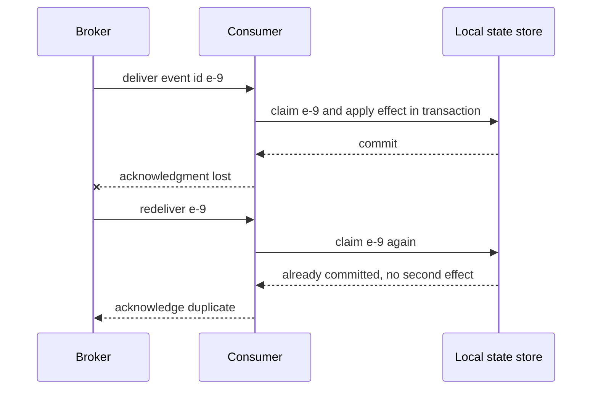

**Decision implications.** Use this model when a consumer can persist the stable identity beside its own state, or when the downstream provider honors the same idempotency key. Retention must cover every supported replay and redrive horizon. If a retry can represent a new intentional action, the identity must distinguish it; payload equality is not a substitute for logical operation identity. If the effect and receipt do not share a transaction, this model alone does not close the crash window.

**Common failure mode.** Writing “processed” after an effect in a separate commit. If the process crashes between them, redelivery repeats the effect. Writing “processed” first in a separate commit reverses the risk: a crash before the effect loses work. A process-local set disappears on restart and cannot arbitrate across replicas. These are transaction-boundary defects, not deficiencies in the choice of message identifier.

**Scenario.** An at-least-once settlement topic feeds a ledger service. The event ID is stable across broker replay. The service inserts an inbox row and a ledger debit in one database transaction, then acknowledges Kafka. A crash after the commit can cause another invocation, but the uniqueness constraint prevents a second debit.

### 4.3 Atomic offset-and-state commit / transactional processing

**Definition.** Transactional processing commits the input position and the state or output derived from that input as one atomic unit. Recovery then sees either both sides committed or neither side committed. “Offset” here means the durable source progress marker: a broker offset, source sequence, or equivalent checkpoint position.

**Mechanism.** The processor starts a transaction, reads or handles one or more inputs, writes changed state/output, records the next position, and commits. If it fails before commit, the transaction aborts and recovery replays the inputs. If it fails after commit, recovery starts after the committed position and observes the already-committed state/output. A local database can do this when both state and position live in that database. A broker transaction can do it when input positions and output records participate in the same broker transaction protocol. A separate database and broker normally do not share one atomic commit without distributed coordination.

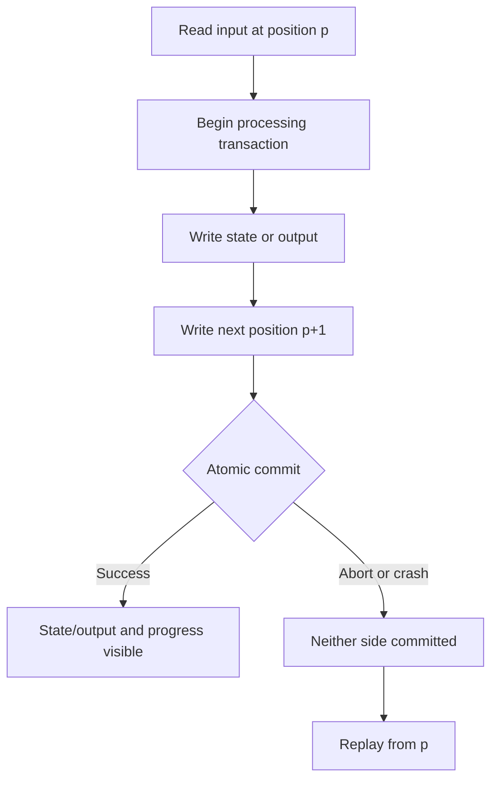

**Decision implications.** Prefer the narrowest store that can own both the progress marker and effect. If processing is Kafka-to-Kafka, Kafka transactions can couple produced records with consumed offsets. If processing is a database mutation, store the consumed position/inbox alongside the mutation in the database transaction, and acknowledge the broker afterward. If the source offset and sink state live in independent systems, use an outbox/inbox, idempotent sink, connector-supported transaction, or distributed transaction; do not assume a client library makes the cross-system writes atomic.

**Common failure mode.** Committing the offset before state makes a crash lose the state update because recovery skips the input. Committing state before the offset can repeat the mutation after a crash. A transaction only closes the gap for resources enlisted in it; naming the word “transaction” without naming participants and durability boundaries is not a guarantee.

**Scenario.** A Kafka Streams application reads a purchase event, updates a local state store, writes a compacted output topic, and advances the input offset under its configured processing guarantee. After a task failure, the committed transaction defines one recoverable cut: either the state changelog/output/offset commit is visible, or the records are replayed and the aborted writes are not visible to `read_committed` consumers.

### 4.4 Stream checkpoints and barrier mechanisms

**Definition.** A checkpoint is a consistent snapshot of a streaming computation’s operator state together with source positions. A barrier is a marker injected into each source stream that flows through operators with the records, identifying the cut of input included in a checkpoint. Exactly-once recovery means restoring that state and resuming from matching positions; it does not by itself make arbitrary sink effects transactional.

**Mechanism.** In an aligned checkpoint, an operator waits until it has received a barrier on every input channel. It temporarily buffers records arriving on channels whose barrier has already arrived, snapshots its state at the common cut, then forwards the barrier. The coordinator declares completion after the required tasks acknowledge durable snapshots. On failure, the processor restores the last completed snapshot and replays from its source positions. Unaligned checkpoints instead include in-flight channel buffers in the snapshot to reduce alignment stalls under backpressure, trading larger checkpoint state for shorter pauses. Transactional sinks commonly prepare output during a checkpoint and commit it only when the checkpoint completes.

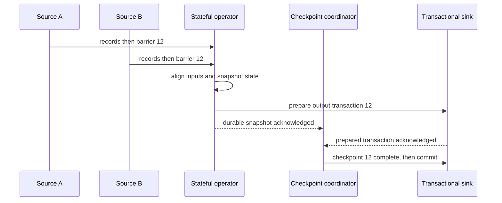

**Decision implications.** Checkpoints fit long-running stateful computations whose source can replay and whose operator state can be snapshotted consistently. Choose checkpoint interval by balancing replay work, snapshot cost, and recovery point objective. Aligned barriers are straightforward under healthy flow but can stall behind a slow input; unaligned checkpoints help under backpressure but increase storage and restore work. Confirm the sink has a checkpoint-aware commit or idempotent write strategy before claiming end-to-end exactly-once output.

**Common failure mode.** Treating a completed processor checkpoint as proof that an email, database row, or remote request was committed exactly once. If an external sink acted and then lost its acknowledgment, restoring an earlier checkpoint can issue the action again. Conversely, a sink that commits too early can expose output from a checkpoint that later fails. The source/state/sink lifecycle must be coordinated or the sink must tolerate replay.

**Scenario.** A Flink job joins click events from two Kafka inputs and maintains per-session state. Barriers align a consistent point across both inputs; the job snapshots operator state and source offsets. After task loss it restores checkpoint 12 and replays later records. A two-phase-commit-capable sink prepares writes per checkpoint and commits after global completion; a plain HTTP endpoint would need an idempotency key or another sink contract.

### 4.5 External sinks, side-effect boundaries, and guarantee composition

**Definition.** An external sink is any effect not part of the processor’s atomic transaction: a separate database, payment provider, email system, webhook receiver, search index, or physical fulfillment operation. Guarantee composition is the process of tracing the guarantee across every source, processor, and sink boundary. An end-to-end claim is only as strong as the least-protected boundary in the path.

**Mechanism.** At each boundary, choose one of four mechanisms: include the sink in the same supported transaction; use a sink-side idempotency key or inbox; write an outbox atomically with local state and relay it at least once; or preserve an ambiguous state and reconcile by querying the provider or human workflow. The outbox mechanism is fully owned by [CH12 Distributed Transactions](CH12_Distributed_Transactions.md). The downstream key and repeat-safe effect are fully owned by [CH16 Idempotency](CH16_Idempotency.md). If the sink cannot participate and provides no queryable identity, a timeout cannot reveal whether it acted; literal exactly-once effect is unavailable. The caller sees the same timeout in two possible worlds: the request never reached the sink, or the sink applied it and its acknowledgment was lost. Retrying can duplicate the second world; not retrying can lose the first. Without a shared transaction, sink-side deduplication, or an outcome query, no caller-side algorithm can distinguish them and guarantee both progress and one effect.

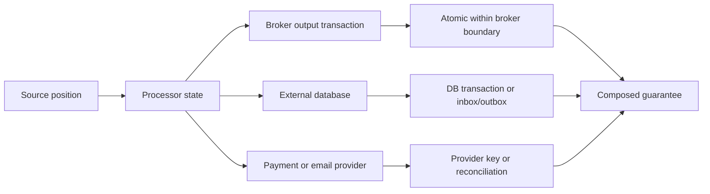

**Decision implications.** Draw the system as explicit source, broker, processor, state store, and sink boundaries. For each edge, record stable identity, transaction participants, acknowledgment order, replay horizon, and recovery owner. Use “exactly-once result within database X” where appropriate; state separately that the email provider is at-least-once with a key or is manually reconciled. If the business requires one real-world action but no participant can deduplicate or query it, the architecture must accept residual uncertainty or introduce a new coordinating authority.

**Common failure mode.** Declaring a pipeline exactly-once because one component has a checkbox with that label. Kafka transactions do not enlist an unrelated relational database. Flink checkpoints do not enlist a payment gateway. A local outbox makes database state and publication intent atomic, but the relay can publish more than once. A consumer’s inbox can protect its local database and still not atomically control a separate email send.

**Scenario.** An order service commits an order and an outbox event together. A relay may publish that event more than once. A billing consumer stores an inbox record and a local charge instruction in one transaction, then calls a payment provider using the stable order-payment ID. The provider deduplicates the key, or the consumer queries by merchant reference after an ambiguous timeout. Each boundary has a named guarantee; together they produce one charge outcome without claiming one handler invocation.

## 5. Internal Working

A useful way to reason about processing is to track a record’s progress through explicit durable states:

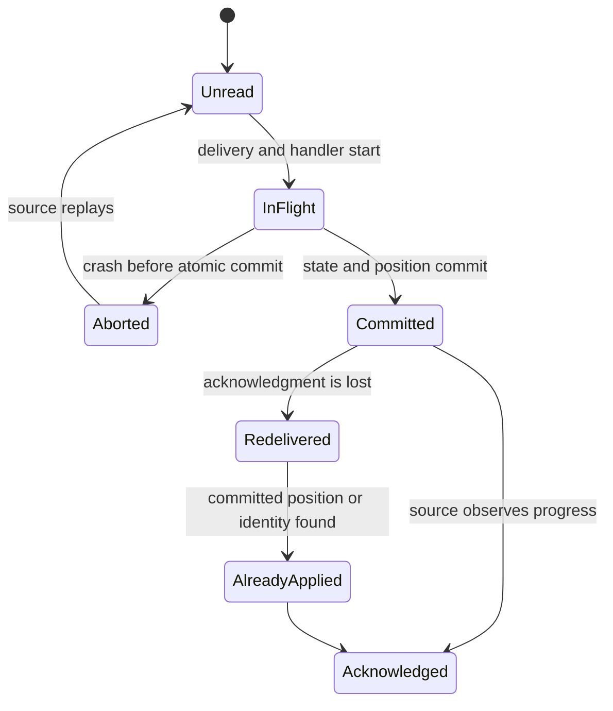

The critical distinction is between an in-memory fact and a durable fact. “The callback returned” is not durable. “The producer received an acknowledgment” may not be durable if a leader loses acknowledged data under an insufficient replication policy. “The database transaction committed” is durable according to that database’s contract, but does not prove a broker offset was committed. The architecture must define the authoritative commit marker and make recovery consult it.

For a transactional broker, the processor typically begins a transaction, consumes records, writes outputs, includes consumed offsets in the transaction, and commits. A crash before commit leaves outputs uncommitted and offsets unchanged; replay is expected. A crash after commit but before the application receives the commit response creates uncertainty for the application, but the broker’s transaction coordinator resolves whether that transaction committed. Consumers configured to read committed data do not expose aborted output records. Stable producer identity and producer epochs fence stale producer instances from continuing to write after replacement.

For a database-backed consumer, the database is commonly the authority. The transaction updates application state and a consumed-message receipt or partition offset. The broker acknowledgment follows the database commit. A crash before database commit rolls back and allows redelivery. A crash after database commit but before broker acknowledgment repeats the handler, which sees the receipt/offset and does not apply state twice. This pattern does not require a distributed transaction because the database commit is authoritative and the broker acknowledgment only causes safe replay.

For a stream processor, the checkpoint coordinator defines a global consistent cut across sources and operator state. The sink must participate in checkpoint completion, keep an idempotent versioned output, or provide a transaction protocol. Restore is deterministic only when the source can replay the required range and the operator state snapshot corresponds to that same range. Event-log replay and CQRS projection design remain owned by [CH15 Event Sourcing](CH15_Event_Sourcing.md) and [CH14 CQRS](CH14_CQRS.md), respectively.

## 6. Design Principles

1. **Specify the semantic count.** State whether the goal is one committed state transition, one output record, one charge, or some other observable result. Do not equate it with one delivery or handler run.
2. **Name every atomic boundary.** List exactly which offsets, state stores, broker records, and sink writes participate in a transaction.
3. **Assume execution can repeat.** Recovery commonly replays input. Handlers should be deterministic where possible and avoid unprotected external actions.
4. **Commit progress with the effect.** If possible, persist source position and derived state/output atomically.
5. **Treat acknowledgments as boundary-specific.** A broker acknowledgment, database commit, and provider response establish different facts.
6. **Use stable identity across retries.** Operation identity belongs to the logical event or command, not an individual delivery attempt.
7. **Protect the sink, not only the source.** A correct source offset cannot undo an external effect that escaped before a crash.
8. **Make replay horizons explicit.** Retention, restore points, and manual redrive policies determine how long an old input can reappear.
9. **Compose, do not overclaim.** Explain each boundary’s guarantee and the way it connects to the next one.
10. **Instrument unresolved work.** Checkpoint age, transaction aborts, offset lag, sink retries, and ambiguous outcomes reveal where guarantees are degrading.

## 7. Architecture Patterns

**Broker-native transactional processing.** Use a transactional producer to atomically publish output records and commit consumed offsets when both sides are inside the same broker’s transaction model. In Kafka, `sendOffsetsToTransaction` includes consumer group progress in the producer transaction. Consumers use `read_committed` when they must not observe aborted records. This pattern is not a general transaction across arbitrary stores.

**Stream processor with checkpointed state.** Frameworks such as Apache Flink snapshot source positions and operator state at a consistent checkpoint. A checkpoint-aware sink can prepare writes and commit them only after checkpoint completion. This works well for stateful stream transformations with replayable sources and supported sinks.

**Database-local inbox and offset.** A consumer stores a message identity or partition position in its database transaction with the business mutation. It acknowledges the broker only after commit. This provides a local atomic state transition and permits harmless redelivery.

**Transactional outbox and downstream inbox.** A service commits business state and an outbox row in one local database transaction; a relay publishes at least once; the consumer uses an inbox with its own local state transaction. [CH12 Distributed Transactions](CH12_Distributed_Transactions.md) owns the outbox mechanism. This chapter uses the pattern to describe guarantee composition, not to re-teach its design.

**External idempotency key with reconciliation.** A stable operation key is passed to a provider, and ambiguous calls are retried with the same key or queried using a durable provider reference. [CH16 Idempotency](CH16_Idempotency.md) owns key scope, fingerprints, replayed outcomes, and repeat-safe application effects.

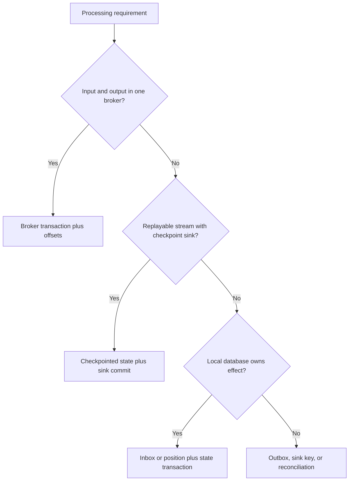

## 8. Production Architecture

A production design should make source, broker, processor, durable state, and external sink boundaries visible. Replication and high availability of these components affect durability, but do not change which resources are included in a transaction.

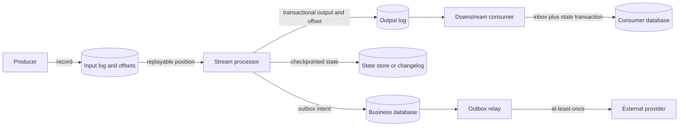

For Apache Kafka, a transactional producer needs a stable `transactional.id` across restarts for a logical producer task, and the broker assigns producer epochs to fence stale incarnations. The consumer must pass its group metadata and the next offsets to the transaction. `read_committed` consumers see only committed transactional records, although they may wait behind an open transaction. Idempotent producer sequencing prevents duplicate broker appends caused by retrying a produce request; it is not equivalent to atomically updating an external database.

For Apache Flink, the job manager coordinates checkpoint barriers and collects durable acknowledgments from task operators. Source connectors snapshot positions; operators snapshot keyed or operator state; sinks may use a two-phase-commit protocol around checkpoint completion. Checkpoint storage, source retention, state backend, and sink semantics must all align. The advertised guarantee is connector-specific: inspect the source and sink guarantees for the deployed versions, rather than inferring them from the framework name.

Cloud managed services expose different boundaries. Amazon Managed Streaming for Apache Kafka supports Kafka protocol transactions with compatible clients; Amazon Managed Service for Apache Flink uses Flink checkpoint semantics, subject to connector and sink behavior. Azure Event Hubs provides producer/consumer features and partition checkpoints, but an application’s database write is not included merely because the source is Event Hubs. Google Cloud Dataflow provides exactly-once processing semantics for supported pipeline operations and sinks; custom external calls still need idempotency or transaction-aware integration. Validate the precise service and connector contract, as product guarantees evolve.

## 9. Implementation

Implementation begins with an explicit failure-window inventory. For each input, write down: when it is considered delivered; when handler execution starts; when local state commits; when the source position advances; when an output becomes visible; and when any external action occurs. Then inject a crash between every adjacent pair. A guarantee that depends on “the process probably won’t crash right there” is not a guarantee.

With a relational consumer, one practical design uses `processed_messages` or a per-partition offset table. The transaction inserts the event ID or verifies the expected offset, updates business rows, and advances the stored position. A unique constraint handles concurrent workers. The broker acknowledgment follows commit. If the message must cause a publication, write an outbox row in the same transaction; do not publish directly and then mark processed.

With Kafka-to-Kafka processing, use a transactional producer; initialize it once; begin a transaction per bounded batch; publish output records; send consumed offsets to the transaction using the current consumer group metadata; and commit. On retriable transaction failure, abort or allow the producer to fence/reinitialize according to the client API. Keep batches bounded because the transaction timeout and open-transaction visibility delay are operational limits. Configure downstream consumers to read committed output if aborted records must remain invisible.

With Flink, choose a checkpoint interval, timeout, storage location, and state backend based on restore objectives and throughput. Ensure source retention exceeds worst-case outage and restore time. A checkpoint that completes more slowly than the configured timeout can repeatedly fail, leaving the job unable to make progress. For a sink, establish whether it is transactional, idempotent, or merely best effort. If the sink is outside the checkpoint protocol, document the weaker guarantee.

The examples in Section 10 are small standard-library demonstrations. They simulate failure windows, use SQLite to commit an inbox/state/offset together, and show why a provider boundary needs either a stable key or reconciliation. They are executable models, not replacements for Kafka or Flink client libraries.

## 10. Complete Code Examples

Three runnable Python examples live under [code/python/exactly-once-processing-chapter/](../code/python/exactly-once-processing-chapter/) and use only the standard library:

1. [01_failure_window_simulator.py](../code/python/exactly-once-processing-chapter/01_failure_window_simulator.py) contrasts at-least-once redelivery with a transactionally committed local state effect, counts delivery attempts, handler invocations, state transitions, and visible effects independently, and injects crashes around the commit boundary.
2. [02_atomic_transactional_consume.py](../code/python/exactly-once-processing-chapter/02_atomic_transactional_consume.py) uses SQLite to commit inbox identity, account state, and the next input position together. It demonstrates rollback-before-commit and commit-before-ack redelivery.
3. [03_external_side_effect_boundary.py](../code/python/exactly-once-processing-chapter/03_external_side_effect_boundary.py) simulates a transactional outbox relay calling a provider. Replaying after a lost response yields one effect only when the provider honors the stable idempotency key; the no-key variant demonstrates ambiguity and duplicate risk.

Run them independently from the repository root:

```powershell
.\.venv\Scripts\python.exe code\python\exactly-once-processing-chapter\01_failure_window_simulator.py
.\.venv\Scripts\python.exe code\python\exactly-once-processing-chapter\02_atomic_transactional_consume.py
.\.venv\Scripts\python.exe code\python\exactly-once-processing-chapter\03_external_side_effect_boundary.py
```

## 11. Performance

Exactly-once mechanisms add coordination cost. Broker transactions introduce transaction begin/commit work, coordinator traffic, replication of transaction state, and visibility delays for `read_committed` consumers. Larger batches amortize fixed costs but keep transactions open longer, increase rollback work, and can delay downstream visibility. Small batches reduce latency but increase coordinator and metadata overhead.

Checkpoint cost depends on state size, storage throughput, barrier alignment, and checkpoint frequency. A shorter interval reduces replay after failure but increases snapshot and coordination overhead. Backpressure can delay aligned barriers; unaligned checkpoints capture in-flight data and can make restore heavier. A transactional sink may add prepare/commit round trips and hold resources while a checkpoint completes.

The correct performance comparison includes retry and reconciliation cost. An at-least-once system with rare duplicates may be cheaper when sink effects are naturally idempotent. A strong guarantee may be justified where duplicate harm dominates latency and storage. Measure transaction abort rate, checkpoint duration, barrier alignment time, commit latency, open-transaction age, redelivery rate, and sink replay rate rather than a single end-to-end throughput number.

## 12. Scalability

Partitioning determines how much concurrency a processor can achieve. Each partition typically has one active consumer per group, so parallelism is bounded by partition count and state ownership. Hot keys can serialize work even when total partition count is large. Exactly-once does not remove ordering constraints or eliminate hot partitions; it adds state/transaction coordination around the same work.

State stores and checkpoints grow with key cardinality, retained history, and in-flight buffers. Rebalancing can move partition ownership and trigger restore from a changelog or checkpoint. Stable transactional identities and fencing are critical during ownership changes so an old worker cannot continue committing after a new worker takes over. Retention must cover the maximum recovery interval; deleting source data too early makes a checkpoint unrecoverable.

For multi-region processing, a regional transaction rarely covers global replication and external effects. Choose a single processing home per key, use a globally coordinated storage system, or accept regional at-least-once delivery with convergent state. Do not infer global exactly-once behavior from a single-region broker transaction.

## 13. Security

Transactional processing affects data integrity and can create replay surfaces. An attacker or misconfigured operator who can reset offsets, restore an old checkpoint, or replay a dead-letter queue may cause old business operations to be attempted again. Protect offset-reset privileges, checkpoint storage, transaction identities, state stores, outbox tables, and administrative redrive tools with least privilege and audit logging.

Stable operation identifiers should not be treated as authorization credentials. External idempotency keys can leak cross-request correlation or permit unintended outcome lookup if a provider’s API is poorly scoped. Authenticate and authorize every request independently; protect inbox/outbox payloads and checkpoint artifacts according to their data classification; redact sensitive payloads from transaction and retry logs.

Fencing is also a security and integrity control. A stale producer or task should not be able to continue writing after ownership changes. Use broker epochs, leases with monotonically increasing fencing tokens, and conditional writes where appropriate. A lease alone does not stop a paused old worker from resuming and issuing an outdated external action.

## 14. Observability

Measure each guarantee boundary separately. Useful signals include source delivery attempts, handler invocations, transaction commits and aborts, committed and uncommitted output counts, consumer lag, checkpoint completion time, barrier alignment time, restore duration, sink retries, inbox conflicts, outbox age, and ambiguous provider outcomes. These measurements make the four counts in Section 4.1 observable rather than conflated.

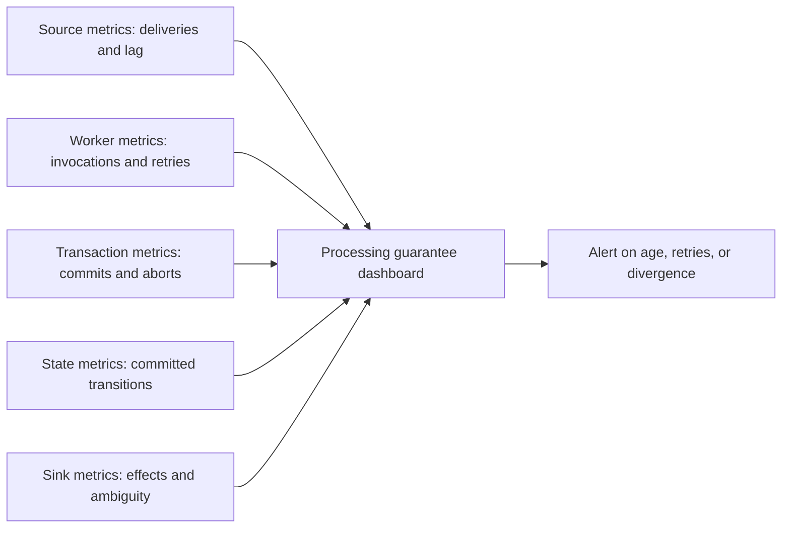

Use a stable, privacy-safe operation identifier in traces to connect retries, but avoid high-cardinality metric labels. Log transaction IDs, checkpoint IDs, partition/offset, producer epoch, and provider reference so operators can reconstruct whether a specific effect committed. A dashboard should distinguish “handler retried” from “duplicate effect detected”; the first can be normal recovery, the second may be a correctness incident.

## 15. Failure Scenarios

| Failure window | Likely recovery behavior | What is protected | What is not protected automatically |
|---|---|---|---|
| Producer sent input, acknowledgment lost | Producer retries or source may contain duplicate | Broker-side idempotent sequence handling, if configured | Downstream effects at unrelated sinks |
| Handler fails before atomic state/position commit | Transaction aborts; input is replayed | No partial local state/position commit | Any external call made before failure |
| State commits, source acknowledgment lost | Input may be delivered again | Inbox/offset checked in same state transaction | Effects outside that transaction |
| Kafka transaction aborts after output send | Output remains uncommitted to `read_committed` consumers; input replays | Kafka output and offsets in transaction | Database or HTTP side effect issued by handler |
| Checkpoint completes, sink commit response is ambiguous | Framework or sink retries/reconciles | Sink only if its protocol is transactional/idempotent | Generic external API behavior |
| External provider acts, response is lost | Caller cannot infer outcome from timeout | Stable provider key or queryable reference, if supported | Provider with neither deduplication nor outcome query |
| Checkpoint storage is unavailable | Checkpoints fail; replay window grows | Last completed checkpoint remains recovery point | Progress beyond source retention |
| Old task resumes after rebalance | Fencing should reject stale writes | Broker/state store with epochs or fencing | Unfenced external action already in flight |

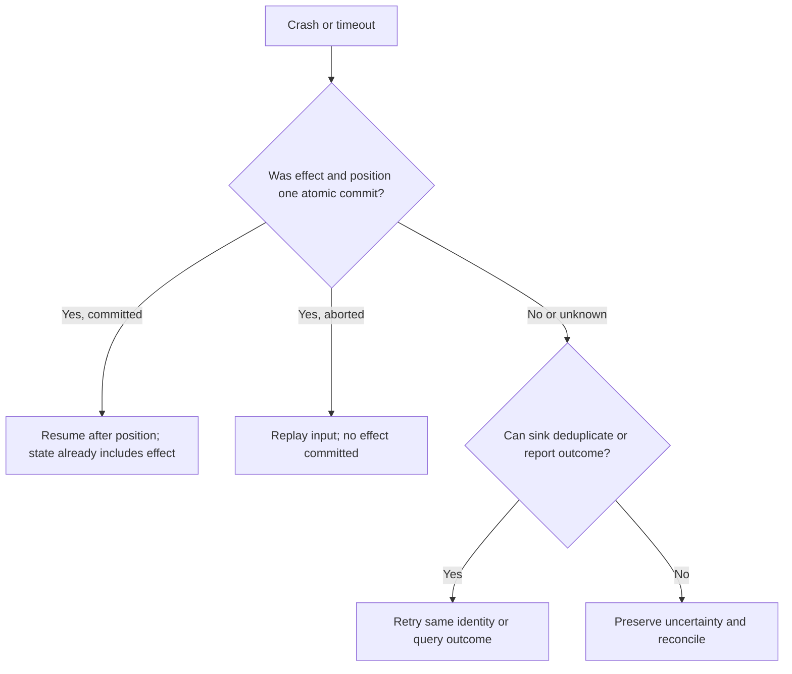

The key operational rule is to classify an outcome as committed, aborted, or unknown. Do not turn “unknown” into “failed” merely to simplify retry logic. An unknown external result may require a keyed retry, provider lookup, or a human-owned reconciliation queue.

## 16. Testing

Test guarantees at their actual boundaries. A happy-path assertion that one record was processed does not prove behavior after a lost acknowledgment. Inject failure before transaction commit, after state commit but before broker acknowledgment, after broker transaction commit but before the client receives the response, and after an external provider acts but before the relay records success.

For a database consumer, assert that the message identity, state transition, and stored position are committed together. Run concurrent duplicate deliveries and verify exactly one durable transition. For Kafka transactions, test aborted output visibility with a `read_committed` consumer, offset recovery, producer fencing, and rebalances. For Flink, fail tasks during checkpoint alignment, after snapshot acknowledgment, and during sink commit; verify restore from a completed checkpoint and connector-specific output semantics.

Use fault injection that deterministically pauses at named boundaries rather than timing-dependent sleeps. Validate the four counts separately: deliveries, handler invocations, committed state transitions, and external effects. For external providers, use a fake that can apply the effect and then lose its response; run once with a stable idempotency key and once without it to demonstrate the residual ambiguity.

## 17. Common Mistakes

- Saying “the message is exactly once” without identifying delivery, invocation, transition, or visible effect.
- Assuming exactly-once means the handler function executes once. Replay may invoke it again.
- Committing the offset before the state mutation, creating loss after a crash.
- Committing state before the offset without an inbox/position check, creating duplicate transitions after a crash.
- Assuming Kafka’s transaction includes an unrelated relational database.
- Assuming a Flink checkpoint makes a plain HTTP call transactional.
- Treating broker producer idempotence as end-to-end processing semantics.
- Using a fresh idempotency key on retry, preventing the sink from recognizing the same operation.
- Performing an external side effect before recording durable intent or identity.
- Advancing a checkpoint or deleting source data before the sink’s effect is safely committed.
- Using “processed” flags that are not atomic with the protected effect.
- Resetting offsets without evaluating replay horizon and external side-effect behavior.

## 18. Best Practices

1. Define “once” as one specific durable transition or visible effect, at one named boundary.
2. Assume delivery and handler execution can repeat under failure recovery.
3. Prefer a transaction that includes both input progress and the local state/output.
4. When a broker acknowledgment follows a database transaction, keep an inbox or consumed position in the same database transaction as the mutation.
5. For Kafka-to-Kafka processing, use transactions to include output records and consumer offsets; use `read_committed` consumers where aborted output must not be visible.
6. For checkpointed stream processing, validate both the source connector and sink connector guarantee.
7. Use outbox/inbox or downstream idempotency across independently failing service boundaries.
8. Preserve a stable identity across retries and redrives; follow CH16 for key and effect design.
9. Treat timeouts as ambiguous until the sink confirms otherwise.
10. Bound transaction sizes and checkpoint durations, and retain input long enough for recovery.
11. Fence stale owners after rebalances, failovers, and lease expiry.
12. Test crash windows and count delivery, invocation, state transition, and effect independently.
13. Publish a guarantee statement naming transaction participants, retention horizon, and excluded sinks.

## 19. Anti-Patterns

**The exactly-once checkbox.** A product setting is presented as a property of the entire application. It normally applies only to a specific source, state, and sink combination; all other boundaries remain open.

**One handler invocation as the requirement.** Preventing replay may sacrifice recovery or availability and still cannot ensure an external system acted once when acknowledgments are lost. Design for one committed outcome instead.

**External call inside a replayable handler.** The processor calls an email or payment service before its transaction/checkpoint commits. A rollback or restore repeats the call. Move the effect behind an outbox or use a stable sink identity.

**Offset-first acknowledgment.** Progress is committed before the business effect. A crash after the offset commit permanently skips the effect.

**State-first without duplicate protection.** State commits but source progress does not; redelivery repeats an additive mutation. Co-commit the progress marker or make the mutation idempotent.

**Unbounded synchronous transaction.** One transaction spans a large batch or slow remote operation, increasing lock duration, timeout probability, and recovery cost. Keep atomic work local and bounded.

## 20. Trade-off Analysis

| Approach | Duplicate delivery/handler calls | State/effect guarantee | Latency and cost | Main limit |
|---|---|---|---|---|
| At-most-once delivery | Usually minimized | Work may be lost | Lowest coordination | No retry after uncertain delivery |
| At-least-once plus idempotent sink | Expected | One logical effect at sink | Key lookup/storage or natural write cost | Depends on stable identity and retention |
| Atomic offset plus database state | May repeat before commit | One local committed transition | Database transaction and inbox/offset storage | Does not include another system |
| Kafka transaction | Handler may replay | Kafka output plus input offsets atomic | Transaction coordinator and visibility delay | External databases/providers excluded |
| Checkpoint plus transactional sink | Operators may replay | Snapshot state/positions and supported sink commit | Snapshot I/O, barriers, sink protocol | Connector-specific; arbitrary side effects excluded |
| Outbox plus inbox chain | Repeated publication/delivery | Local effects protected at each service | Relay lag and per-hop storage | Eventual propagation; no global instantaneous commit |

The choice depends on duplicate harm, tolerated latency, throughput, input replayability, state size, number of independent sinks, and provider capabilities. Stronger local semantics add durable coordination and recovery machinery. Weaker transport semantics can still yield correct business outcomes when effects are naturally repeat-safe. A high-value irreversible action may justify the cost of a durable idempotency contract and reconciliation path even if the transport itself remains at-least-once.

## 21. Comparison Table

| Guarantee phrase | What it can mean precisely | Does not imply |
|---|---|---|
| At-most-once delivery | The transport does not redeliver after its chosen acknowledgment point | Every input is processed or effects are durable |
| At-least-once delivery | The transport retries until its delivery condition is met; duplicates are possible | One handler invocation or one business effect |
| Idempotent producer | Producer retries do not append duplicate records within the broker’s producer identity/sequence contract | Consumer state or external effect is exactly once |
| Kafka transactional processing | Produced Kafka records and included consumed offsets commit/abort together | Atomicity with arbitrary databases or APIs |
| Checkpointed exactly-once state | Restore returns source positions and operator state to a consistent completed checkpoint | Exactly-once arbitrary sink effects |
| Exactly-once effect | One logical effect at a named sink despite retries | One delivery, one invocation, or one global transaction |
| End-to-end exactly-once semantics | Each stage composes its local atomic/idempotent guarantee across explicitly named boundaries | Literal global single execution across uncoordinated failure domains |

## 22. Real-World Case Study

Consider a commerce pipeline that consumes `OrderPaid` events, updates an inventory projection, emits a warehouse request, and sends a customer email. The initial implementation commits the Kafka offset after the handler returns. The handler decrements inventory, calls the warehouse API, sends email, and then commits the offset. A process crash at any point before the offset commit causes replay. Inventory can be decremented twice, warehouse requests can be duplicated, and email can be resent. Committing the offset first avoids duplicate calls only by losing effects if the process crashes afterward.

The redesign separates effects by ownership boundary. Kafka Streams performs the inventory projection and emits an output topic in a broker transaction that includes consumed offsets. The inventory projection is rebuilt from the committed log position, and aborted transactional output is hidden from `read_committed` consumers. A warehouse service consumes the output, inserts an inbox record and a durable warehouse command in one local database transaction, then acknowledges the broker. Its dispatcher sends a stable order-line operation ID to the warehouse provider; after an ambiguous response, it retries the same key or queries the provider. Customer email is treated as a separate effect with a provider idempotency contract where available, otherwise an explicit delivery state and reconciliation policy.

This architecture still permits repeated deliveries and handler invocations. It promises one inventory transition per input identity within the Kafka-backed state boundary, one durable warehouse command per inbox identity, and one warehouse effect only if the provider honors the stable key or can reconcile by reference. If the email provider cannot deduplicate, the team must state that duplicate email is a residual possibility or choose a product flow where repeated notifications are harmless. The precise result is more useful than a blanket “exactly-once pipeline” claim.

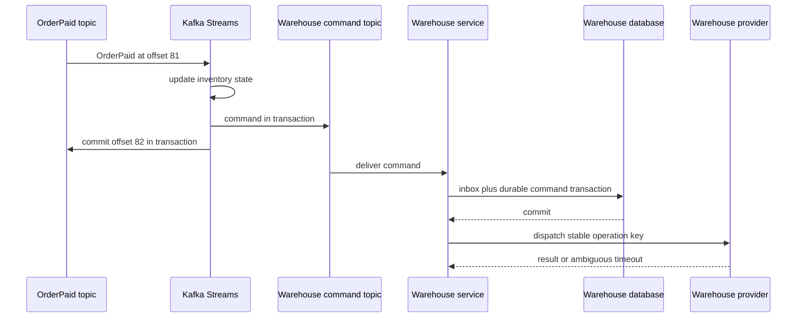

## 23. Interview Questions

1. Distinguish delivery count, handler invocation count, state-transition count, and externally visible effect count.
2. Why can’t a network protocol guarantee literal single execution across independent failure domains?
3. Explain how at-least-once delivery plus an idempotent sink can yield one business effect.
4. What must be atomically committed for a database consumer to avoid both lost updates and duplicate updates?
5. How does Kafka’s transactional producer include consumer offsets, and what does `read_committed` change?
6. Which failures are handled by idempotent producer sequencing, and which remain outside it?
7. Describe how Flink barriers create a consistent checkpoint across multiple input channels.
8. What is the difference between aligned and unaligned checkpoints?
9. Why does a completed checkpoint not automatically make an email or payment exactly once?
10. How would you compose a Kafka transaction, local database update, and third-party API call?
11. Which source retention and checkpoint settings are needed to make recovery possible?
12. How would you prove the guarantee in a test that injects a lost acknowledgment after commit?

## 24. Hands-on Exercises

1. Run the three examples in Section 10 and record the four counts for each simulated failure window.
2. Modify the SQLite consumer to commit account state before recording its inbox row. Inject a crash between commits and observe the duplicate transition on redelivery.
3. Modify the example to record the inbox row before updating account state, again using separate commits. Inject a crash and observe the lost-work failure.
4. Add a two-partition source-position table and reject attempts to advance a partition offset past an unprocessed gap.
5. Extend the external provider simulator to retain idempotency keys for a bounded duration, then replay after expiry and document the guarantee boundary.
6. Sketch the Kafka transaction sequence for a batch of three records, including output records and the next offset for each partition.
7. Draw an aligned checkpoint with two inputs where one barrier arrives late; then show which records an unaligned checkpoint must include in its channel state.

## 25. Design Exercises

1. **Kafka-to-PostgreSQL accounting.** Design a consumer that reads an at-least-once topic and updates a relational ledger. Specify where the input identity/position is stored, when the broker is acknowledged, and how you handle a rebalance.
2. **Flink-to-object-storage analytics.** Design checkpoint and sink-commit semantics for a job writing partitioned files. Explain how uncommitted files are hidden or cleaned up after restore.
3. **Payment provider timeout.** A provider has no idempotency key but allows lookup by merchant reference. Define the durable states and recovery flow after the provider acts but the response is lost.
4. **Email notification pipeline.** Compare accepting possible duplicate email, using a provider key, and creating a notification service with a durable send ledger. State the actual externally visible guarantee for each.
5. **Multi-region stream processing.** Compare a home-region-per-key design, global coordination, and region-local processing with reconciliation. Identify the latency, availability, and duplicate-effect trade-offs.
6. **Guarantee statement review.** Rewrite “the platform processes each order exactly once” as a set of bounded claims for the source, state store, output topic, payment provider, and notification provider.

## 26. Architecture Review Questions

- What does “once” count here: delivery, handler invocation, committed transition, or visible effect?
- Which source position, processor state, and output are part of the same atomic transaction?
- What is the authoritative commit marker, and what does recovery consult?
- Can handler code run again after the effect commits but before an acknowledgment arrives?
- Are retries tied to a stable logical identity rather than a delivery attempt number?
- Does a Kafka transaction include only broker records and offsets, or is another store incorrectly assumed to participate?
- Does each stream source and sink support the claimed checkpoint semantics in the deployed versions?
- Is source retention longer than the worst-case restore and replay window?
- Are stale producers or workers fenced after failover and rebalance?
- For every external effect, is there a transaction, provider key, inbox, queryable reference, or reconciliation process?
- What happens when a provider acts but its response is lost?
- Are transaction aborts, checkpoint age, lag, duplicate deliveries, sink retries, and ambiguous outcomes observable?
- Do tests force failure before and after every commit and acknowledgment boundary?
- Does documentation state what the guarantee excludes, including retention and replay limits?

## 27. Summary

Exactly-once processing is not literal single execution across independently failing systems. Delivery, handler invocation, committed state transition, and externally visible effect are distinct counts. Practical exactly-once semantics come from atomically committing source progress with the protected state/output, or from at-least-once attempts combined with an idempotent effect at a named sink.

Kafka transactions can couple Kafka output records with consumed offsets; Flink checkpoints can couple replayable source positions with operator state and checkpoint-aware sink commits. Neither automatically includes an unrelated database or external provider. Across boundaries, use local inbox/outbox transactions, stable downstream identities, provider-supported deduplication, and reconciliation for ambiguous outcomes. The architecture is complete only when every boundary is stated and its failure windows tested. See [CH16 Idempotency](CH16_Idempotency.md) for repeat-safe operation design, [CH12 Distributed Transactions](CH12_Distributed_Transactions.md) for outbox/distributed transaction mechanisms, [CH14 CQRS](CH14_CQRS.md) and [CH15 Event Sourcing](CH15_Event_Sourcing.md) for their owned read-model/event-log concerns, and [CH19 Deduplication](CH19_Deduplication.md) for general deduplication structures and windows.

## Further Reading

- Apache Kafka documentation: transactions and exactly-once semantics.
- Apache Flink documentation: checkpointing and end-to-end exactly-once sinks.
- [CH16_Idempotency.md](CH16_Idempotency.md) — operation identity and idempotent effects.
- [CH12_Distributed_Transactions.md](CH12_Distributed_Transactions.md) — transactional outbox and distributed-transaction mechanisms.
- [CH14_CQRS.md](CH14_CQRS.md) — read/write separation and projection behavior.
- [CH15_Event_Sourcing.md](CH15_Event_Sourcing.md) — event-store replay and snapshot semantics.
- [CH19_Deduplication.md](CH19_Deduplication.md) — general deduplication structures and time windows.