# Chapter 18: Ordering Guarantees

## 1. Introduction

Distributed systems produce events on multiple machines, deliver them over networks with variable delay, and apply them through consumers that may run concurrently, restart, or move between hosts. A system can preserve every message and still produce a wrong result if a later state change is applied before an earlier one. A bank ledger that applies a balance correction before the debit it corrects, an inventory service that processes `Reserve` after `Release`, or a stream aggregation that closes a time window before a delayed event arrives can all be incorrect without losing data.

An ordering guarantee states which pairs of events the system promises to observe or apply in a particular order, and within what scope. The scope is decisive: a queue may preserve one partition's append order while making no promise between partitions; a causal protocol may order dependent operations while leaving concurrent ones incomparable; a consensus-backed log may establish one total order for a replicated command stream while saying nothing about a separate stream. “Ordered” is incomplete unless it names the events, the scope, the point at which order is established, and the behavior when a gap or late event appears.

This chapter owns the taxonomy and design decision framework for total, per-key, causal, and partial order; per-key sequencing and reordering; cross-partition limits; and event-time progress, watermarks, and late-event policy. [Replication](CH10_Replication.md) owns vector-clock mechanics and causality tracking; this chapter recaps those tools only as needed. [Consensus](CH07_Consensus.md) owns consensus algorithms and replicated-log safety; [Partitioning](CH11_Partitioning.md) owns partition assignment and key-space distribution. [Idempotency](CH16_Idempotency.md) owns repeat-safe operations. [Exactly-Once Processing](CH17_Exactly_Once_Processing.md) owns end-to-end processing/checkpoint guarantees, and [Deduplication](CH19_Deduplication.md) owns general duplicate-detection mechanics. Ordering is related to all of them, but is not a substitute for any of them.

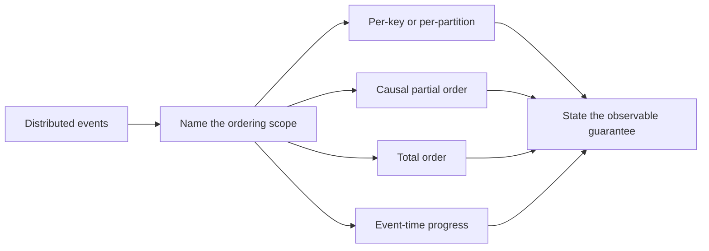

## 2. Historical Evolution

The earliest distributed applications often relied on a single machine's sequence of calls, so local program order was implicit. Once work crossed a network, different clocks, independent senders, asynchronous delivery, retries, and failures made “which happened first?” a distributed-systems question rather than a timestamp comparison. Leslie Lamport's 1978 paper formalized the happened-before relation and introduced logical clocks: a way to preserve known causal constraints without pretending that physical clocks are perfectly synchronized. Fidge and Mattern later developed vector clocks, which distinguish causal precedence from concurrent updates; their full ownership is [CH10 Replication](CH10_Replication.md#44-vector-clocks-tracking-causality-across-replicas).

Message brokers and replicated logs then made order an explicit storage contract. A single append-only log naturally assigns a position to each accepted record. Partitioned logs preserve this property independently per partition so producers and consumers can scale, deliberately giving up a universal order across partitions. Consensus protocols provide a way for a replicated group to agree on one log prefix despite failures, at the cost of coordination and loss of write progress when a safe quorum cannot be reached. See [CH07 Consensus](CH07_Consensus.md#45-raft-log-replication-commit-rules-and-safety) for the protocol mechanics.

Stream-processing systems introduced a second notion of order: the time an event claims to represent may differ from the time a process receives it. Event-time windows therefore need a progress estimate, called a watermark, and an explicit policy for records that arrive after the estimate has advanced. These are not transport-order guarantees. They are decisions about when a computation considers an interval sufficiently complete to emit or discard state.

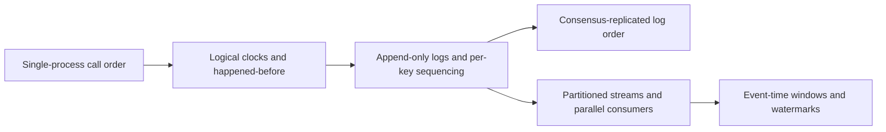

## 3. Why It Exists

Order matters whenever an operation's meaning depends on prior state. Applying `SetStatus(Shipped)` before `SetStatus(Paid)` may be harmless if the latter is rejected by a state machine, or disastrous if it overwrites the newer state. A sequence of debits and credits may produce a different balance if reordered. A cache invalidation that arrives before an older cache fill can be undone by that delayed fill. A per-customer stream may need to preserve each customer's command history even when unrelated customers proceed concurrently.

The requirement is rarely “sort all records by timestamp.” Wall clocks can skew, event timestamps can be generated by unsynchronized devices, and receipt time represents network arrival rather than business occurrence. A global sort also creates a serialization point. The architectural task is to identify which ordering relations are semantically necessary and leave unrelated events concurrent. This often yields a narrower and cheaper guarantee: per aggregate, per account, per key, or per source partition.

Ordering also makes failures more visible. A consumer cannot safely skip sequence 41 and apply 42 if the missing update could change the precondition for 42. It may need to buffer, retry, block that key, route the gap to repair, or use an application rule that proves the operations commute. Each choice affects latency and availability. Order should therefore be a named contract with an owner and failure policy, not an accidental side effect of one worker or today's broker configuration.

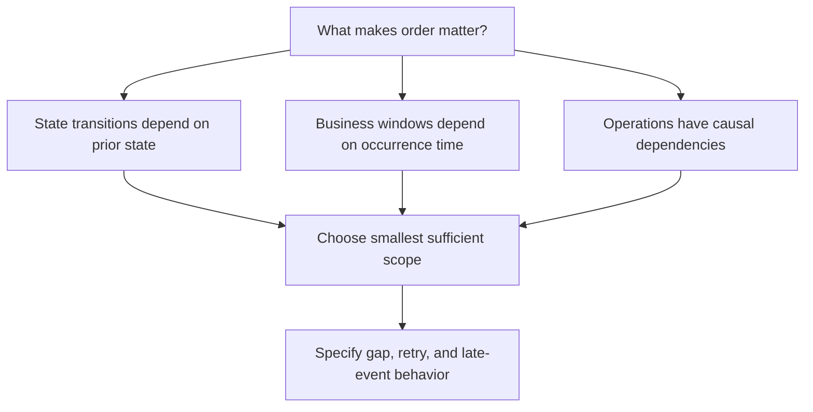

## 4. Core Concepts

### 4.1 Ordering Taxonomy and Order Scope

**Definition.** An ordering relation states whether one event must precede another. A **total order** compares every pair: for any distinct events `a` and `b`, either `a < b` or `b < a`. A **partial order** compares only related pairs; independent events may be incomparable. **Causal order** is the partial order induced by dependency and communication: if event `b` could have observed or been caused by `a`, then `a` precedes `b`. **First-in, first-out (FIFO)** order preserves the order in which one producer or log accepted items within a specified channel or scope. **Per-key order** preserves a sequence for events sharing a business key, while allowing different keys to progress independently. A partition log provides per-partition FIFO order, not automatically per-key business order unless routing sends all events for that key to that same ordered log.

**Mechanism.** Order is a relation over events, not a property of a timestamp field. A total order can be represented by one authoritative sequence number, log offset, or a tuple such as `(logical_time, node_id)` that breaks ties. The tuple makes concurrent events comparable, but the tie-breaker does not prove causality. A partial order is represented by a set of constraints: local program order, message-send-before-receive, explicit dependencies, or causal metadata. If no path relates two events, the contract permits either observed order. A scope can be one producer, one key, one partition, one aggregate, one region, or a whole command domain. The same system can provide different scopes at different layers.

**Decision implications.** Begin with an invariant and ask exactly which events can violate it if reordered. Choose the narrowest scope that protects that invariant. Per-account order is usually enough for a ledger; one global order across unrelated accounts adds coordination without improving correctness. Choose total order only when consumers need one canonical sequence, such as applying a replicated state machine, resolving a non-commutative shared log, or producing a single auditable sequence. Choose causal order when dependencies must be respected but truly independent actions should remain concurrent. State whether the guarantee applies at acceptance, durable commit, delivery, or application: these points are not interchangeable.

**Common failure mode.** Saying “the queue is ordered” while omitting whether that means producer-send order, broker-append order, order within a partition, order after retries, or completion order across concurrent handlers. Another common error is treating a timestamp sort as total order with causal meaning. A deterministic tie-breaker can create a stable display order but cannot establish that the selected first event caused the second.

**Scenario.** A multi-tenant billing stream requires invoice-line changes for one account to be applied in sequence, but account A's processing does not depend on account B. Per-account ordering preserves each ledger's invariant while allowing accounts to run in parallel. A compliance export may later merge records into a deterministic display order using a stable tie-break key, but it must not claim that the merged order reflects causality across accounts.

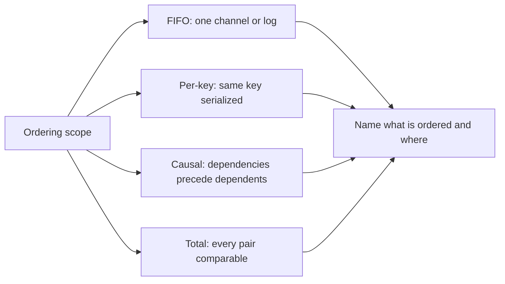

### 4.2 Per-Key and Per-Partition FIFO Sequencing

**Definition.** Per-key sequencing assigns monotonically increasing positions to the events for one key and requires application in that order. A producer can emit `(key, sequence, payload)`; a consumer expects the next sequence for each key. A **reordering buffer** temporarily retains an event that arrived ahead of its predecessor and releases it when the gap is filled. A Kafka topic partition is an ordered append-only log, and Kafka guarantees append order inside each partition. A producer key commonly routes related records to one partition, thereby making that partition's order usable as a per-key ordering mechanism. [CH11 Partitioning](CH11_Partitioning.md#46-partitioning-in-message-queues-and-event-streams-kafka) owns key-to-partition assignment, not this chapter's ordering taxonomy.

**Mechanism.** The writer must establish a sequence authority. This can be an aggregate version in a transactional database, a single writer per key, a leader's append index, or a broker offset. The consumer tracks `next_expected` per key. If sequence `n` arrives when `n` is expected, it applies `n` and drains any contiguous buffered successors. If `n` is greater, it buffers the event and starts a gap timer or repair request. If `n` is lower, it is stale relative to the current sequence; whether it is a harmless redelivery or a conflicting replay belongs to identity and deduplication policy, not to ordering alone. A bounded buffer must cap entries, bytes, and age. On overflow, the system must fail visibly or pause that key rather than silently applying out of order.

**Decision implications.** Per-key ordering fits state machines whose invariants are local to one entity: orders, accounts, devices, shopping carts, or customer sessions. Key choice is therefore both a correctness decision and a load-distribution decision. A key that is too broad serializes unrelated work; a key that is too narrow splits one invariant across independent sequences. For Kafka-like partitioned brokers, all events whose order matters must use a stable key and compatible partitioning. Increasing a topic's partition count can change keyed routing for future records, so the migration and in-flight boundary must be planned with [CH11 Partitioning](CH11_Partitioning.md). No partition count or consumer-group setting creates a total order across the topic.

**Common failure mode.** A consumer pool receives a broker's ordered records and dispatches each to an unconstrained worker pool. Completion order can then differ from fetch order: record 12 may finish before record 11. Another failure is a permanent missing sequence that causes unbounded buffering, memory exhaustion, or head-of-line blocking for every key sharing one worker. A sequence reset after producer restart can also make old and new epochs ambiguous; include a durable generation/epoch or derive sequence from an authoritative version.

**Scenario.** An order aggregate emits versions 17, 18, and 19, but a network retry causes version 19 to reach a consumer before 18. The consumer buffers 19, requests or waits for 18, then applies 18 and 19 in sequence. If 18 does not arrive before the bounded deadline, the consumer parks that order and raises an observable gap rather than guessing that 19 is safe.

```mermaid
sequenceDiagram
    participant Producer as Producer
    participant Log as Partition log
    participant Consumer as Ordered consumer
    Producer->>Log: append key=order-7 seq=11
    Producer->>Log: append key=order-7 seq=12
    Log-->>Consumer: deliver seq=12 first after retry path
    Consumer->>Consumer: buffer 12; expected is 11
    Log-->>Consumer: deliver seq=11
    Consumer->>Consumer: apply 11; advance expected to 12
    Consumer->>Consumer: drain buffer and apply 12
```

### 4.3 Causal Order and Lamport/Vector Clock Recap

**Definition.** Causal order preserves the happened-before relation, commonly written `a -> b`: events within one process retain program order; sending a message precedes receiving it; and the relation is transitive. If neither `a -> b` nor `b -> a`, the events are concurrent. Causal order is therefore a partial order. A Lamport logical clock is a scalar counter that respects known happened-before constraints. A vector clock carries per-replica counters and can distinguish causally ordered versions from concurrent versions.

**Mechanism.** A process increments its Lamport counter before each local event and includes it in outgoing messages. On receiving a timestamp `t`, it sets its counter to `max(local, t) + 1`. This guarantees `a -> b` implies `L(a) < L(b)`. The converse is false: a lower scalar timestamp does not prove that one event caused the other. A deterministic tie-break, such as `(L, process_id)`, can turn Lamport timestamps into a total comparison for display or deterministic arbitration, but it imposes an arbitrary order on concurrency. Vector-clock comparison provides the richer distinction; see [CH10 Replication, Section 4.4](CH10_Replication.md#44-vector-clocks-tracking-causality-across-replicas) for its full update and comparison rules. Here it is a recap: vector dominance means causal precedence, while incomparable vectors mean concurrent updates.

**Decision implications.** Use causal metadata when the application must preserve dependencies but should not block unrelated concurrent work, such as collaborative edits, replicated object versions, or read-your-writes propagation. Do not pay for causal tracking when all that is required is a stable per-key log sequence. Do not mistake Lamport order for physical time, real-time order, or a proof that one concurrent event caused another. If consumers require every event to be comparable, causal order alone is insufficient; add a total-order authority or define a deterministic arbitration rule and accept its semantics.

**Common failure mode.** A scalar timestamp is sorted and treated as causal truth. Clock skew is not the only problem: even a perfect logical clock can assign distinct values to concurrent events because it must provide a deterministic scalar progression. The timestamp indicates a legal linear extension of causal order, not the unique causal history. Another failure is dropping causal metadata at an intermediary, thereby allowing a downstream consumer to apply a dependent operation before its prerequisite.

**Scenario.** A mobile document client edits paragraph P offline and then creates a comment referring to that edit. The comment causally depends on the edit and must not become visible first. An edit to paragraph Q made concurrently by another client need not be globally sequenced against P. Causal metadata lets the service preserve the P dependency while allowing independent work to proceed; a later conflict-resolution policy handles concurrent edits.

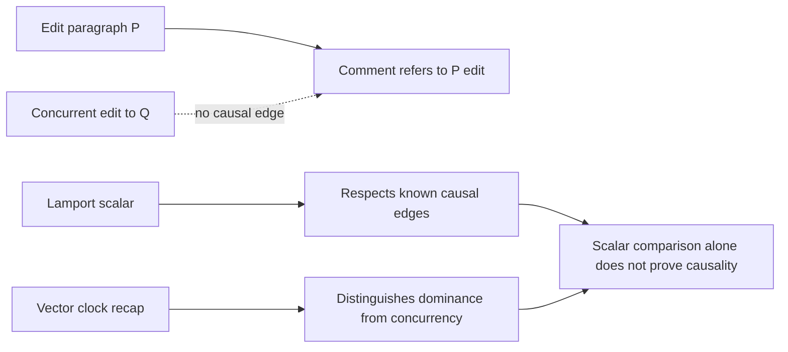

### 4.4 Total Order Through a Leader or Consensus

**Definition.** A total-order service assigns every accepted operation one position in a single sequence, so all participants that apply the sequence agree on the same order. A **single-writer** design has one authority append operations for its scope. A **consensus-backed replicated log** replicates that authority's order and commits a prefix according to a consensus protocol. A leader's local arrival order is not necessarily global real-time order; it is the order the authority accepted.

**Mechanism.** In a single-writer design, the writer serializes concurrent submissions and attaches an increasing sequence or log offset. This gives a straightforward order while the writer is active. To fail over safely, the system needs a way to fence an old writer and prevent two authorities from accepting overlapping histories. A consensus group can establish a safe leader and a committed log prefix; each replica applies entries by log index. The full Agreement, election, replication, and commit mechanics belong to [CH07 Consensus](CH07_Consensus.md), which this section applies rather than re-teaches. Consensus order is scoped to one log/group. Combining two independent consensus logs still requires an additional ordering protocol or a domain-level merge rule.

**Decision implications.** Use total order when correctness or the product contract requires one canonical sequence for a shared state machine, for example, a globally serialized allocation counter or a replicated configuration log. First test whether the invariant can be partitioned by key; one consensus group per shard or key range often preserves local total order without a global bottleneck. Estimate the coordination round trips, quorum write availability, geographic latency, and leader bottleneck. A total-order service gives a canonical serialization, not exactly-once delivery or exactly-once external effects; those guarantees have separate boundaries in [CH17 Exactly-Once Processing](CH17_Exactly_Once_Processing.md).

**Common failure mode.** Treating a leader as safe merely because it is believed to be alive, without fencing its former incarnation. A paused or partitioned leader can resume and accept writes after a replacement has started. Another failure is saying “consensus gives global order” when the system actually has several independent groups or topics. Consensus is not a magical merger across unrelated authorities, and availability may be reduced when no quorum can safely commit.

**Scenario.** A cluster allocates globally unique, monotonically increasing invoice numbers. Requests from several regions enter one consensus-backed sequence, so every replica sees the same committed order. During a partition that leaves a region without a quorum, it queues or rejects allocations rather than inventing a conflicting range. If the business can accept per-region prefixes instead, independent regional sequences may be a better availability/latency trade-off.

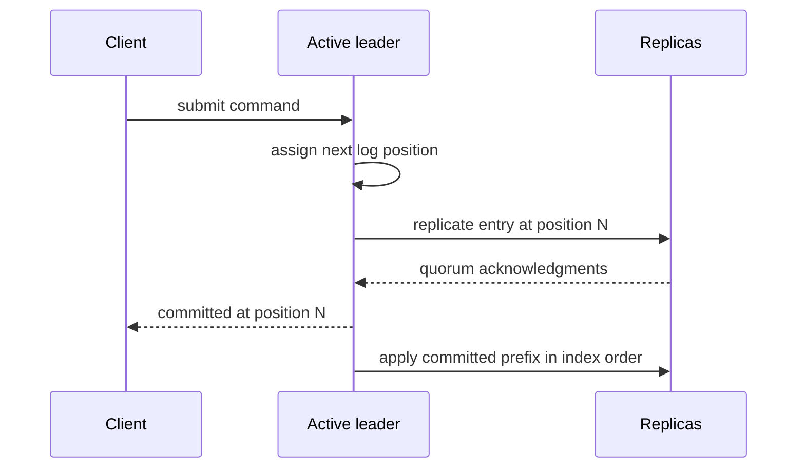

### 4.5 Event Time, Late Events, Watermarks, and Reordering

**Definition.** **Event time** is the timestamp associated with when a fact occurred in its source domain; **processing time** is when a particular processor handles it. Arrival order may differ from both. A **watermark** is a stream processor's estimate or contract that it has seen events up to a particular event-time boundary, subject to its lateness assumptions. A **late event** arrives after the watermark has passed its timestamp or after the relevant window has been finalized. Event-time ordering is about window completeness and temporal computation, not a promise that the transport delivered records in timestamp order.

**Mechanism.** A source or operator emits watermarks as event-time progress advances. In a multi-input or multi-partition operator, downstream progress is commonly constrained by the minimum watermark of active inputs; one slow or idle input can hold back a window. A window closes when the watermark passes its end boundary plus any configured allowed lateness. The processor then chooses whether to drop late events, route them to a side output, update a previously emitted result, or trigger a correction/retraction. A simple bounded-disorder heuristic may compute `max_event_time_seen - allowed_out_of_order`, but that is a policy, not a proof that later data cannot arrive. Idle-input detection can unblock progress, but must be monitored because a misclassified slow input can cause data loss or corrections.

**Decision implications.** Use event time for business questions such as “transactions that occurred in this five-minute interval,” even when devices upload offline later. Use processing time for operational queues or latency measurement when arrival itself defines the useful behavior. Select allowed lateness from observed delay distributions and business tolerance, then specify what happens beyond it. Longer lateness improves completeness but increases state retention, memory/disk use, result latency, and correction complexity. For financial or compliance aggregates, late data may require durable correction workflows rather than silent drops. Distinguish stream event-time watermarks from Kafka's replication high watermark: the latter is a safe replicated-log visibility boundary, owned by [CH10 Replication](CH10_Replication.md#45-replication-in-message-queues-and-logs-kafkas-isr-model), not an event-time completeness signal.

**Common failure mode.** Treating a watermark as a guarantee that no older timestamp can ever arrive. In a system with unbounded source delay, no finite waiting period can prove that. Another failure is using processing time while describing the result as event-time accurate, or closing windows based on the fastest input rather than the minimum progress across relevant inputs. Cleaning state immediately at the watermark can also make allowed-late corrections impossible.

**Scenario.** A sensor buffers readings during a connectivity outage. A dashboard computes five-minute event-time averages and emits a provisional window when its watermark advances. A reading from the closed interval arrives later. The product requirement allows correction for ten minutes, so the processor updates the aggregate and emits a versioned correction; readings later than that are sent to a monitored late-data stream for reconciliation.

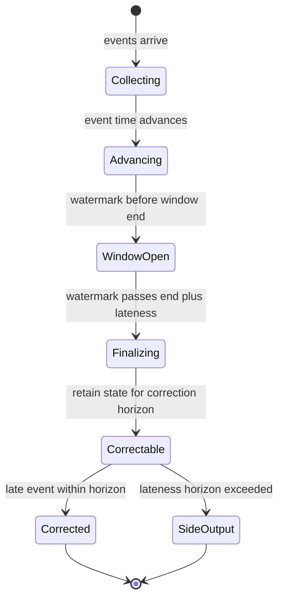

## 5. Internal Working

Ordering is assembled from several mechanisms that operate at different points in the lifecycle. The producer chooses or receives a sequence authority; the transport stores or forwards records; the consumer observes records and may dispatch them concurrently; the state transition is finally applied. An ordered log only guarantees the order in which records are exposed by that log. If a consumer starts asynchronous tasks for offsets 101, 102, and 103, it can complete their effects in another order unless it serializes by key or waits for prior work. Acknowledgment position must also reflect the processing contract: advancing a committed offset past unfinished earlier work can make a restart skip effects.

For explicit per-key sequencing, maintain expected position and bounded pending state. On a gap, do not guess. Request replay from the authority, pause only the affected key when the runtime supports it, or stop the relevant partition if later records share one ordered channel and cannot safely pass. Recovery needs an operator-visible decision: replay missing data, rebuild the key from an authoritative snapshot, or apply a domain-specific skip with an audit record. Timeouts detect lack of progress; they do not prove that a missing message is lost.

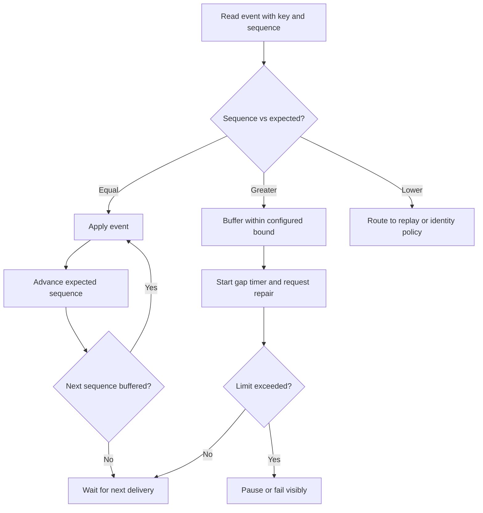

The event-time path is separate. Records can be appended to Kafka in one order and carry event timestamps in another. The broker offset establishes partition append order. The stream processor evaluates event timestamps, tracks maximum observed times and watermarks, and applies its late-data policy. A replicated-log high watermark limits which offsets are safe to expose; a stream watermark estimates event-time completeness. Similar names do not imply interchangeable semantics.

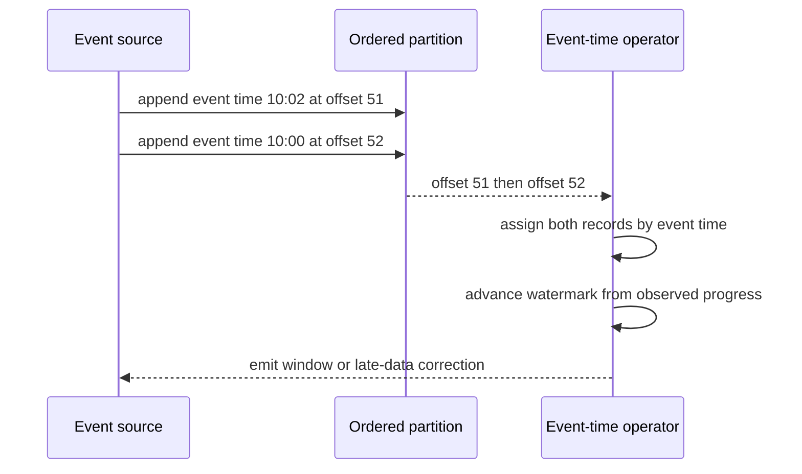

## 6. Design Principles

**Make order scope part of the contract.** Name the entity, partition, stream, or log that owns the sequence. State where sequence assignment occurs and whether consumers must preserve order through effect completion, not merely through fetch.

**Serialize only what must be serialized.** Prefer one lane per invariant-bearing key over a global lock or global log. This keeps independent keys concurrent and limits the consequence of a slow key.

**Treat gaps as state, not as an invitation to guess.** Bound buffers and deadlines, expose the missing sequence, and define replay, snapshot repair, or fail-closed behavior. A timeout is a detection threshold, not a correctness proof.

**Separate transport order, causal order, and event time.** Use a broker offset for append position, causal metadata for dependencies, and event timestamps plus watermarks for temporal windows. Do not overload one field to answer all three questions.

**Specify the completion boundary.** Distinguish accepted, durable, committed, delivered, applied, and externally visible. [CH17 Exactly-Once Processing](CH17_Exactly_Once_Processing.md) will own the broader checkpoint/processing guarantee; [CH16 Idempotency](CH16_Idempotency.md) owns the safe-repeat property at operation boundaries.

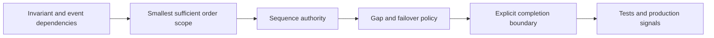

## 7. Architecture Patterns

**Single writer per key.** Route each key to one active writer and serialize that writer's mutations. This is efficient for aggregate-local state, but requires fencing or ownership transfer on failover. It preserves per-key order, not global order.

**Partitioned ordered log.** Hash a stable key to a partition and rely on append order within that partition. This permits parallel consumers across partitions, while a hot key remains one serial lane. Adding partitions, changing partitioners, or changing the key can create a sequence boundary that needs migration handling. Partition assignment and rebalancing mechanics are owned by [CH11 Partitioning](CH11_Partitioning.md).

**Sequenced producer with consumer reorder buffer.** Include a producer epoch and per-key sequence; the consumer buffers ahead-of-gap records and advances only when contiguous. This is useful when the transport may reorder or multiple paths merge, but incurs state, timers, and recovery work. For retry identity, atomic effect semantics, and duplicate retention, use [CH16 Idempotency](CH16_Idempotency.md) and [CH19 Deduplication](CH19_Deduplication.md), not a reorder buffer as a substitute.

**Causal delivery.** Carry dependency metadata and delay an event until its causal predecessors are available. This retains concurrency among incomparable events but can block on missing dependencies. Full vector-clock ownership remains with [CH10 Replication](CH10_Replication.md).

**Consensus-backed log.** Use one replicated state-machine log when all members need a canonical operation order. The coordination and quorum mechanics are owned by [CH07 Consensus](CH07_Consensus.md); this chapter's decision is when the application needs the resulting total-order contract.

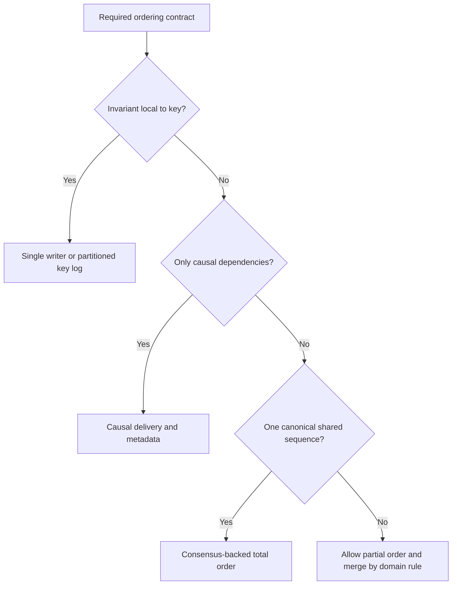

## 8. Production Architecture

A production ordering design needs a named ordering authority, a durable sequence source, a consumer application policy, and a recovery path. For a per-account ledger, the account aggregate version can be allocated in the same transaction as the state change and emitted through an outbox. A keyed stream routes all account events to one partition. The consumer processes each account sequentially, while unrelated accounts execute concurrently. If a partition is reassigned during a consumer-group rebalance, the new owner resumes from committed progress and must not race a stale owner; the broker's group protocol and the application effect boundary both matter.

At larger scope, ordering often becomes hierarchical: a consensus log orders configuration changes, each shard orders its own entity events, and a stream processor uses event time to assemble windows. These orders do not automatically compose into one global sequence. To compare an event from shard A with one from shard B, the system needs an explicit cross-shard dependency, a shared sequencer, or a deterministic merge rule whose semantics are acceptable.

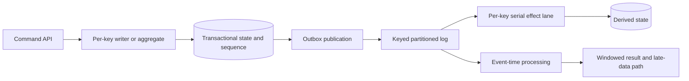

Operationally, track producer sequence gaps, per-key buffer size and oldest age, partition lag, consumer rebalance pauses, watermark lag per input, late-event volume, correction volume, and the age of the oldest unfinalized window. Alert on stalled progress, not only throughput. A system can keep consuming bytes while one key or one idle partition prevents correct completion.

## 9. Implementation

Implement ordering at the narrowest layer that can enforce it atomically. A database aggregate can reject a command whose expected version does not match; a broker can serialize appends within a partition; a consumer can serialize state transitions for a key. Avoid relying on in-process mutexes when multiple service instances or failover are possible. The authority must survive restarts and reject stale writers, usually through a durable version, lease plus fencing token, or consensus-committed log position.

For asynchronous consumers, separate **fetch concurrency** from **effect concurrency**. Fetching can be parallel while applying one key remains serial. A per-key scheduler can run independent keys concurrently but must preserve sequence within each lane. If a handler awaits a downstream call, do not release the lane until its ordered effect reaches the required completion boundary. Acknowledge only progress that is safe to resume after restart. [CH17 Exactly-Once Processing](CH17_Exactly_Once_Processing.md) owns the exact transaction/checkpoint construction.

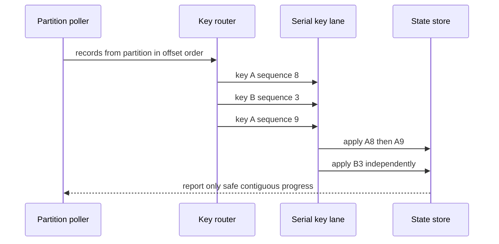

Examples in [code/python/ordering-guarantees-chapter](../code/python/ordering-guarantees-chapter/01_sequence_reorder_buffer.py) demonstrate an explicit sequence reorder buffer, a Lamport-clock comparison, and a small event-time processor. They use only the Python standard library and illustrate mechanics rather than production storage, broker, or checkpoint integration.

## 10. Complete Code Examples

The examples are intentionally small enough to run locally but preserve the decisions a production design must make visible:

1. [Sequence-number reorder buffer](../code/python/ordering-guarantees-chapter/01_sequence_reorder_buffer.py) buffers records that arrive ahead of the expected sequence, drains contiguous records, enforces a memory bound, and refuses to silently skip a gap.
2. [Lamport logical-clock demonstration](../code/python/ordering-guarantees-chapter/02_lamport_clock_demo.py) propagates scalar timestamps across a message and shows why a timestamp tie-break creates a deterministic order without proving causality.
3. [Event-time watermark and late-event processor](../code/python/ordering-guarantees-chapter/03_event_time_watermark.py) advances a bounded-disorder watermark, closes tumbling windows, and routes events beyond the watermark to a late-event result.

Run from the repository root with:

```powershell
.\.venv\Scripts\python.exe code\python\ordering-guarantees-chapter\01_sequence_reorder_buffer.py
.\.venv\Scripts\python.exe code\python\ordering-guarantees-chapter\02_lamport_clock_demo.py
.\.venv\Scripts\python.exe code\python\ordering-guarantees-chapter\03_event_time_watermark.py
```

The reorder-buffer example does not implement durable deduplication, producer fencing, or atomic state changes. The event-time example is a single-input teaching model; a production engine must account for multiple input watermarks, idle partitions, checkpoint recovery, retained state, and the configured late-data contract.

## 11. Performance

Ordering creates serialization points. A global sequencer adds queueing and coordination to every operation in its scope; a per-key sequencer adds those costs only to one key. If a serialized lane has service rate `μ` and arrival rate `λ`, it becomes unstable as `λ` approaches `μ`; adding workers cannot increase throughput for the same strictly ordered key unless the work can be decomposed without violating the invariant. This is why hot-key analysis belongs in capacity planning rather than being treated only as a broker concern.

Reordering buffers consume memory proportional to the number and size of events waiting behind gaps. Large configured lateness similarly retains window state longer. Watermark delay contributes directly to result latency; reducing the delay can improve freshness but increases corrections or dropped data. A consensus-backed total order also adds network round trips and quorum persistence latency, especially when the writer and voters span regions. Batch append and group commit improve throughput but may increase tail latency.

Measure p50/p95/p99 end-to-end apply latency, sequencer queue time, hot-key throughput, buffer occupancy, oldest gap age, watermark lag, late-event ratio, correction rate, and state retained per unit of lateness. Throughput alone hides whether ordered work is accumulating faster than it is applied.

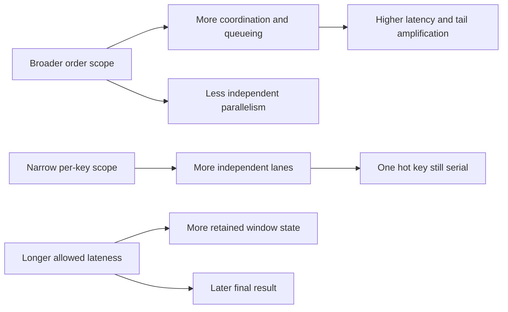

## 12. Scalability

Scalability depends on how order is partitioned. If keys are independent, distributing keys over partitions or workers scales aggregate throughput approximately with the number of balanced lanes. The upper bound for a specific key remains its serial processing capacity. A skewed key distribution can therefore leave most workers idle while one lane accumulates lag. The partition-key selection and hotspot-mitigation framework belongs to [CH11 Partitioning](CH11_Partitioning.md); this chapter adds the requirement that a key must not be split if its order is part of correctness.

Changing partition count, key encoding, or partitioner can move a key's future events to a different lane. During transition, old and new owners can concurrently process the same key or create two local sequences. Safe migration requires a cutover boundary: pause and drain, dual-route with one fenced writer, or establish a new epoch/version that consumers can validate. Partition rebalancing changes ownership; it does not itself establish a new global event order.

For event-time processing, increasing the number of partitions introduces more independent watermarks. A downstream operator often progresses at the minimum watermark, so one delayed or idle partition can hold back all windows. Use idleness detection and per-partition lag signals carefully; do not simply ignore an input because it is slow if it may still contain valid older events.

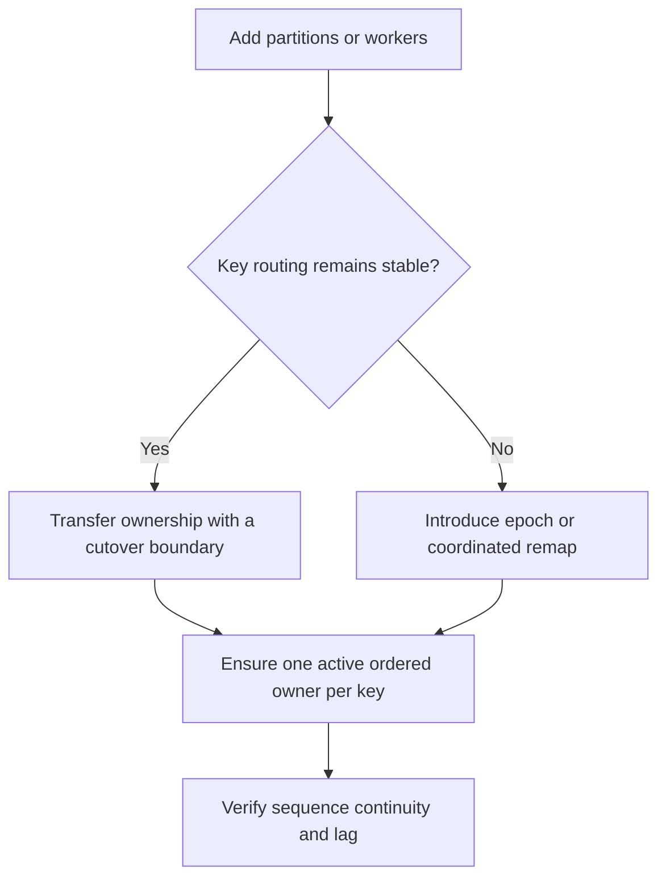

## 13. Security

Ordering metadata affects integrity. An attacker or faulty producer that can forge a high sequence may cause consumers to buffer all earlier events or reject valid work as stale. A replayed old command may be reordered into a valid-looking position unless sequence assignment is authenticated and bound to a producer epoch. Protect sequence authority, event identity, partition key, and timestamp against unauthorized modification; validate ranges and reject impossible jumps.

Buffering is also a resource-exhaustion surface. Bound per-key pending entries, total bytes, distinct blocked keys, and retention duration. Apply quotas per producer or tenant, and rate-limit gap-repair requests. A malicious timestamp far in the future can advance a naïve maximum-observed-time watermark and make ordinary events appear late; validate clock skew and timestamp bounds before using event time to close windows.

Do not expose raw event payloads in gap diagnostics or dead-letter metadata unless the access and retention model permits it. Ordering failures can contain customer identifiers and business events. Security controls should preserve the evidence needed to repair sequence gaps without turning operational telemetry into a second ungoverned data store.

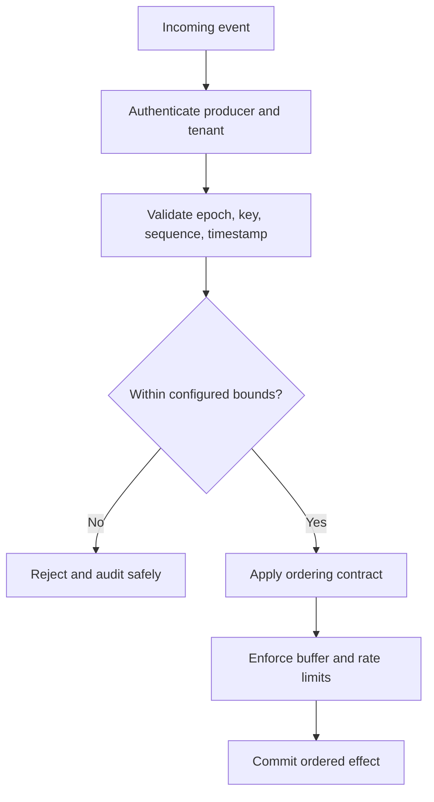

## 14. Observability

Order is observable through progress, not just volume. For a sequenced consumer, record the highest received sequence, next expected sequence, gap duration, buffered count/bytes, and whether the key is applying, waiting, or parked. Keep high-cardinality key identifiers out of metric labels; use sampled traces or structured logs with access controls for individual-key diagnosis. Count gap incidents by category and resolution path.

For partitioned brokers, observe partition lag, consumer assignment changes, rebalances, and effect-completion lag separately. A consumer may have fetched an offset while its state transition is still incomplete. For stream processing, compare source event-time maxima with operator watermarks, monitor the minimum input watermark, idle partition count, window state size, late-event side output, and corrections emitted. The Kafka replication high watermark and event-time watermark must be named distinctly in dashboards.

Instrument order-contract violations as correctness signals: sequence regression, sequence jump, duplicate position, conflicting payload at one position, stale epoch, causal dependency unavailable, late event beyond policy, and commit/checkpoint progress beyond unfinished effects. Attach order scope and authority version to traces so an incident can be diagnosed without assuming a total order across independent streams.

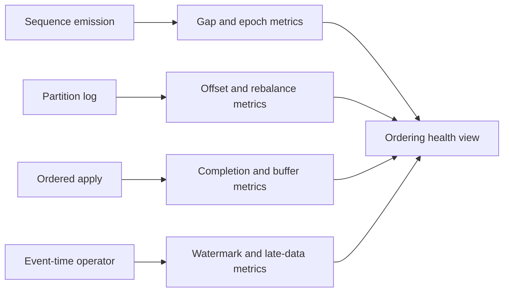

## 15. Failure Scenarios

**Missing predecessor.** Sequence 55 arrives while the consumer expects 54. Buffer 55, start a bounded timer, and request replay or authoritative repair. Do not apply it because the gap “probably does not matter.” If 54 cannot be recovered, park the key or execute an auditable domain-approved skip.

**Concurrent consumers for one key.** A rebalance or stale lease leaves two workers applying the same key. Use broker ownership plus application-level fencing/version checks; a lease timeout alone does not stop a paused old owner from resuming.

**Retry changes completion order.** A handler for event N times out while its downstream effect is still running. A retry of N and a new event N+1 race. Preserve lane ownership until the prior effect is known or safely reconciled. Idempotency makes a retry's repeated effect safe at its named boundary but does not make N+1 safe to overtake N.

**Late event after finalization.** An event arrives after its event-time window has been purged. Follow the published policy: side output and reconcile, issue a correction if state is retained, or drop only when the contract explicitly permits it. Never call a processing-time result event-time complete without disclosing the assumption.

**Watermark stall or leap.** An idle partition can stall the minimum watermark; a future-dated event can leap it. Detect both, validate source timestamps, and apply an explicit idleness/skew policy. A forced watermark advance is a data-completeness decision, not a harmless tuning knob.

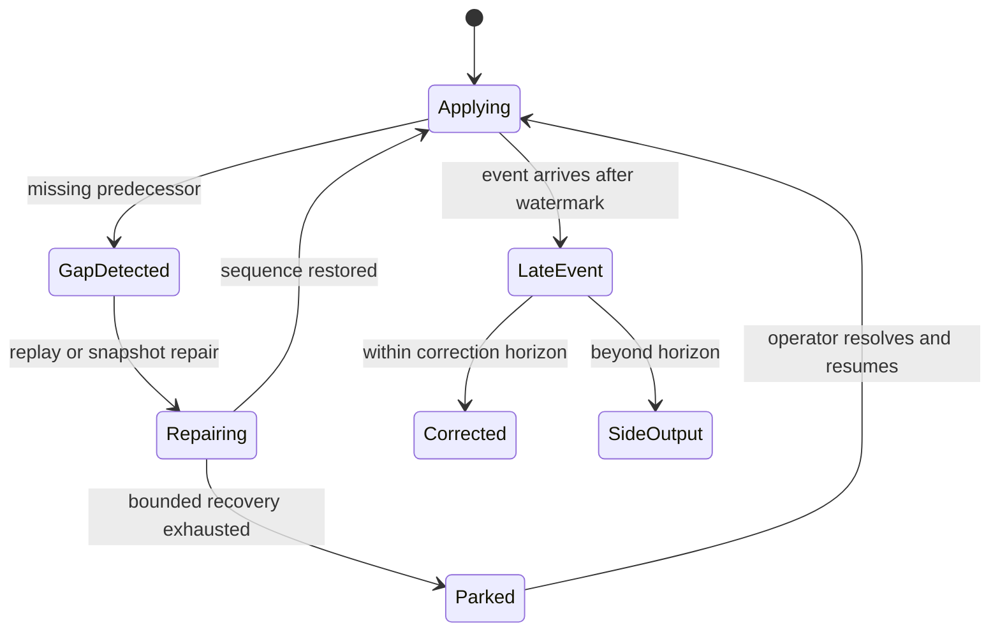

## 16. Testing

Test the contract as a relation, not as a happy-path example. Generate permutations of delivery order and verify that a per-key consumer applies exactly the permitted sequence; generate independent keys and verify their results do not depend on cross-key interleaving. Test contiguous delivery, gaps, duplicates, stale sequence values, sequence resets, producer epochs, buffer exhaustion, process restart, and concurrent ownership transfer. Property-based tests are especially effective for asserting that every output prefix is valid under the declared order.

Use a deterministic scheduler, barriers, or a controllable fake transport to force a later event to arrive before an earlier one. Avoid sleep-based race tests. Inject a crash after effect commit but before acknowledgment and separately test ordering after recovery; refer to [CH16 Idempotency](CH16_Idempotency.md) for repeated-effect invariants and [CH17 Exactly-Once Processing](CH17_Exactly_Once_Processing.md) for processing/checkpoint guarantees.

For event time, test timestamp disorder, future timestamps, equal timestamps, idle inputs, watermark advancement, exact boundary behavior, allowed-lateness expiration, side output, corrections, and restart from a checkpoint. Compare emitted windows against a simple offline reference sort, while asserting the runtime policy for late events. Ensure a test proves both event-time and processing-time behavior because they can agree on in-order input and diverge only under delay.

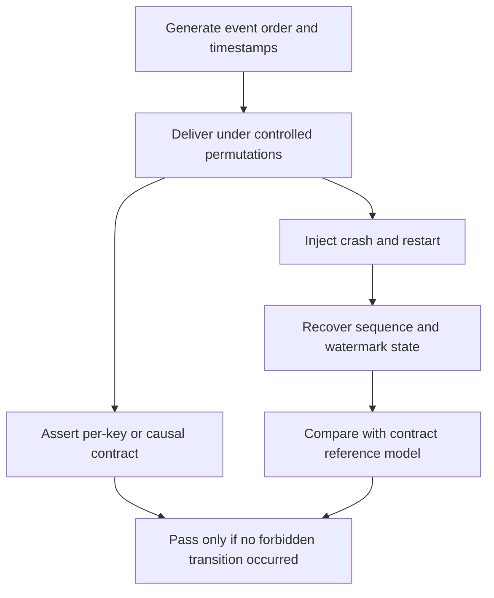

## 17. Common Mistakes

- Saying “ordered” without specifying scope, authority, and completion boundary.
- Assuming broker append order means consumer effect-completion order after parallel dispatch.
- Assuming partition order is topic-wide order. It is not.
- Routing related events with different or unstable keys and expecting one serial lane.
- Treating Lamport timestamps as wall-clock time or proof of causal dependency.
- Using a total-order tie-break and then describing the result as causally correct.
- Letting a reorder buffer grow without limits or silently skipping an expired gap.
- Treating idempotency as a repair for out-of-order state transitions. Repeat safety and sequence correctness are independent properties.
- Treating exactly-once processing as a claim that includes any arbitrary external side effect.
- Confusing a broker replication high watermark with an event-time watermark.
- Advancing event-time progress based on the fastest input rather than the required active-input policy.
- Dropping late events without quantifying their frequency or documenting the business consequence.
- Increasing partition count without planning how key-to-partition routing changes across the cutover.

```mermaid
flowchart LR
    Claim[Ordering claim] --> Ask[Ask: which events and scope?]
    Ask --> Point[At acceptance, delivery, apply, or effect?]
    Point --> Failure[What if a gap, retry, failover, or late event occurs?]
    Failure --> Measure[Can production signals prove progress?]
```

## 18. Best Practices

- Write the order contract in business terms first: “all changes to one account are applied in aggregate-version order.”
- Assign sequence numbers at the authority that owns the state transition; persist the sequence or epoch across restart.
- Route all events in one ordering domain using a stable partition key, and keep the partitioning migration plan with the contract.
- Keep per-key application sequential even if fetch, deserialization, or independent keys are processed concurrently.
- Make buffers bounded by count, bytes, and age; expose gap repair and operator escalation as explicit states.
- Use causal metadata only when dependencies across writers matter. Recap [CH10 Replication](CH10_Replication.md) for vector-clock mechanics.
- Use consensus only when a shared canonical order is required; recap [CH07 Consensus](CH07_Consensus.md) for the safety and availability mechanics.
- Distinguish event time, processing time, broker offsets, and replication visibility in names, schemas, dashboards, and documentation.
- Define watermark idleness, allowed lateness, correction, and state-retention policies before implementation.
- Test all legal and illegal interleavings, failover boundaries, late events, and restart recovery with deterministic scheduling.
- Keep order, deduplication, idempotency, and checkpoint guarantees as separate but composable contracts.

```mermaid
flowchart TD
    Contract[Business ordering contract] --> Authority[Durable authority and sequence]
    Authority --> Route[Stable key routing]
    Route --> Apply[Per-key ordered effects]
    Apply --> Recovery[Bounded repair and replay]
    Recovery --> Signals[Progress, gaps, and lateness signals]
    Signals --> Review[Periodic contract and capacity review]
```

## 19. Anti-Patterns

**Global order by default.** Sending every event through one sequencer because it is easy to reason about serially can impose cross-region latency, cap throughput, and reduce availability even when invariants are entity-local. First prove the need for a global relation.

**Sort by wall-clock timestamp and call it causal.** Physical clocks are imperfect and timestamps do not encode message dependencies. Sorting may be useful for presentation or approximate analytics, but it is not a causal guarantee.

**Concurrent handlers behind an ordered broker.** The broker emits records in order, but fire-and-forget worker tasks complete out of order. Preserve an ordered effect lane where required.

**Unbounded wait-for-gap.** A missing event blocks indefinitely and the buffer grows without limit. Make the wait bounded and the recovery outcome explicit; do not turn an unresolved gap into silent data corruption.

**Watermark as perfect completeness oracle.** A watermark represents a configured assumption or source progress contract. If the source can be arbitrarily delayed, the system must retain correction capacity or accept a quantified late-data outcome.

```mermaid
flowchart TD
    Shortcut[Ordering shortcut] --> Global[One global sequencer]
    Shortcut --> Clock[Sort wall-clock timestamps]
    Shortcut --> Parallel[Parallel effects after ordered fetch]
    Shortcut --> Wait[Wait forever on sequence gap]
    Shortcut --> Perfect[Assume watermark proves completeness]
    Global --> Cost[Hidden coordination, latency, or correctness cost]
    Clock --> Cost
    Parallel --> Cost
    Wait --> Cost
    Perfect --> Cost
```

## 20. Trade-off Analysis

Ordering guarantees spend some combination of coordination, buffering, latency, or availability to prevent invalid observation or application. A per-key lane limits the cost to one key but can create a hot-key ceiling. A global sequencer is simple to explain but serializes unrelated work. Causal delivery permits independent operations to proceed but requires dependency metadata and can stall behind a missing predecessor. Event-time windows trade result freshness and retained state against the ability to incorporate delayed data.

| Choice | Correctness property | Throughput and latency | Availability and complexity | Typical fit |
|---|---|---|---|---|
| No ordering; operations commute | Any interleaving is valid | Highest concurrency | Simplest if commutativity is proven | Independent counters or set merges |
| Per-key FIFO sequence | Same-key accepted order | Parallel across keys; hot-key serial ceiling | Gap repair and stable routing required | Orders, accounts, aggregates |
| Causal partial order | Dependencies precede dependents | Concurrent operations can proceed | Metadata and dependency wait can stall | Collaborative/offline edits |
| Single-writer total order | One authority's append order | Simple but one writer bottleneck per scope | Failover needs fencing | Local shard or bounded command stream |
| Consensus-backed total order | One committed replicated sequence | Quorum round trips and serialized commit | No safe progress without quorum | Shared state machine/configuration log |
| Event-time watermark | Window results follow event-time progress policy | Delay and retained state depend on lateness | Late-event correction/drop policy required | Telemetry, billing, time windows |

Use the following decision sequence: (1) prove whether the operations commute; (2) identify the smallest invariant boundary; (3) choose a local sequence or causal relation; (4) use total order only if incomparable events still require one canonical outcome; (5) independently specify event-time progress if timestamps drive windows; (6) price the costs in throughput, p99 latency, quorum availability, memory, and correction work. [CH02 Non-Functional Requirements](CH02_Non_Functional_Requirements.md) owns the general quality-attribute trade-off method; this chapter applies it to ordering choices.

```mermaid
flowchart TD
    Start[Can operations commute safely?] -->|Yes| Unordered[Allow partial order]
    Start -->|No| Scope{Can invariant be scoped to a key?}
    Scope -->|Yes| PerKey[Per-key sequence]
    Scope -->|No| Causal{Only dependency order required?}
    Causal -->|Yes| CausalOrder[Causal delivery]
    Causal -->|No| Total[Total order authority]
    PerKey --> Time{Are windows based on occurrence time?}
    CausalOrder --> Time
    Total --> Time
    Time -->|Yes| Watermark[Add watermark and late policy]
    Time -->|No| Contract[Document and measure contract]
    Watermark --> Contract
```

## 21. Comparison Table

| Property | FIFO | Per-key sequence | Causal order | Partial order | Total order | Event-time order/progress |
|---|---|---|---|---|---|---|
| What is compared? | Items on one channel/log | Events sharing a key | Events linked by dependency | Only constrained event pairs | Every pair in one scope | Event timestamps and window progress |
| Must unrelated events be ordered? | Within the same channel, yes | No, across keys | No, if concurrent | No | Yes | Not necessarily; windows group by time |
| Typical mechanism | Append-only channel | Sequence/version plus stable routing | Happened-before metadata and dependency buffering | Application-defined constraints | Sequencer or consensus-backed log | Timestamps, watermarks, allowed lateness |
| Main cost | Channel serialization | Hot-key ceiling and gap handling | Metadata and dependency stalls | More complex reasoning | Coordination and availability coupling | Latency, retained state, corrections |
| Common misconception | FIFO means global chronology | Partitioned topic means per-key unless keying holds | Scalar timestamp proves causality | Partial means unordered chaos | Total means real-time order | Watermark means no older event can arrive |

```mermaid
flowchart LR
    FIFO[FIFO] -->|one stream scope| Compare[Compare the promised relation]
    Key[Per-key sequence] -->|same key only| Compare
    Causal[Causal order] -->|dependency edges| Compare
    Partial[Partial order] -->|some pairs incomparable| Compare
    Total[Total order] -->|all pairs comparable| Compare
    EventTime[Event-time progress] -->|window completeness policy| Compare
```

## 22. Real-World Case Study

Consider a payment ledger that consumes transaction commands from multiple regions and also produces hourly revenue reports. The first requirement is not “all events globally ordered”; it is “each account's balance transitions are applied in the order assigned by the account's authoritative writer.” The service assigns an aggregate version atomically with each accepted transition, publishes the event keyed by account ID, and processes each account sequentially. Independent accounts execute on different lanes. A missing version blocks only the affected account when the processing topology supports key isolation; if the broker partition itself cannot advance safely, the partition may need to pause until repair.

The ledger does not use a wall-clock timestamp to determine balance order. Timestamps are retained for audit and reporting, but the aggregate version determines state-transition sequence. A cross-region failover fences the prior writer epoch before the new writer accepts commands. Event delivery may be retried; [CH16 Idempotency](CH16_Idempotency.md) makes repeated operation attempts safe at the named ledger boundary, while [CH19 Deduplication](CH19_Deduplication.md) owns the general message identity registry. Neither changes the fact that version 28 must not be applied before version 27.

The hourly report uses event time. A payment can be accepted at 10:04 but arrive at the reporting processor at 10:08 after a regional network interruption. A watermark closes the 10:00-10:05 interval only after the configured disorder allowance. The report is provisional for a further correction horizon; late arrivals within that horizon emit a correction, and later arrivals enter a reconciliation stream. The operational dashboard distinguishes account-version gaps, broker replication health, and event-time watermark lag because each signals a different failure class.

```mermaid
flowchart TD
    Command[Payment command] --> Account[Account authority assigns version]
    Account --> Keyed[Publish by account key]
    Keyed --> Ledger[Apply versions in per-account order]
    Ledger --> Balance[(Authoritative balance)]
    Keyed --> Report[Event-time revenue windows]
    Report --> Watermark[Watermark plus correction horizon]
    Watermark --> Result[Hourly report and late-data reconciliation]
```

This design deliberately combines guarantees rather than seeking one universal ordering mechanism. Per-account sequence protects the ledger invariant; event-time watermarks protect the report's time-window policy; idempotency and checkpoint boundaries protect repeated processing; consensus or fencing protects authority transfer. Each contract is independently testable and observable.

## 23. Interview Questions

1. What is the difference between a total order and a partial order? Give a distributed example of concurrent events.
2. How does FIFO differ from causal order? Can FIFO preserve order for one sender while violating a dependency between two senders?
3. What does a Lamport clock guarantee, and why does `L(a) < L(b)` not prove `a` happened before `b`?
4. When would per-key ordering be sufficient, and what can make the key itself an architectural risk?
5. Why does a Kafka topic not provide a total order across its partitions? What producer and consumer design is needed for per-key effects?
6. What must a consumer do when sequence 22 arrives but it expects 21? Compare buffer, retry, park, and domain-approved skip.
7. What does consensus add to a leader's local sequence, and what does it not guarantee about unrelated logs or external effects?
8. Explain event time, processing time, watermark, and late event without conflating them with broker offsets.
9. Why can one idle input partition hold back a multi-input watermark? What are the risks of idleness detection?
10. How do throughput, p99 latency, and availability change when a system moves from per-key to global total order?
11. Why is idempotency not enough to make out-of-order operations safe?
12. Which signals would reveal a sequence gap, a consumer apply backlog, and a watermark stall?

## 24. Hands-on Exercises

1. Run `01_sequence_reorder_buffer.py`. Change the arrival sequence to include a missing predecessor and demonstrate that later items remain buffered. Add a bounded timeout path that reports the key and missing sequence without silently skipping.
2. Run `02_lamport_clock_demo.py`. Create two independent processes that never exchange messages, then show that their scalar timestamps can still be compared even though neither event caused the other.
3. Run `03_event_time_watermark.py`. Vary allowed lateness and observe the trade between final-result delay, retained windows, and late-event output. Add a future-dated input and propose a validation rule.
4. Create a test that permutes two different keys and proves per-key results are unchanged. Then permute two events for the same key and assert that forbidden application order is rejected.
5. Build a two-input watermark simulation. Make one input idle, then resume it with an older event. Compare “wait,” “mark idle,” and “emit correction” policies.

## 25. Design Exercises

1. Design an order-processing stream with 40 million daily events, 64 partitions, and a requirement that updates to one order remain ordered. Define the key, sequence authority, concurrency model, gap handling, repartitioning plan, and hot-key response.
2. A collaborative editor supports offline edits from multiple devices. Choose between per-document total order and causal partial order. State how concurrent edits are represented, when clients block, and which concerns are owned by [CH10 Replication](CH10_Replication.md).
3. Design a globally unique invoice-number service for three regions. Compare one consensus-backed allocator, preallocated regional ranges, and region-local numbering. Quantify the availability and semantic differences, not only latency.
4. Design an event-time fraud aggregate with a 15-minute window, p99 source delay of 90 seconds, and occasional 20-minute offline-device uploads. Specify watermark generation, allowed lateness, correction retention, side outputs, and customer-visible semantics.
5. A topic is changing from 48 to 96 partitions while consumers are active. Describe how to preserve per-key order across routing change and how to prove that old and new owners do not concurrently apply the same key.

## 26. Architecture Review Questions

- Is the guarantee named as FIFO, per-key, causal, partial, total, or event-time progress, with no ambiguous “ordered” shorthand?
- What is the exact scope, ordering authority, and sequence/epoch source?
- Does the order need to hold through effect completion, or only through broker delivery?
- Can operations commute, allowing less coordination?
- Are all same-key events routed consistently, including retries, producer failover, and partition-count changes?
- Does consumer concurrency preserve the contract after fetch and during rebalances?
- Are gap buffers bounded by count, bytes, and age, with explicit repair and escalation behavior?
- Can a stale leader or worker resume and write after ownership has moved? What fences it?
- Are Lamport timestamps used only for the properties they guarantee? Are vector clocks recapped from [CH10 Replication](CH10_Replication.md)?
- Is consensus being used for one explicitly scoped log, with the quorum and availability assumptions understood from [CH07 Consensus](CH07_Consensus.md)?
- Are broker offsets, Kafka replication high watermarks, event-time watermarks, and processing-time metrics distinct?
- What is the policy for idle inputs, allowed lateness, corrections, and events beyond the correction horizon?
- Are ordering, idempotency, deduplication, and exactly-once/checkpoint guarantees documented as separate contracts with explicit boundaries?
- Do dashboards reveal gaps, stalled application, hot keys, rebalance pauses, watermark lag, and late-event outcomes?
- Do tests force reordering, concurrent ownership, crash/restart, boundary timestamps, and recovery rather than relying on sleeps?

## 27. Summary

Ordering is a scoped relation, not a boolean property of a distributed system. FIFO preserves a channel's sequence; per-key ordering serializes only events sharing an invariant; causal ordering preserves dependency edges while leaving concurrent events incomparable; partial order is the honest model when no relation is required; and total order makes every pair comparable within one authority's scope. Lamport clocks preserve known causal precedence but do not prove causation from scalar comparison. Vector-clock mechanics remain owned by [CH10 Replication](CH10_Replication.md).

Kafka provides append order within a partition, not across a topic's partitions. Key selection and partition assignment determine whether that primitive can provide per-key ordering; those partitioning mechanics remain with [CH11 Partitioning](CH11_Partitioning.md). A single writer can serialize its own scope, while consensus can safely replicate one canonical log order; consensus mechanics remain with [CH07 Consensus](CH07_Consensus.md). Neither ordering nor transport delivery alone guarantees exactly-once effects. Idempotency remains with [CH16 Idempotency](CH16_Idempotency.md), processing/checkpoint guarantees remain with [CH17 Exactly-Once Processing](CH17_Exactly_Once_Processing.md), and general duplicate-detection mechanics remain with [CH19 Deduplication](CH19_Deduplication.md).

For time-based streams, event time differs from processing time. Watermarks express progress under a lateness policy, not perfect knowledge that no earlier event can arrive. Correct architecture names the order scope, protects sequence gaps, defines replay or correction behavior, measures progress, and buys no stronger global order than the invariant actually needs.