# Chapter 19: Deduplication

## 1. Introduction

Distributed systems routinely observe the same logical fact more than once. A queue redelivers after an acknowledgement is lost; a change-data-capture connector resumes from an earlier checkpoint; a mobile device resubmits after reconnecting; a telemetry agent flushes a buffered batch twice; a replay or backfill traverses records already seen by a live consumer. The duplicate may be byte-for-byte identical, semantically equivalent, or merely refer to the same business fact. Deduplication is the data-management discipline for deciding which observations are repeats within a declared identity scope and time horizon, and what the system should do with them.

This chapter owns the identity, data structures, windows, retention, streaming, replay, and operational trade-offs of deduplication. It treats records, events, requests, and analytical observations as inputs to a data pipeline, not solely as application operations. [Idempotency](CH16_Idempotency.md) owns repeat-safe operation semantics and key generation. [Exactly-Once Processing](CH17_Exactly_Once_Processing.md) owns end-to-end processing guarantees and offset/state transactions. [Ordering Guarantees](CH18_Ordering_Guarantees.md) owns ordering mechanics. Those two missing sibling files were not available at authoring time; the boundaries here follow the explicit ownership map and brief, and links are retained for resolution when they land.

Deduplication is not itself idempotency and is not an exactly-once guarantee. A dedup store can be one mechanism used to make a particular operation repeat-safe, but many deduplication tasks do not execute an operation at all: they clean a customer master, suppress duplicate telemetry, or identify repeated events in an analytical stream. Conversely, an idempotent state assignment may need no duplicate detector. Every design therefore starts with the target fact, identity, scope, horizon, and consequence of a mistaken decision.

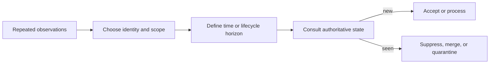

## 2. Historical Evolution

Duplicate handling predates distributed computing: databases used keys and uniqueness constraints to prevent repeated facts, while batch data-cleaning systems matched records by identifiers or attributes. Network retries and message queues made the problem operationally unavoidable. A sender cannot know whether a timed-out receiver acted; brokers commonly choose redelivery over silent loss. The result is at-least-once observation, even when the producer emitted one logical record.

Early queue consumers often kept a process-local set of processed identifiers. Restarts and horizontal scale exposed the weakness: the set disappeared or differed across workers. Durable inbox tables and unique constraints moved the decision into shared transactional state. Large streams then added bounded state, event-time watermarks, and approximate membership structures to contain cost. Those mechanisms solve different parts of the problem: exact identity at a durable boundary, finite memory for a declared horizon, and probabilistic filtering to reduce lookups.

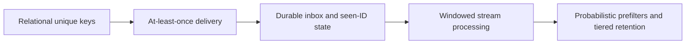

The evolution is not a march toward one universal deduplication engine. Each mechanism trades memory, coordination, latency, and error risk differently. Modern systems combine them: a compact probabilistic filter can reduce storage reads, while an exact store remains the authority; a short hot window can protect the streaming path, while durable identity records cover longer replay horizons.

## 3. Why It Exists

Repeated input consumes resources and can corrupt meaning. Duplicate telemetry inflates counts; repeated CDC records can double a derived balance; repeated customer imports can create duplicate profiles; repeated clickstream events distort funnels; repeated deliveries can invoke a costly downstream computation. Some duplicates are harmless or even useful evidence of retry behavior, while others create irreversible side effects. Suppression is a policy decision, not an automatic property of equal-looking data.

The system needs a reproducible rule for whether two observations represent the same fact. That rule must account for source, tenant, entity, event type, identifier version, and time. A globally unique event ID can support durable suppression; a business key can identify repeated representations of a domain fact; a payload fingerprint can recognize byte or canonical-content equality. Each has failure modes. An identity that is too broad suppresses legitimate facts; one that is too narrow misses repeats.

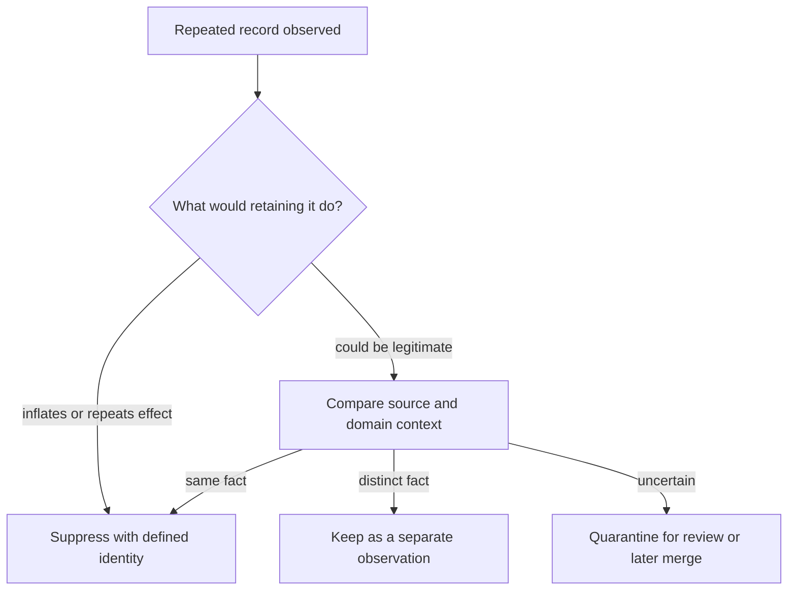

The architecture exists to make that rule explicit, scalable, and auditable. A good design can explain what it suppresses, what it may miss, when protection expires, and how replay behaves. A poor design hides these decisions in a cache TTL, a stream processor default, or a hash function whose collisions and canonicalization rules nobody owns.

## 4. Core Concepts

### 4.1 Deduplication, idempotency, and exactly-once processing

**Definition.** Deduplication classifies observations as already represented within a chosen identity scope and horizon, then suppresses, merges, or routes repeats. Idempotency is a property of an operation: repeating one logical operation has the same externally meaningful effect as applying it once. Exactly-once processing is an end-to-end claim about processing progress and state effects across defined boundaries. Deduplication can implement part of idempotency or processing, but the terms are not interchangeable.

**Mechanism.** Deduplication maintains or queries membership state: “has this identity already been accepted here?” It need not know the operation's intended outcome. Idempotency additionally defines the logical operation, protected effect, and often a stable outcome to replay. Exactly-once processing must coordinate input progress (such as a source offset) with output state, or otherwise recover safely across failures. A seen-ID lookup alone can suppress an event while leaving a checkpoint or output inconsistent.

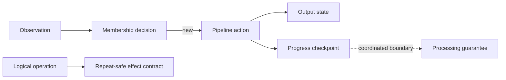

**Decision implications.** Use the narrowest term that matches the promise. Say “suppress repeated event IDs for seven days in this projection,” not “exactly once.” For operation retries, refer to [CH16 Idempotency](CH16_Idempotency.md). For atomic input-progress/output-state guarantees, refer to [CH17 Exactly-Once Processing](CH17_Exactly_Once_Processing.md) once available. Choose deduplication for data-quality or stream-membership needs even when no business operation exists.

**Failure mode.** A consumer commits an ID to a seen table, crashes before writing its output, and later suppresses the redelivery: data is lost. A different consumer writes output first and crashes before recording the ID: the output is duplicated. Suppression without atomicity is not an end-to-end guarantee.

**Scenario.** An analytics pipeline removes repeated page-view events from a replayed file before aggregation. It does not replay an API response or make a user operation idempotent. A billing command consumer may use deduplication as one part of operation idempotency, but the command's effect and result contract remain distinct.

### 4.2 Choosing identity: message ID, business key, or payload fingerprint

**Definition.** Identity is the equivalence rule by which the system decides two observations refer to the same candidate fact. A message/event ID is an assigned token; a business key expresses domain identity; a payload fingerprint summarizes content equality. Scope adds dimensions such as producer, tenant, event type, entity, schema version, or destination projection.

**Mechanism.** A producer ID is usually strongest when stable across retries and globally unique within its documented namespace. A business key can connect different messages that describe one domain entity or natural event, but may collapse distinct facts if the key is not event-specific. A payload fingerprint hashes canonicalized fields; raw-byte hashes are sensitive to serialization, field order, whitespace, and irrelevant metadata. Canonicalization itself can be versioned, and hash collisions, low-entropy data leakage, and omitted material fields must be considered. Composite identity is common: `(source, tenant, event_type, event_id)`.

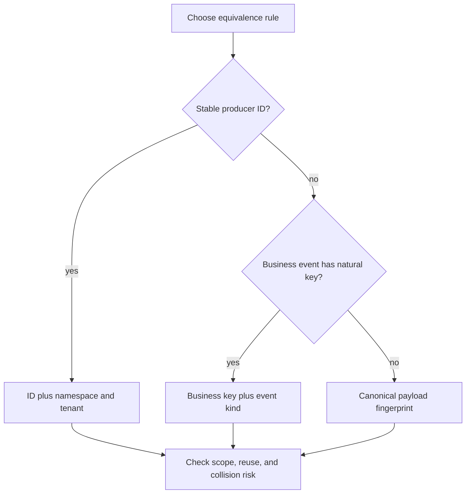

**Decision implications.** Prefer a producer-assigned ID when producers preserve it through retries and replay. Prefer business identity when separately generated records can represent the same domain fact, but include enough dimensions to distinguish legitimate repeated occurrences. Use fingerprints as equality evidence or a fallback, not as proof that same content means same intent. Bind the key to schema/canonicalization version where meaning changes, and define behavior when an identity is reused with a different payload.

**Failure mode.** Deduplicating purchases by `(customer, SKU)` suppresses the second legitimate purchase. Hashing raw JSON misses the duplicate after key-order changes. Omitting producer namespace causes unrelated sources' `event-42` records to collide. Conversely, adding a random delivery-attempt ID guarantees every retry looks new.

**Scenario.** A CDC event carries `(database, table, primary_key, log_position)`. The log position identifies an emitted change uniquely; the primary key identifies the row across versions but cannot distinguish two valid updates. A projection uses the full event identity for duplicate suppression and the row key for state replacement.

### 4.3 Exact durable deduplication: unique constraints, inboxes, and seen-ID stores

**Definition.** Exact deduplication uses authoritative state whose membership decision is exact within its stated key domain and retention. Common forms are a database unique constraint, an inbox/processed-message table, or a durable seen-ID key-value store. “Exact” describes membership, not the completeness of identity or the atomicity of downstream effects.

**Mechanism.** A unique constraint on the complete scoped identity arbitrates concurrent inserts. The winner records the identity; a conflict means that identity already exists. An inbox table can record source ID, consumer/projection scope, first-seen time, status, and optional output reference. A transaction that inserts the inbox record and applies a local output gives a useful atomic boundary. A key-value store can offer atomic put-if-absent, but a subsequent write to another store remains a separate failure boundary. Partitioned unique constraints may be local rather than global, so partition routing must preserve identity co-location.

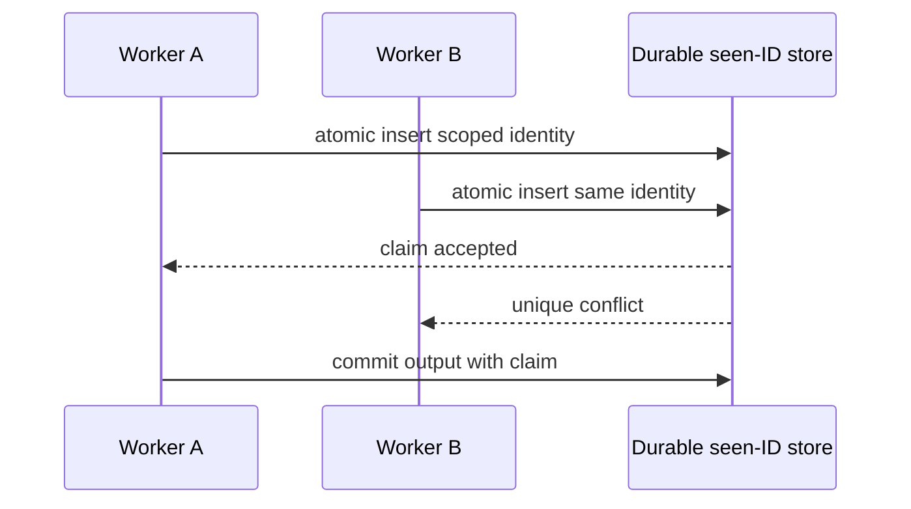

**Decision implications.** Use relational uniqueness when a local transaction can include both membership and effect and the write volume fits the database. Use a dedicated key-value store for high-throughput membership when its persistence, consistency, conditional-write, backup, and expiry semantics meet the contract. Specify whether the uniqueness key includes consumer identity: one event may need processing once by each independent projection. Preserve tombstones or compact IDs if the full record can expire before the business identity should.

**Failure mode.** A check-then-insert race permits two workers to accept the same ID. A local unique constraint in each shard permits cross-shard duplicates. An inbox entry committed before an unrelated output can cause loss; an output committed first can duplicate. An in-memory set silently forgets its history on restart.

**Scenario.** A settlement projection stores `(projection_name, source_event_id)` under a unique key and updates its balance table in the same database transaction. A rebuild into a new projection generation uses a new `projection_name`, so its membership records do not suppress the intended rebuild.

### 4.4 Bounded windows, retention, and late events

**Definition.** Bounded-window deduplication remembers identities only within a finite interval. The interval can be based on processing time (when the system sees the record), event time (when the source says it occurred), or a lifecycle/retention policy. Retention correctness means the remembered horizon covers every duplicate the system promises to suppress. Event-time ordering, watermarks, and late-event taxonomy are owned by [CH18 Ordering Guarantees](CH18_Ordering_Guarantees.md); this section applies those inputs to deduplication state rather than re-deriving them.

**Mechanism.** A stateful stream processor tracks IDs and expiry metadata, evicting entries when a watermark or processing-time clock advances. Event-time windows account for source timestamps; watermarks estimate when earlier events are unlikely to arrive, while allowed lateness retains state beyond the watermark. Too-early eviction lets late duplicates through; too-late eviction increases memory and can hold hot keys indefinitely. Processing-time expiry is simpler but can misclassify delayed transport as a new fact. Durable stores can use TTL, but asynchronous expiry and clock skew make boundary behavior implementation-specific.

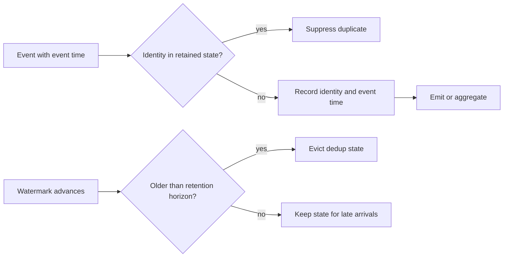

**Decision implications.** Derive the window from measured and contractually supported delay: producer retries, broker retention/redelivery, outages, restore/backfill, and clock error. If the source can replay without a bound, a finite window is not an exact guarantee; use durable identity, replay isolation, or accept and document residual duplicates. State whether events older than allowed lateness are dropped, corrected downstream, or sent to a late-data side output. Ordering affects which events are still in state, but [CH18 Ordering Guarantees](CH18_Ordering_Guarantees.md) owns ordering mechanics.

**Failure mode.** Choosing a one-hour state TTL because normal delivery is seconds, while a broker can redrive after a multi-day outage. The same event then passes as new. Another defect is using event time without validating clocks: a future-dated event can advance a watermark and evict valid state prematurely.

**Scenario.** A sensor stream deduplicates by `(device_id, event_id)` for 48 hours of event time and allows 6 hours of lateness. Events arriving beyond that policy go to a correction stream rather than silently changing a finalized dashboard. A recovery replay beyond 48 hours uses a separate projection generation.

### 4.5 Probabilistic structures: Bloom filters and safe role

**Definition.** A Bloom filter is a compact probabilistic set-membership structure. It can report “definitely not present” or “possibly present,” with false positives but, under normal insertion-only operation, no false negatives for inserted items. It does not store the original IDs and cannot prove membership.

**Mechanism.** An array of `m` bits and `k` hash-derived positions represents `n` inserted IDs. Insertion sets those bits; query checks whether all are set. A query with any unset bit is definitely absent from that filter; all-set is only a candidate duplicate. Approximate false-positive probability is $p \approx (1-e^{-kn/m})^k$, minimized near $k=(m/n)\ln 2$. Overfilling increases false positives. Reset, stale replication, incorrect hash-versioning, or unsupported deletion can invalidate operational assumptions; counting Bloom filters support deletion at additional memory and counter-overflow risk.

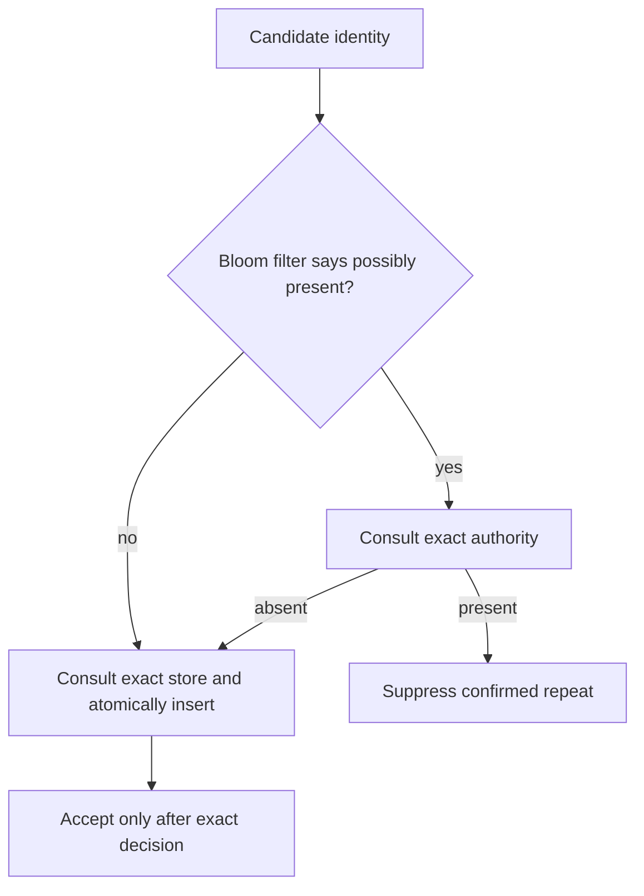

**Decision implications.** Use a Bloom filter as a read-avoidance prefilter when exact lookups are costly and false positives are acceptable as extra work. A positive must be verified by authoritative state before dropping data. A negative can skip an exact lookup only if the filter is complete and current for the exact namespace; in most distributed deployments, still perform an atomic exact claim so concurrent inserts, lag, restart, and rebuild cannot create false negatives in the correctness path. Never make a sole Bloom-positive decision that discards data when loss is unacceptable.

**Failure mode.** Treating “possibly present” as “definitely duplicate” drops a legitimate record with probability increasing as the filter fills. Rebuilding a filter asynchronously and trusting a negative can admit old duplicates if the exact store was not consulted. Deleting bits to remove one identity can also clear bits shared by other identities and create false negatives.

**Scenario.** A high-volume ingestion service checks a local Bloom filter before querying a remote exact ID store. A possible hit triggers exact lookup; a miss performs an atomic insert. False positives add a network read but do not lose data. Filter saturation raises lookup cost and triggers rotation, not a change in correctness policy.

### 4.6 Cross-partition coordination, replay, and operational trade-offs

**Definition.** Cross-partition deduplication occurs when records that share an identity can arrive at different workers, shards, regions, or replay runs. Replay is intentional re-consumption of historical data; backfill is recomputation or loading of historical records, often into a new target. Both challenge any assumption that “seen” is globally meaningful.

**Mechanism.** Global exact uniqueness requires co-location or coordination: route by a stable identity hash to one partition, use a globally consistent conditional insert, or maintain a shared authoritative store. Each has latency, availability, hot-key, or consistency costs. Replay policy separates source identity from processing generation: continue deduplicating into the same target when replay should be a no-op, or use an isolated generation when rebuilding a projection. A generation is not permission to duplicate external side effects; replay should target an isolated state sink or be explicitly side-effect-free.

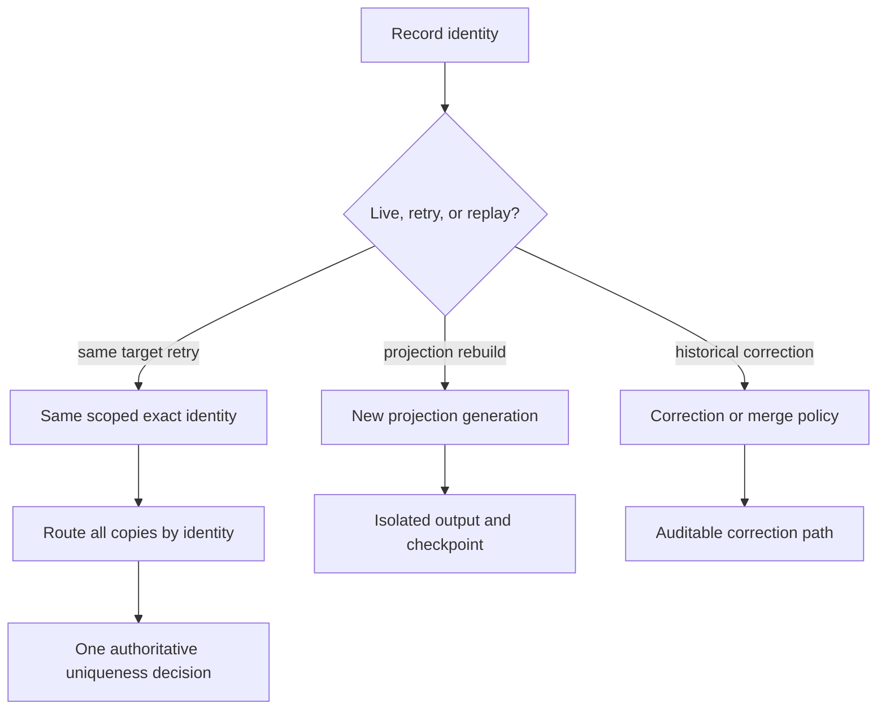

**Decision implications.** If broker partitions are keyed by entity but dedup identity is a producer event ID, copies may land on different partitions; the routing key must follow the dedup domain or a global arbiter must exist. Choose a replay namespace that includes consumer and projection version, not merely an arbitrary run ID. Document whether corrections supersede, merge with, or coexist with existing facts. [CH17 Exactly-Once Processing](CH17_Exactly_Once_Processing.md) owns offset/state transaction guarantees; this chapter only specifies the identity state and data policy they may use.

**Failure mode.** Two regions accept the same ID under independent local stores and asynchronously replicate afterward. Both effects are already visible before conflict resolution. A backfill reuses live dedup state and silently skips every historical record, or a new generation replays and sends every email again. A restore rolls the checkpoint backward while retaining newer seen IDs, suppressing data that was never written to the restored output.

**Scenario.** A team rebuilds a daily revenue projection after correcting its dedup identity. It writes to generation `revenue-v3`, replays the immutable source log with an isolated checkpoint and seen-ID namespace, validates counts against `v2`, then atomically switches readers. No customer notifications are emitted by the rebuild.

## 5. Internal Working

A correct exact path has an atomic decision point. Normalize and validate the identity, select its scope, then ask the authority to claim it. If the claim succeeds, the new record follows the chosen processing path; if it conflicts, compare stored metadata to distinguish a true repeat from identifier reuse. Persist output and checkpoint in their required transaction boundary. Retention is a separate lifecycle, but expiry must not race a valid retry inside the declared horizon.

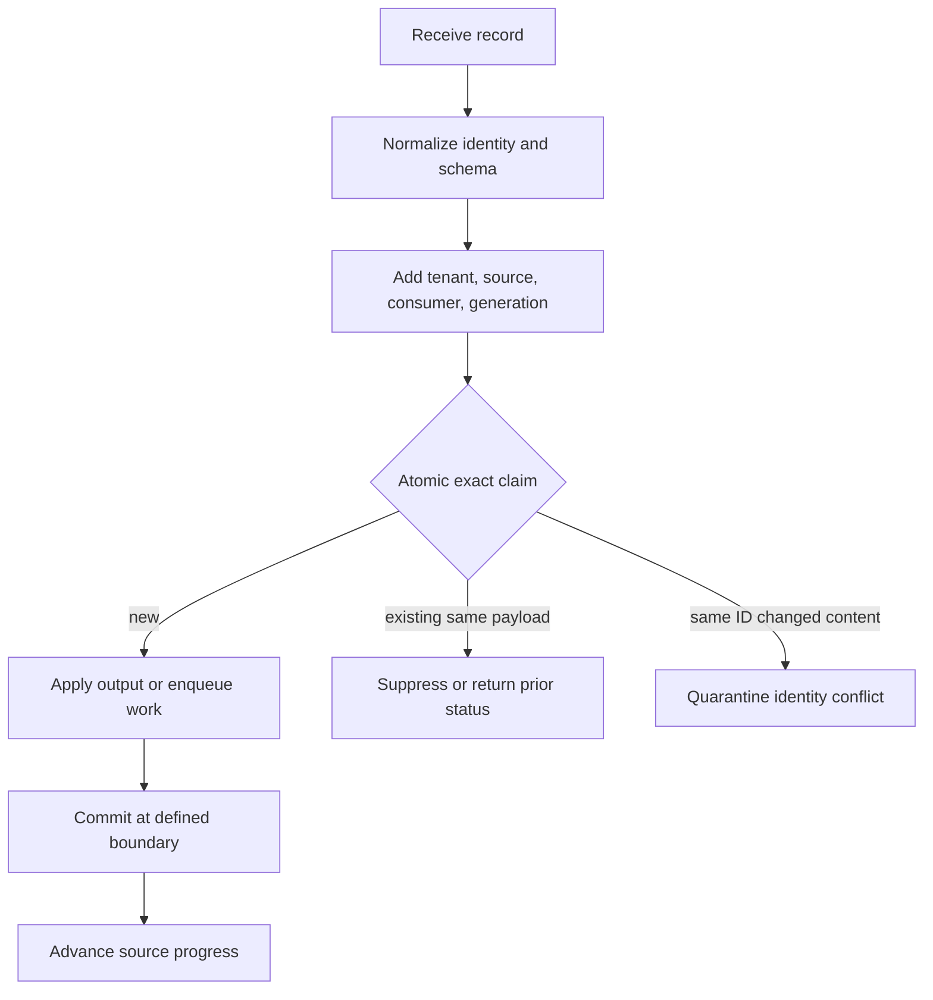

For an inbox transaction, “claim” and local output share a transaction. For a high-throughput stream processor, membership may be held in keyed state and checkpointed with operator state; restoration must recover both coherently. A Bloom filter can precede exact storage but cannot replace it. For nontransactional sinks, use a sink-specific upsert, deterministic output key, or reconciliation process. The correct pattern depends on what “duplicate” means and which state is authoritative.

An expiry worker should delete in bounded batches and record the policy version. If expiry is based on event time, it needs a trustworthy watermark; if based on wall clock, clock skew and delayed delivery matter. Cleanup should never delete an identity still inside the guaranteed horizon. For permanent uniqueness, retain a compact tombstone, domain key, or archive index rather than retaining an unbounded full payload.

## 6. Design Principles

1. Define the fact and equivalence relation before selecting a data structure.
2. Include all identity namespaces: source, tenant, event kind, consumer, and generation as appropriate.
3. Separate identity from payload equality; bind material content to an ID to detect accidental reuse.
4. Make exact membership decisions atomic under concurrent arrivals.
5. Co-locate identical identities, or pay explicitly for a global arbiter.
6. Derive retention from the longest supported delay or replay horizon, not average latency.
7. Treat late data and clock quality as correctness inputs to event-time windows.
8. Use probabilistic filters only where their one-sided error is safe and precisely understood.
9. Give replay an explicit target, namespace, checkpoint, and side-effect policy.
10. Make expiry, saturation, store outage, and conflict behavior observable.

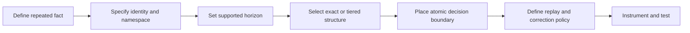

## 7. Architecture Patterns

**Transactional inbox.** Store source identity and consumer scope under a unique constraint in the same transaction as local effects. This pattern fits event consumers with a relational sink and bounded or durable replay policy. It does not make a remote side effect atomic.

**Deterministic output key.** Write derived records under a stable key, using replace/upsert semantics where repeated writes produce the same projection state. This can avoid a separate seen table for state projections, but it is not correct for additive aggregates unless the update is versioned or deduplicated first.

**Keyed stream state.** Partition records by the dedup identity and keep per-key membership until a watermark/TTL permits eviction. This gives low-latency bounded suppression, with correctness bounded by state retention and checkpoint behavior.

**Tiered exact membership.** Keep a hot in-memory or local filter for candidate checks, a durable exact store for authority, and optionally an archive/tombstone tier for long horizons. Every layer's consistency and recovery behavior must preserve the authority rule.

**Quarantine and merge.** When IDs collide with changed material content or a business-key match is ambiguous, retain both evidence records and route to a conflict-resolution workflow rather than choosing a destructive winner.

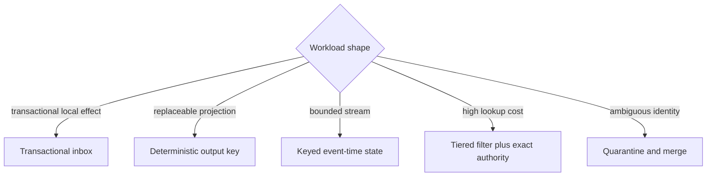

## 8. Production Architecture

A production design commonly has source adapters, identity normalization, a partition router, a dedup authority, the output sink, checkpoint coordination, replay tooling, and an expiry/compaction path. These are logical responsibilities; some may be one stream processor or database. The authority must be recoverable and shared across every process that can see the same identity.

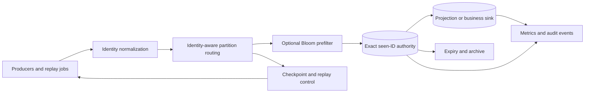

For a relational sink, a unique index can be the authority. For a log processor, local keyed state may be checkpointed with source progress. For multi-region ingestion, deterministic home-region routing reduces coordination but creates a regional dependency; globally consistent conditional writes improve global uniqueness at latency and availability cost. Eventual replication alone is not a uniqueness mechanism because both writers can accept before learning of each other.

Operational architecture includes state-size budgets, backup/restore behavior, key/schema version migration, controlled replay, deletion/retention compliance, and an emergency mode. If the authority is unavailable, decide whether to buffer durably, reject, or accept with explicitly degraded duplicate risk. “Fail open” is a business decision, not a transparent resilience setting.

## 9. Implementation

Start with an identity contract: canonical fields, namespaces, uniqueness scope, payload mismatch behavior, time basis, horizon, and post-expiry semantics. For a message inbox, a representative relational key is `(consumer_name, projection_generation, source_name, event_id)`. Store a payload digest and first-seen time for diagnosis, but do not confuse the digest with the identity. Ensure the database's unique constraint spans the required scope.

For append-only input, insert the identity before downstream visibility only when the insert and sink update are atomic or recoverably coordinated. For replaceable projections, an upsert keyed by entity plus source version may make repeated materialization safe. For additive aggregates, maintain event-level identity or derive the aggregate from a canonical deduplicated log. A batch job should use deterministic batch/item identities so reruns do not create a fresh namespace unintentionally.

The examples in Section 10 are complete standard-library references. They cover SQLite-backed exact membership, an event-time bounded window with a late-event path, a Bloom filter false-positive demonstration, and a replay-safe projection-generation consumer. They illustrate the data-management boundary only; they do not claim broker-level or end-to-end exactly-once processing.

## 10. Complete Code Examples

The examples are runnable independently with Python 3.10+ and no third-party packages. They use in-memory state or SQLite so the decisions are visible without a broker or cloud service.

1. [Exact seen-ID store](../code/python/deduplication-chapter/01_exact_seen_id_store.py) uses a SQLite primary key and a transaction to distinguish first observation from a repeat.
2. [Bounded-window stream deduplication](../code/python/deduplication-chapter/02_bounded_window_late_events.py) uses event time, allowed lateness, and an explicit too-late route.
3. [Bloom filter false-positive demo](../code/python/deduplication-chapter/03_bloom_filter_false_positive_demo.py) measures observed false positives and verifies every positive against an exact set.
4. [Replay/backfill-safe consumer](../code/python/deduplication-chapter/04_replay_backfill_safe_consumer.py) isolates projection generations and proves a rebuild does not suppress its own history or repeat external effects.

```powershell
.\.venv\Scripts\python.exe code\python\deduplication-chapter\01_exact_seen_id_store.py
.\.venv\Scripts\python.exe code\python\deduplication-chapter\02_bounded_window_late_events.py
.\.venv\Scripts\python.exe code\python\deduplication-chapter\03_bloom_filter_false_positive_demo.py
.\.venv\Scripts\python.exe code\python\deduplication-chapter\04_replay_backfill_safe_consumer.py
```

## 11. Performance

Exact membership adds a lookup/write, index maintenance, and possibly cross-partition coordination. Let unique arrival rate be $r$ records/second, retained horizon $T$ seconds, average encoded key bytes $b$, and storage/index multiplier $a$. A first-order footprint is $M \approx rTb a$, before payloads, replication, tombstones, and skew. Retries increase attempted operations even when unique cardinality does not. Measure unique rate and duplicate rate separately.

For a Bloom filter sized for $n$ elements and target false-positive probability $p$, approximate bit requirement is $m \approx -n\ln(p)/(\ln 2)^2$ and optimal hash count is $k \approx (m/n)\ln 2$. The filter trades RAM and CPU for fewer exact-store reads; false positives consume lookup capacity but should not lose data. When actual `n` exceeds sizing, the false-positive rate rises and the filter may become an expensive always-positive gate.

Hot identities can create write contention. Sharding by a stable hash distributes unrelated IDs but cannot distribute one hot key; batch claims can reduce round trips while increasing lock duration and recovery granularity. Monitor p95/p99 membership latency, unique-index conflicts, storage growth, filter saturation, and eviction backlog. Optimize only after preserving the exact decision path.

## 12. Scalability

The main scaling limit is the scope of uniqueness. A per-process map scales cheaply but gives no cross-process guarantee. A regional table gives regional uniqueness. A global exact store or routing protocol gives wider uniqueness with coordination cost. A hash partition is safe only when every copy of the same full identity maps to the same partition and the mapping remains stable through rebalancing.

For streams, keying by identity can create uneven load if a small number of keys dominate; salting a key spreads load but also splits the very state needed for uniqueness. Do not salt away correctness. If a domain has many copies of the same identity, route to an authority or use a two-stage partition/merge design. Partition migration must transfer dedup state with the same care as output state.

Scale retention by time partitioning, compact tombstones, tiered storage, or bounded windows. Deletion should be incremental and observable. A full historical scan for each identity is rarely viable; an archive index can support rare long-horizon checks without keeping every full payload hot. Recovery and replay capacity must be planned independently from live throughput.

## 13. Security

Identity values may be attacker-controlled. Bound their size, validate encoding, and scope them by authenticated tenant/source so one actor cannot suppress another actor's data. A collision or deliberate reuse should be visible and quarantinable. Do not expose whether another tenant has already used a particular ID.

Payload fingerprints are not encryption. Hashes of predictable values can be guessed, and unhashed payloads in the dedup table may contain personal or regulated data. Minimize retained payloads, use access controls and encryption at rest, and define deletion/audit requirements. Logs should use privacy-safe identifiers and avoid turning raw keys into unbounded metric labels.

An unbounded stream of unique IDs is a resource-exhaustion vector against exact stores and filters. Enforce quotas, validate source authenticity, cap per-tenant state, and alert on cardinality spikes. A Bloom filter is not a security boundary; an attacker can intentionally saturate it and increase false positives.

## 14. Observability

Separate counters for first-seen records, confirmed duplicates, identity conflicts, too-late records, expired-state arrivals, replay-generation volume, exact-store failures, and Bloom false positives. A single “dedup count” obscures whether the system is healthy or silently losing records. Track unique cardinality and duplicate ratio by bounded dimensions such as source, event type, and tenant tier.

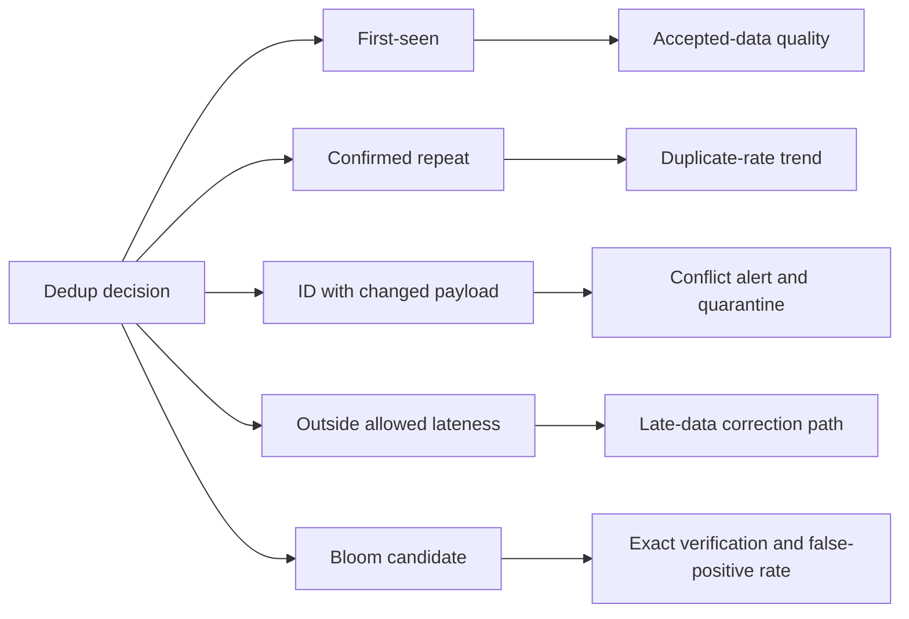

Operational dashboards should include state bytes/keys, oldest retained identity, TTL deletion lag, per-partition skew, exact-claim latency, Bloom occupancy and estimated false-positive probability, replay throughput, and checkpoint-to-output divergence signals. Emit structured audit records for suppressed or quarantined identities with enough metadata to explain the decision without storing sensitive payloads. Alert on rates and age, not just totals.

## 15. Failure Scenarios

**Concurrent duplicate claims.** Two workers see an absent ID. A unique constraint or atomic put-if-absent must select one winner. A preliminary read is only an optimization.

**Effect/identity split.** The identity commits but the output does not, or vice versa. Use one transaction, deterministic idempotent sink keys, or a reconciliation ledger. Do not label the gap exactly once.

**Window expires before redelivery.** A delayed duplicate arrives as new. Increase horizon, retain durable tombstones, or explicitly accept the residual risk.

**Watermark jumps.** A malformed future timestamp advances event-time eviction and removes useful state. Validate timestamp bounds and monitor watermark jumps.

**Partition split-brain.** Two partitions independently accept the same identity. Route by complete identity or coordinate through one authority.

**Filter saturation or rebuild.** False positives increase or an incomplete filter misses old IDs. Continue exact verification, rebuild from authoritative state, and fail safely if completeness is unknown.

**Replay after restore.** Output is restored to an earlier point but dedup state remains newer, suppressing missing output. Restore output, dedup state, and checkpoints from a coherent recovery point or rebuild in an isolated generation.

**Identity schema migration.** New canonicalization changes key interpretation. Version identities and dual-read/dual-write or rebuild deliberately; do not silently change the hash function in place.

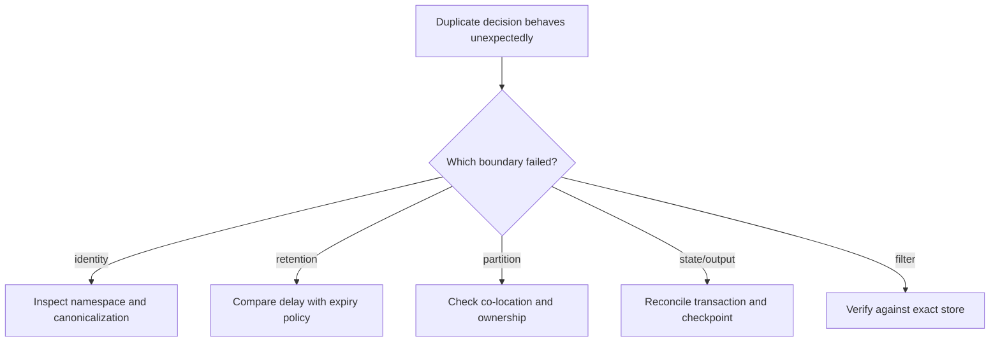

## 16. Testing

Test the equivalence rule before load behavior. Include same ID/same payload, same ID/changed payload, different IDs/same payload, same business key/different event occurrence, namespace collisions, and canonicalization-version changes. Assert the final output as well as the decision classification.

Force concurrent first observations with barriers and verify one exact claim. Test expiry immediately before, at, and after the documented boundary, including delayed delivery and clock skew. For stream state, permute arrival order, include duplicate late events, test watermark advancement, and verify too-late routing. For Bloom filters, verify no inserted item is reported absent, measure false positives on non-members, and test saturation/rebuild behavior.

Replay tests should cover same-target no-op replay, isolated generation rebuild, correction/backfill policy, and crash/restore combinations where checkpoint and output may diverge. Use property-based generation of duplicate copies and permutations to assert invariants. Exactly-once offset/output transactions need their own processing-contract tests in CH17; here test the identity and retention behavior at the dedup boundary.

## 17. Common Mistakes

- Treating payload equality as business identity.
- Using a delivery-attempt ID that changes on every retry.
- Omitting source, tenant, consumer, or event type from the namespace.
- Using a check-then-insert sequence without an atomic arbiter.
- Assuming per-partition uniqueness means global uniqueness.
- Setting a TTL from normal delivery latency rather than maximum supported replay delay.
- Advancing an event-time watermark from unvalidated timestamps.
- Dropping every Bloom-positive item without exact confirmation.
- Assuming Bloom filters support safe deletion or remain complete after partial rebuild.
- Sharing live dedup state with a projection rebuild and suppressing the intended history.
- Replaying external side effects merely because the output generation is new.
- Calling deduplication idempotency or exactly-once processing without stating boundaries.

## 18. Best Practices

1. Write and version the identity contract, including namespace and material-content rules.
2. Prefer stable producer IDs for retries; use business keys only when their semantics distinguish repeated occurrences.
3. Use exact durable membership for correctness-sensitive drops.
4. Make the unique claim atomic and align its scope with partition routing.
5. Define event-time, allowed-lateness, and post-window behavior explicitly.
6. Calculate retention from retry, broker, outage, replay, restore, and compliance horizons.
7. Keep Bloom filters as prefilters with exact authority verification.
8. Treat replay as a separate mode with a target generation and side-effect policy.
9. Preserve enough metadata to diagnose conflicts without retaining unnecessary sensitive payloads.
10. Test concurrent claims, late arrival, expiry, saturation, restore, and reprocessing.
11. Expose data-quality and storage metrics independently.
12. Phrase guarantees with identity, sink, scope, and horizon.

## 19. Anti-Patterns

**The payload-hash universal key.** Identical payloads can be two intended occurrences; semantically identical payloads can serialize differently. Use domain intent or stable source identity, with fingerprints as validation.

**The process-local set.** It fails on restart, scale-out, failover, and rebalance. Use durable shared state or a checkpointed operator state whose recovery contract is explicit.

**The Bloom filter as judge.** A false positive becomes data loss when it directly drops a record. Verify positives against exact authority.

**The default TTL.** A convenient cache expiration silently defines the business guarantee. Derive expiry from the supported replay horizon and test its boundary.

**The global database for every workload.** A single exact store may centralize correctness but create a hot bottleneck or availability dependency. Co-locate by identity or document coordination trade-offs.

**The replay equals live traffic assumption.** Backfills can pollute live aggregates, resend notifications, or collide with current state. Isolate targets and disable external effects by design.

## 20. Trade-off Analysis

Exact durable state offers deterministic membership and clear auditing at the cost of storage, writes, lookup latency, cleanup, and coordination. Bounded state limits cost but turns a duration into a correctness boundary. A Bloom filter compresses membership at the cost of false-positive lookups and operational lifecycle complexity. Payload fingerprints are cheap and portable but only as good as canonicalization and identity semantics. Global uniqueness avoids cross-shard duplicates but may reduce availability or increase latency.

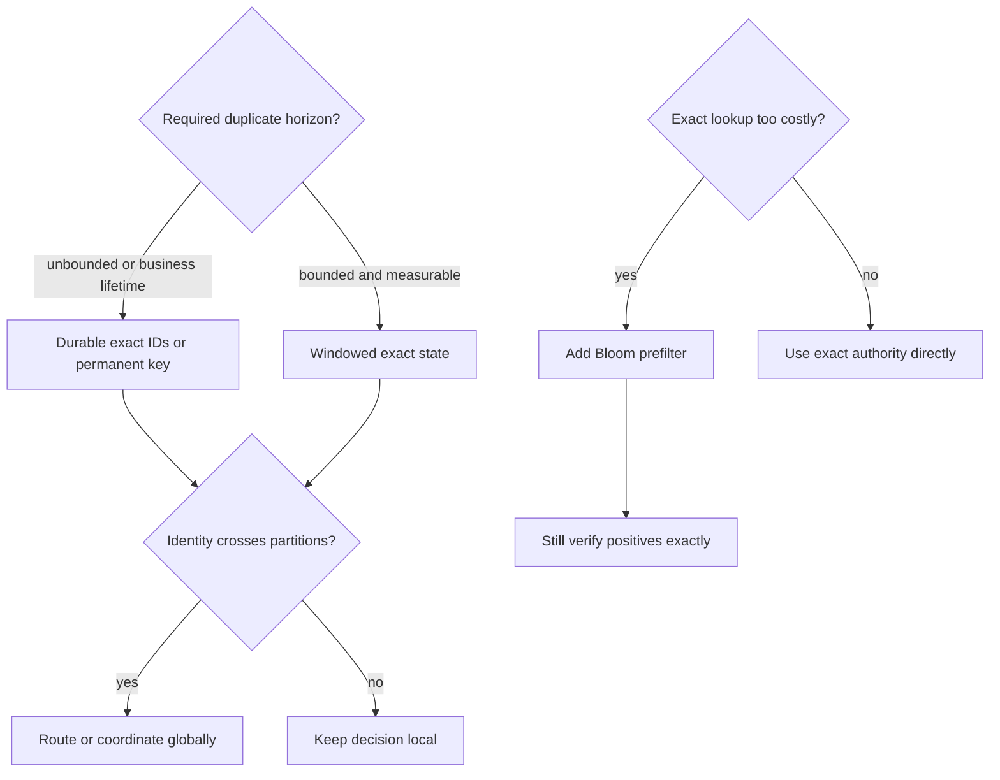

Choose by consequence of false suppression versus false admission, maximum duplicate delay, identity cardinality, write/read ratio, payload size, topology, and replay needs. For an analytical count, a bounded correction stream may be acceptable. For a financial ledger, a probabilistic false positive is not. If no finite delay bound exists, do not describe a finite TTL as exact.

## 21. Comparison Table

| Mechanism | Membership result | Cost profile | Appropriate role | Main risk |
|---|---|---|---|---|
| Unique constraint/inbox | Exact within key and retention scope | Durable writes and index contention | Correctness authority for local data | Wrong scope, split transaction, or expiry |
| Durable key-value set | Exact if conditional insert and consistency are adequate | Low-latency distributed state; coordination cost | High-volume shared membership | Cross-region race or weak conditional semantics |
| Windowed stream state | Exact while state is retained | Bounded memory/state backend | Streaming suppression with known delay bound | Late duplicate after eviction |
| Bloom filter | Negative is definite; positive is probable | Compact memory and hash CPU | Prefilter to reduce exact lookups | False-positive loss if treated as authority |
| Payload fingerprint | Equality evidence, not identity by itself | Hash CPU; compact storage | Detect changed-content reuse or exact-content repeats | Canonicalization and semantic collision |
| Deterministic output upsert | Convergent state write for replaceable outputs | Sink write/index work | Projections keyed by stable entity/version | Unsafe for additive effects |
| Quarantine/merge workflow | No automatic suppression of ambiguous cases | Human or asynchronous resolution | Fuzzy/business identity conflicts | Backlog and delayed correctness |

## 22. Real-World Case Study

A commerce analytics team consumes order-change events into daily revenue aggregates. During routine operation, delivery is fast and duplicates are rare. A regional outage later causes a connector to restart from an older checkpoint, replaying several hours of events. The original aggregate is additive, so replay doubles revenue for affected orders. A process-local set had hidden the defect in development but vanished on restart.

The redesign assigns a stable source event identity composed of database lineage and log position, with tenant and consumer scope. The normal projection writes an inbox key and updates its local aggregate in one transaction. A business order ID is not used as the event identity because an order can legitimately emit multiple changes. Events with the same source ID but different canonical content are quarantined as source-integrity conflicts.

For historical corrections, the team writes a new projection generation and rebuilds from the retained source log. The replay path shares no live notification side effects; after validation, readers switch to the rebuilt generation. A 72-hour window protects the hot stream, while durable inbox/tombstone retention covers the connector's supported replay range. A small Bloom filter avoids most remote membership reads, but all possible hits are verified exactly. Metrics distinguish live duplicates, replay volume, late arrivals, and filter false positives.

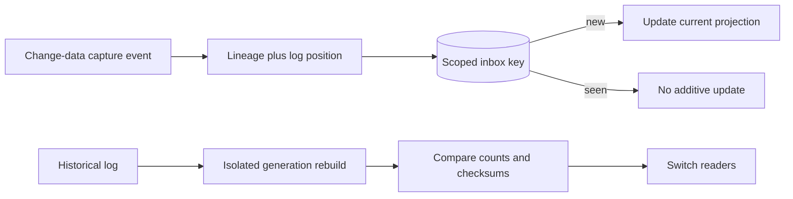

The design does not promise that source events are delivered once. It defines how this projection classifies repeated observations, protects its additive state, and rebuilds without repeating external actions. The exact retention horizon is stated against connector recovery and archive replay policy rather than inferred from typical latency.

## 23. Interview Questions

1. How do deduplication, idempotency, and exactly-once processing differ?
2. When is a producer message ID preferable to a business key or payload hash?
3. Why can two identical payloads be distinct legitimate events?
4. What makes a unique constraint a better concurrent arbiter than check-then-insert?
5. How should a bounded event-time dedup window handle late arrivals?
6. What guarantee does a Bloom filter provide, and what does it not provide?
7. How do you deduplicate globally when the same identity can cross partitions?
8. How should replay into an existing projection differ from rebuilding a new generation?
9. How do restore points for output, dedup state, and source offsets interact?
10. Which metrics reveal a too-short retention policy or a saturated Bloom filter?

Strong answers state identity scope, the authority, horizon, and failure behavior. They distinguish a probabilistic prefilter from exact suppression and do not claim that a membership table alone creates end-to-end exactly-once processing.

## 24. Hands-on Exercises

1. Run all four examples and identify the exact assertion that demonstrates each stated invariant.
2. Extend Example 01 to detect same-ID/different-payload reuse and quarantine it.
3. Change Example 02's watermark and allowed-lateness settings; show which late duplicate is suppressed and which is routed.
4. Increase Example 03's item count without resizing the filter and measure false-positive growth.
5. Add a `source_name` namespace to Example 01 and prove equal IDs from independent producers do not collide.
6. Simulate a restore where the projection is rolled back but the seen-ID store is not; then design a coherent restore or generation rebuild.

## 25. Design Exercises

1. **Telemetry ingestion.** Choose identity and window for devices that buffer offline for up to five days. Decide the policy for older events and clock skew.
2. **Payment ledger.** Design exact event identity, inbox transaction, retention, and conflict handling. Keep CH16's operation contract and CH17's processing guarantee distinct.
3. **Multi-region clickstream.** Compare home-region routing, global conditional writes, and bounded per-region deduplication. Quantify the false-admission risk.
4. **Customer master import.** Combine exact source IDs with a fuzzy business-key match. Specify quarantine and merge policy instead of destructive automatic suppression.
5. **Projection rebuild.** Design a generation-based backfill with checkpoints, validation, reader cutover, rollback, and no external side effects.
6. **Cost review.** Estimate exact-store cardinality and Bloom memory from arrival rate, retention, and target false-positive rate; include indexes and replication in the budget.

## 26. Architecture Review Questions

- What fact is considered repeated, and what is the exact equivalence rule?
- Is identity producer-assigned, business-derived, or content-derived? What can collide?
- Which namespace dimensions prevent cross-tenant, cross-source, and cross-consumer collisions?
- Is membership authoritative and atomic under concurrent arrivals?
- Does the identity route to one partition, or is global coordination required?
- What delay and replay horizon does retention cover, and what happens after expiry?
- How are event time, watermarks, late arrivals, and clock anomalies handled?
- Are Bloom positives verified against exact state? How is filter completeness maintained?
- Can output, dedup state, and source progress recover from a common point?
- Does replay target the same sink or an isolated projection generation?
- Are external side effects disabled or independently protected during backfill?
- Are conflicts, late events, expiration, saturation, and state growth observable?
- Do tests force duplicates across workers, partitions, restarts, and restore boundaries?
- Are claims phrased with an explicit identity, scope, sink, and time horizon?

## 27. Summary

Deduplication is a general data-management problem: identify repeated records, events, or requests within a defined scope and horizon, then suppress, merge, or route them according to the cost of mistakes. Identity may be a stable message ID, a carefully scoped business key, or a canonical payload fingerprint; none is universally correct. Exact durable stores provide authoritative membership, bounded windows control state growth at a correctness boundary, and Bloom filters reduce lookup cost only when exact authority remains responsible for dropping data.

Retention must cover the supported retry, outage, replay, and backfill horizon. Event-time state must account for lateness; cross-partition identity requires routing or coordination; replay needs an explicit target generation and side-effect policy. Deduplication may support idempotency, but is broader than it, and neither a dedup table nor a Bloom filter is by itself an exactly-once processing guarantee. Link operation semantics to [CH16 Idempotency](CH16_Idempotency.md), end-to-end processing boundaries to [CH17 Exactly-Once Processing](CH17_Exactly_Once_Processing.md), and ordering mechanics to [CH18 Ordering Guarantees](CH18_Ordering_Guarantees.md).