# Chapter: REST

Part: [08 — API Architecture](PART_OVERVIEW.md) · Status: Edited (overlap with HTTP resolved)

## 1. Introduction

dissertation. It is the dominant style for public and internal HTTP APIs
today. This chapter covers REST's constraints, maturity model, and design
the Richardson Maturity Model).
REST (Representational State Transfer) is an architectural style for
networked Application Programming Interfaces (APIs), most often exposed
through Hypertext Transfer Protocol (HTTP). Roy Fielding defined the style
in his 2000 doctoral dissertation as an explanation of the architectural
constraints behind the Web's scalability and evolvability. REST is not a
wire protocol, a required serialization format, or a synonym for any API
that returns JavaScript Object Notation (JSON) over HTTP. It is a way to
organize resource identity, representations, interaction semantics, and
application-state transitions.

This chapter owns REST-specific concepts: the constraint set, resource and
representation modeling, the uniform interface as applied to those
resources, hypermedia controls, and the Richardson Maturity Model. The
[HTTP chapter](../05_Networking_and_OS/CH01_HTTP.md) remains the authoritative
source for method semantics, status codes, headers, caching directives, and
conditional request mechanics. This chapter explains how a REST designer
uses those mechanisms without duplicating their wire-level definitions.

## 2. Historical Evolution

default style for public APIs, later joined (not replaced) by GraphQL and
gRPC for specific use cases.
Before REST became common vocabulary, networked applications already used
remote procedure calls, distributed object systems, and early Web endpoints
that often exposed server function names directly. These approaches could
work within one controlled system, but they commonly coupled clients to
method inventories, server deployment details, and bespoke interaction
rules. The Web demonstrated another way to compose independently operated
systems: identify resources, exchange representations, and follow links
through a shared protocol.

Fielding's dissertation introduced REST as a style and derived its
constraints from the architecture of the Web. The constraints were intended
to explain why layering, caching, stateless interactions, and a uniform
interface support large-scale evolution, not to prescribe a particular
framework or JSON format. During the 2000s, Web APIs increasingly adopted
resource-oriented URI design and consistent HTTP method usage, and the term
"RESTful" became shorthand for several different levels of adherence. The
Richardson Maturity Model later offered a practical, if simplified,
diagnostic for those differences.

REST remains common, but it is one point in the API-style design space.
GraphQL adds client-selected field graphs, gRPC provides schema-first
remote procedure calls and generated stubs, and event-stream or WebSocket
APIs address long-lived update patterns. These styles can coexist; the
choice depends on interaction shape, contract needs, infrastructure, and
client population rather than fashion.

## 3. Why It Exists

evolve without breaking clients.
An API is a boundary between independently changing components. If every
endpoint invents its own verbs, status behavior, URI shape, and caching
rules, each new client must learn a private protocol and each intermediary
must understand application-specific exceptions. Resource-oriented APIs
seek to make common interaction semantics visible and reusable: clients
address resources, exchange representations, and rely on a small, consistent
interface.

REST's constraints target recurring architectural pressures. Stateless
requests allow work to move between service instances; cacheable responses
can reduce repeated reads; a uniform interface gives generic clients and
intermediaries a stable interaction model; client-server separation permits
independent evolution; and layering allows gateways and caches to be added
without rewriting clients. Those properties are not free. Statelessness
moves context into each request or a shared state resource, cacheability
requires careful freshness and privacy decisions, and hypermedia can require
more capable clients. REST exists as a reasoning framework for those
trade-offs, not as a guarantee that an API will automatically scale or
remain compatible.

The design problem is therefore twofold: decide whether REST's constraints
fit the system's dominant interactions, then model resources and
representations so that each constraint produces a real operational or
evolution benefit. If the API is fundamentally a command protocol or a
low-latency bidirectional stream, another style may be clearer.

## 4. Core Concepts

REST's core concepts are not a bag of URI conventions. They fit together as
an architectural style: identify resources, expose their representations
through a uniform interface, preserve the constraints that make the web
scale, and let clients move through application state using the contract the
server publishes. The subsections below teach that structure and its
trade-offs. HTTP owns the wire-level request/response format, method
semantics, status-code taxonomy, content-negotiation headers, conditional
request mechanics, and cache directives; REST applies those mechanisms
consistently to a resource model rather than re-defining them.

### 4.1 Resources, resource identity, and representations

**Definition.** A resource is a conceptual thing the API names and allows a
client to address: an order, a customer, a collection of orders, or a
relationship such as the items belonging to an order. A resource is not the
JSON object currently returned for it. That JSON document is a
**representation**: a selected description of the resource at a point in
time, in a format the client and server can exchange. The distinction lets
the resource keep a stable identity while its representation evolves or is
rendered in different media types.

**Mechanism.** A URI (Uniform Resource Identifier) identifies the target
resource; the representation carries state and links relevant to the
request. For example, `/orders/42` can identify one order whether the
response contains its full address, a compact summary, or a representation
with a different language. A collection URI such as `/orders` identifies a
set or feed; `/orders/42/items` names a relationship-derived collection.
The API designer chooses the resource boundary and stable identifier, then
chooses which representation is appropriate for a particular interaction.
The internal database row, aggregate, cache key, and public resource may
align, but REST does not require them to be the same object.

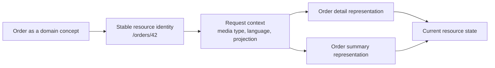

**Decision implications.** Choose resource boundaries around durable domain
concepts and relationships that clients need to address, not around every
database table or every screen. A stable resource identity gives clients a
place to retrieve current state and makes caching, conditional updates, and
links understandable. Representations can be optimized for different
consumers without multiplying resource identities, but each representation
variant adds contract and caching considerations. Prefer a shallow,
readable URI hierarchy; deep nesting often encodes ownership assumptions
that change or makes a child impossible to address independently.

**Common failure mode.** Treating a representation as the resource itself
leads to accidental identity changes when response fields or storage layout
change. The opposite mistake is exposing every internal table as a public
resource, which leaks implementation structure and creates an API that is
hard to evolve independently. Another trap is putting actions into paths by
default (`/orders/42/cancelNow`) instead of first asking whether the action
is a state transition or a separately addressable resource.

**Scenario.** An order service stores line items in a separate table, but
clients reason about an order as one business resource. The API exposes
`/orders/42` as the stable order identity and `/orders/42/items` as a
relationship collection. A mobile client requests a compact representation;
an operations client requests detail. Both address the same order rather
than depending on the database's table layout.

### 4.2 REST constraints and the causal path to system properties

**Definition.** The REST style is an architectural style defined by a set of
constraints. It is neither a wire protocol nor a synonym for any
JSON-over-HTTP API. The commonly taught constraints are client-server
separation, stateless interaction, cacheability, a uniform interface, and a
layered system; code-on-demand is an optional constraint in Fielding's
formulation. Each constraint removes a form of coupling or enables an
intermediary, but each also has a cost.

**Mechanism.** Client-server separation lets the user-interface concerns
evolve independently of data-storage concerns. Statelessness requires each
request to carry the context needed to understand it, so the server does not
depend on hidden per-client session state between requests. Cacheability
labels responses with reuse policy, allowing a cache to satisfy repeated
reads when permitted. The uniform interface makes resources, representations,
and transitions visible through consistent interaction semantics instead of
application-specific methods for every operation. Layering permits proxies,
gateways, and caches to mediate requests without requiring the client to know
the internal topology. Code-on-demand can transfer executable behavior to a
client, but is uncommon in modern API design and is not required for REST.

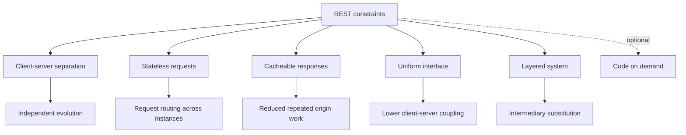

**Decision implications.** Evaluate whether a proposed API actually gains
from each constraint. Statelessness is useful for horizontal scaling and
failure recovery, but moving all state into client tokens can increase
payload size, revocation difficulty, and security exposure. Cacheability
improves efficiency only when freshness and privacy rules are explicit.
Uniformity reduces the number of one-off interaction rules but may feel
less convenient than a task-specific remote procedure call (RPC) for some
operations. A system may
use REST principles without implementing every constraint equally strongly;
be precise about which properties it relies on instead of claiming a
maturity label as a quality guarantee.

**Common failure mode.** Calling an API REST because it uses HTTP and JSON
while it keeps server-side conversational state, exposes action-specific
RPC endpoints, and ignores cache semantics. A label does not create the
architectural properties. Another failure is applying statelessness
mechanically by putting sensitive, large, or revocable state into bearer
tokens without considering the resulting threat model.

**Scenario.** A public catalog API serves cacheable product reads through an
edge cache while authenticated order mutations remain non-cacheable and
stateless across application instances. The design uses client-server
separation, a uniform interface, and layered intermediaries; it does not use
code-on-demand. The useful claim is about those concrete constraints, not
that the API is "fully RESTful" in the abstract.

### 4.3 The uniform interface: resources, representations, and transitions

**Definition.** The uniform interface is REST's constraint that clients
interact through a consistent set of semantics rather than a separate
application verb for every operation. Its four classic dimensions are
resource identification, manipulation through representations,
self-descriptive messages, and hypermedia as the engine of application
state. HTTP supplies the protocol-level method and response semantics;
REST's design work is choosing how resources and state transitions use that
shared interface.

**Mechanism.** A client identifies a resource, sends a representation or
retrieval request using HTTP's standardized method semantics, and interprets
the returned status, headers, media type, body, and links. REST therefore
maps domain operations to HTTP behavior consistently rather than inventing
`/getOrder`, `/updateOrder`, and `/deleteOrder` calls as unrelated remote
procedures. For instance, adding an item to an order may be modeled as
creating a member of `/orders/42/items`, while replacing a known item's
representation targets `/orders/42/items/7`. The correct method and status
semantics remain those taught by [HTTP](../05_Networking_and_OS/CH01_HTTP.md);
REST owns the resource mapping and consistency of that mapping.

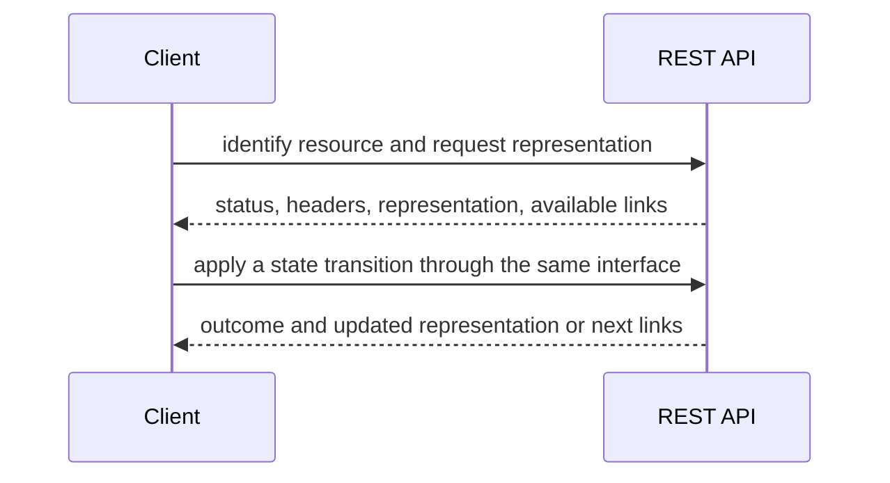

**Decision implications.** Consistent mappings make client behavior easier
to predict and allow generic intermediaries to understand requests. Use
HTTP method semantics precisely rather than redefining them locally. Model
domain operations that do not fit simple Create, Read, Update, Delete (CRUD)
as transitions with explicit semantics; a command-like endpoint can be
appropriate when a true resource model would be artificial, but repeated
action endpoints should not become
an excuse to bypass HTTP's safety, idempotency, and conditional-request
contracts. Link to HTTP instead of restating the full method/status
taxonomy.

**Common failure mode.** Using `POST` for every operation and encoding the
action only in a path or body can erase the distinctions clients, caches,
and generic tooling rely on. The reverse failure is forcing a complex domain
command into a misleading `PUT` merely to appear resource-oriented. Uniform
interface means consistent semantics, not that every application operation
must look like CRUD.

**Scenario.** A reservation API uses a `reservations` collection for
creation and stable member URIs for inspection and cancellation state. A
rarely used bulk-reconciliation command remains an explicit command resource
because it has a distinct lifecycle and result, rather than masquerading as
a normal update to a reservation representation.

### 4.4 Resource modeling: aggregates, collections, and relationships

**Definition.** Resource modeling decides which domain concepts receive
stable API identities, which are represented as collections, and how
relationships are navigated. A collection is not necessarily a database
table or an unbounded list; it is a resource whose representation describes
or yields a bounded view of its members. A member resource is independently
addressable when clients need to refer to it over time.

**Mechanism.** Begin with user-visible nouns and lifecycle boundaries, then
test identity, ownership, and relationship cardinality. A path such as
`/customers/9/orders` expresses a navigable relationship; `/orders/42`
expresses an independently addressable order. Model nested paths only when
the parent relationship is semantically important and stable. If orders can
be moved between accounts or accessed by global ID, retaining a canonical
`/orders/42` URI avoids making identity depend on the current parent path.
Query parameters can express a bounded collection view such as filtering,
sorting, or pagination without inventing a new resource for every query
combination.

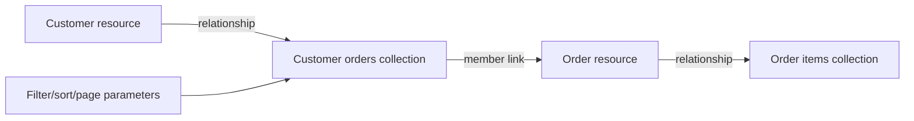

**Decision implications.** Align public resources with domain concepts and
aggregate boundaries when that supports stable ownership, but avoid exposing
internal aggregates as a universal rule. A resource should have an identity
that remains meaningful as storage changes. Nested URIs improve discoverability
for containment relationships but can imply ownership and make long paths
fragile; provide canonical member links when independent addressing matters.
Collections should be bounded and explicit about their continuation model.

**Common failure mode.** Deeply nesting paths to mirror every relationship
creates brittle URLs (`/regions/1/stores/2/orders/3/items/4/discounts/5`).
Another common failure is confusing a query shape with a resource and
creating a new endpoint for every combination of filters. Exposing an
unbounded collection can lead to memory pressure, slow serialization, and
unpredictable client latency.

**Scenario.** A fulfillment system models an order independently from the
customer who placed it because orders remain addressable after customer
account merges. It still exposes `/customers/9/orders` as a relationship
collection for navigation. Both routes lead to the same order identity; the
collection uses cursor pagination and never returns an unbounded result.

### 4.5 Representations, media types, and partial views

**Definition.** A representation is a transfer-ready description of a
resource. The server selects it based on media type and request context. A resource may have
multiple representations without acquiring multiple identities. A partial
view is a deliberately smaller representation or a bounded collection
projection, not a separate REST constraint.

**Mechanism.** The server serializes resource state into a representation
such as JSON and communicates its media type using HTTP content-negotiation
headers. REST-specific design includes
choosing stable field names, distinguishing omitted fields from explicit
nulls where that matters, and deciding whether a client-selected field
projection is worth the added cache-key and authorization complexity. A
representation can include links and version information alongside data.
The HTTP chapter owns the semantics of `Accept`, `Content-Type`, and
content negotiation; this chapter focuses on designing resource
representations that remain coherent as the domain changes.

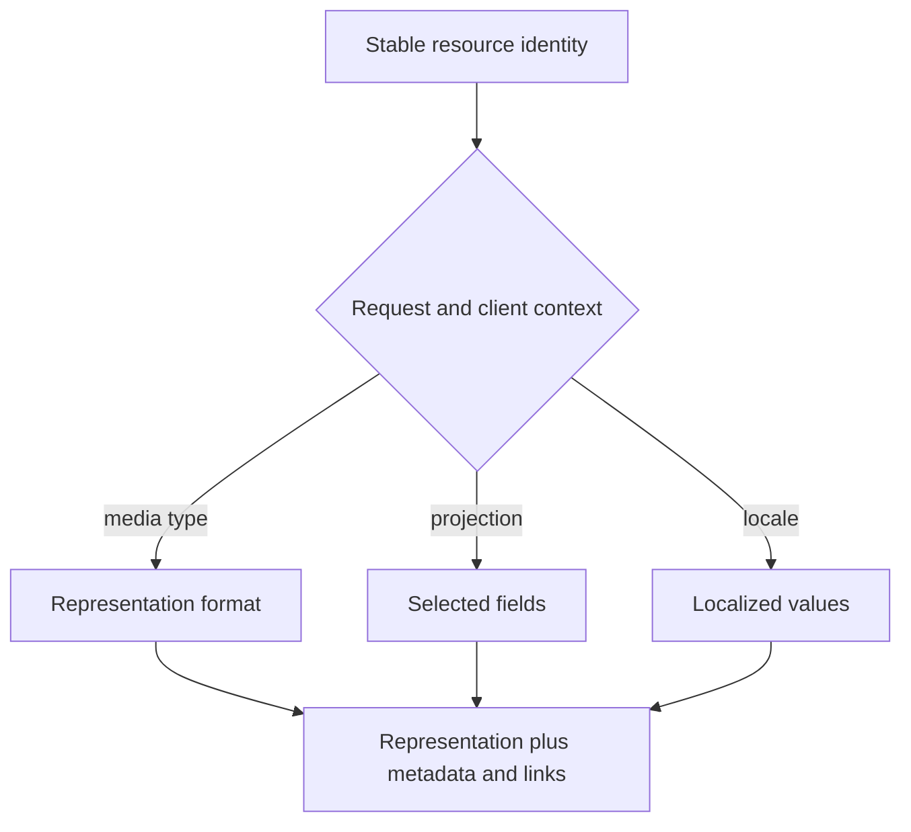

**Decision implications.** Default to one canonical representation per
resource and add variants only for a measured need, such as a compact mobile
view or a genuinely different media type. If clients can select fields,
ensure authorization is checked per field and caches distinguish variants
when required. Prefer additive evolution for optional fields and preserve
the meaning of existing fields. A representation is a public contract,
not a direct serialization of an internal object that can change without
review.

**Common failure mode.** Returning different shapes from the same URI based
on undocumented client assumptions makes caching and compatibility
unpredictable. Treating an omitted field and a `null` field as equivalent
can also break clients that interpret omission as "not requested" and null
as "known to be absent." Including privileged fields in a shared
representation and relying on clients to hide them is an authorization
failure.

**Scenario.** A product resource offers a standard representation and a
compact projection selected by an explicit field parameter. The server
authorizes requested fields, includes a variant-aware validator, and keeps
the same product URI in both cases. A later optional field is added without
changing existing field meanings.

### 4.6 Statelessness, client-server separation, and layered systems

**Definition.** Statelessness means each request contains the context needed
to process it; the server does not depend on hidden conversation state
stored between requests. It does not mean the system has no state: business
resources, durable sessions, and databases are stateful. Client-server
separation divides user-interface concerns from data and service concerns;
layering allows intermediaries to sit between them.

**Mechanism.** A client sends the resource identifier, operation, relevant
credentials, and request data on each interaction. The server can route the
request to any capable instance because no private in-memory conversation
must follow that client. A gateway can authenticate or route; a cache can
answer an eligible read; a load balancer can select an instance. These
layers remain substitutable when each layer respects the message contract
and does not silently alter resource semantics.

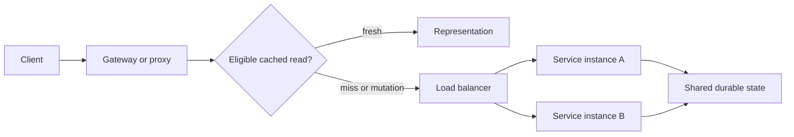

**Decision implications.** Stateless interactions usually simplify
horizontal scaling, failover, and rolling deployment. Keep conversational
state in explicit resources or a suitable shared/session store when the
domain needs it; do not confuse a stateless request contract with a
stateless business. Every intermediary adds policy and failure modes, so
document which headers, cache rules, identity context, and request IDs are
preserved across layers. Client-server separation is useful when clients
and services need independent release cycles, but it does not remove the
need for compatibility management.

**Common failure mode.** Storing a login flow or multi-step workflow only in
one server process creates affinity requirements and makes failover lose
progress, despite the API being described as stateless. Another failure is
placing user-specific data in a shared cache without a correct cache key
or privacy directive. Adding a gateway that rewrites paths or headers
without preserving the public contract can create split-brain API behavior.

**Scenario.** Two service instances serve an order API behind a load
balancer. The client resends its authorization and request context on every
call; both instances read and update a shared durable order store. A
deployment can replace one instance without migrating user conversation
state. A checkout workflow is represented explicitly rather than pinned to
the process that received its first request.

### 4.7 Cacheability and conditional resource interaction

**Definition.** Cacheability is the REST constraint that responses declare
whether they can be reused and under what conditions. HTTP defines the
wire-level cache directives, validators, and conditional request behavior;
REST design decides which resource representations are safe and useful to
reuse and how validators reflect resource state.

**Mechanism.** A cacheable read has a representation, a freshness policy,
and a cache key that distinguishes meaningful variants. A validator such as
an entity tag (`ETag`) can represent the version of a resource. A client may later ask
whether that representation is still current; the server can return a
not-modified response instead of retransmitting the body. For writes, a
precondition can protect against overwriting a representation that changed
since the client read it. These are HTTP mechanisms; see
[HTTP](../05_Networking_and_OS/CH01_HTTP.md) for full header semantics.
REST's part is to make resource version and privacy decisions consistent.

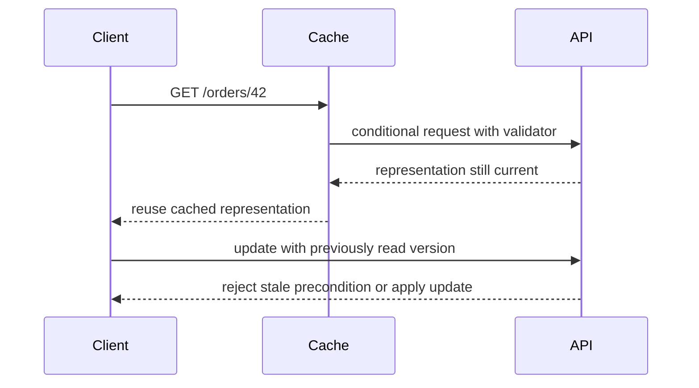

**Decision implications.** Cache public, stable reads aggressively when
the freshness contract permits it; avoid shared caching for sensitive
user-specific representations unless the key and directives are correct.
Derive validators from the representation version or a reliable content
hash. Use conditional writes when concurrent updates must not silently
overwrite each other. Ensure any selected representation, language, or
authorization-dependent variation is reflected in cache behavior.

**Common failure mode.** A shared cache serves one user's representation
to another because the cache key omits tenant or authorization context.
Another failure is using a timestamp validator with insufficient
resolution, causing distinct versions to appear equal, or changing a
representation without changing its validator. A stale client update that
omits a precondition can overwrite another user's change.

**Scenario.** An order detail response carries a validator derived from
version 7. A client reads it, another client changes the shipping address,
and the resource advances to version 8. The first client submits a change
using its version-7 precondition; the service refuses the stale update and
returns the current version, allowing the client to merge deliberately.

### 4.8 Hypermedia controls and HATEOAS

**Definition.** HATEOAS (Hypermedia As The Engine Of Application State) is
the REST uniform-interface constraint in which a representation includes
controls that describe relevant next interactions. The client follows
server-provided links or forms rather than reconstructing every transition
from undocumented URI templates. A link is not merely decorative metadata;
it communicates a navigable relationship or permitted transition in the
current application state.

**Mechanism.** The server renders links based on the resource's current
state and the caller's context. A pending order might expose `cancel`;
after fulfillment, that control disappears and a `track` link appears.
Clients discover transitions from link relations and media-type rules.
The server still enforces authorization and state invariants when a link is
followed: omitting a link is not a security boundary. Hypermedia may use
standard or domain-specific media types, and the representation's
semantics must be documented for clients.

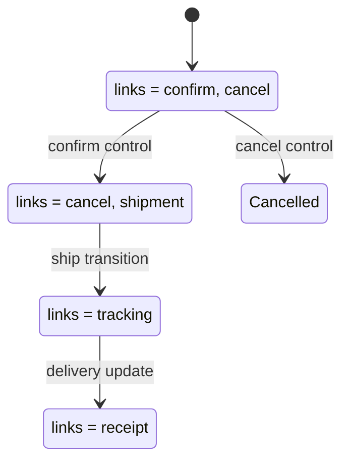

**Decision implications.** Hypermedia is valuable when clients should
discover server-controlled workflows, transitions change often, or
multiple implementations need to navigate the same state machine. It
requires clients to understand media types and link relations and may be
more complex than hard-coded URLs for a small, stable API. Level-3 maturity
is not automatically worth its implementation and client-library cost;
choose it when runtime discoverability and workflow evolution provide
concrete value.

**Common failure mode.** Returning links but requiring clients to ignore
them and construct paths manually is decorative hypermedia, not a useful
state-transition contract. Another error is treating the presence of a
`cancel` link as authorization and failing to recheck the caller or order
state when the action is invoked. Link relations that change meaning
without versioning can break clients as surely as changing a field.

**Scenario.** A procurement API returns an approval request with an
`approve` control only while it is pending and the caller is an eligible
approver. A client renders the action from the response. The server checks
the role and current state again when the client follows the control, so a
stale page cannot approve a request twice or bypass policy.

### 4.9 Richardson Maturity Model as a diagnostic, not a score

**Definition.** The Richardson Maturity Model describes increasing use of
resources, HTTP verbs, and hypermedia controls: Level 0 uses one endpoint
and often one method; Level 1 introduces resource URIs; Level 2 uses HTTP
methods and status semantics consistently; Level 3 adds hypermedia controls.
It is a diagnostic lens for identifying which REST ideas an API uses, not a
formal compliance standard or a direct measure of quality.

**Mechanism.** Moving from Level 0 to Level 1 separates addressable
concepts. Level 2 lets the uniform interface carry operation meaning rather
than hiding every action behind one remote procedure. Level 3 lets
representations describe available transitions. Each level adds a
capability and implementation/client cost; an API can benefit from
resource modeling and precise HTTP semantics without adopting a full
hypermedia client runtime.

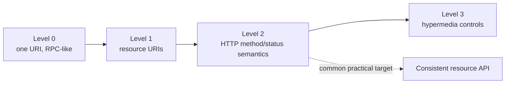

**Decision implications.** Use the model in design reviews to discuss
specific constraints, not to shame teams or claim that Level 3 is always
superior. Level 2 may be a pragmatic target for stable APIs with generated
clients. Level 3 may make sense where server-driven workflows and
independent client evolution matter. A high maturity level does not fix
poor resource boundaries, unsafe authorization, or an unstable schema.

**Common failure mode.** Treating the model as a certification ladder
encourages teams to add links without a client strategy or to retrofit
verb semantics onto fundamentally command-oriented operations. It also
confuses maturity with API quality: a consistent Level-2 API can be safer
and easier to use than a nominal Level-3 API with ambiguous resource
semantics.

**Scenario.** A team reviews an existing API and finds one `/execute`
endpoint handling every action (Level 0). It first separates customer,
order, and payment URIs (Level 1), then maps ordinary retrieval and
replacement to the HTTP interface (Level 2). It postpones Level 3 until
client teams identify a real need for server-discovered workflow
transitions.

### 4.10 Collection queries, pagination, and bounded representations

**Definition.** A collection query is a bounded view of a resource
collection. Pagination divides a potentially large result into manageable
segments; filtering and sorting select an ordered subset. These are API
contract decisions about traversal and stability, not a license to expose
arbitrary database query syntax.

**Mechanism.** Offset pagination identifies a position in a result set and
is simple for small, relatively stable collections. Under concurrent
inserts or deletes, later pages can skip or repeat entries because offsets
refer to a shifting position. Cursor pagination encodes a continuation
position, commonly the last stable sort key and a tie-breaker, so traversal
can continue from a deterministic boundary. The API must define sort order,
page-size limits, cursor opacity, and what happens when the underlying
collection changes. Filters should be allow-listed and have explicit
semantics.

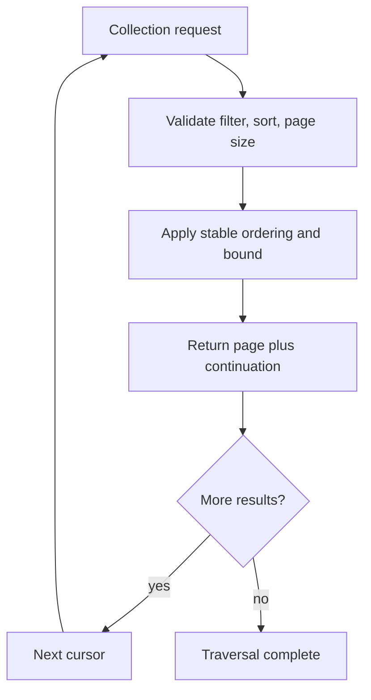

**Decision implications.** Use cursor pagination for large or frequently
changing collections where stable continuation matters; offset pagination
may be simpler for small administrative lists and random page access.
Always cap page size and make ordering deterministic with a unique
tie-breaker. A cursor is not automatically a snapshot: document whether
newly inserted records can appear during traversal and whether a cursor
expires. Keep filtering expressive enough for clients without turning the
API into a database query proxy.

**Common failure mode.** Returning an unbounded collection makes response
size and latency depend on data growth. Offset paging without deterministic
ordering can produce duplicate or missing items even in a static dataset.
Returning a transparent database offset or raw key can couple clients to
storage internals; cursors should be opaque or explicitly versioned.

**Scenario.** An audit endpoint returns records sorted by `(created_at,
id)` with a 100-item maximum. Its cursor contains the last timestamp and ID
in a signed opaque token. New records inserted after page one do not shift
the continuation point, and the API documents that traversal is not a
transactional snapshot.

### 4.11 API evolution, compatibility, and versioning

**Definition.** API evolution is the controlled change of resource
representations, links, and behavior while existing clients continue to
work. Compatibility is directional: an old client reading a new response
may tolerate added optional fields, while a new client talking to an old
server may not provide fields that the server now requires. Versioning is
one tool in this process, not the process itself. This subsection covers
how compatibility and versioning choices apply to REST resources; Part 08's
planned CH10 Versioning chapter owns the cross-style version-policy
lifecycle.

**Mechanism.** Prefer additive changes that preserve existing meanings:
add optional response fields, introduce new link relations, or add
explicitly optional request fields with safe defaults. Avoid removing or
reinterpreting fields, tightening accepted values, changing nullability,
or altering pagination ordering without a migration plan. Versioning can
be expressed in the URI or representation/media-type contract; each has
cache, routing, discoverability, and operational consequences. Deprecate
with telemetry and published retirement dates rather than relying on an
unannounced cutoff.

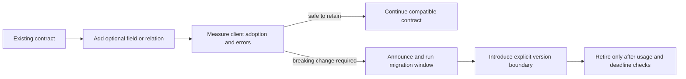

**Decision implications.** Choose URI versioning when clients need an
obvious, routable major contract boundary and infrastructure can host
versions side by side. Header or media-type versioning can keep resource
identity stable but complicates cache keys, observability, and manual
testing. Do not version for every additive field; version when semantics
are incompatible and cannot be migrated safely. Track versions per
consumer so retirement is evidence-based.

**Common failure mode.** Adding a field that is technically optional but
changes the meaning of an existing field is still a breaking change.
Another failure is running multiple versions indefinitely without owner,
traffic, or retirement metrics. Versioning does not remove the need for
contract tests or a migration strategy.

**Scenario.** A shipping API wants to replace a single `address` field
with structured `recipient`, `street`, and `postalCode` fields. It adds
the new representation while retaining the legacy field, marks the legacy
field deprecated, measures client usage, and introduces a major version
only when the old representation must be removed.

## 5. Internal Working

to a REST resource — a typical request/response for fetching an order:
There is no REST-specific wire protocol. A REST interaction is carried by
HTTP messages, but its architectural behavior depends on how the API maps
those messages to resource identities, representations, and transitions.
The HTTP chapter owns request-line, header, framing, method, and status-code
mechanics. At the REST layer, an implementation must keep a coherent path
from a target URI to a domain resource and back to a public representation.

For a read, the server parses the target and query, checks the caller's
authorization, resolves the resource, and determines whether a current
representation can be returned or safely reused from cache. For a mutation,
it additionally validates the requested transition and any concurrency
precondition before committing. It then maps domain outcomes to the public
response contract and records operation telemetry without exposing
internal exception details.

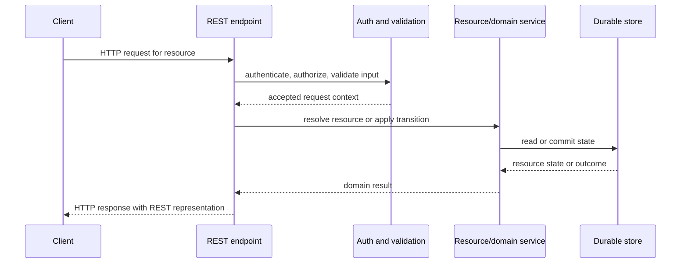

For a conditional read, the API can return a validator with the
representation. A later request can ask whether that representation remains
current. The HTTP chapter owns the detailed conditional-request and
freshness rules; this exchange shows where a REST resource version fits:

```text
GET /orders/42 HTTP/1.1
Host: api.example.com
Accept: application/json
If-None-Match: "42-v3"

HTTP/1.1 304 Not Modified
```

If the cached representation remains current, the server can avoid sending
the full body. For a conditional mutation, the precondition can reject an
update based on stale state. These examples show where resource versions
participate in the interaction; the HTTP chapter defines the exact header
and status semantics.

## 6. Design Principles

REST principles are practical design checks rather than slogans:

- **Client-server separation.** Keep presentation choices in the client and
  resource/business ownership in the service. A stable contract permits
  each side to release independently, but only if clients do not depend on
  undocumented field ordering or internal service topology.
- **Stateless interaction.** Include the context required for each request
  and keep long-lived workflow state in a resource or shared system, not a
  particular process's memory. This simplifies routing and recovery while
  making each message more self-contained.
- **Cacheability.** Mark representations with an explicit reuse and
  freshness policy. Public catalog data and private account data need
  different policies; a response should not be cached merely because it is
  a `GET`.
- **Uniform interface.** Use resource identity, representations, standard
  HTTP semantics, and meaningful self-description consistently. The HTTP
  chapter owns method and status semantics; REST ensures the API does not
  invent a new meaning for each resource.
- **Layered system.** Permit caches, gateways, and proxies to mediate calls
  while preserving the public contract. Clients should not require direct
  knowledge of the origin's deployment topology.
- **Code-on-demand (optional).** A server may transfer executable code to
  extend client behavior. This is optional, uncommon for modern service
  APIs, and carries sandboxing and reproducibility costs.

The constraints reinforce each other: statelessness makes routing flexible,
cacheability reduces repeated work, and uniform messages let intermediaries
operate without understanding every domain operation. The trade-off is that
clients must handle explicit representations and state transitions instead
of relying on an opaque conversational session.

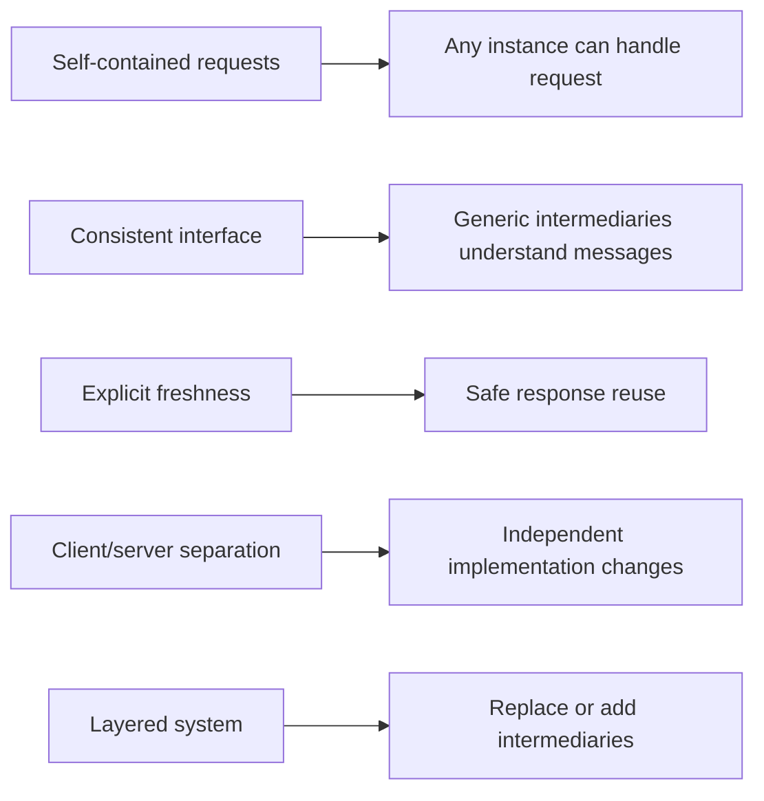

## 7. Architecture Patterns

REST resource contracts appear in several recurring system patterns:

**Resource-oriented service.** A service owns a set of resources,
representations, and valid transitions. Keep ownership explicit when data
crosses service boundaries; an endpoint that composes several owners should
document consistency and failure behavior rather than pretending the result
is one atomic resource.

**Backend for Frontend (BFF).** A client-specific facade can aggregate
resource representations for a mobile or web application and hide internal
fan-out. It is useful when clients have materially different payload or
workflow needs, but it adds a contract and should not duplicate domain
invariants. The facade owns presentation composition, not the underlying
business resource.

**Long-running operation resource.** When a request starts work that
outlives a normal request deadline, return an operation identity and expose
its state as a resource. Clients can query status or follow a completion
link instead of keeping a connection open indefinitely. Define terminal
states, cancellation behavior, and retention.

**Bulk operation resource.** A bulk request can create a job resource that
reports per-item outcomes. State whether the operation is all-or-nothing or
partially successful and how retries avoid duplicate effects. Keep request
size and result cardinality bounded.

**Versioned representation.** URI-based major versions are visible in
routing; media-type versions keep the resource URI stable but require
careful negotiation and cache variation. Section 4.11 covers the evolution
decision. An API Gateway is an important deployment pattern, but its full
architecture is deferred to this part's dedicated API Gateway chapter.

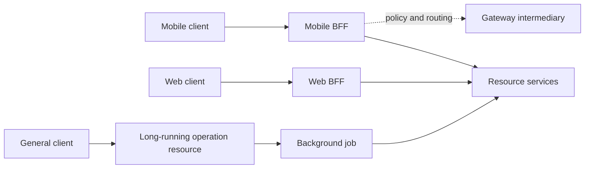

## 8. Production Architecture

Ingress commonly uses Hypertext Transfer Protocol Secure (HTTPS). The
transport-security handshake itself is owned by the TLS chapter; REST
design assumes a protected channel and focuses on resource authorization
and contract preservation through the edge.

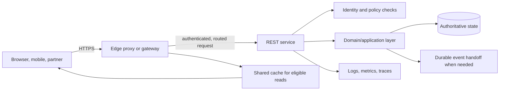

The edge handles cross-cutting ingress concerns such as routing and
transport termination. Resource-level authorization and domain invariants
remain in the service that owns the resource; duplicating them only at the
edge makes alternate internal call paths dangerous. Cache only responses
whose freshness and privacy policy is explicit. When a committed mutation
must publish an event, use a reliable handoff such as the transactional
outbox described in [Distributed Transactions](../07_System_Design_and_Distributed_Systems/CH12_Distributed_Transactions.md),
not an uncoordinated database write followed by a best-effort publish.

Production design also specifies request and response size limits,
timeouts, connection-pool limits, retry behavior, request identifiers, and
dependency-failure mapping. A REST API should expose stable domain outcomes
even if its internal topology includes several services; an internal
timeout or stack trace must not become an accidental public contract.

## 9. Implementation

Implementation should separate transport parsing, resource resolution,
domain behavior, and response mapping. For each request:

1. Parse the method, target URI, headers, and a bounded body.
2. Authenticate the caller and authorize access to the specific resource
  and operation.
3. Resolve identifiers and validate query parameters and body fields
  against the public contract.
4. Check concurrency preconditions before applying a state transition.
5. Execute domain behavior and persist the result within the owning
  service's consistency boundary.
6. Map expected outcomes to documented response semantics; log unexpected
  failures internally with a correlation identifier.
7. Serialize the appropriate representation and include validators,
  `Location`, or hypermedia controls when relevant.

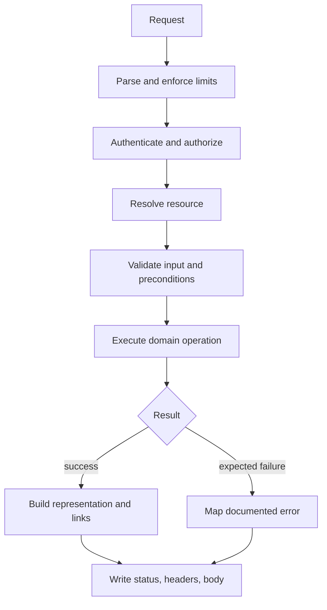

Avoid binding arbitrary request fields directly onto persistence objects.
That pattern can permit mass assignment, bypass invariants, and expose
internal fields. Validate at the boundary, then invoke an explicit domain
operation. The examples in Section 10 are small teaching servers; they do
not replace production middleware, durable storage, structured logging, or
full request validation.

## 10. Complete Code Examples

- Python orders resource with creation, retrieval, validators, and
  conditional update: [orders_api.py](../code/python/rest-chapter/orders_api.py)
- Node.js orders resource with corresponding contract behavior:
  [orders_api.js](../code/node/rest-chapter/orders_api.js)
- Stable keyset pagination with opaque cursor encoding:
  [cursor_pagination.py](../code/python/rest-chapter/cursor_pagination.py)
- Conditional update, stale-write conflict, and explicit retry flow:
  [conditional_update.py](../code/python/rest-chapter/conditional_update.py)

Run the server examples with Python 3 or Node.js; both use standard
libraries. The pagination and concurrency examples are standalone
simulations and require no database or external service. They demonstrate
contract mechanics, not a complete production stack.

## 11. Performance

REST performance is usually won by controlling work and bytes per
interaction, not by choosing a fashionable serialization library. Start
with the resource access pattern: measure request rate, representation
size, serialization cost, dependency fan-out, cache hit ratio, and tail
latency. The HTTP chapter owns the mechanics of compression and cache
headers; REST design determines whether a representation is stable,
bounded, and safe to reuse.

Conditional reads can avoid sending a body when a representation has not
changed. Bounded pagination prevents a single collection request from
loading and serializing an unbounded result. Field projections can reduce
payload size when clients genuinely need different shapes, but every
projection combination increases cache and authorization complexity.
Avoid a large nested representation that triggers one database query per
child; fetch the required graph deliberately and keep limits visible in the
contract.

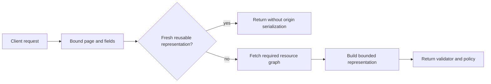

Measure p50, p95, and p99 latency by route template and outcome rather than
averaging all endpoints together. A fast health check can hide a slow
collection query in the overall average. Compare payload sizes and
downstream work before adding field-selection syntax or an aggregation
endpoint; the simpler fix may be a better resource boundary or a cursor
index.

## 12. Scalability

does.
Stateless interaction makes it possible to route successive requests to
different service instances, but it does not by itself make every workload
scale. The service still needs shared durable resource state, enough
database capacity, and bounded per-request work. Long-running operations
should be represented as resources instead of holding an application
worker for the duration of a job. Caches can scale read-heavy traffic only
when their freshness and privacy semantics remain correct.

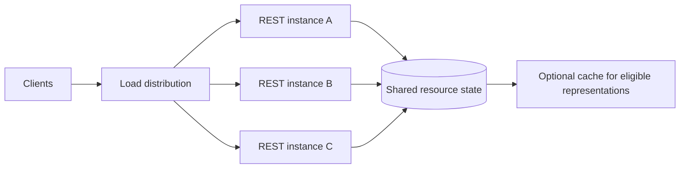

Scale the constrained layer rather than multiplying application instances
blindly. If database writes are the bottleneck, more stateless API workers
can increase contention without increasing throughput. If a hot resource
or tenant dominates traffic, partitioning or workload isolation may be
needed; those mechanisms are owned by the relevant database and distributed
systems chapters. Keep per-request fan-out and response size bounded so
horizontal scale does not simply multiply downstream load.

## 13. Security

Security begins with the resource boundary. Authentication establishes
which principal is making the request; authorization decides whether that
principal may perform this operation on this specific resource. Enforce
object-level authorization after resolving the resource identifier, not
only at the route or collection level. A caller allowed to read one
customer's orders must not gain access to another customer's order by
changing `/orders/42` to `/orders/43`.

Validate path, query, and body inputs on the server. Bind only fields the
operation is allowed to change; accepting a full object and copying every
field into persistence state can permit mass assignment of ownership,
status, or role fields. Avoid leaking sensitive data in error bodies,
logs, validators, and cacheable representations. Shared caches must not
reuse a user-specific response across principals. The future Part 08 API
Security chapter owns a comprehensive API threat and control framework;
this section covers REST-specific resource authorization and representation
risks. HTTP owns the exact status-code meanings; REST should apply them
consistently rather than inventing a parallel error protocol.

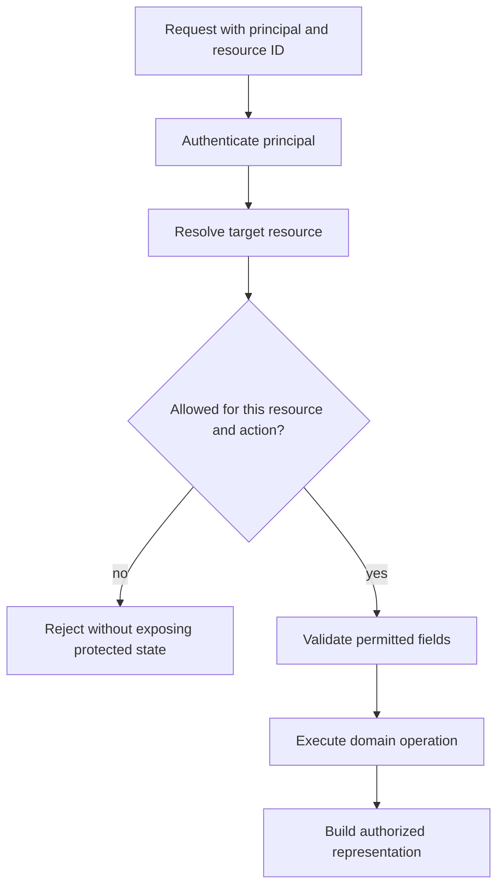

## 14. Observability

Observe the public contract in terms that reveal availability and user
impact without exposing private data. Record request method, normalized
route template, response class, latency, payload size, and dependency
outcomes. A route template such as `/orders/{orderId}` is useful for
metrics; the literal `/orders/88492017` creates unbounded label
cardinality. Logs can carry a request or trace identifier, but should not
record credentials, full payment data, or sensitive query parameters.

Track both protocol outcomes and domain outcomes. A technically successful
HTTP response can still represent a rejected business transition, while a
large number of `404` responses may indicate either normal probing or a
broken client integration. Add dashboards for latency percentiles,
availability, error rate by route, cache effectiveness, pagination depth,
and dependency timeouts. Distributed tracing is useful for request fan-out;
the future Observability chapter owns the general tracing and telemetry
pipeline.

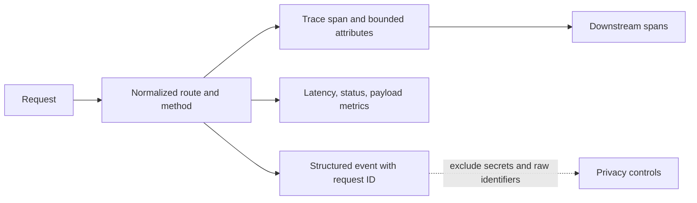

## 15. Failure Scenarios

the current `ETag`.
**Stale update.** A client reads version 7, another client commits version
8, and the first client submits a mutation based on version 7. A
precondition can reject the stale write; the client should fetch current
state and reconcile rather than blindly resubmit. HTTP owns the precise
conditional request status and header semantics.

**Ambiguous timeout.** The server may have committed a mutation before the
response was lost. The client cannot infer from a timeout alone whether the
operation happened. Use an operation identity and idempotent effect where
the business operation can safely be retried; general idempotency is owned
by Part 07's Idempotency chapter. Do not advise clients to retry every
mutation indiscriminately.

**Partial dependency failure.** A composite response may have one
unavailable dependency. Decide whether the resource contract permits a
partial representation, a failed whole response, or a long-running
operation resource. Returning a success-shaped empty value can mislead a
client into treating missing data as authoritative.

**Cache inconsistency.** A mutation succeeds but an intermediary continues
serving an old representation. Define invalidation or freshness behavior
for each cacheable resource and ensure validators advance with the
representation. Cache behavior must not expose another principal's data.

**Unexpected server error.** Return a stable public error shape and a
correlation identifier; keep stack traces and internal hostnames in
protected logs. A failure response should not reveal whether a protected
resource exists when the caller lacks permission to know.

```mermaid
flowchart TD
  Failure[REST interaction failure] --> Classify{Where did it occur?}
  Classify -->|stale version| Reconcile[Fetch and reconcile current state]
  Classify -->|ambiguous timeout| Identity[Resolve operation identity before retry]
  Classify -->|dependency partial| Contract[Apply documented partial/fail policy]
  Classify -->|stale cache| Freshness[Invalidate or revalidate representation]
  Classify -->|unexpected| Correlation[Return safe error and correlation ID]
```

## 16. Testing

Test the API as a contract, not only as a collection of handler functions.
For each resource, cover successful reads and transitions, missing
resources, malformed input, forbidden access, stale preconditions, and
representation invariants. Verify creation returns a stable resource
identity and a location; verify validators change when relevant state
changes and remain stable when it does not.

Use several complementary layers:

- **Unit tests** for resource mapping, domain transitions, and error mapping.
- **HTTP integration tests** for methods, headers, status behavior, content
  types, and serialization across the actual server boundary.
- **Contract tests** for client-visible fields, links, pagination, and
  compatibility guarantees. The future OpenAPI chapter owns the full schema
  and tooling workflow.
- **Authorization tests** that vary both principal and resource identifier
  to detect object-level access failures.
- **Concurrency tests** that race updates using the same resource version
  and assert that no update is silently lost.
- **Property-based or invariant tests** for resource lifecycle rules and
  pagination ordering when the domain warrants them.

Avoid tests that assert only implementation details such as private route
functions or framework-specific response objects. Client-visible behavior
is the contract. Include negative tests for malformed cursors, unsupported
media types, oversized request bodies, and unexpected dependency failure.

```mermaid
flowchart LR
    Unit[Domain and mapping tests] --> Integration[HTTP boundary tests]
    Integration --> Contract[Client contract tests]
    Contract --> Security[Authorization and data-isolation tests]
    Security --> Concurrency[Concurrent update tests]
    Concurrency --> Release[Release confidence and compatibility checks]
```

## 17. Common Mistakes

Common mistakes often come from treating REST as surface syntax rather than
an interaction contract:

- Using `POST` for every operation and putting all semantics in an action
  name, even when a stable resource and standard HTTP interaction are
  clearer.
- Returning a success status for domain failure or encoding every error in
  a `200` response body. HTTP status semantics are owned by the HTTP
  chapter; use them consistently.
- Modeling paths after tables or internal service names, then breaking
  clients when storage changes.
- Returning unbounded collections or relying on unspecified ordering.
- Treating a `PUT`-shaped endpoint as automatically safe without checking
  the actual server-side effect and representation semantics.
- Assuming a `GET` response is safe for shared caching despite user-specific
  data or authorization-dependent fields.
- Returning every internal field in a generic serializer and hoping
  clients ignore fields they should not see.
- Exposing links that clients ignore, while claiming hypermedia has removed
  URI coupling.

For each route, write down its resource identity, allowed transition,
preconditions, response representations, and error contract. Most of these
mistakes become visible when those five things cannot be stated clearly.

## 18. Best Practices

Model resources around durable domain concepts and relationships, with a
stable identity that does not reveal database layout. Keep paths shallow and
consistent; use query parameters for bounded collection views rather than
inventing endpoints for every filter combination. Keep representations
additive and explicitly version incompatible changes.

Document the successful and unsuccessful outcomes for every operation.
Bound page sizes and request bodies, define deterministic collection
ordering, and expose validators when stale writes or repeated reads matter.
Authorize after resolving the target resource. Keep transport concerns,
domain invariants, and representation mapping in distinct layers. Use
hypermedia for a real state-discovery need and use an asynchronous
operation resource for work that outlives the request.

Finally, design observability and compatibility into the API from the
start. Use route templates for metrics, redact sensitive information,
record enough context to diagnose failures, and measure client usage before
retiring a contract. A technically elegant interface that cannot be
operated or safely evolved is not a successful API design.

## 19. Anti-Patterns

**RPC-in-REST clothing.** A URI per server function (`/getOrder`,
`/approveOrder`) and one method for everything inherit none of REST's
uniform-interface benefits. If the application is genuinely RPC-shaped,
choose an RPC style explicitly rather than claiming resource semantics.

**Database-shaped public resources.** Exposing tables, joins, or internal
identifiers couples clients to persistence choices and makes refactoring a
breaking change.

**Fake hypermedia.** Returning links without stable relation semantics or
without clients that follow them adds payload but no runtime decoupling.

**Unbounded representations.** A single detail response that recursively
embeds every related object can trigger unpredictable fan-out, payload
growth, and authorization gaps. Bound the graph or provide a navigable
relationship resource.

**Version-per-release.** Creating a new API version for every deployment
multiplies support and testing work. Prefer compatible additive evolution
and reserve major versions for actual semantic breaks.

**False idempotency.** Repeating a request is not safe merely because the
URI is stable or the method name sounds declarative. State the operation's
effect, enforce its preconditions, and use the operation-identity design
owned by the Idempotency chapter when retries can duplicate a meaningful
side effect.

## 20. Trade-off Analysis

| Decision | Benefit | Cost or risk |
|---|---|---|
| Resource interface vs. task-specific RPC | Common semantics and generic intermediary support | Some domain commands need careful resource modeling |
| Richardson Level 2 vs. Level 3 hypermedia | Simpler clients and broad tooling vs. runtime transition discovery | Hard-coded URI rules vs. richer media-type/client complexity |
| URI vs. media-type versioning | Visible routing boundary vs. stable resource identity | URI churn and parallel routes vs. cache variation and client tooling |
| Offset vs. cursor pagination | Easy random page access vs. stable traversal at scale | Shifting result windows vs. opaque cursor and ordering requirements |
| Full vs. compact representation | Fewer client round trips vs. less payload | Larger transfer and overfetch vs. multiple projection contracts |
| Shared cache vs. origin-only reads | Lower latency and origin load | Freshness, invalidation, and privacy risk |
| Synchronous request vs. operation resource | Immediate result when work is bounded | Client connection duration vs. eventual completion and polling model |

Choose based on client needs, data change rate, failure behavior, and
operational cost. REST does not resolve these trade-offs automatically; its
constraints make them explicit and composable.

```mermaid
flowchart TD
  Need[What interaction does the client need?] --> Read{Bounded read?}
  Read -->|yes| Representation[Resource representation plus cache policy]
  Read -->|large collection| Page[Cursor or bounded offset pagination]
  Need --> Work{Work completes within request budget?}
  Work -->|yes| Transition[Resource transition with preconditions]
  Work -->|no| Job[Create operation resource and expose progress]
  Need --> Workflow{Must client discover next action?}
  Workflow -->|yes| Hypermedia[Hypermedia controls]
  Workflow -->|stable known workflow| Contract[Documented stable resource contract]
```

## 21. Comparison Table

| Dimension | REST | GraphQL | gRPC |
|---|---|---|---|
| Contract shape | Addressable resources and representations | Typed graph selected by the client | Schema-defined remote procedures and messages |
| Client request shape | Standardized resource interactions | One query can traverse related fields | Calls generated from a service definition |
| Caching | Can use HTTP caching when resource and policy fit | Often needs operation-aware or normalized client caching | Not naturally served by generic HTTP caches |
| Evolution pressure | Resource and representation compatibility | Schema field/nullability compatibility | Protocol Buffer field and service compatibility |
| Typical fit | Public and Create, Read, Update, Delete (CRUD)-shaped resource APIs | Flexible clients and variable read shapes | Internal service calls and streaming Remote Procedure Call (RPC) APIs |
| Main cost | Requires disciplined resource modeling | Resolver complexity and query-cost controls | Tooling, code generation, and transport constraints |

These are not mutually exclusive at the organization level. A public REST
resource API can coexist with an internal gRPC service; a GraphQL facade can
compose several resource services. Avoid choosing a style for one isolated
feature without considering client diversity and the system's operational
boundaries. The dedicated chapters in this part teach GraphQL and gRPC in
full.

## 22. Real-World Case Study

Consider an order-management API used by a customer web client, a mobile
application, and a fulfillment partner. The system models an order as a
stable resource at `/orders/{orderId}` and exposes its line items through a
bounded relationship collection. A client creates an order through the
collection and receives the new resource identity; subsequent reads return
an order representation with a validator derived from the resource version.

The customer clients can reuse a fresh representation where policy permits.
The fulfillment partner receives only the fields authorized for its role.
When a customer changes an address, the client includes the version it
previously read. If fulfillment has already advanced the order, the service
rejects the stale transition instead of overwriting the newer state. The
client fetches current state and presents a deliberate merge or asks the
customer to retry.

The flow exposes several design choices. A summary representation avoids
fetching all line items for a list view; cursor pagination bounds the order
history; an operation resource reports a slow fraud review without holding
an HTTP request open; and stable links expose actions appropriate to the
current order state. The API remains independent of its database schema and
internal fulfillment topology.

```mermaid
sequenceDiagram
  participant Shop as Customer client
  participant API as Order API
  participant Fraud as Fraud service
  participant Store as Order store
  Shop->>API: create order
  API->>Store: persist pending order
  Store-->>API: order ID and version 1
  API-->>Shop: created resource, location, validator
  Shop->>API: update address with version 1
  API->>Store: compare expected version and update
  Store-->>API: conflict because version advanced
  API-->>Shop: stale-state response and current link
  API->>Fraud: evaluate order asynchronously
  Fraud-->>API: review completed
```

## 23. Interview Questions

1. **What is REST, and why is it not synonymous with JSON over HTTP?**
  A strong answer describes constraints, resource identity,
  representations, and a uniform interface; JSON is only one possible
  representation format.
2. **What is the difference between a resource and a representation?**
  Explain how one stable resource can have different selected or localized
  representations.
3. **What does statelessness mean, and what does it not mean?** It means
  requests do not depend on hidden state in a particular server process;
  business state can still be durable and stateful.
4. **What distinguishes Richardson Maturity Model Level 2 from Level 3?**
  Level 2 consistently applies HTTP semantics to resources; Level 3 adds
  hypermedia controls for runtime navigation.
5. **When should a collection use cursor pagination rather than offsets?**
  Discuss ordering stability, concurrent changes, random page access, and
  cursor expiration.
6. **How do conditional requests help prevent lost updates?** Describe a
  validator tied to resource version and a precondition checked before
  mutation; defer exact header semantics to HTTP.
7. **When is REST a poor fit compared with GraphQL, gRPC, or an event stream?**
  Relate the answer to query variability, RPC contracts, streaming, client
  needs, and operational cost.
8. **How would you evolve a representation without breaking old clients?**
  Cover additive fields, stable meanings, deprecation measurement, and
  versioning only for incompatible semantics.

## 24. Hands-on Exercises

1. Run the Python or Node.js orders API from Section 10. Create an order,
  retrieve it, inspect its resource identity and validator, then submit a
  stale update and observe the conflict behavior.
2. Implement a bounded cursor-paginated collection. Add a deterministic
  unique tie-breaker to the sort, encode the continuation position, and
  test what happens when a new record is inserted between page requests.
3. Add a long-running operation resource for a simulated fraud review.
  Define its lifecycle, terminal states, retry behavior, and links exposed
  to a client while the operation is pending.

For each exercise, state the resource model and contract before writing the
handler. Verify success, absence, invalid input, unauthorized access, and
concurrent state change rather than testing only the happy path.

## 25. Design Exercises

Design a library lending API for books, members, copies, loans, holds, and
renewals. Include canonical resource identities, relationship collections,
bounded search results, validators for concurrent loan changes, and the
representation returned to a public catalog client versus a staff client.
Decide whether hold placement is a simple resource creation or a
long-running operation. Explain how double-booking is prevented and how a
client discovers whether a loan can be renewed.

Deliver: a resource map, five representative request/response contracts,
pagination rules, cache policy, authorization matrix, and an evolution plan
for adding a new loan state. Evaluation focuses on stable identity, explicit
invariants, correct use of HTTP semantics, and whether failure behavior is
visible to clients.

## 26. Architecture Review Questions

- Can the team state the resources, identities, representations, and
  ownership boundaries without referring to database table names?
- Are HTTP method, status, caching, and conditional-request semantics used
  consistently with the HTTP chapter's contract?
- Are collection responses bounded, deterministically ordered, and
  explicit about continuation behavior?
- Do conditional mutations detect stale client state, and can clients
  recover from conflicts without blind retries?
- Is object-level authorization enforced after resource resolution?
- Are cache keys, validators, privacy policy, and representation variants
  consistent?
- Are breaking changes measured, deprecated, and retired through an
  explicit compatibility plan?
- Do logs and metrics use route templates and avoid secrets or
  unbounded-cardinality resource identifiers?
- Does the API use hypermedia because clients need runtime transition
  discovery, or only to claim a maturity level?
- If work outlives a request, is its state represented explicitly rather
  than tied to an open connection?

## 27. Summary

REST is an architectural style for networked APIs, not a replacement for
HTTP and not a guarantee of quality by label. Its central design work is to
choose stable resources, coherent representations, and transitions that
use a uniform interface while respecting statelessness, cacheability,
client-server separation, and layering. Good REST design makes ownership,
freshness, compatibility, and failure behavior explicit so clients can
evolve without depending on server internals.

**Further reading**: [HTTP](../05_Networking_and_OS/CH01_HTTP.md) ·
[GraphQL](CH02_GraphQL.md) · [gRPC](CH03_gRPC.md) ·
[WebSocket API](CH04_WebSocket_API.md) ·
[API Gateway](PART_OVERVIEW.md)
