# Chapter: GraphQL

Part: [08 — API Architecture](PART_OVERVIEW.md) · Status: Drafted

## 1. Introduction

GraphQL is both a strongly typed query language for APIs and a runtime that
validates and executes client-supplied operations against a server-defined
schema. The client describes the shape of data it needs; the server decides
which fields exist, how each field is resolved, and which policies apply.
This changes the API contract from a collection of separately addressed
response shapes to a traversable, typed graph of capabilities.

The attraction is real: a mobile screen can fetch only the fields it can
render, a dashboard can follow relationships in one operation, and client
teams can add selections without requiring an endpoint for every view. The
cost is also real. A request can select deep, repeated, expensive paths;
field resolvers can multiply backend calls; HTTP intermediaries see one
endpoint rather than one cacheable resource per query; and authorization
must hold at each reachable field and domain operation. GraphQL therefore
moves some complexity from endpoint design into schema design, execution
planning, and runtime governance.

This chapter owns GraphQL's schema and type-system design, operation and
resolver semantics, request-scoped batching, GraphQL pagination and error
behavior, query-cost controls, schema evolution, and GraphQL-specific
caching and authorization trade-offs. It treats federation as an extension
that composes independently owned schemas, not as a prerequisite for using
GraphQL. It does not re-teach REST constraints, resource modeling, the
Richardson Maturity Model, or HATEOAS; those belong to [REST](CH01_REST.md).
Likewise, HTTP methods, status codes, cache directives, and headers are
owned by [HTTP](../05_Networking_and_OS/CH01_HTTP.md). GraphQL commonly uses
HTTP as a transport, but the HTTP chapter owns that wire-level contract.
Subscriptions are an application-level stream contract; WebSocket framing
and the WebSocket-versus-Server-Sent Events (SSE) transport decision belong
to [WebSockets](../05_Networking_and_OS/CH17_WebSockets.md). The future
[gRPC](CH03_gRPC.md) chapter is a sibling comparator, not a subject taught
here. Product-level gateway architecture and comprehensive API security
belong to the future [API Gateway](CH08_API_Gateway.md) and
[API Security](CH09_API_Security.md) chapters; this chapter confines those
topics to GraphQL-specific implications.

## 2. Historical Evolution

GraphQL originated at Facebook as an internal response to mobile clients
that needed data assembled from a rapidly changing product graph. A fixed
endpoint often returned too much data, while a screen that needed several
related resources required multiple requests and client-side coordination.
The team developed a typed query language and execution model that let the
client state its selection while keeping the server in control of the
available graph. Facebook open-sourced GraphQL in 2015; the GraphQL
specification and ecosystem have since grown beyond the original JavaScript
implementation.

The evolution is not simply "REST was replaced." REST remains effective
when stable resource representations, HTTP caching, simple operational
visibility, and independently addressable resources are valuable. GraphQL
became useful where many consumers need different projections over related
data and the organization can afford schema governance and query controls.
The standards work has progressively clarified validation, execution,
introspection, input coercion, and transport-independent behavior. The
GraphQL specification defines the language and execution contract; products
such as Apollo Federation add composition conventions above that core.

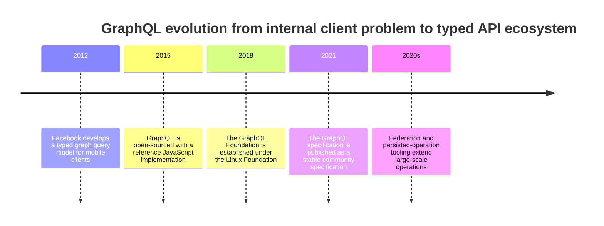

## 3. Why It Exists

An API is consumed by clients with different presentation and network
constraints. A browser detail page may need a product, its seller, and a few
reviews; a mobile list may need only product identifiers, titles, and
thumbnail URLs. With fixed response shapes, teams commonly choose among
three imperfect responses: return a broad payload to every consumer, create
many narrowly tailored endpoints, or make the client call several endpoints
and join the results. Each choice can be correct, but none automatically
fits every consumer or screen.

GraphQL makes the selection shape part of the request. The server exposes a
schema that describes legal fields and relationships; the client submits an
operation selecting a subset; validation rejects selections that do not
match the schema; execution resolves selected fields and serializes a
response with the requested shape. One network round trip can therefore
cover a graph traversal, but it does not guarantee one backend call, one
database query, or lower total latency. The runtime only provides a coherent
selection and execution contract. Resolver design, batching, and limits
determine whether the contract performs acceptably.

The architectural problem GraphQL solves is **consumer-specific data
composition**, not the absence of an API design method. If consumers need
different views of the same connected domain, the schema lets them choose
projections without giving each consumer authority to invent new server
capabilities. When stable resource boundaries, broad intermediary caching,
or a small number of fixed use cases dominate, a REST API may be simpler.
Section 4.8 provides the decision test; REST's constraints and resource
modeling remain owned by [Chapter 1](CH01_REST.md).

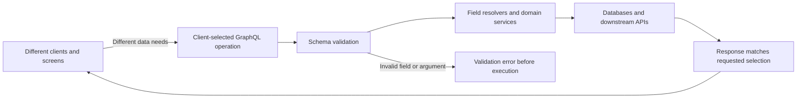

## 4. Core Concepts

Section 4 is the decision foundation for this chapter. Each subsection
defines one GraphQL-specific concept, follows its execution mechanism,
explains when it changes an architecture choice, identifies a failure mode,
and grounds the reasoning in a concrete scenario.

### 4.1 Schema and type system: the contract that bounds client choice

**Definition.** A GraphQL schema is a typed description of the fields and
relationships clients may select, the arguments those fields accept, and
the root operations the server supports. It is a capability contract, not a
database schema and not a promise that every field maps directly to a stored
column. The type system includes scalar values such as `String`, `Int`,
`Float`, `Boolean`, and `ID`; object types with named fields; enums with
closed sets of values; interfaces that require common fields; unions that
allow one of several object types; and input object types for structured
arguments. Input and output types are deliberately distinct: an object
containing server-owned fields is not automatically safe or meaningful as a
write input.

**Mechanism.** A schema declares root `Query`, optional `Mutation`, and
optional `Subscription` types. An object field may itself return another
object or a list, which creates the graph edges clients traverse. Interfaces
provide a common selection surface for implementing object types; unions
provide a set of possible object types without requiring common fields.
Clients use inline or named fragments to select type-specific fields after
the runtime type is known. Input objects and enums constrain arguments
before resolver code runs. Custom scalars are appropriate for values with
well-defined serialization and validation semantics, such as a date-time,
but should not disguise unstructured blobs or business rules.

Nullability is part of the contract. `T!` promises a non-null value; `[T]`
allows a null list and null elements; `[T!]!` promises a list whose elements
and list itself are non-null. These promises affect error propagation: if
resolving a non-null field fails, the null propagates to its nearest nullable
parent. A schema should express genuine invariants, not optimistic hopes.
For example, an absent profile picture is naturally nullable; a missing
primary key for a persisted entity usually indicates an integrity failure.

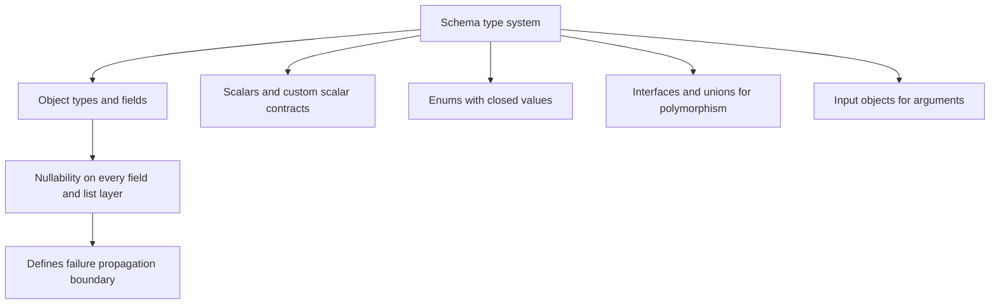

**Decision implications.** Schema design determines client autonomy and
server compatibility at once. More expressive relationships reduce the
need for endpoint proliferation, but every exposed edge becomes a
potentially expensive or sensitive traversal. A narrow enum prevents
ambiguous string values; an input object provides validation and evolution
room; an interface is useful when multiple domain types genuinely share
stable semantics. Nullability should follow domain guarantees and
availability expectations. Lists should have explicit size arguments or a
connection shape rather than silently allowing an unbounded collection.

**Common failure mode.** Treating the schema as a thin mirror of tables
exposes storage details, creates leaky contracts, and makes later domain
changes expensive. Another failure is aggressive non-null annotation: a
downstream service's transient outage can null an entire parent object or
top-level list when a nullable field would have preserved useful sibling
data. The opposite, marking every field nullable, removes meaningful
guarantees and pushes defensive checks onto every client.

**Scenario.** A commerce API returns `Product`, `Seller`, and a polymorphic
`SearchHit` union that can hold a product or an article. The product's
`seller` is non-null because every published product must have an owner;
`thumbnailUrl` is nullable because some legacy products have no image. The
search field accepts a bounded `first` argument and returns a connection.
That schema communicates integrity, absence, polymorphism, and cost
boundaries instead of exposing the underlying catalog tables.

### 4.2 Operations and resolver execution: selection becomes work

**Definition.** An operation is a validated client request of type query,
mutation, or subscription, optionally named and parameterized with
variables. A resolver is the server function responsible for obtaining a
field's value from its parent value, arguments, request context, and field
metadata. GraphQL execution walks the requested selection tree and calls
resolvers only for selected fields, then completes and serializes each
result according to the field's declared type.

**Mechanism.** A query selects read-oriented fields and may select multiple
root fields; query field ordering does not promise sequential side effects,
so query resolvers should be safe to execute concurrently. A mutation has
one root mutation field at a time in document order, giving clients an
ordered mutation contract; subfields of the returned object are then
resolved as part of that result. This ordering is not a transaction across
databases or services. A subscription has one root field that establishes
an event source; each emitted event is used as the parent value for a new
execution of the selection set.

Resolver execution is recursive. A root resolver returns a parent object;
the executor resolves selected child fields using that object. A default
field resolver reads a same-named property, while explicit resolvers can
call domain services, databases, or other APIs. The request context carries
request-scoped dependencies such as the authenticated principal, loaders,
and tracing metadata. The resolver should translate between the public
schema and a domain operation, not become a place where domain invariants
are bypassed.

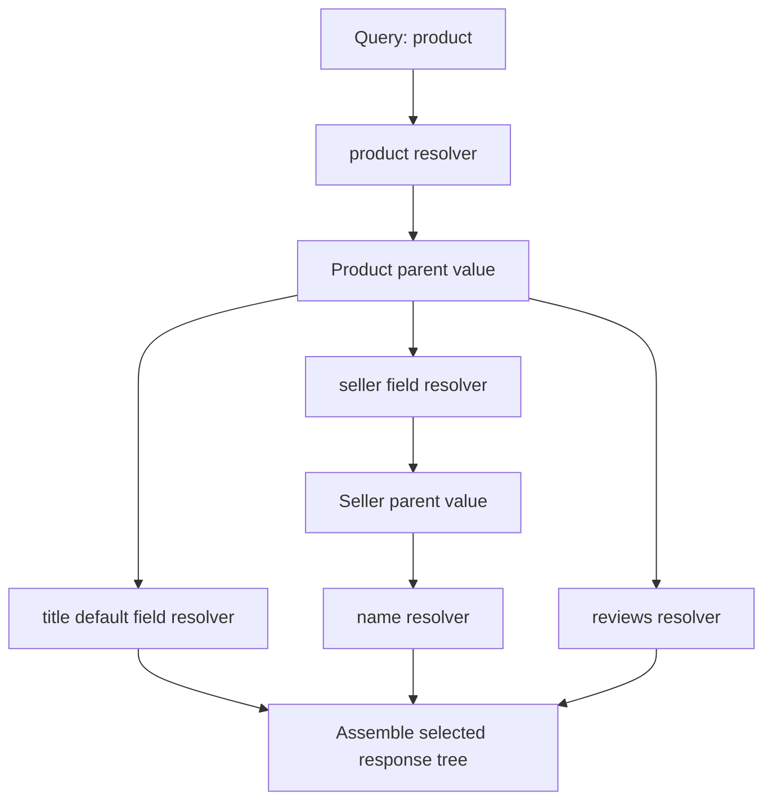

**Decision implications.** Field-level execution is the source of GraphQL's
flexibility and a key source of its performance risk. Resolvers should be
small, composable adapters over domain services, with backend access
organized so selections can batch or share work. Query operations can
support independent concurrent root reads; mutations should expose
business-level commands with explicit input and result types, and must rely
on domain/database transaction boundaries where atomicity matters. The
GraphQL operation is not itself a distributed transaction.

**Common failure mode.** A resolver that performs unrelated network calls,
mutates state during a query, or returns ORM entities with lazy-loading
behavior creates hidden work and unpredictable execution. Relying on query
field order for correctness is also invalid: selection order is not a
general sequencing primitive. Likewise, putting multiple unrelated writes
into one mutation operation does not make them atomic.

**Scenario.** A product detail screen selects `product(id)`, its title,
seller name, and the latest three reviews. The root resolver loads the
product through the catalog domain service; the seller and review resolvers
use request-scoped loaders. The client chooses a smaller selection for a
list screen without changing domain write behavior or creating a second
endpoint.

### 4.3 N+1 and request-scoped DataLoader: coordinate field-level reads

**Definition.** The N+1 query problem occurs when resolving a collection
requires one initial backend read plus one additional read for each returned
item. DataLoader is a common batching and memoization pattern: resolver
calls enqueue keys during one execution turn, and a batch function fetches
values for many keys together, returning values aligned to the original key
order. A loader is normally scoped to one GraphQL request so cached values
cannot leak between users or become long-lived stale state.

**Mechanism.** A `products` resolver may fetch 50 product rows in one query.
If the `seller` resolver then executes `SELECT ... WHERE id = ?` for each
product, the total is 51 backend round trips. A request-scoped
`sellerById.load(id)` records all requested identifiers, deduplicates
repeated keys, and schedules a batch function such as `WHERE id IN (...)`.
The function must return one result per input key in exactly the same order,
including explicit missing-value placeholders. A map keyed by identifier
usually restores order after a database's `IN` query, which does not
guarantee ordering.

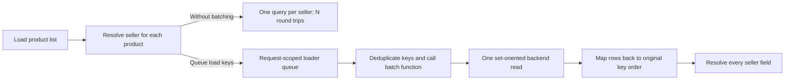

**Decision implications.** Batching belongs at a boundary where requests
share a backend access shape. It is not a substitute for a useful database
query, and one GraphQL field selection may still cause multiple batches if
the executor reaches loaders in later turns or the key count exceeds a
configured batch size. Per-request memoization avoids duplicate work within
an operation but must not be treated as cross-request caching. In
multi-tenant systems, loader construction should bind tenant and principal
scope, and batch functions must enforce that scope.

**Common failure mode.** A global DataLoader cache can return one principal's
object to another request, retain stale values across mutations, or grow
without bound. Incorrect result ordering silently associates the wrong
seller with a product. A loader that batches one field but invokes a
downstream service once per key internally only hides the N+1 rather than
solving it. DataLoader does not automatically combine arbitrary resolvers
or make non-batchable external APIs cheap.

**Scenario.** A category query returns 40 products and each selects a
seller. Without batching, request tracing shows 41 catalog database calls.
The team adds a request-scoped seller loader with a maximum batch size of
100, maps returned sellers by ID, and tests that one request performs one
seller batch. A second authenticated request receives a distinct loader,
preventing cross-principal cache reuse.

### 4.4 Cursor pagination and partial errors: bound results without hiding failure

**Definition.** Cursor pagination advances through an ordered collection
using an opaque position token, rather than requesting a numeric page whose
contents can shift under concurrent inserts. A connection is a common
GraphQL response shape containing `edges` (each with a cursor and node) and
`pageInfo` (including whether more results exist and the cursors at the
boundaries). Partial data means the response may contain successful fields
alongside an `errors` array for fields that could not be resolved.

**Mechanism.** The client supplies a bounded `first` count and an optional
`after` cursor. The server decodes or validates the cursor, applies a stable
ordering with a unique tie-breaker, fetches `first + 1` rows, returns at most
`first`, and derives `hasNextPage` from the extra row. A cursor is an opaque
continuation token, not authorization and not necessarily encrypted; every
page request rechecks access to the underlying data. Stable ordering matters:
ordering only by a non-unique timestamp can skip or duplicate items.

During execution, a resolver exception is associated with a response path.
The executor places a safe error in `errors` and substitutes `null` at the
failed field. If the field is non-null, null propagates through its parent
until a nullable boundary is reached; sibling fields may still succeed.
This is distinct from a request parse or validation failure, which prevents
execution and typically has no `data` result. Clients must handle both
partial success and operation-level rejection.

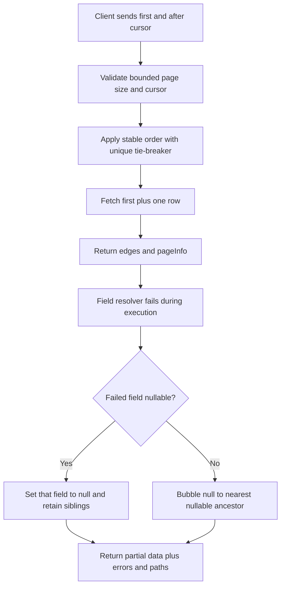

**Decision implications.** Cursors are a good fit for large, changing, or
efficiently indexed collections where clients need incremental traversal.
They require a deterministic sort key and a cursor contract stable enough
to survive deployments. Explicit maximum page sizes are mandatory for
capacity control. Nullability is a resilience decision: keep optional or
independently failing subfields nullable when useful sibling data should
survive; make a field non-null when the parent is invalid without it.
Error paths are machine-readable and should be used for field-level
recovery, while error messages should not expose internal exception details.

**Common failure mode.** Offset pagination over a changing collection can
repeat or omit entries as earlier rows are inserted or removed. An unsigned
cursor can be modified to probe arbitrary positions, and a cursor that embeds
authorization assumptions can outlive revoked access. At the other extreme,
one non-null leaf can bubble through a chain and erase an entire result when
the schema marked a recoverable enrichment as mandatory. Treating every
response with an `errors` array as wholly failed discards valid partial data;
ignoring errors can display incomplete information as complete.

**Scenario.** A support queue displays a page of cases while one optional
customer-avatar service is degraded. The connection still returns stable
case edges; the avatar field is nullable, so only its value becomes null and
the error path identifies the affected edge. A later request uses the final
cursor and rechecks current tenant access, while the page size remains capped
at 50.

### 4.5 Query abuse controls: limit the work a valid operation can request

**Definition.** Query abuse controls bound the execution cost of operations
that are syntactically valid but too deep, broad, repeated, or expensive for
the service's resource budget. Common controls include maximum depth,
field/alias count, weighted complexity, list-size limits, execution
deadlines, concurrency limits, and persisted-operation allowlists. These
controls complement request-size limits; a small query document can still
expand into substantial backend work.

**Mechanism.** Parsing produces an abstract syntax tree (AST). Validation
rules can reject invalid structure before resolver work begins; a cost
analyzer walks the AST and estimates field costs using schema metadata and
bounded arguments. A simple model adds scalar field costs and multiplies a
list field's child cost by its maximum selected item count; a production
model may weight backend fan-out, nested lists, and expensive domain
operations. Depth limits constrain recursive traversal but do not alone
capture a wide query or expensive shallow field. Persisted queries identify
approved operation text by a cryptographic hash; the server can accept a
known hash and reject unknown operations, often after a controlled
registration path.

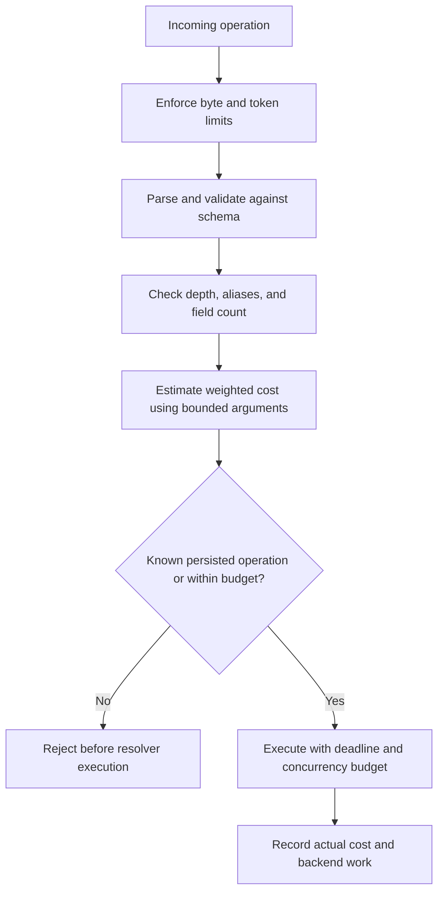

**Decision implications.** Limits should reflect resolver cost, not merely
GraphQL syntax. A list resolver with bounded `first: 20` may be safe while
the same field with `first: 10000` is not. Persisted queries reduce arbitrary
document exposure and simplify operation-level analytics, but they do not
prove a query is cheap, authorize its data, or prevent an approved operation
from being invoked at abusive frequency. Public developer APIs may support
dynamic operations with strict budgets; first-party applications can often
use build-time persisted operations for stronger control.

**Common failure mode.** A depth-only limit permits a very wide operation
with hundreds of aliases to execute the same expensive resolver repeatedly.
An estimator that treats every field as unit cost misses nested list
multiplication and downstream fan-out. A static persisted allowlist becomes
a bypass if unknown queries are silently accepted as full documents, or an
availability risk if rollout and rollback of client manifests are not
coordinated.

**Scenario.** A public product graph permits maximum depth 8, at most 100
selected fields, list sizes capped at 50, and a weighted cost budget of 800.
Search and recommendation fields carry higher weights than scalar fields.
The browser application sends build-time persisted operations; an internal
explorer uses dynamic queries with the same cost rules. Runtime telemetry
compares estimated cost to actual resolver duration and backend calls so
the estimate can be tuned rather than trusted blindly.

### 4.6 Schema evolution: additive change is not automatically harmless

**Definition.** Schema evolution is the controlled change of a GraphQL
contract while clients and servers are deployed independently. Adding a
nullable field or a new optional input argument is usually additive;
removing or renaming a field, changing its type, tightening nullability, or
changing enum behavior may break existing operations. Deprecation marks a
field or argument as discouraged while it remains available, usually with a
reason and replacement guidance.

**Mechanism.** Schema changes flow through code review, schema validation,
client-operation checks, deployment, usage observation, and eventual
removal. A field marked `@deprecated(reason: ...)` remains executable, which
lets clients migrate on their own schedule. Static operation registries can
identify known clients selecting the old field; runtime field-usage metrics
can reveal unknown or legacy clients. Schema checks must compare both
types and behavior: changing a field from nullable to non-null tightens the
promise and changes error propagation even though the field name is
unchanged. Enum additions are a subtle compatibility risk for clients that
assume exhaustive closed sets.

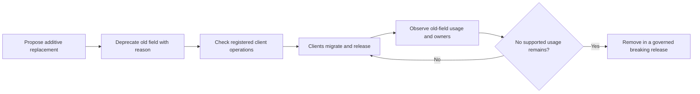

**Decision implications.** A schema registry and compatibility checks become
important when multiple teams publish independently. Deprecation needs an
owner, a migration target, an announced support window, and evidence for
removal; otherwise it becomes permanent clutter. Compatibility policy must
include input and output positions, nullability, enum handling, and runtime
semantics. New optional arguments should preserve prior behavior when
omitted.

**Common failure mode.** Adding a new enum value can break a generated
client's exhaustive switch even though the server considers the schema
change additive. Renaming a field and adding a replacement in the same
release can still break clients that have not deployed. A deprecation
directive without field-usage telemetry or a removal policy only documents
debt; it does not retire it.

**Scenario.** An account API replaces `fullName` with `displayName`. The
server first adds `displayName`, deprecates `fullName` with a migration
reason, and keeps both resolvers backed by the same domain value. Operation
checks identify registered clients still selecting `fullName`; telemetry
confirms adoption before the field is removed in a planned breaking window.

### 4.7 GraphQL caching and authorization: selection flexibility has boundaries

**Definition.** GraphQL caching has at least three distinct layers:
transport or intermediary caching of the response, server-side caching of
resolver data, and normalized client caching of individual entities and
fields. These layers use different identities. Authorization is the rule
that a principal may perform an operation on a domain object or field; it
must be enforced by trusted server/domain boundaries regardless of the
client's selection or cache behavior.

**Mechanism.** A conventional shared HTTP cache keys responses by request
target and selected headers. GraphQL commonly posts many operations to one
endpoint, often with distinct bodies, variables, and principals; the URL
alone is not a safe response identity. GET requests for queries and
persisted-operation identifiers can improve cacheability, but a complete
cache key still needs operation identity, canonical variables, relevant
representation dimensions, and authorization scope. Server data caches
should be keyed by entity/version and tenant or permission context as
appropriate. A normalized client cache stores entities by stable identity
(often `__typename` plus `id`) and fields separately; it can merge partial
results and satisfy later selections locally, but it does not make stale or
unauthorized server data safe.

Authorization can be coarse at operation entry and fine at a field or
domain-service boundary. Schema directives and resolver middleware may
express policy, but the domain operation should still enforce invariants and
ownership. Hiding fields in a client schema is not a security boundary.
Authorization must consider aliases, fragments, nested paths, tenant
identity, and object-level access; the resolver context carries verified
identity, while the service checks whether the requested action is allowed.

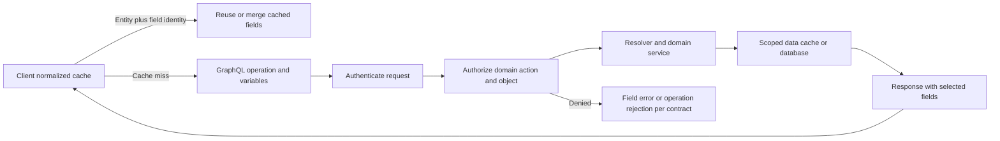

**Decision implications.** Do not assume one universal response-cache
strategy. Public, deterministic, persisted queries are candidates for
shared caching when the cache key is complete; user-specific responses
usually require private caching or no shared cache. Normalized client caches
are effective for interactive applications with stable entity identity and
explicit invalidation/update policies. Resolver authorization is useful for
field-level visibility; domain authorization is necessary for business
invariants and mutations. Gateway controls can constrain traffic, but
comprehensive API-security architecture is deferred to [API Security](CH09_API_Security.md).

**Common failure mode.** A shared cache keyed only by `/graphql` can return
one user's response to another user. A normalized client cache may preserve
privileged fields after the user switches account unless the cache is
partitioned or cleared. Conversely, checking a role only at the root query
can expose a nested object the caller is not permitted to see. Putting
authorization solely in presentation-oriented field resolvers can also
leave a mutation or non-GraphQL entry point unprotected.

**Scenario.** A multi-tenant project dashboard uses a normalized browser
cache keyed by tenant and user session, and clears it on account switch.
Resolver guards redact a restricted field, while the project domain service
checks tenant membership for both reads and mutations. A public category
query uses a persisted operation and a shared-cache key that includes its
canonical variables; private project responses bypass shared caches.

### 4.8 GraphQL versus REST: choose by consumer and operational shape

**Definition.** The choice is between API contracts with different
composition, discoverability, caching, and governance properties, not
between a modern and obsolete technology. GraphQL gives consumers a
schema-bounded selection language over a graph; REST organizes interactions
around resources and a uniform interface. REST-specific constraints,
resource modeling, HATEOAS (Hypermedia As The Engine Of Application State),
and the Richardson Maturity Model are owned by [Chapter 1](CH01_REST.md) and
are recapped here only as a boundary.

**Mechanism.** GraphQL clients select nested fields in one operation and
the runtime invokes field resolvers. REST clients address resource
representations through resource-oriented requests, with HTTP methods,
status codes, and cache headers whose wire semantics are owned by
[HTTP](../05_Networking_and_OS/CH01_HTTP.md). GraphQL can reduce client
round trips and over-fetching, but shifts complexity into query analysis,
resolver orchestration, field authorization, and cache identity. REST can
make resource-level caching and operational inspection straightforward,
but multiple representations or composed screens may need additional
endpoints or client requests. Either can be paired with a Backend for
Frontend (BFF) when a consumer-specific boundary is beneficial.

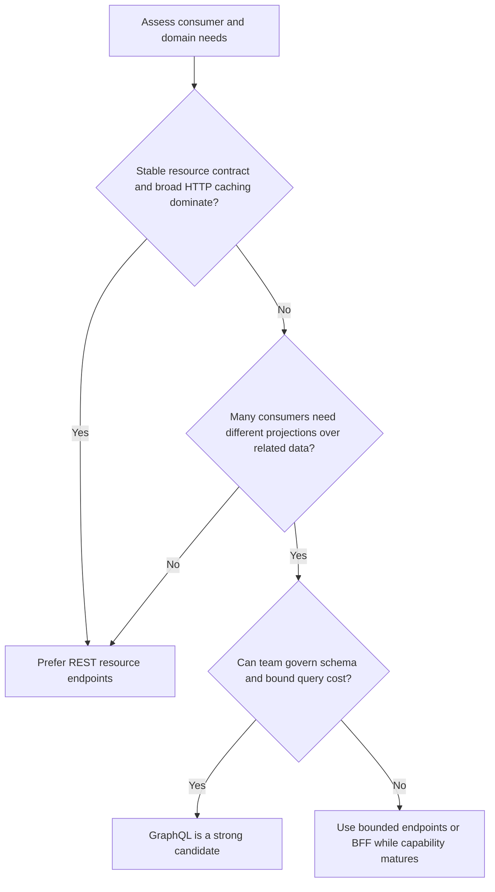

**Decision implications.** Prefer GraphQL when clients vary substantially,
the domain is naturally connected, client iteration speed matters, and the
organization can operate a schema and execution platform. Prefer REST when
resource semantics are stable, consumers need similar representations,
public cache infrastructure is valuable, and operational simplicity
outweighs client-side composition. A hybrid is legitimate: GraphQL may be a
consumer-facing composition layer over REST or service APIs, while
resource-oriented endpoints remain useful for downloads, webhooks, bulk
operations, or external integrations. Avoid exposing both styles without
clear ownership and lifecycle rules.

**Common failure mode.** Adopting GraphQL to avoid making API decisions
creates a broad schema with weak ownership, expensive resolvers, and no
limits. The inverse failure is forcing every consumer through fixed REST
shapes when the organization repeatedly builds bespoke aggregation layers
and clients are blocked on endpoint changes. Comparing only request count
also misleads: one GraphQL request may fan out to dozens of backend calls.

**Scenario.** A public catalog has stable product resources and is heavily
served by a content delivery network; REST remains the simplest public
contract. An authenticated multi-surface application combines catalog,
availability, and review data differently for each screen. A GraphQL
composition layer is justified if it uses bounded connections, batched
resolvers, persisted operations, and the same domain authorization as the
underlying services. The decision is based on consumer variance and
operational capability, not endpoint fashion.

## 5. Internal Working

A GraphQL server processes a document through distinct stages. Parsing
converts source text to an abstract syntax tree; validation checks fields,
arguments, fragments, operation rules, and variable usage against the schema;
coercion converts supplied variables and defaults into typed runtime values;
execution traverses selected fields, invokes resolvers, completes values
recursively, and serializes the result. A parse or validation failure occurs
before resolver execution. A resolver failure can occur after execution has
begun and can coexist with successful data.

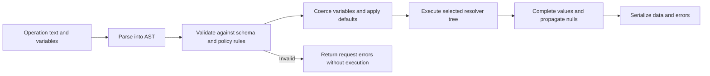

Execution begins from the selected operation's root type. For each field,
the executor supplies the parent value, arguments, context, and field
metadata to its resolver. The returned value may be synchronous or
asynchronous; list elements and nested fields are then completed according
to the schema. Independent query fields may execute concurrently. A
mutation's top-level fields execute serially in document order, but that
does not provide atomicity across resolvers. Subscription execution first
creates an event stream; each event then runs the selection set and produces
a result payload.

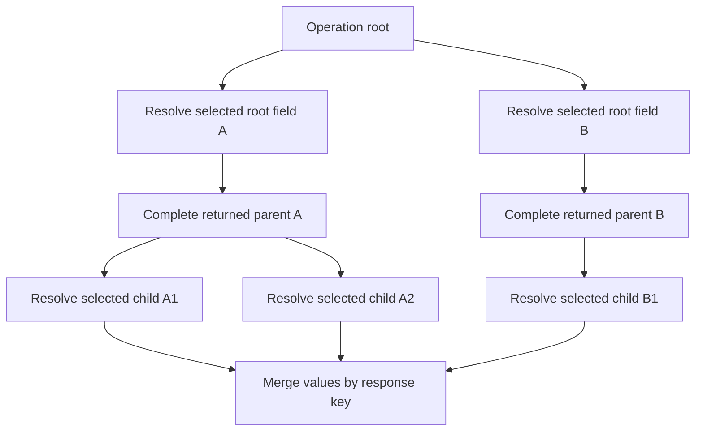

Aliases change response keys without changing underlying field names, and
fragments expand selections based on the runtime object type. Directives
such as `@include` and `@skip` conditionally include selections; custom
directives may affect validation or execution only when the server
implements their behavior. Variables keep operation text stable while
changing arguments, which supports persisted operations and operation-level
analytics. Introspection exposes schema metadata when enabled; production
policy may restrict it, but introspection is not a substitute for access
control.

Errors are recorded with a response path identifying the field/alias/list
position. Completion applies nullability from the leaf upward. If a nullable
field fails, its value becomes null and siblings can survive. If a
non-null field fails, the parent is invalidated; propagation continues
until it reaches a nullable boundary or the root. The execution result
contains both available data and errors when execution partially succeeds.

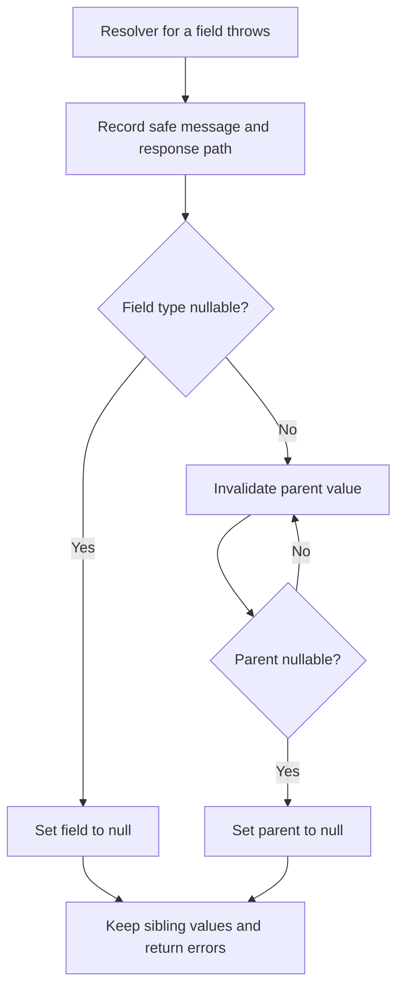

Subscription transports carry these execution results but do not change
their GraphQL meaning. A subscription operation describes the event source
and selected payload fields; the transport handles connection lifecycle and
message delivery. WebSocket handshake/framing, connection scaling, and
WebSocket-versus-SSE choice are owned by [WebSockets, Part 05 Chapter 17](../05_Networking_and_OS/CH17_WebSockets.md).
This chapter owns only the application contract: one subscription root
field, a stream of event-triggered GraphQL results, authorization at
subscription setup and as required for each event, cancellation, and the
delivery guarantees actually provided by the chosen implementation.

## 6. Design Principles

1. **Design for domain meaning, not storage shape.** Public types should
   express stable business concepts; resolver adapters translate to storage
   and service models.
2. **Make expensive edges visible.** A relationship field is a capability
   and a cost boundary. Give list fields bounded arguments and measure their
   backend fan-out.
3. **Treat nullability as failure semantics.** Mark fields non-null only
   when the value is guaranteed and its absence should invalidate the
   parent result.
4. **Keep resolvers thin and policy-aware.** Resolvers authenticate,
   authorize or delegate authorization, call domain services, and map
   results. They do not reimplement transactional invariants.
5. **Scope request state to a request.** Principals, tracing, and DataLoader
   caches should not cross request boundaries; tenant context must be
   propagated explicitly.
6. **Constrain work before execution.** Parse and validation limits,
   weighted complexity, list bounds, deadlines, and concurrency controls
   should reject excessive operations before backend work begins.
7. **Evolve additively and observe usage.** Deprecation is a migration
   process, not a directive that magically removes client dependence.
8. **Separate transport from application semantics.** HTTP, WebSocket, and
   SSE deliver GraphQL operations/results differently; the schema and
   execution contract is not a wire-protocol tutorial.

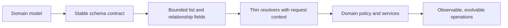

## 7. Architecture Patterns

### Single GraphQL service

A single service owns the schema and resolvers for a bounded product or
domain. This is the lowest-coordination deployment model and is often the
right starting point. It still needs modular schema ownership internally,
request-scoped context, resolver performance controls, and an explicit
deployment and schema-change process.

### GraphQL as a composition layer

A GraphQL server can aggregate calls to domain services or existing REST
APIs. The composition layer hides client-specific orchestration, but it
must not become the sole location of business invariants or create
unbounded synchronous fan-out. Use domain-facing clients with deadlines,
bulk operations where available, and clear ownership for each schema field.

### Backend for Frontend (BFF) GraphQL

A BFF exposes a schema shaped for one class of clients, such as a mobile
application, while keeping internal service contracts separate. This can
contain consumer-specific evolution and authorization context. The trade-off
is another service to operate and the risk of parallel business logic if
the BFF takes ownership of domain rules.

### Federated graph

Federation composes subgraphs owned by separate teams into a supergraph
contract. A router plans an operation across subgraphs, sends sub-operations,
and combines results. Entity keys and field ownership determine how an
object crosses subgraph boundaries. This can reduce a central schema team's
implementation bottleneck, but adds composition rules, distributed query
planning, cross-service latency, partial failure, and governance. Federation
is not part of the GraphQL core specification and does not automatically
make services independently deployable or data ownership coherent.

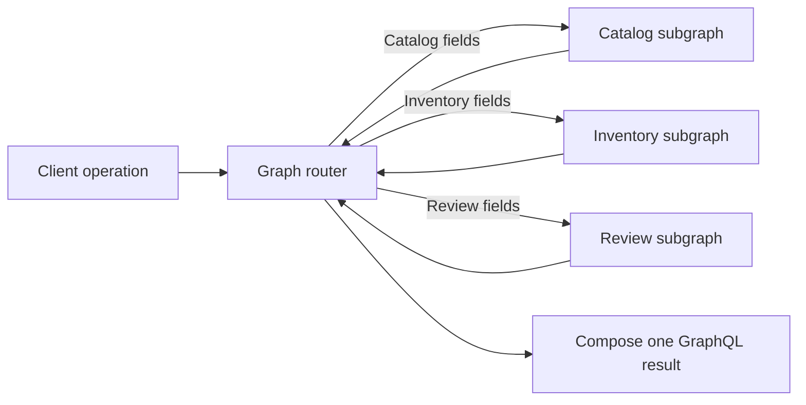

## 8. Production Architecture

A production deployment separates request admission, GraphQL execution,
domain access, and stateful infrastructure. A gateway or edge proxy may
authenticate, rate-limit, route, or enforce transport-level policy, but the
GraphQL service still validates schema operations, computes query budgets,
establishes request context, and invokes domain services. Full API gateway
product architecture is deferred to [Chapter 8](CH08_API_Gateway.md); the
GraphQL-specific rule is that gateway policy cannot replace field- and
domain-level checks.

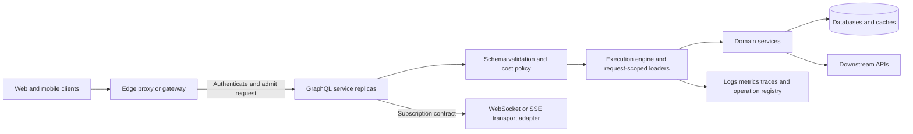

The service should be stateless across operations where possible. A
subscription connection may retain transport state, but event distribution
across replicas requires an appropriate shared event source or
publish/subscribe backplane. Subscription authorization must account for
revocation and changing object permissions over the stream's lifetime.
Avoid placing a database connection or unbounded event queue in a per-client
subscription without explicit capacity controls.

## 9. Implementation

The implementation sequence starts with schema design. Identify public
domain objects, scalar and enum meanings, relationships, input types,
nullability invariants, and bounded list arguments. Then define resolver
ownership: which domain service fulfills each field, whether calls can be
batched, what authorization context is required, and which failures are
recoverable. Next add request parsing/validation, query-cost policy,
deadlines, tracing, and an operation allowlist or persisted-query path
appropriate to the client population.

The examples in Section 10 use Node.js and GraphQL.js, the reference
JavaScript implementation of the GraphQL specification. Install the
declared packages from the example directory with `npm install`, then run
`npm test`. The sample schemas and operations are local artifacts; no
database, credentials, or external service is required. The production
architecture should replace in-memory repositories with domain services
while retaining the same schema, batching contract, authorization boundary,
and complexity checks.

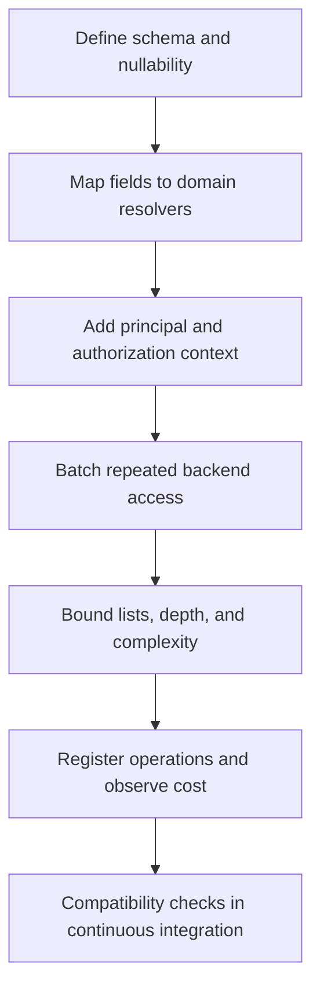

## 10. Complete Code Examples

The runnable examples are intentionally small but execute real GraphQL.js
schema validation and operation execution. `@graphql-tools/schema` is not
required; the first example builds an executable schema from SDL using
GraphQL.js and explicit resolver functions. The package manifest pins the
major dependency lines, and the tests use Node.js's built-in test runner.

1. **Schema and resolvers:**
   [schema_and_resolvers.js](../code/node/graphql-chapter/schema_and_resolvers.js)
   and [library.graphql](../code/node/graphql-chapter/library.graphql) define
   object, enum, union, input, query, and mutation behavior with
   principal-aware access.
2. **Request-scoped batching:**
   [request_scoped_dataloader.js](../code/node/graphql-chapter/request_scoped_dataloader.js)
   demonstrates the N+1 pattern's remedy with the `dataloader` library and
   a per-operation cache.
3. **Cursor pagination and partial errors:**
   [cursor_pagination_and_errors.js](../code/node/graphql-chapter/cursor_pagination_and_errors.js)
   uses a stable cursor connection and verifies nullable-field error
   propagation without discarding sibling data.
4. **Persisted operation and cost controls:**
   [persisted_query.js](../code/node/graphql-chapter/persisted_query.js)
   validates a SHA-256 (Secure Hash Algorithm 2 with 256-bit output)
   operation identifier, then enforces depth and estimated-cost limits
   before execution. Its approved operation is recorded in
   [persisted_operations.json](../code/node/graphql-chapter/persisted_operations.json)
   and [product_summary.graphql](../code/node/graphql-chapter/product_summary.graphql).

Run prerequisites and tests from
[the example package](../code/node/graphql-chapter/package.json). Tests are
offline and assert schema execution, authorization, batching, cursor
continuation, partial data with error paths, and pre-execution rejection of
an unknown or over-budget operation.

## 11. Performance

GraphQL request count is a poor proxy for work. A single operation may
invoke many resolvers, create several downstream round trips, serialize a
large response, and hold database resources while completing nested
selections. Measure operation latency by operation name and normalized
field path, resolver duration, batch sizes, backend calls, response bytes,
and estimated versus actual query cost. Avoid labels containing raw
variables or user identifiers, which create unbounded metric cardinality
and may leak sensitive values.

Optimize at the highest-cost boundary: remove duplicate resolver work,
batch repeated keys, use set-oriented domain methods, cap page sizes, and
avoid fields with expensive per-item enrichment on broad lists. Caching is
useful only when its key represents the operation and security context; a
normalized client cache helps avoid repeated entity fetches but does not
reduce the first server execution. Compression and connection behavior are
HTTP concerns owned by [HTTP](../05_Networking_and_OS/CH01_HTTP.md), not
GraphQL semantics.

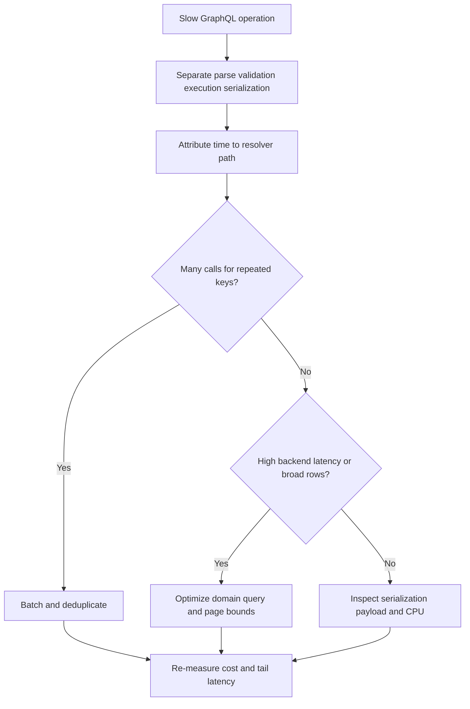

## 12. Scalability

Stateless query execution scales horizontally when request context and
short-lived loader caches are created per operation and shared state is
externalized. Capacity planning must account for the cost distribution of
operations, not just requests per second: a small number of broad queries
can consume more resolver and database capacity than thousands of scalar
lookups. Weighted admission control, execution deadlines, bounded
concurrency, database-pool limits, and cancellation propagation keep
expensive operations from consuming all workers.

Subscriptions change the capacity model because connections and event
subscriptions persist. Use shared pub/sub or durable event infrastructure
when clients can connect to different replicas; size connection memory,
fan-out throughput, and per-principal subscription counts. Reconnects and
replay semantics are transport/application concerns that must be specified
with the chosen adapter. The general WebSocket connection-scaling and
backplane pattern is owned by [WebSockets](../05_Networking_and_OS/CH17_WebSockets.md).

Federation scales schema ownership organizationally, but a federated
operation may multiply service-to-service calls. Routers need query plans,
subgraph deadlines, bounded concurrency, and observable per-subgraph
latency. Splitting a schema into more subgraphs can improve team ownership
while worsening the critical path; partition around clear domain ownership
and high-value independent deployment, not a desire to distribute every
type.

## 13. Security

GraphQL-specific security begins with treating operation text, variables,
fragments, aliases, and input values as untrusted. Parse and validate with
the implementation library; enforce limits for document size, depth,
field count, aliases, list arguments, estimated cost, execution time, and
concurrency. Disable or restrict introspection according to the threat
model, while recognizing that obscuring the schema does not secure data.
Persisted-operation allowlists reduce arbitrary query exposure for known
clients but must not become authorization tokens.

Authentication establishes the principal; authorization evaluates access
to each sensitive object and domain action. Prefer policy checks in domain
services for invariant-bearing operations, with resolver-level guards for
field visibility and efficient rejection. Ensure authorization is applied
after resolving object identity but before disclosing protected fields.
Batch functions must preserve principal and tenant scope, and cache keys
must include all security-relevant dimensions. Error messages should not
reveal SQL, stack traces, internal service names, or whether a protected
resource exists when that distinction is sensitive.

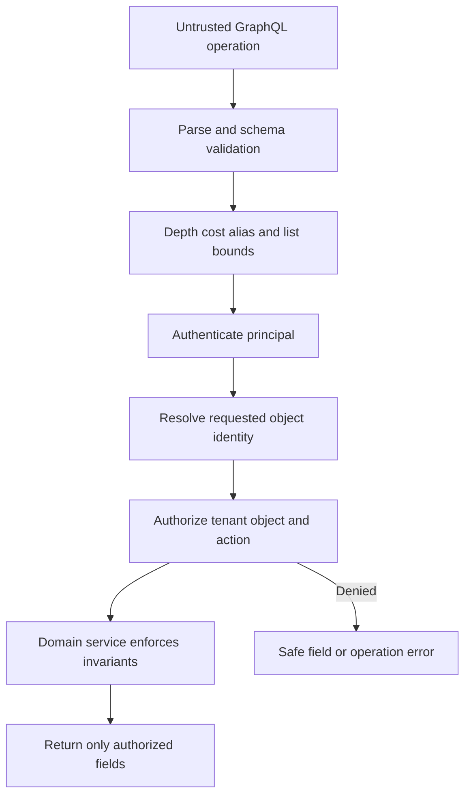

Comprehensive API threat modeling, token protocols, gateway policy, and
security governance belong to the future [API Security](CH09_API_Security.md)
chapter. HTTP authentication headers, cookies, Cross-Origin Resource
Sharing (CORS), and transport security are owned by their respective
networking/security chapters and should be recapped rather than re-taught
here.

## 14. Observability

Instrument GraphQL at both operation and resolver boundaries. Useful
signals include operation name, a stable operation hash, validation and
execution outcomes, estimated cost, resolver duration, DataLoader batch
size/cache-hit ratio, downstream calls, response bytes, and subscription
count/delivery lag. Record normalized field paths and schema coordinates,
not raw query text or unredacted variables by default. Operation names can
be absent or attacker-controlled for dynamic clients, so normalize or
classify unknown operations instead of trusting names as metric labels.

Distributed traces should link the incoming operation to resolvers,
downstream requests, and database spans without creating a span for every
scalar field in an unbounded operation. Sampling can depend on cost,
latency, or error status. Capture GraphQL errors separately from HTTP
transport outcomes: a request can complete at the transport layer while a
field resolver has failed, and a request may return useful partial data.
Never place credentials or sensitive variable values in traces.

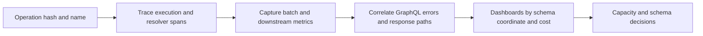

## 15. Failure Scenarios

| Failure | Observable symptom | Containment and recovery |
|---|---|---|
| Resolver N+1 | Backend call count grows with list size | Batch keys, add set-oriented domain methods, cap list size |
| Pathological valid operation | High execution time or resource saturation | Reject by cost/depth/alias limits; enforce deadlines and concurrency budgets |
| Downstream field failure | `data` is partial and `errors` includes a path | Preserve nullable siblings; return safe errors; make client degradation explicit |
| Incorrect non-null contract | A leaf failure erases a large parent or root result | Revisit nullability against domain invariants and availability expectations |
| Cross-tenant cache reuse | One tenant sees another tenant's result | Partition/clear client cache; include tenant and permission scope in server cache keys |
| Subscription replica loss | Events stop or clients reconnect without continuity | Re-establish subscriptions; define replay cursor and delivery guarantees |
| Federation subgraph outage | Fields from one subgraph fail while others may succeed | Bound subgraph timeouts, preserve partial results where schema allows, alert on ownership |
| Stale persisted-operation registry | Client release references unknown operation hash | Deploy compatible manifests before clients; support rollback and explicit registration lifecycle |

```mermaid
flowchart TD
    F[GraphQL symptom] --> C{Execution cost high?}
    C -->|Yes| Q[Inspect operation cost and resolver fan-out]
    C -->|No| E{Errors have field paths?}
    E -->|Yes| D[Inspect resolver and downstream dependency]
    E -->|No| T{Transport or admission failure?}
    T -->|Yes| H[Inspect HTTP or subscription transport owner]
    T -->|No| S[Inspect schema validation and persisted-operation registry]
    Q --> M[Contain with bounds then correct owning layer]
    D --> M
    H --> M
    S --> M
```

## 16. Testing

Test schema contracts independently from implementation details. Schema
checks should reject unknown fields, invalid argument types, missing
required variables, and incompatible changes. Resolver tests should verify
domain calls, authorization outcomes, nullability, and safe error mapping.
Integration tests should execute representative operations through the
GraphQL runtime and assert both `data` and `errors`, including the error
path and null-propagation boundary.

Performance tests should scale collection sizes and assert backend call
counts, loader batch ordering, maximum page bounds, and complexity
rejection before resolver invocation. Persisted-query tests should cover
hash mismatch, unknown identifiers, variable changes with stable operation
text, and rollout compatibility. Federation needs composition checks and
cross-subgraph integration tests in addition to per-subgraph contract
tests. Subscription tests should cover setup authorization, event payload
execution, cancellation, reconnect/replay behavior, and permission changes
where supported.

The Section 10 package provides offline executable tests. It demonstrates
runtime behavior but is not a substitute for production database
integration, load tests, or threat-model review.

## 17. Common Mistakes

- Modeling the schema as a direct projection of database tables.
- Treating one GraphQL request as one backend query or one unit of work.
- Omitting page-size bounds because clients "should" request small lists.
- Building DataLoader instances globally and accidentally sharing cached
  values across requests, users, or tenants.
- Ignoring loader result ordering or failing to represent missing keys.
- Marking all fields non-null for convenience, then losing broad portions of
  the response during a recoverable downstream failure.
- Assuming query field order is sequential or a mutation operation is a
  distributed transaction.
- Treating persisted queries as authorization or as proof of low cost.
- Hiding fields in the client rather than enforcing access in trusted
  server/domain code.
- Caching responses by endpoint URL without operation, variables, and
  security context in the identity.
- Deprecating fields without client-usage evidence or a removal owner.
- Introducing federation before there are real schema-ownership or team
  scaling constraints.

## 18. Best Practices

- Start from consumer use cases and domain concepts; expose only fields that
  can be supported, secured, and observed.
- Use explicit input objects for mutations, enums for bounded values, and
  scalar contracts with well-defined coercion.
- Choose nullability to express reliable invariants and intended partial
  failure boundaries.
- Make collection access cursor-based and bounded; define stable ordering
  and re-authorize every page.
- Use request-scoped DataLoaders for repeated key lookups, with tests for
  batching, key ordering, missing records, and tenant isolation.
- Keep resolvers thin; move authorization-sensitive invariants into domain
  services that all entry points share.
- Enforce cost, depth, alias, document-size, timeout, and concurrency
  budgets before expensive resolver work.
- Use persisted operations where clients and deployment workflows support
  them, while preserving separate authorization and cost checks.
- Track operation and field usage; deprecate with a reason, replacement,
  owner, timeline, and compatibility checks.
- Choose response and normalized-cache policies explicitly, including
  account-switch clearing and tenant/user partitioning.
- Adopt federation only with clear subgraph ownership, composition checks,
  query-plan visibility, and cross-service failure budgets.

## 19. Anti-Patterns

### The universal graph

Exposing every internal entity and relationship creates an effectively
unbounded public capability surface. It increases authorization and cost
risk while coupling clients to implementation details. Publish a deliberate
domain graph and add fields when there is a supported consumer need.

### Resolver as orchestration dump

Large resolvers that contain business rules, database joins, authorization,
retries, and downstream orchestration are difficult to test and reuse.
Move domain behavior into explicit services; leave resolvers as typed
adapters.

### Unbounded nested lists

Returning all children because the client can request only some fields does
not bound work. Every list needs a maximum size or another explicit cost
contract, and nested list multipliers must be included in admission policy.

### GraphQL facade without domain ownership

A central graph that reimplements every service's business logic becomes a
distributed monolith and a bottleneck. Federation is not a cure unless
subgraphs have meaningful ownership and operational independence.

### Transport tunnel vision

Assuming GraphQL itself specifies HTTP caching, WebSocket reliability, or
SSE reconnection conflates the application contract with its transport.
Choose and operate transports using the owning chapters and define the
GraphQL operation/result behavior separately.

## 20. Trade-off Analysis

| Decision | Benefit | Cost or risk | Use when |
|---|---|---|---|
| GraphQL versus REST | Client-selected graph projections and fewer composition round trips | Query governance, resolver fan-out, cache identity complexity | Consumer needs vary materially over connected data |
| Nullable versus non-null field | Nullable preserves sibling data after field failure | Client must handle absence; non-null expresses stronger guarantee | Match actual domain invariant and desired failure boundary |
| Cursor versus offset pagination | Stable traversal under inserts and efficient continuation | Cursor and ordering contract need design | Large or changing collections |
| Dynamic queries versus persisted operations | Exploratory flexibility versus strict operation control | Dynamic cost risk versus client/registry rollout coordination | Choose by client population and threat/capacity model |
| Resolver-level versus domain-level authorization | Field-specific visibility versus invariant reuse across entry points | Scattered resolver checks versus more domain context plumbing | Use both at their appropriate boundaries |
| Shared response cache versus normalized client cache | Network-level reuse versus entity-level merge and local reads | Correct keying/privacy versus invalidation/staleness | Public stable queries versus interactive authenticated clients |
| Single schema versus federation | Simpler planning and operations versus distributed team ownership | Central coordination versus composition and cross-service latency | Federation only when ownership constraints justify it |

## 21. Comparison Table

| Dimension | GraphQL | REST | gRPC |
|---|---|---|---|
| Contract shape | Typed graph schema and client selection | Resource-oriented representations and uniform interface | Typed service methods and generated message contracts |
| Typical interaction | One operation may traverse related fields | Requests address resource representations | Procedure call over a service contract |
| Client control | Selects fields and nested relationships | Selects among server-defined endpoints/representations | Calls defined methods with typed messages |
| Caching | Often operation/variables aware or normalized client cache | Resource and HTTP cache semantics are direct strengths | Application/client caching; not general browser intermediary caching |
| Main operational risk | Unbounded execution and resolver fan-out | Endpoint proliferation or fixed-shape over/under-fetching | Contract/code-generation coupling and transport interoperability |
| Strong fit | Diverse clients over connected domain data | Stable resource contracts and broad HTTP caching | Typed, efficient service-to-service communication |

REST's constraints and maturity model are fully owned by
[Chapter 1](CH01_REST.md); HTTP wire semantics by
[Part 05 Chapter 1](../05_Networking_and_OS/CH01_HTTP.md). The future gRPC
chapter is [Part 08 Chapter 3](CH03_gRPC.md) and owns its complete contract
and transport treatment.

## 22. Real-World Case Study

### GitHub's GraphQL API

GitHub introduced a public GraphQL API alongside its REST API to support
clients that needed flexible traversals across users, repositories,
issues, pull requests, and connections. The graph model lets a client ask
for a specific combination of related fields, while the schema provides
discoverability and typed validation. The API is an instructive case
because it demonstrates that GraphQL does not eliminate operational
constraints: GitHub documents rate limits and query cost, requires
pagination for connections, and provides schema evolution/deprecation
guidance.

Architecturally, the valuable lesson is the coexistence model. REST remains
available for resource-oriented integrations and existing clients; GraphQL
serves use cases where clients benefit from selecting connected data. A
costed query model is necessary because the server's work depends on the
operation graph, not just request count. Cursor connections bound results;
typed schema changes still require compatibility discipline. This should
not be read as evidence that every API benefits from two public styles:
GitHub's ecosystem and product surface create specific consumer needs that
smaller systems may not have.

```mermaid
flowchart LR
    Consumer[GitHub API consumer] -->|Resource request| REST[REST API]
    Consumer -->|Selected graph operation| GQL[GraphQL API]
    GQL --> SC[Typed schema and validation]
    SC --> COST[Query cost and connection bounds]
    COST --> DOM[GitHub domain data]
    REST --> DOM
```

## 23. Interview Questions

1. How does GraphQL schema nullability affect runtime error propagation?
2. What is the N+1 problem in a resolver tree, and what guarantees must a
   DataLoader batch function satisfy?
3. Why does a single GraphQL request not imply a single backend operation?
4. How would you design and validate a cursor for a collection with
   duplicate timestamps and concurrent inserts?
5. What is the difference between a request validation error and an
   execution error with partial data?
6. Why are depth limits alone insufficient to control query cost?
7. How can a persisted query improve operations, and what risks does it
   not remove?
8. Which schema changes are breaking even if a field name is unchanged?
9. How do response caching and normalized client caching differ, and what
   information must a safe cache identity include?
10. Where should authorization live when a protected field is reachable
    through multiple GraphQL paths and non-GraphQL entry points?
11. What organizational and runtime constraints justify federation?
12. When would you select REST instead of GraphQL for a public API?

## 24. Hands-on Exercises

1. Run the Section 10 tests, then add a `BookFormat` enum and a nullable
   `subtitle` field. Verify invalid enum values fail before execution.
2. Add a nested author list query and record database-call counts before and
   after request-scoped DataLoader batching. Assert results remain in input
   key order when the repository returns rows in a different order.
3. Extend cursor pagination with a compound `(createdAt, id)` ordering key.
   Insert a record between page requests and verify no duplicate or missing
   edge appears.
4. Make one nested resolver throw. Experiment with nullable and non-null
   declarations and inspect the resulting `data`, error path, and null
   propagation boundary.
5. Add an alias-heavy operation and a nested list operation. Demonstrate why
   a depth limit alone does not keep estimated cost under budget.
6. Add a deprecated field with a replacement reason, then write a schema
   check that fails when a registered client still selects it.

## 25. Design Exercises

### Multi-tenant project workspace

Design a GraphQL schema for projects, members, tasks, activity events, and
role-dependent fields. Include cursor connections, mutation input types,
nullability rationale, and at least one interface or union where
polymorphism is meaningful. Specify which authorization checks occur in
resolvers and which must be enforced by domain services.

Then define a weighted cost model for nested project/task/activity
selections, a request-scoped batching plan, an operation persistence
workflow, and a normalized-client-cache partitioning strategy. Include a
failure contract for an unavailable activity service and a cursor behavior
when a member loses project access between pages. Evaluate whether one
GraphQL service, a BFF, or federation is justified by the team and domain
boundaries.

## 26. Architecture Review Questions

- Does the schema model stable domain concepts rather than expose storage
  tables and internal implementation details?
- Are list arguments bounded and cursor ordering deterministic?
- Does every potentially expensive relationship have a known resolver and
  backend access plan?
- Are DataLoaders request-scoped, correctly ordered, tenant-aware, and
  measured for batch behavior?
- Does nullability describe domain guarantees and intentional partial-data
  boundaries?
- Are query depth, aliases, field count, list size, weighted cost,
  deadlines, and concurrency controlled before expensive execution?
- Are persisted operations managed as deployment artifacts, not confused
  with authorization?
- Are object- and field-level access checks enforced at trusted boundaries
  and repeated in domain invariants where required?
- Do response and client caches include correct operation, variable,
  principal, tenant, and version dimensions, or avoid unsafe sharing?
- Are schema deprecations tied to usage evidence, owners, and migration
  windows?
- Is federation solving a real ownership constraint, with composition
  checks and cross-subgraph latency/failure budgets?
- Are GraphQL application semantics clearly separated from HTTP,
  WebSocket, SSE, gateway, and comprehensive security ownership?

## 27. Summary

GraphQL combines a typed schema, client-selected operations, and a runtime
that validates and resolves selected fields. Its flexibility is bounded by
the schema, but not by a fixed resource response shape; that shifts
architectural responsibility toward resolver design, request-scoped
batching, query-cost controls, partial-error handling, schema evolution,
authorization, and cache identity. Cursor connections and explicit
nullability make collection and failure behavior part of the API contract.

GraphQL is a strong fit when consumers need different projections across
related domain data and the organization can operate its execution and
governance model. REST remains a strong fit for stable resource contracts
and direct HTTP caching; gRPC serves a different typed service-to-service
role. Federation is an organizational and runtime extension, not a default
scaling step. Across all choices, GraphQL's schema and operation behavior
remain distinct from the HTTP or streaming transport that carries them.

**Further reading**: [REST](CH01_REST.md) ·
[HTTP](../05_Networking_and_OS/CH01_HTTP.md) ·
[WebSockets](../05_Networking_and_OS/CH17_WebSockets.md) ·
[gRPC](CH03_gRPC.md) · [Part 08 overview](PART_OVERVIEW.md)