# Chapter: gRPC

Part: [08 — API Architecture](PART_OVERVIEW.md) · Status: Draft

## 1. Introduction

Google Remote Procedure Call (gRPC) is a contract-first remote procedure
call (RPC) framework. A team writes service and message definitions in Protocol
Buffers (Protobuf) interface definition language (IDL), generates client
and server bindings for chosen languages, and implements behavior behind
those bindings. The result is not merely a compact binary serializer: it is
a coordinated contract for method names, typed inputs and outputs, call
cardinality, errors, metadata, deadlines, and compatibility.

This chapter owns those gRPC framework and application programming
interface (API) contract mechanisms. It does not teach HTTP/2 (Hypertext
Transfer Protocol version 2) framing, binary frames, multiplexing, header compression,
or transport flow control; those belong to [HTTP/2](../05_Networking_and_OS/CH04_HTTP2.md).
It does not teach HTTP/3 (Hypertext Transfer Protocol version 3) or QUIC transport mechanics; see
[HTTP/3](../05_Networking_and_OS/CH05_HTTP3.md). gRPC commonly uses HTTP/2,
but it is not synonymous with HTTP/2: HTTP/2 is a transport substrate that
can carry other application protocols, while gRPC defines service contracts
and call semantics above it. A gRPC deployment must still confirm that its
chosen runtime, proxy path, and server support the negotiated transport.

REST (Representational State Transfer) remains the resource-oriented API
style owned by [REST](CH01_REST.md). [GraphQL](CH02_GraphQL.md) is a sibling
API style; the comparison here is limited to choosing an API shape rather
than explaining GraphQL's execution model.
Application Programming Interface (API) Gateway and API Security are future chapters in this part. This chapter
covers only gRPC-specific gateway interoperability and framework-level
credentials; complete gateway policy and security architecture are deferred
to [API Gateway](PART_OVERVIEW.md) and [API Security](PART_OVERVIEW.md).

## 2. Historical Evolution

RPC frameworks predate gRPC by decades. Earlier systems such as Sun RPC,
CORBA (Common Object Request Broker Architecture), Java RMI (Remote Method
Invocation), and later Thrift attempted to make a network call resemble a
local method call. They differed in IDL, encoding, language reach, runtime,
and deployment assumptions. Google developed Stubby for internal service
communication; gRPC was released publicly in 2015 as an open-source,
cross-language framework built around Protocol Buffers and HTTP/2.

The timing mattered. Cloud-native systems were splitting work across many
independently deployed services, while mobile clients and backend services
needed compact contracts and generated integrations across languages. HTTP/2
provided a capable substrate, but it did not itself specify service methods,
message schemas, RPC lifecycles, deadlines, or cross-language stubs. gRPC
standardized those framework-level concerns as a coherent developer
contract, leaving transport behavior to HTTP/2 and its implementations.

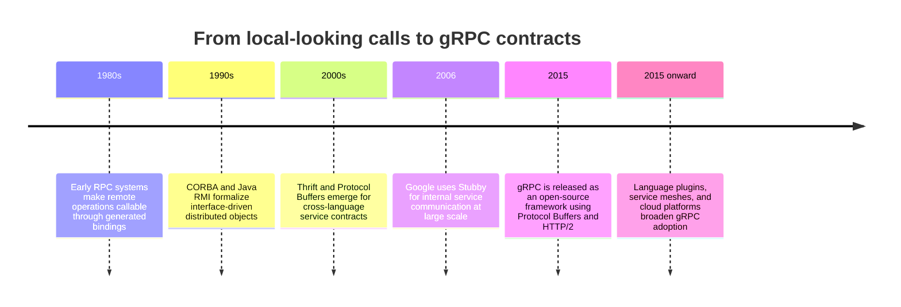

The evolution is not a linear replacement story. Each generation traded
some local-call convenience for clearer network contracts, deployability,
and interoperability. gRPC's design is strongest when both sides are under
engineering control and can share generated artifacts or a published
contract. A public browser-facing API may value discoverability, manual
inspection, and intermediaries more than generated typed calls; that is a
decision question, not a defect in either style.

## 3. Why It Exists

Without a shared contract, independently implemented clients and servers
drift in field names, optionality, enum values, error interpretation, and
serialization assumptions. A handwritten client can compile while sending
the wrong shape; a server can change a field's meaning without noticing
that another service still depends on it. At scale, these are integration
failures repeated across languages and deployment timelines.

gRPC addresses this coordination problem with an IDL as the source of
truth, generated code that enforces the declared call shape in each language,
and runtime conventions for call completion, cancellation, deadlines,
metadata, and status. Generated bindings reduce mechanical mismatch, but
they do not prove domain correctness: a valid request can still violate a
business invariant, and generated clients can still be deployed against an
incompatible server.

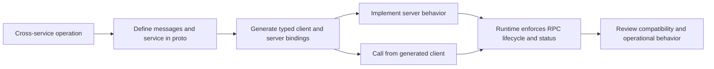

The framework exists to make the contract explicit and repeatable, not to
make distributed calls behave like in-process calls. Network latency,
partial failure, retries, authorization, version skew, and resource
exhaustion remain architectural concerns. gRPC gives teams places to
express and observe those concerns; it does not remove them.

## 4. Core Concepts

### 4.1 IDL, messages, services, and generated contracts

**Definition.** A `.proto` file is a language-neutral contract containing
message types and service methods. A message declares named fields with
types and stable field numbers; a service groups named RPC methods, each
with an input message, an output message, and a cardinality. The schema is
compiled by `protoc` (the Protocol Buffers compiler) and language plugins
into message classes, client stubs, and server interfaces or dispatch code.

**Mechanism.** A field's number is its wire identity; its name is primarily
for source readability and generated APIs. The compiler maps schema types
to language-specific representations and emits descriptors used by the
runtime. Client stubs expose typed methods; server base classes or
registration helpers map incoming service/method names to implementations.
Both sides encode and decode using the same wire-level field identities,
even if they are written in different languages. Generated code is a build
artifact, not the design authority: source `.proto` files, plugin versions,
and generated outputs must be kept reproducible.

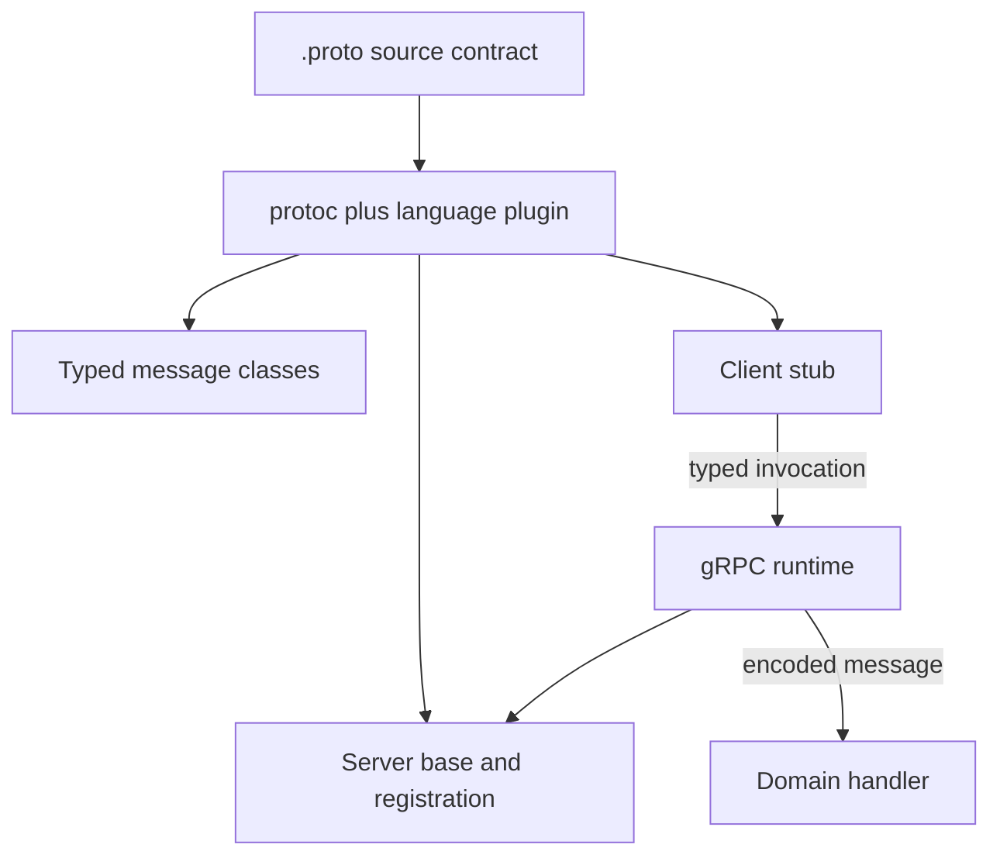

**Decision implications.** Contract-first generation is valuable when
services have multiple language clients, frequent coordinated changes, or
strong compile-time feedback requirements. It adds a toolchain and schema
governance obligation: compiler and plugin versions must be pinned, generated
diffs reviewed, and consumers given a compatible artifact. Keep domain
behavior out of generated files and avoid treating a successful build as a
compatibility proof.

**Common failure mode.** Developers hand-edit generated code, change a field
number because it is not visible in application logic, or run different
compiler/plugin versions in local and release builds. The immediate build
may pass while reproducibility and wire compatibility silently disappear.

**Scenario.** An order platform has Go and Python services that both consume
`OrderService`. A checked-in `.proto` contract and pinned generation step
let both teams compile against the same method and message shape before
integrating. CI rejects generated output that differs from the pinned
compiler's result.

### 4.2 RPC cardinalities are distinct contracts

**Definition.** gRPC defines four method shapes: unary (one request, one
response), client-streaming (many requests, one response), server-streaming
(one request, many responses), and bidirectional-streaming (many requests
and many responses). The `stream` keyword in the service declaration marks
which side has repeated message delivery; it is part of the public method
contract, not a private implementation detail.

**Mechanism.** A unary method has a single completion result. A
client-streaming handler consumes a request iterator and returns one summary
or outcome after the input stream closes. A server-streaming handler returns
one response iterator, with the client reading until completion or error.
In a bidirectional call, each side independently reads and writes messages;
messages are ordered within each direction, but an application must not
assume that a response corresponds one-for-one to the request most recently
sent. The generated API differs by language, but the cardinalities remain
the same.

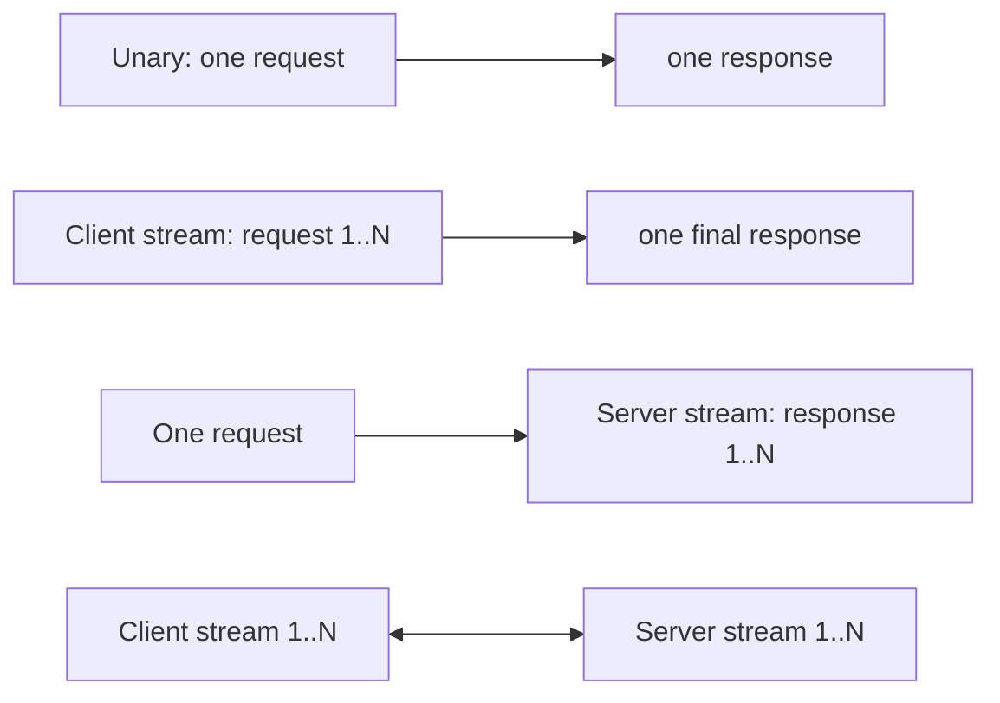

**Decision implications.** Use unary for bounded command/query operations
whose result is naturally one value. Use client streaming to amortize a
logical batch or upload where one aggregate acknowledgment is meaningful;
server streaming for a finite result feed or subscription with explicit
termination semantics; and bidirectional streaming when both parties need
ongoing independent messages. Choose streaming because the domain contract
requires it, not simply because a stream appears faster than repeated unary
calls.

**Common failure mode.** A team exposes an unbounded server stream for data
that users expect to paginate, without defining resume position, retention,
or how clients recover after interruption. Another common defect is
assuming bidirectional request and response messages are lockstep pairs,
which creates deadlocks when either side waits for a response before sending
the next request.

**Scenario.** A telemetry collector accepts a client stream of measurements
and returns one accepted/rejected count; an operator dashboard separately
opens a server stream of state changes. These are different contracts and
should not be collapsed into one ambiguous streaming method.

### 4.3 Deadlines, cancellation, status, and trailers

**Definition.** A deadline is the caller's latest acceptable completion
time. Cancellation says the caller no longer needs the result. A gRPC
status is the terminal outcome of an RPC, expressed through a canonical
status code and optional description; trailers carry terminal metadata
alongside that status. These are framework-level call semantics, distinct
from HTTP status codes, which remain owned by [HTTP](../05_Networking_and_OS/CH01_HTTP.md).

**Mechanism.** A client sets a deadline or timeout on a call. The runtime
transmits the remaining time budget and cancels work when the call is
cancelled or expires. A server handler can inspect remaining time and
cancellation state, stop downstream calls, and release resources. When
calling another service, the handler should derive a child deadline no later
than the inbound deadline, reserving time for its own response and cleanup.
The server completes with a status; trailing metadata is delivered at
completion, not as ordinary response fields. Deadlines are not implicit in
the schema, so each caller and service policy must set sensible bounds.

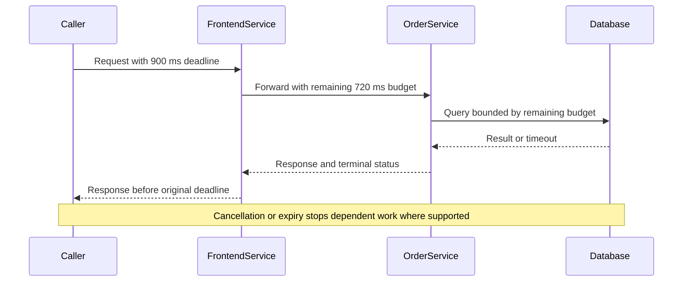

**Decision implications.** Put an end-to-end deadline at the user or job
boundary, then allocate smaller budgets to downstream operations. A chain
of calls each given a fresh full timeout can exceed the caller's actual
latency budget. Cancellation must reach expensive database queries,
stream producers, and queued work; otherwise the caller disconnects while
the system continues spending capacity on abandoned work.

**Common failure mode.** Omitting deadlines leaves calls waiting far longer
than the user request or batch lease can tolerate. Setting every hop to the
same fixed timeout can also overrun the parent budget. A further mistake is
treating cancellation as rollback: cancelling an RPC cannot undo a side
effect that has already committed.

**Scenario.** An inventory API receives a 700 ms deadline, spends 100 ms on
validation, and forwards at most 500 ms to a stock service, reserving the
remainder to map the response. If the request expires, the stock lookup is
cancelled rather than continuing as orphaned work.

### 4.4 Schema evolution and wire compatibility

**Definition.** Protobuf compatibility is the ability of different schema
versions to exchange encoded messages without misinterpreting fields. Wire
compatibility is necessary but not sufficient: a change can preserve
decoding while changing business meaning or generated source APIs.

**Mechanism.** Encoded fields carry a number and wire type, not the field
name. Adding a new field with a new number is generally safe for old readers
(unknown fields can be skipped) and for new readers of old messages (the
field is absent). Removing a field requires reserving its number and name so
neither can be reused. Changing a field's type or number, reusing a number,
or changing a field from singular to repeated can break interpretation.
Enum evolution needs similar care: old consumers may not recognize a newly
added numeric value. `oneof`, presence, defaults, and JSON mappings introduce
additional semantic constraints that require compatibility tooling and
consumer testing.

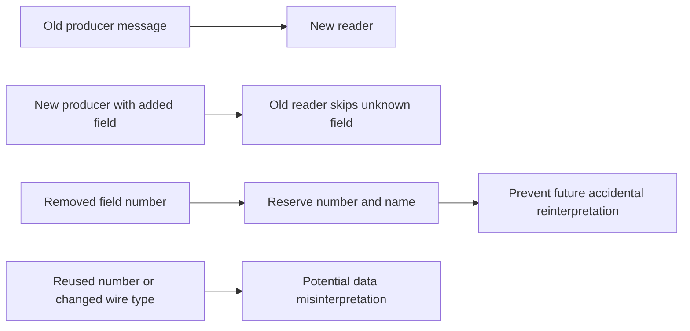

**Decision implications.** Evolve messages additively, preserve field
numbers, reserve retired identifiers, and check compatibility in continuous
integration (CI) against the released schema. Separate wire compatibility
from rollout compatibility: deploy readers before writers when new fields
are required, and ensure old and new service versions can coexist during
rolling deployments. Use a new service or package version only when a
contract change truly cannot be introduced compatibly; versioning every
minor field addition creates needless client migration work.

**Common failure mode.** Reusing field number `4` after deleting its old
meaning may cause a new reader to interpret old persisted or delayed
messages as a completely different value. Another failure is relying only
on schema compatibility checks while changing what an existing enum value
means; the bytes decode, but the business contract is broken.

**Scenario.** A fulfillment API adds `region` as field `5` while keeping
fields `1` through `3` stable and reserving the retired field `4`. New
servers can serve old clients during a rolling release, and old servers can
ignore the added field sent by a new client.

### 4.5 Streaming flow control and application backpressure

**Definition.** Application backpressure is the policy by which a producer
slows or bounds message production when a consumer cannot keep up. It is
not the same as HTTP/2 byte-level flow control: the latter is owned by
[HTTP/2 §4.6](../05_Networking_and_OS/CH04_HTTP2.md#46-flow-control-stream-level-and-connection-level),
while gRPC applications decide when to read, write, queue, or cancel
messages.

**Mechanism.** A streaming API passes messages through runtime buffers and
transport buffers. In synchronous APIs, iteration or write completion can
provide natural pacing, but exact buffering and readiness semantics differ
by language and runtime. Asynchronous APIs expose explicit readiness or
await points. A well-designed producer emits only when the downstream
consumer can make progress, bounds any intermediate queue, and handles
cancellation. Message size and rate limits are needed because a stream can
remain active while consuming substantial memory or CPU.

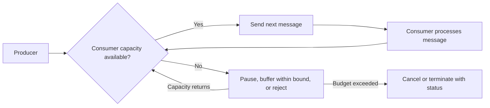

**Decision implications.** Specify maximum message size, allowed stream
duration, queue bounds, and behavior when consumers are slow. Consider
chunking large objects as references or bounded blocks rather than creating
one enormous Protobuf message. For long-lived subscriptions, include resume
tokens or sequence positions and define whether missed updates are replayed,
coalesced, or lost. A streaming API is a lifecycle and capacity contract,
not just an iterator return type.

**Common failure mode.** A handler eagerly reads a fast producer into an
unbounded in-memory list before processing or writing downstream. When the
consumer slows, memory grows with the stream's lifetime and can exhaust the
process even though HTTP/2 flow control is functioning correctly.

**Scenario.** A log-export service streams batches to a remote collector.
The server reads the next batch only after the previous batch has been
accepted, caps each batch and total in-flight bytes, and terminates with a
clear retry position when the collector remains unavailable.

### 4.6 Service config, retries, load balancing, and health

**Definition.** A gRPC service config is client-side policy associated with
a target or resolved service. It can configure method timeouts, retry
behavior, wait-for-ready, and load-balancing policy where supported. Health
checking is a service-level signal that reports whether a named service is
serving; it is not equivalent to a TCP port accepting connections.

**Mechanism.** A name resolver provides addresses and possibly service
configuration to the channel. The selected load-balancing policy chooses
among usable endpoints. A retry policy classifies selected terminal status
codes as retryable, applies bounded attempts and backoff, and can respect
server pushback or retry throttling where runtime support exists. gRPC
health checking uses a standard health service and may be queried by
clients or infrastructure. Reflection publishes service descriptors at
runtime for tools such as `grpcurl`; it is a discovery facility, not a
production dependency or access-control mechanism.

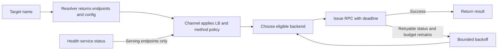

**Decision implications.** Use retries only when an operation is safe to
repeat or protected by an explicit idempotency contract, and keep the total
attempt budget inside the caller's deadline. Retry only a narrow set of
transient statuses; do not retry validation, authorization, or permanent
domain failures. Choose client-side balancing only if name resolution and
endpoint discovery support it; otherwise an L7 proxy may own balancing.
Health checks should reflect readiness to perform useful work, not merely
process liveness.

**Common failure mode.** A retry policy on a mutation resubmits work after
the server committed but before the response reached the client. This can
duplicate a charge or order. Independently, retries at several service
layers multiply attempts and intensify an outage. Treat a health endpoint
that always reports `SERVING` as a misleading green light if critical
dependencies cannot serve requests.

**Scenario.** A read-only `GetOrder` call retries `UNAVAILABLE` at most
three attempts with exponential backoff, under a 1.2-second total deadline.
The same automatic retry policy is not applied to `CreateOrder` unless the
operation has a stable deduplication key and server-side replay semantics.

### 4.7 Browser and interoperability boundaries

**Definition.** Native gRPC clients use the full gRPC protocol contract and
runtime semantics. Browser JavaScript cannot generally use a native gRPC
client directly because browser networking APIs do not expose all required
HTTP/2 features. gRPC-Web is a browser-oriented protocol variant, commonly
terminated or translated by a proxy. HTTP transcoding maps selected RPCs to
JSON/HTTP endpoints, often using annotations or gateway configuration.

**Mechanism.** With gRPC-Web, a browser client speaks a compatible
request/response representation to an edge proxy, which communicates with
the backend using native gRPC or a translation layer. Transcoding exposes
HTTP paths, verbs, and JSON shapes for selected methods; streaming support
varies by implementation and is commonly more constrained than native
gRPC. These bridges create another contract surface that must map errors,
metadata, authentication, and schema evolution consistently.

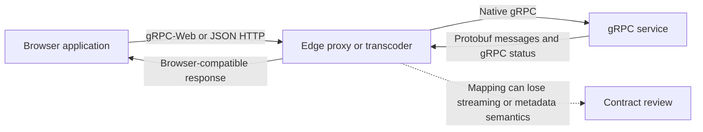

**Decision implications.** Use native gRPC for controlled service-to-service
clients that benefit from generated contracts and streaming. Use gRPC-Web
when browser clients should share a Protobuf-oriented contract and an
appropriate proxy is available. Use transcoding when an HTTP/JSON edge
contract is required, while retaining gRPC internally. Avoid promising a
single identical behavior across native, browser, and transcoded clients
until streaming, errors, deadlines, and metadata have been tested end to
end. Full gateway architecture is deferred to the future API Gateway
chapter.

**Common failure mode.** A team assumes that a gateway's existence makes
every RPC browser-compatible. The browser path may not support bidirectional
streaming, may map only a subset of statuses, or may drop custom metadata.
The result is a second API whose differences surface only after frontend
integration.

**Scenario.** A browser-based support console needs unary customer lookups
and server updates. The team exposes those methods through a tested
gRPC-Web proxy but keeps a bulk bidirectional replication method private to
native service clients.

### 4.8 Choosing gRPC against REST and GraphQL

**Definition.** API style selection is a decision about the shape of the
consumer's work and the operating environment. REST models resources and
uses HTTP's uniform method/status vocabulary (owned by
[REST](CH01_REST.md)); GraphQL lets a client request a selection of related
fields through a schema and execution model (the sibling chapter is not yet
drafted); gRPC defines typed service methods and RPC cardinalities.

**Mechanism.** Compare the domain shape, consumer diversity, generated-code
support, browser constraints, caching and intermediary needs, streaming
requirements, and contract rollout model. gRPC's generated stubs favor
controlled, typed clients and service-to-service calls. REST's uniform
resource interface and HTTP ecosystem favor broad interoperability and
cache-friendly resource access. GraphQL can suit clients that need
client-shaped graph queries, at the cost of query governance and a distinct
execution model. None is inherently the fastest or most evolvable without
considering payloads, network conditions, gateway behavior, and client
release cadence.

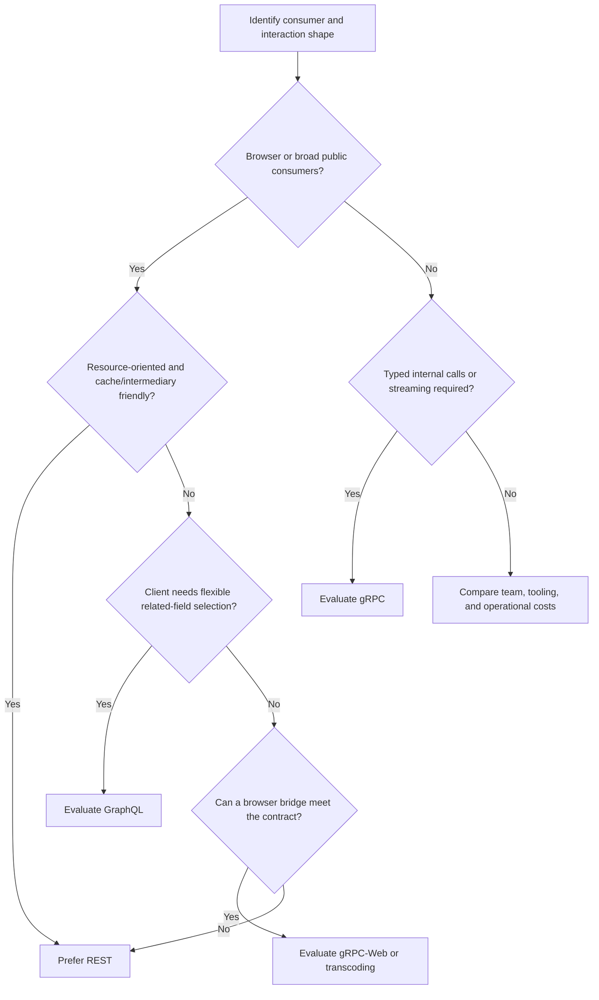

**Decision implications.** A platform can use more than one style at
different boundaries: REST or GraphQL at a public experience edge and gRPC
between services, with explicit ownership for translation and policy. This
is not automatically an anti-pattern, but every translation layer can lose
semantics and adds latency and operational ownership. Evaluate consumer
tooling, version rollout, access policy, observability, and gateway support
as part of the decision rather than selecting by serialization benchmark
alone.

**Common failure mode.** Choosing gRPC because binary payloads are presumed
to be faster, without measuring the actual workload or accounting for
browser access, debugging tools, schema governance, and edge infrastructure.
The inverse mistake is forcing resource-shaped HTTP onto a high-volume
internal stream simply because the organization already has REST tooling.

**Scenario.** An internal pricing engine has Go and Java callers, a stable
typed contract, and server-streamed price updates, making gRPC a strong
candidate. Its customer-facing catalog remains REST because browsers,
CDNs, and external integrators benefit from conventional HTTP resource
semantics. GraphQL remains an option for a separate client-driven
aggregation boundary, evaluated after its sibling chapter is available.

## 5. Internal Working

A gRPC call passes through several framework stages. The generated stub
selects a fully qualified service and method, serializes the request message,
and submits it to the language runtime with call options such as deadline
and metadata. The runtime establishes or reuses a channel, applies the
resolver and service configuration, and invokes a selected backend. The
server runtime dispatches to the registered generated handler, which
decodes the message and calls application code. Completion returns a
response message (if the method shape permits one), terminal status, and
trailers. HTTP/2 carries the gRPC exchange in common deployments, but this
chapter deliberately treats its framing and byte flow as owned by
[HTTP/2](../05_Networking_and_OS/CH04_HTTP2.md).

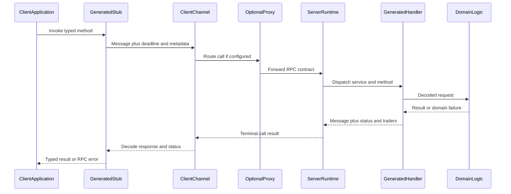


The key boundary is between generated mechanics and application policy.
Generated code handles method dispatch and message representation; the
service implementation owns validation, authorization decisions, domain
invariants, and durable effects. Interceptors wrap calls for cross-cutting
behavior, but should not become a hidden business-logic layer. A channel is
typically reused across calls and owns runtime resources; creating one per
request defeats connection reuse and can overload clients and servers.

## 6. Design Principles

**Model domain operations, not local object methods.** A remote method has
latency, partial failure, resource cost, and retry behavior. Name methods
around stable capabilities and state their preconditions and outcomes; do
not expose an implementation's private class API as a network contract.

**Treat the `.proto` as a product contract.** Keep messages cohesive, field
numbers stable, and comments useful to consumers. Define presence when
absence differs from a default value, and choose enums that tolerate
unknown future values. Generated stubs are downstream artifacts of this
source contract.

**Bound every operation.** Set deadlines, message-size limits, stream
lifetimes, and queue bounds. Propagate cancellation and avoid unbounded
buffering. A call with no explicit budget can occupy threads, memory, and
downstream capacity beyond the request that motivated it.

**Separate transport, RPC, and business outcomes.** HTTP/2 transport state,
gRPC terminal status, and domain outcome are different layers. Use gRPC
status for call-level failure; use typed response fields for expected
domain alternatives when the call itself completed normally. Do not map
every business rejection to `INTERNAL`.

**Design retries with effects in mind.** An unavailable response does not
prove that the server did not execute the request. Retry only safe or
deduplicated operations, and budget attempts within an end-to-end deadline.

## 7. Architecture Patterns

### Internal service-to-service contract

Services share versioned Protobuf definitions and generated bindings. A
consumer calls a provider through a reusable channel; discovery and
balancing can be implemented by the client runtime, a proxy, or a platform
name resolver. The contract repository or package registry provides the
schema to independent teams. Enforce compatibility checks before releasing
the producer and consumer artifacts.

### Edge translation boundary

Browser or public HTTP consumers reach a gRPC backend through gRPC-Web,
transcoding, or an API facade. The edge owns mapping of paths, JSON fields,
authentication context, errors, quotas, and streaming limitations. The
future API Gateway chapter owns full gateway architecture and policy; here
the important gRPC decision is to make the translation boundary explicit
and test it as a separate contract.

### Long-lived subscription

A server-streaming method delivers changes to a client. The design must
define initial snapshot behavior, ordering scope, heartbeat or idle timeout,
resume cursor, retention, and what happens when a consumer falls behind.
If replay is required, the stream needs a durable sequence/cursor contract;
an open network stream alone is not a durable event log.

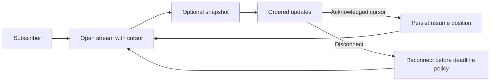

### Bounded bulk transfer

Client streaming can submit a batch while avoiding a single oversized
request. Partition the work into bounded messages, validate each item,
define whether partial acceptance is possible, and return a summary with
stable item identifiers. If the stream fails midway, callers need a retry
strategy that does not duplicate accepted items.

## 8. Production Architecture

A production deployment usually has language-specific generated clients,
reusable channels, a gRPC-aware server runtime, and one or more routing
layers. A proxy may terminate TLS, route on the service/method path, enforce
timeouts, or translate browser traffic. Every hop must preserve the
semantics the service relies on: deadlines, cancellation, status, trailers,
identity, and streaming.

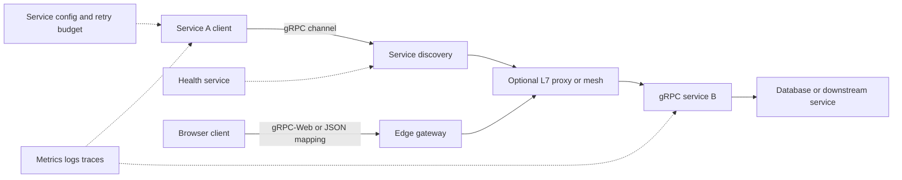

Use one long-lived channel per target and credentials/configuration scope,
not one channel per request. Scale server concurrency based on the language
runtime and handler behavior; synchronous handlers that block on slow
dependencies need bounded worker capacity. Stateful streams need graceful
drain behavior during deployments: stop accepting new streams, let
existing calls finish within a bounded period, then cancel remaining work
and rely on defined client resumption behavior.

Name resolution and balancing must match the platform. A client-side
`round_robin` policy is useful only when the resolver supplies individual
backend addresses and the runtime supports the policy. A proxy may instead
present one stable endpoint and make balancing decisions itself. Confirm
which layer owns health filtering, retries, and connection lifecycle to
avoid duplicate policies.

## 9. Implementation

The implementation workflow starts by designing messages and method
cardinality, then compiling the contract, implementing the generated server
interface, and using generated clients. The example service is an order
operations boundary: one unary lookup, a client-streaming import, a
server-streaming watch, and a bidirectional inventory synchronization call.
Its message fields use stable numbers, and the compatibility successor
demonstrates safe additive evolution and reservation of a retired number.

For Python, generation requires `grpcio` at runtime and `grpcio-tools` for
the compiler plugin. From the repository root, generate bindings with:

```powershell
Set-Location code/proto/grpc-chapter
python -m grpc_tools.protoc -I . --python_out=../../python/grpc-chapter --grpc_python_out=../../python/grpc-chapter order_service.proto
```

This command requires a configured Python environment with both packages
installed. The source examples are not claimed to have executed in this
workspace: `protoc` was not found during authoring, and generated bindings
are intentionally not checked in. Run schema compilation and the sample
after installing the prerequisites. For a deployment, use TLS channel
credentials or platform-provided workload credentials rather than the
insecure local-development channel shown in the demonstration.

Generated-code policy should be explicit: either check generated output
into the repository or generate it during a reproducible build. In both
cases pin compiler, plugins, and runtime versions; run compatibility checks
against the previous released descriptor; and test that a new client can
interoperate with the currently deployed server version.

## 10. Complete Code Examples

The four artifacts below form one small, reviewable example set. The
Protobuf contract illustrates service and message definitions; the Python
program runs an in-process server and client and exercises unary plus all
three streaming cardinalities; the successor schema illustrates field
compatibility; and the service configuration demonstrates a bounded retry
for a read method. The successor schema is compiled separately from the
first schema because it intentionally declares the same package and message
names at a later contract revision.

1. [Order service schema](../code/proto/grpc-chapter/order_service.proto)
2. [Python streaming server and client](../code/python/grpc-chapter/02_streaming_demo.py)
3. [Compatible schema successor](../code/proto/grpc-chapter/03_order_service_v2.proto)
4. [Client service config](../code/python/grpc-chapter/04_service_config.json)

Prerequisites: Python 3.10 or later, `grpcio`, and `grpcio-tools`. Generate
the Python bindings from `order_service.proto` into the Python example's
directory using the Section 9 command. To compile the successor, use a
separate output directory so the two descriptor sets do not overwrite one
another. The service-config file is an example input for a compatible gRPC
client channel; support for individual policies varies by runtime and
resolver. No example assumes a live database, production identity provider,
or successful execution without those prerequisites.

## 11. Performance

Protobuf's compact binary representation can reduce payload size and
serialization work for typed messages compared with verbose text formats,
but the actual gain depends on field values, message shape, compression,
and implementation. Small messages may be dominated by scheduling,
network round trips, TLS, proxy traversal, or application work. Benchmark
end-to-end latency and resource cost using production-shaped payloads,
including tail percentiles and concurrency, rather than using serializer
microbenchmarks as a protocol decision.

Reuse channels and stubs. Channel creation and name resolution are not
per-request operations. For high-throughput clients, bound concurrent RPCs
and account for per-stream buffering and server-side work. Large messages
can cause allocation spikes even when encoded compactly. Configure message
size limits to match the domain, and stream bounded chunks for bulk data.

Retries consume extra capacity and increase tail latency. A retry policy
must include backoff, maximum attempts, and an overall deadline; a client
that retries immediately can turn transient overload into positive
feedback. Measure retry rate, queued work, and deadline exhaustion
alongside successful latency. Avoid retrying the same request at the client,
proxy, and service mesh without a coordinated attempt budget.

## 12. Scalability

Scale stateless unary services horizontally behind a gRPC-aware load
balancer or proxy, while preserving request-level identity and bounded
resource use. Long-lived streams change the capacity model: a single stream
consumes connection/stream state, handler state, and potentially buffers
for its lifetime. Plan by concurrent streams and messages/bytes per second,
not only requests per second.

Streaming clients must reconnect deliberately. If a stream represents a
subscription, use a resume cursor and bounded replay window. If it represents
a session with server-local state, use a shared state store or intentional
affinity; do not assume a reconnect reaches the same process. Connection
draining, idle timeouts, and deployment budgets should be tested against
actual stream duration distributions.

Client-side balancing can distribute calls directly among endpoints, but
it shifts endpoint discovery and health interpretation into the client
runtime. Proxy-side balancing centralizes policy, but may add a hop and
must correctly handle gRPC methods and streams. Choose one primary owner
for retry and balancing policy, document failover behavior, and test both
endpoint changes and proxy failure.

## 13. Security

At the framework level, gRPC clients configure channel credentials for
transport security and call credentials for per-call authentication data.
Transport credentials commonly establish TLS (Transport Layer Security)
and may use mutual TLS (mTLS) where workload identity requires it; full TLS
and certificate mechanics are owned by [TLS](../05_Networking_and_OS/CH06_TLS.md).
Call credentials attach values such as a bearer token to call metadata.
Credentials should be composed deliberately, scoped to the intended
authority, and never logged as ordinary metadata.

Credentials authenticate a caller or secure a channel; they do not replace
authorization. The service must authorize each method and resource, validate
input sizes and values, and avoid trusting caller-provided identity headers
unless an authenticated proxy boundary explicitly owns them. Reflection
should be restricted or disabled where exposing service descriptors is
unnecessary. Detailed authentication and API policy belongs to the future
[API Security](PART_OVERVIEW.md) chapter; gateway enforcement belongs to
[API Gateway](PART_OVERVIEW.md).

Streaming expands exposure over time: enforce per-message and aggregate
limits, deadlines/idle limits, concurrent-stream quotas, and cancellation
cleanup. Do not place secrets in status descriptions or trailers, since
intermediaries and diagnostics may record them. Ensure logs redact tokens,
personal data, and message payloads by default.

## 14. Observability

Instrument RPCs with low-cardinality labels: service, method, canonical
status code, and deployment/version. Record request and response sizes,
duration distributions, active streams, deadline exceeded, cancellation,
retry attempts, and health transitions. Avoid using raw identifiers,
metadata values, or full request paths as metric labels.

Distributed tracing should propagate trace context through metadata or the
chosen instrumentation framework, create client and server spans, and
record status and retry attempts. For streaming methods, one span that
remains open for hours is often operationally awkward; use a bounded stream
span plus message/event counters or linked spans according to the tracing
system's model. Never put payloads or credentials into spans by default.

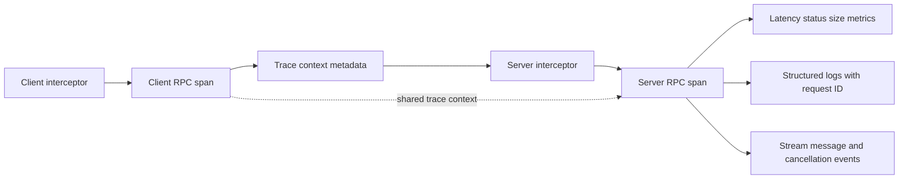

Interceptors are useful for consistent telemetry, correlation identifiers,
and policy enforcement that is genuinely cross-cutting. Keep them fast,
bounded, and observable themselves. An interceptor that blocks on a remote
logging service can become a hidden availability dependency on every call.

## 15. Failure Scenarios

**Deadline exhaustion in a call chain.** A caller spends most of its budget
waiting on a downstream service, then times out before its own response is
written. Propagate remaining time, reserve response/cleanup budget, and
report which dependency consumed it.

**Ambiguous mutation outcome.** The server commits a create operation but
the response is lost. The client observes `UNAVAILABLE` or a transport
failure and cannot infer whether the mutation committed. Use idempotency
keys or a queryable operation identifier before retrying.

**Slow stream consumer.** Messages accumulate in application queues or
runtime buffers, increasing memory until the process is pressured. Bound
queues, observe lag, pause reads/writes where the API allows, and terminate
according to an explicit policy.

**Schema skew during rollout.** A new client calls a method or sends a field
that an old server does not understand. Deploy server support first, use
additive schema evolution, and exercise mixed-version integration tests.

**Proxy strips semantics.** A gateway forwards messages but drops deadlines,
trailers, authentication metadata, or stream cancellation. Test the entire
route, not just direct client-to-server behavior.

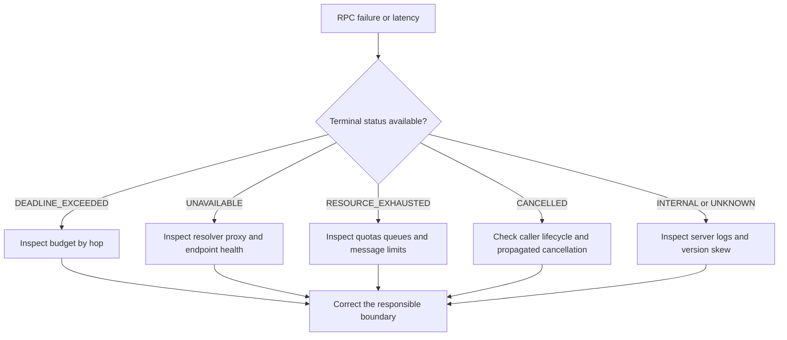

## 16. Testing

Test the contract at multiple levels. Schema checks verify syntax, lint
rules, package/service naming, and field-number compatibility against the
last released descriptor. Generated code should be reproducible with pinned
compiler and plugin versions. Unit tests exercise domain handlers without
network setup; in-process integration tests validate serialization,
dispatch, statuses, metadata, and streaming behavior.

Add cross-version tests for the deployment sequence that matters: old
client/new server and new client/old server where rollout requires both.
Test unknown fields and enum values, absent optional fields, and reserved
numbers. For streams, test half-close, early server completion, client
cancellation, slow consumers, maximum message sizes, and interruption with
resume behavior.

Resilience tests should assert deadlines terminate downstream work, retries
stay within attempt and time budgets, and non-idempotent methods are not
retried without protection. Test the production proxy/gateway path for
trailers, metadata, authentication, status mapping, and browser bridges.
Load tests should include realistic message distributions and long-lived
streams, not just high rates of tiny unary calls.

## 17. Common Mistakes

- Treating gRPC as another name for HTTP/2 and attributing transport
  multiplexing or byte-window behavior to the application contract.
- Creating a channel for each request instead of reusing channels.
- Reusing Protobuf field numbers or changing a field's meaning while keeping
  the same number.
- Omitting deadlines and allowing calls or streams to consume resources
  indefinitely.
- Assuming cancellation rolls back a completed side effect.
- Retrying mutations based only on a transient status without idempotency.
- Using gRPC status codes as a substitute for typed domain outcomes.
- Treating trailers as ordinary response fields or assuming every proxy
  preserves custom trailers.
- Building unbounded queues around streams and mistaking transport flow
  control for application backpressure.
- Exposing reflection publicly without a deliberate discovery policy.
- Assuming native gRPC behavior maps identically to browser or transcoded
  clients.
- Logging full metadata or serialized payloads, including credentials and
  personal information.

## 18. Best Practices

Use stable packages and service names, descriptive messages, and field
numbers allocated once. Reserve retired fields and names; automate schema
linting and compatibility checks. Keep generated artifacts reproducible.

Set an end-to-end deadline at the call boundary and propagate the remaining
budget to downstream calls. Check cancellation in long-running handlers,
bound message sizes and queues, and define stream termination and recovery.

Choose status codes deliberately, return actionable but non-sensitive
descriptions, and use structured error details only when every runtime and
gateway in the path supports them. Document retry safety per method. Reuse
channels; configure one clear owner for load balancing and retries; and
validate health as application readiness.

Use interceptors for consistent correlation and telemetry, not hidden
business semantics. Test generated stubs and production intermediaries
together. Treat gRPC-Web and transcoding as separately supported contracts
with explicit feature limitations.

## 19. Anti-Patterns

**Local-call illusion.** Designing remote methods as if they were cheap,
infallible local calls leads to chatty APIs, missing timeouts, and implicit
transaction assumptions. Coarse-grained operations and explicit outcomes
better reflect the network boundary.

**RPC per field.** Splitting one cohesive operation into many tiny calls
adds round trips and failure points. Batch only when the domain operation
has a clear all-or-partial-result contract; do not batch unrelated work
merely to reduce call count.

**Unbounded stream as event store.** A stream is a live delivery mechanism,
not durable storage. Without a cursor, retention, and replay semantics, a
disconnected consumer cannot know which events it missed.

**Retry everywhere.** Layered retries amplify load and can duplicate
side-effects. Assign retry ownership, restrict retryable methods/statuses,
and cap total attempts within the caller's budget.

**One protocol for every boundary.** Requiring browsers and third-party
integrators to use native gRPC can make the system less accessible; forcing
all internal services through a REST facade can discard useful typed
streaming semantics. Use explicit edge translation where justified.

## 20. Trade-off Analysis

| Decision | Benefits | Costs and risks | Choose when |
|---|---|---|---|
| gRPC vs. REST | Generated typed contracts, compact messages, streaming | Toolchain, schema governance, weaker generic browser/cache ecosystem | Controlled clients, cross-language services, streaming needs |
| gRPC vs. GraphQL | Fixed typed operations, generated clients, server-defined work | Less client query flexibility; browser bridge may be needed | Service operations and stable call shapes dominate |
| Unary vs. streaming | Unary is simple to reason about; streams amortize setup and support incremental data | Stream lifecycle, backpressure, resume, and deployment complexity | Stream only when incremental or bidirectional interaction is required |
| Client-side vs. proxy balancing | Direct endpoint choice and fewer hops vs. centralized policy | Resolver/client complexity vs. proxy dependency and hop cost | Match service discovery, runtime support, and operational ownership |
| Automatic retries vs. caller retry | Transparent transient recovery vs. explicit domain-aware control | Duplicate effects and amplified load vs. more caller code | Automatic retries only for safe/idempotent operations with a bounded budget |
| Transcoding vs. separate edge API | Reuses schemas and backend methods | Semantic mismatch, feature limits, translation maintenance | HTTP/JSON exposure is needed and mapping is intentionally supported |

The principal gRPC trade is contract precision and runtime integration in
exchange for less universal consumer accessibility and more specialized
operational tooling. Its strongest case is not “binary is faster”; it is
that a service organization can agree on typed operations and safely
generate client/server integration across languages. The case weakens when
consumers cannot adopt the runtime, contracts change without governance, or
the system needs browser-native capabilities that the chosen bridge does
not preserve.

## 21. Comparison Table

| Dimension | gRPC | REST | GraphQL |
|---|---|---|---|
| Primary abstraction | Service methods and typed messages | Resources and uniform HTTP interface | Client-selected graph fields |
| Contract | Protobuf IDL with generated bindings | Often OpenAPI or documented HTTP representation | Schema and query language |
| Typical encoding | Protobuf binary | Commonly JSON, but representation is not fixed by REST | Commonly JSON response |
| Streaming | Unary and three streaming cardinalities | Depends on HTTP/API design and extensions | Subscription support depends on implementation |
| Browser support | Usually needs gRPC-Web or a bridge | Broad native HTTP support | HTTP-based clients are common |
| Caching | Not HTTP-cache-native by default | Natural fit for cacheable resource reads | Requires query-aware or application caching |
| Compatibility focus | Field numbers, wire types, method paths, generated APIs | URI, method, representation, and status contract | Schema fields, resolver behavior, query cost |
| Strong fit | Internal typed calls and streaming | Public/resource-oriented APIs | Client-specific aggregation and field selection |

REST's resource model and HTTP method semantics are owned by
[CH01_REST](CH01_REST.md), not re-taught here. GraphQL's execution and
schema mechanics belong to the not-yet-drafted sibling chapter. This table
is a boundary-aware choice aid, not a universal ranking.

## 22. Real-World Case Study

Consider an enterprise order platform with Java checkout services, Go
inventory services, and Python analytics consumers. The initial integration
uses handwritten JSON clients. Teams disagree about whether a missing
`delivery_window` means “unspecified” or “use default,” and a rollout adds
a new status string before all consumers recognize it. The failure is not
that JSON cannot represent the contract; it is that no shared, tested
contract governs independent releases.

The platform introduces a Protobuf service contract and generated client
bindings. `GetOrder` remains unary; a batch import uses client streaming
with a bounded accepted-count summary; a separate subscription streams
order-state changes with a resume cursor. CI checks schema compatibility
and generated output. Each call has an explicit deadline; retries are
restricted to the read method and `UNAVAILABLE`; create operations require
a request key and stable replay behavior. Interceptors record method,
status, duration, and trace context without logging message payloads.

The design does not make all boundaries gRPC. A browser support console
uses a gateway mapping for a small subset of unary methods, while external
partners receive a resource-oriented HTTP API. The team tests that the
browser mapping preserves authorization, errors, and deadlines, and it
keeps the streaming replication endpoint native-only. The result is a
contract that serves controlled internal callers without forcing every
consumer into the same protocol.

The architecture review identifies the cost explicitly: engineers own
compiler/plugin upgrades, schema review, generated artifact publication,
proxy compatibility, and stream lifecycle operations. Those costs are
accepted because cross-language contract drift and incremental event
delivery were material problems; they would not be justified by a small
serialization benchmark alone.

## 23. Interview Questions

1. What does gRPC own that HTTP/2 does not, and where does the boundary lie?
2. How do unary, client-streaming, server-streaming, and bidirectional RPCs
   differ in lifecycle and application contract?
3. Why must Protobuf field numbers remain stable, and what should happen to
   a retired field number?
4. How should an inbound deadline constrain downstream RPCs?
5. Why does `UNAVAILABLE` not automatically prove that a mutation is safe
   to retry?
6. How do gRPC status and trailers differ from a typed domain outcome?
7. How can an application stream apply backpressure independently of
   HTTP/2 flow control?
8. What are the operational differences between client-side balancing and
   proxy-side balancing?
9. What behavior can be lost when native gRPC is translated to gRPC-Web or
   HTTP/JSON?
10. When would you choose gRPC, REST, or GraphQL for a given consumer?

## 24. Hands-on Exercises

1. Compile the order service schema using `grpcio-tools`, inspect the
   generated message and stub modules, and explain how the service path is
   derived from the package, service, and method names.
2. Run the Python example and exercise all four RPC cardinalities. Add a
   deadline to a slow handler and verify the client receives
   `DEADLINE_EXCEEDED`.
3. Add a field with a new number to the v2 schema. Compile v1 and v2 into
   separate directories and test old-reader/new-writer and
   new-reader/old-writer behavior.
4. Add an interceptor that emits method, status, duration, and request ID.
   Prove that it does not log authorization metadata or message payloads.
5. Modify the service config to retry `GetOrder` on `UNAVAILABLE`, then
   instrument attempts and confirm the overall deadline bounds total time.

## 25. Design Exercises

Design an API for a package-tracking platform consumed by mobile clients,
internal services, and partner systems. It must support a single current
status lookup, a partner bulk import, and a live tracking feed. Choose
method cardinalities and describe message boundaries, field-number policy,
deadline propagation, retry safety, resume behavior, and how browser and
partner access differs from internal calls.

Evaluation criteria: each method's cardinality matches its use; streams
have bounded resource and recovery semantics; mutations have repeat-safe
behavior; Protobuf evolution allows mixed-version deployments; gateway
translation is a deliberate, tested boundary; observability avoids
high-cardinality and sensitive labels.

## 26. Architecture Review Questions

- Is the `.proto` schema treated as the source contract and generated
  reproducibly with pinned tools?
- Are all fields assigned stable numbers, and are removed identifiers
  reserved?
- Does each RPC use the narrowest appropriate cardinality and define its
  terminal behavior?
- Are deadlines set at the boundary, propagated downstream, and paired
  with cancellation cleanup?
- Are status codes, trailers, and domain outcomes used for distinct
  purposes?
- Are retries limited to repeat-safe operations and bounded by one
  end-to-end attempt/time budget?
- Are streams bounded, observable, cancellable, and recoverable after
  disconnection where required?
- Is health based on useful readiness, and is reflection exposure
  intentional?
- Does the proxy preserve metadata, deadlines, cancellation, status, and
  streaming semantics?
- Are authentication credentials distinct from authorization policy, with
  complete security and gateway patterns assigned to their future chapters?
- Is the choice against REST and GraphQL justified by consumer needs rather
  than payload format preference?

## 27. Summary

gRPC is a contract-first RPC framework: Protobuf schemas define messages and
service methods, generated stubs connect language-specific clients and
servers, and the runtime provides unary and streaming call lifecycles,
deadlines, cancellation, canonical statuses, trailers, metadata, credentials,
and service configuration. These are API and framework concerns above the
transport. HTTP/2 owns framing, multiplexing, and byte-level flow control;
HTTP/3 and QUIC own their transport mechanisms.

The architecture succeeds when the schema is governed as a versioned
contract, retries reflect side-effect safety, streams have explicit
backpressure and recovery policies, and every intermediary preserves the
required call semantics. Choose gRPC for typed, controlled service
interactions and streaming when those benefits outweigh specialized tooling
and browser/interoperability costs. Choose REST or GraphQL where their
consumer-facing interaction models fit better, and translate between
boundaries only with explicit, tested contracts.

**Further reading**: [REST](CH01_REST.md) ·
[HTTP/2](../05_Networking_and_OS/CH04_HTTP2.md) ·
[HTTP/3](../05_Networking_and_OS/CH05_HTTP3.md) ·
[API Gateway](PART_OVERVIEW.md) · [API Security](PART_OVERVIEW.md)