# Chapter: WebSocket API

Part: [08 — API Architecture](PART_OVERVIEW.md) · Status: Drafted

## 1. Introduction

A WebSocket Application Programming Interface (API) is the application contract carried over a WebSocket
connection: the message shapes, operation meanings, identity rules, delivery
expectations, and error behavior that client and server agree to use after
the transport is open. The connection is merely a channel. Without an
application contract, both sides can exchange bytes but cannot reliably
agree whether a message is a command, an event, an acknowledgment, a replay,
or an error.

This chapter owns that contract layer. It develops envelope and payload
schemas; command, event, acknowledgment, and error semantics; correlation and
multiplexing; subscription naming and authorization; application sequence,
acknowledgment, and replay; schema evolution; application-level backpressure;
logical-operation observability; and the decision to expose a WebSocket API
rather than a request-oriented API style. Examples use JavaScript Object
Notation (JSON) as a readable payload format, but the principles apply to
Protocol Buffers, MessagePack, or a domain-specific binary schema.

The transport substrate is deliberately outside this chapter. [Part 05's
WebSockets chapter](../05_Networking_and_OS/CH17_WebSockets.md) owns the HTTP
Upgrade and `101` handshake, framing, masking, fragmentation, subprotocol and
extension negotiation mechanics, transport comparison, connection scaling,
pub/sub backplanes, heartbeat and reconnection mechanics, and connection
draining. This chapter recaps only the minimum needed to place its contract
on that substrate. It also does not re-teach REST, GraphQL, gRPC, API
gateways, or general API security: those are owned by this part's sibling
chapters, with API Gateway and API Security still future references.

## 2. Historical Evolution

WebSocket protocol standardization solved a transport problem: a persistent
full-duplex channel. It did not prescribe one universal application message
model. Early applications commonly sent arbitrary strings or JSON blobs whose
meaning depended on undocumented client and server assumptions. As systems
grew, teams converged on explicit envelopes, typed message categories,
correlation identifiers, subscription operations, and versioned payloads.
Those are application design choices, not requirements imposed by RFC 6455.

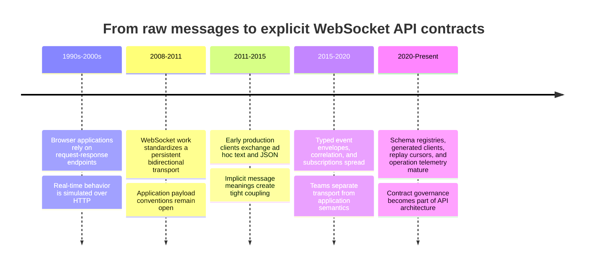

The important shift is not a particular serialization format. It is the move
from "send some JSON" to a contract that states what each message means, how
it can be correlated, authorized, acknowledged, retried, evolved, and
observed. That shift is what makes independent client releases and multiple
server implementations practical.

## 3. Why It Exists

A full-duplex channel permits either endpoint to send at any time. That
freedom also removes the simple request boundary that ordinarily scopes one
request, one response, one authorization check, one timeout, and one log
record. Multiple logical operations can be active on the same connection;
server events may arrive between their replies; a connection may disappear
after a command commits but before its result is observed; and a client may
resume after missing updates. The transport cannot decide the correct
application outcome for any of those cases.

The contract answers those questions. It defines stable identifiers and
message categories, determines which principal may perform which action,
states whether an acknowledgment means queued or committed, declares how
sequence gaps are recovered, and tells clients what to do when they receive
an unknown field or unsupported message version. If those rules stay
implicit, every client implements a slightly different protocol and server
changes become risky even when the wire connection remains healthy.

## 4. Core Concepts

### 4.1 The application message envelope

**Definition.** An envelope is the stable outer structure shared by all
application messages. It carries the minimum metadata needed to classify,
route, validate, authorize, correlate, and observe the message; the
domain-specific data belongs in a separate payload. A useful envelope
usually contains a protocol version, message type, message identifier,
operation or correlation identifier when applicable, timestamp where useful,
and payload. It must not confuse application metadata with WebSocket frame
headers, which Part 05 owns.

**Mechanism.** The receiver validates the envelope before dispatching its
payload. The `type` discriminant selects a schema and handler; the version
selects compatible interpretation rules; identifiers connect related
operations; and the payload is validated against the selected schema. A
minimal conceptual shape is:

```json
{
  "v": 1,
  "type": "order.cancel",
  "messageId": "msg_01J...",
  "operationId": "op_01J...",
  "payload": { "orderId": "ord_42" }
}
```

The envelope should be deliberately small and stable. Put a field at this
level only if several message families need its semantics. Domain-specific
fields such as `orderId` remain in the payload. A parser should reject
missing required metadata, malformed identifiers, unsupported major
versions, and payloads that do not match the declared message type before
business code runs.

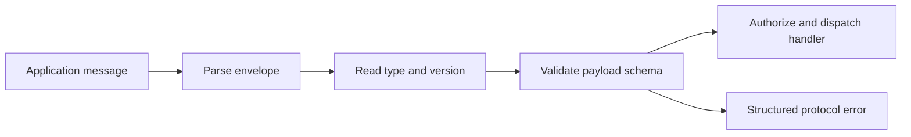

**Decision implications.** A common envelope makes generic middleware,
metrics, tracing, validation, and client dispatch possible. It also creates a
long-lived compatibility surface, so avoid fields whose meaning changes by
message type without an explicit rule. A JSON envelope is easy to inspect
but larger than a compact binary encoding; the contract should remain
format-independent where the product may need to change serialization.

**Common failure mode.** Teams start with bare payloads and later infer
message type from field presence, such as treating an object with `text` as a
chat message and one with `cursor` as a cursor update. Overlapping fields,
optional properties, and version drift make classification ambiguous. The
result is a collection of undocumented mini-protocols and fragile
client-specific branching.

**Scenario.** A collaboration service supports chat, presence, and document
edits. Each uses the same envelope with distinct `type` values, while its
payload schema evolves independently. Shared middleware can validate
`messageId`, attach `operationId` to traces, and route without understanding
document content.

### 4.2 Commands, events, acknowledgments, and errors

**Definition.** A command asks the server to perform an action; an event
reports a fact that has occurred; an acknowledgment communicates progress or
completion for a command or event stream; and an error describes a rejected
message or failed operation. These categories are semantically different
even though all are application messages on the same channel.

**Mechanism.** A command is named for intent, carries validated input, and
has a defined authorization and idempotency policy. The server can answer
with an immediate `accepted` acknowledgment and later a terminal result, or
with a terminal success/error when work is synchronous. An event is
published after its named fact becomes true; it should not be treated as a
command with a different label. An error has a stable code, retryability
classification, safe human-readable message, and optional structured field
details. The contract distinguishes a transport-level delivery receipt from
an application acknowledgment: receiving bytes does not mean a command was
accepted or committed.

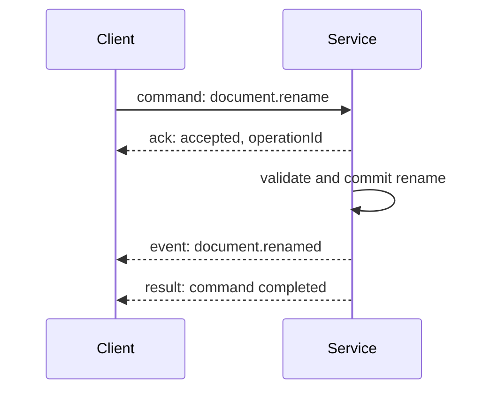

**Decision implications.** Keep the type system small and explicit. A
command/result contract fits work initiated by one caller; a domain event
fits facts useful to several subscribers; acknowledgments fit progress and
delivery checkpoints. If clients need to recover after a disconnect, define
which terminal messages can be replayed and how long they remain available.

**Common failure mode.** A server emits an event called `order.created`
before the database transaction commits, then publishes a failure or
compensation later. Consumers interpret an intended action as a durable fact
and trigger irreversible follow-up work. Another common mistake is returning
an `ack` without saying whether it means received, validated, queued, or
committed.

**Scenario.** A media-conversion command may take several seconds. The server
acknowledges acceptance with an operation identifier, publishes progress
events, and eventually emits a terminal result. A malformed request instead
receives an immediate non-retryable validation error; a temporary capacity
limit receives a retryable error with a suggested delay.

### 4.3 Correlation and request-response over a full-duplex channel

**Definition.** Correlation binds a reply or asynchronous outcome to the
logical operation that caused it. Multiplexing means several such operations
can be outstanding concurrently on one WebSocket connection without
confusing their replies with unsolicited events or with one another.

**Mechanism.** Each command receives a unique `operationId` (or
`correlationId`) that the server echoes in acceptance, result, and error
messages. The client maintains a pending-operation map keyed by that value;
events without that correlation remain independent. A `messageId` identifies
one envelope, while an `operationId` identifies the durable logical action
across retries and reconnects. They are not interchangeable. If a retry
should not execute a side effect twice, the stable operation identifier
needs server-side deduplication semantics; correlation alone does not make
an operation idempotent.

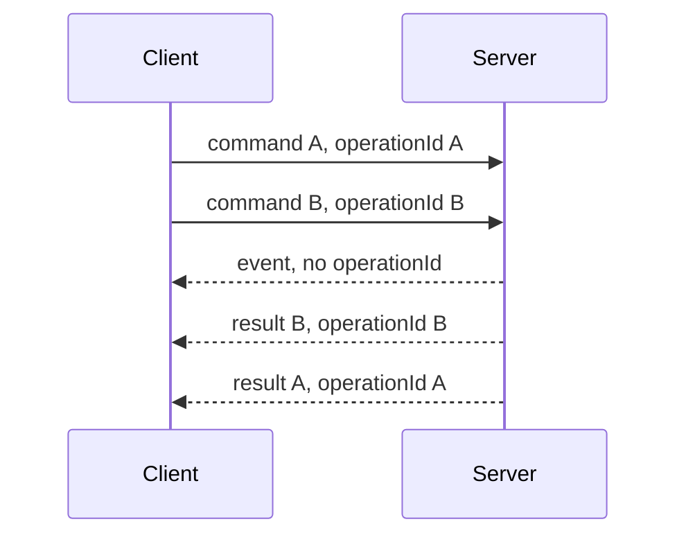

The example allows out-of-order completion because independent operations
may finish at different speeds. If a domain invariant requires ordering,
that order must be part of the operation contract, not an assumption made
from send order.

**Decision implications.** Correlation enables concurrent workflows, bounded
timeouts, cancellation, and useful traces. Define identifier scope and
retention: connection-scoped correlation is insufficient when a retry can
arrive over a new connection. Choose whether replies are a single terminal
result or a stream of progress plus a terminal result. Define what happens
when the client abandons a pending operation; cancellation itself is a
command with races against completion.

**Common failure mode.** A client pairs replies by arrival order. One slow
operation then shifts every subsequent response onto the wrong UI action.
Another is generating a fresh operation identifier for each retry, allowing
the server to perform a charge, reservation, or mutation more than once.

**Scenario.** A trading workstation requests account limits and submits an
order while receiving market events. The independent commands have distinct
operation identifiers; market events have their own event identifiers. The
reply router resolves each pending promise only from the matching result or
error.

### 4.4 Subscription and channel contracts

**Definition.** A subscription is an application-level request to receive a
named class of events, optionally filtered by parameters and bounded by an
authorization policy. A channel or topic is a stable name for an event
stream, not a guarantee that messages are persisted or delivered. Naming,
filtering, lifecycle, and permission rules belong in the API contract.

**Mechanism.** The client sends a `subscribe` command with a channel name,
filter, and optional replay cursor. The server authenticates the connection
context, authorizes the principal for that exact channel and filter,
registers the subscription, then returns a subscription identifier and
starting cursor. `unsubscribe` is explicit and idempotent. The server must
also define behavior when a subscription is revoked, expires, or becomes
invalid because a resource was deleted. Channel names should be
domain-oriented and versionable, such as `documents/{documentId}/activity`,
not implementation-oriented names that expose internal service topology.

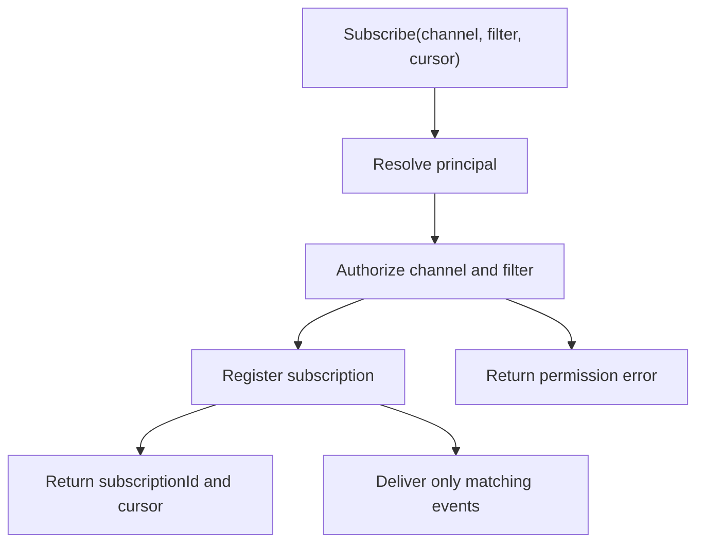

Authorization is not implied by guessing an unlisted channel name. Treat
resource identifiers in channel names as untrusted input, check tenant and
object-level access, and ensure filters cannot broaden access beyond the
principal's scope. Consider whether authorization is evaluated only when
subscribing or re-evaluated for each delivered event; revocation-sensitive
data usually requires a defined revocation path.

**Decision implications.** Explicit subscriptions reduce unnecessary fan-out
and give operators a meaningful unit for quotas and diagnostics. Fine-grained
channels improve isolation but increase lifecycle and cardinality complexity.
A broad `tenant/*` subscription is simpler but must have a carefully scoped
permission check and bounded message volume.

**Common failure mode.** The server authorizes access to the WebSocket once
and assumes every later subscription is safe. A caller can then change a
resource ID in a channel name and subscribe to another user's data. An
equally serious contract error is acknowledging a subscription before replay
and live delivery have a defined cutover, producing a gap or duplicate at
the transition.

**Scenario.** A user may subscribe to a document's presence channel while
having read access, but only editors may subscribe to the document's
mutation-audit stream. Both channels identify the same document, but the
authorization decision uses action and channel type, not only the object ID.

### 4.5 Application sequence, acknowledgments, and replay

**Definition.** An application sequence is an ordering position assigned to
events within a declared scope, such as one document or one account. An
acknowledgment cursor states the last position the consumer has processed
according to an explicit rule. Replay requests events after a cursor so a
consumer can recover missed application state. These are contract-level
semantics; the WebSocket transport's frame order is not a durable event
history or a replay guarantee.

**Mechanism.** Each event carries a stream identifier and monotonically
advancing sequence within that stream. The client records a cursor only
after it has durably applied the event (or otherwise met the contract's
processing condition). On reconnect, the client requests events after that
cursor. The server either replays the retained range and then transitions to
live delivery without a gap, or returns an explicit cursor-expired response
that requires a snapshot and a new cursor. A duplicate may occur at the
replay/live boundary, so event identifiers and idempotent application are
needed. A global total order across unrelated streams is costly and should
not be implied by per-stream sequence numbers.

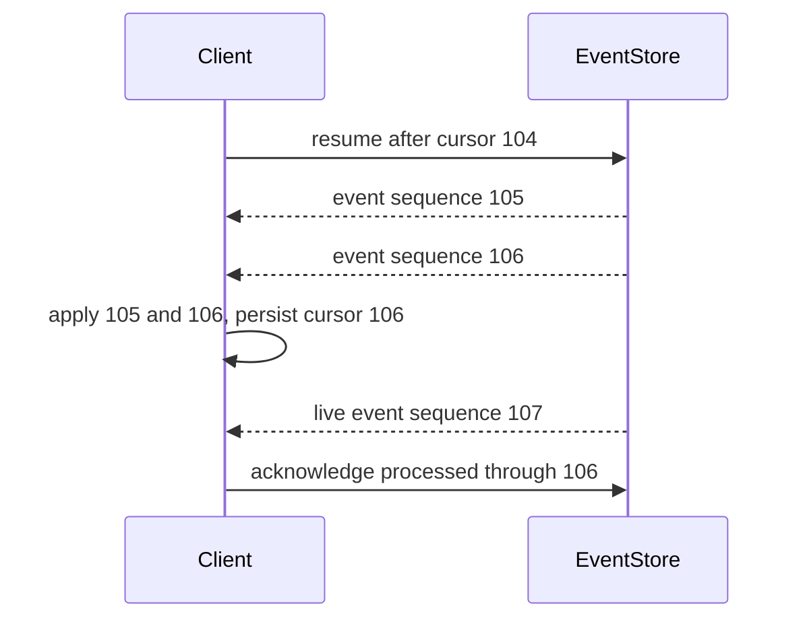

The contract must specify whether acknowledgments are cumulative or per
event, whether out-of-order processing is allowed, what the retention window
means, and whether a cursor is opaque or a public numeric sequence. An
acknowledgment is evidence only within that defined boundary; it does not
promise exactly-once processing of an external side effect.

**Decision implications.** Sequence scope should align with the state that
must be reconstructed. Per-document ordering can be practical; one global
sequence across a multi-region system can become a serialization bottleneck.
Replay is valuable when missed updates are unacceptable and retained history
is available. For ephemeral presence, replay may be misleading; clients
should instead fetch a current snapshot.

The general ordering taxonomy, per-key ordering mechanisms, and reordering
behavior are owned by Part 07's [Ordering Guarantees](../07_System_Design_and_Distributed_Systems/CH18_Ordering_Guarantees.md)
chapter; this subsection defines only the sequence scope and cursor contract
for WebSocket API messages. General duplicate identity and retention are
owned by [Deduplication](../07_System_Design_and_Distributed_Systems/CH19_Deduplication.md),
and end-to-end processing guarantees by [Exactly-Once Processing](../07_System_Design_and_Distributed_Systems/CH17_Exactly_Once_Processing.md).
This API contract states where acknowledgments and replay begin and end; it
does not re-teach those general mechanisms or promise exactly-once effects.

**Common failure mode.** A client stores the greatest sequence observed
before persisting the corresponding state. A crash after cursor persistence
but before state application permanently skips an event. Another failure is
promising replay while the underlying pub/sub transport is non-durable and
there is no authoritative event store.

**Scenario.** A collaborative editor processes events for document `d-42`
in sequence. A mobile client reconnects with cursor 104; if history through
106 is retained, it applies 105 and 106 before live 107. If the cursor is
older than retention, it fetches a document snapshot and resumes from the
snapshot's cursor rather than silently continuing from an incomplete state.

### 4.6 Schema and version evolution

**Definition.** Schema evolution is the controlled change of message
envelopes and payloads while clients and servers run different releases.
Compatibility is directional: a new server may need to read old client
messages, and an old client may receive new server events. A schema version
is a statement of interpretation, not merely a deployment number.

**Mechanism.** Prefer additive changes that preserve old interpretations:
add optional fields with safe defaults, keep existing field meanings stable,
and make readers ignore unknown optional fields. Removing or changing the
meaning of a field is breaking. For a breaking semantic change, introduce a
new message type or major contract version and support an overlap period.
Validate both directions in consumer/provider contract tests. Version
negotiation of WebSocket subprotocols is transport setup owned by Part 05;
this chapter's concern is the application schema selected and carried by
that agreed transport.

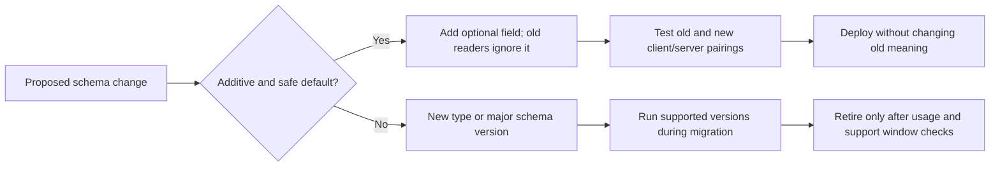

Do not infer schema compatibility from successful JSON parsing. A payload
may parse but change units, nullability, enum meaning, or ordering behavior.
Keep a compatibility matrix covering supported client versions and message
families. Unknown message types need a defined policy: ignore only if they
are explicitly non-critical notifications; otherwise return a structured
unsupported-message error and preserve connection health.

**Decision implications.** In-band version fields simplify dispatch and
replay; message-type version suffixes make breaking boundaries visible but
can multiply types. Avoid versioning every deployment. Version only when
interpretation meaningfully differs, and maintain a deprecation period long
enough for offline and mobile clients to upgrade.

**Common failure mode.** A server adds a field and assumes all clients ignore
unknown properties, but a strict decoder rejects the whole message. More
dangerously, a field retains its name while changing units from milliseconds
to seconds, causing syntactically valid but materially wrong behavior.

**Scenario.** A presence event initially contains `lastSeenAt` as an
ISO-8601 string. A later release adds optional `lastSeenEpochMs`; old clients
continue reading the original field. A future major contract can remove the
string only after telemetry shows the supported client population has
migrated.

### 4.7 Application-level backpressure and error behavior

**Definition.** Application-level backpressure is the policy governing what
the sender should do when a consumer cannot process logical messages at the
rate they are produced. It is distinct from transport flow control and
socket buffering. The application contract chooses whether to slow
production, bound queues, coalesce updates, drop eligible events, persist
work, or terminate an overloaded subscription.

**Mechanism.** Define message classes by loss tolerance and ordering need.
For durable commands, reject or defer new work with a retryable capacity
error rather than silently dropping accepted work. For replaceable state
updates, coalesce to the latest value. For ordered durable events, use
bounded queues and explicit consumer credits or acknowledgments if the
protocol needs application-level pacing. Set maximum payload, queue, and
in-flight-operation bounds. A slow consumer must have a deterministic
policy and an observable terminal reason.

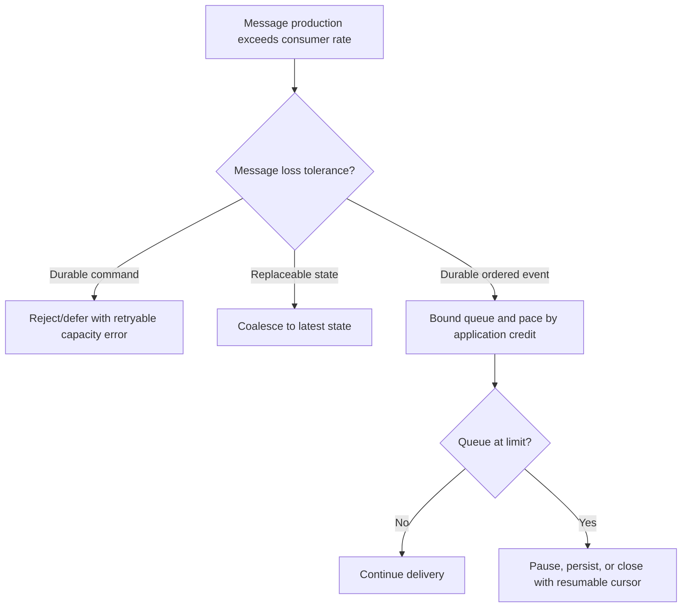

**Decision implications.** A lossy policy is appropriate only when a later
message supersedes an earlier one and clients can recover current state. A
durable policy costs storage and latency but preserves work. The policy
should vary by message class rather than applying one queue behavior to all
traffic. Limits protect the service from one slow or malicious consumer
consuming unbounded memory.

**Common failure mode.** The server queues every update for a slow client
without a bound. Memory grows until the connection or process fails, often
impacting unrelated clients. Conversely, dropping every message at a high
watermark may lose a command result that the caller believes was accepted.

**Scenario.** A dashboard receives per-second sensor readings and can
coalesce unsent readings by sensor to the newest value. Its alarm transition
events are durable and sequenced, so they are persisted and replayable. The
two classes therefore use different overload policies on the same
connection.

### 4.8 Protocol selection as an API-contract decision

**Definition.** Protocol selection asks whether a WebSocket API is the right
contract for the interaction, not whether WebSockets can technically carry
it. Choose it when the product requires frequent, low-latency communication
in both directions, or many concurrent logical operations benefit from one
live channel. Choose a request-oriented style when interactions are discrete
and naturally represented as resources, client-shaped queries, or typed
service calls.

**Mechanism.** Start with interaction shape: directionality, frequency,
latency tolerance, operation duration, offline/replay requirements, client
population, and intermediary constraints. If server-to-client delivery is
the only push need, consider Server-Sent Events (SSE), which Part 05
compares with polling and WebSockets. If clients mostly read or mutate
resources, REST (this part's CH01) is often simpler. GraphQL (CH02) serves
client-shaped graph queries; gRPC (CH03) serves typed remote procedure
contracts, commonly between services. Do not re-derive those styles here.
One product may deliberately use REST for durable commands and WebSockets
for live events, sharing identity and domain schemas across both.

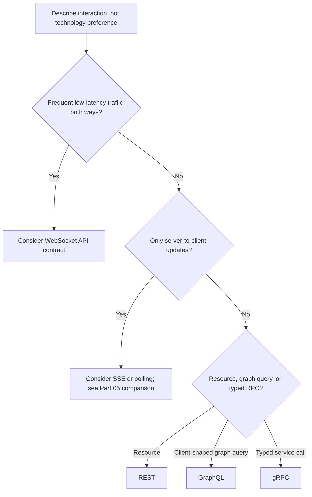

**Decision implications.** A WebSocket API trades stateless per-request
boundaries for a long-lived application session and requires explicit
operation, authorization, replay, and overload semantics. It is compelling
for chat, interactive collaboration, games, and live control loops where
both parties initiate frequent messages. It is a poor fit when it merely
avoids a modest polling interval or wraps ordinary CRUD in a persistent
connection.

**Common failure mode.** Selecting WebSockets because a requirement says
"real-time," without quantifying directionality or latency. Teams inherit
contract complexity and connection operations for a notification feed that
could use SSE or a conventional endpoint.

**Scenario.** A collaborative whiteboard uses WebSockets for cursor movement,
presence, and frequent edit commands, where both sides initiate messages.
Account settings remain REST resources. A background export's progress may
be SSE because it is a one-way stream and the start/cancel actions are
ordinary commands.

## 5. Internal Working

At runtime, application processing begins after the WebSocket transport has
delivered a complete logical application message. The receiver parses the
envelope, applies size and schema limits, identifies the operation, resolves
the authenticated principal, authorizes the requested action, and only then
dispatches domain work. The sender should not treat successful socket send
as proof of server acceptance or durable completion. Those states require
application acknowledgments with declared meaning.

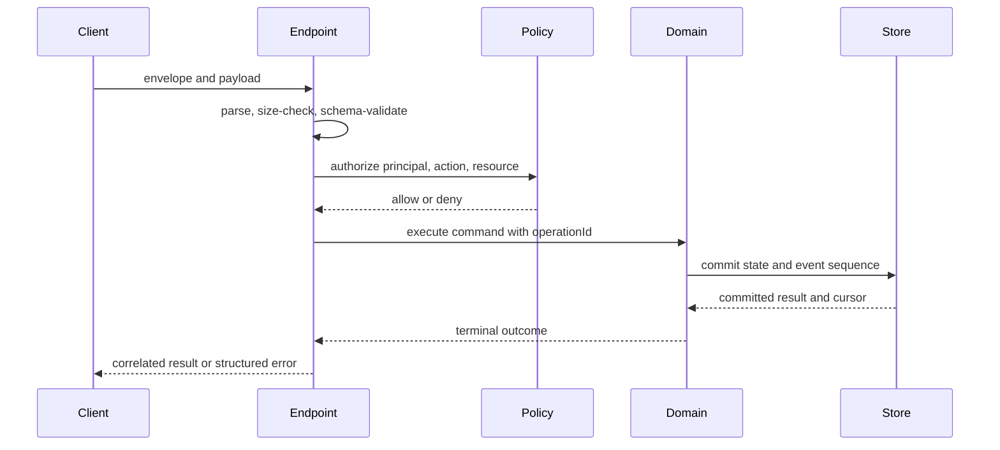

For subscriptions, the corresponding path authorizes the channel, establishes
a cursor boundary, replays retained events if requested, then hands delivery
to the live stream without a gap. This transition is an application
consistency problem, not a property provided by the transport. The exact
server implementation may use a broker, event store, or domain service, but
the client-visible contract remains stable.

## 6. Design Principles

1. **Make semantics explicit.** Every message type names a business meaning,
   not merely an implementation action. Define acknowledgment stage,
   ordering scope, replay support, and error retryability.
2. **Separate envelope from payload.** Shared metadata stays generic;
   domain schemas stay independently evolvable.
3. **Treat each message as a security boundary.** A long-lived authenticated
   connection does not grant unlimited authority to every later command or
   subscription.
4. **Design for uncertainty after send.** A client may not know whether an
   operation committed when the connection fails. Use stable operation
   identity, explicit deduplication rules, and outcome lookup/replay where
   required.
5. **Bound every resource under application control.** Limit payload size,
   pending operations, subscriptions, replay range, and outbound queues.
6. **Specify loss and recovery.** Distinguish durable facts from replaceable
   state and define the behavior for a gap, expired cursor, or slow consumer.

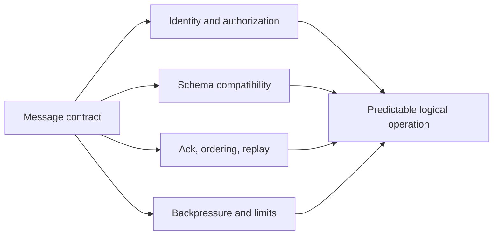

## 7. Architecture Patterns

**Command with correlated result.** The client sends a command with a
stable operation identifier. The server acknowledges acceptance, then
returns a terminal result or error carrying the same identifier. Use this
when a request may take long enough that progress events or concurrent
operations matter. Keep the command contract explicit about retry and
idempotency; the [Idempotency chapter](../07_System_Design_and_Distributed_Systems/CH16_Idempotency.md)
owns the general mechanism.

**Subscription with cursor.** A client requests a named stream, optionally
after a cursor. The server returns a subscription identifier and the cursor
from which delivery is guaranteed. Use this when a client needs durable
updates and reconnect recovery; do not promise it for ephemeral presence.

**Snapshot plus event tail.** The server returns a consistent snapshot with
its stream cursor, then events after that cursor. This bounds replay cost for
long-disconnected clients and gives a recovery route when older history has
expired. The snapshot and cursor must describe the same logical point.

**Shared command and event contracts across APIs.** A system may accept
commands through REST or gRPC while publishing resulting events over a
WebSocket API. Reuse domain schemas and identity semantics, but do not
pretend a command receipt and a live event have identical delivery or retry
guarantees.

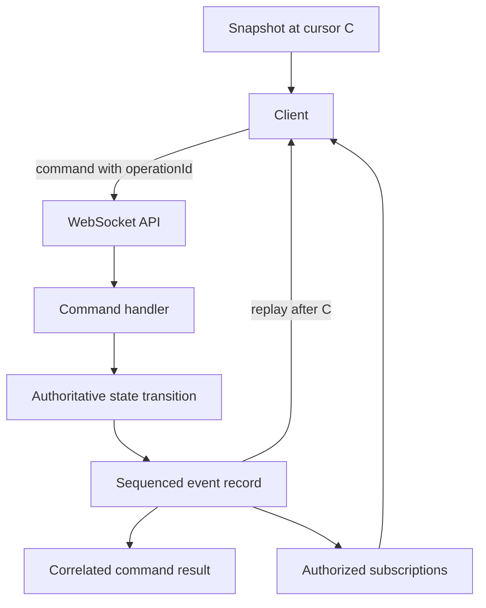

## 8. Production Architecture

The application contract usually sits behind a WebSocket endpoint or managed
real-time gateway. That gateway terminates the transport, applies connection
policy, and forwards validated application messages to command handlers and
subscription services. The exact connection distribution, draining, and
backplane design belongs to [Part 05 WebSockets](../05_Networking_and_OS/CH17_WebSockets.md).
The API-specific concern is to keep business operations, event retention,
authorization, and schema evolution independent of the process that happens
to hold a connection.

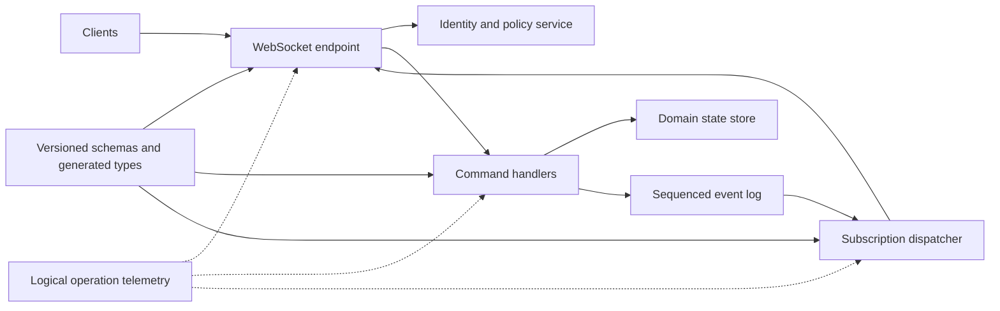

Keep internal routing details out of public channel names and error payloads.
A gateway may apply coarse connection limits, while command handlers enforce
resource-level permissions and business invariants. For a public API,
document supported client versions and the replay/retention service-level
expectation alongside the message schemas.

## 9. Implementation

An implementation should have a typed registry from message type and schema
version to validator and handler. The dispatch pipeline should reject
unknown required types, malformed envelopes, oversized payloads, and
unauthorized operations before domain code runs. Validate data after
deserialization; static client types do not validate untrusted runtime
input. Return errors through one stable structure rather than leaking
framework exception names.

The server should maintain a bounded pending-work and outbound-delivery
policy per connection or subscription. It should correlate all terminal
responses, distinguish acceptance from commitment, and define operation
expiry. If the same command can be retried after reconnect, its stable
operation identifier must be carried through the retry and be subject to the
declared deduplication policy. Do not generate IDs only at the WebSocket
connection layer.

For subscriptions, authorize both subscribe and unsubscribe lifecycle
operations; scope each cursor to a principal and stream; and prevent a cursor
from granting access to another tenant's history. Cursor tokens can be
opaque and integrity-protected, but their authorization meaning must still
be checked server-side. Re-check access when policy requires immediate
revocation. API Security (CH09, future) owns the full cross-cutting security
model; this chapter limits itself to the message contract's identity and
authorization obligations.

For browser clients, credentials may be constrained by the WebSocket client
API and deployment architecture. Do not put bearer secrets in query strings
that may be logged. Part 05 owns Origin validation and transport security;
the future API Security chapter owns credential and threat-model depth.

## 10. Complete Code Examples

The following are **illustrative JSON contract fixtures**, not executable
programs or complete schemas. They are deliberately small enough to review
as API examples. Production contracts should add formal JSON Schema or an
equivalent schema definition, documented constraints, and generated
compatibility tests.

- [Versioned envelope](../code/json/websocket-api-chapter/01_versioned_envelope.json):
  stable metadata separated from a domain payload.
- [Correlated command and reply](../code/json/websocket-api-chapter/02_correlated_command_reply.json):
  stable operation identity across acceptance and completion.
- [Subscription lifecycle and replay cursor](../code/json/websocket-api-chapter/03_subscription_replay_cursor.json):
  subscribe, event sequence, acknowledgment, and resume request.
- [Acknowledgment and error contracts](../code/json/websocket-api-chapter/04_ack_and_error_contract.json):
  distinct acceptance, committed result, and retryable/non-retryable errors.

These fixtures use JSON arrays where a sequence of separate messages is
shown. Each array element is an independent application message, not one
WebSocket frame or a prescribed batching format.

## 11. Performance

At the API layer, performance depends on message size, serialization and
validation cost, handler latency, fan-out, and the amount of work held in
flight. WebSocket framing overhead is usually not the dominant cost for
JSON-heavy domain messages; Part 05 owns frame details and transport-level
comparison. Measure end-to-end logical operation latency from client send to
the contractually meaningful terminal result, not just time until the
server's socket write returns.

Batching can amortize envelope and dispatch overhead, but increases latency,
head-of-line coupling between unrelated messages, and the blast radius of a
malformed batch. Compression can reduce bytes while increasing CPU and
latency; its transport negotiation and mechanics belong to Part 05. Avoid
unbounded payloads and deeply nested schemas, which increase parsing cost
and can become denial-of-service multipliers. Put explicit limits on both
the number of in-flight operations and the cost of each operation.

For high-frequency state, send deltas only when the consumer can apply them
reliably; otherwise periodic snapshots may be faster overall because they
avoid resynchronization complexity. Benchmark representative slow consumers
and reconnect replay, not only median message throughput with an always-fast
client.

## 12. Scalability

The API layer scales by separating connection ownership from logical
operation ownership. The transport server may hold a client connection, but
commands should execute against services and stores that can scale according
to business workload. Subscription fan-out, authorization checks, event
retention, and replay have separate capacity curves. Part 05 owns
connection-count scaling and the pub/sub backplane; this section covers the
additional contract-level costs those mechanisms carry.

Channel design determines fan-out. A single global topic is easy to reason
about but can deliver irrelevant events to every connection. Fine-grained
channels reduce unnecessary work but increase subscription metadata and
policy checks. Partition streams by the smallest scope that needs ordered
delivery; avoid an accidental global sequence if per-resource order is
sufficient. Bound replay ranges and provide snapshot recovery so old
clients cannot demand unbounded history.

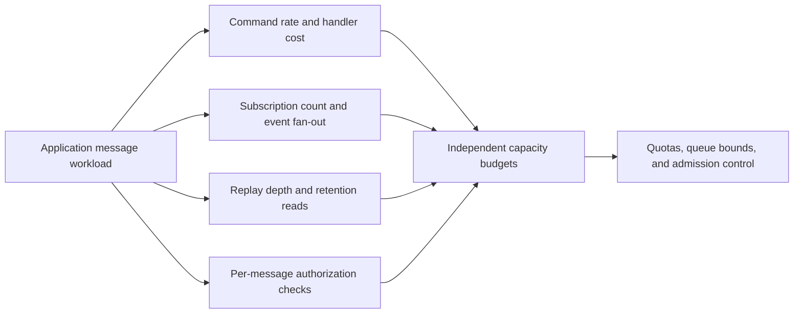

Use tenant-level quotas and per-principal subscription limits to prevent one
consumer from dominating shared capacity. A hot channel may need partitioned
fan-out or a read-model designed for subscriptions. Capacity tests should
include authorization and serialization work, event replay, and slow-client
backpressure rather than counting only open connections.

## 13. Security

The API contract must state which authenticated principal is acting, which
message types that principal may send, which resources it may address, and
which event streams it may receive. A successful connection authentication
establishes identity context; it does not authorize every later command.
Authorize at the message and resource boundary, validate tenant ownership,
and decide how credential expiration or permission revocation affects an
already-open connection. Part 05 WebSockets owns the transport-specific
Origin check and connection substrate; the future [API Security chapter
(CH09)](PART_OVERVIEW.md) owns comprehensive API threat modeling and
cross-cutting controls.

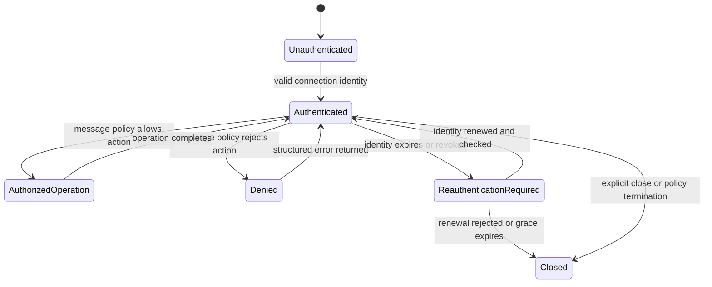

Do not trust client-supplied identity, tenant, role, or authorization scope
inside a payload. Derive the principal from verified connection context and
bind every operation to it. Validate messages against allow-listed schemas,
cap nesting and size, and avoid reflecting sensitive data in errors. Do not
log raw credentials or unrestricted payloads. Apply rate limits and quotas
to logical operations and subscriptions, not only connection establishment.

For replay, treat cursors as untrusted input: validate stream ownership,
tenant, retention range, and integrity before returning data. A replay
cursor is not a capability token unless the design deliberately makes it
one and protects it accordingly. Define whether events already authorized
when produced are re-authorized at delivery; sensitive data generally needs
current access checks or revocation-aware subscription termination.

## 14. Observability

The key observability unit is the logical operation or subscription, not just
the connection. A single socket can carry many unrelated commands and event
streams. Propagate a trace context or operation identifier through the
envelope and internal work, but keep identifiers bounded and avoid using
user-provided values as metric labels. Never log full sensitive payloads by
default.

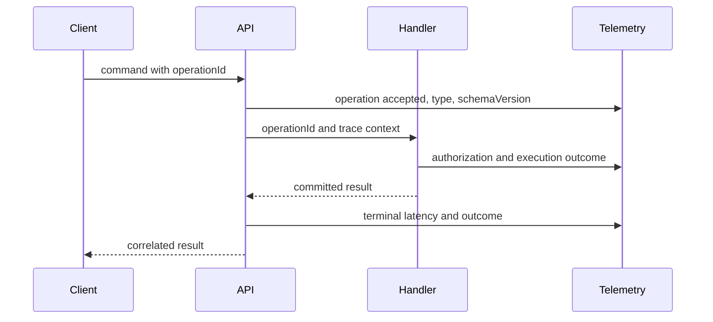

Useful low-cardinality measurements include message count by type and
version, validation and authorization rejection rates, command acceptance to
terminal latency, pending-operation age, subscription count by bounded
category, replay volume and cursor-expiry rate, queue depth, coalesced or
dropped update count, and structured error code. Track correlation across
client send, server acceptance, durable commit, event publication, and
client acknowledgment where each boundary exists.

Do not count every message as a REST request or label metrics by raw channel,
resource ID, operation ID, or user ID. Use sampled traces and privacy-safe
structured logs for high-cardinality investigation. Connection counts,
heartbeat health, and transport close codes remain useful but are owned by
Part 05's WebSockets chapter; they do not substitute for application-level
outcome telemetry.

## 15. Failure Scenarios

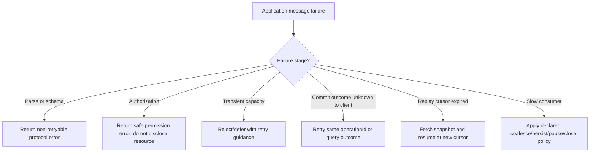

**Commit succeeded, reply was not observed.** The client cannot infer failure
from a missing result. It retries with the same operation identifier or
queries the operation outcome. The server returns the recorded result or
reports an explicit unknown/expired state; it does not silently repeat a
non-idempotent side effect.

**Event gap.** A sequence jumps from 106 to 108. The client pauses dependent
state application, requests replay after 106, and either fills 107 or obtains
a fresh snapshot if the cursor has expired. It must not merely log the gap
and continue displaying a state it knows may be inconsistent.

**Permission revoked during a subscription.** The server stops delivery and
returns a subscription-terminated reason that does not reveal protected
data. It may require reauthentication or a fresh subscribe after policy
changes. The contract should define whether already queued events are
discarded.

**Unknown required message version.** The server returns a stable
unsupported-version error and does not guess at payload meaning. The client
can update, downgrade to a supported contract if allowed, or close cleanly.

## 16. Testing

Test the contract at message boundaries, not only handler functions.

- **Schema tests:** valid and invalid envelopes, unknown optional fields,
  unknown required types, size and nesting limits, and each supported schema
  version.
- **Correlation tests:** interleave several commands and unsolicited events;
  complete commands out of order; verify every result reaches the matching
  operation and timeouts do not leak pending state.
- **Acknowledgment tests:** prove `accepted` is not treated as `committed`;
  test terminal result, duplicate command, retry with stable operation ID,
  and response-loss recovery.
- **Subscription tests:** deny unauthorized resource and filter combinations;
  verify idempotent unsubscribe, revocation, and cross-tenant isolation.
- **Replay tests:** resume from a cursor, cross the replay/live boundary,
  inject duplicates and gaps, expire a cursor, and verify snapshot alignment.
- **Backpressure tests:** use a deliberately slow consumer and verify bounded
  queues, class-specific loss policy, and recovery without process-wide
  resource exhaustion.
- **Compatibility tests:** test old client/new server and new client/old
  server combinations for every supported release window.
- **Operational tests:** verify structured error codes and telemetry at
  validation, authorization, commit, replay, and terminal-result boundaries.

Property-based tests are valuable for envelope parsing, identifier handling,
sequence transitions, and cursor boundaries. A contract test suite should
also assert that documentation fixtures and generated client types agree;
schema changes that compile but alter semantic guarantees need review beyond
type checking.

## 17. Common Mistakes

- Using bare domain payloads without an envelope or explicit message type.
- Treating `messageId`, `operationId`, and `eventId` as one interchangeable
  identifier.
- Treating a successful socket write or `received` signal as proof that a
  command committed.
- Correlating replies by arrival order rather than by stable operation ID.
- Reissuing a side-effecting command with a new ID after an uncertain
  disconnect.
- Naming a channel without specifying filters, subscription lifecycle,
  authorization, retention, and replay behavior.
- Assuming transport ordering provides a durable application event log.
- Persisting a replay cursor before the associated event is durably applied.
- Adding an optional schema field without checking strict decoders or
  semantic compatibility.
- Applying one overload policy to durable commands, ordered events, and
  replaceable state updates alike.
- Putting access tokens in query strings or logging raw message payloads.
- Choosing a WebSocket API for a one-way or infrequent interaction without
  comparing simpler API contracts.

## 18. Best Practices

- Publish a message catalog with type, version, direction, schema, authority,
  correlation behavior, acknowledgment meaning, ordering scope, retry rule,
  and replay support.
- Keep command intent, event facts, progress acknowledgments, terminal
  results, and errors as distinct message categories.
- Use stable operation IDs across retries; keep message IDs unique per
  envelope and event IDs stable across replay.
- Define sequence scope and cursor persistence rules in terms of applied
  application state, not received bytes.
- Make subscription names domain-oriented, authorize each requested stream,
  and define revocation behavior.
- Prefer additive evolution and preserve field meaning; maintain a tested
  client/server compatibility window.
- Bound payloads, in-flight operations, subscriptions, replay ranges, and
  outbound queues.
- Pick an overload policy per message class and make drops/coalescing
  observable.
- Trace logical operations across acceptance, commit, publication, and
  client acknowledgment without exposing sensitive payloads.
- Use WebSockets only when the bidirectional interaction justifies the
  contract and operational costs; use Part 05's comparison for transport
  choice and this part's sibling chapters for alternative API contracts.

## 19. Anti-Patterns

**One generic `message` type with payload inspection.** This hides semantics,
weakens schema validation, and makes version changes ambiguous. Use explicit
discriminated message types.

**Acknowledgment without a stage.** A boolean `ok` does not say whether the
server received, validated, queued, or committed the work. Name the state and
define its durability boundary.

**Global event sequence by default.** A global total order can serialize
otherwise independent streams and add coordination cost. Use the smallest
ordering scope that satisfies domain invariants.

**Unbounded replay and queues.** Unlimited retention requests or per-client
buffers convert a slow or stale client into a capacity risk. Bound the
window and provide snapshot recovery or an explicit terminal policy.

**Connection-level authorization as permanent authority.** A single
handshake decision cannot safely authorize arbitrary future messages,
resources, and subscriptions. Re-check according to the sensitivity and
revocation requirements of each operation.

**WebSocket as a universal API wrapper.** Moving ordinary resource reads and
mutations onto a persistent channel does not automatically simplify the
contract. Keep request-shaped work on an API style that naturally expresses
it unless multiplexed, low-latency, bidirectional interaction is required.

## 20. Trade-off Analysis

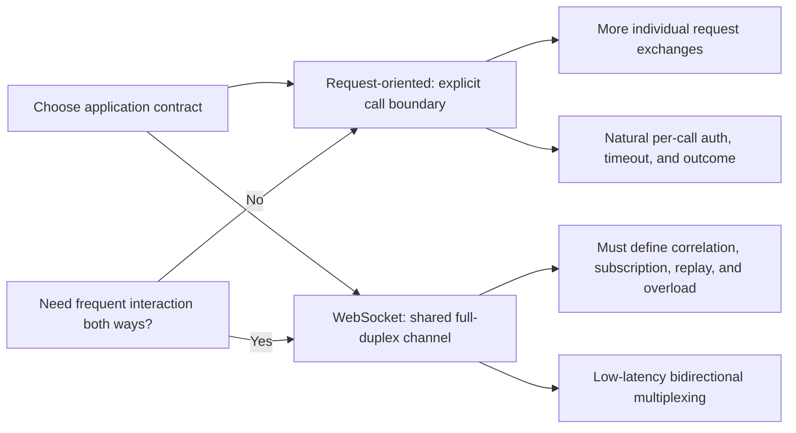

The WebSocket API's primary benefit is not merely fewer bytes. It is the
ability to maintain concurrent logical operations and server-originated
events over one live channel. The cost is that request boundaries and
recovery guarantees must be designed explicitly. If clients only need
server-originated updates, SSE may provide a narrower contract. If the
interaction is resource-oriented, graph-query-oriented, or typed
request-response, REST, GraphQL, or gRPC may provide clearer semantics; see
those sibling chapters for their own mechanisms.

| Decision | Benefit | Cost | Use when |
|---|---|---|---|
| One terminal reply per command | Simple correlation and client state | Poor fit for long-running progress | Work completes quickly or progress is unnecessary |
| Acceptance plus progress plus terminal result | Responsive long-running operation | More states, timeout, and reconnect rules | Processing takes seconds or has meaningful milestones |
| Per-stream sequence and replay | Recoverable state with bounded ordering | Event storage, cursors, duplicate handling | Missing an update corrupts user-visible state |
| Ephemeral delivery without replay | Lower storage and simpler publisher | Client must resynchronize from current state | Presence or replaceable transient state |
| Coalesce slow-client updates | Bounds queues and favors freshness | Intermediate values are intentionally lost | Latest state matters more than every transition |
| Persist and replay slow-client updates | Preserves ordered facts | Storage, latency, and retention cost | Every event matters to downstream state |

## 21. Comparison Table

This table compares API contract fit only. Part 05 owns WebSocket transport
and SSE/polling transport mechanics; the GraphQL and gRPC sibling chapters
own their full style-specific explanations.

| Dimension | REST | GraphQL | gRPC | WebSocket API |
|---|---|---|---|---|
| Primary interaction | Resource request/response | Client-shaped graph query/mutation | Typed remote procedure call | Commands, events, and subscriptions on a live channel |
| Initiation | Client initiates each exchange | Client initiates each operation | Client initiates each RPC/stream | Either endpoint can initiate messages |
| Correlation | Implicit in request/response | Per operation | Per RPC/stream | Explicit identifiers required for concurrent operations |
| Server push | Separate mechanism | Subscription transports vary | Streaming RPC | Native application message direction after connection setup |
| Replay contract | Client re-requests resource | Application-specific | Application-specific | Must be defined with cursor, retention, and snapshot semantics |
| Strong fit | Public resource APIs and CRUD | Flexible client-specific reads | Typed service-to-service calls and streams | Frequent bidirectional interaction and multiplexed operations |
| Main contract risk | Resource/method semantics drift | Resolver/schema coupling and query cost | Generated schema/client coordination | Implicit operation, authorization, and recovery semantics |

These styles can coexist. The architect should select per interaction and
keep identity, domain invariants, and event meaning consistent across
boundaries.

## 22. Real-World Case Study

Consider a collaborative design canvas used by browser and mobile clients.
The team initially sends untyped JSON messages: some include `documentId`,
some use `room`, and acknowledgments are a bare `true`. It works in a single
client release, but a mobile client reconnecting after suspension cannot
know whether its last edit committed. A second client release changes cursor
coordinates from percentages to pixels; old clients render valid-looking
but incorrect positions. Authorization is checked when the socket opens,
not when a client subscribes to a document.

The revised contract separates the stable envelope from message payloads.
Each edit command has a stable operation ID; the server distinguishes
accepted from committed; committed document changes receive per-document
sequence numbers and stable event IDs. A reconnecting client resumes after
its last durably applied cursor or fetches a snapshot if history has expired.
Presence remains ephemeral and is coalesced for slow clients. A subscription
names the document and activity stream explicitly, and authorization checks
the principal's current permission for that document and stream.

Schema evolution introduces an optional coordinate-space field with a
well-defined default, then migrates clients before any breaking change.
Telemetry records operation type, contract version, commit outcome, replay
gaps, and authorization denials without logging canvas content. The system
still depends on Part 05's connection distribution and backplane mechanics;
the contract does not attempt to solve those transport concerns. The outcome
is a protocol clients can implement independently, test under reconnect and
version skew, and debug by logical operation rather than by socket alone.

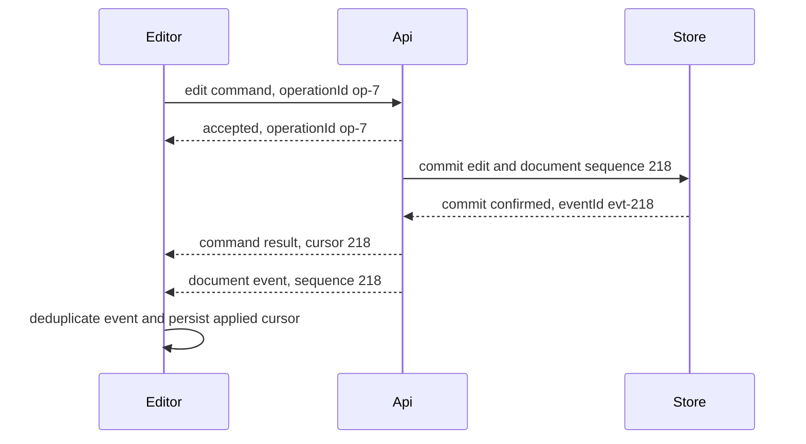

## 23. Interview Questions

1. Why does a WebSocket connection need an application message envelope if
   WebSocket already defines frames?
2. How do `messageId`, `operationId`, `correlationId`, and `eventId` differ?
3. What should an `accepted` acknowledgment mean, and how is that different
   from a committed result?
4. How would you support several concurrent commands and unsolicited events
   on one connection without pairing responses by arrival order?
5. What is the difference between transport ordering and an application
   sequence/replay contract?
6. How do you close the race between replaying retained events and switching
   a subscription to live delivery?
7. What does a replay cursor prove, and what should happen when it expires?
8. How do you authorize a subscription to a resource when the connection was
   authenticated earlier?
9. Which schema changes are backward-compatible, and how would you support
   mobile clients that remain offline for weeks?
10. How should overload behavior differ for durable commands, ordered events,
    and replaceable state updates?
11. When is a WebSocket API a better contract than REST, GraphQL, or gRPC?
12. Which logical-operation metrics would expose contract failures that
    connection counts cannot?

## 24. Hands-on Exercises

1. Take the Section 10 versioned envelope fixture and define a formal schema
   with required fields, optional fields, enumerated message types, and
   bounded payload sizes. Add valid and invalid fixtures.
2. Implement a client-side pending-operation map keyed by `operationId`.
   Interleave two commands, an event, and out-of-order results; prove no
   response is delivered to the wrong caller.
3. Specify a subscription contract for a tenant-scoped audit stream. Include
   subscribe, accepted response, unsubscribe, authorization denial, and
   cursor-expired behavior.
4. Simulate event sequences 105-108 with a duplicate and a missing event.
   Implement a client that persists its cursor only after applying events
   and requests replay on a gap.
5. Simulate a slow client receiving sensor readings and alarm transitions.
   Coalesce sensor state but persist alarm events, then measure memory and
   recovery behavior under a bounded queue.
6. Change a payload schema additively and run old-client/new-server and
   new-client/old-server contract tests. Then change a field's units and
   document why the change is breaking despite valid JSON.

## 25. Design Exercises

Design the application contract for a multi-user incident room where users
can issue commands, subscribe to updates, and reconnect from mobile devices.
Include:

- Envelope, message types, identifiers, and version policy.
- Command acceptance versus terminal outcome, including retry behavior when
  the client cannot tell whether a command committed.
- Channel names, filters, per-message authorization, and permission
  revocation.
- Event sequence scope, acknowledgment semantics, replay retention, and
  snapshot fallback.
- Different backpressure policies for incident commands, status events, and
  typing indicators.
- Compatibility support window and unknown-message behavior.
- Logical-operation traces, low-cardinality metrics, and privacy-safe logs.
- A protocol decision that explains why this interaction uses WebSockets
  rather than REST, GraphQL, gRPC, or one-way SSE.

Review the design against a threat where one tenant guesses another tenant's
channel, a client retries after response loss, a cursor has expired, and a
slow consumer accumulates updates during a burst.

## 26. Architecture Review Questions

- Is the transport-versus-application ownership boundary explicit, with
  Part 05 linked for handshake, framing, transport comparison, scaling, and
  reconnection mechanics?
- Does every message have an explicit type, schema version, and validation
  rule?
- Are message, operation, correlation, and event identifiers distinct and
  consistently scoped?
- Does each command define acceptance, commitment, terminal result, timeout,
  retry, and duplicate semantics?
- Are subscriptions named, filtered, authorized, revocable, and explicitly
  unsubscribed?
- Is ordering scoped to a stream or aggregate, and is replay backed by a
  source of truth with bounded retention?
- Does cursor persistence follow successful application of the event?
- Are schema changes tested in both client/server version directions?
- Are payload, queue, in-flight operation, subscription, and replay bounds
  enforced?
- Does every message class have a deliberate overload and error policy?
- Are identity and resource authorization checked at the application
  operation boundary, not inferred solely from connection establishment?
- Can operators trace a logical command through acceptance, commit,
  publication, and client acknowledgment without high-cardinality metrics or
  sensitive payload logging?
- Is WebSocket justified by interaction shape, rather than a general desire
  for a modern or real-time API?

## 27. Summary

A WebSocket API is the application contract carried over a full-duplex
transport, not the transport protocol itself. Its envelope makes messages
classifiable and evolvable; its command, event, acknowledgment, and error
types distinguish intent from fact and receipt from commitment. Correlation
IDs make concurrent logical operations safe to multiplex, while explicit
subscription contracts bind channels and filters to authorization. Application
sequences, acknowledgments, and replay cursors define recovery beyond the
transport's ordering and delivery behavior. Schema evolution, bounded
backpressure, per-message authorization, and logical-operation telemetry make
the API survivable under version skew, overload, reconnects, and production
incidents.

Choose this API style when clients and servers genuinely need frequent,
low-latency messages in both directions or concurrent operations over a live
channel. Otherwise, REST, GraphQL, gRPC, SSE, or polling may express the
interaction with less contract and operational complexity. Part 05 remains
the owner of WebSocket transport mechanics and the transport comparison;
future API Gateway and API Security chapters own their cross-cutting
mechanics.

**Further reading**: [REST](CH01_REST.md) · [Part 05 WebSockets](../05_Networking_and_OS/CH17_WebSockets.md) ·
[GraphQL](PART_OVERVIEW.md) · [gRPC](PART_OVERVIEW.md) ·
[API Gateway](PART_OVERVIEW.md) · [API Security](PART_OVERVIEW.md) ·
[Idempotency](../07_System_Design_and_Distributed_Systems/CH16_Idempotency.md)