# Chapter: Server-Sent Events as an API Contract

Part: [08 — API Architecture](PART_OVERVIEW.md) · Status: Drafted

## 1. Introduction

Server-Sent Events (SSE) are often introduced as a way to keep a connection
open. That is the transport-level description, and it belongs to Part 05's
[WebSockets chapter](../05_Networking_and_OS/CH17_WebSockets.md#48-full-duplex-bidirectional-communication-as-the-core-value-proposition):
SSE carries server-to-client events in a long-lived HTTP response and does
not provide a reverse message channel. This chapter starts one layer above
that mechanism. It treats an event stream as a public API contract: what a
client subscribes to, how events are named and shaped, what an event ID
means, what replay can recover, where retention ends, and what a client must
do when its cursor is no longer usable.

The distinction matters because a connection that reconnects is not
necessarily a feed that resumes correctly. The browser can reconnect while
the server has already discarded the relevant history; an event can arrive
before the client has durably applied its payload; an authorization rule can
change while a stream is open; and a filter can silently create a different
cursor sequence from the one used by a prior subscription. A good API
contract makes each of these boundaries visible and testable instead of
letting a convenient client library imply guarantees the service does not
provide.

The ownership boundary is deliberate. Part 05 CH17 remains the owner of SSE
transport essentials and the general WebSocket-versus-SSE-versus-polling
decision framework. This chapter owns resumable event-feed API details and
the design decisions that make server-push useful to API consumers. It
recaps the HTTP substrate where necessary, links to the [REST chapter](CH01_REST.md)
for resource modeling, and forwards security-policy and gateway mechanics
to the future [API Security and API Gateway chapters](PART_OVERVIEW.md#chapters).

## 2. Historical Evolution

Server push in browsers accumulated several layers of workarounds before
SSE became a standardized browser-facing API. Short polling repeatedly
requested the latest state; long polling held an ordinary request until an
update existed; WebSockets later standardized a full-duplex channel. SSE
took a narrower path: retain HTTP's request/response direction and define a
browser event-source interface for consuming a streamed response. Part 05
CH17 owns this transport and protocol history; this API chapter does not
restate it.

The API-design problem did not disappear when transport support arrived.
Early feeds often exposed an open endpoint that emitted ad hoc JSON blobs,
with no stable identity, no documented reset behavior, and no answer to
"what happens if the client is offline for an hour?" As systems grew, the
important evolution was from a live notification channel toward an explicit
feed contract: stable event identity, retained history, a resume cursor,
bounded retention, tenant-aware selection, schema compatibility, and a
defined recovery path when the requested history is gone.

This distinction also separates a stream API from an event store. A stream
may expose a filtered, privacy-scoped projection for subscribers without
being the system of record. Full event sourcing, event-log authority,
aggregate replay, and upcasting belong to [Event Sourcing](../07_System_Design_and_Distributed_Systems/CH15_Event_Sourcing.md);
an API feed may be backed by an event log, a change-data-capture pipeline,
or a purpose-built delivery store.

## 3. Why It Exists

Many API consumers need to learn that a resource changed without repeatedly
fetching the complete resource. A deployment console needs state transitions
for a running job; a support dashboard needs ticket updates; a browser may
need an order-status change while its user remains on the page. A normal
resource API remains the authority for current state, but a feed can carry
small changes or invalidation signals promptly and let the client fetch a
fresh representation only when it needs one.

The architectural question is not merely whether the server can emit bytes
continuously. It is whether the API can specify an unambiguous subscription
scope, stable event identity, ordering scope, replay boundary, expiry path,
authorization lifetime, and compatibility policy. Without those decisions,
the feed is an attractive demo that becomes an unreliable integration point
as soon as clients sleep, deploy independently, or scale across tenants.

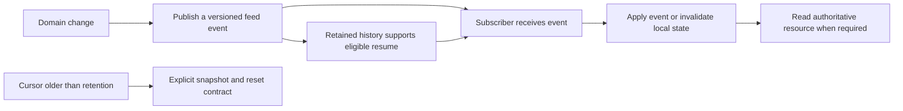

## 4. Core Concepts

### 4.1 An event-stream endpoint is a subscription resource

**Definition.** An event-stream endpoint is an API resource that represents
a subscription to a named, scoped sequence of changes. It is not simply a
route whose handler happens to wait. Its contract identifies the audience,
event families, filters, ordering scope, replay behavior, retention, and
termination conditions. This fits the REST resource-modeling vocabulary
owned by [CH01_REST](CH01_REST.md), while the long-lived response itself is
the transport recap owned by Part 05 CH17.

**Mechanism.** A client selects a feed with a stable path and explicit
parameters, for example `GET /v1/tenants/{tenantId}/orders/events?status=open`.
The response represents the event sequence for that authorized tenant and
filter. A separate `GET /v1/tenants/{tenantId}/orders/{orderId}` remains the
authoritative current-state resource; the event endpoint need not turn each
event into a second copy of every resource. A useful contract describes
whether it is a collection-wide feed, a resource-scoped feed, or a named
business-topic subscription, and whether a client can use a snapshot
endpoint to establish its initial state.

The endpoint should be stable across deployments and should avoid exposing
internal broker names, partition IDs, or database table names as the public
subscription model. Those are implementation details that may change while
the logical subscription remains meaningful. Query parameters must also be
canonicalized: semantically identical filters should produce the same
subscription identity and cursor scope.

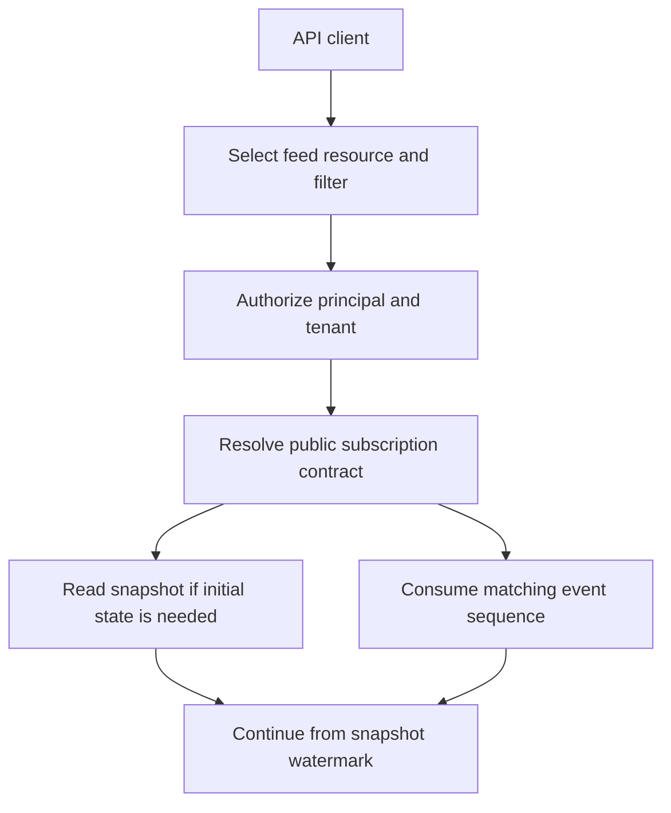

**Decision implications.** Model subscriptions around client jobs, not
internal producers. A user-facing deployment feed might combine build,
approval, and rollout transitions into a coherent deployment view even when
those facts originate in different services. Conversely, a single generic
`/events` endpoint with dozens of undocumented event families makes
authorization, schema evolution, and consumer ownership difficult to
reason about. Keep feed boundaries aligned with a stable audience and
meaningful ordering scope; add a new feed when its guarantees or security
boundary differ materially.

**Common failure mode.** Treating an endpoint as an unstructured socket
causes the server to leak internal event topics directly into client
contracts. Producers then cannot reorganize without breaking consumers, and
the API team cannot tell whether a cursor represents one tenant's logical
feed or a broker partition shared by unrelated tenants.

**Scenario.** A job-monitoring API exposes `/v1/jobs/{jobId}/events` for
status transitions and a separate `/v1/jobs/{jobId}` resource for the
current snapshot. The feed tells a page that a job moved to `running`; the
resource supplies the complete current job when the page reloads or detects
a gap.

### 4.2 Event names, payload schemas, and stable IDs

**Definition.** A feed event has an event type, a validated payload, and—if
the contract supports resume—a stable event ID. The event type selects the
payload schema and consumer action; the payload carries the business fact or
invalidation data; the ID identifies a position or event within a precisely
scoped feed. The SSE `event`, `data`, and `id` fields are transport
representation details; their API meanings and schema are owned here.

**Mechanism.** Keep the envelope small and explicit. A typical public event
has a `type`, `schema_version`, `occurred_at`, a resource reference, and a
type-specific `data` object. The event name should be stable and
machine-readable, such as `order.status_changed`, not a presentation label
like `Your order is on its way!`. Payloads should state whether fields are
complete values or deltas, identify nullable/optional fields, and carry a
correlation or causation reference only when consumers have a defined use
for it. Do not use a timestamp alone as an event ID: clocks can collide,
drift, or move backwards, and timestamps do not necessarily establish a
total ordering.

For resumable feeds, an ID must remain stable when the same logical event is
redelivered and must be interpretable by the server for the correct feed
scope. Prefer an opaque cursor if the storage layout or partition mapping may
change. If the API uses a visible monotonic sequence, state its ordering
scope; a tenant-local sequence is not globally ordered. IDs should not
contain secrets or grant access by themselves. A cursor is untrusted input
and must be checked against the authenticated principal and subscription.

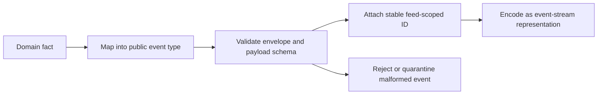

**Decision implications.** Emit facts when consumers need to react to a
meaningful change; emit invalidations when the authoritative resource is
the only safe representation to expose. A fact such as
`order.status_changed` supports local projections but freezes a public data
meaning. An invalidation such as `order.changed` keeps the contract smaller
but forces an additional resource read. Stable IDs should be designed with
the retention and replay model, rather than appended after clients depend on
the event schema.

**Common failure mode.** Reusing a broker offset as a public event ID can
couple clients to internal partitioning, while using a generated random ID
per delivery makes replay deduplication impossible. Both mistakes confuse
the internal record identity with the stable API cursor.

**Scenario.** An order feed publishes a stable `order.status_changed`
event with an ID scoped to the tenant feed, a schema version, the order ID,
the new status, and the transition time. If the consumer needs address or
payment details, it follows the resource link rather than relying on a
forever-expanding event payload.

### 4.3 Cursor, resume, replay window, and retention

**Definition.** A cursor identifies a position in one logical subscription.
Resume asks the server to continue after that position; replay is the
server's retrieval of retained events after it. The retention window is the
range of positions the service still promises to serve. These are API
contract semantics, not a property guaranteed merely because the browser
reconnects.

**Mechanism.** In the browser `EventSource` API, the server can put an event
ID on each event. The browser tracks the last event ID it dispatched and
sends it as the `Last-Event-ID` request header when it reconnects. The
server-visible meaning should be: "continue after this cursor in this
authorized feed," not "the application durably committed this event." The
header is client input, can be absent, stale, malformed, or from a different
subscription, and must be validated. When the client opens a fresh stream,
the API may also support an explicit `after` cursor parameter; document
precedence clearly, typically using `Last-Event-ID` on automatic reconnect
and `after` only when no reconnect header is present.

A replay algorithm needs a stable ordering relation and an exclusive or
inclusive boundary. A common contract is strictly-after: if the cursor is
`c`, return events whose feed positions follow `c`, in the feed's declared
order. If the cursor is unknown or outside retention, do not silently jump
to the tail. Return a documented reset signal and a snapshot watermark so
the client can rebuild state and continue after the snapshot's position.

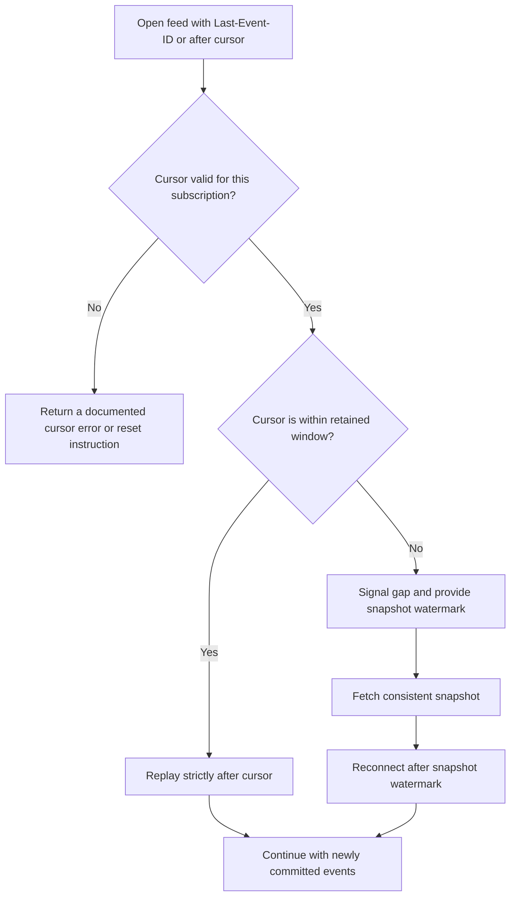

Retention must be specified in a unit clients can plan against: elapsed
time, event count, or both. Time-only retention is easy to describe but
high-volume feeds may evict history far sooner in event-count terms; count-
only retention has different consequences for low-volume feeds. State the
effective replay window, how it is measured, and whether maintenance or
outages can shorten it. A cursor can be syntactically valid but no longer
retained, which is a normal contract outcome rather than an exceptional
server bug.

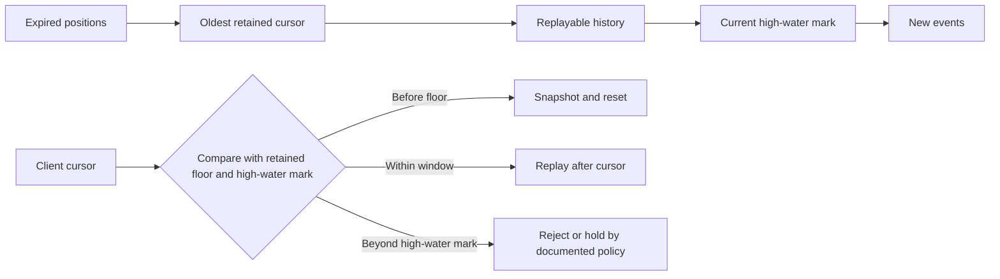

**Decision implications.** Retention is a product promise and a storage
budget. Choose it from realistic offline periods, client release cadence,
incident recovery objectives, and replay throughput. A longer window helps
mobile or intermittently connected clients but increases storage, replay
load, and privacy exposure. A cursor should be scoped to the canonical
filter and authorization boundary; changing filters may require a new
subscription cursor or a reset.

**Common failure mode.** Returning only events after the current tail when a
requested cursor has expired makes a gap look like a successful resume. The
client's view then remains incomplete indefinitely, and no metric on the
stream itself reveals that history was skipped.

**Scenario.** A tenant's feed retains at least 24 hours and a bounded number
of events. A reconnect within that contract replays after its cursor. A
reconnect after the oldest retained event receives `feed.reset` with a
snapshot URL and watermark; the client replaces its local projection, then
resumes after that watermark.

### 4.4 Tenant authorization and filter design

**Definition.** A subscription is authorized over both an identity boundary
and a data-selection boundary. Authentication answers who the caller is;
authorization determines which tenant, resource, and event families the
caller may observe. Filters narrow that authorized set; they must never
broaden it.

**Mechanism.** Resolve tenant and principal from trusted credentials, then
authorize the specific feed and requested resource scope before accepting
the stream. Apply authorization again at event selection, not only when the
connection starts: permissions, memberships, or resource ownership can
change during a long-lived subscription. A policy change should revoke,
close, or re-evaluate the affected subscription within a documented bound.
Bind cursors to the tenant, feed, and canonical filter (or reject reuse
across those dimensions). Validate every filter against an allow-list and
limit its cardinality and complexity. The event producer should not decide
which tenants can see the event; the feed authorization layer makes that
decision from authoritative policy.

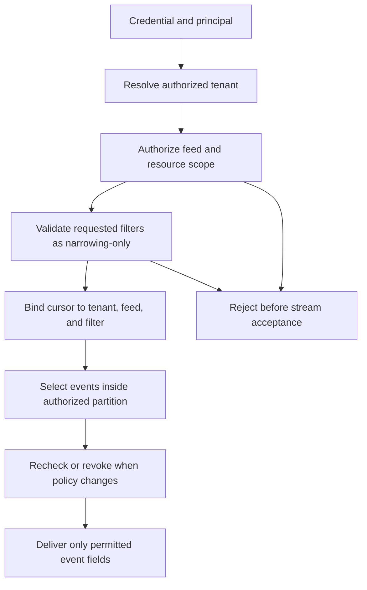

Native browser `EventSource` does not offer a general custom-header option.
That affects credential design at the API surface: same-site secure cookies
may be appropriate for browser sessions; a cross-origin source needs an
explicit credential and origin policy; bearer-token query parameters risk
leaking through logs, diagnostics, and copied URLs. A fetch-based streaming
client can set headers but has different implementation and reconnect
responsibilities. These are application-security choices, not a reason to
weaken tenant boundaries. Detailed identity, token, and gateway policy
belongs to the future [API Security and API Gateway chapters](PART_OVERVIEW.md#chapters).

**Decision implications.** Prefer a tenant-scoped endpoint where tenant
identity is part of the resource path and authorization is checked against
the authenticated caller; do not trust a path tenant ID alone. Keep filters
expressive enough for real consumer needs but bounded enough to authorize,
canonicalize, and monitor. For multi-tenant fan-out, partitioning or
indexing should preserve tenant isolation without requiring one global scan
per subscriber.

**Common failure mode.** A stream is authorized once at connection open,
then a long-lived connection continues to deliver data after the user's
membership is revoked. Another common defect is applying a filter to event
types but not to fields, leaving sensitive fields exposed inside an
otherwise permitted event.

**Scenario.** A dashboard principal can subscribe to tenant `acme` and the
`orders` feed, but only to open orders. The API rejects a cursor minted for
another tenant, validates `status=open` as a narrowing filter, and omits
payment data from the event projection even when the producer's internal
record contains it.

### 4.5 Event schema evolution and compatibility

**Definition.** Event-schema evolution is the controlled change of event
names, fields, value domains, and meaning while producers and subscribers
deploy independently. A published event is an API representation with
consumers, not a private object that can be freely refactored.

**Mechanism.** Establish compatibility rules per event family. Adding an
optional field with a documented default is often compatible for tolerant
readers; removing a field, changing its type, changing a unit, or narrowing
an enum can break consumers. Unknown event types should be safely ignorable
only when the contract says they are; clients that require every transition
must detect unsupported types and fall back to a snapshot or a newer
contract. Include an explicit schema version when the payload needs
version-specific interpretation, but avoid a global version counter that
forces unrelated events to evolve together.

Use additive evolution for routine changes, introduce a new event type or
versioned feed for incompatible meaning, and run old and new projections in
parallel when consumers need a migration period. Keep event names stable
even if internal aggregate names change. Event upcasting across a durable
event store is a separate concern owned by [Event Sourcing](../07_System_Design_and_Distributed_Systems/CH15_Event_Sourcing.md); a feed contract may instead retain the original wire version, transform at the API edge, or expire old versions by policy.

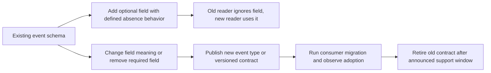

**Decision implications.** The compatibility policy must match the
consumer population. Internal feeds with coordinated deployments can use a
short migration window; public integrations need longer overlap, explicit
deprecation dates, and version-aware metrics. Event schemas should be
validated at producer boundaries and contract-tested against representative
consumer fixtures. Document whether payload fields are snapshots or deltas,
and whether consumers may ignore fields they do not recognize.

**Common failure mode.** A producer renames `state` to `status` as a
"cleanup," deploys immediately, and discovers mobile clients or customer
integrations still rely on the old field. A subtler break changes a value
from dollars to cents while retaining an integer type; syntax-compatible
payloads can still be semantically incompatible.

**Scenario.** Version 1 sends `order.status_changed` with `status` and
`order_id`. Version 1.1 adds optional `reason_code`; older clients ignore
it. A later change replaces status transitions with a different state
machine, so the producer publishes `order.lifecycle_transition.v2` and
keeps the old event available through a documented migration window.

### 4.6 HTTP cache, proxy, error, and reconnect consequences

**Definition.** An event-feed API runs through HTTP-aware clients,
gateways, reverse proxies, and sometimes shared caches. The API contract
must specify the expected behavior at those boundaries without re-teaching
HTTP caching or proxy mechanics, which are owned by [HTTP](../05_Networking_and_OS/CH01_HTTP.md)
and [HTTP/2](../05_Networking_and_OS/CH04_HTTP2.md).

**Mechanism.** A live stream is not an ordinary immutable representation.
The endpoint should declare an explicit cache policy that prevents
intermediaries from replaying or sharing one subscriber's live response with
another; authenticated, tenant-specific streams must not become shared
cache entries. Proxies must preserve streaming behavior and avoid buffering
the full response, but exact flush, timeout, flow-control, and HTTP/2
configuration belong to the networking chapters. At the API level, publish
which status/body outcomes mean "subscription accepted," "credentials
invalid," "not authorized," "cursor expired," and "temporary service
unavailable." Once the stream has begun, a normal HTTP status cannot be
changed; terminal conditions therefore need an event-level contract or a
connection close followed by a documented reconnect outcome.

| API outcome | Before stream acceptance | After stream acceptance | Client action |
|---|---|---|---|
| Missing or invalid credentials | `401 Unauthorized` | Close after the documented credential-expiry behavior; do not keep delivering protected events | Refresh credentials, then create a new subscription |
| Authenticated but forbidden | `403 Forbidden` | Revoke/close the affected subscription | Stop retrying until access changes |
| Cursor outside retention | Return a reset result or emit `feed.reset` with snapshot URL and watermark | Emit `feed.reset`, then close the stream | Close the old source, fetch the consistent snapshot, and open a new source after its watermark |
| Temporary overload or outage | `429 Too Many Requests` or `503 Service Unavailable`, with retry guidance where supported | Close the stream | Retry with bounded backoff; preserve the last usable cursor |

These are contract examples, not a replacement HTTP status taxonomy; the
semantics of status codes and `Retry-After` belong to [HTTP](../05_Networking_and_OS/CH01_HTTP.md).
Native `EventSource` does not reliably expose response status and body
details to application code. A browser API can therefore expose a companion
status/reset resource or use a fetch-based streaming client when it must
classify pre-acceptance failures precisely. For an expired cursor discovered
after reconnect, a typed `feed.reset` event gives the application an
observable recovery instruction; its handler should close that source before
fetching the snapshot and opening a new source with the returned watermark.

Native `EventSource` exposes limited error detail and performs automatic
reconnection. The API must distinguish transient interruption from
permanent conditions, state when the client should retry, and avoid turning
authorization denial or an expired cursor into an invisible retry loop.
Where a browser client cannot inspect status or response headers adequately,
provide a companion status/reset resource or use a fetch-based streaming
client with an explicit error protocol. The SSE `retry` field can suggest a
reconnect delay, but it does not guarantee delivery or server availability;
Part 05 CH17 owns this transport behavior.

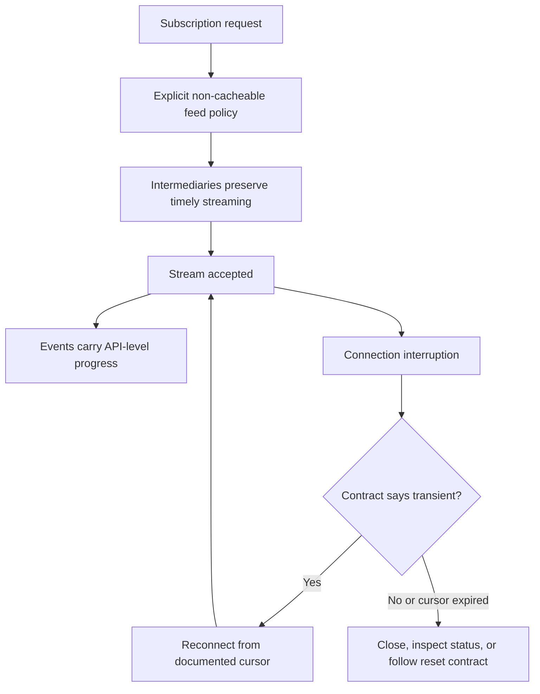

**Decision implications.** Treat gateway timeout and buffering behavior as
deployment prerequisites, but document them as client-visible consequences:
maximum supported idle period, expected heartbeat or comment behavior only
as transport detail, retry policy, and how the client recognizes permanent
failure. Avoid caching the event stream; cache a separate snapshot endpoint
according to ordinary HTTP policy if appropriate. If HTTP/2 is used, its
stream multiplexing can share a connection, but stream-level flow control
and intermediaries still influence delivery latency; link to CH04_HTTP2
rather than duplicating its mechanism.

**Common failure mode.** The origin emits events promptly but a reverse
proxy buffers them until a large chunk accumulates. The connection looks
healthy while the API's promised low-latency update is violated. Another
failure is a cache or gateway treating an authenticated stream like a
cacheable `GET`, mixing tenants or replaying stale bytes.

**Scenario.** A browser dashboard sees an `error` event from `EventSource`
but cannot tell whether a cursor expired or a proxy briefly dropped the
connection. The API publishes a companion feed-status endpoint and a
`feed.reset` event contract; the client retries transient network failures
and performs a snapshot reset for expired history.

### 4.7 Reliable resumable feeds versus ephemeral live-only streams

**Definition.** A reliable resumable feed retains enough ordered history to
continue a client from a valid cursor. An ephemeral live-only stream offers
future events while connected but does not promise recovery of events missed
during a disconnect. Neither label implies exactly-once application
processing. The service must state its guarantees at the boundary it
actually controls.

**Mechanism.** For a resumable feed, the service needs durable or otherwise
recoverable event history, stable feed-scoped positions, a retention
contract, an ordering scope, cursor validation, a replay path, and a gap
response. It may promise ordered replay after a valid cursor for the
retention window. The browser's `Last-Event-ID` is the last event dispatched
by the user agent; it is not an acknowledgment that application code
finished processing or committed a local transaction. Therefore native
`EventSource` alone cannot establish exactly-once processing, nor can the
server infer a durable consumer checkpoint from that header. If application
processing must be at-least-once across client crashes, the client needs an
application-managed checkpoint/acknowledgment design and idempotent effect
handling; that is a separate contract.

For an ephemeral feed, omit a replay promise and document that reconnect
starts at the live edge, with possible loss during outages. IDs may be useful
for diagnostics, but do not imply replay unless the service honors them.
Provide a current-state resource or snapshot so clients can repair local
state after reconnect. If events are merely invalidations, the client can
refresh the resource and converge even when an individual notification was
missed.

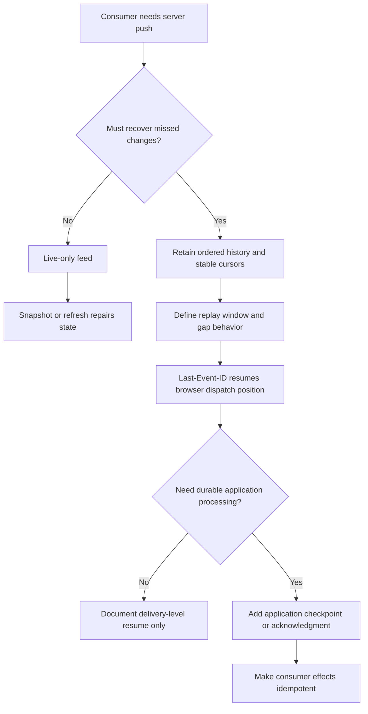

**Decision implications.** Choose the weakest guarantee that satisfies the
product. A live dashboard invalidation may be ephemeral and repair by
refetching. Financial or workflow transitions may require a retained feed
and a durable consumer checkpoint, but SSE itself does not supply that
checkpoint. Retention, replay rate limits, and maximum lag are part of the
published service objective, not implementation footnotes.

**Common failure mode.** Marketing a feed as "reliable" because browser
reconnection is automatic, then discovering that a client offline beyond a
short retention period missed business transitions. A related mistake is
claiming exactly-once because event IDs are unique; uniqueness supports
deduplication but does not atomically commit the client's side effect and
cursor.

**Scenario.** A live inventory badge is an ephemeral invalidation feed; on
reconnect it refetches inventory. A provisioning audit consumer uses a
resumable feed with a retained cursor and an explicit acknowledgment store
updated only after the consumer commits each transition. The former
promises convergence; the latter promises replay within a stated window,
with idempotent processing rather than exactly-once delivery.

### 4.8 Server-push API surface decision

**Definition.** Choosing an API surface for server-push means deciding what
the consumer needs to subscribe to and what delivery/recovery contract it
needs. It is separate from choosing the underlying transport. Part 05 CH17
owns the general polling/SSE/WebSocket transport-selection framework; this
section applies only the API-contract lens and does not re-derive that
framework.

**Mechanism.** Start with the consumer's interaction and correctness needs:
is the server sending notifications, state deltas, or a durable business
history; does the consumer need to send messages on the same channel; must
it replay after downtime; what is the ordering scope; how will it repair a
gap; and what authorization/filter boundary applies? A REST snapshot plus
SSE invalidations is often a clean API composition: REST owns current
resource representations and SSE announces that a refresh may be useful.
If consumers need bidirectional low-latency messages, the transport choice
returns to the Part 05 decision framework. If updates are infrequent and
staleness acceptable, ordinary resource reads or polling may be simpler.

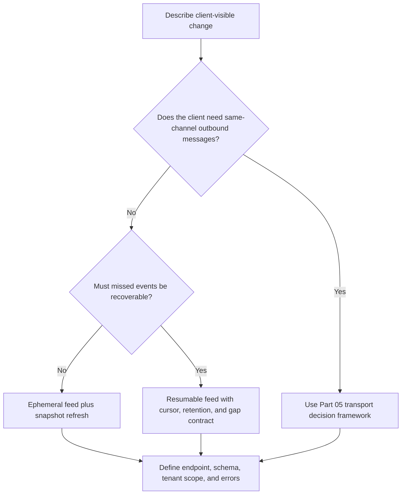

**Decision implications.** Do not expose one universal feed for unrelated
consumer classes simply because they share a transport. A public audit
consumer may need an explicit retained feed; a browser notification badge
may need only a lightweight invalidation. Conversely, do not create a
separate endpoint for every screen if those endpoints have identical
audience, ordering, replay, and schema boundaries. The API surface should
make meaningful guarantees visible and avoid promises the infrastructure
cannot meet.

**Common failure mode.** Teams debate protocol names before deciding
whether an event is durable, whether a client can recover a gap, or whether
the feed exposes tenant-sensitive content. They then discover that the
chosen transport carried an undefined product contract.

**Scenario.** An operations console receives deployment invalidations over
an ephemeral feed and fetches the deployment resource for full state. A
third-party compliance integrator receives a separately scoped, retained
audit feed with stable cursors and explicit expiry behavior. Both may use
SSE, but they are different API contracts.

## 5. Internal Working

An event feed is usually assembled from several stages: a domain change is
committed, an event is mapped into a public schema, the event is assigned a
position in a feed scope, authorization and filters select eligible
subscribers, and the API layer emits the representation. The storage and
fan-out design must preserve the public ordering and replay promise. A
best-effort in-memory queue can implement an ephemeral feed, but it cannot
honestly provide replay after process restart unless the events are also
retained elsewhere.

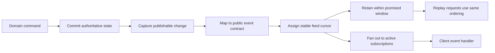

The difficult boundary is between commit and publication. If the domain
state commits but the feed event is lost, the snapshot and stream disagree.
If publication occurs before commit and the transaction later rolls back,
subscribers observe a fact that never became authoritative. A transactional
outbox or change-data-capture pipeline can close this dual-write window;
the general outbox pattern is owned by Part 07's [Distributed Transactions](../07_System_Design_and_Distributed_Systems/CH12_Distributed_Transactions.md)
chapter. This chapter's API requirement is that the published event reflect
a committed business fact and have a stable feed position.

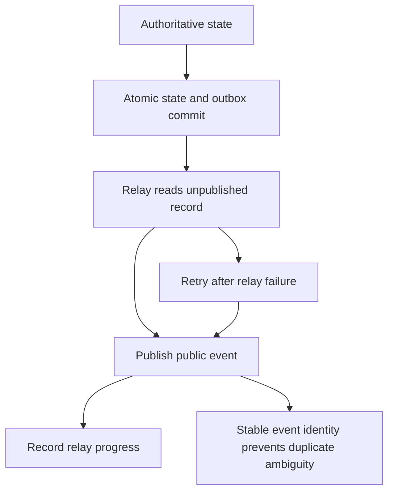

Replay and live delivery must meet without a hole. A typical implementation
captures a high-water mark, replays through that mark, then tails newer
events, or uses a single ordered log consumer that switches from replay to
live delivery atomically. If replay and live fan-out race independently,
the client may miss an event between the two phases or receive duplicates.
Duplicates are acceptable only when the contract acknowledges them and
clients can identify and safely handle them.

## 6. Design Principles

- **Name the guarantee at the observable boundary.** Say "ordered replay
  after a valid cursor within 24 hours" rather than "reliable". State
  separately whether the promise concerns server retention, browser
  dispatch, or application processing.
- **Treat the cursor as scoped API data.** Bind it to the tenant, feed,
  filter, and ordering model. Validate it as untrusted input and do not
  expose internal partition assumptions accidentally.
- **Keep snapshots authoritative.** Events may be deltas, projections, or
  invalidations; the resource API or a consistent snapshot defines current
  state and repairs gaps.
- **Make filters narrowing-only and schema-aware.** A filter is part of the
  subscription identity and security policy, not a free-form broker query.
- **Design expiry as a normal path.** Every retained feed eventually loses
  old history. Define how a client obtains a consistent snapshot and resumes
  from its watermark before production traffic depends on the endpoint.
- **Assume clients deploy independently.** Version event payloads and
  deprecation periods as deliberately as request/response schemas.

## 7. Architecture Patterns

### Snapshot plus change feed

The client obtains a snapshot with a watermark, then subscribes after that
watermark. The API must define how the snapshot and cursor are made
consistent; otherwise a change between the snapshot read and stream start
can be missed. The client applies later feed events or invalidates and
refetches current resources.

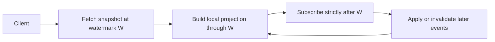

### Filtered tenant feed

The service authorizes a tenant-level feed and applies a bounded filter
within that tenant. Its cursor binds to a canonical filter expression. If
the filter changes, the API either starts a new cursor scope or requires a
reset, rather than pretending that a cursor over one filtered sequence
orders another sequence.

### Notification-only feed

Events communicate that a resource may have changed, and clients re-read
the ordinary resource. This reduces payload sensitivity and schema
coupling, at the cost of extra requests and possible read-after-event
latency. It works especially well for dashboards where the feed is a
freshness signal rather than a complete transaction log.

### Retained audit feed

The server retains ordered feed records and supports cursor replay within a
published window. Consumers that need durable processing add a durable
checkpoint or acknowledgment protocol; `Last-Event-ID` alone remains a
browser-dispatch cursor. This pattern requires explicit privacy, deletion,
retention, and replay-rate controls.

### Live-only feed

The server fans out current events without retaining history. It is cheaper
and appropriate when the consumer can recover from a snapshot or tolerate
missed notifications. Its documentation must say that reconnect resumes at
the live edge and that a disconnected client may miss events.

## 8. Production Architecture

A production feed API usually separates event production, durable or
ephemeral distribution, and HTTP subscription handling. A shared log or
delivery store supports replay; a fan-out tier serves active streams; an
API edge authenticates, authorizes, limits, and routes subscriptions. These
are logical roles, not mandatory separate products. Small deployments may
combine them, but the boundaries should remain visible in capacity and
failure analysis.

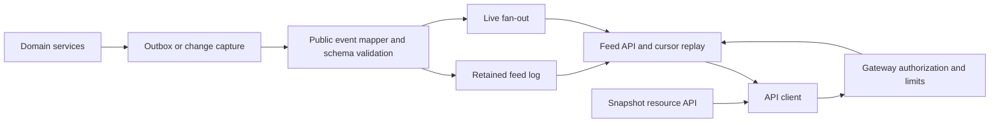

The event log's partitioning must align with the promised ordering scope.
If the API promises order per order ID, a per-order key can preserve that
order without imposing a global sequence. If it promises one tenant-wide
order, the chosen storage and fan-out path must actually serialize that
tenant's events. Do not publish "global order" when the system can only
provide per-key order. The general ordering taxonomy belongs to Part 07's
[Ordering Guarantees](../07_System_Design_and_Distributed_Systems/CH18_Ordering_Guarantees.md)
chapter; this chapter scopes the API claim and links that mechanism.

## 9. Implementation

Implement the contract in this order: define the public feed and audience;
write the event envelope and per-type schemas; select a cursor model and
ordering scope; choose the retention window and expiry outcome; specify the
snapshot or reset path; then implement authentication, tenant filtering,
schema validation, publication, replay, and live fan-out. This order
prevents an implementation detail such as a broker offset from becoming an
accidental public promise.

The implementation should make cursor parsing and authorization explicit
functions rather than implicit query predicates. Canonicalize filter input
before binding it to a cursor. Validate the event payload before publication
so malformed records do not poison every subscriber. Keep event IDs stable
across relay retries. For a retained feed, make replay and live-tail
transition atomic or prove that any overlap is duplicate-safe and any gap
is impossible. For a live-only feed, expose the weaker guarantee directly.

The examples in Section 10 are runnable, standard-library Python reference
models for contract behavior. They deliberately do not implement an HTTP
server or the SSE wire parser; Part 05 CH17 owns those transport mechanics.

## 10. Complete Code Examples

These examples are deliberately small and executable. They model API
contract decisions, not a deployable server or transport implementation.

1. **Event envelope and payload contract** — [01_event_contract.py](../code/python/sse-api-chapter/01_event_contract.py)
   is runnable with Python 3.10+ and the standard library. It validates a
   versioned public event and prints its JSON representation.
2. **Resumable feed cursor** — [02_resume_cursor.py](../code/python/sse-api-chapter/02_resume_cursor.py)
   is runnable with Python 3.10+ and the standard library. It models
   strictly-after replay and an expired cursor; numeric cursors are used for
   readability, while production APIs should normally make cursors opaque.
3. **Tenant authorization and filtering** — [03_authorized_filter.py](../code/python/sse-api-chapter/03_authorized_filter.py)
   is runnable with Python 3.10+ and the standard library. It proves that a
   requested topic filter can narrow, but cannot broaden, an authorized
   tenant feed.
4. **Replay-window expiry and reset** — [04_replay_expiry.py](../code/python/sse-api-chapter/04_replay_expiry.py)
   is runnable with Python 3.10+ and the standard library. It returns a
   structured reset instruction when a cursor predates retained history.

The example cursor algorithms are illustrative in-memory models. They do
not claim persistence, distributed ordering, durable application
acknowledgment, or exactly-once processing.

## 11. Performance

The cost of a feed is not just the bytes in each event. It includes active
subscription state, authorization checks, filter evaluation, fan-out
amplification, retained history, replay bursts, serialization, and slow
consumer buffering. Measure those dimensions separately. A compact event
that is broadcast to every tenant can cost more than a larger event routed
to a small authorized audience.

Bound event size and subscriber queue depth. If a client cannot consume at
the producer rate, define whether the server drops ephemeral updates,
coalesces them, disconnects the slow consumer, or applies backpressure.
Never allow one slow client to cause unbounded memory growth. Replay should
be rate-limited and paged or paced where the backlog can be large; the API
must make clear whether the live tail waits behind replay or can interleave
with it while preserving the declared order.

For high fan-out topics, separate event creation from subscriber delivery
and measure per-tenant and per-topic concentration. Cache or batch the
authorization result only if revocation staleness remains within policy.
HTTP compression may reduce payload bandwidth but changes CPU and buffering
trade-offs; the general `Content-Encoding` behavior is owned by [HTTP](../05_Networking_and_OS/CH01_HTTP.md).

## 12. Scalability

Subscription count, event rate, replay lag, and recipient fan-out are
distinct scale axes. More API instances increase connection capacity but do
not automatically distribute events to the instance holding a subscriber.
A shared distribution layer or subscription registry is needed when
producers and active connections are spread across processes. A retained
feed additionally needs storage and replay capacity sized for a reconnect
storm after an outage.

Partition on a key that supports both authorization and the required order
scope, commonly tenant or resource identity. Avoid a single global hot
partition if independent tenants do not need a global order. For large
tenants, subpartitioning may improve throughput but weakens total order;
that is an API-level trade-off to state explicitly. Rebalance and failover
must not change the public cursor meaning. If internal positions change,
translate through an opaque cursor layer or force a documented reset.

Use quotas for concurrent subscriptions, filter complexity, replay volume,
and event production. Apply per-principal and per-tenant limits so one
consumer cannot monopolize replay resources. The future [API Gateway chapter](PART_OVERVIEW.md#chapters)
owns gateway architecture and policy enforcement in depth; this chapter
specifies the feed-facing limits clients must understand.

## 13. Security

An event feed is an ongoing data disclosure channel. Authorization at
connection open is insufficient if membership, role, or resource ownership
can change during the stream. Re-evaluate relevant policy or use a bounded
authorization lease, and define what happens when it expires. Filter event
fields as well as event records; a topic-level allow-list does not make every
field in that topic safe for every subscriber.

Protect cursors from cross-tenant reuse and tampering. An opaque cursor may
be signed or stored server-side, but opacity alone is not authorization.
Avoid bearer credentials in URLs where logs and referrers can capture them.
Use secure cookie attributes and a strict origin policy for browser
credentials; do not assume ordinary cross-origin request controls
automatically secure a long-lived feed. The detailed authentication,
authorization, token, and cross-origin policy belongs to the future [API Security chapter](PART_OVERVIEW.md#chapters).

Set conservative limits on event payload size, filter depth, subscriptions,
and replay requests. Treat client-supplied event IDs, filter expressions,
and tenant identifiers as untrusted. Apply privacy-specific retention and
deletion policy to stored events; the fact that an event was delivered once
does not justify retaining sensitive content indefinitely.

## 14. Observability

Instrument the contract rather than merely counting open connections.
Useful measures include active subscriptions by feed and tenant tier,
authorization denials, filter rejection, event publication-to-delivery
latency, oldest retained position, replay lag, cursor-expiry/reset rate,
replay volume, schema-validation failures, slow-consumer disconnects, and
subscriber reconnect rate. Do not use raw tenant IDs, user IDs, or cursors
as high-cardinality metric labels; use structured logs with privacy-aware
redaction and bounded aggregation.

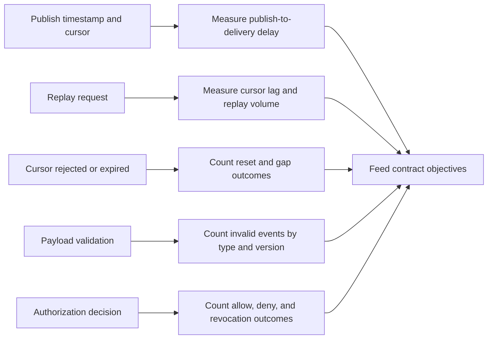

Define service objectives that map to consumer-visible guarantees: delivery
latency for live notifications, maximum replay lag for retained feeds,
minimum retention window, reset correctness, and authorization revocation
latency. Connection uptime alone is not a useful availability measure if
events are buffered, filtered incorrectly, or silently skipped. Observability
taxonomy and SLO mechanics are owned by Part 12; this chapter defines the
API-specific signals to expose there.

## 15. Failure Scenarios

**Cursor expired.** The server must not jump to the live edge silently. It
returns or emits the documented reset instruction, including a snapshot
resource and a watermark that orders later events. The client replaces its
projection and resumes strictly after that watermark.

**Publication gap.** Domain state commits but the event is not published.
The event pipeline should retry from a durable outbox or change log, and
operators should detect divergence between committed changes and published
positions. Stable event identity makes retries observable and duplicate-safe.

**Authorization revoked mid-stream.** The service closes or re-evaluates
the subscription within its stated revocation bound. A future reconnect
must be denied, and no buffered event beyond the revocation boundary should
leak afterward.

**Proxy buffers or drops the stream.** Clients see delayed delivery or
reconnect churn. Verify the full intermediary path and distinguish proxy
timeouts from application-level feed errors; do not "fix" the API by
promising a latency the path cannot deliver.

**Schema mismatch.** A new event value or field meaning reaches an old
consumer. Unsupported event types must follow the published ignore, refresh,
or upgrade behavior; schema validation and consumer compatibility tests
should catch incompatible producer changes before rollout.

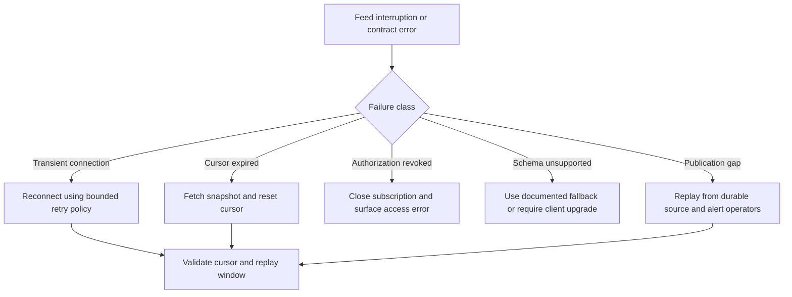

## 16. Testing

Test the public contract with fixtures and state transitions, not only with a
browser that remains connected. Schema tests should validate required
fields, optional-field defaults, event names, and backward-compatibility
rules. Cursor tests should verify strict-after behavior, ordering scope,
malformed IDs, cross-feed reuse rejection, duplicate retry behavior, and
the lower and upper boundaries of retention.

Authorization tests must include tenant substitution, topic broadening,
field-level filtering, permission revocation while connected, and cursor
reuse after a role change. Reset tests should force an expired cursor and
prove that the snapshot watermark plus subsequent replay produces the same
state as a clean snapshot. Test the replay-to-live handoff under concurrent
publication to catch missing or reordered events.

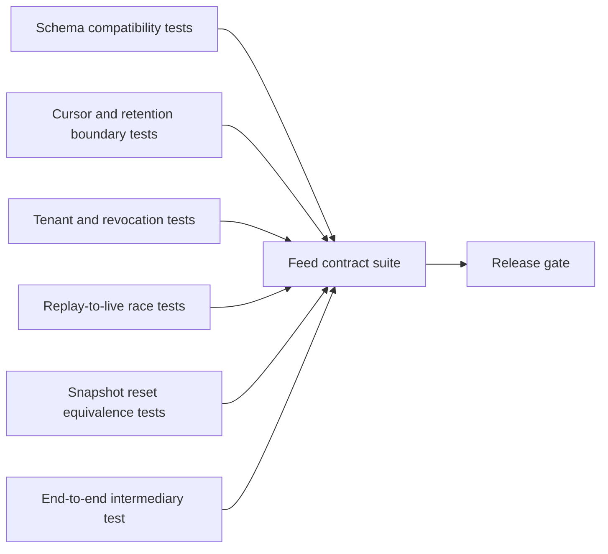

Run integration tests through the actual gateway and proxy configuration to
verify that events arrive before the configured flush threshold, that
authenticated feeds are not cached, and that timeouts and reconnects match
the published behavior. Load tests should simulate a reconnect surge with
backlogs, not just a large steady-state connection count. For examples
without a live HTTP server, execute all four Section 10 Python scripts as
contract-model smoke tests.

## 17. Common Mistakes

- Claiming reliable or exactly-once delivery because the browser reconnects
  automatically or each event has a unique ID.
- Treating `Last-Event-ID` as an application acknowledgment even though it
  describes the browser's last dispatched event.
- Silently starting at the live edge when a cursor has expired.
- Using timestamps as a cursor without defining collision, clock, and
  ordering behavior.
- Reusing a cursor across tenants, feeds, or filter expressions.
- Treating a broker topic or partition as the public API contract.
- Putting large resource snapshots into every event instead of defining
  whether events are facts, deltas, or invalidations.
- Authorizing only when the stream opens and ignoring policy changes during
  its lifetime.
- Assuming `EventSource` can attach arbitrary bearer headers or expose every
  HTTP error detail to application code.
- Testing only a continuously connected happy path and never testing
  retention expiry, replay races, or a reconnect storm.

## 18. Best Practices

- Publish a contract table per feed: audience, endpoint, event types,
  ordering scope, cursor semantics, retention, gap behavior, and snapshot
  path.
- Use stable event names, explicit payload schemas, and stable IDs whose
  scope is documented.
- Define `Last-Event-ID` as a resume cursor for the browser-dispatch
  position, not proof of durable application processing.
- Offer application-managed checkpoints when durable processing is a real
  requirement; combine them with idempotent consumer effects.
- Bind cursors to an authorized tenant, feed, and canonical filter.
- Treat expired cursors as an expected reset workflow and test snapshot
  consistency at its watermark.
- Make authorization re-evaluation and revocation latency part of the
  long-lived subscription contract.
- Keep event payloads minimal and version them with producer/consumer
  compatibility tests.
- Separate an ephemeral invalidation feed from a retained audit feed when
  their guarantees, retention, or privacy obligations differ.
- Monitor replay lag, expiry, delivery latency, authorization outcomes, and
  schema failures as first-class service signals.

## 19. Anti-Patterns

**Unbounded generic `/events` feed.** A single endpoint exposes arbitrary
internal topics and payloads to every consumer. It couples clients to
implementation details and makes authorization and schema governance
unmanageable.

**False resume.** The API accepts a cursor but discards it or resumes only
from current time. The endpoint appears resumable while silently losing
history.

**Cursor as credential.** A cursor is assumed to authorize access because
it is opaque or difficult to guess. Cursors are not authentication; every
resume still requires authorization.

**Exactly-once by event ID.** A consumer deduplicates IDs but commits the
dedupe record separately from its side effect. A crash between the two
operations still causes a duplicate effect or a lost event. Exactly-once
processing requires an atomicity boundary beyond SSE.

**Infinite retention by default.** Retaining every payload forever
increases storage and privacy exposure while making replay load
unpredictable. Set and enforce a bounded policy.

**One schema version for every event.** A global version forces unrelated
event families to rev together and encourages clients to reject harmless
additions. Version the contract at the smallest meaningful boundary.

## 20. Trade-off Analysis

| Decision | Benefit | Cost and limit |
|---|---|---|
| Ephemeral live-only feed | Low storage and simple producer path | Disconnects can lose events; client must refresh or tolerate gaps |
| Retained resumable feed | Reconnect can recover within a defined window | Storage, replay capacity, cursor migration, and reset behavior required |
| Fact payloads | Enables local projections with fewer follow-up reads | Stronger schema coupling and greater privacy/data-minimization burden |
| Invalidation events | Small payload and loose coupling to resource schema | Additional reads; client convergence depends on snapshot availability |
| Opaque cursor | Hides storage layout and supports cursor translation | Requires server validation/state or signing; harder for clients to inspect |
| Visible sequence | Easy to debug and compare | Leaks ordering/volume and couples clients to sequence semantics |
| Tenant-wide ordering | Simple consumer mental model | Can constrain partitioning and create hot tenants/partitions |
| Per-resource ordering | Better parallelism and scale | Consumers must not infer a global order across resources |
| Native `EventSource` | Browser-managed reconnect and event dispatch | Limited custom headers/error visibility; cursor is not an app acknowledgment |
| Fetch-based streaming | Greater control of headers, errors, and checkpoints | Client implements parser, reconnect, buffering, and lifecycle carefully |

## 21. Comparison Table

| API feed property | Ephemeral live-only | Resumable retained feed | Durable application consumer |
|---|---|---|---|
| History retained | No replay promise | Yes, within stated window | Yes, subject to source and checkpoint policy |
| Cursor | Optional or diagnostic only | Stable, scoped resume position | Application-managed committed position |
| Disconnect gap | May lose notifications | Replay if cursor is still retained | Replay from last durable checkpoint |
| Expired history | Snapshot refresh or tolerated loss | Explicit reset/snapshot contract | Recovery or operator-visible terminal condition |
| Processing guarantee | None beyond live delivery | Browser-dispatch resume only unless augmented | At-least-once can be engineered with ack/checkpoint and idempotency |
| Exactly-once effect | No | No | Only within a named atomic boundary; not provided by SSE |
| Appropriate use | Presence, invalidations, transient progress | Browser feeds, resumable updates | Audit/workflow integration with durable processing needs |

The table distinguishes API guarantees, not transport protocols. For the
general direction, latency, and operational-complexity choice among
polling, SSE, and WebSockets, use Part 05 CH17 Section 4.8. For HTTP
resource semantics, status codes, and cache directives, use [HTTP](../05_Networking_and_OS/CH01_HTTP.md).

## 22. Real-World Case Study

Consider a multi-tenant deployment platform whose browser console displays
build, approval, rollout, and health changes. Its first implementation
opened a live-only stream and emitted JSON notifications. In a continuously
connected demo, the console appeared correct. In production, laptops slept,
network paths changed, and users reopened tabs hours later. Automatic
reconnection restored the stream but did not restore the events emitted
during the gap; the UI could display an old deployment state indefinitely.

The team separated current state from change notification. The REST resource
`/v1/deployments/{id}` remained authoritative. The API added a retained,
tenant-scoped event feed with stable event IDs, event types, and a declared
ordering scope per deployment. A snapshot response included a watermark;
the client built its initial view through that watermark and subscribed
strictly after it. The service documented a 24-hour minimum replay window
and emitted a reset instruction with a snapshot URL when a cursor was older
than the retained floor.

The feed carried minimal transition facts rather than a copy of the entire
deployment record. Old clients ignored newly added optional fields; an
incompatible state-machine change received a new event type and an overlap
period. Authorization was tenant- and deployment-scoped and rechecked when
membership changed. During review, the team stopped describing
`Last-Event-ID` as an acknowledgment: the browser can advance it before the
application has committed its local update. The console therefore used the
feed for view convergence, while an automation consumer with durable
processing used a separate application checkpoint and idempotent effects.

The result was not a promise that events could never be lost under any
condition. It was a precise contract: browser clients can replay dispatched
history after a valid cursor within the retention window; expired cursors
reset through a consistent snapshot; the feed is ordered only per
deployment; authorization is tenant-scoped; and durable consumer processing
requires an explicit checkpoint beyond SSE. That precision let product,
operations, and integrators discuss failures without mistaking reconnect
behavior for durability.

## 23. Interview Questions

1. What is the difference between an SSE transport reconnect and a
   resumable event-feed API contract?
2. What exactly does `Last-Event-ID` tell a server, and what does it not
   prove about client-side processing?
3. How should a service respond when a cursor is syntactically valid but
   older than the retention window?
4. Why should a cursor be bound to a tenant, feed, and canonical filter?
5. When is an invalidation event preferable to a full domain fact payload?
6. How can a snapshot plus event feed avoid a gap during initial
   synchronization?
7. What does ordered replay mean if ordering is per resource rather than
   global?
8. What additional mechanism would be needed to promise durable application
   processing?
9. How do event schema compatibility rules differ for additive and
   semantic changes?
10. What API-visible behavior should distinguish transient disconnect,
    authorization denial, and replay-window expiry?
11. Why is a tenant filter not itself an authorization boundary?
12. Under what conditions should a live-only feed be preferred to a
    retained resumable feed?

## 24. Hands-on Exercises

1. Run the four Section 10 Python examples. Change the cursor in
   `02_resume_cursor.py` to test a retained position, a position before the
   retention floor, and a position beyond the high-water mark.
2. Extend `01_event_contract.py` with a second event type and write
   compatibility tests for an absent optional field and an unknown event
   type.
3. Extend `03_authorized_filter.py` with a membership revocation that occurs
   after a subscription begins. State the maximum interval in which the
   feed may still deliver events.
4. Extend `04_replay_expiry.py` so a snapshot is tagged with watermark `W`
   and the client resumes strictly after `W`. Prove that the rebuilt state
   matches a clean replay.
5. Write a short feed contract for a support-ticket dashboard: audience,
   event types, ordering scope, retention, filter behavior, cursor scope,
   reset flow, and whether the feed is ephemeral or resumable.

## 25. Design Exercises

1. Design a public order-status feed for browser and mobile clients. Specify
   whether events are facts or invalidations, the event envelope, cursor
   semantics, retention, snapshot handoff, and tenant authorization.
2. Design an audit feed consumed by a third-party integration that may be
   offline for several days. Calculate the required retention and replay
   capacity, state what occurs beyond the window, and define an
   application-level checkpoint protocol without claiming SSE itself
   provides exactly-once effects.
3. A dashboard asks for a filter over 200 event types and arbitrary JSON
   predicates. Design a bounded subscription language that preserves
   authorization, canonical cursor scope, and operational limits.
4. A team proposes reusing broker partition offsets as public IDs. Write an
   architecture decision explaining the benefits, coupling and migration
   costs, and when an opaque cursor translation layer is justified.
5. Design a schema migration from `order.status_changed` to a new lifecycle
   model while older clients remain deployed. Specify overlap, telemetry,
   deprecation, and fallback behavior.

## 26. Architecture Review Questions

- Is the feed's audience and resource scope explicit, separate from the
  transport implementation?
- Does every resumable event have a stable ID, a defined ordering scope,
  and a documented strictly-after or inclusive replay boundary?
- Does the contract say what `Last-Event-ID` represents and explicitly
  avoid calling it an application acknowledgment?
- Are retention duration/count, cursor expiry, reset behavior, and snapshot
  watermark specified and tested?
- Does a changed tenant, feed, or filter invalidate or re-scope a cursor?
- Are filters bounded and narrowing-only, with authorization applied to
  both event records and payload fields?
- Can authorization changes revoke an already-open subscription within a
  documented bound?
- Are event names and payload schemas versioned with a compatibility and
  deprecation policy?
- Is the event pipeline ordered after authoritative state commit and
  protected against publication gaps or duplicate relay attempts?
- Are cache, proxy buffering, timeout, retry, and client-visible error
  consequences verified across the deployed path?
- Is the feed explicitly classified as ephemeral, replayable for a bounded
  window, or durable for an application consumer?
- Does the service avoid claiming exactly-once processing unless it names
  and implements the atomicity boundary that makes that claim true?

## 27. Summary

An SSE API is more than an open HTTP response. Part 05 CH17 remains the
owner of one-way SSE transport mechanics and the general choice among SSE,
WebSockets, and polling; this chapter owns the API contract carried over
that transport. A sound contract models a subscription as a scoped resource,
defines stable event types and payload schemas, gives resumable events
stable feed-scoped IDs, specifies cursor and retention boundaries, and
provides an explicit snapshot/reset path when history expires.

The most important guarantee boundary is `Last-Event-ID`: the browser sends
the last event it dispatched, not proof that application code durably
processed it. A retained feed can promise ordered replay within a stated
window, but SSE alone does not provide durable application acknowledgment
or exactly-once effects. Live-only feeds are valid when the API says missed
events may be lost and offers an appropriate refresh path. Tenant
authorization, narrowing filters, schema evolution, proxy/cache behavior,
and client-visible retry and reset outcomes all belong in the contract.
When these promises are stated precisely, teams can select a server-push
API surface that matches the consumer's real correctness needs without
confusing transport reconnection with reliable event processing.

**Further reading**: [REST](CH01_REST.md) ·
[WebSockets and the SSE transport/selection boundary](../05_Networking_and_OS/CH17_WebSockets.md#48-full-duplex-bidirectional-communication-as-the-core-value-proposition) ·
[HTTP](../05_Networking_and_OS/CH01_HTTP.md) ·
[HTTP/2](../05_Networking_and_OS/CH04_HTTP2.md) ·
[Event Sourcing](../07_System_Design_and_Distributed_Systems/CH15_Event_Sourcing.md) ·
[Part 08 API Security and API Gateway](PART_OVERVIEW.md#chapters)