# Chapter: Asynchronous APIs

Part: [08 — API Architecture](PART_OVERVIEW.md) · Status: Draft

## 1. Introduction

An asynchronous API separates the moment a service accepts responsibility for work from the moment that work reaches a final outcome. The caller submits a command, receives an acceptance result with a stable operation identity, and later learns completion through a status resource, callback, durable message, or stream. This is not simply an implementation that uses `async`/`await`; it is a contract between independently operating systems about ownership, progress, delivery, retry, and recovery.

This chapter owns the API-level asynchronous interaction model: acceptance versus completion, operation lifecycle, callback and webhook delivery, durable command/event APIs, correlation and causation, delivery attempts, replay, request/reply over messaging, and choosing an interaction style. [REST](CH01_REST.md) owns HTTP `202 Accepted` and the long-running operation-resource pattern; this chapter recaps those decisions and develops how they compose with callbacks and messaging. The [WebSocket API](CH04_WebSocket_API.md) and [Server-Sent Events (SSE)](CH05_Server_Sent_Events.md) chapters own their message-envelope and feed/replay contracts. The [gRPC](CH03_gRPC.md) chapter owns streaming Remote Procedure Call (RPC) mechanics. Part 07 owns general idempotency, exactly-once boundaries, ordering, and deduplication; this chapter links those mechanisms and specifies where an asynchronous API contract depends on them.

The central design question is not whether work runs on another thread. It is: at which boundary has the provider accepted durable responsibility, how can the consumer identify and observe the work, and what must either side do after an ambiguous failure?

## 2. Historical Evolution

Early service interfaces often held one request open while a server completed all work and returned one response. That model is effective when work is bounded and fast. As systems began coordinating payment networks, batch imports, media conversion, provisioning, and multi-service workflows, the end-to-end duration became longer and less predictable than the request path could reliably sustain. Timeouts, client disconnections, proxy limits, and retry storms made a still-running operation look indistinguishable from a failed one.

The response was not one new protocol, but a family of API contracts. Long-running REST requests began returning an operation identity and a status resource. Callback URLs and webhooks inverted notification direction for integrations that could receive inbound traffic. Message brokers separated acceptance from worker availability and enabled durable buffering. Streaming APIs exposed progress when the consumer needed a continuous view. Request/reply messaging adapted command-response interaction to asynchronous transports.

These approaches solve different parts of the problem. A queue can decouple processing but does not tell a caller whether a business operation completed. A webhook can notify a consumer but is not a durable source of truth by itself. A status resource can be polled but may produce unnecessary traffic. The evolution is therefore toward explicit lifecycle and delivery contracts, not toward asynchronous messaging as a universal replacement for request/response.

## 3. Why It Exists

Synchronous request/response couples the caller's connection lifetime to the provider's completion time. If a request triggers work lasting minutes, the provider consumes request capacity or must rely on infrastructure that tolerates a long-lived call; the caller must preserve connection state; and either endpoint may time out independently. A timeout reports that the caller did not observe a response, not that the provider did not commit the operation. Retrying blindly can repeat the command, while not retrying can leave the caller uncertain.

Bursty workloads create a different failure. If arrivals briefly exceed service capacity, synchronous front doors pass that pressure directly to workers and dependencies. Queues form invisibly in connection pools, thread pools, and downstream services. A durable asynchronous boundary can acknowledge bounded admission, buffer work, apply quotas, and let workers process at a controlled rate. It does not create infinite capacity: queue depth, age, and rejection policy become explicit design constraints.

Asynchrony is useful when work duration is long or variable, when the consumer can tolerate deferred results, when bursts should be isolated from execution capacity, or when producer and consumer availability differ. It adds operation state, delivery retries, retention, correlation, and operational recovery. If the operation reliably completes within a small latency budget and the caller needs its result immediately, a direct request/response remains simpler and often safer.

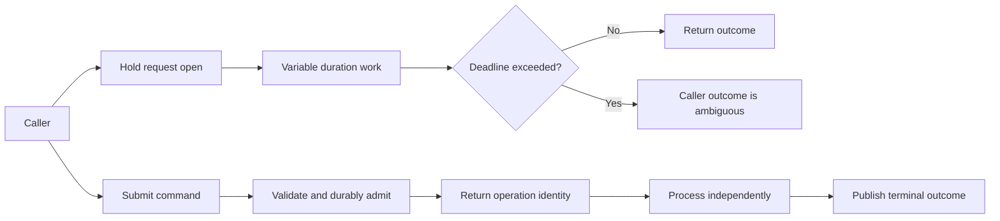

## 4. Core Concepts

The core contract has four actors or boundaries: the caller that initiates intent, the API that accepts or rejects it, the execution system that performs it, and the completion channel through which the result becomes observable. These may be implemented in one process or several services. The API must state what each acknowledgment proves; transport success alone cannot establish business completion.

### 4.1 Synchronous versus asynchronous interaction and acknowledgment meaning

**Definition.** A synchronous interaction keeps one request/response exchange open until a result is available. An asynchronous interaction ends the submission exchange before the requested work is complete and provides another way to observe its outcome. “Asynchronous” here names the client-visible contract, not a programming-language scheduling primitive.

**Mechanism.** The provider validates the command, checks caller authority and capacity, and either rejects it or records enough durable state to resume responsibility after process failure. Only after that admission boundary does it return an acceptance receipt. A worker later claims the work, executes it, and writes progress or a terminal state. An immediate response can still be synchronous even if the server internally delegates a short task to a worker; conversely, returning `202 Accepted` is not useful if the provider has only placed work in volatile memory that disappears on restart.

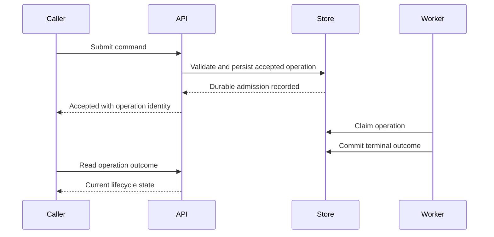

**Decision implications.** Select asynchronous interaction when the expected duration or variance exceeds the caller's useful connection budget, or when admission control and independent worker scaling are material requirements. Define the acknowledgment stage in plain language: received, validated, admitted, scheduled, started, or completed. A caller must never treat admission as proof that the business effect occurred. If the provider cannot durably admit work, it should reject or defer the request rather than return an acceptance promise it cannot honor.

**Common failure mode.** The handler returns success immediately after publishing to an in-process queue. A process restart loses accepted work, although clients have already stopped submitting it. The opposite error is holding an HTTP request open for a lengthy workflow, so retries occur after a timeout while the original operation continues.

**Scenario.** A document export takes 5 seconds for small files and 8 minutes for large files. The API admits only work that fits the tenant quota, commits an operation record, and responds with an operation identity. The caller polls or subscribes for completion; the acceptance response explicitly does not promise the export has started.

### 4.2 Long-running operation lifecycle

**Definition.** An operation resource is a stable API identity for one logical execution and its observable lifecycle. It can represent queued work, running progress, a terminal success or failure, or cancellation. REST owns the resource modeling and HTTP `202` semantics; this subsection applies that pattern to the lifecycle contract and delivery alternatives.

**Mechanism.** A useful minimal state machine is `accepted -> queued -> running -> succeeded | failed`, with `cancel_requested` and `cancelled` when cancellation is supported. Some states may be omitted or collapsed, but the contract must not make terminal states appear transient. State transitions are persisted with timestamps and version or progress metadata. A cancellation request is a competing command, not a rollback guarantee: completion may win the race, and the status resource must report the actual outcome. Define expiry and retention after terminal state so consumers know how long lookup remains available.

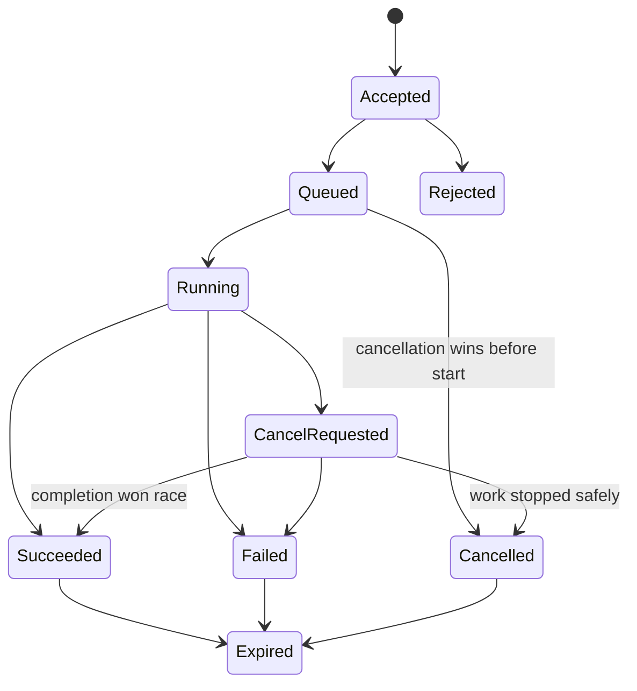

**Decision implications.** Keep the state vocabulary small and define allowed transitions, monotonicity, and terminality. Progress should be useful and bounded, not a high-frequency trace of internal steps. If operations can partially succeed, model per-item results or a domain-specific partial terminal state instead of overloading `succeeded`. Cancellation belongs only where the underlying work can honor it safely; otherwise expose that cancellation is unsupported or best-effort.

**Common failure mode.** The API reports `cancelled` as soon as it receives a cancellation request even though an irreversible downstream effect has already completed. Another failure is deleting terminal operation records immediately, making a delayed callback or client retry impossible to reconcile.

**Scenario.** A bulk user-import operation validates 50,000 rows. Its resource reports accepted, running with coarse progress, and then completed with counts for imported, rejected, and skipped rows. Cancellation prevents processing later rows but does not claim to undo rows already committed.

### 4.3 Webhook registration and delivery contract

**Definition.** A webhook is an outbound HTTP notification that a provider sends to a consumer-controlled endpoint when a named event or operation outcome occurs. Registration is the contract by which the consumer configures the destination, event scope, and lifecycle. Delivery attempts are distinct from event creation and from consumer-side processing.

**Mechanism.** Registration validates the destination and event selection, binds it to an authorized tenant or principal, and returns a durable subscription identity. The event contract identifies event type, event identity, schema version, occurrence time, and operation/correlation references where appropriate. Each attempt sends the same logical event identity and stable payload; a signature covers the exact transmitted bytes and timestamp. The receiver verifies authenticity, enforces replay-age policy, records or queues the event, and responds quickly. The provider considers the attempt acknowledged only according to documented response rules, usually a successful HTTP response class; a response is not proof the consumer completed all downstream work.

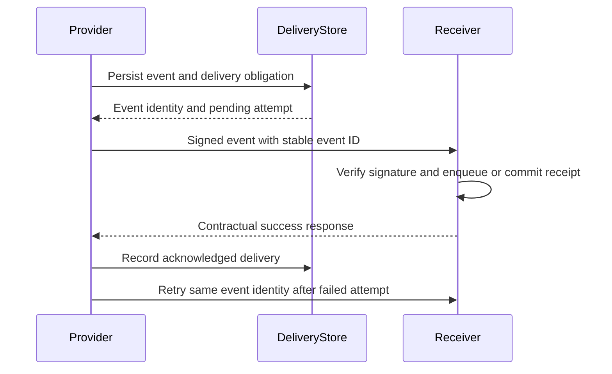

**Decision implications.** Webhooks fit consumers that can expose an inbound endpoint and need prompt notification without maintaining a long-lived connection. Registration should include endpoint ownership, event filters, pause/delete behavior, secret rotation, and delivery visibility. State whether the provider retries non-success responses, connection failures, and timeouts, and whether any response code suppresses retries. Delivery rate, timeout, payload size, and endpoint concurrency need explicit bounds.

**Common failure mode.** A provider emits a webhook only once and discards it after a timeout, or generates a new event identifier on retry so the receiver cannot recognize a repeated logical event. A receiver that performs all business work inline before responding can time out after its side effect commits, triggering duplicate delivery.

**Scenario.** A payment provider notifies a merchant when a transfer settles. The merchant registers a settlement endpoint and event family. It verifies the signed request, durably enqueues the notification, returns success, and processes the settlement independently. The provider retains attempt history and retries according to its published policy.

### 4.4 Asynchronous command, event, and message contracts

**Definition.** A command expresses requested intent; an event states a fact that has occurred; a message is the delivery unit transported between producer and consumer. A command API can return an admission receipt while its later outcome is reported as an operation state or event. The category must be clear even if all payloads share a serialization format.

**Mechanism.** Define a stable envelope for each contract family with a message identity, type, schema version, producer/tenant context as appropriate, and a domain payload. Commands specify validation, authorization, admission, and terminal outcome. Events specify what fact is true, which service owns that fact, and whether the consumer should treat the payload as a snapshot, delta, or invalidation. A broker topic or queue name is not by itself a public API contract: consumers need the schema and delivery semantics independent of broker implementation.

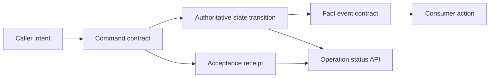

**Decision implications.** Use commands for directed work owned by one authority and events when multiple consumers need to react to a committed fact. Keep API and broker schemas consistent where they describe the same business fact, but do not force identical wire envelopes across HTTP, broker, and streaming transports when each has different needs. Publish ownership and schema compatibility rules. Avoid leaking internal database records or workflow implementation steps as public event types.

**Common failure mode.** An event named `invoice.paid` is emitted when payment was merely requested. Consumers then treat intent as fact and may ship goods before settlement. Another failure is exposing internal broker partition IDs as stable public identifiers, coupling clients to storage topology.

**Scenario.** A fulfillment service accepts `CreateShipment` as a command. It reports an operation identity immediately, then emits `shipment.created` only after the shipment record is committed. A notification service and warehouse integration consume the fact independently.

### 4.5 Identity, correlation, causation, and reliability boundaries

**Definition.** An operation identity names one logical requested action across submission retries. A message identity names one transmitted message. A correlation identity groups messages participating in one workflow or request/reply exchange. A causation identity names the direct message or command that produced another message. These identifiers answer different questions and should not be conflated.

**Mechanism.** The caller creates or receives a stable operation ID before retrying. The provider returns it in acceptance, status, callback, and message metadata. Each emitted event has its own stable event/message ID, while its `causation_id` points to the command or event that directly led to it and `correlation_id` connects the broader workflow. Persisting and replaying a stable outcome under retries is the general idempotency concern owned by [Part 07 CH16 Idempotency](../07_System_Design_and_Distributed_Systems/CH16_Idempotency.md). Exactly-once processing boundaries belong to [CH17](../07_System_Design_and_Distributed_Systems/CH17_Exactly_Once_Processing.md); order scope and sequence guarantees belong to [CH18](../07_System_Design_and_Distributed_Systems/CH18_Ordering_Guarantees.md); message equivalence and seen-ID structures belong to [CH19](../07_System_Design_and_Distributed_Systems/CH19_Deduplication.md). This chapter relies on those mechanics but does not re-teach them.

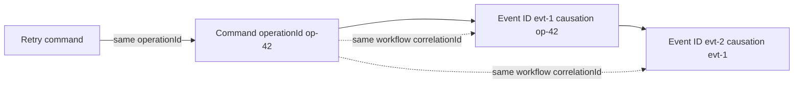

**Decision implications.** Document identifier creation authority, uniqueness scope, retention, propagation, and whether clients may supply values. Preserve the same operation identity when retrying an uncertain submission; generate a new message identity for a newly created delivery record only where contractually meaningful, while keeping the event identity stable on redelivery. Correlation improves diagnosis but does not make effects repeat-safe, create ordering, or prove exactly-once processing.

**Common failure mode.** A consumer uses `correlation_id` as its deduplication key, causing distinct commands in one workflow to collapse, or uses a fresh operation ID on every client retry, causing the provider to treat one intent as several. Another failure is claiming exactly-once because IDs are unique while the side effect and checkpoint are not atomic.

**Scenario.** A travel booking is one correlated workflow containing a flight command, hotel command, and later compensation. Each command has its own operation identity; each emitted event has a distinct message identity and direct cause; a shared correlation identity lets support trace the trip end-to-end. The implementation details of repeat-safe effects link to Part 07 CH16-19.

### 4.6 Delivery, retry, replay, and dead-letter lifecycle

**Definition.** Delivery policy states how a provider attempts to transfer a message, what counts as acknowledgment, and what happens when attempts fail. Replay is a deliberate redelivery or re-publication of retained logical data. A dead-letter queue (DLQ) or equivalent quarantine holds work that cannot proceed automatically for inspection or recovery; it is not a success state.

**Mechanism.** A durable delivery record moves through pending, attempting, acknowledged, retry-scheduled, and exhausted/quarantined states. Retryable failures include many timeouts, connection failures, and selected server responses; permanent schema or authorization failures may need operator correction rather than rapid retry. Exponential backoff with jitter spreads retries over time; a maximum age or attempt count bounds resource use. The provider retains the original event identity and enough payload/version context for replay. Manual recovery records who replayed what, when, and under which correction, and preserves auditability.

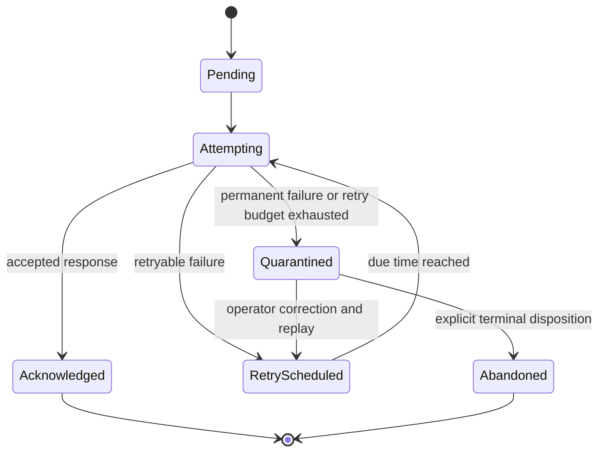

**Decision implications.** Publish attempt timeout, retryable response classification, backoff range, jitter, maximum delivery age, event retention, and replay permissions. Retry policy should match event criticality and consumer repair capability. Keep manual replay authorized and observable, with a way to inspect payload version and prior attempt errors without exposing secrets. A DLQ requires an owner, alert, service-level target, and documented resolution path.

**Common failure mode.** Immediate retries amplify an outage into a retry storm. An unbounded retry loop can retain poison messages forever and starve healthy work. A DLQ with no ownership becomes silent data loss in slow motion. Replaying a corrected event under a new identity may also prevent consumers from relating it to the original failure.

**Scenario.** A tax-filing webhook endpoint returns a server error during an outage. The provider retries with capped exponential backoff and jitter, displays the next attempt time, and eventually quarantines the event after its delivery-age limit. After the receiver is repaired, an operator replays the same logical event and records the intervention.

### 4.7 Choosing among operation resources, webhooks, queues, streams, and RPC

**Definition.** Asynchronous API style selection matches interaction direction, consumer availability, latency, durability, completion visibility, and operational ownership to a contract. The styles can be composed: an operation resource can be authoritative while a webhook accelerates notification, and a queue can isolate execution behind either.

**Mechanism.** First identify who initiates work and who needs the outcome. A status resource supports pull-based observation and is straightforward through ordinary HTTP; webhooks notify a reachable consumer; durable queues decouple producers and workers; SSE supplies server-to-client updates; WebSocket APIs support bidirectional live interaction; gRPC streaming provides typed streaming RPC mechanics owned by [CH03_gRPC](CH03_gRPC.md). [CH01_REST](CH01_REST.md) owns REST resource semantics, [CH04](CH04_WebSocket_API.md) owns WebSocket envelope/subscription contracts, and [CH05](CH05_Server_Sent_Events.md) owns SSE feed/replay contracts. The decision here is the composition across work lifecycle, not a re-teaching of those styles.

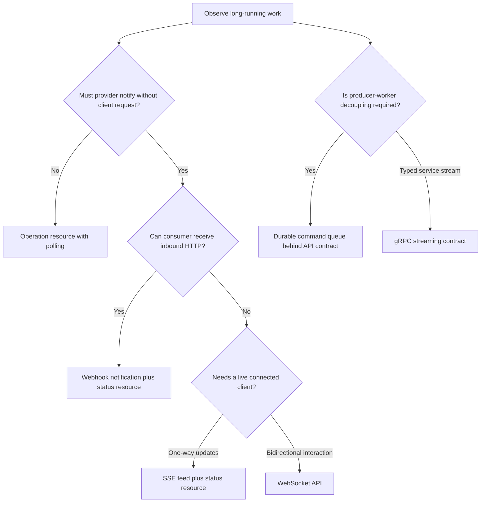

**Decision implications.** Prefer an operation resource as the durable lookup path when clients need status or recovery after missed notifications. Add callbacks or streams for latency-sensitive notification, not as the only record of outcome unless their own contract provides the required retention and recovery. Use queues for workload decoupling and backpressure, while exposing an API contract that does not require every caller to understand broker internals. gRPC streaming is appropriate when typed service-to-service stream semantics fit; it is not interchangeable with a durable queue.

**Common failure mode.** Selecting a callback as the sole outcome channel creates a blind spot when the consumer endpoint is down. Selecting a queue because “async” was requested can leave the caller with no way to inspect status or resolve an uncertain command. A live connection is a poor durable work ledger.

**Scenario.** A video conversion API returns an operation resource and emits a webhook when the operation becomes terminal. A browser can optionally subscribe to progress over SSE. A durable queue isolates conversion workers. The status resource remains authoritative if the webhook or stream is missed.

### 4.8 Delivery security and observability boundaries

**Definition.** Asynchronous security and observability cover who may submit, observe, cancel, or receive an operation; how callback authenticity and replay are checked; and how the same logical operation is traced across independent delivery attempts. General API threat modeling and gateway controls are outside this chapter and belong to the future sibling [API Security](PART_OVERVIEW.md) and [API Gateway](PART_OVERVIEW.md) chapters.

**Mechanism.** Bind operation and subscription identities to the authenticated tenant and principal, then re-authorize status reads, cancellation, callback registration, and manual replay. Webhook signatures typically authenticate the exact body plus a timestamp with a shared secret; receivers compare signatures in constant time and reject stale timestamps according to the replay window. Secret rotation, destination validation, and outbound network restrictions reduce endpoint abuse and server-side request forgery risk. For observability, propagate trace/correlation identifiers while using bounded metric labels; record accepted, started, retried, terminal, and quarantined transitions without logging credentials or unrestricted payloads.

**Decision implications.** Treat a status URL or operation ID as an identifier, not automatically as a capability. Define the authorization lifetime across an operation that may outlast the caller's token. Webhook signature verification authenticates the sender and payload integrity; it does not authorize the event's business action, prevent a legitimate duplicate, or replace receiver idempotency. Measure queue age, operation age, attempt count, delivery latency, terminal outcomes, and replay/DLQ backlog with cardinality controls.

**Common failure mode.** The receiver accepts a correctly signed old request indefinitely, enabling replay. A provider accepts arbitrary callback destinations without validation, creating an outbound request risk. A metrics system labels every sample with operation or customer IDs and becomes unusable under cardinality growth. Logging full payloads leaks personal or financial data.

**Scenario.** A logistics partner receives shipment webhooks. It verifies timestamp and signature, checks the event's tenant and shipment authorization, persists the event receipt, and returns promptly. Its trace uses the operation and event IDs, while dashboard metrics aggregate by event family, result class, and bounded partner tier.

## 5. Internal Working

A typical asynchronous command crosses several independently failing boundaries: API admission, durable work recording, queue publication or worker pickup, business execution, result persistence, and notification delivery. The hardest correctness question is the point where the provider becomes responsible for finishing or reporting the work. If the API acknowledges before that point, acceptance is unreliable. If it acknowledges after that point but the caller loses the response, the caller needs a stable operation identity or another outcome lookup path.

A robust design usually commits an operation record and a durable handoff together, or uses an equivalent mechanism that closes the database-to-queue dual-write gap. Part 07's [Distributed Transactions](../07_System_Design_and_Distributed_Systems/CH12_Distributed_Transactions.md) chapter owns the transactional outbox pattern; this chapter requires only that the observable acceptance contract correspond to durable admission. Workers claim eligible operations, apply bounded leases or fencing where appropriate, record attempts and state transitions, then emit completion notifications from durable state. Notification can lag behind completion without making the operation itself incomplete.

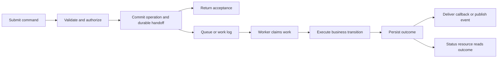

The queue's delivery behavior, worker checkpoint atomicity, ordering, and deduplication are not implied by the API-level lifecycle. The contract must name relevant guarantees at each boundary and point to the Part 07 owners rather than advertise a vague “exactly once” promise.

## 6. Design Principles

- **Name the admission boundary.** State what has been validated, persisted, and scheduled before reporting acceptance.
- **Separate receipt from outcome.** Acknowledgment of a command is not a terminal business result; expose both explicitly.
- **Keep one authoritative outcome path.** Status resources or durable result lookup should survive missed callbacks and stream disconnects.
- **Make uncertainty resolvable.** A lost response must lead to lookup or retry under the same logical operation identity, not guesswork.
- **Bound every queue and wait.** Admission limits, queue age, operation duration, payload size, attempts, and retention all need policies.
- **Design callbacks as delivery obligations.** Persist pending delivery and expose attempt history where the integration warrants it.
- **Treat cancellation as a race.** Report the state actually reached; do not describe cancellation request as rollback.
- **Make the delivery promise measurable.** Track admission rejection, oldest queued work, completion latency, retry volume, and terminal failures.

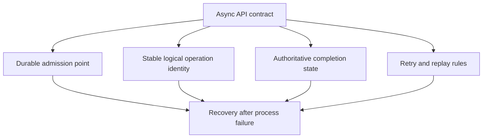

## 7. Architecture Patterns

**Operation resource with polling.** The caller submits a command and receives a resource identity, then polls a status representation using a documented interval or retry hint. This is the simplest default when completion latency is moderate and polling load is acceptable. REST owns its HTTP resource semantics; this chapter owns the lifecycle and polling cadence decisions.

**Operation resource plus callback.** Keep the status resource authoritative and send a webhook for state changes or terminal outcome. This combines pull-based recovery with low-latency notification. The receiver can safely ignore missed notifications and query the operation.

**Queue-backed command API.** The public API performs validation, durable admission, and returns an operation receipt; internal workers consume commands from a queue or log. The queue absorbs bursts and isolates worker scaling, while quotas and admission rejection prevent unbounded backlog.

**Request/reply over messaging.** A producer publishes a request with a correlation identifier and reply destination; a consumer processes it and publishes a reply carrying the same correlation identity. The caller need not block a network request, but the contract still needs reply expiry, duplicate handling, timeout, and unresolved-outcome policy.

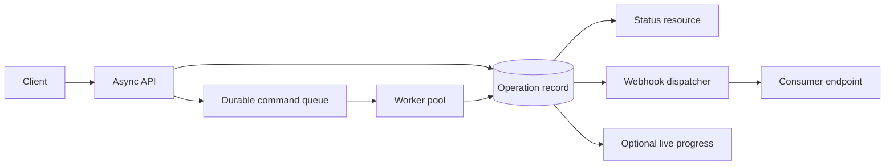

A queue is an implementation and decoupling mechanism, not a promise that every accepted operation completes successfully. Capacity, poison messages, worker outages, and downstream failures remain visible and require policy.

## 8. Production Architecture

Separate the public interaction plane from execution capacity where load and ownership justify it. The ingress API owns authentication, validation, tenant quota, operation creation, and stable response mapping. A durable store or log protects accepted work; workers scale according to queue depth and age; a result store serves operation reads; a delivery service attempts callbacks and records outcomes. A small system may combine these roles while preserving the same failure boundaries.

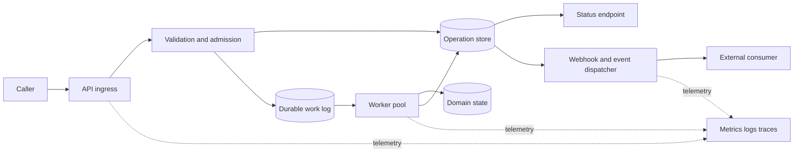

Capacity planning must include arrival rate, service rate, queue storage, retry amplification, worker concurrency, downstream quotas, and recovery after an outage. If arrivals exceed service rate for too long, a queue merely converts immediate errors into growing latency and storage pressure. Admission control must reject or defer new work before the system accepts more obligation than it can satisfy within the published service objective.

## 9. Implementation

Implement the API contract in a sequence that makes every promise testable:

1. Define command schema, authorization scope, maximum payload, and validation outcomes.
2. Define operation identity, stable status URI or lookup key, retention, and terminal states.
3. Choose and implement the durable admission point; do not acknowledge before it.
4. Persist the command and dispatch obligation with a recoverable relationship.
5. Implement worker state transitions, lease/recovery policy, and terminal result storage.
6. Add status reads and optional callback/stream notifications from persisted state.
7. Document retryable failures, backoff, replay, dead-letter handling, and operator ownership.
8. Instrument admission through terminal completion and exercise failure injection before launch.

Keep API-level identity metadata in explicit fields rather than relying on logs or broker headers that consumers cannot observe. Validate callbacks and message envelopes before business dispatch. Do not serialize internal exceptions as public failure reasons. Provide a stable error code, safe detail, retryability classification, and correlation reference where useful.

## 10. Complete Code Examples

The examples are executable reference models for API contracts. They use Python 3.10+ and the standard library only. They are intentionally small: the first uses SQLite as a durable local operation store but is not a horizontally scalable production service; the latter two simulate delivery and messaging semantics without requiring a broker or public endpoint.

1. **Operation-resource API:** [01_operation_resource_api.py](../code/python/async-apis-chapter/01_operation_resource_api.py) starts a local HTTP server, persists accepted operations in SQLite, and exposes `POST /operations` and `GET /operations/{id}`. Run `python 01_operation_resource_api.py`, then submit a JSON document with `curl -X POST http://127.0.0.1:8080/operations -H "Content-Type: application/json" -d '{"document":"report"}'` and poll the returned `statusUrl`.
2. **Signed webhook retry simulator:** [02_webhook_retry_simulator.py](../code/python/async-apis-chapter/02_webhook_retry_simulator.py) signs the exact body with HMAC-SHA256, verifies timestamp/signature at a receiver, retries transient failures with capped exponential backoff and deterministic jitter, and routes exhausted work to a small dead-letter list. It needs no live server.
3. **Correlated request/reply consumer:** [03_correlated_message_consumer.py](../code/python/async-apis-chapter/03_correlated_message_consumer.py) demonstrates command, acceptance, completion, correlation and causation identifiers, timeout/response-loss ambiguity, stable retry identity, and operator replay. Its in-memory broker is illustrative and is not durable.

Run each with `python <filename>` from its directory. No third-party package, broker, database server, or cloud account is required. The scripts are teaching artifacts; the chapter's stated reliability and security boundaries still apply.

## 11. Performance

Asynchronous APIs trade connection occupancy for queueing and state-management cost. The acceptance path should be short and bounded, but adding a queue does not reduce total work. Measure admission latency separately from time-to-start, execution duration, and time-to-terminal-outcome. For a callback, measure event creation to first attempt and to acknowledgment; for polling, measure request amplification and status-read latency.

The queueing delay grows sharply as utilization approaches full capacity. A system sized only for average throughput has no room for bursts, retries, or recovery after worker outages. Apply tenant quotas, maximum in-flight operations, payload limits, and a clear rejection response. Polling interval should reflect expected completion time and user value: frequent polling reduces detection delay but increases read load. Conditional status reads and adaptive intervals can reduce repeated payload cost, but the basic contract must specify freshness and observable transition behavior.

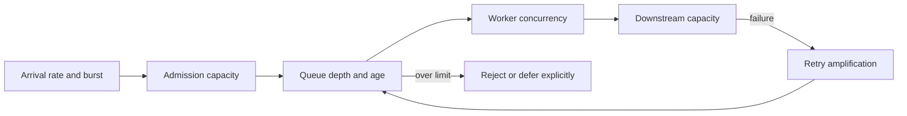

Avoid optimizing only average completion time. Long-tail jobs can dominate queue age and service objectives. Partition work classes when a slow class would starve short jobs, and cap retries so a dependency outage cannot multiply load without bound.

## 12. Scalability

Scale admission, durable storage, execution workers, status reads, and notification delivery as distinct dimensions. A stateless ingress can scale independently from workers, but the durable state and queue must support the accepted workload. Worker concurrency should be limited by the narrowest downstream resource, not by the number of available compute slots. Partitioning and per-key ordering choices belong to Part 07's ordering and partitioning owners; the API publishes only the ordering scope consumers may rely on.

Burst absorption has a finite horizon. If the queue grows faster than workers drain it, estimate time-to-capacity and switch from accepting work to controlled rejection, quota reduction, or priority shedding. A retry backlog after an outage can be larger than normal traffic, so replay and redrive need rate controls. Status polling can itself become a burst when many clients poll at the same fixed interval; use jittered client intervals and server guidance.

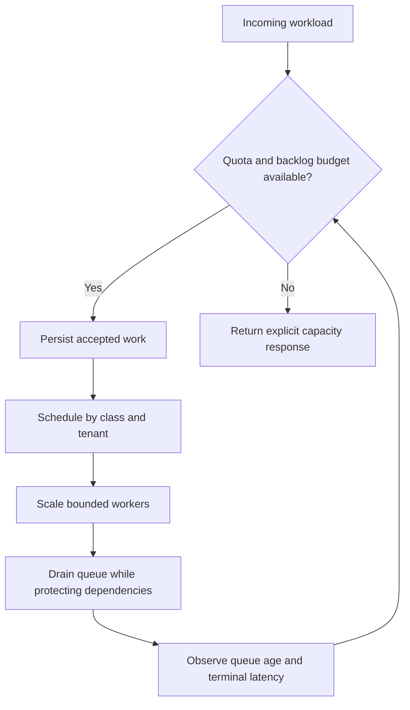

## 13. Security

An asynchronous operation outlives the request that created it. Authorization must therefore cover submission, later status reads, cancellation, result retrieval, webhook registration, and replay. Do not treat possession of a predictable operation identifier as permission to read its result. Re-evaluate authorization when required by the data sensitivity and business policy; a caller's access may be revoked while work remains in flight.

A webhook URL is untrusted input and an outbound network target. Validate destination policy, restrict private and link-local address access, handle redirects deliberately, and defend against DNS rebinding and endpoint changes according to deployment threat model. Protect secrets at rest, support rotation overlap, sign the exact payload bytes and timestamp, and use a bounded replay window. Verify signatures with constant-time comparison and reject stale or malformed timestamps. These are webhook-specific obligations, not a general API security tutorial; full API threat modeling belongs to the future API Security chapter.

Never include credentials or sensitive data in operation IDs, callback URLs, or query parameters. Minimize event payloads, redact logs, cap body size and decompression expansion, and prevent one tenant from using callbacks or replay to exhaust shared resources.

## 14. Observability

The unit of observation is the logical operation across attempts, not one HTTP request or one queue message. Propagate operation, correlation, and causation identifiers through API admission, worker execution, state transitions, and outbound delivery. These IDs are useful in structured logs and traces, but should not be unbounded metric labels.

Measure accepted and rejected operations, queue depth and oldest age, time-to-start, execution duration, terminal outcomes, cancellation races, webhook attempts and acknowledgment latency, retry schedule, dead-letter backlog, manual replay, and operation lookup failures. Separate API acceptance availability from completion success: a healthy `202` rate can hide a stuck queue. Alert on age and progress as well as raw depth, since a small queue can still contain one business-critical operation that has been stuck for hours.

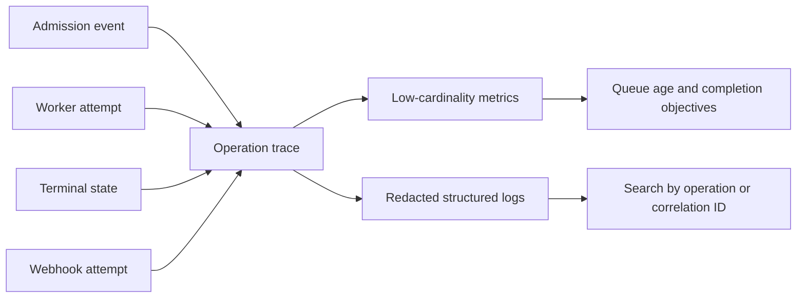

Define service objectives for acceptance latency, completion latency by work class, terminal failure rate, callback delivery age, and status availability. Label each objective's boundary: time to admit is not time to complete, and delivery acknowledgment is not consumer-side business completion.

## 15. Failure Scenarios

**Acceptance response lost.** The provider may have durably admitted the operation while the caller sees a timeout. The caller retries with the same stable operation identity or queries outcome through a documented lookup; it must not invent a fresh identity without understanding the duplicate risk. Part 07 CH16 owns the full idempotency mechanism.

**API acknowledged volatile work.** An ingress process crashes before a queued in-memory task is persisted. Accepted work disappears. The architectural fix is to move the acknowledgment after durable admission or return an explicit rejection when admission cannot be guaranteed.

**Worker crashes mid-operation.** A lease expires and work may be attempted again. State transitions and external effects need a documented repeat-safety boundary; see Part 07 CH16-19. The API should surface eventual terminal state, not equate worker invocation with success.

**Webhook endpoint is unavailable.** Retry under the published schedule, keep the operation result available, and alert on age or exhausted delivery. Do not make the business operation itself fail merely because a best-effort notification failed unless the business contract explicitly couples them.

**Poison payload or incompatible schema.** Quarantine the item with a stable diagnostic and schema version. Automated infinite retries waste capacity; manual replay follows correction and records who initiated it.

**Cancellation races with completion.** The API records cancellation requested, then reports the state that actually wins. It must not promise rollback of already committed effects.

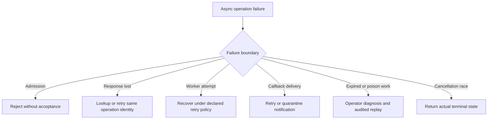

## 16. Testing

Test the interaction contract across failures, not only the happy-path worker function.

- **Admission tests:** validation rejection, quota exhaustion, durable acceptance, and process restart after acceptance.
- **Lifecycle tests:** legal state transitions, terminal-state immutability, progress bounds, cancellation races, and retention expiry.
- **Ambiguous-outcome tests:** drop the acceptance response after persistence and prove the client can resolve the original operation.
- **Delivery tests:** receiver timeout, non-success response, retry schedule, stable event identity, signature tampering, stale timestamp, exhausted attempts, and manual replay.
- **Message tests:** correlate out-of-order replies, expire unmatched replies, redrive a quarantined message, and preserve trace context.
- **Load tests:** burst admission, queue saturation, retry amplification, recovery after outage, and polling synchronization.
- **Contract evolution tests:** old/new producer-consumer schema combinations, unknown optional fields, enum expansion, and semantic compatibility.

Consumer-driven contract tests should verify the producer's real event or webhook against consumer expectations before release. The future OpenAPI chapter owns the formal OpenAPI workflow; AsyncAPI may be appropriate for message contracts, but this chapter does not assume either sibling's full tooling treatment. Keep examples, schemas, and generated client artifacts aligned through CI.

## 17. Common Mistakes

- Treating `202 Accepted` as proof that work completed or even began.
- Returning acceptance before the operation and dispatch obligation are durable.
- Treating an HTTP timeout as proof that the operation failed.
- Offering callbacks without an outcome lookup or event replay path.
- Using a new operation identity for every retry of one caller intent.
- Calling a queue durable without defining broker retention, replication, and redrive behavior.
- Retrying immediately or forever without jitter, age limits, and ownership.
- Treating a webhook success response as proof the consumer's business effect completed.
- Calling an API exactly-once because a message has an ID.
- Offering cancellation as though it were transactional rollback.
- Publishing internal workflow steps or database-shaped payloads as stable public events.
- Measuring only request latency and queue depth, ignoring oldest age and terminal completion.

## 18. Best Practices

- Define accepted, started, progressed, completed, failed, cancelled, and expired states as applicable.
- Commit the operation identity and durable work obligation before reporting acceptance.
- Keep a status or outcome lookup as the authoritative recovery path when notifications can be missed.
- Use stable operation identity for one logical command and distinct identities for its messages and events.
- Specify which delivery failures are retryable, the backoff and jitter bounds, maximum age, and replay policy.
- Retain delivery-attempt history and assign an operator owner to quarantined work.
- Sign webhook payloads, enforce a replay window, rotate secrets safely, and restrict callback destinations.
- Use queues to isolate capacity, but enforce admission controls and downstream concurrency budgets.
- Test response loss, restarts, retries, dead-letter redrive, schema skew, and callback outages.
- Report separate objectives for admission, completion, and notification delivery.

## 19. Anti-Patterns

**Fire and forget with a success response.** The caller receives no stable identity, status path, or recovery protocol. This is only acceptable for explicitly best-effort work whose loss is harmless and observable.

**Infinite synchronous wait.** Holding a request open does not make long work reliable; it consumes connection and server capacity while intermediaries can still terminate it.

**Callback as sole truth.** A webhook can be delayed, duplicated, rejected, or lost after retention. Without outcome lookup or replay, callers cannot reconcile state.

**Unbounded accepted backlog.** Accepting everything transfers overload into storage, latency, and eventual outage. Admission is a capacity decision, not a courtesy.

**Retry every error.** Permanent validation and authorization failures should not be retried like temporary network failure. Blind retry increases load and hides bad contracts.

**Exactly-once by naming.** Stable IDs, broker settings, or a single consumer do not by themselves guarantee one external side effect. Part 07 CH17 owns the boundary analysis.

**Polling every second forever.** A fixed aggressive cadence scales read load with pending clients even when work takes minutes. Give bounded guidance, use jitter, and offer push when it materially improves the experience.

## 20. Trade-off Analysis

| Choice | Benefit | Cost or risk | Strong fit |
|---|---|---|---|
| Synchronous response | Simple outcome and no operation state | Connection lifetime, timeout ambiguity, coupled capacity | Fast bounded work |
| Operation resource and polling | Recoverable status and simple client infrastructure | Polling load and completion-detection delay | Moderate volume; clients can poll |
| Operation resource plus webhook | Low-latency notification with authoritative lookup | Endpoint registration, retries, signature and support lifecycle | Server-to-server integrations |
| Queue-backed execution | Burst isolation and independent worker scaling | Queue operations, backlog policy, eventual completion | Variable work and decoupled producers/workers |
| SSE/WebSocket progress | Fast live updates | Connection and replay contract complexity | Interactive clients needing progress |
| gRPC streaming | Typed streaming RPC for controlled service clients | Runtime/intermediary/tooling constraints; not a work ledger | Service-to-service stream contract |
| At-least-once delivery | Recoverable under failures | Consumer must tolerate repeated attempts | Durable notifications and commands |
| Bounded retries and DLQ | Limits amplification and enables diagnosis | Requires ownership and manual recovery | Critical integrations with repair path |

The strongest general composition is often an operation resource for lookup, a durable queue for execution, and an optional webhook or stream for prompt updates. Do not add all three automatically: each boundary has operational cost, and simple polling may be sufficient at low volume.

## 21. Comparison Table

| Interaction | Primary direction | Completion visibility | Recovery after disconnect | Main architectural cost |
|---|---|---|---|---|
| Operation resource polling | Caller pulls | Status representation | Re-read stable operation identity | Poll traffic and retention |
| Webhook | Provider pushes to consumer | Callback attempt acknowledgment | Provider retries; consumer reconciles via operation lookup | Endpoint availability and delivery operations |
| Durable message queue | Producer to worker/consumer | Separate result/status contract | Broker retention and redrive, within configured bounds | Broker capacity and consumer operations |
| SSE | Server to connected client | Feed event contract | CH05 feed cursor/replay contract | Long-lived stream and feed retention |
| WebSocket API | Bidirectional messages | CH04 message/ack contract | CH04 application replay contract | Connection lifecycle and multiplexing |
| gRPC streaming | Typed RPC stream | RPC terminal status and stream messages | Application-specific resume and operation identity | Generated contract and runtime constraints |

HTTP `202` and REST operation-resource semantics remain owned by CH01; WebSocket, SSE, and gRPC mechanics remain with their named siblings. This table compares how an API composes asynchronous work, not the underlying transport protocols.

## 22. Real-World Case Study

A cloud document service offers bulk export to enterprise customers. Its first endpoint performed the export inside the initiating HTTP request. Small exports completed quickly, but large tenants regularly exceeded gateway timeouts. Some clients retried after timeout while the original export continued, creating duplicate archives and increased storage. Others assumed timeout meant failure and opened support tickets.

The revised API validates the request, checks tenant quota, records an operation resource, and durably hands off work before returning acceptance. The response identifies the operation and provides its status location; the operation reports queued, running, completed, failed, or cancellation outcome. The export worker writes an immutable result reference and terminal state. A webhook is optional for enterprise systems that need prompt notice, while the status resource remains authoritative. A browser console may receive progress over SSE, using that chapter's feed contract rather than inventing another stream protocol.

The team publishes attempt limits, callback response rules, bounded retry with jitter, retention, and audited manual replay. Stable operation identity lets a client resolve a lost acceptance response; Part 07's idempotency and exactly-once chapters own the underlying repeat-safe effect and processing-boundary mechanics. Metrics separate admission latency from queue age and completion time. During a worker outage, admission begins rejecting work when the backlog budget is exhausted instead of accepting obligations the platform cannot meet.

The improvement is not that failures disappear. A client can distinguish rejection from acceptance, discover actual completion after a network interruption, and receive notification without making the callback the sole source of truth. Operators can locate stuck work by operation identity, observe retry pressure, and replay quarantined delivery under an explicit procedure.

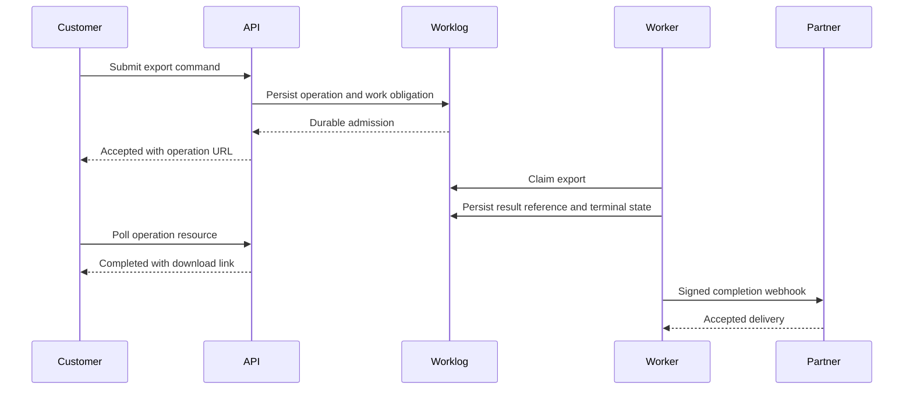

## 23. Interview Questions

1. What does asynchronous API interaction mean, and how does it differ from using `async`/`await` internally?
2. What exactly must be durable before an API reports that it accepted work?
3. Why is a request timeout not proof that the command failed?
4. How do an operation ID, message ID, correlation ID, and causation ID differ?
5. What belongs in an operation resource's state machine, and how should cancellation races appear?
6. What does a successful webhook response acknowledge, and what does it not prove?
7. How should a webhook provider classify responses and schedule retries?
8. Why are callback registration and delivery separate lifecycle concerns?
9. When should an API combine polling with webhook notification?
10. What are the trade-offs between a queue-backed command API and request/reply messaging?
11. Why does a dead-letter queue need an owner and replay audit trail?
12. Which guarantees are owned by Part 07's idempotency, exactly-once, ordering, and deduplication chapters?
13. How would you choose between an operation resource, webhook, SSE, WebSocket, and gRPC streaming?
14. What consumer-driven contract tests would detect an incompatible event change?

## 24. Hands-on Exercises

1. Run the operation-resource server. Submit concurrent exports, restart the process, and inspect which accepted work remains available. Extend the worker to demonstrate recovery of queued records and document what would be needed for safe recovery from a crash mid-effect.
2. Run the webhook simulator with a receiver that fails twice, then succeeds. Alter the body after signing, change the timestamp, and verify the receiver rejects each invalid attempt.
3. Run the correlated messaging example with out-of-order replies and a lost response. Preserve the same operation identity on retry, then compare with a retry that incorrectly generates a new identity.
4. Add a maximum queue-age policy and a manual replay command. Ensure replay is audited and cannot bypass signature, schema, authorization, or idempotency checks.

## 25. Design Exercises

Design an API for a utility provider that accepts meter-data imports from partners. Imports can contain millions of rows, partners can be offline, and each row has an independently reportable validation result.

Specify the submission schema and admission boundary; operation states and retention; tenant quotas and burst rejection; queue partition and worker concurrency assumptions; partial-success representation; callback event types and retry policy; signature rotation and destination validation; status polling guidance; replay and DLQ ownership; identifiers and tracing; schema compatibility policy; and which Part 07 reliability mechanisms are required. Compare an operation resource plus webhook with polling-only and a durable partner queue. Name the service objectives for acceptance, completion, and delivery separately.

## 26. Architecture Review Questions

- Does the API clearly distinguish submission receipt, durable admission, execution start, and terminal outcome?
- Is acceptance returned only after the provider can recover its obligation after process failure?
- Can a caller resolve a lost response without creating a second logical operation?
- Is there an authoritative status or result lookup path if callbacks or streams are missed?
- Are operation states, cancellation races, partial outcomes, expiry, and retention specified?
- Are callback registration, event schema, acknowledgment, attempt history, retry, and replay documented?
- Are retryable and permanent failures distinguished, with bounded backoff, jitter, and maximum age?
- Does every dead-letter or quarantine path have an operational owner and audited recovery action?
- Are command, event, operation, correlation, and causation identities distinct and scoped?
- Are Part 07 CH16-19 reliability mechanics linked rather than re-taught or overclaimed?
- Are callback signatures, replay windows, secret rotation, destination validation, and authorization addressed?
- Are queue capacity, admission rejection, dependency limits, and retry amplification tested?
- Do observability measures separate acceptance, queue wait, execution, terminal state, and notification delivery?
- Have consumer-driven tests exercised supported schema versions and semantic changes?
- Is the chosen interaction style simpler and more reliable than the alternatives for this consumer and workload?

## 27. Summary

An asynchronous API makes a durable promise about work that outlives the request that initiated it. Its contract separates admission from completion, gives each logical operation a stable identity, exposes lifecycle and terminal outcome, and defines how clients recover from response loss. Operation resources, callbacks, queues, request/reply messaging, and streams are composable choices with different reachability, durability, latency, and operational costs.

The provider should acknowledge only after it can recover its obligation. A webhook response acknowledges a delivery boundary, not necessarily consumer-side business completion. Retries need bounded backoff and jitter, dead-letter work needs an owner, and replay needs a stable identity and an audit trail. Idempotency, exactly-once boundaries, ordering, and deduplication remain owned by Part 07 CH16-19; REST `202`, WebSocket and SSE contracts, and gRPC streaming mechanics remain owned by their respective chapters. Make each guarantee observable and test it under response loss, process failure, backlog, duplicate delivery, and schema evolution.

**Further reading**: [REST](CH01_REST.md) · [WebSocket API](CH04_WebSocket_API.md) · [Server-Sent Events](CH05_Server_Sent_Events.md) · [gRPC](CH03_gRPC.md) · [Idempotency](../07_System_Design_and_Distributed_Systems/CH16_Idempotency.md) · [Exactly-Once Processing](../07_System_Design_and_Distributed_Systems/CH17_Exactly_Once_Processing.md) · [Ordering Guarantees](../07_System_Design_and_Distributed_Systems/CH18_Ordering_Guarantees.md) · [Deduplication](../07_System_Design_and_Distributed_Systems/CH19_Deduplication.md) · [OpenAPI and API Gateway](PART_OVERVIEW.md)
