# Chapter: OpenAPI Specification (OAS)

Part: [08 — API Architecture](PART_OVERVIEW.md) · Status: Draft

## 1. Introduction

The OpenAPI Specification (OAS) is a language-agnostic description format for application programming interfaces (APIs) that use the Hypertext Transfer Protocol (HTTP). An OpenAPI document records the externally visible HTTP surface: servers, paths, operations, parameters, request and response media types, schemas, security requirements, and related metadata. It is a machine-readable contract that people can review and tools can process.

OpenAPI is not itself a server framework, an API gateway, a REST architectural style, or a guarantee that a running service behaves as described. It lets an organization express and distribute an HTTP contract, then connect that artifact to design review, documentation, validation, mock servers, code generation, and compatibility checks. Its value comes from making the contract reviewable and reusable across those stages.

This chapter owns OAS syntax and document modeling, HTTP API contract workflows, schema reuse, and specification-based governance. [REST](CH01_REST.md) owns resource modeling and REST constraints; OpenAPI can describe a RESTful interface but cannot make an RPC-shaped API RESTful. [HTTP](../05_Networking_and_OS/CH01_HTTP.md) owns method, status, header, caching, and wire-level semantics; this chapter describes where those facts appear in an API contract without re-teaching their protocol mechanics. [GraphQL](CH02_GraphQL.md) owns GraphQL Schema Definition Language (SDL) and GraphQL operations, and [gRPC](CH03_gRPC.md) owns Protocol Buffers (Protobuf) interface definition language (IDL) and generated remote procedure call (RPC) contracts. The parallel [Async APIs chapter, CH06](CH06_Async_APIs.md), owns asynchronous interaction styles and any full AsyncAPI specification teaching; this chapter distinguishes AsyncAPI but does not teach it. API Gateway (CH08), API Security (CH09), and Versioning (CH10) own their broader architecture and policy topics.

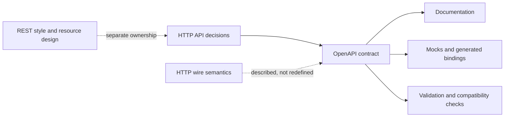

## 2. Historical Evolution

Swagger began as a specification and tooling ecosystem for describing HTTP APIs. Swagger 2.0, released in 2014, established a widely used JSON/YAML contract format. In 2015, the specification was donated to the OpenAPI Initiative (OAI), and the name OpenAPI separated the community specification from the Swagger-branded tools and products that implement it.

OpenAPI 3.0.0 arrived in 2017. Relative to Swagger 2.0, it introduced a more regular document structure, reusable `components`, explicit `requestBody`, multiple server definitions, callbacks, links, and more direct media-type modeling. OpenAPI 3.1.0, released in 2021, aligned Schema Objects with JSON Schema Draft 2020-12 and made nullability and vocabulary behavior more predictable for schema-aware tools. OpenAPI 3.1.1 (2024) and 3.1.2 (2025) are patch releases in the 3.1 feature line. OpenAPI 3.2.0 (2025) added, among other changes, first-class modeling for the HTTP `QUERY` method and richer sequential/streaming media-type descriptions. OpenAPI 3.2.1, published September 10, 2026, is the latest patch release at the time of writing; use the 3.2 feature set only when the relevant tools support it.

The format's evolution is not a command to migrate every contract immediately. The version in the top-level `openapi` field selects the OAS feature set. `info.version` describes the API description's version and is not the OAS version or necessarily the runtime API version. Patch releases clarify or correct the format; minor-version features can still expose tool-support gaps.

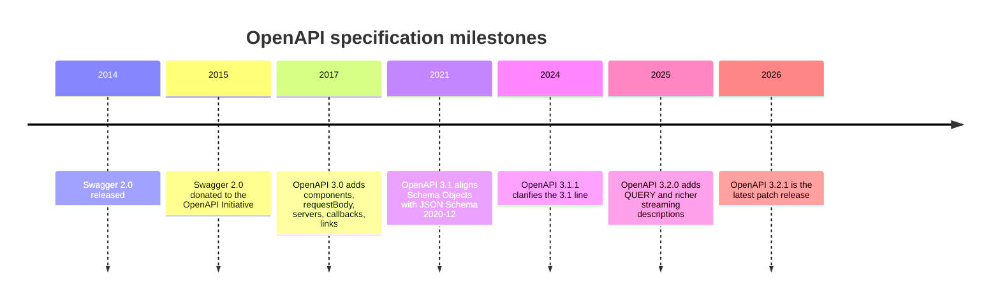

## 3. Why It Exists

An HTTP API is a coordination boundary. A consumer needs to know how to construct a request, what content it may send, which outcomes it must handle, and how to interpret returned data. When those facts exist only in code, slide decks, or manually maintained prose, clients and server implementations tend to diverge. OpenAPI provides a common artifact that makes the contract addressable, reviewable, and available to tools without requiring consumers to reverse engineer the implementation.

The specification can drive several activities from the same source: rendered reference documentation, request and response validation, mock endpoints, client and server scaffolding, test-case generation, and compatibility analysis. These outputs reduce repeated translation work. They do not remove architectural judgment: a generated method name is not a good domain operation merely because a generator accepted it, and schema-valid data can still violate a business invariant.

The central decision is whether describing the HTTP surface once and reusing that description costs less than keeping separate definitions synchronized. OpenAPI is most valuable when several consumers or teams depend on the same contract, when review and release governance matter, or when tooling can usefully automate repeated work. For a private endpoint with one short-lived consumer, a full registry and generation pipeline may cost more than it saves.

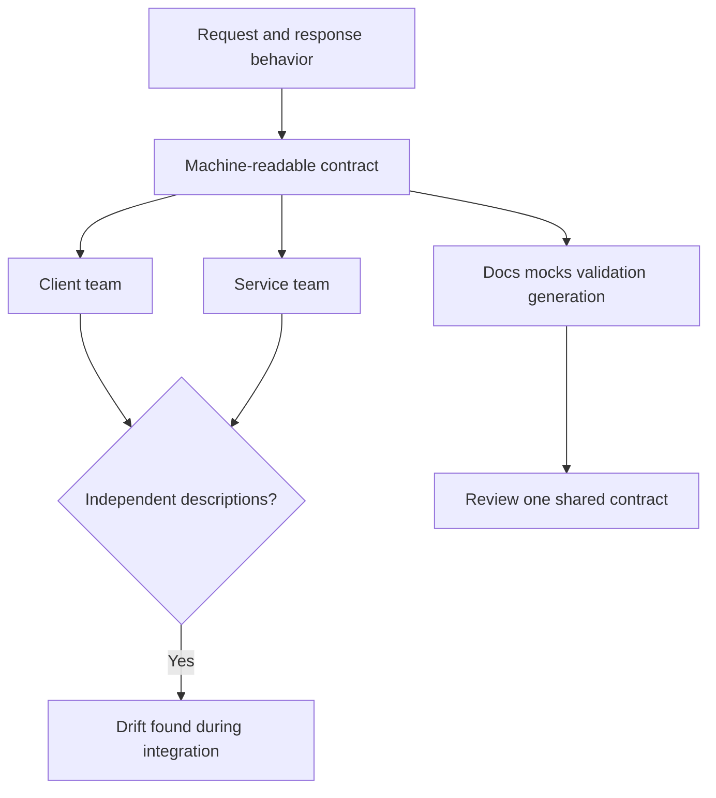

## 4. Core Concepts

These eight concepts form the working mental model for OpenAPI. They deliberately stop at the contract layer: resource semantics, wire semantics, authentication enforcement, and other schema languages remain with their owning chapters.

### 4.1 OAS as a contract model

**Definition.** An OpenAPI description is a structured declaration of an API's observable HTTP interface. An OpenAPI document is one JSON or YAML serialization of that description. The description includes both data shape and interaction metadata: which operation appears at a path, what inputs it accepts, what responses it may produce, and how operations are grouped or related.

**Mechanism.** A reader combines the server base URL with a path template, selects an HTTP operation, serializes its parameters and optional body according to media type, then interprets documented responses. A tool can traverse the same model to render prose, generate calls, or validate an exchange. OAS does not prescribe the implementation architecture behind an operation; several services or a gateway can jointly fulfill one described endpoint.

**Decision implications.** Treat the description as an interface artifact with an owner, review process, and release relationship to the implementation. Decide whether the source of truth is authored first or extracted from code, and make that decision visible. A contract is useful only when it is sufficiently accurate and maintained as behavior changes.

**Common failure mode.** An organization labels an outdated YAML file as the contract while production behavior has drifted. Tooling can make the stale document look authoritative, and generated clients can then faithfully reproduce the wrong assumptions.

**Scenario.** A checkout team publishes an order API used by web, mobile, and fulfillment clients. It reviews the operation and error contract once, publishes a stable description artifact, and links each release to the exact contract revision used by its clients.

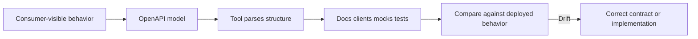

### 4.2 OpenAPI document anatomy

**Definition.** The root OpenAPI Object is the entry point. Its `openapi` field selects the OAS feature set; `info` identifies the described API document; `servers` gives connection bases; `paths` maps URL paths to operations; `webhooks` describes provider-initiated incoming requests; `components` stores reusable definitions; top-level `security` supplies a default security requirement; and `tags` add operation grouping metadata. At least one of `paths`, `components`, or `webhooks` must be present in current OAS releases.

**Mechanism.** A `Path Item Object` groups path-level parameters and shared descriptions with operations such as `get`, `post`, or `patch`. An `Operation Object` contains its summary, `operationId`, tags, parameters, request body, responses, callbacks, security override, and server override. A `Response Object` may specify headers, content keyed by media type, and links to other operations. Tooling may use `operationId` as a generated function name, so it must be unique and stable enough for its consumers.

**Decision implications.** Keep document boundaries and reuse intentional. A single file is easy to resolve and validate; multiple files can improve team ownership but make reference resolution, packaging, and publication more demanding. Tags are navigation metadata, not the API's domain model. Servers are target locations, not environments that should embed credentials.

**Common failure mode.** Teams mistake `info.version` for the version of the OAS, assume declarations under `components` are active without references, or define duplicate `operationId` values that cause code generators to collide.

**Scenario.** A contract has `/orders` and `/orders/{orderId}` path items, reusable request and response schemas under `components`, and `Orders` and `Fulfillment` tags. A generated client can group methods from operation tags while preserving stable operation IDs.

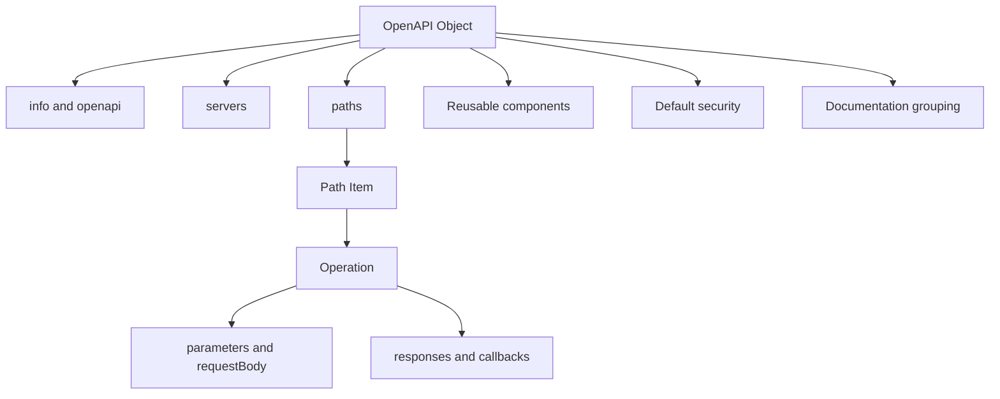

### 4.3 Paths, operations, parameters, request bodies, and responses

**Definition.** A path is a relative URL template such as `/orders/{orderId}`. An operation is the API behavior associated with an HTTP method at that path. Parameters represent path, query, header, or cookie inputs. A request body describes an input message by media type and schema. Responses map expected status codes or ranges to response descriptions, headers, and media-type-specific content.

**Mechanism.** Each `{template}` in a path has a matching required path parameter. Parameter serialization is part of the contract: `style` and `explode` affect how arrays and objects appear on the wire, so consumers must not guess. A request body uses `content` mappings such as `application/json`; response content is similarly keyed by media type. The operation should cover its successful result and known failure outcomes; a `default` response can document otherwise-unlisted results. OAS 3.2 recognizes `query` and supports additional HTTP method modeling; that syntactic support does not redefine method semantics.

**Decision implications.** Describe the actual request and response surface, including optionality, media types, pagination bounds, and expected errors. Be explicit about parameters whose serialization is not a simple scalar. Do not define a request body for a method whose semantics are unclear merely because a tool accepts it. The [HTTP chapter](../05_Networking_and_OS/CH01_HTTP.md) owns status and method meanings; here, selecting the right response code is contract completeness, not a second HTTP tutorial.

**Common failure mode.** A path template omits its required parameter, an optional value is mistakenly put in `required`, or a parameter is described as an object while the runtime expects bracketed query keys that OAS does not standardize. Another failure is documenting only the success case, leaving clients to infer validation, authorization, conflict, and dependency failures.

**Scenario.** `GET /orders/{orderId}` requires a UUID path parameter and returns an `Order` for the `application/json` representation. The contract includes the documented not-found and unauthorized responses; a client can generate typed handling without assuming that every non-success uses the same body.

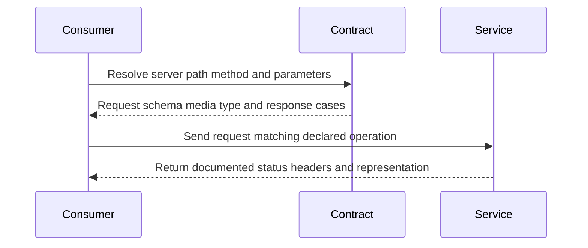

### 4.4 Schema components, reuse, and JSON Schema alignment

**Definition.** A Schema Object describes the structure and constraints of request or response data. `components.schemas` names reusable schemas, while other component collections hold reusable parameters, request bodies, responses, examples, headers, callbacks, links, and security schemes. In OAS 3.1, Schema Objects are based on JSON Schema Draft 2020-12 plus the OpenAPI base vocabulary.

**Mechanism.** OAS 3.1 supports JSON Schema types and keywords, including `type: [string, "null"]`, `$defs`, `$id`, `$schema`, `$ref`, `oneOf`, and `unevaluatedProperties` where appropriate. This differs from OAS 3.0's restricted schema dialect and its `nullable: true` convention. `required` names required object properties; it does not make every property required by default. `format` values such as `date-time` or `uuid` often function as annotations unless a validator enables format assertions. The effective schema dialect is selected by `$schema` or `jsonSchemaDialect`; absent an override, the OAS dialect applies.

**Decision implications.** Reuse schemas to reduce accidental divergence, not to force different representations into one over-generalized object. Request and response shapes often deserve different schemas because clients send different fields than the server returns. Use `readOnly` and `writeOnly` as directional annotations, not as a substitute for runtime input filtering. Check that every required field, null state, and closed or open object policy reflects actual behavior.

**Common failure mode.** Authors copy OAS 3.0 `nullable` examples into 3.1 and assume they have JSON Schema semantics; another common defect is expecting `format: uuid` or `format: date-time` to be strictly enforced by every tool. A shared schema may also accidentally leak a server-owned field into a request body.

**Scenario.** `Order` contains a required server-generated `id` marked `readOnly`, while `CreateOrderRequest` omits it. Optional `deliveryNote` accepts `null` as distinct from omission only if the business contract actually distinguishes those states. CI checks the schema dialect and examples with the same validator family used by runtime boundary validation.

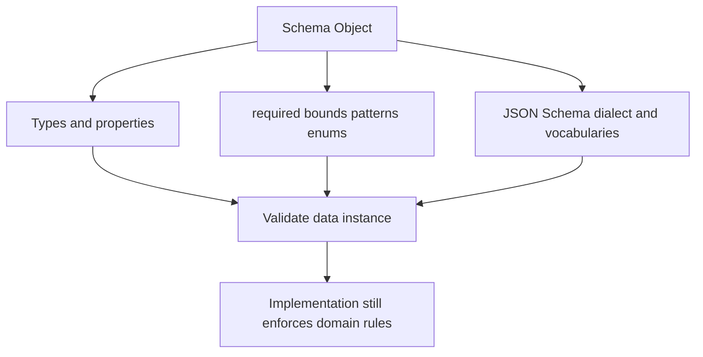

### 4.5 References, composition, and examples

**Definition.** `$ref` reuses a schema or other reusable OAS object by URI reference. JSON Schema composition combines assertions: `allOf` requires every subschema to validate, `anyOf` requires one or more, and `oneOf` requires exactly one. Examples illustrate instances or serialized values; they are informative contract material, not an alternate schema.

**Mechanism.** Local references commonly point to `#/components/schemas/Order`; external references point to other documents and must resolve against a base URI. In OAS 3.1, `$ref` inside a Schema Object follows JSON Schema rules, including sibling keywords, while a Reference Object outside schemas has its own rules. `allOf` composes constraints; it does not create object-oriented inheritance automatically. A discriminator can help consumers choose among variants but does not alter JSON Schema validation results. Use media-type examples that match the associated schema and serialization.

**Decision implications.** Prefer local references for portable, self-contained contracts. Split descriptions into files only when modular ownership or reuse offsets resolver complexity. Keep reference graphs finite and validate that all references resolve in the packaged release. Use examples to convey realistic edge cases, including nulls and errors, and test them against schemas instead of assuming they are correct.

**Common failure mode.** A generator dereferences an external file differently from a validator, a cyclic reference overwhelms a tool, or `allOf` is used as if it merged conflicting properties with an inheritance rule. An example with an invalid enum or missing required field teaches consumers the wrong contract.

**Scenario.** A shared `Problem` schema holds common error fields. `ValidationProblem` composes it with a list of field-level issues. The document supplies one valid validation example and one conflict example, and CI resolves every local reference and validates both values.

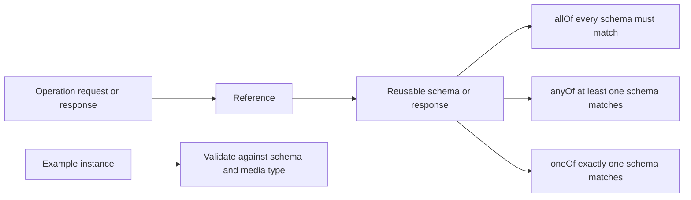

### 4.6 Security schemes, callbacks, webhooks, and links

**Definition.** `securitySchemes` describes mechanisms such as HTTP bearer authentication, API keys, mutual Transport Layer Security (mTLS), OAuth 2.0, or OpenID Connect. A `security` requirement applies schemes globally or to an operation. A callback describes an out-of-band request associated with an initiating operation; a webhook describes an incoming request that the provider may send independently. A Link Object describes a possible relationship from one response to another operation.

**Mechanism.** Security requirements are arrays of alternatives: multiple schemes within one requirement object are combined, while separate objects are alternatives. `security: []` removes inherited security for an operation; an empty requirement `{}` permits anonymous access. Callbacks use runtime expressions such as `{$request.body#/callbackUrl}` to identify a callback target. Webhooks have named Path Items at the document root. Links may use `operationId` or `operationRef` and runtime expressions to derive target parameters from request or response values. None of these constructs executes requests or grants access by itself.

**Decision implications.** Describe only mechanisms the running edge and service actually accept. Explain token format as a hint, not a claim that tokens are verified. For callbacks, document delivery, retries, signing, and registration semantics outside the OAS where needed; validate destinations against server-side policy to prevent server-side request forgery. Treat links as static machine-readable navigation metadata, distinct from dynamic hypermedia in a response body.

**Common failure mode.** Teams see `security: - BearerAuth: []` and assume authorization is implemented, or mistake a callback URL schema for safe callback delivery. A link to an operation is not proof the caller is authorized or that the operation will succeed.

**Scenario.** `POST /orders` accepts an optional callback URL, and its callback definition describes the later order-status notification. A separate `orderStatusChanged` webhook describes provider-originated notifications after a subscription is established. The service authenticates callbacks and restricts outbound destinations independently of the document.

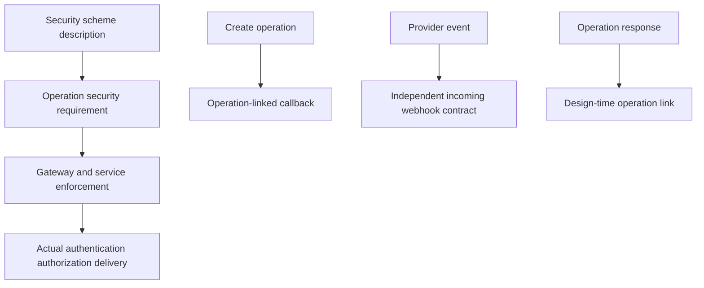

### 4.7 Design-first versus code-first and the tool chain

**Definition.** Design-first starts with a reviewed OpenAPI description and treats implementation and consumers as realizations of that contract. Code-first derives a description from implementation annotations or framework metadata. Both are methods of producing a contract; neither guarantees its accuracy or quality.

**Mechanism.** In design-first, teams agree on operation shape and examples before implementation, then validate server and clients against the artifact. In code-first, annotations and runtime types feed a generator that emits the description, which still needs review for semantic completeness and compatibility. A lifecycle may include authoring, linting, bundling, validation, rendered docs, mocks, client generation, server scaffolding, tests, publication, and change checks. Tooling differs in which OAS versions and JSON Schema features it supports.

**Decision implications.** Prefer design-first when consumers and independent teams need early coordination or when the API boundary is a deliberate product. Prefer code-first when one implementation team owns a small interface and metadata stays close to code, but validate generated output as a release artifact. Hybrid is common: design the public contract, then use code generation and framework validators. Pin tools and transformations so output is reproducible.

**Common failure mode.** A code-first framework silently omits a custom response or body constraint, while teams assume the generated file is complete. Conversely, design-first can produce a beautiful spec that no runtime validator checks and no implementation owner updates.

**Scenario.** A platform team owns a public orders contract design-first to unblock mobile development. Its FastAPI implementation generates handler types from the contract, and CI compares the committed description with the deployed service behavior through schema validation and consumer contract tests.

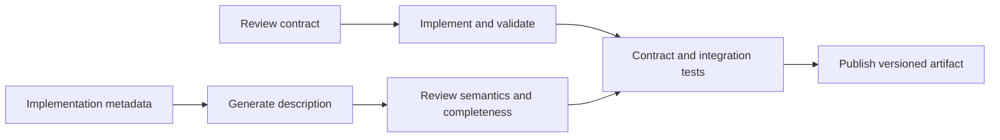

### 4.8 Compatibility, governance, and specification limits

**Definition.** Contract compatibility asks whether existing consumers can continue to communicate correctly across a change. Governance is the set of ownership, review, policy, and release controls that makes that question repeatable. A specification's limitations are the observable facts it cannot fully capture, such as business invariants, state-dependent behaviors, runtime timing, authorization decisions, or service-level objectives.

**Mechanism.** A compatibility checker compares a proposed description with a known released baseline and classifies changes such as removed paths or operations, narrowed request constraints, removed response fields, changed requiredness, and response-code changes. Rules are directional: accepting more request values may help clients, while returning fewer possible response variants can break them. A checker uses heuristics and cannot prove all semantic compatibility. Governance combines automated diffs with ownership, review, consumer testing, and deliberate exceptions.

**Decision implications.** Define compatibility separately for requests and responses, and choose a baseline that represents what consumers actually use. Decide whether warnings block merges and how intentional major changes are approved. Add runtime validation or consumer-driven tests for claims the schema cannot establish. Keep versioning policy with future CH10; this chapter explains compatibility checks, not a complete cross-style version strategy.

**Common failure mode.** Teams call adding a response field "always safe," though strict generated clients may reject unknown properties; or they assume a clean structural diff proves business behavior is compatible. Ignoring callback, security, or example changes also leaves meaningful contract drift unreviewed.

**Scenario.** A release proposes making `deliveryWindow` mandatory in create requests. A compatibility check flags this as breaking for existing clients; the team either makes the field optional with a documented default, coordinates a migration, or uses a governed incompatible release boundary.

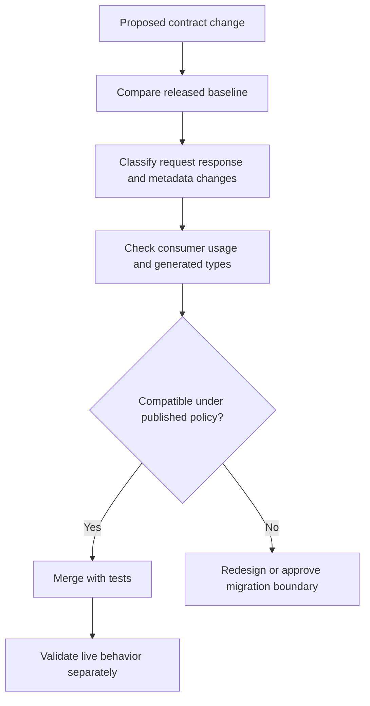

## 5. Internal Working

An OpenAPI tool first parses YAML or JSON into a data model, checks that required objects and fields are structurally valid, resolves references, then applies semantic or organization-specific rules. A downstream tool may render operations, generate code, produce mock responses from examples, or compare the document with another release. Each consumer implements a subset of the specification and may interpret unsupported features differently; tool compatibility is therefore part of the architecture.

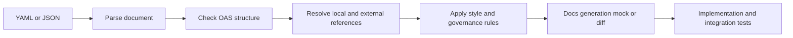

At request time, a runtime validator can match method and path, parse input according to the declared media type and serialization, validate the instance against its schema, invoke the application, and validate the resulting status, headers, and body. OpenAPI does not require a service to perform these steps. The implementation may choose generated routing, framework-native validation, gateway validation, or tests; architects should name the enforcing component and avoid validating the same request inconsistently at multiple layers.

References add their own execution concerns. Local JSON Pointer references are convenient within one entry document; external references introduce retrieval permissions, network availability, trust boundaries, and reproducibility concerns. Bundle or vendor remote references at release time where feasible, and reject unexpected network retrieval during production builds. OAS 3.1 and later require complete-document parsing behavior for reliable reference resolution, so tools that only inspect isolated fragments may not be interoperable.

## 6. Design Principles

1. **Model the public contract, not internal implementation types.** Expose stable consumer concepts and intentional request/response shapes.
2. **Keep one accountable source per boundary.** Decide whether the description is authored or generated, then reconcile any generated artifact deterministically.
3. **Make serialization explicit where it matters.** Parameters, media types, nullability, and examples must agree with actual wire behavior.
4. **Separate shape validation from business validation.** JSON Schema can express structure and many constraints; it does not encode every domain invariant.
5. **Treat security declarations as documentation.** Runtime identity verification and authorization remain enforced in trusted components.
6. **Version the toolchain.** Pin validators, bundlers, generators, and rulesets because version drift changes generated output and diagnostics.
7. **Review consumer impact directionally.** Request acceptance and response evolution have different compatibility effects.
8. **Prefer portable descriptions.** Minimize vendor extensions and remote references unless the value outweighs interoperability cost.

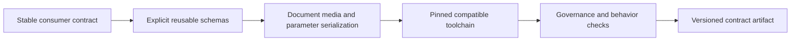

## 7. Architecture Patterns

**Design-first provider contract.** A product or platform team publishes a contract before implementation. Consumers can review requests, responses, and examples early. It suits independently scheduled teams and external partners; it requires an owner to keep the published artifact in step with implementation.

**Code-first service metadata.** Framework declarations generate the description from route handlers and type annotations. It minimizes duplicate source declarations for a service team but is risky when framework inference cannot represent custom behavior, error branches, or headers. Review generated output and test it at the HTTP boundary.

**Contract package or registry.** A central or federated service stores immutable, versioned descriptions with owners, publication state, and consumer references. Centralization improves discovery and consistency but can bottleneck teams; federation needs common compatibility rules and a stable artifact format.

**Gateway validation and transformation.** An edge component may validate requests or route using the description. This is a deployment use of an API contract, not a full API Gateway design lesson; policy, routing topology, and transformation architecture belong to [CH08 API Gateway](CH08_API_Gateway.md). Never let an edge schema become the only place that protects domain invariants.

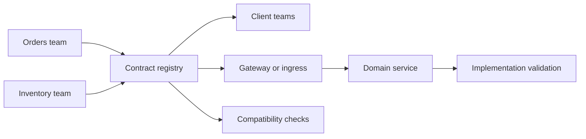

## 8. Production Architecture

A mature contract pipeline separates authoring, publication, and runtime behavior. A repository or registry stores the reviewed description; CI validates structure and policy; documentation and mocks are derived from that exact revision; generators publish client packages; and runtime services enforce request constraints and domain rules. Consumers should be able to identify which contract revision corresponds to a deployed provider.

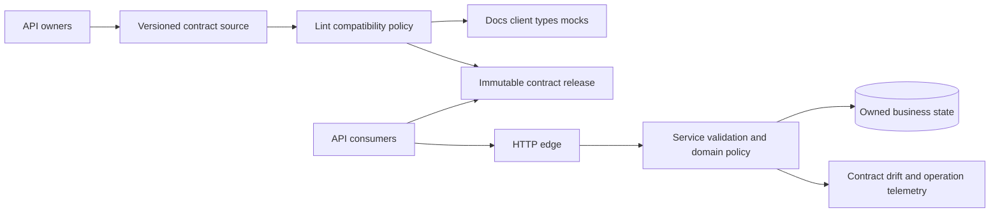

At scale, contracts may be split by service boundary and assembled for review or publication. Avoid a single enormous description that couples unrelated release trains, but retain a coherent public surface when consumers need cross-service navigation. Treat private extensions as explicit agreements, and do not expose confidential server URLs, internal hostnames, test credentials, or private implementation details in public descriptions.

## 9. Implementation

Implementation starts by capturing the consumer-visible contract. Define operations, required and optional inputs, response outcomes, media types, reusable schemas, examples, and security requirements. Choose the source-of-truth mode, OAS version, reference layout, naming rules, and validation policy. Then build a small vertical slice: lint and resolve the document, render docs, generate or hand-write one client, validate representative requests and responses, and compare it against the running implementation.

For design-first services, generate code only for structures that are stable enough to automate. Generated server stubs often leave important validation and domain behavior unfinished; generated clients still require correct timeouts, retries, and credentials. For code-first services, treat the generated OpenAPI file as a reviewed build output and compare it in CI. Publish artifacts immutably and retain the prior release as a compatibility baseline.

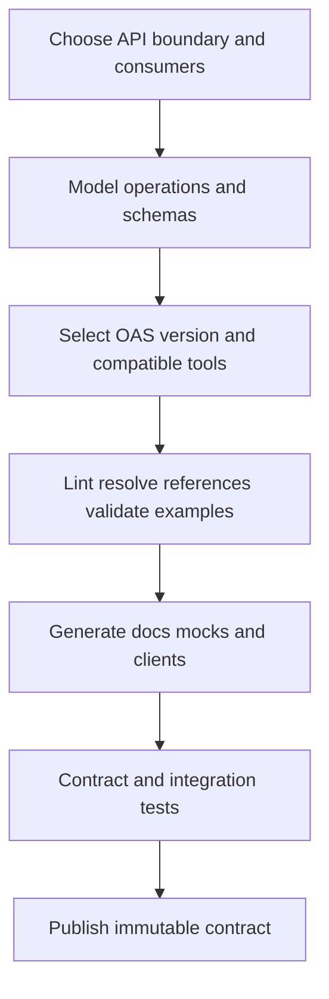

## 10. Complete Code Examples

The artifacts in `code/*/openapi-chapter/` form a single orders API example. They are intentionally transparent about what runs locally and what requires additional tooling.

1. [Complete OAS 3.1.1 orders contract](../code/yaml/openapi-chapter/openapi.yaml): two resource paths, OAuth 2.0 security requirements, reusable order and Problem Details schemas, examples, a response link, an operation callback, and an independent webhook.
2. [CI validation and breaking-change workflow](../code/yaml/openapi-chapter/openapi-ci.yml): installs a linter and compatibility checker, validates the proposed document, and compares it with the base-branch contract.
3. [Toolchain package](../code/yaml/openapi-chapter/package.json): commands for linting, mocking, and TypeScript type generation, with pinned npm tool versions.
4. [Client, mock, and contract-test workflow](../code/yaml/openapi-chapter/README.md): reproducible commands, including a generated-type step, a Prism mock, and Schemathesis tests against a running provider.

The repository currently has `js-yaml` available for parsing YAML and Node.js for parsing JSON. It does not have the OpenAPI linter, mock server, code generator, or a running orders API installed. Therefore, this chapter's artifacts are not represented as generated or integration-tested output. The validation summary reports only checks actually performed.

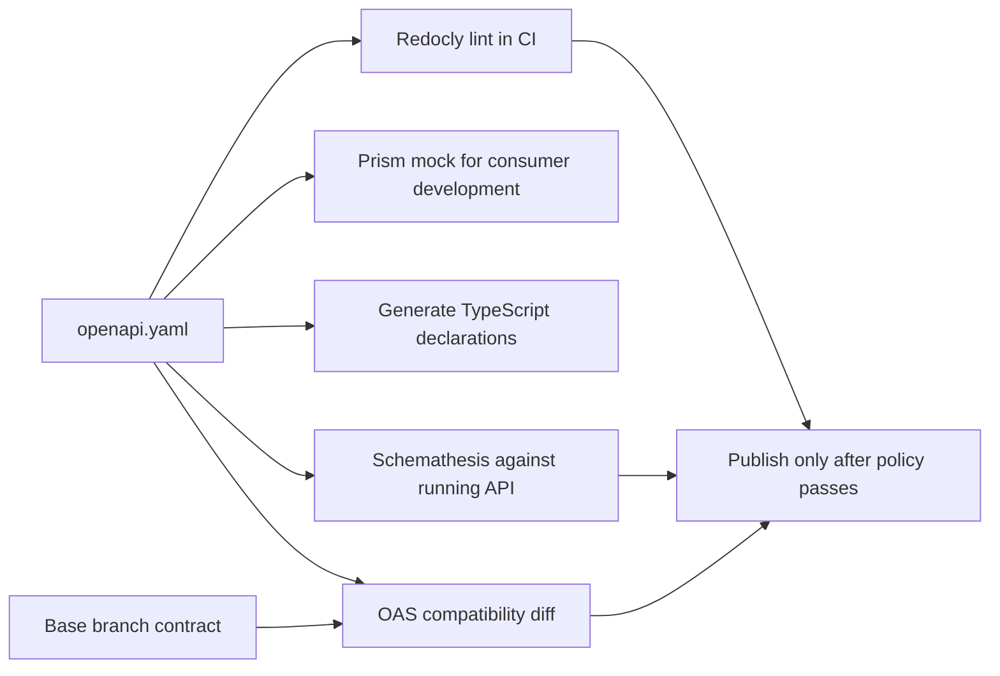

## 11. Performance

OpenAPI has no inherent request-time cost when it is used only at design and build time. Runtime validators, dynamic routers, or gateways that load and validate the description add parsing, schema evaluation, and dispatch work. A robust implementation loads and compiles schemas once, caches them by contract revision, and avoids refetching external references per request. Measure the runtime path rather than assuming validation is free or too expensive.

Contract size affects developer tools and build pipelines: large reference graphs increase parse, bundle, and code-generation time. Split files by ownership where this improves review, then bundle or package them reproducibly for downstream tools. Avoid excessive `oneOf` branches, pathological regular expressions, and schemas with deeply recursive expansion when the chosen validator cannot bound evaluation cost.

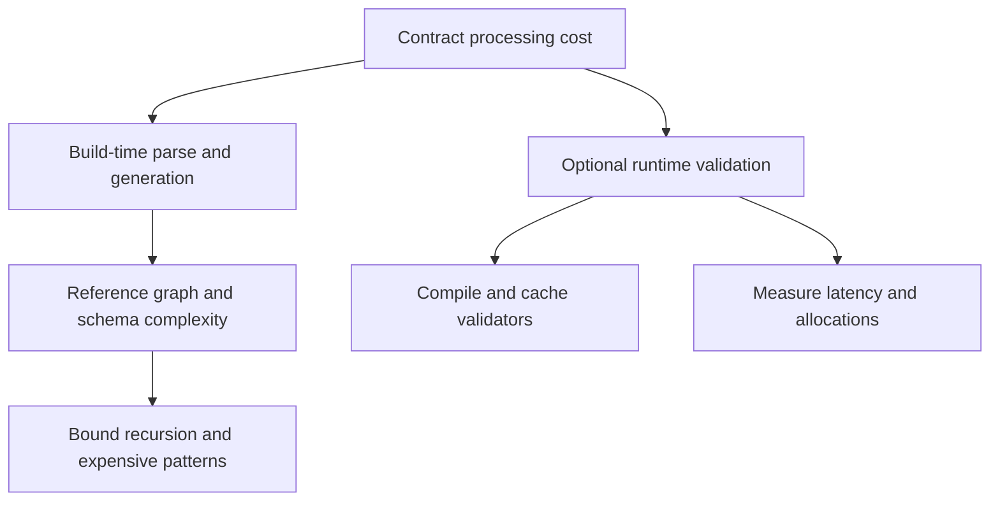

## 12. Scalability

Contract governance scales organizational coordination, not request throughput. As the API estate grows, separate ownership by domain, publish searchable immutable versions, share lint rules, and automate consumer impact analysis. A federated model lets teams ship independently, but only if naming, version conventions, extension policy, and compatibility rules are consistent enough for shared tooling.

Runtime schema validation can be scaled by compiling validators at startup, reusing immutable schema objects, and limiting body sizes and validation complexity. A gateway that aggregates or validates every interface becomes a potential release and availability bottleneck. Keep the contract registry and documentation plane independent of the request data plane unless a live runtime dependency is deliberately accepted.

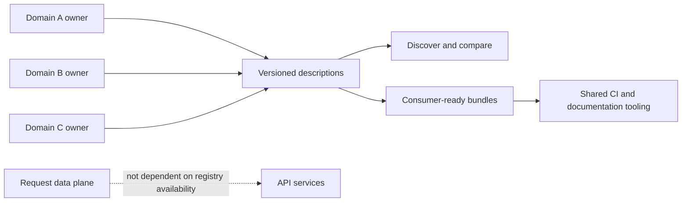

## 13. Security

OpenAPI is security-relevant in two ways: it documents expected protection and it is input to tools that process untrusted descriptions. A `securitySchemes` entry and its operation requirement do not authenticate a caller, validate a token, enforce object-level authorization, rate-limit requests, or secure data. The gateway and service must enforce those controls. This chapter's security content is limited to describing that boundary; comprehensive threat modeling and controls belong to future [API Security, CH09](CH09_API_Security.md).

Treat untrusted OpenAPI documents as executable-like build inputs: external `$ref` retrieval can expose build systems to untrusted hosts or server-side request forgery; recursive references can consume resources; Markdown renderers must sanitize HTML; and generated code must be reviewed for unsafe defaults. Pin and isolate tools, restrict reference retrieval, and avoid secrets in server variables, examples, or published URLs.

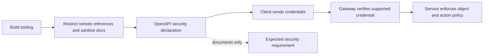

## 14. Observability

Observe both contract governance and runtime conformance. At build time, record linter findings, unresolved references, compatibility classifications, generated-artifact diffs, and waived rules with owners. At runtime, instrument normalized operation identity, validation outcome, schema version, request size, response status, and latency. Avoid raw IDs, secrets, or full bodies as metric labels or logs.

Contract drift is an operational signal. Compare production traffic or implementation tests with declared paths, media types, and response codes. A new undocumented response may break clients even when the handler itself is healthy. Conversely, a documented but unused endpoint may indicate obsolete surface area. Monitoring can reveal these trends but should not silently rewrite the contract.

```mermaid
flowchart TD
    CI[Lint and compatibility results] --> Catalog[Contract quality view]
    Request[Runtime operation] --> Normalize[Normalize path and operation ID]
    Normalize --> Metrics[Status latency size validation metrics]
    Normalize --> Trace[Trace to implementation and dependencies]
    Metrics --> Drift[Compare observed behavior to contract]
    Trace --> Drift
    Drift --> Owner[Assign review to API owner]
```

## 15. Failure Scenarios

**Description drift.** Generated docs show a response that the service no longer returns. Contain it by rolling back the contract release or restoring implementation behavior; then add a test for the missing response.

**Unresolved external reference.** CI depends on a remote schema that is unavailable or changed. Vendor or bundle approved dependencies, record their origin, and validate the final packaged document without network access.

**Generator version skew.** Local and release builds create different clients. Pin generator versions and configuration, publish generated artifacts reproducibly, and review the output diff.

**Breaking contract merged.** A newly required request property rejects deployed clients. Block merge based on the released baseline, then add a migration path or deliberate release boundary.

**Mock treated as implementation.** A mock responds from examples but does not implement authorization, state transitions, idempotency, or domain constraints. Label mock environments clearly and keep provider contract tests against the real implementation.

```mermaid
flowchart TD
    Signal[Contract-related incident] --> Kind{Observed failure}
    Kind -->|Docs differ| Drift[Compare release artifact and implementation]
    Kind -->|Reference unavailable| Ref[Bundle or restore trusted dependency]
    Kind -->|Generated code changed| Tools[Pin generator and reproduce]
    Kind -->|Clients rejected| Compat[Inspect change classification and baseline]
    Kind -->|Mock passed only| Runtime[Test the actual provider]
```

## 16. Testing

Test the description as a published artifact and the implementation as a running system. Structural tests check syntax, required fields, unique operation IDs, parameter/path correspondence, and reference resolution. Schema tests check examples and representative payloads. Linting checks organization conventions such as tags, descriptions, operation IDs, security declarations, and prohibited media types.

Provider contract tests send representative requests to the real service and assert status, headers, media type, and body conformance. Consumer tests protect client assumptions that a generic diff may not know, such as unknown-field tolerance, response ordering, or default semantics. Compatibility tests compare current and released descriptions in the correct direction and include tool-version policy. Mocks are useful for parallel development but cannot replace provider tests.

```mermaid
flowchart LR
    Structure[Parse and resolve] --> Schema[Validate schemas and examples]
    Schema --> Policy[Lint conventions and security declarations]
    Policy --> Diff[Compare released contract]
    Diff --> Provider[Exercise running provider]
    Provider --> Consumer[Run consumer contract tests]
    Consumer --> Release[Publish tested artifact]
```

## 17. Common Mistakes

- Treating OpenAPI as synonymous with REST, or assuming a valid document makes an API RESTful.
- Confusing the `openapi` field with `info.version` or runtime version policy.
- Treating security scheme descriptions as authentication or authorization enforcement.
- Writing examples without checking them against schemas and media-type serialization.
- Reusing request and response schemas when their allowed fields differ.
- Assuming `format` annotations are always asserted by validators.
- Assuming generators agree on defaults, `oneOf`, nullable unions, or vendor extensions.
- Publishing a mock-generated client without testing the actual provider.
- Comparing only names while missing requiredness, media-type, security, and semantic changes.
- Dereferencing untrusted external references during privileged builds.

An OpenAPI document is an executable input to parts of the software supply chain. Review it with the same attention given to source code, and test its claims at the actual HTTP boundary.

## 18. Best Practices

- Declare and pin the OAS feature line and tool versions; verify support before using newer fields.
- Give every operation a unique, stable `operationId` and every path parameter a matching required parameter declaration.
- Include success responses and known errors, with correct media types and reusable error schemas.
- Prefer JSON Schema-compatible constraints in OAS 3.1+, and distinguish omission from explicit `null` where the domain does.
- Keep examples representative and validate them automatically.
- Use local `$ref` by default; bundle and review external reference dependencies.
- Make design-first or code-first ownership explicit and reconcile output in CI.
- Compare changes against a real released baseline and complement generic diff tools with consumer tests.
- Treat security schemes as declarations; enforce identity and authorization in trusted runtime components.
- Publish versioned contracts alongside client packages and provider releases.

```mermaid
flowchart LR
    Author[Own and review] --> Pin[Pin OAS tooling]
    Pin --> Validate[Validate schema references and examples]
    Validate --> Compatible[Check consumer compatibility]
    Compatible --> Test[Provider and consumer tests]
    Test --> Publish[Publish immutable artifact]
    Publish --> Observe[Observe usage and drift]
    Observe --> Author
```

## 19. Anti-Patterns

**Spec as decoration.** The document is generated once for attractive reference pages, then ignored by tests and implementation. It cannot serve as a contract if nobody reconciles it with runtime behavior.

**Universal shared schema.** A single `Entity` schema with dozens of optional fields erases operation-specific invariants and confuses clients. Reuse stable components, but keep distinct intent-specific shapes.

**Generator as architect.** Automatically generated resource paths and operation names mirror handler implementation details instead of a deliberate external interface. Generation accelerates translation; it does not decide the API model.

**Security by declaration.** Publishing `security` entries without runtime enforcement creates false assurance, especially if direct service routes bypass the gateway.

**Mock-only confidence.** A mock driven by the same description cannot independently prove that the deployed provider matches that description.

**Remote-reference roulette.** A build downloads mutable external documents at runtime and produces different outputs depending on network state or remote changes. Pin, vendor, and review references.

## 20. Trade-off Analysis

| Decision | Benefit | Cost or risk | Choose when |
|---|---|---|---|
| Design-first vs. code-first | Early consumer agreement vs. close coupling to implementation metadata | Contract/implementation synchronization vs. inference gaps | Decide by ownership and consumer coordination needs |
| One document vs. multi-document description | Simpler resolution and release vs. modular ownership | Large file vs. reference and packaging complexity | Split only where teams or reuse benefit |
| OAS 3.0 vs. 3.1 vs. 3.2 | Broad older-tool support vs. stronger schema alignment/new features | Dialect and tool-support gaps | Select the newest feature line proven by all consumers |
| Generated client vs. handwritten client | Consistency and speed vs. more control over ergonomics | Generator coupling and runtime quirks vs. duplicated mapping | Use generation for broad stable surfaces, handcraft carefully for narrow use |
| Runtime validation vs. build-time contract tests | Immediate boundary rejection vs. no per-request validator cost | Latency/compute and duplicated checks vs. detection only in test/release | Use runtime validation at trust boundaries with measured budgets |
| Strict compatibility gate vs. exception workflow | Prevents accidental breaks vs. slows intentional evolution | False positives and migration friction | Automate classification and govern exceptions |
| Local references vs. remote references | Reproducible packaging vs. centralized reuse | Duplication vs. network and trust dependencies | Prefer local/bundled unless shared governance is reliable |

## 21. Comparison Table

| Dimension | OpenAPI | REST | GraphQL SDL | Protobuf IDL / gRPC | AsyncAPI |
|---|---|---|---|---|---|
| Describes | HTTP API surface and schemas | Architectural constraints and resource interactions | GraphQL types and operations | RPC methods, messages, and streaming cardinality | Asynchronous message and event interfaces |
| Runtime by itself | None | Not a runtime | GraphQL server runtime required | gRPC runtime and generated bindings | None; tooling ecosystem varies |
| Typical consumer | HTTP clients, docs and build tools | Clients and HTTP-aware intermediaries | GraphQL clients and execution engines | Generated service clients | Producers, consumers, and event tooling |
| Compatibility focus | Paths, operations, parameters, media types, schemas, security declarations | Resource identity, representation and REST interaction behavior | Field/type/nullability and operation behavior | Field numbers, message and service compatibility | Channel and message contracts plus protocol binding |
| Ownership here | Full | Recap only; CH01 owns REST | Recap only; CH02 owns SDL | Recap only; CH03 owns IDL | Boundary only; CH06 owns any AsyncAPI teaching |

OpenAPI is a common contract language for REST-style HTTP APIs, but the terms are not interchangeable. GraphQL SDL is the schema language for the GraphQL type system and does not become OpenAPI because GraphQL uses HTTP as a transport. Protobuf IDL describes gRPC service/message contracts; any HTTP transcoding layer is a separate boundary that can be described with OpenAPI. AsyncAPI addresses asynchronous interaction contracts and is owned by the parallel CH06 chapter; this chapter does not duplicate its specification coverage.

## 22. Real-World Case Study

### Order platform contract consolidation

Consider a retailer with separate web, mobile, and fulfillment teams. The order service's code documents only its successful create and retrieve paths. Mobile has copied an old JSON example into its client, fulfillment expects a callback after a state transition, and support has built an internal mock with a different error envelope. A deployment adds a required field and produces a runtime integration failure.

The team agrees on an OAS 3.1.1 description for create and retrieve. It separates `CreateOrderRequest` from `Order`, standardizes known errors with a reusable Problem Details shape, and documents an optional callback and an independent order-status webhook. Security requirements identify the OAuth scope expected by each operation, with an explicit note that enforcement stays in gateway/service code.

CI parses and lints the description, validates examples, checks references, and compares the proposed contract with the released baseline. It generates a TypeScript type declaration and a mock for frontend development. Provider tests send real requests to a test deployment and check documented outcomes. A compatibility warning on the required field blocks the change until the field becomes optional or a migration is approved.

The key improvement is not YAML itself. It is that the same reviewed artifact gives each team a shared point of reference, while provider tests and compatibility policy stop the artifact from becoming a fiction. The team keeps the registry lightweight until more service boundaries need discovery and broader governance.

```mermaid
flowchart LR
    Web[Web consumer] --> Contract[Reviewed order contract]
    Mobile[Mobile consumer] --> Contract
    Fulfillment[Fulfillment consumer] --> Contract
    Contract --> CI[Lint examples references compatibility]
    CI --> Mock[Consumer mock and types]
    CI --> Provider[Provider contract tests]
    Provider --> Release[Versioned service and contract release]
```

## 23. Interview Questions

1. What is the difference between an OpenAPI document, an OpenAPI description, and a running API?
2. How do `openapi` and `info.version` differ?
3. What changed in Schema Object alignment between OAS 3.0 and 3.1?
4. How do `allOf`, `anyOf`, and `oneOf` differ, and why is `allOf` not automatically object inheritance?
5. What compatibility risks arise when a request field becomes required?
6. How does security requirement array logic express alternatives versus combined schemes?
7. What does an OpenAPI Link Object guarantee, and what does it not guarantee?
8. How are operation callbacks different from independent webhooks?
9. When would design-first be preferable to code-first, and how would code-first drift be detected?
10. Why is a generated client or mock not proof that a deployed provider matches the contract?
11. What risks arise from remote `$ref` resolution in CI?
12. Which changes require human review even when an automated compatibility checker passes?

## 24. Hands-on Exercises

1. Parse the Section 10 contract and enumerate every operation, security requirement, request media type, and response status.
2. Add a `GET /orders/{orderId}/items` operation with bounded pagination parameters and document serialization explicitly.
3. Add a nullable delivery note using JSON Schema 2020-12 and demonstrate the difference between omitted and explicit `null` in examples.
4. Add a new response property, remove a response property, and make a request property required. Compare the compatibility tool's classifications and explain any tool-specific gaps.
5. Generate a TypeScript declaration and run a Prism mock. Inspect which behaviors the mock can and cannot represent.
6. Run a property-based contract test against a local service and intentionally introduce one response mismatch to verify the failure report.

## 25. Design Exercises

### Public catalog API lifecycle

Design the contract workflow for a catalog API used by a browser, a partner integration, and an internal inventory service. Decide the source-of-truth mode, OAS feature line, modularization strategy, publication process, compatibility rules, generated artifacts, runtime enforcement points, and support window for old clients.

Provide a representative item schema with nullability rationale, one paginated collection operation, validation and unavailable-dependency errors, and security requirements. State which properties cannot be proven by the schema, how examples are checked, which consumer assumptions require explicit tests, and how a breaking identifier change would be staged.

## 26. Architecture Review Questions

- Is the owner of the contract and its source-of-truth mode explicit?
- Does the declared OAS feature line work across all validators, generators, documentation renderers, and runtime frameworks in the pipeline?
- Do path templates, parameters, serialization rules, request bodies, and responses match the deployed HTTP behavior?
- Are request and response schemas separated where their allowed fields differ?
- Are JSON Schema dialect selection, nullability, `required`, `readOnly`, and `format` semantics understood by the selected validators?
- Do examples validate, use the right media type, and cover meaningful failure paths?
- Are `$ref` targets reproducible, resolved, and safe to retrieve?
- Are operation IDs unique and stable for generated clients?
- Are security declarations explicit but not mistaken for runtime enforcement?
- Are callbacks, webhooks, and links independently tested for delivery and authorization behavior?
- Does CI compare against a released baseline and support human-reviewed exceptions?
- Are implementation invariants, authorization, rate limits, retries, latency, and other runtime behaviors documented or tested outside the schema?
- Are REST, HTTP, GraphQL, gRPC, AsyncAPI, API Gateway, API Security, and Versioning ownership boundaries respected?

## 27. Summary

OpenAPI is a machine-readable contract model for HTTP APIs. Its document structure describes servers, paths, operations, parameters, request bodies, responses, reusable components, schemas, tags, security requirements, callbacks, webhooks, and response links. OAS 3.1 aligns Schema Objects with JSON Schema Draft 2020-12; OAS 3.2 adds newer HTTP and streaming description capabilities, and OAS 3.2.1 is the latest patch release as of this chapter's date.

The contract can power documentation, mocks, generated client/server scaffolding, validation, and compatibility checks, but no generated output proves that the production service conforms. Use runtime and consumer tests to verify actual behavior, directional compatibility rules to guard evolution, and explicit ownership for every contract. Keep REST resource modeling, HTTP wire semantics, GraphQL SDL, Protobuf IDL, asynchronous interaction styles, gateway architecture, comprehensive security, and API version policy with their designated chapters.

**Further reading**: [REST](CH01_REST.md) · [GraphQL](CH02_GraphQL.md) · [gRPC](CH03_gRPC.md) · [Async APIs, CH06](CH06_Async_APIs.md) · [HTTP](../05_Networking_and_OS/CH01_HTTP.md) · [OpenAPI Specification](https://spec.openapis.org/oas/v3.2.1.html) · [OpenAPI Initiative Learn](https://learn.openapis.org/)
