# Chapter: API Gateway Architecture

Part: [08 — API Architecture](PART_OVERVIEW.md) · Status: Draft

## 1. Introduction

An Application Programming Interface (API) Gateway is the governed ingress
boundary through which external or explicitly designated client populations
reach APIs. It accepts API traffic, identifies the intended product and
operation, applies centrally managed policy, and forwards a permitted
request to an appropriate backend. Its defining architectural property is
not that it terminates Hypertext Transfer Protocol (HTTP), rewrites a path,
or balances connections; general reverse proxies and load balancers already
do those things. A Gateway makes API consumers, public contracts, policy
composition, and operational ownership explicit at the edge.

This chapter owns the full Gateway product and system architecture: its
responsibility boundary, north-south ingress, API-aware route selection,
consumer and contract policy pipeline, aggregation-versus-Backend for
Frontend (BFF) decisions, protocol mediation, integration points for
authentication and authorization, rate limiting and version rollout,
high availability, observability, and the choice between a Gateway, a
general reverse proxy, a load balancer, and a service mesh. It treats
transformation, caching, compression, and resilience only at the placement
and integration level.

The ownership split is intentional. [Part 05 Reverse Proxy](../05_Networking_and_OS/CH11_Reverse_Proxy.md)
owns generic reverse-proxy mechanics, including the proxy relationship,
request forwarding, general path/host routing, header rewriting, and its
security-boundary role. [Part 05 Load Balancer](../05_Networking_and_OS/CH10_Load_Balancer.md)
owns Layer 4/Layer 7 (L4/L7) selection algorithms, health-check mechanics,
session affinity, and load-balancer high availability. [Part 05 HTTP](../05_Networking_and_OS/CH01_HTTP.md)
owns HTTP wire semantics, methods, status codes, headers, caching,
compression, and content negotiation. This chapter explains where a Gateway
uses those mechanisms; it does not redefine them.

API-specific security mechanics, versioning policy, and rate-limiting
algorithms are reserved for this part's future CH09 API Security, CH10 API
Versioning, and CH11 Rate Limiting chapters. This chapter establishes
integration boundaries and operational consequences, then recap-links
rather than competing for those owners. The sibling chapters
[Representational State Transfer (REST)](CH01_REST.md),
[GraphQL (Graph Query Language)](CH02_GraphQL.md),
[gRPC (Google Remote Procedure Call)](CH03_gRPC.md),
[WebSocket API](CH04_WebSocket_API.md),
and [Server-Sent Events API](CH05_Server_Sent_Events.md) remain the owners
of their respective API contracts.

## 2. Historical Evolution

API Gateway architecture grew from the convergence of several needs: a
stable reverse-proxy front door, a way to mediate independently deployed
services, and a product surface for governing API consumers. The name
became popular as organizations exposed service-oriented and microservice
systems, but the underlying indirection is older. The change was that the
intermediary began treating APIs and their consumers as first-class managed
entities rather than applying only host- or path-oriented proxy rules.

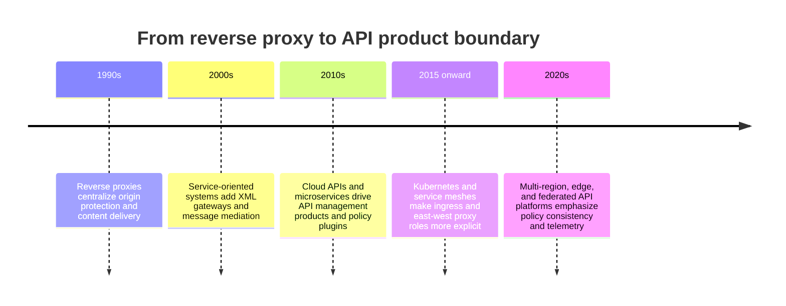

Early enterprise service gateways translated between Simple Object Access
Protocol (SOAP), Extensible Markup Language (XML), and proprietary message
formats. Later products added API keys, quotas, developer registration,
analytics, and lifecycle controls for public APIs. Cloud providers then
offered managed API front doors, while open-source projects made programmable
gateways available inside private infrastructure. Service meshes
distributed proxying and traffic policy to east-west service communication.
These products overlap in implementation but solve different governance
problems: the Gateway is an API product and ingress boundary; the mesh is a
service-to-service connectivity and policy system.

This is not a replacement sequence. Many production systems use a Content
Delivery Network (CDN), a cloud load balancer, an API Gateway, and
service-mesh proxies together. Good architecture identifies which layer
owns each decision, avoids making the same decision twice, and chooses
deployment topology based on trust boundaries, traffic, and operational
ownership rather than product naming.

## 3. Why It Exists

An API provider often serves multiple clients with distinct credentials,
contracts, quotas, and release timelines while backend services scale and
change independently. If every service independently implements public
identity, consumer policy, edge routing, deprecation behavior, telemetry,
and network exposure, those controls drift. If one generic proxy is asked
to become the API product without explicit ownership, policy changes become
an opaque pile of route-specific exceptions.

The Gateway creates a stable, governable boundary. It gives clients one
logical entry point while preserving internal service boundaries, provides
one place to enforce policies that genuinely apply to an API product, and
gives platform teams a controlled interface for publishing routes and
policy. It does not make a weak service contract coherent, make business
authorization correct by itself, or eliminate the need to secure services
behind it.

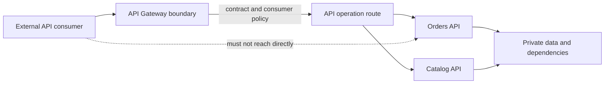

The pattern is justified when central policy and independent backend
evolution are worth the extra hop, platform, and failure domain. For a
small internal application with one client and one service, a Gateway can
add cost without meaningful governance value. For a public multi-service
API with several consumer classes, the same boundary can reduce duplicated
controls and make exposure reviewable.

## 4. Core Concepts

These eight concepts establish the Gateway's architectural model. Each
distinguishes the API product boundary from lower-level proxying, protocol,
security, or resilience mechanisms owned elsewhere.

### 4.1 Gateway role and boundary: API-aware north-south ingress

**Definition.** The Gateway is a policy-enforcing intermediary at the
boundary between an API consumer population and provider services.
North-south traffic crosses a system or platform trust boundary;
east-west traffic is service-to-service communication within a platform.
The Gateway maps an authenticated caller and a public operation to an
allowed backend action under an explicit contract and policy set.

**Mechanism.** A request arrives at a stable public endpoint. The Gateway
normalizes enough metadata to identify the API, consumer, version, and
operation; evaluates applicable policy; selects a route; and forwards to a
private backend address. It returns a response under the public contract,
attaching safe correlation and policy metadata as configured. The origin
network should enforce the intended topology: a private service must not
remain publicly reachable through an alternate address that bypasses the
Gateway. The Gateway does not replace domain validation or resource-level
authorization inside a service.

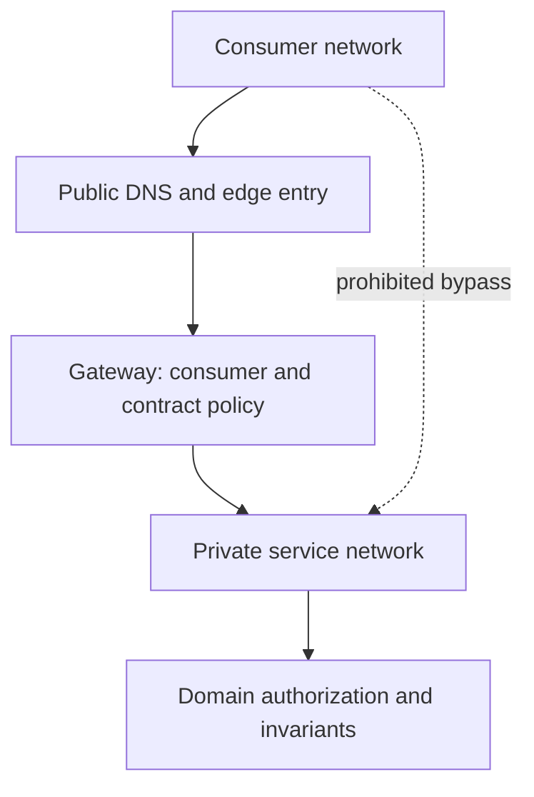

**Decision implications.** Place the Gateway where policy is enforceable
and where a team can own availability, routing, configuration, and
incidents. A public API may use a managed or dedicated Gateway behind edge
denial-of-service protection. An internal platform may use a separately
governed internal Gateway. A Gateway is not required merely because a
system has HTTP endpoints.

**Common failure mode.** The diagram shows a Gateway as the only ingress,
but a forgotten public service endpoint permits clients to bypass its
authentication, quota, or audit policy. The architecture then has a
decorative boundary, not an enforced one.

**Scenario.** A commerce platform publishes orders and catalog operations
to mobile, partner, and staff clients. Public ingress is restricted to the
Gateway; services remain private and independently authorize access to a
requested order or catalog object.

### 4.2 API-edge routing and service discovery

**Definition.** API-edge routing maps a public API identity and operation to
a destination service or upstream pool. Service discovery supplies the
current destination set. Routing is API-aware when it can use stable
contract elements such as host, version, method, path, or a verified
consumer attribute. Part 05 owns generic path/host forwarding mechanics;
the Load Balancer chapter owns backend-selection algorithms.

**Mechanism.** The control plane publishes versioned route configuration
binding a public operation to a backend service identity. At runtime, the
Gateway resolves that identity through static configuration, a platform
registry, or a control-plane integration. The proxy selects an eligible
upstream according to the load-balancing mechanism. Route changes should
be validated before activation and carry an observable configuration
version so operators can correlate traffic changes with their source.

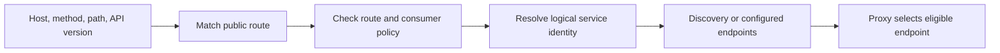

**Decision implications.** Prefer logical service names over embedding
ephemeral instance addresses. Use static routes for small stable systems
and dynamic discovery when churn or independent deployments require it.
Keep route ownership explicit: application teams own contracts and service
semantics; platform teams may own shared runtime and guardrails. Do not
duplicate health-check algorithms or distribution logic here.

**Common failure mode.** A route is activated before its service name
resolves, or the Gateway and registry disagree about a rollout. Requests
then fail at the edge despite healthy instances. Configuration validation
and staged activation reduce this control-plane/data-plane mismatch.

**Scenario.** A deployment registers `orders-v2` before publishing a route
that sends a bounded cohort to it. The Gateway routes by public API version
and verified cohort; the load-balancing tier distributes requests among
healthy instances of the selected service.

### 4.3 Aggregation and the BFF boundary

**Definition.** Gateway aggregation combines backend calls into one
client-facing response. A Backend for Frontend (BFF) is a client-specific
or client-family-specific application boundary that composes data and
behavior. A Gateway may offer simple, bounded aggregation, but should not
silently become a domain application or a home for presentation logic.

**Mechanism.** A simple aggregator fans out to independent reads, applies
an overall deadline, joins results, and returns a stable composite
representation. A BFF goes further: it owns a client-oriented contract,
can orchestrate domain operations, and can evolve with that client family.
The decision turns on behavior and ownership, not whether both run in one
process.

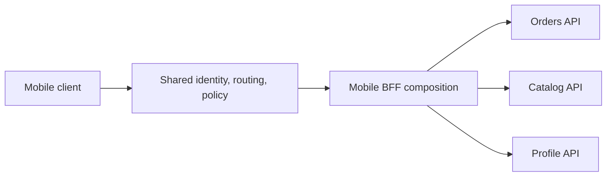

**Decision implications.** Use Gateway aggregation for small, stable,
generic fan-out whose execution can be bounded. Use a BFF when response
shape, composition rules, or workflows differ by client, or when composition
needs independent application ownership. Prefer one domain call when a
service can provide a coherent contract without cross-boundary coupling.

**Common failure mode.** A Gateway plugin accumulates business rules,
parallel calls, fallbacks, and client-specific mapping. Its release cadence
becomes coupled to every backend and client, while one edge failure breaks
workflows that belonged in application services.

**Scenario.** A mobile home screen needs order summaries, delivery status,
and recommendations. A mobile BFF owns this projection and partial-response
semantics; the Gateway applies shared authentication integration and routes
`/mobile/*` to it.

### 4.4 Protocol mediation and transcoding

**Definition.** Protocol mediation adapts a public API contract to a
backend contract or transport. Transcoding is the narrower mapping of one
representation to another under an explicit schema. It is not arbitrary
payload rewriting and cannot infer semantic equivalence between protocols.

**Mechanism.** The mediator parses and validates a public request, maps
fields and errors using a declared contract, invokes the backend, and maps
the result back. A REST/JSON facade over gRPC needs method annotations or
an explicit mapping, Protocol Buffers (Protobuf) descriptors, and a
compatible transcoder. GraphQL is schema execution, not simple JSON
transcoding. WebSocket and Server-Sent Events (SSE) APIs introduce
long-lived connection and stream semantics requiring explicit support.

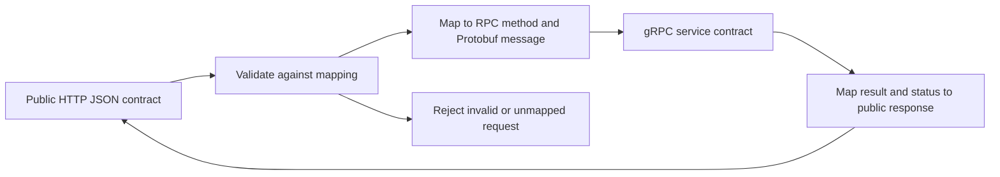

**Decision implications.** Mediate when it gives clients a durable public
contract while allowing backend evolution, and when mappings are complete,
testable, and observable. Avoid hiding material differences such as
streaming completion or error meaning. Use native protocol paths where
clients and infrastructure support them. Document payload limits,
cancellation, and unsupported features.

**Common failure mode.** A JSON facade is called equivalent to a gRPC
method but drops deadlines, maps every RPC error to one generic failure,
or buffers a stream until completion. The interface appears compatible
while losing essential behavior.

**Scenario.** A partner REST operation maps to unary `GetOrder` using
generated descriptors. A streaming RPC is not exposed through that mapping;
the partner receives a documented SSE feed with its own cursor and replay
contract.

### 4.5 Policy pipeline and integration boundaries

**Definition.** A Gateway policy pipeline is the ordered set of checks and
transformations deciding whether a request may proceed and how it is
forwarded. Ordering is part of correctness: cheap rejection should precede
expensive work, while identity-dependent decisions must wait for verified
identity.

**Mechanism.** A representative flow is request-size and syntax limits,
route identification, credential validation, consumer/product resolution,
authorization integration, rate/quota decision, version eligibility,
transformation, upstream selection, and response processing. Product
ordering varies. Define each stage's fail-open or fail-closed behavior,
error mapping, policy version, and service-side rechecks. This chapter owns
the integration points. Full API security belongs to future CH09; rate
limiting algorithms to future CH11; API versioning policy to future CH10.

**Decision implications.** Make the sequence inspectable, deterministic,
and testable. Keep identity claims distinct from resource authorization:
the Gateway can reject a caller lacking an API scope, but a service should
still decide whether that principal may access a specific order. Document
behavior when policy dependencies are unavailable.

**Common failure mode.** A Gateway trusts a caller-supplied
`X-Consumer-Id` or `X-Role`, or assumes that a valid token grants access
to every resource. A global quota applied before consumer identity is
known can also create unintended shared throttling.

**Scenario.** An API key identifies a partner product; token validation
establishes a principal; a scope check gates the operation; a per-consumer
quota is evaluated; the order service performs object-level authorization.

### 4.6 Transformation, header policy, caching, and compression placement

**Definition.** Gateway transformation changes request or response
metadata, path, or representation at the API boundary. Header policy
governs which public and internal headers cross the boundary. Caching and
compression can be placed at a Gateway, but their wire semantics remain
owned by HTTP, CDN, and caching chapters.

**Mechanism.** A Gateway may remove spoofable internal headers, add a
correlation identifier, normalize a documented legacy route, or map a
public field through a declared schema. Changes should be directional,
ordered, bounded, and observable. Caching requires a correct key, freshness,
and privacy rules; authenticated representations must not be shared unless
policy proves them equivalent. Compression must honor HTTP negotiation.

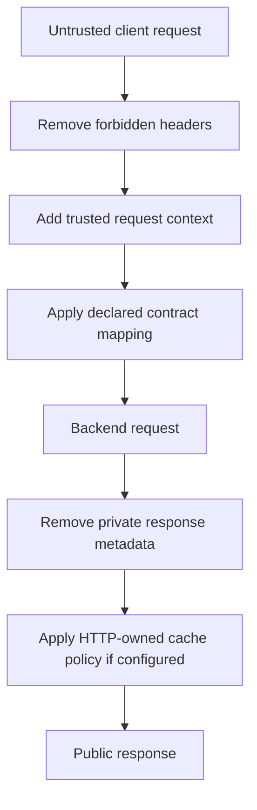

**Decision implications.** Put a transformation at the Gateway when it is
cross-cutting, contract-level, and platform-owned. Put domain mapping in a
BFF or service when it needs business knowledge. Avoid rewriting opaque
bodies. Use allowlists for trust-sensitive metadata; do not let tracing
headers forge identity.

**Common failure mode.** A shared cache omits authorization or tenant
identity from its key and returns private data to another consumer. An
undocumented rewrite can also prevent operators from correlating public
requests with backend logs.

**Scenario.** The Gateway strips inbound `X-Internal-Role`, creates a
request ID when absent, preserves validated trace context, and injects
trusted identity metadata over a protected internal connection. It does
not cache personalized account responses.

### 4.7 High availability, deployment topology, and failure handling

**Definition.** Gateway high availability means the API boundary continues
to serve permitted traffic through instance, zone, or regional failures
without violating routing or policy guarantees. It is end-to-end: replicas
do not help if they share one failed configuration service, identity
dependency, or network path.

**Mechanism.** Deploy stateless data-plane replicas across failure domains,
place a highly available edge/load-balancing tier in front, and distribute
configuration through a controlled, versioned process. Keep request-time
dependencies minimal; define bounded timeouts and fail-open/closed behavior
for required identity and quota services. Circuit breakers and retries
integrate general resilience mechanisms but do not replace sound dependency
design. CH10 Load Balancer owns health-check, selection, and balancing
mechanics; this section explains Gateway dependencies on that tier.

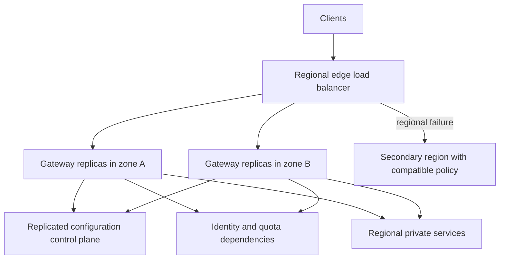

**Decision implications.** Separate control-plane availability from
request-path availability: a temporary control-plane outage need not stop
already validated configuration. Active-active regions require compatible
policy, quota state, credentials, and data-residency rules. Use graceful
draining and compatible rollouts. Circuit-break the failing dependency;
do not retry at every layer.

**Common failure mode.** Replicas span zones, but all synchronously consult
one unavailable policy service. The tier is nominally redundant yet fails
closed for every request. Failing open on mandatory authorization can turn
the same outage into a security incident.

**Scenario.** During control-plane interruption, regional data planes
continue with the last signed configuration, reject updates, and emit a
degraded-control-plane signal. Protected operations fail closed if required
identity validation expires; an explicitly public health route remains
available.

### 4.8 Gateway versus reverse proxy, load balancer, and service mesh

**Definition.** These components can share proxy software but have distinct
primary responsibilities. A reverse proxy is the generic server-side
intermediary; a load balancer distributes work among eligible backends; an
API Gateway governs API ingress and consumer-facing policy; a service mesh
governs service-to-service connectivity and policy.

**Mechanism.** Identify the decision the system needs. Generic origin
protection or host/path forwarding calls for reverse-proxy capability.
Pool selection and health call for load-balancing capability. A managed
API contract boundary and consumer policy call for a Gateway. Consistent
identity, telemetry, and traffic policy across service-to-service calls
may call for a mesh. One product may implement multiple roles, but the
architecture should name each role and owner.

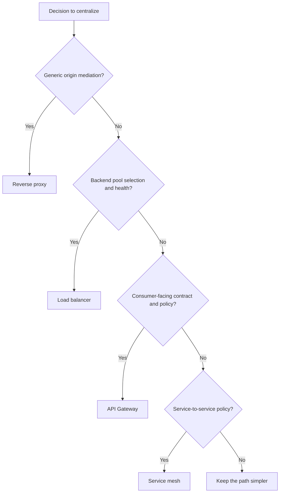

**Decision implications.** Prefer the smallest layer that owns the needed
decision. Do not buy a Gateway solely for TLS termination or path routing;
do not stretch a mesh into a public API product boundary without reason;
do not assume a Gateway provides load-balancer algorithms because its
runtime contains an upstream pool. Layer products only for distinct,
measurable responsibilities.

**Common failure mode.** Teams add edge, ingress, mesh, and service proxies
with overlapping retries, transformations, and identity checks. The result
is excess hops, inconsistent policy, confusing telemetry, and no clear
incident owner.

**Scenario.** A public SaaS API uses a CDN/WAF edge, one API Gateway for
consumer policy, and mesh proxies for east-west calls. An internal batch
service uses discovery and the mesh without traversing the public Gateway.

## 5. Internal Working

At runtime, the Gateway turns a network request into a sequence of bounded
decisions. The order matters because later decisions may depend on earlier
results, and expensive parsing, identity calls, or backend work should not
happen for requests already known to be invalid. Plugin order is
product-specific; the architecture must define each stage's contract and
failure semantics.

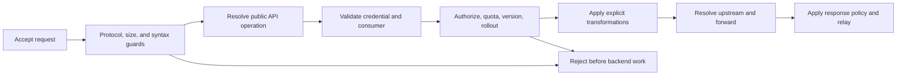

Distinguish control plane from data plane even when a managed product hides
them. Administrators define APIs, consumers, routes, and policy in the
control plane. Workers receive effective configuration, process traffic,
and report telemetry. A safe rollout validates syntax and references,
checks compatibility, stages a version, activates it progressively, and
preserves rollback. Configuration propagation delay is part of the
consistency model and should be observable.

## 6. Design Principles

Treat the Gateway as a boundary with named owners, not a convenient place
for every cross-cutting concern. Keep public APIs stable while backend
topology changes, but do not hide domain semantics behind opaque
transformations. Make policy deterministic, version-controlled, reviewable,
and attributable. Fail closed when a mandatory security decision cannot
be made; degrade deliberately for non-security dependencies where the
contract permits it.

Every request path needs a budget. The Gateway consumes client latency
budget, and policy dependencies consume Gateway budget. Bound body size,
concurrency, fan-out, queueing, and connection lifetime. Propagate
cancellation and deadlines where supported. Prefer service-level
authorization in addition to edge checks; the edge narrows exposure but
does not replace domain invariants.

## 7. Architecture Patterns

Common patterns include one shared public Gateway, separate public and
internal Gateways, regional Gateways behind global traffic steering,
Gateway-plus-BFF, and Gateway-to-mesh ingress. One shared Gateway simplifies
consumer governance but concentrates blast radius. Separate tiers isolate
trust and release cycles but add cost. Regional deployment reduces latency
and contains regional failures but requires policy and identity consistency.
Gateway-to-mesh ingress is appropriate when external policy and east-west
service policy are both required, with a clear handoff contract.

Route-level migration can direct traffic from a legacy backend to a
replacement, but route switching does not itself solve data migration,
contract compatibility, or rollback safety. For GraphQL, the Gateway can
authenticate and route while the GraphQL runtime owns schema, resolver,
query complexity, and field execution. For gRPC, preserve supported
transport behavior and deadlines. WebSocket and SSE routes require explicit
long-lived connection, draining, and streaming support.

## 8. Production Architecture

A production topology separates internet-facing protection, API policy,
private services, and management paths. The ingress tier may include a
CDN or Web Application Firewall (WAF), a network or application load
balancer, and a replicated Gateway fleet. These boxes are not mandatory:
managed platforms often combine functions. What matters is distinct policy
ownership and the ability to trace one request across the actual path.

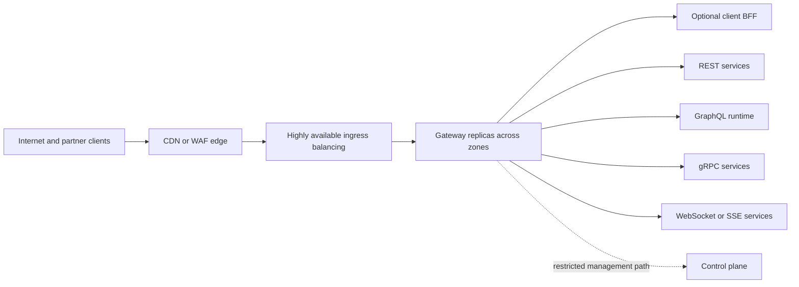

Keep management endpoints off public data routes, restrict administrative
identities, and separate route ownership from platform policy. Replicas
should receive compatible configuration before traffic shifts. A regional
design should document cross-region failover, quota and credential
availability, and data-residency constraints.

## 9. Implementation

Start with an API inventory: public operation, contract owner, consumer
classes, authentication, authorization boundary, traffic profile, data
classification, upstream, timeout, and version policy. Model routes from
stable public contracts rather than copying internal paths without review.
Adopt a configuration promotion process with code review and automated
validation for routes, plugins, certificates, and policies.

Choose products based on operational constraints. Managed services reduce
control-plane operations but constrain extensions and may create
provider-specific dependencies. Self-managed platforms offer control but
require patching, capacity management, data-plane upgrades, and safe
configuration distribution. Evaluate streaming and protocol support,
identity integrations, telemetry, multi-region behavior, and vendor exit.

## 10. Complete Code Examples

The examples comprise one runnable composition sample and real gateway
configuration formats. The Kong and Envoy files are illustrative, not
drop-in production manifests: plugin availability, schemas, certificates,
and upstreams depend on the installed release and environment. Each names
its validation prerequisites. The Python BFF is self-contained and uses
only the standard library.

1. [Kong routes and shared policy](../code/yaml/api-gateway-chapter/01_kong_routes.yaml) demonstrates declarative routes, credentials, and header policy. It targets Kong Gateway 3.x; validate against the exact image and plugins before deployment.
2. [Python BFF aggregation demo](../code/python/api-gateway-chapter/02_bff_aggregation.py) runs local stub services and a BFF, illustrating concurrent fan-out, bounded timeouts, and partial results without external packages.
3. [Envoy gRPC JSON transcoding](../code/yaml/api-gateway-chapter/03_envoy_grpc_transcoding.yaml) shows the v3 transcoder boundary. It requires a compiled Protobuf descriptor, HTTP annotations, Envoy with the transcoder extension, and a reachable gRPC cluster; validate with the matching Envoy binary.
4. [Kong rollout and failure policy](../code/yaml/api-gateway-chapter/04_kong_rollout_policy.yaml) shows weighted rollout and bounded retry/timeout policy. Check upstream and plugin fields against the exact Kong release; this is not application-level circuit breaking.

Run the BFF with Python 3.10 or newer:
`python code/python/api-gateway-chapter/02_bff_aggregation.py`, then request
`http://127.0.0.1:8080/mobile/home`. It is a teaching fixture, not a
production server: it omits authentication, TLS, durable state, and
production-grade request parsing.

## 11. Performance

The Gateway adds a hop, parsing, policy evaluation, and often a second
connection leg. Measure its contribution by route and policy stage, not
only end-to-end latency. Track median and tail latency, queue time,
connection reuse, response bytes, CPU, memory, active streams, and policy
dependency time. A remote identity lookup per request can dominate latency
even when the proxy itself is efficient.

Avoid synchronous fan-out unless composition is required. When it is,
issue independent reads concurrently, cap concurrency, use an overall
deadline, and define partial-result meaning. Large bodies, decompression,
transformations, and streaming materially change memory and CPU cost.
Benchmark representative payloads and concurrent streams.

## 12. Scalability

Scale stateless data-plane workers horizontally when route configuration
is available locally. Capacity planning must include connections, requests
per second, TLS work, response size, streaming lifetimes, and policy
dependency limits. Long-lived WebSocket and SSE connections consume slots
longer than ordinary request-response calls and need graceful draining.

Configuration cardinality can become a scaling limit. Thousands of
route-specific plugins and exceptions raise validation, propagation, and
review costs. Partition policy by product or trust boundary when useful and
remove obsolete routes. In multi-region systems, decide whether quota state
is regional, coordinated globally, or eventually consistent; that choice
affects capacity and consumer fairness.

## 13. Security

The Gateway is a valuable enforcement point, not a complete security
boundary by itself. Restrict direct origin access, protect management APIs,
validate credentials using trusted sources, reject spoofed identity
headers, and pass only authenticated context over a protected internal
channel. Services must still validate object-level authorization, inputs,
and domain invariants. Do not log bearer credentials, API keys, sensitive
payloads, or full query strings without a reviewed data policy.

Authentication and authorization design, token validation, threat
modeling, and API-specific attack controls belong to future CH09 API
Security. This chapter owns their Gateway integration boundary: which
identity result is consumed, which edge decision is made, what downstream
systems may trust, and how bypass is prevented. A WAF detects classes of
hostile traffic; it does not prove a business operation is authorized.

## 14. Observability

Instrument the Gateway to connect public requests to selected routes,
consumer classes, policy outcomes, upstreams, and response results. Record
route and configuration version, a correlation identifier, policy stage,
upstream status, and latency breakdown. Use bounded-cardinality labels:
consumer IDs, raw paths, and arbitrary query values can create unbounded
metrics or expose sensitive data. Redact before logs leave the trusted
environment.

Preserve trusted trace context and create spans for Gateway policy and
upstream work. Distinguish edge rejection from backend failure; include
traffic, errors, latency percentiles, throttling, active connections,
configuration age, and dependency health. Alert on user-visible symptoms
and configuration drift, not just process liveness. Define an operator path
from public request ID to service trace without trusting an unverified
caller identifier.

## 15. Failure Scenarios

Gateway incidents often arise from correlated dependencies: bad
configuration, identity or quota outages, regional isolation, retry
amplification, certificate expiry, or an upstream that is reachable but
cannot serve useful work. Specify returned errors, operations that can
continue, and how operators distinguish edge from origin failures.

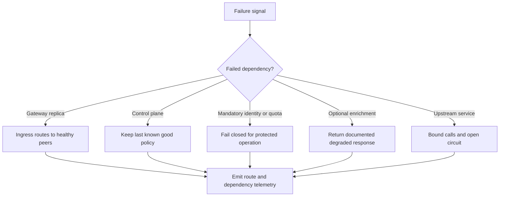

Retry only operations safe to repeat or governed by an explicit idempotency
contract. Retries at Gateway, BFF, client, and service can multiply load
during an outage. Circuit breakers, bulkheads, deadlines, and backoff are
general resilience mechanisms; the Gateway integrates them but does not
own their complete theory. Load-balancer health-check mechanics remain
owned by CH10 Load Balancer.

## 16. Testing

Test Gateway policy as executable contract. Unit tests cover route matching,
policy order, allow/deny outcomes, transformations, and failure mapping.
Integration tests use the deployed Gateway version and actual plugin set
with representative identity and upstream dependencies. Contract tests
confirm public behavior remains compatible while backend routes change.

Include negative cases for direct-origin bypass, forged identity headers,
unknown versions, oversized bodies, expired credentials, cache isolation,
and policy dependency timeouts. Load tests include persistent connections,
streaming routes, large payloads, and failure injection. For staged rollout,
test rollback and mixed configuration versions. Parser success alone does
not prove security, reachability, or semantic compatibility.

## 17. Common Mistakes

Common mistakes include turning the Gateway into a domain orchestrator,
assuming edge authentication replaces service authorization, deploying one
Gateway replica behind a highly available load balancer, and defining
timeouts independently at every layer. Teams also underestimate streaming
capacity, trust client identity headers, use broad retries, and ship
configuration without an owner or rollback mechanism.

Route-level API version selection is not version policy. A Gateway can
direct traffic to a version, but it cannot decide compatibility,
deprecation windows, or migration policy without an API governance contract.
Those mechanisms belong to future CH10 API Versioning.

## 18. Best Practices

Maintain a version-controlled API inventory and route catalog. Use
least-privilege route policy, explicit timeouts, request/response size
limits, trusted-header allowlists, and private origin reachability. Keep
data-plane configuration locally available, promote gradually, expose
effective configuration versions, and retain a tested rollback path.

Set per-route latency and availability budgets, monitor policy dependencies,
and test the Gateway as part of the user-facing path. Separate public and
administrative surfaces. Use a BFF for client-specific composition when
that behavior has application ownership. Review whether caching, WAF,
compression, and transformation belong at this tier or an adjacent owner.

## 19. Anti-Patterns

**Gateway as distributed monolith.** Business workflows and client-specific
logic accumulate in plugins, making every API change depend on one edge team.

**The only authorization layer.** Services trust all callers passed through
the Gateway despite internal routes, replayed messages, or future bypasses.

**Gateway sprawl.** Teams deploy unmanaged ingress with different identity,
telemetry, and policy conventions. The intended central boundary becomes
inconsistent public surfaces.

**Protocol laundering.** A transcoder claims to preserve a contract while
silently dropping streaming, deadline, error, or authorization semantics.

**Shared bottleneck by design.** One cluster handles unrelated trust zones,
control traffic, long-lived streams, and latency-sensitive transactions
without isolation or capacity controls.

## 20. Trade-off Analysis

The Gateway trades an extra hop and centralized blast radius for policy
consistency, client/backend decoupling, and a manageable API product
boundary. A managed Gateway lowers operational burden but may constrain
protocol support, extensions, and portability. A self-managed Gateway
provides control but requires patching, scaling, availability, safe
configuration, and plugin supply-chain controls.

Centralization helps policies that must be consistent, such as consumer
identification and edge quotas. It harms architecture when it creates a
single-team bottleneck or duplicates service behavior. Measure whether each
edge responsibility has a clear owner, failure policy, and demonstrable
value rather than counting Gateway features.

## 21. Comparison Table

| Concern | Reverse proxy | Load balancer | API Gateway | Service mesh |
|---|---|---|---|---|
| Primary boundary | Server-side mediation | Backend pool | Consumer-facing API ingress | Service-to-service traffic |
| Typical direction | North-south or internal | Ingress or internal | North-south API ingress | East-west |
| Core decision | Forward or transform | Select eligible backend | Apply API/consumer policy and route | Apply workload identity and traffic policy |
| Full mechanism owner | Part 05 CH11 | Part 05 CH10 | This chapter | Future dedicated chapter if drafted |
| Common risk | Misconfigured exposure | False health or poor distribution | Policy bottleneck and sprawl | Complexity and retry amplification |

These categories describe responsibilities, not necessarily separate
products. One runtime can perform multiple roles; architecture should still
make ownership, policy order, and failure domains explicit.

## 22. Real-World Case Study

Consider a retailer evolving one commerce application into independently
deployed catalog, order, and delivery services. Mobile applications, web
clients, and external sellers need different scopes and traffic policies.
The platform places a Gateway behind a managed regional load balancer and
WAF. The Gateway maps public routes to private services, identifies API
consumers, enforces contract-level quotas, emits a stable request ID, and
routes versioned operations. A mobile BFF composes home-screen data; the
Gateway does not own its business rules.

During a catalog v2 rollout, the API team deploys a compatible backend,
validates route configuration, and sends a bounded cohort to v2. The rollout
stops when the route's error budget worsens. The Gateway provides routing
and policy telemetry; the API Versioning owner defines deprecation and
consumer migration criteria. The load balancer owns endpoint health and
distribution, and the service mesh governs internal calls. Backend topology
can change without treating every route edit as a new API contract.

When the identity provider is unavailable, the Gateway cannot infer partner
identity from a client header. Protected operations fail closed; public
catalog reads continue only if policy explicitly permits anonymous access.
This availability choice is a product/security decision, not a generic
proxy default.

## 23. Interview Questions

1. What makes an API Gateway architecturally different from a reverse proxy?
2. When should response aggregation live in a Gateway versus a BFF?
3. How do you prevent a Gateway from becoming the only authorization layer?
4. What must be preserved when exposing gRPC through HTTP/JSON?
5. How do retries at client, Gateway, and service layers interact in an outage?
6. How would you design availability when identity or quota services fail?
7. Which responsibilities belong to a Gateway, load balancer, and mesh?
8. How should configuration be validated, promoted, observed, and rolled back?

## 24. Hands-on Exercises

1. Run the Python BFF example. Change one downstream stub to fail and observe partial-response behavior.
2. Add a Kong route. State its consumer, authentication, authorization, quota, upstream, and rollback owners first.
3. Given the Envoy transcoder route, list descriptor, annotations, runtime extension, and compatibility-test prerequisites.
4. Design route-level metrics for traffic, latency, policy rejection, upstream error, and active streams without high-cardinality labels.

## 25. Design Exercises

1. Design public and internal Gateway boundaries for a multi-tenant SaaS platform, including origin prevention and identity failure behavior.
2. Design regional active-active ingress for REST reads, payment writes, gRPC calls, and SSE subscriptions. State quota consistency and stream-drain behavior.
3. Decide whether mobile composition belongs in a Gateway, BFF, or domain service. Compare ownership, latency, and failure isolation.
4. Plan a legacy API migration where old and new backends share a route. Define compatibility gates, rollout, telemetry, and rollback criteria.

## 26. Architecture Review Questions

- Is the Gateway enforced, or can clients reach origins directly?
- Which team owns the public contract, route, shared policy, and runtime?
- Are identity integration and resource authorization separated?
- Are rate limits keyed to the intended consumer and failure behavior explicit?
- Can route, plugin, and policy configuration be tested and rolled back?
- Are GraphQL, gRPC, WebSocket, and SSE paths supported with their semantics?
- Are timeouts, size, concurrency, streaming, and fan-out bounded?
- Does each proxy, load balancer, WAF, and mesh have a distinct role?
- Can operators correlate a request to policy and backend work safely?
- Have regional failure, dependency outage, retries, and bypass been tested?

## 27. Summary

An API Gateway is the API-aware north-south policy and routing boundary,
not merely another name for a reverse proxy. It makes consumers, contracts,
routes, and shared edge policy manageable while preserving backend service
and sibling API ownership. Its responsibility set should remain bounded:
use a BFF for client-specific composition, preserve protocol semantics,
integrate security and versioning without claiming their deeper ownership,
and rely on Load Balancer, HTTP, CDN, cache, and resilience owners for their
mechanisms.

The architecture succeeds when origin bypass is prevented, policies are
reviewable, configuration is safely deployed, failures are isolated, and
the extra hop produces a measurable governance or evolution benefit. When
those conditions do not hold, a simpler reverse proxy or direct service
path may be the better design.