# Chapter: Application Programming Interface (API) Security

Part: [08 — API Architecture](PART_OVERVIEW.md) · Status: Draft

## 1. Introduction

Application Programming Interface (API) security is the design and operation of controls around machine-accessible capabilities, data, and side effects. It is not a token format, a gateway feature, or a collection of input filters. An API is a chain of trust decisions: identify the caller, bind the caller to a permitted operation, constrain which objects and properties are reachable, validate the request before effects occur, protect downstream boundaries, and preserve enough privacy-safe evidence to detect and contain abuse.

This chapter owns the API-specific threat model and control composition across Representational State Transfer (REST), GraphQL, Google Remote Procedure Call (gRPC), WebSocket APIs, Server-Sent Events (SSE), and asynchronous APIs. Its center of gravity is authorization at the actual resource, action, and data boundary; validation of attacker-controlled API input; credentials and tenant scoping; and security review and testing. It does not re-teach OAuth 2.0, OpenID Connect (OIDC), JavaScript Object Notation (JSON) Web Token (JWT), Security Assertion Markup Language (SAML), or Transport Layer Security (TLS) mechanics. Those remain with Part 05 CH19-CH22 and CH06 respectively. They are integrated here as identity and transport inputs, not treated as authorization by themselves.

The API-style chapters keep their contract ownership: GraphQL query-cost and persisted-operation controls (CH02), gRPC metadata and call semantics (CH03), WebSocket message and subscription contracts (CH04), SSE feed and cursor contracts (CH05), webhook delivery lifecycle (CH06), OpenAPI description mechanics (CH07), and Gateway architecture (CH08). General idempotency belongs to Part 07 CH16. API version policy belongs to [Cross-Style API Versioning](CH10_Versioning.md); rate-limiting algorithms belong to [API Rate Limiting, Quotas, and Fairness](CH11_Rate_Limiting.md). These are recap-and-link boundaries, not additional subjects taught here.

## 2. Historical Evolution

Early application security concentrated on the visible perimeter: a firewall admitted or rejected a network flow, and a server often assumed that an authenticated session represented a trustworthy user. The move to public Web APIs exposed a more precise question. Once a request reaches an application, can this principal perform this action on this specific object and see these specific fields? A reachable endpoint and a valid identity do not answer that question.

The API attack surface then widened with mobile and partner clients, machine-to-machine integrations, client-selected GraphQL operations, generated remote procedure calls, long-lived event connections, and webhook callbacks. These interfaces reduce integration friction, but they multiply entry points and policy contexts. A single user may authenticate once while requesting thousands of object identifiers; a stream can outlive the authorization decision made at connection setup; an event consumer can receive a signed message more than once; and a gateway can validate credentials without knowing a domain ownership rule.

Security practice has consequently shifted from perimeter-only defense to explicit trust boundaries and object-aware controls. The Open Worldwide Application Security Project (OWASP) API Security Top 10 made Broken Object Level Authorization (BOLA) prominent because identifier manipulation is easy to automate and can expose or mutate another user's records even when login and role checks work correctly. Modern API security combines identity, policy, validation, data minimization, transport protection, and operational response. No one layer can safely stand in for all the others.

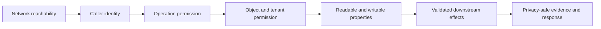

## 3. Why It Exists

An API turns internal capabilities into remotely invocable behavior. Every exposed method, field, subscription, callback, identifier, filter, and serialized property becomes part of a contract that an adversary can probe at machine speed. Unlike a human-facing workflow, an API caller can vary identifiers, omit fields, send unexpected fields, replay requests, alter message order, and follow relationships far faster than a person can navigate screens.

The main architectural failure is confusing one successful check for all subsequent checks. TLS can protect a connection but does not decide which invoice a caller may read. A valid access token can prove that an issuer granted a client some authority, but not that a particular invoice belongs to the caller's tenant. A role such as `operator` may permit a class of actions but not every function or every object's protected fields. A schema can prove the body has a string named `ownerId`; it cannot decide whether the caller may set it. A Gateway can centralize policy and still be bypassed if an origin is public or if services trust forwarded identity headers from arbitrary callers.

The security architecture must make each of these boundaries explicit, testable, and owned. It should minimize authority before a request reaches a service, repeat domain authorization at the point where data or effects are controlled, constrain inputs and outputs, and ensure asynchronous work does not lose the identity and tenant context under which it was accepted. Strong defaults reduce the chance that a new endpoint accidentally inherits an unsafe assumption.

## 4. Core Concepts

### 4.1 API threat model and trust boundaries

**Definition.** An API threat model is a structured account of entry points, actors, protected assets, trust transitions, abuse cases, and controls. A trust boundary is a point at which data or authority moves between components with different assumptions: internet to edge, Gateway to service, one service to another, producer to webhook receiver, or authenticated connection to an individual message.

**Mechanism.** Inventory every externally or cross-team reachable surface, including HTTP routes, GraphQL fields and mutations, Remote Procedure Call (RPC) methods, stream subscriptions, callbacks, file imports, and administrative endpoints. For each, name the caller class, credential source, data classification, effects, tenant scope, and the component that makes each decision. Trace untrusted fields and identifiers through parsing, authorization, storage access, and downstream calls. A threat is not closed merely because one control exists; record which control prevents, detects, and limits its impact.

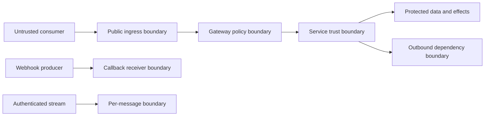

**Decision implications.** Use a data-flow diagram and abuse-case list before selecting products. Model public and internal APIs separately: private network placement lowers exposure but does not make service callers trustworthy. Identify ownership of each decision so that the Gateway, identity provider, service, and data layer do not assume another party performed a check that they cannot verify.

**Common failure mode.** The threat model ends at the edge proxy and omits direct service addresses, background workers, subscriptions, or webhook receivers. Controls then look complete on a diagram while an alternate route avoids them.

**Scenario.** A billing service has a public REST route, a GraphQL resolver, and an internal export worker. The threat model includes all three paths to customer invoices and verifies that each reaches the same tenant and object policy rather than relying on the public Gateway alone.

### 4.2 Authentication and authorization at each boundary

**Definition.** Authentication establishes the identity or credential principal presented at a boundary. Authorization decides whether that principal may perform a particular action on a particular resource under current policy. Authentication answers who or what is calling; authorization answers what this caller may do here and now.

**Mechanism.** A short-lived request typically authenticates the credential, establishes a verified principal, resolves the requested operation, loads or safely scopes the target object, evaluates policy, and only then performs the read or mutation. A long-lived connection has at least two distinct boundaries: connection establishment and later messages or deliveries. Authentication at connect time establishes a principal for that connection; subscription creation, each sensitive message, and event delivery still require action and resource authorization. When policy changes, a stream needs a defined re-check, revocation, or maximum authorization lifetime.

OAuth 2.0 (OAuth) supplies delegated authorization flows and access-token issuance; OIDC adds an identity layer; JWT is a token representation; and SAML carries federated assertions. Recap only: use the correct artifact for the intended recipient and validate issuer, audience, time, and the claims needed by the API. Detailed flows, claims semantics, serialization, signatures, and federation validation remain with [OAuth](../05_Networking_and_OS/CH19_OAuth.md), [OIDC](../05_Networking_and_OS/CH20_OIDC.md), [JWT](../05_Networking_and_OS/CH21_JWT.md), and [SAML](../05_Networking_and_OS/CH22_SAML.md). TLS protects the transport channel and server identity; mutual TLS (mTLS) can also identify a workload at the channel boundary. TLS handshake and certificate mechanics remain with [TLS](../05_Networking_and_OS/CH06_TLS.md).

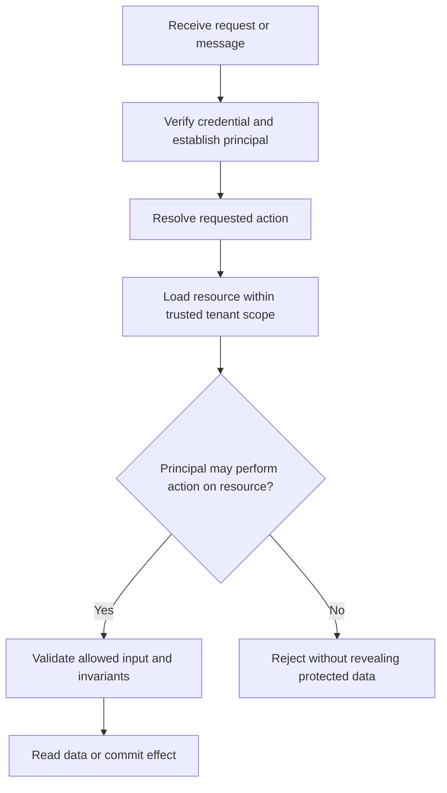

**Decision implications.** State the authorization point for each operation, not just the authentication scheme. A coarse role check can eliminate obviously unauthorized functions, but domain authorization should bind action to object and tenant. For long-running calls, decide whether policy is fixed at admission or re-evaluated at execution; for streams, define revocation latency and what happens to already queued events.

**Common failure mode.** A system treats a valid token, successful login, or open WebSocket as a universal permission. The identity is authentic, but the caller can use a different record identifier, invoke a privileged mutation, or continue receiving events after membership is revoked.

**Scenario.** A user has a valid access token and opens a document collaboration connection. The server authenticates the connection, authorizes each document subscription, checks edit permission on each mutation, and removes the subscription when the user's membership is revoked.

### 4.3 Object- and function-level authorization: BOLA, IDOR, and BFLA

**Definition.** Broken Object Level Authorization (BOLA), historically called Insecure Direct Object Reference (IDOR), occurs when a caller can access an object by changing or guessing its identifier without a valid object-specific permission. Broken Function Level Authorization (BFLA) occurs when a caller invokes a function or operation their principal is not allowed to use. They are distinct: one concerns *which object*, the other *which capability*.

**Mechanism.** Resolve identifiers as untrusted selectors. The policy decision must include the authenticated principal, action, object attributes, tenant, and relevant relationship or state. Prefer scoped data access such as `find(document_id, tenant_id)` where that scope is authoritative, then apply explicit ownership or sharing policy. Avoid relying on random identifiers, hidden buttons, route names, or a collection-level check. For mutations, authorization should precede side effects and should be checked against the object actually changed, not a client-supplied ownership claim.

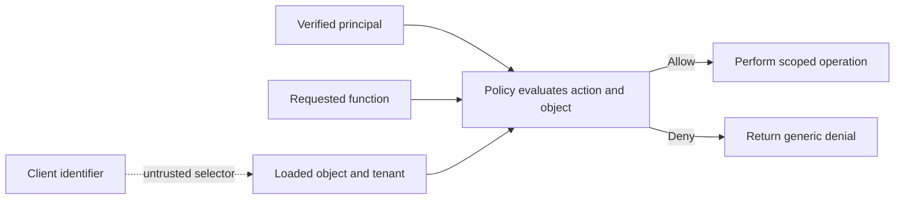

**Decision implications.** Use centralized policy primitives when many endpoints share rules, but keep domain rules close to the data and operation they protect. Combine role or scope checks for coarse capability with per-object rules for ownership, delegated access, status, and tenant membership. For batch requests, authorize every object independently or reject the batch atomically according to a documented contract.

**Common failure mode.** A route checks that a caller is logged in and then executes `SELECT * FROM invoices WHERE id = ?`; a second route checks `role == admin` only in the user interface. Guessable IDs make exploitation easier, but opaque IDs do not repair the missing authorization.

**Scenario.** A partner integration can read invoices for its assigned customer accounts. The handler derives partner identity from a verified credential, resolves the invoice under the partner's allowed account set, and denies both an invoice from another account and the administrative refund function.

### 4.4 Property-level authorization, mass assignment, and excessive exposure

**Definition.** Broken Object Property Level Authorization (BOPLA) is unauthorized reading or modification of individual fields on an otherwise accessible object. Mass assignment is a common write-side form: a server binds every submitted property onto a domain object, allowing a caller to set fields such as `tenantId`, `ownerId`, `role`, `price`, or `approved`. Excessive data exposure is the read-side counterpart: a response serializes a broad internal object and relies on clients to ignore sensitive properties.

**Mechanism.** Define separate request and response models. Construct mutations from explicit writable-field allow-lists and derive server-owned values from trusted context or domain state. Construct responses from explicit readable projections based on principal, purpose, and object state. Treat nested objects and patch semantics carefully: omission, null, and empty collections can have distinct meanings. Apply property-level rules even when the caller can access the parent object.

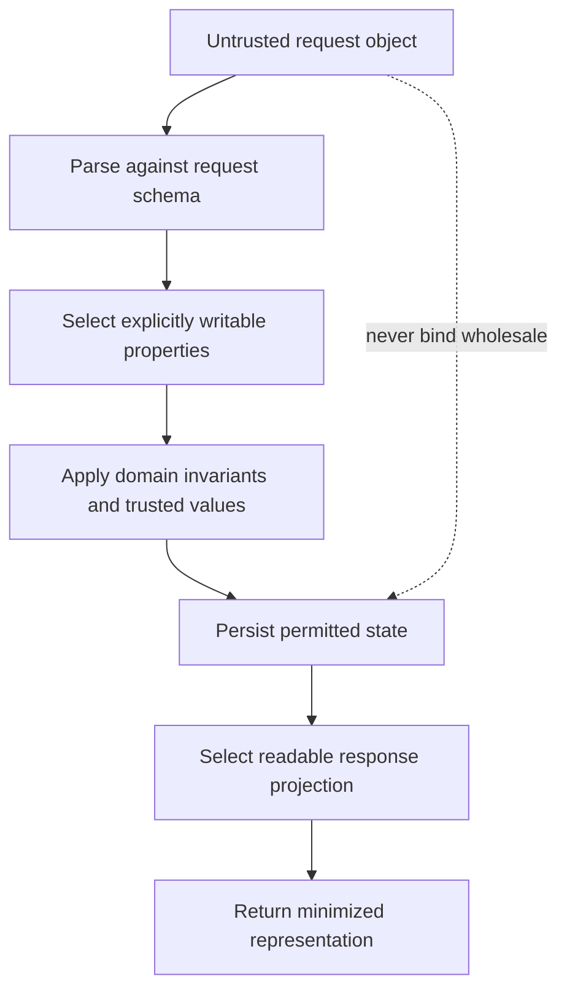

**Decision implications.** Prefer allow-lists over denylists because new fields otherwise become writable by default. Use distinct Create, Update, and Response models when their trust directions differ. Reject unexpected privileged fields or safely ignore them according to a consistent contract; silently accepting them can hide client defects, while reporting exact forbidden property names may reveal schema details. Ensure generated schemas and runtime serializers enforce the same boundary.

**Common failure mode.** A shared database entity is used for request binding and response serialization. Adding `isAdmin` to that entity unintentionally exposes it in output and makes it writable through a generic update path.

**Scenario.** A user may edit a document's title and body, but only an administrator may change its retention class. The ordinary update endpoint accepts only title and body; a separate privileged operation performs an audited retention transition.

### 4.5 Input, schema, semantic validation, and injection

**Definition.** API boundary validation determines whether supplied data is structurally valid, within resource bounds, semantically meaningful, and permissible for the next operation. Schema validation checks shape and constraints; semantic validation checks domain meaning; authorization separately checks whether this caller may request the operation. Neither validation nor sanitization substitutes for authorization.

**Mechanism.** Parse with a maintained parser, enforce content type and encoded/decoded size limits, reject ambiguous or malformed representations, validate types, ranges, enumerations, nesting, and collection lengths, then enforce domain invariants before side effects. Treat path, query, headers, cookies, GraphQL variables, RPC messages, WebSocket payloads, SSE cursors, file names, and webhook bodies as untrusted. Use parameterized database queries and structured process APIs rather than string concatenation. For output contexts, use context-specific encoding; do not attempt to make arbitrary input safe by stripping a few suspicious substrings.

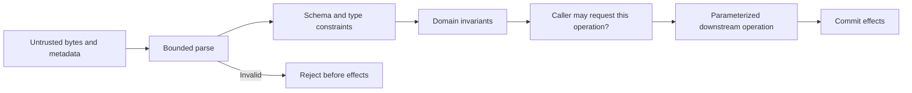

**Decision implications.** Validate at every trust transition, including internal service boundaries, because internal callers can be compromised or buggy. Keep resource limits appropriate to the API style; query-depth and complexity mechanisms remain owned by [GraphQL](CH02_GraphQL.md), and traffic-rate policy belongs to [API Rate Limiting, Quotas, and Fairness](CH11_Rate_Limiting.md). Make validation rules consistent between contract tooling and runtime enforcement, while recognizing that generated schema validation cannot prove business invariants.

**Common failure mode.** The service trusts a browser's validation, accepts a deeply nested unbounded payload, or interpolates a caller-controlled sort expression into a query. A valid JavaScript Object Notation (JSON) document can still exploit injection, exhaust parser resources, or request an invalid business transition.

**Scenario.** An order API accepts a bounded list of line items and a currency from an enumerated set. It rejects duplicate or impossible item quantities, authorizes the purchaser for the account, and passes item identifiers as database parameters rather than assembling Structured Query Language (SQL) text.

### 4.6 Credential handling, audience, scopes, tenant boundaries, and API keys

**Definition.** A credential is evidence presented to establish a principal or delegated authority. Audience constrains the intended recipient; scope constrains a class of permitted operations; tenant context partitions data and policy. An API key is a shared credential commonly used to identify an application or integration, but by itself it does not prove the identity of an end user or grant safe access to arbitrary objects.

**Mechanism.** Keep secrets out of source code, URLs, client bundles, logs, and error messages. Store server-held credentials in a managed secret store, rotate them with overlap and revocation procedures, and prefer short-lived, narrowly issued tokens where the protocol supports them. Validate issuer, signature through a proven implementation, audience, expiry/not-before, and required scope or role. Do not infer tenant authority from a caller-supplied header or body field; bind tenant from verified claims or a trusted server-side membership lookup. If a tenant selector is accepted for a legitimate multi-tenant operator, authorize the requested tenant explicitly. For API keys, use TLS, narrow service-specific permissions, inventory, rotation, and revocation; never treat secrecy or key obscurity as object authorization.

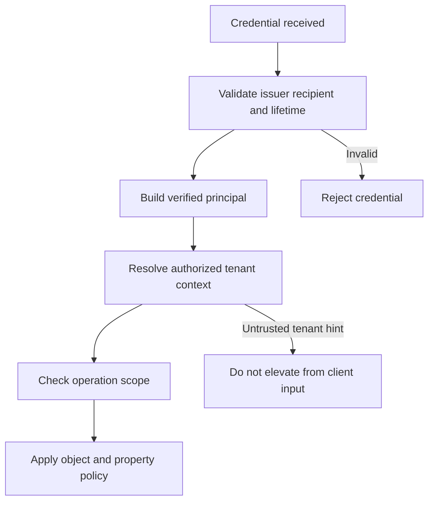

**Decision implications.** Choose protocol artifacts for their intended role: OAuth access tokens authorize resource access; OIDC ID tokens authenticate a relying party and are not API bearer tokens; a signed JWT still needs claim validation; SAML assertions are validated within their federation boundary. Those mechanics remain with the Part 05 owners. Use API keys for low-risk public identification, constrained partner integration, or service credentialing only when lifecycle and leakage risks are acceptable. Browser-embedded keys are extractable and should be assumed public.

**Common failure mode.** A service accepts a token issued to a different API, uses an ID token as a bearer access token, trusts `X-Tenant-ID` without binding it to principal membership, or logs a full API key on a 401 response. A key that is valid proves possession, not permission to read the selected record.

**Scenario.** A reporting workload receives a credential whose audience is the reporting API and whose scope permits export reads. The service resolves its tenant membership from an approved workload registry, limits the query to that tenant, and rejects a token intended for the billing API.

### 4.7 API-style-specific boundaries and layered controls

**Definition.** Each API style exposes a different unit of interaction, but every style still has an identity boundary, an authorization target, untrusted input, and a response or effect boundary. Security controls should follow the style's contract rather than assuming every interaction is one Hypertext Transfer Protocol (HTTP) request and one response.

**Mechanism.** REST checks each operation and object, including nested resources and filters. GraphQL applies authorization at domain operations and sensitive fields while retaining its own schema and resolver model; depth, complexity, and persisted-operation controls are owned by CH02. gRPC uses verified channel/call credentials and metadata as inputs to per-method and per-resource decisions; metadata mechanics remain in CH03. WebSocket connections authenticate at setup, then authorize each subscription and sensitive message, with a revocation plan. SSE authorizes the feed, filter, and cursor scope, and rechecks event delivery as policy changes. Asynchronous commands preserve the authorized principal and tenant context through execution; webhook receivers verify the event signature and delivery freshness before accepting a stable event identity.

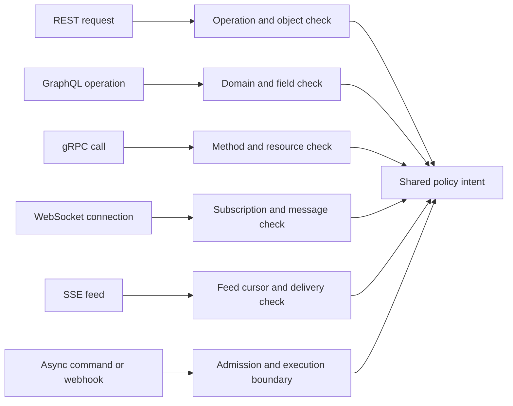

**Decision implications.** Reuse policy meaning and domain authorization without forcing every protocol into an identical transport abstraction. Make the trusted identity propagation contract explicit between Gateway and service; strip spoofable inbound identity headers and create or sign trusted context only across controlled hops. Keep style-specific mechanisms with their owning chapters so controls preserve protocol semantics.

**Common failure mode.** A team protects only the HTTP route and forgets GraphQL nested resolvers, gRPC reflection or privileged methods, WebSocket messages after connect, SSE replay, or background work after an accepted request. Another failure is applying authorization only at the edge and allowing an alternate internal path to bypass it.

**Scenario.** A project-management product exposes a REST document read, a GraphQL dashboard, a gRPC export method, and a change feed. All use one documented policy for tenant membership and document visibility, but each adapter enforces it at its actual object or message boundary.

### 4.8 Unsafe downstream consumption and Server-Side Request Forgery

**Definition.** Server-Side Request Forgery (SSRF) occurs when an attacker influences a server-side request to a destination the attacker could not directly reach, such as a cloud metadata endpoint or internal control plane. More broadly, unsafe downstream consumption occurs when API input controls a Uniform Resource Locator (URL), file, query, command, or integration request without a strict destination and capability policy.

**Mechanism.** Avoid accepting arbitrary callback, import, image, or document URLs when a narrower identifier or pre-registered destination suffices. If remote fetching is required, parse and canonicalize the URL with a maintained library; allow only approved schemes and destinations; resolve and validate addresses; block loopback, link-local, private, and metadata ranges where not explicitly required; revalidate after redirects and Domain Name System (DNS) changes; limit redirects, response size, time, and content types; and enforce egress policy outside the application as a second boundary. Do not let a webhook registration endpoint become an unrestricted proxy. Use parameterized database and process interfaces for non-URL downstream inputs.

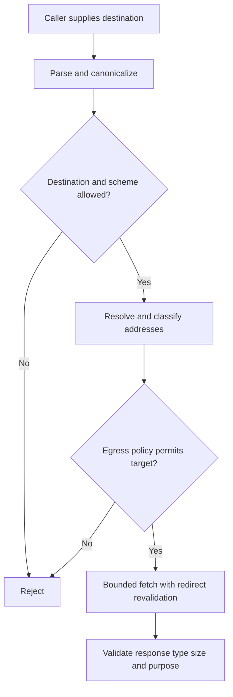

**Decision implications.** The safest design is to model the business object or destination registration rather than expose a general-purpose fetch primitive. Application allow-lists should be backed by network egress restrictions because DNS rebinding, proxy settings, and parser discrepancies can defeat a single URL check. Treat downstream responses as untrusted input too.

**Common failure mode.** A PDF preview endpoint fetches any supplied URL, follows redirects, and returns the response body. An attacker changes the URL to a private address or causes a redirect into an internal service, turning the application into a network pivot.

**Scenario.** A partner may register a callback host after domain-control verification. Delivery resolves only to public addresses, blocks private ranges at both application and egress layers, disables redirects by default, and caps response time and size.

### 4.9 Safe errors, privacy-safe evidence, and security testing

**Definition.** A secure API error communicates enough for a legitimate caller to recover without exposing secrets, internal topology, or whether a protected object exists. Security testing provides evidence that authorization and input controls fail closed for abuse cases, not merely that the happy path works. Observability records security-relevant outcomes while minimizing sensitive data.

**Mechanism.** Use a stable error taxonomy and correlation identifier, but avoid returning stack traces, raw database errors, token claims, signatures, or secret values. For object denials, consider a consistent not-found-style response where revealing existence is itself sensitive; keep the internal audit reason more precise. Emit structured events for credential failures, authorization denials, policy changes, validation rejects, replay detections, and administrative actions. Redact or tokenize identifiers where possible, restrict access to security telemetry, and set retention based on investigation needs and privacy obligations. Test positive and negative cases for every policy dimension, including tenant, object, action, property, state, and protocol boundary.

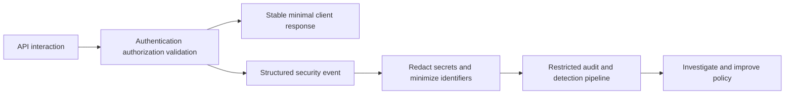

**Decision implications.** Separate client error detail from operator evidence. Make telemetry actionable by capturing policy identifier, operation, decision category, correlation ID, and carefully scoped subject/resource references without collecting full payloads by default. Security tests should run at unit, service integration, contract, and deployed-boundary levels; a passing schema test cannot establish object authorization.

**Common failure mode.** An API returns a detailed difference between nonexistent and unauthorized account IDs, and logs the bearer token plus full request body for diagnosis. The error channel becomes an enumeration oracle and the log pipeline becomes a credential store.

**Scenario.** A support analyst investigates repeated cross-tenant denials using a correlation ID and policy-decision event. The client receives a generic response; the protected audit system contains a redacted actor and resource reference with access controls and a retention window.

## 5. Internal Working

A secure API operation is a sequence of decisions whose order matters. Parse enough to identify the operation, establish a principal from verified credentials, derive trusted tenant context, load the intended object through a scoped path, authorize the action and property set, validate business invariants, and commit effects. Where a decision depends on current state, avoid a check-then-use gap: the authorization and mutation may need to share a transaction or use a versioned conditional update. For asynchronous work, persist the validated authorization context or a stable actor reference and define whether policy is rechecked when the worker executes.

```mermaid
flowchart LR
    Ingress[Ingress and transport protection] --> Authenticate[Credential verification]
    Authenticate --> Context[Principal and trusted tenant context]
    Context --> Parse[Bounded parse and schema validation]
    Parse --> Resolve[Scoped object resolution]
    Resolve --> Authorize[Action and property authorization]
    Authorize --> Domain[Domain invariants]
    Domain --> Effect[Atomic effect or durable admission]
    Effect --> Output[Response projection and safe event]
```

Authentication and authorization may be distributed across components, but the contract between them must preserve provenance. The Gateway can validate a token and attach a normalized identity context; the service must accept that context only from a trusted hop, and still enforce domain rules. If the Gateway forwards raw client headers such as `X-User`, `X-Role`, or `X-Tenant`, the service must discard or overwrite them rather than treating them as evidence.

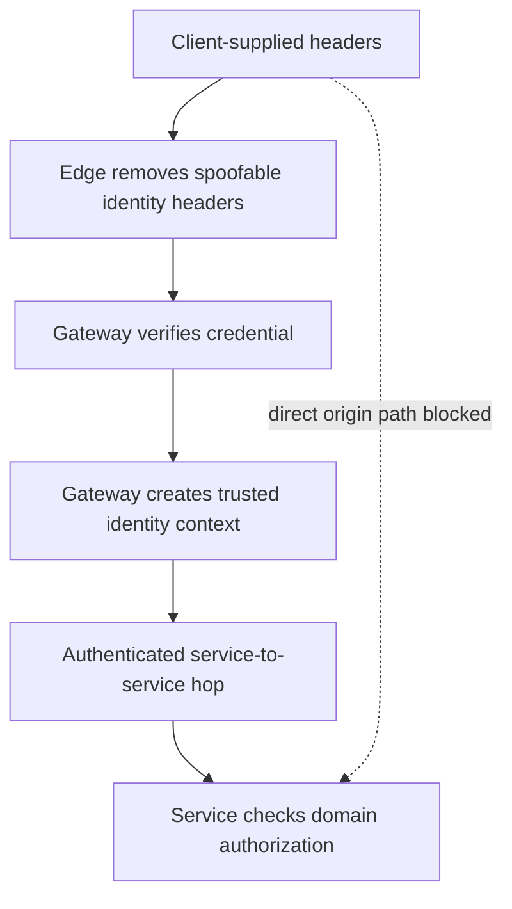

For long-lived and asynchronous interactions, authorization state must have a lifecycle. A WebSocket subscription can be revoked; an SSE cursor can be reused only in the same authorized feed; a webhook may be validly signed but stale or replayed; a queued command can outlive the user's role. Define the policy snapshot, revocation behavior, accepted event identity, and effect idempotency independently. Signature verification does not replace application authorization, and replay rejection does not make a business effect idempotent.

## 6. Design Principles

1. **Authorize where the protected object or effect is controlled.** Edge checks are valuable filters, not a substitute for domain decisions.
2. **Fail closed on missing or ambiguous identity context.** If a tenant, audience, or policy input cannot be established, do not silently widen access.
3. **Derive authority from trusted evidence.** Client-supplied identifiers select a target; they do not prove ownership, role, or tenant membership.
4. **Minimize both input authority and output data.** Explicit writable and readable projections are more robust than binding or serializing internal models wholesale.
5. **Preserve policy across protocol boundaries.** REST, GraphQL, gRPC, and streams can adapt the same domain policy without pretending they share one transport lifecycle.
6. **Make revocation and replay contracts explicit.** Long-lived credentials, subscriptions, cursors, and callbacks have time and state boundaries.
7. **Prefer prevention with independent containment.** Application checks, private service reachability, constrained egress, and audit signals should fail differently.
8. **Test denials as first-class outcomes.** Every allow rule needs negative cases for nearby identities, objects, actions, tenants, and properties.
9. **Collect the least sensitive evidence that still supports response.** Correlation and policy metadata are usually more useful than raw payload retention.

## 7. Architecture Patterns

**Policy enforcement point plus policy decision logic.** A service adapter identifies operation context, while a shared policy module or policy service evaluates principal, action, resource, and environmental attributes. Keep authoritative domain invariants near the operation; remote policy engines can improve consistency but add availability, latency, versioning, and fail-open/closed decisions.

**Scoped repository access.** Load objects through tenant- or ownership-scoped queries so common paths cannot accidentally retrieve arbitrary records. Add explicit policy checks for relationships that cannot be represented by a simple predicate. Do not hide policy inside a repository in a way that obscures which action is allowed.

**Separate request and response projections.** Input models name writable properties; output models name readable properties. Domain entities remain private. This reduces mass assignment, accidental serialization, and coupling between persistence and public contracts.

**Gateway plus service defense in depth.** The Gateway handles coarse consumer, credential, and route policy; services protect objects and effects. Keep origins private, remove untrusted forwarded identity, and use service-to-service identity across hops. Gateway responsibility and availability architecture remain owned by [API Gateway](CH08_API_Gateway.md).

**Short-lived streams with bounded authorization leases.** When per-event policy checks are too expensive, use a short lease or bounded subscription lifetime, renew it through an authenticated path, and close or re-evaluate on revocation. The contract must disclose the revocation bound and not imply instantaneous removal when it is eventual.

**Signed webhook ingress.** Verify the signature over the exact raw body and timestamp using a maintained cryptographic library, enforce a freshness window, atomically record replay identity, and enqueue before acknowledging. Then apply tenant, event-type, and business authorization before side effects.

## 8. Production Architecture

A production design usually combines an edge denial-of-service layer, an API Gateway, private service ingress, application policy checks, and data-store constraints. These layers have different jobs. Part 05 Firewalls owns network filtering, Web Application Firewall (WAF) mechanics, and segmentation; this chapter only places those controls in the API threat model. The Gateway chapter owns route and policy-pipeline architecture; here it is an integration point. TLS owns handshake and certificate configuration; API security requires correct channel protection but does not re-derive it.

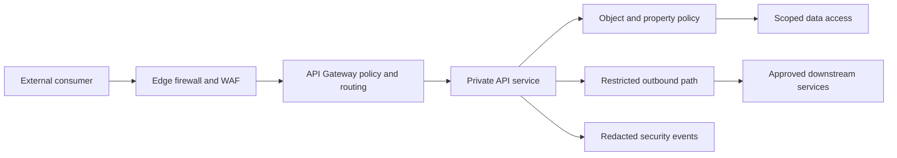

The boundary is only real if topology enforces it. Private services should reject direct public ingress; identity headers should be regenerated by trusted intermediaries; workload identity should authenticate service hops; egress should be constrained; and datastore accounts should have only the access needed by the service. Provider-specific controls differ, but the architectural invariant is consistent: one bypass path can nullify a carefully configured front door.

For REST and OpenAPI, document which operations require credentials and what authorization is still evaluated at runtime. For GraphQL, keep schema-level visibility and resolvers aligned with domain checks, and rely on CH02 for depth, complexity, and persisted operations. For gRPC, validate channel or per-call credentials and authorize method/resource context; do not assume private HTTP/2 means trusted callers. For WebSocket and SSE, model connection lifetime, subscription/feed scope, cursor binding, revocation, and data delivery as separate policy decisions. For asynchronous commands and webhooks, persist a trustworthy actor context, verify inbound signatures, and define retry and duplicate-effect behavior with Part 07 CH16.

## 9. Implementation

Implement authorization as explicit policy inputs and outputs. A practical decision function receives a verified principal, action, resource, and relevant environment; it returns allow or deny plus a policy identifier suitable for audit. It should not accept a caller-provided `isAdmin` field or rely on UI-only checks. Avoid a universal authorization helper that lacks resource context: it will tend to collapse distinct actions into a boolean authenticated flag.

When using bearer tokens, prefer standards-compliant libraries and the issuer's metadata or key-distribution mechanism. Pin accepted algorithms and validate issuer, audience, expiry, not-before, and the claims required for the operation. JWT's payload is not secret merely because it is signed. Never write custom OAuth flows, signature verification, SAML parsing, or TLS cryptography for production. Keep token refresh and revocation decisions with the identity protocol implementation; downstream APIs should receive credentials meant for their audience.

For input handling, bind only to dedicated request types and reject unexpected properties where feasible. Apply validation before database access and before side effects. Parameterize database queries, allow-list sort and filter fields, and never pass arbitrary API input to shell commands. Return output DTOs or projections that enforce field visibility. Ensure policy tests use synthetic tenants and objects, and make all examples in [Section 10](#10-complete-code-examples) standalone and local-only.

## 10. Complete Code Examples

The following examples run with a current Node.js runtime and its standard library. They use synthetic in-memory data, do not contact networks or databases, and do not contain production credentials. Their purpose is to make authorization and verification decisions executable, not to replace a framework's mature identity or policy library.

1. [Object-level authorization guard](../code/node/api-security-chapter/01_object_authorization.js): verifies tenant, ownership, action, and fail-closed behavior.
2. [Property allow-list and mass-assignment prevention](../code/node/api-security-chapter/02_property_allowlist.js): accepts only editable fields and preserves server-owned state.
3. [Signed webhook verification and replay window](../code/node/api-security-chapter/03_signed_webhook_replay.js): verifies exact-body Hash-based Message Authentication Code (HMAC), constant-time signature comparison, timestamp freshness, and duplicate delivery rejection using synthetic inputs.

Run them from the repository root:

```powershell
node code/node/api-security-chapter/01_object_authorization.js
node code/node/api-security-chapter/02_property_allowlist.js
node code/node/api-security-chapter/03_signed_webhook_replay.js
```

The webhook sample uses an in-memory replay set solely to demonstrate the decision sequence. A production receiver needs an atomic, shared replay/idempotency record with bounded retention and a stable event identity; signature freshness and cryptographic authenticity do not guarantee exactly-once business effects.

## 11. Performance

Security checks consume CPU, memory, I/O, and often a network round trip. Measure the cost of credential verification, policy lookup, object resolution, schema validation, and audit emission separately. A local signature check can be cheaper than online introspection but shifts revocation and key-rotation responsibilities to each verifier; a remote policy engine centralizes decisions but can add latency and an availability dependency. Those are explicit architecture trade-offs, not reasons to skip object checks.

Avoid duplicate work without weakening identity context. Cache validated public keys according to issuer metadata and rotation guidance; cache policy decisions only when the key includes every relevant principal, tenant, resource, action, version, and policy epoch. Never share an authorization-sensitive response cache across principals merely because the route is identical. GraphQL response and resolver-cache identities remain described in CH02; query-cost controls are also owned by CH02. Rate-limit algorithms remain with [CH11](CH11_Rate_Limiting.md) and are not developed here.

Validation should be bounded and proportional. Cap request sizes, nesting, batch sizes, and expensive semantic operations. The API style owner defines its query, stream, and payload contract; the rate-limiting sibling owns request-volume algorithms. Security performance is best measured as the cost of preserving the intended boundary under realistic concurrency, not by removing the check from a benchmark.

## 12. Scalability

A policy model must remain understandable as services, tenants, and operations grow. Central policy definitions can reduce drift, but they should not create a single synchronous policy service that every request depends on unless its availability, caching, rollout, and failure behavior are deliberately engineered. Local enforcement can improve resilience but risks inconsistent policy versions. A hybrid pattern distributes signed or versioned policy while retaining domain-specific checks at services.

Partition policy and data by trusted tenant context. Ensure background workers, export jobs, and event consumers carry tenant identity through durable records rather than reading a mutable global variable. For stream delivery, avoid one broad unbounded subscription when tenant-specific authorization or event filtering is required. Keep caches tenant- and principal-aware, and test account switching, role changes, and policy-version changes.

As organization size increases, assign owners to the policy model, credential issuers, Gateway configuration, service enforcement, and audit pipeline. A central security team can define guardrails and reusable tests; service teams remain responsible for their data and effects. Avoid turning a common library into a false guarantee: adoption checks, policy tests, and deployment evidence are needed to prove each service uses it correctly.

## 13. Security

API security depends on control composition, not a single checklist. Protect credentials in transit with correctly configured TLS (owned by Part 05 CH06); use OAuth/OIDC/JWT/SAML implementations appropriate to the caller and trust relationship (owned by Part 05 CH19-CH22); then authorize each API operation against the resource and properties actually involved. Use least privilege, secure secret storage, audience restriction, short lifetimes where appropriate, key rotation, and explicit revocation behavior.

Treat replay and idempotency as adjacent but distinct. A timestamped webhook signature can bound freshness and a replay store can reject the same delivery identity. A business operation may still execute twice through distinct valid deliveries or across a failure between effect and acknowledgment. General operation identity, atomic claims, and stable outcome replay belong to [Part 07 Idempotency](../07_System_Design_and_Distributed_Systems/CH16_Idempotency.md). Likewise, do not teach traffic throttling here; [CH11](CH11_Rate_Limiting.md) owns rate-limiting algorithms, while API Security specifies the identity and abuse signals those policies consume.

Validate security across the actual deployment path: edge, Gateway, origin, service-to-service identity, data store, stream infrastructure, and egress. Remove default credentials, keep debug endpoints private, use dependency and configuration scanning, and rehearse rotation and containment. For each sensitive API surface, record attacker goal, preconditions, control, residual risk, signal, response owner, and a regression test. The [API Gateway](CH08_API_Gateway.md) chapter owns Gateway topology and availability; [Firewalls](../05_Networking_and_OS/CH14_Firewalls.md) owns network and WAF rule mechanics.

## 14. Observability

Security telemetry should let an operator answer: who attempted which operation, against what policy boundary, with what decision category, through which service and correlation context, and what response followed? Useful events include invalid credential class, authorization denial, tenant mismatch, validation rejection, replay detection, suspicious enumeration pattern, policy change, secret rotation, and administrative access. Keep high-cardinality details in controlled logs or traces rather than metric labels.

Do not record bearer tokens, API keys, passwords, signatures, full webhook bodies, or unnecessary personal data. Hashing a low-entropy identifier is not automatically anonymization; use keyed pseudonyms or scoped opaque references where correlation is necessary. Apply access control, retention, deletion, and audit to security logs themselves. Keep client-facing errors stable and sparse while preserving precise internal policy identifiers.

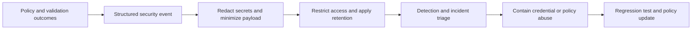

Metrics should count outcomes and trends without embedding user IDs or raw resource IDs. Dashboards can track denial rates by operation and policy category, invalid-signature rates, authentication failures, and unexpected origin traffic. Alerts should be tuned to detect change and impact rather than treating every denial as an incident; legitimate clients also make mistakes. Maintain a route and policy inventory so telemetry can be interpreted against known exposure.

## 15. Failure Scenarios

**Cross-tenant object access.** A request changes `/accounts/acct-a/invoices/123` to an identifier owned by `acct-b`. A valid token does not prevent BOLA. The service must scope object resolution and verify account membership, then emit a redacted denial signal.

**Privilege escalation through function routing.** A mobile client invokes an administrative operation omitted from its interface. BFLA occurs if only UI visibility or authentication is checked. The operation handler must enforce server-side capability policy.

**Property injection.** A caller adds `role`, `tenantId`, or `approved` to an otherwise valid update object. Dedicated request models and allow-lists stop the value before persistence; a regression test protects against future model changes.

**Credential audience confusion.** A service accepts a token minted for a different API or mistakes an ID token for an access token. Audience and artifact-purpose validation must be enforced by a standards-compliant library and issuer configuration.

**Stream authorization drift.** A user loses access while a WebSocket or SSE stream is open. The API must close, reauthorize, or bound the stale permission window and must not deliver newly unauthorized events.

**Webhook replay and duplicate effects.** A signed event is sent again after a timeout. Verify freshness and stable event identity, atomically deduplicate receipt, and use Part 07 idempotency for the business effect.

**SSRF through callback or import URL.** A service follows a redirect to an internal address or metadata service. Application destination checks plus egress restrictions, redirect revalidation, and bounded fetching reduce the path.

**Gateway bypass.** A forgotten public origin accepts direct requests and trusts headers normally set by the Gateway. Close alternate ingress and authenticate trusted service hops; test reachability from outside the intended network.

## 16. Testing

Security testing should prove policy behavior, not just handler reachability. Build an authorization matrix across principal class, tenant, object relationship, action, property, and object state. For each allow case, include a near-neighbor denial: same role in another tenant, same tenant but unrelated object, read allowed but update denied, allowed parent with a forbidden child, and expired or wrong-audience credential. Test both direct service calls and the deployed ingress path.

Use property-based and fuzz testing for parsers, schema boundaries, query filters, cursor decoders, and webhook headers. Add tests for oversized bodies, deeply nested values, duplicate or unexpected properties, malformed encodings, injection strings, replay windows, stale events, revocation, and partial batch authorization. For GraphQL, retain CH02's query-cost/depth and persisted-operation test strategy; for streams, simulate reconnect, filter changes, cursor reuse, and mid-connection policy changes.

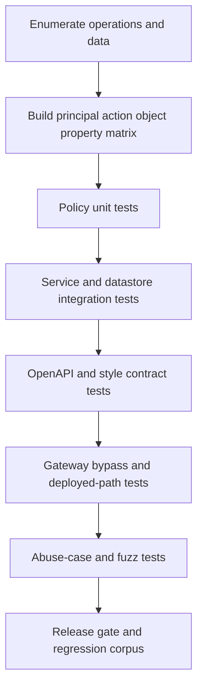

A penetration test is a time-bounded sample, not a substitute for repeatable policy tests. Include static analysis, dependency checks, secret scanning, configuration review, and deployment probes. Use synthetic test tenants and records. Ensure test logs do not accidentally preserve credentials or production data, and verify that failures are visible to the team that owns the policy.

## 17. Common Mistakes

- Treating successful authentication as permission for every resource or operation.
- Relying on opaque identifiers, client-side route guards, or hidden fields to prevent unauthorized access.
- Trusting tenant IDs, roles, or ownership supplied in request bodies or untrusted headers.
- Binding public request objects directly to persistence entities.
- Serializing internal domain objects wholesale and hoping clients ignore sensitive fields.
- Performing authorization only at the Gateway while services remain reachable by alternate paths.
- Authorizing a WebSocket connection once and never checking subscriptions, messages, or later deliveries.
- Treating a signed webhook as fresh, authorized, unique, or idempotent without separate checks.
- Caching data or policy decisions without tenant, principal, resource, and policy-version context.
- Logging credentials and raw payloads in the name of debugging.
- Assuming a schema-valid request is semantically valid or authorized.

## 18. Best Practices

- Maintain an API inventory that includes routes, fields, methods, subscriptions, feeds, callbacks, and privileged tools.
- Document trust boundaries, threat actors, protected data, and abuse cases as part of design review.
- Use verified principal context and bind tenant scope from trusted sources.
- Enforce function, object, and property policy at the service or domain boundary that controls the operation.
- Use separate request and response models with explicit writable and readable properties.
- Validate body size, structure, types, bounds, semantics, and state transitions before effects.
- Use maintained protocol and cryptographic libraries; never invent token, signature, XML, or TLS verification.
- Restrict token audience and scope, protect secrets, rotate credentials, and rehearse revocation.
- Bind long-lived subscriptions and cursors to the same tenant, feed, filter, and authorization scope.
- Protect downstream calls with destination allow-lists, egress controls, bounded redirects, and response limits.
- Make authorization denials and replay events observable without storing secrets or unnecessary personal data.
- Maintain negative tests and run them through both service and deployed ingress paths.

## 19. Anti-Patterns

**Perimeter-only authorization.** The Gateway authenticates a caller, while domain services trust that every requested object is allowed. One missed route or internal call becomes a data breach.

**Identifier secrecy as access control.** UUIDs or long random IDs lower guessability but do not establish entitlement; leaked references remain usable if policy is absent.

**Universal administrator scope.** A broad service key or role avoids modeling domain permissions but creates an unnecessarily large blast radius and weak audit attribution.

**Shared persistence/public DTO.** A single object is used for database state, request binding, and response serialization. New fields silently expand both write and read authority.

**Connection-time-only checks.** A stream is trusted for its entire lifetime even when membership, role, resource state, or tenant policy changes.

**Security by WAF signature.** A WAF can filter classes of malformed or known hostile traffic but cannot infer business ownership rules for every object.

**Catch-all error disclosure.** Returning stack traces, SQL errors, policy internals, or exact object existence leaks implementation and data clues.

**Security logging as payload capture.** Recording all headers and bodies stores reusable secrets and personal data in systems with different access and retention controls.

## 20. Trade-off Analysis

| Decision | Option A | Option B | Choose based on | Main failure mode |
|---|---|---|---|---|
| Authorization placement | Central Gateway coarse policy | Domain/service object policy | Apply both when edge policy can reduce exposure but only service has authoritative object context | Treating one layer as a substitute for the other |
| Token verification | Local signed-token validation | Online introspection/reference lookup | Revocation latency, issuer availability, consistency, and operational coupling | Local stale authority or remote validation outage |
| Policy evaluation | Local library/rules | Central policy service | Consistency needs versus latency and availability budget | Version drift or a central fail-open/fail-closed incident |
| Input contract | Strict reject unknown properties | Ignore unknown properties | Compatibility needs balanced against hidden client defects and mass-assignment risk | Silent acceptance or fragile rollout |
| Stream authorization | Check every sensitive delivery | Short lease with bounded reauthorization | Event volume, revocation objective, and policy-change propagation | Unbounded stale subscription rights |
| Webhook replay defense | In-memory demonstration store | Durable atomic shared store | Production concurrency and restart behavior | Replay accepted after restart or across replicas |
| Error semantics | Generic denial | Detailed denial reason | Enumeration/privacy risk versus client recovery needs | Existence oracle or unusable integration |
| Downstream URL access | Arbitrary URL | Registered/allow-listed destination | Product necessity and egress architecture | SSRF, redirect, or DNS-rebinding pivot |

The secure choice is not always the most centralized one. A central policy service can improve consistency but becomes part of the request availability path. Local policy can continue during outages but requires safe distribution and version governance. A useful design records the required revocation time, availability behavior, cache lifetime, and owner before selecting the mechanism.

## 21. Comparison Table

| Surface | Primary authorization target | Re-check boundary | Common security trap | Owning style chapter |
|---|---|---|---|---|
| REST resource request | Function, resource, tenant, returned fields | Each request and mutation | ID substitution or broad object binding | [REST](CH01_REST.md) |
| GraphQL operation | Domain operation, object, sensitive field | Resolver/domain operation; cache context | Root-only check or shared response cache | [GraphQL](CH02_GraphQL.md) |
| gRPC call | Service method and resource | Each call and privileged message | Treating metadata or private transport as permission | [gRPC](CH03_gRPC.md) |
| WebSocket API | Subscription, filter, message, event | Connect, subscribe, sensitive message, delivery | Authorize connection once | [WebSocket API](CH04_WebSocket_API.md) |
| SSE feed | Feed, tenant, filter, cursor, delivered event | Open/reconnect and delivery | Reusing cursor across changed scope | [SSE API](CH05_Server_Sent_Events.md) |
| Async command/webhook | Admission, durable actor context, event type, effect | Admission, execution, receipt, replay | Losing tenant/actor or duplicating effects | [Async APIs](CH06_Async_APIs.md) |
| Gateway | Consumer, route, coarse policy | Ingress and upstream hop | Bypass path or mistaken domain authority | [API Gateway](CH08_API_Gateway.md) |

This comparison identifies where API security attaches; it does not transfer ownership of resource semantics, protocol mechanics, GraphQL cost controls, Gateway architecture, or asynchronous delivery guarantees to this chapter.

## 22. Real-World Case Study

**Illustrative composite: multi-tenant document platform.** This scenario combines common API failure modes and is not a claim about a specific company or breach. The product exposes REST document operations, a GraphQL workspace dashboard, an SSE change feed, and a partner webhook for export completion. It stores customer documents in shared tables and routes public calls through a Gateway.

The first security review finds that REST access checks only for a valid bearer token. An attacker who obtains a document ID can change it in the route and read another tenant's record. The GraphQL resolver calls the same unscoped repository and returns internal fields such as `retentionClass`; its request-scoped cache is keyed only by document ID. The SSE feed validates tenant scope at connection setup but does not bind the replay cursor to the filter or re-evaluate membership after revocation. A webhook receiver accepts valid signatures but has no durable duplicate-event record.

The remediation begins with a single policy statement: a principal may perform a named action on a document only if current membership and document state permit it. Repository reads become tenant-scoped; mutations bind only editable properties; GraphQL and REST adapters call the same domain policy; response projections vary by permission. The SSE contract binds cursors to tenant, feed, and canonical filter, and defines how revoked subscriptions close. The webhook receiver verifies raw-body signature and timestamp, atomically records a stable event identity, and enqueues before responding. Part 07 CH16 owns the effect's idempotency behavior.

The Gateway remains useful for credential validation, route policy, and removing spoofable identity headers, but backend services are private and retain authoritative object checks. Security telemetry records policy identifiers and redacted references rather than token or document body. Regression tests run cross-tenant, wrong-action, forbidden-field, stale-cursor, replay, and direct-origin-bypass cases through both adapter-level tests and the deployed edge path.

The architecture is stronger because each control has one job and one owner. It does not depend on identifier secrecy, a single Gateway setting, or a signature being equivalent to authorization. Remaining risks include policy propagation delay, cache invalidation across replicas, and the operational burden of replay-store availability; each is measurable and assigned rather than hidden.

## 23. Interview Questions

1. Distinguish authentication, authorization, and tenant scoping. Why can a valid token still produce BOLA?
2. How would you test for BOLA when identifiers are Universally Unique Identifiers (UUIDs) and the API has both REST and GraphQL surfaces?
3. Compare BFLA with BOLA. Give a single request that could exhibit both.
4. How do request and response DTOs reduce mass assignment and excessive exposure?
5. What is the difference between a signed JWT and an encrypted token? Which claims should an API validate?
6. Why is an OIDC ID token not automatically an API access token?
7. What can an API key identify, and what must it not be treated as proving?
8. How do you authorize a WebSocket subscription after authenticating the connection?
9. How should an SSE cursor be bound to authorization and filter state?
10. How can a webhook signature be correct while the event is still unsafe to process?
11. Describe an SSRF-safe architecture for user-configured callback destinations.
12. Which controls belong at a Gateway, and which must remain in a domain service?
13. How would you log a cross-tenant denial without creating a sensitive-data repository?
14. What is the relationship between replay protection and idempotency?

## 24. Hands-on Exercises

1. Add a second synthetic tenant to the object guard example. Create a table-driven test matrix for owner, same-tenant reader, cross-tenant reader, and administrator actions.
2. Extend the property example with a nested settings object. Demonstrate why top-level allow-listing alone is insufficient for nested mass assignment.
3. Modify the webhook example to use a stable event ID and an atomic persistence abstraction. Test duplicate delivery across simulated process restarts.
4. Design a cursor format bound to tenant, feed, filter hash, and expiry. Document why the cursor is not an authorization credential and how invalid or expired cursors behave.
5. Write a GraphQL resolver test that requests a field the principal may not see, while confirming that CH02's query-cost policy remains independently enforced.
6. Draw the full ingress and egress trust boundaries for a callback-registration endpoint. Add direct-origin and redirect-based SSRF abuse cases.

## 25. Design Exercises

**Partner invoice API.** Design an API serving multiple partner organizations. Specify identity source, audience, partner-to-tenant mapping, invoice object policy, downloadable-file policy, property projections, audit events, and revocation behavior. Include a negative authorization matrix and explain how a partner admin differs from a platform operator.

**Live project collaboration.** A product exposes REST reads, GraphQL dashboards, WebSocket edits, and SSE notifications. Define shared policy semantics and each style's check boundaries. Explain membership revocation, event filtering, cursor reuse, cache partitioning, and how the API avoids conflicting decisions across adapters.

**Webhook ingestion platform.** Design registration, destination verification, signature rotation, replay protection, delivery deduplication, downstream effects, and safe observability. Explain how to avoid SSRF, what must be atomic, and which guarantees remain owned by Part 07 idempotency.

## 26. Architecture Review Questions

- Is every exposed operation, field, method, feed, callback, and administrative surface inventoried?
- Are trust boundaries shown between client, edge, Gateway, service, datastore, worker, and downstream dependency?
- Does every operation identify its authentication source and object/function/property authorization owner?
- Are object identifiers treated as selectors rather than authorization evidence?
- Does the policy include tenant, action, resource, relationship, and current state where relevant?
- Are request and response models separate, with explicit writable and readable property sets?
- Are size, type, range, semantic, and injection controls applied before effects?
- Are token issuer, audience, lifetime, purpose, and required scope validated by maintained libraries?
- Can any caller-controlled tenant header, URL, filter, cursor, file path, or downstream query broaden access?
- Are service origins private, forwarded identity headers trusted only across controlled hops, and outbound destinations constrained?
- For long-lived APIs, are subscription, message, feed, cursor, event-delivery, and revocation boundaries specified?
- Are webhook authenticity, freshness, replay identity, and business idempotency treated as distinct controls?
- Are GraphQL cost controls linked to CH02, Gateway decisions to CH08, version policy to CH10, rate-limit algorithms to CH11, and general idempotency to Part 07 CH16?
- Are GraphQL cost controls linked to CH02, Gateway decisions to CH08, version policy to [CH10](CH10_Versioning.md), rate-limit algorithms to [CH11](CH11_Rate_Limiting.md), and general idempotency to Part 07 CH16?
- Do negative tests cover cross-tenant, wrong-object, wrong-action, forbidden-property, revoked-principal, replay, and bypass cases?
- Do errors and telemetry avoid secrets, unnecessary personal data, and protected-object enumeration?
- Is there an incident procedure for credential rotation/revocation, policy rollback, stream termination, and affected-data assessment?

## 27. Summary

API security is a system-level threat model and control architecture. Authentication establishes a principal; authorization binds that principal to a specific operation, object, tenant, and property set. BOLA, BFLA, and property-level failures persist even when tokens, schemas, gateways, and network firewalls are present, so services must enforce domain policy where protected data and effects are controlled.

Validate inputs at every trust boundary, minimize writable and readable fields, constrain credentials by recipient and scope, treat API keys as limited credentials, and protect downstream requests from SSRF. Long-lived streams and asynchronous callbacks introduce connection, message, cursor, replay, and execution boundaries that need explicit policy lifecycles. Safe error handling, privacy-aware observability, abuse-case testing, and incident procedures complete the architecture.

**Further reading:** [REST](CH01_REST.md), [GraphQL](CH02_GraphQL.md), [gRPC](CH03_gRPC.md), [WebSocket API](CH04_WebSocket_API.md), [SSE API](CH05_Server_Sent_Events.md), [Async APIs](CH06_Async_APIs.md), [OpenAPI](CH07_OpenAPI.md), [API Gateway](CH08_API_Gateway.md), [OAuth](../05_Networking_and_OS/CH19_OAuth.md), [OIDC](../05_Networking_and_OS/CH20_OIDC.md), [JWT](../05_Networking_and_OS/CH21_JWT.md), [SAML](../05_Networking_and_OS/CH22_SAML.md), [TLS](../05_Networking_and_OS/CH06_TLS.md), [Firewalls](../05_Networking_and_OS/CH14_Firewalls.md), and [Idempotency](../07_System_Design_and_Distributed_Systems/CH16_Idempotency.md).
