# Chapter: Cross-Style API Versioning

Part: [08 — API Architecture](PART_OVERVIEW.md) · Status: Draft

## 1. Introduction

An Application Programming Interface (API) is a contract between independently changing producers and consumers. Versioning is the deliberate way an organization names, evolves, supports, and eventually retires incompatible interpretations of that contract. It is not a label to attach to each deployment, nor a substitute for designing compatible change. A service can deploy many times without changing its public contract; conversely, one deployment can introduce a breaking contract change even if its software release number barely moves.

This chapter owns cross-style API version policy, directional compatibility classification, deprecation and sunset governance, migration and retirement decisions, and the compatibility evidence required before release. It applies to REST (Representational State Transfer), GraphQL, gRPC (Google Remote Procedure Call), WebSocket APIs, Server-Sent Events (SSE), asynchronous APIs, and contract descriptions such as OpenAPI. The sibling chapters own the mechanics of their respective schemas and protocols. They are recapped and linked here, not retaught.

The governing question is not simply, “Is version 2 backward-compatible?” Ask instead: which producer and consumer versions must interoperate during this rollout, in which direction, for which operations and data, under which documented support window? This chapter turns that question into a policy an architecture team can review and operate.

## 2. Historical Evolution

Early network interfaces often evolved under one team's control, where producer and consumer could be rebuilt together. Distributed systems weakened that assumption: separately deployed services, third-party integrations, browser clients, and mobile applications can remain on different releases for days or months. Semantic version numbers borrowed from libraries helped communicate intent, but an API boundary has a wider and less controllable consumer population than one package dependency graph.

The industry consequently developed several identity mechanisms: path segments, hostnames, query values, headers, media types, schema fields, and versioned message names. None alone supplies a compatibility policy. More mature practices distinguish source-control releases from public contract identity, compare changes directionally, publish deprecation dates, measure real consumer use, and preserve old and new contracts during migration.

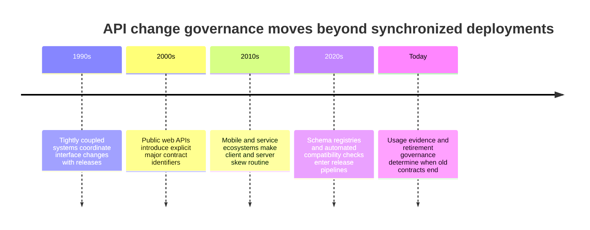

The evolution is not toward one universal version syntax. It is toward treating a contract as a product with owners, support promises, migration evidence, and an end-of-life decision.

## 3. Why It Exists

Independent release is valuable only if one side can change without forcing every other side to release at the same moment. In practice, consumers may be offline, embedded in a mobile application awaiting store review, built by another organization, generated from an older schema, or connected through a webhook or stream whose lifetime outlasts a deployment. A producer that changes meaning without an explicit compatibility boundary transfers its release risk to every consumer.

Version policy makes that risk governable. It identifies which changes can be absorbed additively, which require coexistence, how consumers learn about retirement, what traffic evidence is trustworthy, and who can authorize a deadline extension. A version identifier helps select an interpretation or route; compatibility checks and migration discipline establish whether that interpretation still works.

The trade is real: preserving old contracts consumes implementation, test, documentation, and operational capacity. Failing to preserve them can cause client outages or silent data corruption. The right policy minimizes unnecessary major versions while setting an explicit, evidence-based end to every compatibility promise.

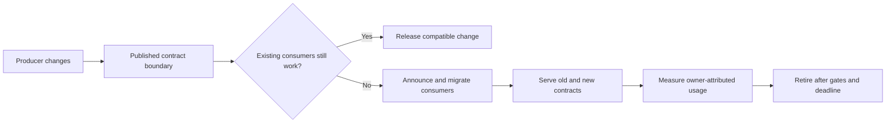

## 4. Core Concepts

These eight concepts form one governance system. Compatibility is directional, the schema is only part of the contract, and retirement is an operational decision supported by evidence rather than a date written in a document.

### 4.1 Contract version versus deployment and release version

**Definition.** A contract version names a consumer-visible set of meanings and interactions. A deployment version identifies a built service artifact; a release version identifies a delivery event or package. They may be related in release metadata, but they answer different questions. A contract version may be stable across hundreds of deployments, and one deployment may serve more than one contract version.

**Mechanism.** A contract includes schema shape and semantics: accepted inputs, emitted outputs, defaults, error meanings, ordering, delivery and replay behavior, and lifecycle promises. A deployment can fix a defect or improve latency while preserving all of these. Conversely, changing a field from a snapshot to a delta, tightening accepted input, or changing a stream's replay guarantee changes the contract even when the path and field names remain unchanged. Record the immutable source revision or schema digest associated with each supported contract identifier.

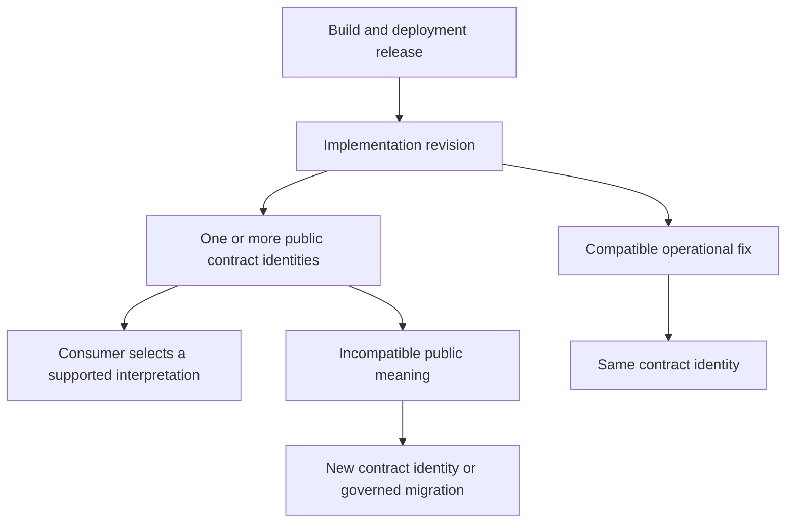

**Decision implications.** Version the smallest boundary whose interpretation actually differs. Do not change a public version merely because a container image, internal library, or endpoint deployment changed. Keep build, deployment, schema, and API identifiers separately queryable so incident responders can tell “which code ran?” from “which contract did this caller use?”

**Common failure mode.** A team increments `/v2` for every release and teaches clients that versions are deployment snapshots. The number becomes noisy, old routes accumulate, and no one can explain which semantic change justified coexistence. The opposite failure is keeping `/v1` while silently changing a unit or delivery guarantee.

**Scenario.** An order API deploys five times to fix validation and improve database access while preserving its documented request and response behavior. These remain one contract version. A later change makes `total` represent tax-inclusive minor currency units rather than the prior decimal major units; that is a semantic contract break even if the deployment tag changes only from `2026.10.1` to `2026.10.2`.

### 4.2 Compatibility is directional and pairing-specific

**Definition.** Compatibility is the ability of a particular producer and consumer pair to interoperate correctly. “Backward-compatible” is incomplete unless it states which side is old, which is new, which direction data flows, and which behavior is checked. For a request/response API, two essential pairings are old client with new server and new client with old server. Bidirectional streaming and asynchronous messaging add producer/consumer directions for each message family.

**Mechanism.** An old client/new server check asks whether the new server still accepts requests the old client emits and whether the old client understands responses the new server emits. A new client/old server check asks whether the old server accepts requests the new client emits and whether the new client handles responses the old server can produce. A tolerant old response reader may ignore an added optional field, but that does not mean a new client can rely on that field when speaking to an old server.

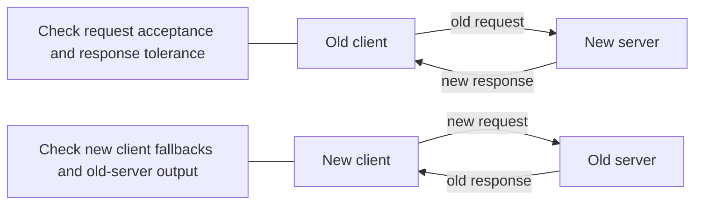

| Client \\ Server | Old server | New server |
|---|---|---|
| Old client | Baseline pairing | New server accepts old requests and emits responses the old client tolerates |
| New client | New client falls back to old behavior and sends only requests the old server accepts | Baseline pairing |

**Decision implications.** Build a compatibility matrix from deployment reality, not from a single abstract label. A rolling backend release may require old and new server replicas to accept both old and new clients. A public mobile service may need old-client/new-server support for the full store adoption tail, but not necessarily new-client/old-server once server-first rollout is complete. Document which pairings are required and for how long.

**Common failure mode.** CI checks only that the new schema can parse old data, then deploys clients before all servers know the new request field. Or a server adds a response property that an old strict decoder rejects. A schema diff that reports “additive” cannot settle either case without reader tolerance and rollout order.

**Scenario.** A new client wants to request an optional `includeHistory` flag. It first sends the flag only after server capability is observed, or it falls back to the old behavior when talking to an old server. The provider tests both pairings instead of treating the field addition as universally compatible.

### 4.3 Additive, breaking, and semantic changes

**Definition.** An additive change expands the contract without invalidating existing valid interactions under the declared tolerance rules. A breaking change makes a previously valid interaction fail or requires a consumer to understand a new obligation. A semantic change preserves syntactic shape while changing meaning and is breaking whenever a consumer can produce a materially different result.

**Mechanism.** Classify input acceptance separately from output interpretation. Making a request field optional with a safe default generally broadens server acceptance; making it required narrows acceptance. Adding an optional response field depends on old-reader tolerance; removing a response field affects clients that use it. Adding an enum value can break exhaustive consumers. Reordering a collection, changing null versus omission, changing units, changing error retryability, or altering stream replay guarantees can be breaking even when the schema structure is unchanged. Classify defaults and unknown-value behavior explicitly.

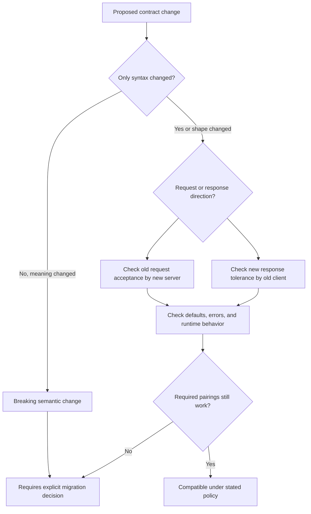

**Decision implications.** Use an organization-owned classification table, then let protocol-native tools supply evidence about structure. Require a human semantic review for units, defaults, ordering, error behavior, authorization-visible data, replay, and business invariants. The policy should distinguish “wire-compatible,” “source-compatible,” “behavior-compatible,” and “rollout-compatible”; passing one dimension is not proof of the others.

**Common failure mode.** Teams equate “new field is optional” with “safe.” A field can have a misleading default, a new enum member can break exhaustive client code, or an unchanged integer can change from cents to dollars. The parser succeeds while the business result is wrong.

**Scenario.** A webhook changes `status: "paid"` to `status: "settled"` but keeps the same JSON shape. A structural diff sees a string-to-string field; a contract review recognizes that existing consumers branch on the old value. The producer adds the new event/value while preserving the old meaning during a measured migration, or creates an explicit incompatible contract.

### 4.4 Version identifiers and where they belong

**Definition.** A version identifier is the client-visible selector for a contract interpretation. Common locations are URI path, hostname, request header or media type, query parameter, and—in message systems—a schema field or message type. Each makes a different trade among discoverability, routing, caching, tooling, and the scope of the version boundary.

**Mechanism.** A path such as `/v2/orders` is visible in logs, documentation, and route configuration and can be served side by side, but duplicates resource paths and can encourage version-per-release behavior. A hostname such as `v2.api.example.com` isolates routing and certificates but multiplies DNS, domain, and client configuration. A header or media-type parameter can keep the URI stable but is less visible and must be represented in cache keys, observability, and manual testing. A query parameter is easy to try but can leak into copied URLs, caches, and analytics, and may be omitted accidentally. A message schema version scopes interpretation to an envelope, event family, or schema rather than necessarily versioning an endpoint.

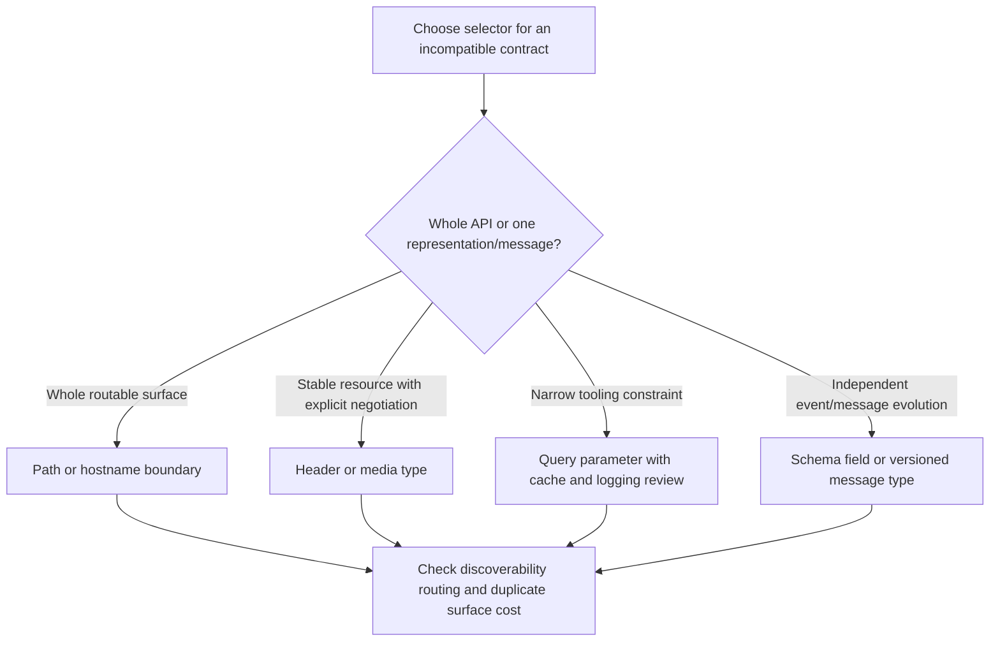

**Decision implications.** Choose one default for the public API family so consumers, gateways, documentation, and telemetry behave consistently. Use path versions when a major contract needs a clear addressable route and parallel serving. Use headers or media types when representation negotiation is already a first-class, well-tested capability. Version asynchronous schemas at the message-family boundary when endpoint semantics remain stable. Do not version additive changes merely because a selector exists.

**Common failure mode.** The same API accepts a path version, a header override, and a schema field without defining precedence. Clients can observe one selector while the gateway routes another. A header-based version omitted from cache identity can also cause a representation selected for one contract to be returned to another.

**Scenario.** A public resource API selects major contracts with `/v1` and `/v2` because partners need visible, independently routable surfaces. Its event feed keeps the endpoint stable but adds an event-family `schema_version` for one incompatible payload change, allowing unrelated events to evolve independently.

### 4.5 Deprecation, sunset, notice, and owner deadlines

**Definition.** Deprecation is a notice that a contract remains available but is discouraged and has a planned migration path. Sunset is the point at which support ends and the contract is no longer served. A retirement deadline is a governed commitment, not just metadata. Deprecation does not itself disable a field or route, and a sunset header does not guarantee that every consumer received or understood the notice.

**Mechanism.** A lifecycle record names the affected operation or schema element, replacement, accountable service owner, consumer-facing announcement, deprecation date, earliest sunset date, retirement deadline, support exceptions, and telemetry source. Notify consumers through channels they actually monitor: API documentation, release notes, developer portal, direct partner contacts, and response metadata where applicable. Instrument version and operation usage with consumer identity available to authorized operators, but aggregate metrics to avoid exposing sensitive identifiers. Review active usage, unknown clients, failure rates, migration completion, and contractual notice requirements before shutdown.

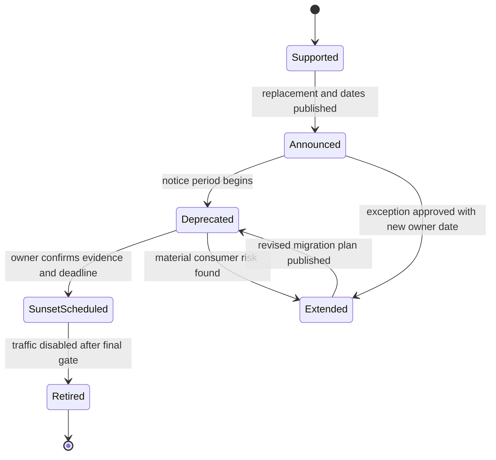

**Decision implications.** Set notice periods according to consumer release speed, contractual terms, data criticality, and the organization's ability to identify owners. Require an accountable owner and a finite deadline even for extensions. Make emergency withdrawal a separate incident process with explicit risk acceptance; do not disguise it as an ordinary sunset.

**Common failure mode.** A deprecation annotation is added, but no owner, replacement, date, or usage signal exists. The old contract lives forever until a hurried removal surprises an unknown integration. The opposite failure is a calendar-driven shutdown despite evidence of a critical active client that has no migration path.

**Scenario.** A partner webhook payload's `legacyState` field is deprecated after its replacement and mapping guide are published. The inventory lists each registered partner owner and target date. At the review gate, traffic is zero for 60 days and partner teams confirm migration; the service retires it on the announced date. If an unowned client remains, the owner opens a bounded exception rather than silently resetting the clock.

### 4.6 Coexistence, routing, and client migration

**Definition.** Coexistence is the period when more than one contract interpretation is supported. Routing selects the implementation or adapter that honors the selected contract; it does not decide whether the versions are compatible or how long they remain supported. Client migration is the controlled movement of consumers to a replacement while both sides remain operationally observable.

**Mechanism.** Establish the new reader and server behavior first, then introduce compatible adapters or dual representations, and route using a stable contract selector. A typical sequence is expand the server to accept old and new forms, release new clients, observe adoption, stop producing the old form only after reader readiness, then remove old input/output support after the sunset gate. Keep contract-specific mapping at an explicit boundary rather than scattering conditionals through domain logic. Gateway CH08 owns the placement and mechanics of route configuration; this chapter owns the version policy and evidence that a route may be removed.

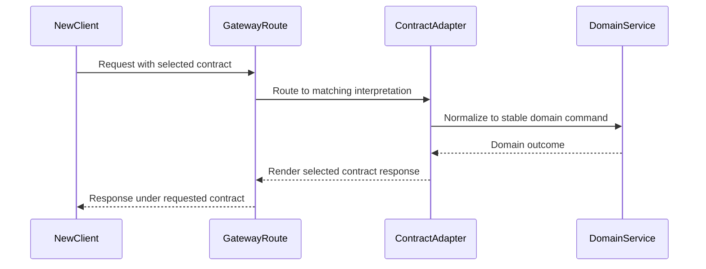

**Decision implications.** Coexist only as long as required by the support policy. Keep the domain model independent of public version-specific wire shape; map at an anti-corruption boundary and test each supported adapter. Use traffic splitting for rollout risk, not to hide an unannounced contract change. Maintain a rollback path that is compatible with data already written by the new implementation.

**Common failure mode.** A gateway points `/v2` at a new backend, but shared storage now contains values the old backend cannot read. Route rollback restores code but not data compatibility. Another failure is maintaining a separate full implementation per version, allowing behavior and fixes to drift.

**Scenario.** A billing service moves from a single `address` object to normalized address fields. It expands the read path to understand either representation, writes both only during a bounded transition, verifies parity, switches the canonical writer, then contracts by removing the legacy field after all clients migrate. The old server remains able to read the transitional stored shape during rollback.

### 4.7 Compatibility automation and version-explosion control

**Definition.** Compatibility automation is a repeatable set of structural diffs, generated-client checks, provider/consumer contract tests, and runtime usage measurements. Version explosion is the operational cost of too many simultaneously supported contract variants, each with implementation, documentation, testing, routing, and support obligations.

**Mechanism.** Compare proposed schemas against immutable released baselines; run directional producer/consumer checks; generate representative old/new pair tests; add consumer-driven tests for assumptions static schemas cannot express; and publish the result with the change. Define policy severity, waiver owner, expiry, and rationale. Maintain an inventory of supported versions, active consumers, dates, owners, and test coverage. Remove versions when evidence and gates are met, and consolidate where adapters can safely map several historical shapes into one stable domain contract.

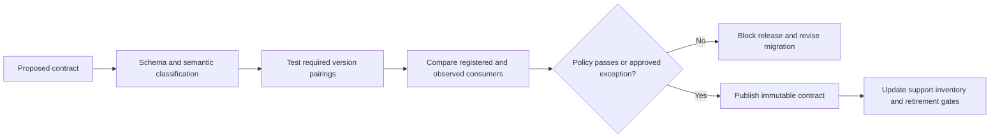

**Decision implications.** Automate what tools can observe and reserve review for semantic and rollout claims. A clean schema diff is evidence, not a proof. Set a maximum supported-major window only if it reflects actual product support and consumer cadence; pair it with a way to request a time-bounded exception. Avoid making every minor release a separate route or version label.

**Common failure mode.** A compatibility checker blocks harmless change until teams bypass it, or it passes a semantic break because the type is unchanged. Meanwhile, no owner retires old versions, so test matrices and security fixes grow without bound. Unowned waivers convert governance into paperwork.

**Scenario.** CI detects that a required request property was added and blocks the release. The team changes it to optional with an explicit default, adds old-client/new-server tests, and records a semantic-review approval. A dashboard shows two supported major versions, one scheduled for retirement, and a third blocked from publication because its migration owner has not been named.

### 4.8 Long-lived clients and event/message contracts

**Definition.** Version skew is the difference between the contract capabilities of communicating endpoints. Long-lived clients include mobile applications, offline devices, partner integrations, installed desktop software, and processes holding persistent streams. Event/message contracts are independently consumed schemas whose producer and consumer releases may be separated by queues, replay retention, or connection lifetime.

**Mechanism.** Define minimum supported client capability and maximum server compatibility horizon. Use capability negotiation or documented feature detection when clients can select optional behavior; do not infer compatibility from an application version string alone. For streams, decide whether a connection pins its negotiated schema until reconnect or can receive multiple message-family versions in one stream. For webhooks and queued events, retain enough schema identity to decode delayed/replayed payloads, or transform them through an explicit versioned adapter. Set unknown-field and unknown-event behavior per message criticality.

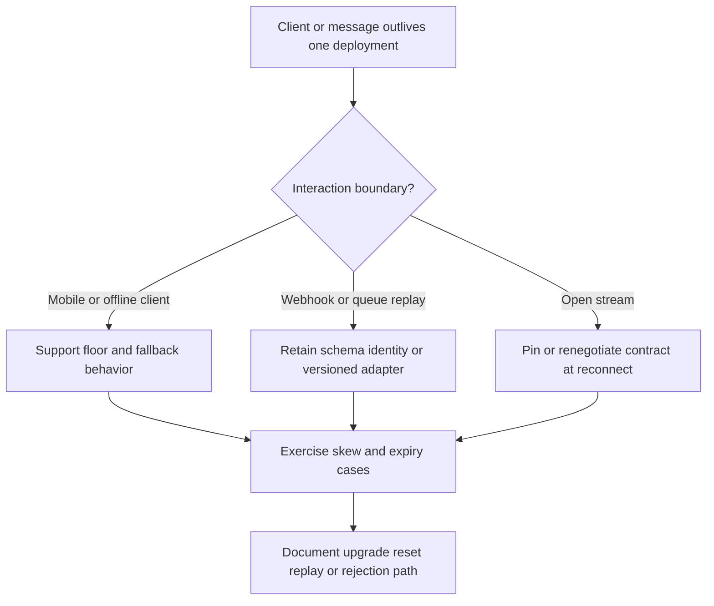

**Decision implications.** Size overlap from the longest credible client and message lifetime, not just server deployment cadence. For mobile, combine a published minimum version with a forced-upgrade path only when risk warrants it and the client can still reach the upgrade experience. For events, avoid one global schema counter when independent event families evolve at different rates. Ensure retained data can still be read or intentionally transformed after its original producer is gone.

**Common failure mode.** A server deploys a new event payload and assumes every consumer upgrades immediately, while a delayed queue redelivers old messages after the old decoder was removed. A stream may also keep sending a new event type over a connection whose client negotiated an older schema and cannot recover without reconnecting.

**Scenario.** A mobile application can remain offline for weeks. The server keeps v1 behavior during the announced support window, adds a capability response that lets newer clients use a richer field, and records adoption by client cohort. A webhook event carries its own `schema_version`; delayed retries are rendered or upcast by a version-aware adapter rather than interpreted by the current schema blindly.

## 5. Internal Working

Version policy is implemented by a chain of contract artifacts and runtime decisions. A change starts as a proposed schema and semantic delta, is classified against released baselines, is tested against required version pairings, and is published with a support identity. At runtime, a request or message selects an interpretation; routing reaches an implementation or adapter; telemetry records which contract was actually used. Retirement reverses the process only after usage and notice gates pass.

```mermaid
flowchart LR
    Change[Change proposal] --> Baseline[Released contract baseline]
    Baseline --> Classify[Directional and semantic classification]
    Classify --> PairTest[Old and new pairing tests]
    PairTest --> Publish[Publish identity and support window]
    Publish --> Select[Select version at request or message boundary]
    Select --> Adapt[Route or adapt to domain behavior]
    Adapt --> Observe[Measure use and outcome]
    Observe --> Retire[Apply sunset gates]
```

Keep contract selection and domain behavior distinct. An adapter converts a public version's accepted request into a canonical command and renders the canonical outcome under that version. The service's business invariants should not change merely because one consumer uses an older field spelling. If semantics genuinely differ, do not disguise the difference as a field mapper: define separate behavior and explicit ownership.

## 6. Design Principles

- Treat the consumer-visible contract, not the deployment artifact, as the unit of version policy.
- State compatibility direction and the required client/server pairings in every change review.
- Separate schema shape from semantic, behavioral, and rollout compatibility.
- Prefer compatible evolution; introduce a version boundary only for unavoidable incompatible meaning.
- Give every deprecated contract a replacement, owner, notice channel, deadline, and usage measure.
- Keep version-specific translation at a bounded adapter or contract boundary.
- Make event, webhook, and stream schema identity explicit when messages can outlive a producer release.
- Retire versions deliberately; a deadline without owner and evidence is not governance.

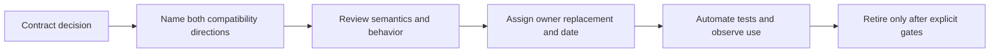

## 7. Architecture Patterns

**Compatible continuous evolution.** Keep a stable major contract identity while adding optional capabilities with safe defaults. This is appropriate when consumers tolerate unknown output fields and do not depend on closed enumerations or fixed serialized shapes. Compatibility tests and runtime usage still matter; “no new version number” is not “no review.”

**Parallel major contracts.** Serve two or a small number of incompatible contract versions simultaneously through separate selectors and adapters. Use this when a semantic break cannot be migrated in place and consumer cohorts need different interpretations. Define a sunset for the old contract before launch.

**Canonical domain model with edge adapters.** Translate version-specific request and response shapes at the API boundary while keeping domain commands and outcomes stable. This limits duplicated business logic. It does not fit versions whose domain behavior is intentionally different; those require explicit domain separation.

**Versioned message families.** Give independently evolving event families their own schema identity or type boundary. Producers retain or translate historical forms for delayed consumers and replay. Avoid a single global schema version that couples unrelated feeds.

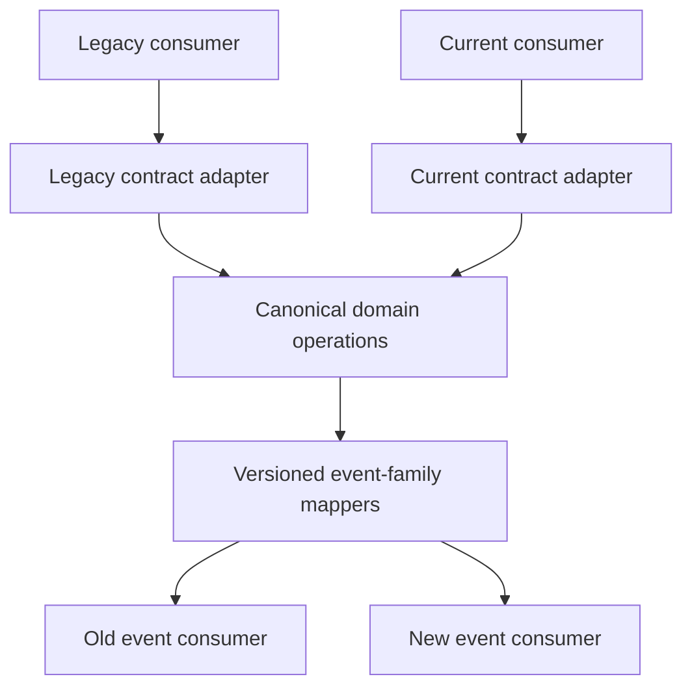

## 8. Production Architecture

A production version boundary usually spans contract source, API edge routing, one or more service implementations, schema validation, consumer libraries, and telemetry. Not every system needs a central registry. The minimum useful inventory identifies each public contract, its selectors, supported versions, owners, consumers, schema locations, release baseline, sunset dates, and test evidence.

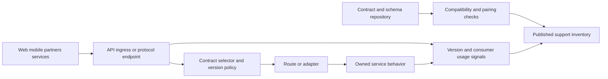

Do not make the live request path depend on a documentation registry being available unless that dependency is a deliberate architecture choice. Publish immutable contract artifacts with each support identity and load validated routing or schema configuration through the system's established deployment mechanism. Gateway CH08 owns where and how routes are placed, propagated, and rolled back; this chapter owns which contract may be routed and the governance criteria for keeping or removing it.

## 9. Implementation

Implement version policy as a release workflow rather than a naming convention. First inventory consumers and the interaction types they use. Then define a contract baseline, compatibility directions, unknown-field and unknown-message behavior, minimum supported pairings, and a semantic-review checklist. Decide whether the change is compatible, can be expanded in place, or requires parallel contracts. For incompatible work, name the replacement, adapter, migration owner, notice plan, and sunset gate before implementation begins.

Separate contract parsing from domain logic. Validate the selected external contract, translate into a stable internal command where meanings match, and serialize outcomes according to the selected contract. Keep telemetry for version, operation or message family, response outcome, and attributable consumer cohort. Avoid high-cardinality identifiers in metric labels; retain consumer-level evidence in access-controlled inventory or structured records.

The examples in Section 10 are deliberately scoped. The Python classifier is an executable teaching model, not a complete schema diff engine. The JSON inventory is illustrative data, not a production registry schema. The YAML routing policy is vendor-neutral pseudo-configuration, not a deployable gateway file. The Markdown migration checklist is a review aid, not a runtime migration tool.

## 10. Complete Code Examples

Four artifacts show a policy workflow without pretending one file can prove compatibility:

1. [Directional compatibility classifier](../code/python/versioning-chapter/01_compatibility_classifier.py) is a standard-library Python model with executable assertions. It classifies a few explicit changes in both pairing directions; it intentionally cannot infer semantic compatibility from schemas.
2. [Expand-migrate-contract checklist](../code/markdown/versioning-chapter/02_expand_migrate_contract_checklist.md) is a worked migration sequence covering backfill, dual-read/write hazards, verification, cutover, and rollback gates.
3. [Deprecation inventory](../code/json/versioning-chapter/03_deprecation_inventory.json) is illustrative JSON showing owner, replacement, notice, usage evidence, deadline, and retirement gate fields. It is a data example, not a registry schema.
4. [Multi-version routing policy](../code/yaml/versioning-chapter/04_multi_version_routing_policy.yaml) is vendor-neutral illustrative YAML describing selection and support policy. It is not valid input for a specific gateway until translated and validated against that product's schema.

Run the classifier with Python 3.10 or later: `python code/python/versioning-chapter/01_compatibility_classifier.py`. Validate the JSON and YAML examples with a parser, and review the checklist as prose. These checks establish syntax and the model's examples only; provider/consumer integration and gateway routing remain unverified without the target implementations.

## 11. Performance

Versioning has no inherent per-request cost when it is only a build-time governance practice. Runtime cost appears through selector parsing, schema validation, translation, branching, and extra data copies. Measure those costs per supported contract before removing validation or moving logic into a less visible layer. Cache compiled validators by immutable schema revision, not by a mutable label whose contents may change.

Parallel versions can increase code paths, memory, deployment size, and test time. A single edge adapter may reduce duplicated domain logic but can add serialization and latency. More importantly, old versions may prevent storage or event-model cleanup, so the cost is not limited to request CPU. Track active versions and traffic distribution as operational capacity inputs.

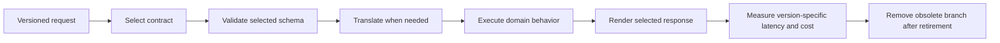

## 12. Scalability

Version scalability is organizational and operational: how many contracts can teams review, test, route, document, and support reliably? Every additional active version multiplies combinations with client releases, server replicas, data states, and intermediary configurations. A service with three client cohorts and two server generations may face six pairings before stream or event schemas are counted.

Control this combinatorial growth by defining a narrow support window, grouping clients into capability cohorts, automating required pairings, and setting a review date for every exception. Avoid retaining a version solely because a route is cheap; its security fixes, incident response, and data compatibility remain obligations. For high-volume APIs, separate old and current paths only when it gives useful isolation or clearer measurement, not to create a version-specific deployment for every consumer.

## 13. Security

Versioning is not a security mechanism. Older contracts may expose fields, defaults, or error behavior that newer designs no longer permit, so include security and privacy owners in the retirement review. Do not use a version selector as an identity, authorization, or quota control. A client choosing an older contract does not gain an exception from current policy.

This chapter does not teach authentication, authorization, threat modeling, or quota mechanisms. Those boundaries belong to Part 08 CH09 API Security and CH11 Rate Limiting, respectively. The API Gateway chapter (CH08) owns routing and policy placement; here, version governance only requires that every supported selector maps to the same approved security-policy baseline and that retirement does not leave an unmaintained path exposed.

## 14. Observability

Observe contract usage at the API operation, GraphQL schema coordinate, RPC method, message family, event type, or webhook subscription boundary appropriate to the style. Record selected contract identity, serving implementation, outcome, and a bounded client cohort. Keep the signals needed to contact an owner in an access-controlled consumer inventory rather than turning raw customer identifiers into metric dimensions.

For retirement, define a measurement window, what constitutes a request (including retries and replay), how anonymous or unregistered traffic is handled, and what “zero use” means. A missed telemetry path is uncertainty, not evidence of no consumers. Track deprecation notices delivered, migration status, active usage, errors by contract, unsupported-version attempts, and exceptions with owner and expiry.

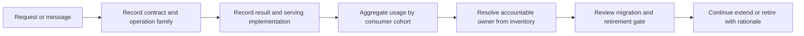

## 15. Failure Scenarios

**Selector disagreement.** A request header says v2 while a gateway path rule routes to v1. Log the selected contract and route configuration revision together; reject ambiguous combinations unless precedence is explicitly documented.

**Semantic drift under one identity.** The schema shape is unchanged but an amount or state transition changes meaning. Stop rollout, restore the prior meaning or publish a new contract boundary, and add a semantic compatibility test.

**Dual-write divergence.** A migration writes both old and new representations and one update path omits one side. Detect through parity checks and an authoritative source-of-truth decision; do not assume matching writes are atomic.

**Sunset with unknown clients.** Traffic appears low, but webhook retries or offline clients can return later. Confirm telemetry coverage and retention windows, contact registered owners, and use a time-bounded extension if evidence is incomplete.

**Old event cannot be decoded.** A delayed message arrives after its original schema implementation was removed. Retain schema identity and an approved adapter for the support window, or dead-letter with an explicit recovery path rather than guessing at its meaning.

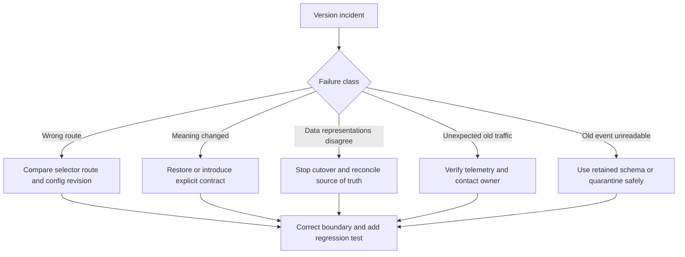

## 16. Testing

Test contract governance at four levels. Structural checks validate schema syntax and produce a diff against an immutable released baseline. Directional tests pair old and new clients with old and new providers for the rollout combinations the policy requires. Behavioral tests assert defaults, units, error meanings, ordering, idempotent interpretation, and stream or replay guarantees. Retirement tests verify that old selectors are disabled at the correct boundary and return a documented outcome.

OpenAPI CH07 owns OpenAPI syntax and specification-based structural compatibility tooling; use its checks as one input, not as the cross-style policy itself. GraphQL CH02 owns schema field deprecation and GraphQL compatibility mechanics. gRPC CH03 owns Protobuf field-number compatibility. WebSocket and SSE chapters own their message/feed schema details. Add integration tests for gateways and adapters when routing determines the served contract.

```mermaid
flowchart LR
    Baseline[Released schema baseline] --> Structural[Style-specific structural diff]
    Structural --> Pairing[Required old/new producer-consumer tests]
    Pairing --> Semantic[Defaults meaning errors and ordering tests]
    Semantic --> Runtime[Gateway adapter or stream integration tests]
    Runtime --> Retirement[Sunset and unsupported-selector tests]
    Retirement --> Release[Policy evidence attached to release]
```

## 17. Common Mistakes

- Incrementing a contract version for every deployment, or treating release tags as public compatibility evidence.
- Saying “backward-compatible” without naming producer, consumer, data direction, and required pairing.
- Treating an additive schema diff as proof that strict clients tolerate unknown output.
- Ignoring semantic changes because types and field names remain unchanged.
- Adding a version selector without precedence, cache identity, logging, and route tests.
- Deprecating without an owner, replacement path, notice channels, deadline, or usage telemetry.
- Trusting a gateway route to define policy that belongs to contract governance.
- Leaving dual-read/write behavior in place without a canonical source, parity check, or end date.
- Removing old event decoders while delayed messages can still be replayed.
- Keeping every historical major forever and calling the resulting support burden “backward compatibility.”

## 18. Best Practices

- Publish the contract identity, owner, released schema revision, consumers, and support window in an inventory.
- Require explicit directional compatibility statements for every nontrivial change.
- Review behavior, defaults, errors, ordering, and delivery semantics alongside schema structure.
- Prefer adding optional capabilities with safe defaults over introducing new major versions.
- For unavoidable breaks, decide the selector and migration path before implementation begins.
- Use expand-migrate-contract sequencing with data parity checks and rollback-safe writes.
- Notify consumers through maintained channels and provide concrete replacement examples.
- Measure usage by contract and consumer cohort with an explicit evidence window.
- Time-box waivers and legacy branches; assign a named owner for every extension.
- Retire only after required clients migrate, dependencies expire, and rollback is no longer required.

## 19. Anti-Patterns

**Version per release.** A deployment identifier is exposed as a new API version, multiplying route and test variants without a contract reason.

**Big-bang replacement.** A new incompatible contract ships while the old one is immediately disabled, assuming all consumers deploy in lockstep.

**Forever compatibility.** Old versions remain nominally supported but receive no tests, fixes, or owner. This promises reliability the organization no longer provides.

**Dual-write without authority.** Two stores or fields are updated independently, but the design does not say which is canonical when they disagree.

**Version label as compatibility proof.** `/v2` is introduced, but the team neither classifies the change nor tests old/new pairings.

**Sunset by dashboard alone.** A low request count is treated as proof of no consumer despite incomplete attribution, replay, or telemetry coverage.

## 20. Trade-off Analysis

| Choice | Benefit | Cost or risk | Appropriate when |
|---|---|---|---|
| Compatible additive evolution | Few routes and low migration burden | Strict readers and semantic assumptions can still break | Existing meaning can remain stable |
| Parallel major versions | Clear incompatible boundary and rollback isolation | Duplicate adapters, tests, documentation, and operations | Change cannot be safely bridged in place |
| Path selector | Discoverable and straightforward to route | Duplicate resource surface and version-per-release temptation | A routable major boundary is needed |
| Header or media-type selector | Stable resource identity and negotiated representation | Less visible; cache and client tooling must preserve selector | Negotiation is established and consistently supported |
| Query selector | Easy to inspect and use in simple clients | Can leak, be omitted, or fragment caches and analytics | Constrained legacy integration with explicit controls |
| Schema-version field | Message-family scope, independent endpoint lifecycle | Consumers must dispatch versions; retention and replay matter | Event or message meaning evolves independently |
| Adapter to canonical domain contract | Limits business-logic duplication | Translation is another code path and may not fit semantic divergence | Differences are representational, not behavioral |
| Fixed sunset date | Creates migration urgency | Can harm consumers if notice or usage evidence is weak | Owner, replacement, notice, and exception process exist |

The policy should minimize both accidental breaking changes and indefinite support. Count the ongoing obligations of each active contract, but do not optimize them by transferring unannounced risk to clients.

## 21. Comparison Table

| Concern | REST | GraphQL | gRPC | WebSocket and SSE APIs | Cross-style policy here |
|---|---|---|---|---|---|
| Contract identity | Path/media type and representation choices | Schema and selected operations | Service and Protobuf schema | Endpoint plus message/feed schema | Decide selector scope, precedence, and support window |
| Native compatibility mechanics | Resource and representation evolution | Field, argument, enum, nullability deprecation | Protobuf field numbers and wire rules | Envelope, event, cursor, replay, and payload rules | Classify directions and rollout pairings |
| Structural automation | OpenAPI CH07 tools where used | GraphQL schema/operation checks | Protobuf schema checks | Message/feed schema checks | Require baseline, tests, semantic review, and exception governance |
| Deprecation detail | API-level notice and retirement | CH02 owns field-level mechanics | CH03 owns schema mechanics | CH04/CH05 own message/feed details | Own cross-style notice, owners, dates, evidence, retirement |
| Routing placement | CH08 Gateway | CH08 Gateway | CH08 Gateway | CH08 Gateway | Gateway routes only after policy defines supported contracts |

These columns are complementary, not competing. Each protocol chapter retains its schema or interaction mechanics; this chapter decides the organization-wide compatibility and lifecycle policy. Gateway CH08 is referenced only for routing placement. Security and quota enforcement are not taught here.

## 22. Real-World Case Study

A commerce platform serves browser clients, mobile applications, partner REST clients, internal gRPC services, and order-status webhooks. A business change replaces a single delivery address with a validated structured location and changes the meaning of an order-state transition. The team initially proposes to deploy a new backend and switch the gateway route in one evening.

The review first separates contract from deployment: the backend can be released without a public version change if it preserves old behavior. The location shape is representational and can be expanded with optional fields; the new state meaning is semantic and requires an explicit event/message boundary. The partner API will serve `/v2` beside `/v1`; GraphQL adds a new field and deprecates the old field using CH02's mechanics; gRPC evolves its Protobuf message under CH03's field-number rules; webhook events use a new event-family version; and the stream feed retains old payload decoding through its replay window. REST, GraphQL, gRPC, WebSocket, and SSE-specific format decisions stay with their owning chapters.

The server first accepts both location forms and writes a canonical domain value. A reconciliation job compares old and new representations before new clients use the replacement. New clients are released, and usage is measured by partner registration, application cohort, RPC method, and event family. The Gateway routes supported selectors to the appropriate adapter, but the API owners define the migration and retirement policy. CH09 Security and CH11 Rate Limiting own their respective controls; version selection does not bypass them.

The old contract is deprecated with a replacement guide, owner contacts, an announced sunset, and a review gate. A deadline extension requires an owner, reason, and revised date. The legacy routes and event decoder are removed only after the adoption window, delayed-message retention, and rollback conditions have elapsed. The result is more than a version number: it is a controlled migration with tests and evidence at each boundary.

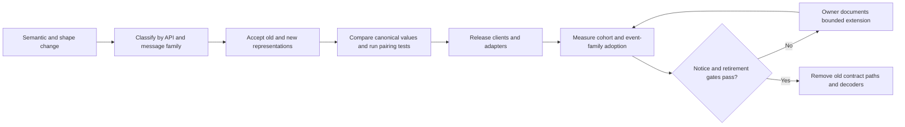

## 23. Interview Questions

1. How is a contract version different from a deployment version?
2. What exactly does old-client/new-server compatibility prove, and what does it not prove about new-client/old-server behavior?
3. Why can adding an optional response field still break a client?
4. How can a shape-preserving change in units or ordering be breaking?
5. When would you choose a path selector rather than a header, hostname, query parameter, or message schema version?
6. What minimum evidence should exist before announcing a sunset date?
7. How do you keep dual-read/write migration rollback-safe?
8. What should happen to delayed events after the producer's old schema implementation is removed?
9. Which checks belong in an automated structural diff, and which require semantic review?
10. How do you bound the test matrix as multiple client and server generations coexist?
11. What does an API Gateway decide in a version rollout, and what policy does it not own?
12. How would your retirement policy differ for a mobile application, a registered webhook partner, and an internal service?

## 24. Hands-on Exercises

1. Run the Section 10 classifier. Add an enum expansion and a change that alters a field's units; state which directions are safe and why the tool cannot infer semantic safety.
2. Take an API with a required request field and design an expand-migrate-contract sequence. Include a canonical source, parity check, rollback point, and a plan for stopping writes to the legacy shape.
3. Populate the deprecation inventory for a mobile client, a partner webhook, and an internal gRPC service. Give each a distinct notice and evidence window.
4. Review the illustrative multi-version routing file. Identify which parts require translation into a gateway product schema and define a test proving selector precedence.
5. Write compatibility tests for a stream that remains open across a server deployment. Decide whether the stream pins schema version or renegotiates only on reconnect.

## 25. Design Exercises

Design a cross-style migration for a subscription platform changing customer identity from an email address to an immutable customer identifier. Consumers include a browser application deployed continuously, mobile applications that may remain offline for several weeks, REST partners, a GraphQL client registry, internal gRPC services, a WebSocket live feed, SSE notifications, and webhook consumers with delayed retries.

Deliver a contract inventory, directional compatibility matrix, selector decision per surface, migration order, adapter and data authority design, semantic compatibility tests, deprecation notices and owner deadlines, runtime telemetry, exception policy, and final retirement gates. State which mechanics are owned by REST CH01, GraphQL CH02, gRPC CH03, WebSocket CH04, SSE CH05, OpenAPI CH07, and Gateway CH08. Do not design security or quota mechanisms; identify those as CH09 and CH11 inputs.

## 26. Architecture Review Questions

- Does the proposal name contract identity separately from build, release, and deployment identity?
- Are old-client/new-server and new-client/old-server requirements stated explicitly?
- Does classification cover request and response directions, semantics, errors, ordering, and delivery guarantees?
- Are protocol-specific schema details left to their owner chapters?
- Is selector precedence clear, observable, and consistent with cache and client tooling behavior?
- For each breaking change, is the replacement and coexistence plan agreed before implementation?
- Are data migrations authoritative, parity-checked, bounded, and rollback-safe?
- Does every deprecation record identify an owner, notice channel, support deadline, usage source, and exception path?
- Does telemetry cover replays, delayed messages, offline clients, and unknown consumers?
- Are structural diffs complemented by consumer/provider pairing tests and semantic review?
- Is every compatibility waiver time-bounded and attributable?
- Can the organization test and operate every supported version without unowned branches?
- Are Gateway routing, Security controls, and Rate Limiting controls assigned to their proper owners?
- Are retirement criteria measurable, and is there a final verification and rollback decision?

## 27. Summary

API versioning is cross-style contract governance, not deployment numbering. A contract version describes consumer-visible meaning; compatibility belongs to a specific producer/consumer pairing and direction. Additive shape changes can still break strict readers, while an unchanged schema can conceal semantic breaks in units, defaults, errors, ordering, or delivery guarantees.

Choose a version selector for the boundary that differs, serve incompatible contracts side by side only for a defined migration window, and retire them using owner-attributed usage evidence and announced gates. Expand-migrate-contract sequencing must protect data authority and rollback. Structural automation is valuable but cannot replace semantic review and real pairing tests. GraphQL, Protobuf, REST, OpenAPI, WebSocket, and SSE mechanics remain with their owning chapters; Gateway CH08 owns routing placement. The durable policy is the combination of compatibility classification, lifecycle notices, measured adoption, and explicit retirement decisions.

**Further reading**: [REST](CH01_REST.md) · [GraphQL](CH02_GraphQL.md) · [gRPC](CH03_gRPC.md) · [WebSocket API](CH04_WebSocket_API.md) · [Server-Sent Events](CH05_Server_Sent_Events.md) · [Async APIs](CH06_Async_APIs.md) · [OpenAPI](CH07_OpenAPI.md) · [API Gateway](CH08_API_Gateway.md)
