# Chapter: API Rate Limiting, Quotas, and Fairness

Part: [08 — API Architecture](PART_OVERVIEW.md) · Status: Draft

## 1. Introduction

An Application Programming Interface (API) rate limiter decides whether a
request may consume a bounded share of service capacity now. It is an
architecture control for protecting finite resources, allocating shared
capacity fairly, shaping bursts, and making abuse expensive. A limiter is
not merely a counter beside a route: its identity key, time model, algorithm,
state placement, consistency promise, rejection contract, and dependency
failure behavior jointly determine who can use the API and what happens
under load.

This chapter owns API rate and quota algorithms, request identity and policy
hierarchies, fairness, distributed limiter-state trade-offs, policy
governance, and the API-visible behavior of rejection. It distinguishes
request-rate policy from quotas, concurrent-work limits, admission control,
and load shedding, then connects those controls to request cost, worker
capacity, and client retry behavior. The examples are deliberately small
standard-library reference implementations, not substitutes for atomic
distributed state or production authentication.

The ownership boundaries matter. [API Gateway (CH08)](CH08_API_Gateway.md)
owns gateway architecture and where rate policy fits in its policy pipeline;
this chapter owns the algorithms. [HTTP (Part 05 CH01)](../05_Networking_and_OS/CH01_HTTP.md)
owns status-code and header wire semantics, so `429 Too Many Requests` and
`Retry-After` are recapped, not re-taught. [GraphQL (CH02)](CH02_GraphQL.md)
owns query complexity and persisted-operation mechanisms; [Async APIs
(CH06)](CH06_Async_APIs.md) owns asynchronous admission and operation
lifecycle. [Load Balancer (Part 05 CH10)](../05_Networking_and_OS/CH10_Load_Balancer.md)
owns backend distribution and health selection, while [Reverse Proxy
(Part 05 CH11)](../05_Networking_and_OS/CH11_Reverse_Proxy.md) owns generic
proxy placement. API security threat models are owned by
[API Security (CH09)](CH09_API_Security.md); bypass resistance appears
here only as a limiter-control concern.

## 2. Historical Evolution

Early public interfaces often used coarse per-source request counters or
server-local in-memory limits. These controls were easy to add to one
process, but their behavior changed when a service gained replicas, a
reverse proxy obscured client addresses, or a legitimate integration grew
faster than its fixed threshold. A shared counter improved consistency but
introduced a dependency on a state service on the request path.

As API products began serving many consumers with contracted service tiers,
rate limits evolved into several related mechanisms: rolling windows for
more even limits, token buckets for controlled bursts, quotas for period
budgets, weighted costs for heterogeneous operations, and concurrency caps
for scarce in-flight work. Managed gateways made enforcement accessible,
but policy correctness still depends on identity, algorithm semantics,
failure policy, and client behavior. Multi-region systems later exposed a
fundamental choice: coordinate every decision, accept bounded local
overshoot, or partition capacity among regions.

The progression is not toward one universally superior algorithm. A
low-cost read endpoint, a GraphQL traversal, and an asynchronous export
consume different resources and have different burst tolerance. A mature
design combines controls at the boundaries where each can observe the
relevant identity and cost, while publishing one coherent consumer
contract.

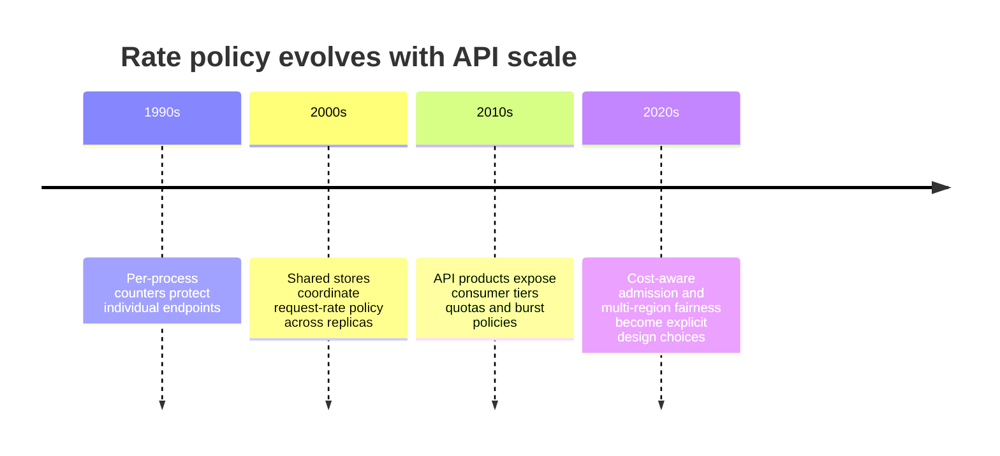

## 3. Why It Exists

Every API has finite CPU, memory, connection slots, database capacity,
downstream service budgets, and operational attention. Without an explicit
allocation rule, one fast caller or one expensive request shape can consume
those resources before other consumers receive useful service. Reactive
autoscaling helps only after signals arrive, capacity becomes available,
and the dependency chain can scale; it cannot make an overloaded database
or a third-party service infinitely elastic.

Rate policy makes the allocation boundary intentional. It can protect a
shared service from a burst, prevent one tenant from monopolizing capacity,
enforce a published usage plan, or reject a request whose estimated work
exceeds a safe budget. A good policy also gives clients a recovery signal:
the caller learns that retrying immediately is counterproductive and, when
possible, when to try again.

The control has costs. Every key creates state and cardinality; a shared
counter can add latency and a failure dependency; approximate global
accounting permits overshoot; and overly strict limits turn normal demand
into avoidable errors. The design question is not simply “what requests per
second?” It is “which resource is protected, which consumer owns the work,
what burst is safe, how exact must the decision be, and what observable
promise can the API keep?”

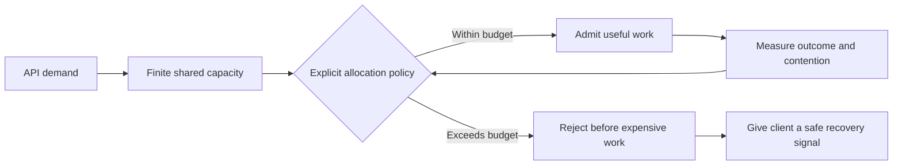

## 4. Core Concepts

The terms in rate policy are often used interchangeably even though they
control different quantities. Each concept below starts with the protected
resource and follows the request decision through its mechanism, trade-offs,
failure mode, and a concrete scenario. The distinctions are architectural:
combining them under one numeric “limit” usually hides an important
capacity or fairness assumption.

### 4.1 Rate limits, quotas, concurrency, admission, and shedding

**Definition.** A rate limit bounds the frequency or weighted cost of
requests over a time interval. A quota bounds cumulative usage over a longer
accounting period, such as a day or billing month. A concurrency limit
bounds simultaneous in-flight operations. Admission control decides
whether the system can accept another unit of work given current capacity
or backlog. Load shedding deliberately discards or rejects lower-priority
work when a system is already overloaded. These controls answer different
questions and are not synonyms.

**Mechanism.** A rate algorithm tracks arrivals or replenishing credit; a
quota meter accumulates usage and resets or replenishes according to a
contractual period; a concurrency guard acquires a slot and releases it
when work ends; admission considers current queue depth, age, predicted
service time, or downstream health; shedding selects work to reject when
continuing all work would worsen the overload. A quota can coexist with a
rate limit: a customer might be allowed 100,000 calls monthly but no more
than 20 calls per second. A concurrency ceiling still matters when requests
are slow: 10 requests per second at a 30-second service time can imply
hundreds of simultaneous operations.

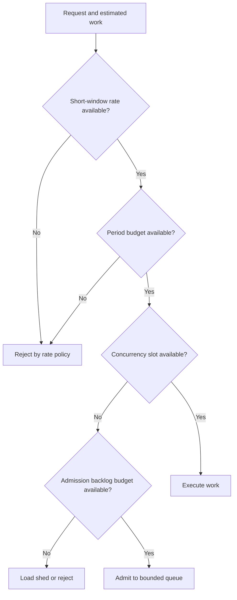

**Decision implications.** Select the control that matches the scarce
resource. Use rate limits for arrival pressure, quotas for aggregate
consumption commitments, concurrency for occupied slots or expensive
in-flight work, and admission for current backlog and service health. Use
load shedding as an overload survival mechanism, not as an ordinary plan
meter. When a contract needs both short-term protection and monthly
entitlement, expose both limits and their reset behavior separately.

**Common failure mode.** A service calls a requests-per-minute counter a
concurrency limit, although slow operations continue accumulating and
exhaust connections. Another common error is treating a monthly quota as
protection against a 10-second spike. Neither number controls the resource
the team actually intends to protect.

**Scenario.** A report API permits 60 lightweight status reads per minute,
100,000 reads per month, and at most 4 active exports per tenant. A bounded
export queue accepts at most 20 waiting jobs. These four policies protect
request pressure, contractual usage, active worker capacity, and backlog
independently.

### 4.2 Identity keys, dimensions, and hierarchical policy

**Definition.** A limiter key is the stable identity under which usage is
aggregated. A policy dimension selects whose behavior the rule measures:
source Internet Protocol (IP) address, credential, tenant, user, route,
operation class, or a weighted cost unit. A hierarchy applies multiple
budgets to the same request, for example global service, tenant, user, and
route limits.

**Mechanism.** The request is authenticated and normalized, the policy
resolves a trusted identity tuple, and each applicable bucket or counter is
evaluated. For example, a request can consume one unit from the global
service bucket, one from its tenant bucket, and a route-specific weighted
amount from a tenant-route bucket. A decision must be atomic across the
required hierarchy or define safe compensation; otherwise a request may
consume only some budgets when a later check rejects it. The key should be
derived from verified server context, not a freely supplied header.

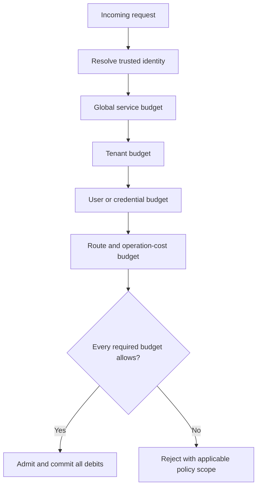

**Decision implications.** IP is useful before authentication and for
coarse abuse control, but shared carrier NAT can group unrelated users and
IPv6 address rotation can fragment one actor. Credentials identify a
registered client but may be shared or rotated. Tenant keys align with
commercial fairness; user keys protect an individual inside a tenant;
route keys protect a hot dependency or expensive operation. Use multiple
dimensions where each guards a distinct failure mode, and bound key
cardinality with authenticated identity, known route IDs, and eviction or
expiry rules.

**Common failure mode.** Trusting `X-Tenant-Id` or a client-supplied
`X-Forwarded-For` lets callers select another key or create unlimited
identities. Conversely, keying only by IP behind a proxy puts every caller
in one bucket. A high-cardinality key derived from arbitrary query text can
turn limiter state itself into a memory-exhaustion target.

**Scenario.** A partner platform uses a credential-to-tenant mapping after
credential validation. It applies a coarse source-IP limit before identity,
then a tenant-wide service budget, a user budget for interactive users, and
a higher weighted cost for `/exports`. Unauthenticated traffic cannot
choose its own tenant key.

### 4.3 Fixed windows and sliding windows

**Definition.** A fixed-window counter counts usage in discrete intervals
such as each UTC minute. A sliding-log limiter stores recent request times
and admits only when the count inside the rolling interval is below the
limit. A sliding-window counter approximates the rolling count by combining
the current and prior fixed-window counters according to elapsed time.

**Mechanism.** For a fixed window of length $W$, the key is typically
`(identity, floor(time / W))`; every request increments that counter and is
allowed while the count is at most $L$. This is inexpensive and easy to
explain, but requests just before and after a boundary can receive nearly
$2L$ calls in a short span. A sliding log removes timestamps older than
$W$ and counts the remainder, giving exact rolling-window semantics at
storage cost proportional to request volume. A sliding-window counter
estimates the rolling count as current-window count plus the previous-window
count weighted by the fraction of the previous window still overlapping.

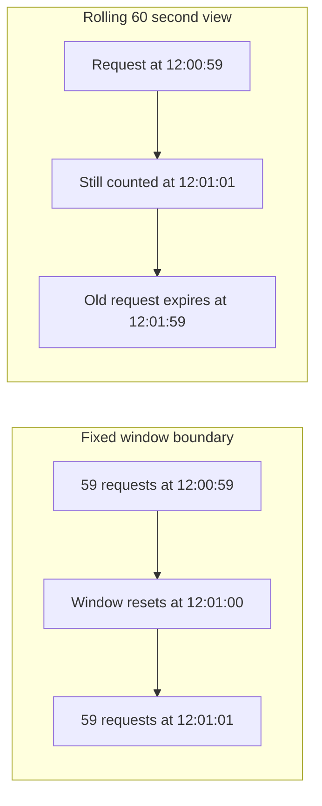

**Decision implications.** Fixed windows suit coarse plan accounting,
low-cost limits, or systems where boundary bursts are acceptable. Sliding
logs are appropriate when exact rolling semantics justify per-request state
and cleanup cost. Sliding counters are a practical middle ground for
approximate smoothing with low storage. State explicitly whether the API
promises a strict rolling bound or a per-calendar-window budget; clients
and billing systems otherwise infer different behavior from the same
number.

**Common failure mode.** A fixed-window rule is described as “no more than
60 requests in any minute,” which is false at a boundary. A sliding log
without expiration or bounded key retention grows indefinitely. A
sliding-counter estimate is advertised as exact when it is only an
interpolation.

**Scenario.** A low-risk metadata endpoint allows 120 calls per calendar
minute and accepts a brief reset-boundary burst, so a fixed counter is
sufficient. A costly search endpoint promises no more than 30 calls in any
rolling 10 seconds and uses a sliding log at moderate traffic or a sliding
counter when memory cost dominates.

### 4.4 Token bucket, leaky bucket, and Generic Cell Rate Algorithm

**Definition.** A token bucket stores replenishing credits: each request
spends tokens, and a full bucket permits a bounded burst. A leaky bucket
represents a queue or virtual drain that releases work at a controlled
rate. The Generic Cell Rate Algorithm (GCRA) is a compact virtual-scheduling
formulation commonly used to implement leaky-bucket-like conformance
without storing every arrival.

**Mechanism.** A token bucket has capacity $B$ and refill rate $r$ tokens
per second. At time $t$, refill by $r(t-t_0)$ up to $B$, then admit a
request of cost $c$ if at least $c$ tokens remain. A full bucket allows an
immediate burst of up to $B$ cost units; sustained average throughput is
bounded by $r$. A leaky queue accepts arrivals into a finite buffer and
drains at a configured pace; a policer can instead reject arrivals that
would exceed the virtual drain schedule. GCRA stores a theoretical arrival
time (TAT). Each request of cost $c$ advances TAT by its emission interval;
the request is conforming if its actual arrival is not earlier than TAT
minus the configured burst tolerance.

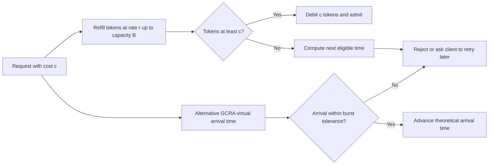

**Decision implications.** Choose token buckets when controlled bursts are
desirable and an average refill rate is intuitive. Use a leaky queue when
the system should smooth admitted work into a more regular output rate;
choose a leaky policer or GCRA when queuing would consume scarce latency or
memory. Token bucket capacity is a separate decision from refill rate: set
it from safe burst tolerance, not an arbitrary multiplier. For weighted
operations, tokens should represent a cost unit that correlates with the
protected resource.

**Common failure mode.** A token bucket with an enormous capacity is
mistaken for a stable requests-per-second limit, allowing a burst that
overwhelms downstream pools. A leaky queue is allowed to grow without
bound, converting rejection into unbounded latency. GCRA parameters are
copied from another library without confirming whether its burst parameter
means extra requests or total bucket capacity.

**Scenario.** A catalog API sustains 100 cost units per second and permits
a 200-unit burst after idle time. A regular profile read costs one unit; a
large search costs 20. The bucket absorbs a page-load burst while capping
sustained work, and the client receives an eligibility hint when a request
cannot be admitted.

### 4.5 Burst semantics, fairness, and noisy neighbors

**Definition.** Burst tolerance is the amount of work admitted above the
sustained rate over a short interval. Fairness is the policy by which
contending consumers receive shares of a constrained resource. A noisy
neighbor is one consumer whose demand or key behavior degrades service for
other consumers sharing the same capacity pool.

**Mechanism.** The algorithm determines how quickly burst capacity is
earned, stored, and spent. A token bucket preserves idle-time credit up to
its capacity; a fixed window can create a boundary burst; a leaky queue
trades burst acceptance for delay. Fairness then depends on key scope and
scheduler behavior: per-tenant buckets isolate tenants, weighted shares
give premium classes a larger allocation, and deficit-round-robin-style
scheduling can distribute queued work in proportion to configured weights.
Fairness is not guaranteed by a global rate counter: the first consumer to
arrive may consume all available tokens.

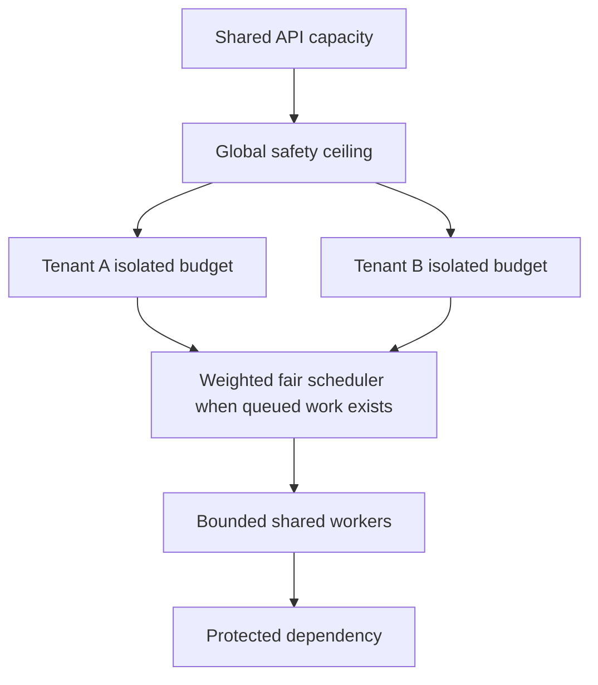

**Decision implications.** Define the burst interval and maximum cost, not
just the average rate. For customer fairness, apply a global ceiling plus
tenant isolation; where plans differ, publish the weight and any reserved
capacity. Do not promise strict fairness from a stateless reject-on-arrival
limiter: that design prevents monopolization only to the granularity of its
keys and algorithm. If work is queued, use explicit scheduling and queue
budgets, not priority labels alone.

**Common failure mode.** A “premium” tenant gets a higher per-tenant limit
but still shares an unpartitioned worker pool, so its burst starves every
other tenant. Another failure is a tiny burst allowance that rejects
legitimate fan-out from a single user action, causing clients to retry and
increase load. Per-user limits can also be bypassed by creating accounts
unless the broader identity system addresses that threat.

**Scenario.** A multi-tenant analytics API sets a global database safety
bucket and per-tenant buckets with documented plan weights. Its queued
exports use weighted fair scheduling and per-tenant active-job caps. Small
interactive reads retain a separate budget so long-running exports cannot
consume all request capacity.

### 4.6 Distributed state and multi-region accounting

**Definition.** Distributed limiter state is the representation of usage
shared across multiple service instances or regions. A strict shared
counter serializes or atomically coordinates decisions. Local token buckets
avoid a request-time network dependency but permit aggregate overshoot.
Approximate mergeable counters, including Conflict-free Replicated Data
Type (CRDT)-like counters, converge after communication but do not provide
an immediate global cap. Partitioned quotas assign each region a share so
local decisions can remain bounded without a per-request global round trip.

**Mechanism.** A centralized atomic store performs refill/check/debit as
one operation; it provides a clear ordering point but adds network latency,
hot keys, and an availability dependency. Independent local buckets can
each admit at the configured global rate, so total admission may approach
the sum of all regional capacities. Allocate smaller local rates or
periodically reconcile if that overshoot is acceptable. Mergeable counters
exchange increments and eventually converge; they suit approximate usage
measurement better than hard contractual limits. Partitioned quotas reserve
shares per region, making local decisions strict against each assigned
share but potentially stranding unused capacity in one region while another
is exhausted.

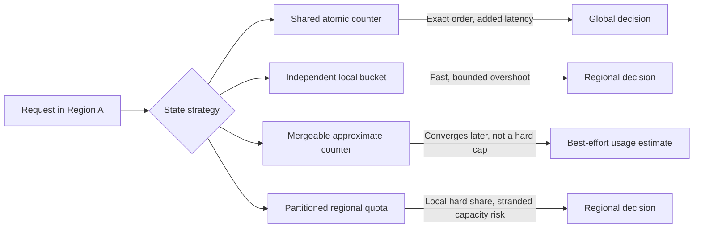

**Decision implications.** Choose consistency from the consequence of
overshoot. A free trial counter or low-cost read may tolerate a small
bounded excess; a costly operation or strict contractual entitlement may
require atomic coordination or pre-partitioned capacity. Specify what
happens during a region partition, how regional budgets are rebalanced, how
clock skew is bounded, and whether quota reset is global or regional. Use
the central counter only when its failure domain and tail latency fit the
API's availability budget.

**Common failure mode.** Every region receives a full copy of what was
intended to be a global token budget, multiplying allowed traffic by region
count. A centralized store outage can also turn a supposedly resilient API
into a global outage. An approximate CRDT-like count is incorrectly
advertised as a hard monthly cap, leading to over-consumption or billing
disputes.

**Scenario.** A service operates in three active regions. It reserves a
strict export quota as regional shares totaling the plan allowance, while
low-cost catalog reads use local buckets with a small, measured overshoot
budget. The control plane rebalances unused export share on a slower
cadence; requests do not synchronously cross regions.

### 4.7 Gateway enforcement and client-visible retry contract

**Definition.** Enforcement placement is the point where the request has
enough trustworthy context to evaluate its policy and where rejection still
prevents the protected work. A client retry contract communicates the
policy outcome in API terms. The Gateway chapter owns the architecture and
ordered policy pipeline; this chapter owns limiter behavior once that
boundary supplies route and consumer identity.

**Mechanism.** A typical request uses cheap transport guards, resolves the
public operation, validates credentials and consumer identity, then
evaluates applicable rate policy before forwarding to a backend. The
service may enforce a second local concurrency or dependency-protection
limit because only it can observe actual in-flight work. On rejection,
HTTP `429 Too Many Requests` is the usual response for a caller-specific
rate policy; HTTP `503 Service Unavailable` can represent broader temporary
service incapacity. The HTTP chapter owns these wire semantics and
`Retry-After`; the API contract should identify the policy scope and give a
retry time only when the server can make a useful estimate. Clients should
honor the hint, apply bounded backoff and jitter, and avoid retrying
non-repeatable operations without their own idempotency contract.

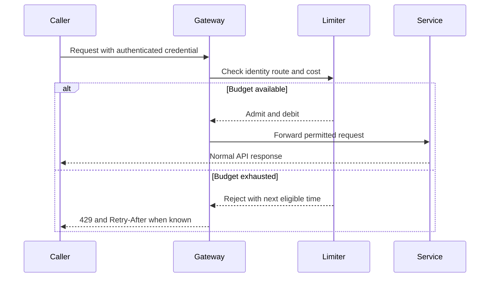

**Decision implications.** Enforce an API consumer policy at a Gateway
when that layer has trusted identity and route context; enforce actual
workload concurrency near the service or worker pool. Avoid redundant
identical counters at several layers unless their responsibilities are
explicit. Fail-closed behavior is appropriate when a strict consumer
entitlement or cost cap must not be bypassed; a carefully bounded local
fallback may be preferable for availability-sensitive, low-risk routes.
The fallback must have a stated maximum overshoot and expiry.

**Common failure mode.** The gateway trusts caller-controlled identity
headers, evaluates policy before credential resolution, or returns a
generic server error that causes clients to retry immediately. Fail-open
without a local ceiling can remove all protection during a state-store
outage; fail-closed on every route can convert a limiter-store incident
into a full API outage. Stale proxy metadata can also make all clients
appear to have one source IP.

**Scenario.** A public partner API applies per-credential request-rate
policy at the Gateway after authentication. The export service applies a
per-tenant active-job ceiling at durable admission, where queue capacity is
visible. The `429` response names a documented limit scope and an estimated
retry delay; a store outage follows a route-specific fail policy.

### 4.8 Cost-based GraphQL and asynchronous admission integration

**Definition.** Cost-based limiting charges a request according to estimated
resource work rather than treating every HTTP exchange as equivalent. A
GraphQL operation can represent nested resolver fan-out; an asynchronous
command can create durable work long after the submission request ends.
Their owning chapters define those execution and lifecycle contracts.

**Mechanism.** For GraphQL, use the schema-aware estimated operation cost
and persisted-operation identity owned by [CH02](CH02_GraphQL.md), then
charge the relevant tenant or credential budget before resolver execution.
Compare estimated cost with observed backend work and tune weights; do not
assume persisted operations are inherently cheap. For asynchronous APIs,
evaluate quota, active-operation count, and backlog capacity at the durable
admission boundary owned by [CH06](CH06_Async_APIs.md). A submission may
cost one request token but reserve many worker-seconds or queue bytes; the
contract should account for that deferred obligation and release or settle
reserved capacity according to lifecycle outcomes.

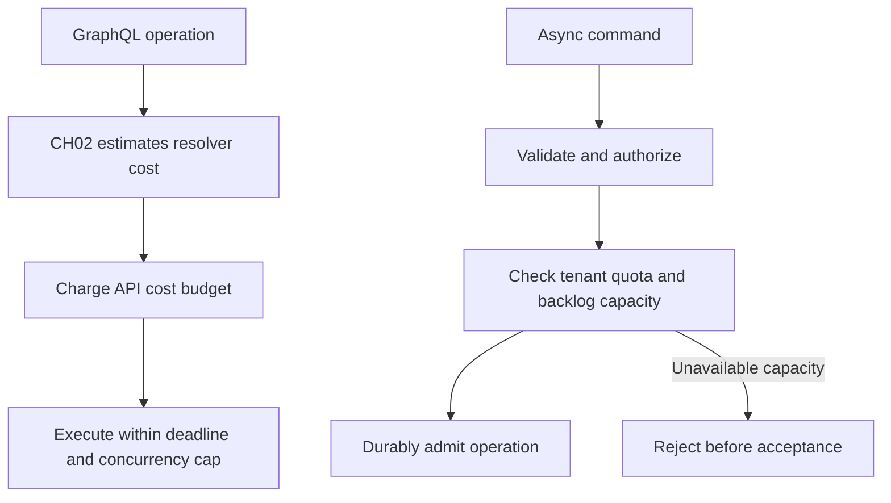

**Decision implications.** Use weighted units where request work varies
materially and can be estimated before expensive execution. Keep the
estimator owned by the API style and the shared budget semantics owned
here. Async quotas should count the resource actually reserved (active
jobs, queue bytes, or estimated work), not only submissions per minute.
Publish whether rejected work consumed any request quota and whether
accepted work reserves future capacity.

**Common failure mode.** A GraphQL API counts one token per operation while
allowing arbitrary nested lists, so one call can dominate the database. An
async API rate-limits submission but acknowledges an unbounded backlog,
converting overload into delayed failure and storage exhaustion. Charging
estimated cost after execution does not protect the work already spent.

**Scenario.** A persisted analytics query has an estimated cost of 40 and
consumes 40 units from the tenant budget before execution; its observed
resolver and database work is recorded for estimator calibration. A report
submission reserves one active-job slot and an estimated storage allowance
before returning acceptance; when capacity is unavailable, it rejects
without creating an operation resource.

### 4.9 Policy governance, rollout, and observability

**Definition.** Policy governance is the lifecycle for defining, reviewing,
publishing, measuring, changing, and retiring limiter rules. Observability
shows whether the intended policy is active and how it affects consumers
and protected resources. A policy must be attributable to a version and an
owner, not just a number in a dashboard.

**Mechanism.** Store policy as versioned configuration with identity
dimensions, algorithm parameters, effective routes, time zone/reset rules,
failure behavior, and customer-facing wording. Validate syntax, key
availability, parameter ranges, and expected state cardinality before
activation. Roll out in shadow mode or a small cohort, compare would-reject
decisions with actual load and service outcomes, then ramp enforcement with
rollback. Observe allowed and rejected request counts, estimated wait,
remaining budget where appropriate, limiter latency/errors, store health,
key cardinality, and protected dependency saturation. Metrics use bounded
labels such as route template, plan tier, and policy version; raw user or
tenant IDs belong in access-controlled diagnostic logs only when needed.

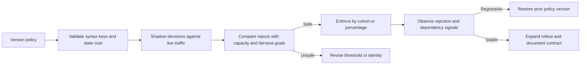

**Decision implications.** Treat a threshold change as a consumer-visible
contract change, especially if developers depend on published quotas or
retry timing. Shadow mode proves policy impact only for observed traffic;
it does not test missing identity or failover paths. Use policy version,
owner, change reason, and rollback criteria. Alert separately on the
protected service and the limiter dependency so a “healthy rejection rate”
does not hide a stuck backend or a broken counter store.

**Common failure mode.** A global policy change is deployed to every region
before its key or state schema exists. A permissive shadow result is taken
as proof of correctness even though it never exercised client retries or
regional partition behavior. High-cardinality metrics include a label per
customer and overwhelm the telemetry system.

**Scenario.** A platform reduces a search burst capacity from 100 to 60
tokens after a database saturation event. It shadows the new setting,
compares predicted rejections by plan tier, ramps the change across a
cohort, watches database saturation and client retry volume, and retains an
immediate rollback to the previous policy version.

### 4.10 Limiter dependency failures and graceful degradation

**Definition.** A limiter dependency failure occurs when the state store,
policy distribution, clock source, or identity mapping required for a
decision is unavailable, stale, or inconsistent. Fail-open admits requests
without the normal shared check; fail-closed rejects requests when the
decision cannot be made. A bounded fallback uses local state or a cached
policy to preserve a limited safety envelope.

**Mechanism.** Classify each route by the consequence of over-admission and
under-admission. A mandatory hard quota may deny when shared state is
unavailable. A low-risk read route may use a local bucket capped below the
regional safety limit, with short expiry and explicit overshoot accounting.
Stale policy can be served only within a bounded age; after expiry the
route follows its fail policy. Circuit-breaker state must not silently
change policy forever. Emit a distinct outcome for normal rejection,
dependency error, stale-policy fallback, and local-degraded admission.

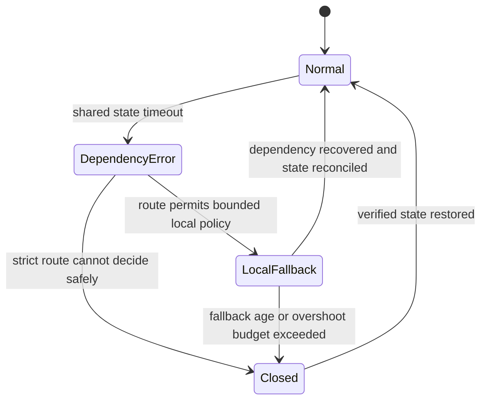

**Decision implications.** Choose fail behavior per operation class, not as
one product-wide toggle. Consider cost of an accidental grant, cost of
denying legitimate traffic, local safety ceilings, stale configuration
age, and reconciliation after recovery. Keep limiter timeouts shorter
than the request budget and prevent unbounded retries to the limiter store.
For protected writes or costly jobs, strict denial may be correct; for
public low-cost reads, bounded local fallback may preserve useful service.

**Common failure mode.** A fallback bucket has no cap, so every replica
independently admits a full global allowance. Alternatively, the limiter
uses fail-closed for health checks and every public read, taking the entire
API offline because an optional global counter is degraded. Reconciliation
may then double-count local usage or reset buckets and grant a fresh burst.

**Scenario.** A regional counter service is unreachable for 20 seconds.
Catalog reads switch to a local bucket capped at 10% of the regional
allocation, while export admission fails closed because accepted work
consumes durable worker capacity. Both fallback decisions produce separate
telemetry; normal shared decisions resume only after the policy version and
usage reconciliation are verified.

## 5. Internal Working

A rate decision is a small state transition with a surprisingly large
correctness surface. The request path first resolves a trusted key and
policy version, obtains time from a monotonic source for elapsed intervals,
reads the relevant state, computes replenishment or expiration, tests the
request cost, and commits the debit atomically. It then returns the
decision and any useful retry estimate. If policy is hierarchical, all
required debits must be committed as one logical decision; partial updates
must be prevented or repaired.

For a token bucket, let $T_0$ be tokens at the previous update, $t_0$ its
timestamp, $r$ refill tokens per second, and $B$ capacity. At time $t$:

$$
T = \min(B, T_0 + r(t - t_0))
$$

Admit a request with cost $c$ if $T \ge c$, then persist $T-c$ and $t$.
For a rejection, the earliest eligible delay is approximately
$(c-T)/r$, provided $r > 0$. A production implementation must define
rounding, clock anomalies, negative elapsed time, bucket initialization,
TTL, and whether retries of the same logical request can debit twice.

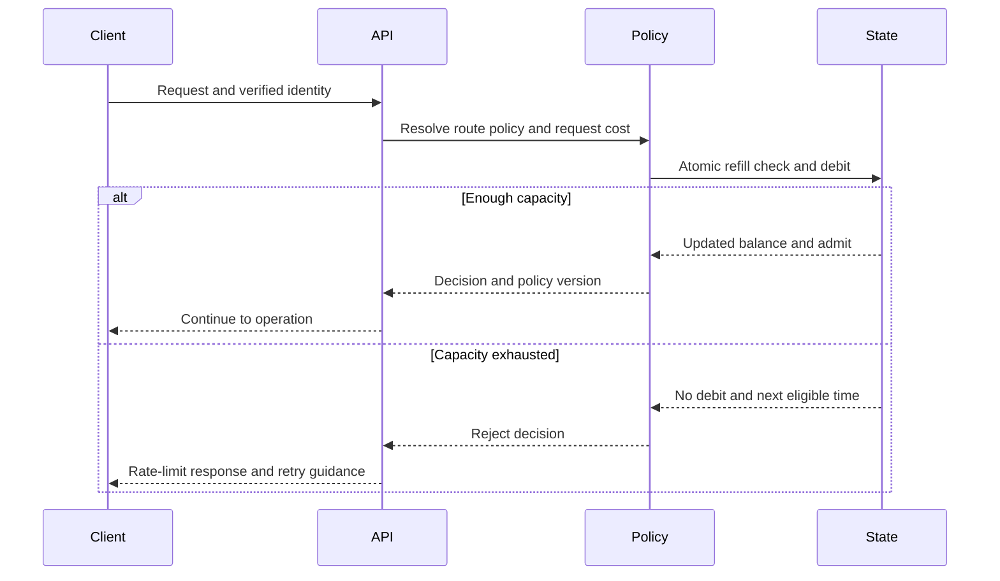

In a multi-instance deployment, the atomic transition is the critical
boundary. Two workers that independently read 5 tokens can both admit a
cost-4 request unless the check-and-debit is a single compare-and-update,
script, transaction, or equivalent. If local state is intentional, that
concurrency is instead part of the documented overshoot bound. Do not use
wall-clock timestamps for monotonic elapsed-time calculations inside one
process; distributed stores may use server time or a carefully defined
time source to avoid client clock skew.

## 6. Design Principles

- **Name the protected resource.** CPU time, database operations, queue
  bytes, active exports, and contractual call count require different
  meters.
- **Make the key trustworthy.** Derive tenant, user, and credential from
  authenticated server context; treat forwarded network identity as
  trusted only when each proxy hop is controlled.
- **Separate rate from entitlement.** Publish sustained rate, burst,
  period quota, and concurrent-work limits as distinct values.
- **Charge work, not just messages.** Weight expensive routes and bound
  client-controlled fan-out before execution.
- **Make hierarchy atomic or explicit.** A request either consumes all
  mandatory budgets or none, unless partial debit has a deliberate repair
  rule.
- **Bound state and decision latency.** Expire idle keys, constrain key
  cardinality, cap retries, and keep the limiter inside the request budget.
- **Choose a consistency promise.** State whether the limit is exact,
  region-local, partitioned, or approximate, and quantify tolerated
  overshoot.
- **Specify failure behavior per class.** Document fail-open, fail-closed,
  and bounded local fallback routes before an outage.
- **Treat rejection as part of the API.** Give stable error meaning,
  useful retry guidance, and client instructions that avoid retry storms.
- **Change policy like code.** Review, test, stage, observe, version, and
  roll back thresholds and key definitions.

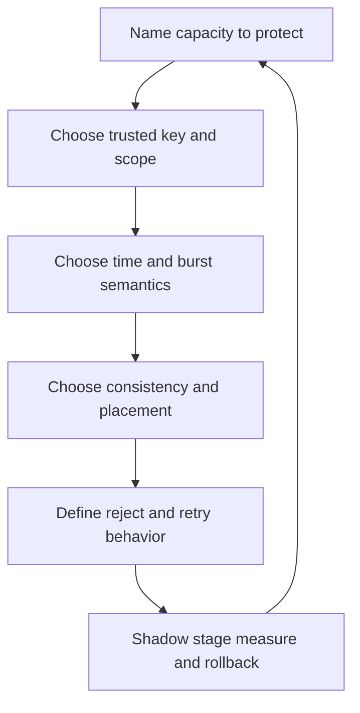

## 7. Architecture Patterns

**Edge consumer policy.** An API Gateway evaluates credential, tenant, and
route budgets after trusted identity resolution and before backend
forwarding. It centralizes consumer-facing policy but should not replace
service-local concurrency protection or domain authorization.

**Service-local bulkhead.** A service enforces a narrow concurrency
ceiling around a scarce database pool or downstream call. This decision is
close to the resource and can reflect actual in-flight work, while an edge
rate limit provides earlier rejection.

**Hierarchical token budgets.** One request checks a global safety bucket,
a tenant allocation, and an optional user or route bucket. A central
atomic implementation offers strict debiting; a partitioned version trades
some utilization for regional autonomy.

**Cost-metered operations.** A route or operation class maps to a bounded
cost unit; GraphQL uses its style-owned estimator, and asynchronous work
reserves capacity at its durable admission boundary. Metering should be
calibrated to backend saturation, not to business price alone.

**Queue admission with fair scheduling.** A bounded queue accepts only
work that can be completed within its capacity and age objective. Per-tenant
active-job caps and weighted scheduling prevent one producer from occupying
every worker. The Async APIs chapter owns operation lifecycle and
notification contracts.

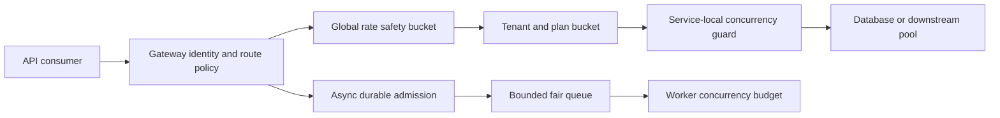

The key design choice is compositional: reject cheaply at the edge, then
enforce workload-specific capacity near the resource whose occupancy is
known. Each layer must own a distinct budget or safety property; copying
the same threshold to several components creates inconsistent state and
confusing rejection behavior.

## 8. Production Architecture

A production design usually separates policy authoring from request-time
decisions. A control plane owns versioned limits, consumer plans, route
metadata, and gradual rollout. Data-plane Gateway or service replicas
receive validated policy and consult local or shared usage state. The
identity path supplies trusted consumer context; API services enforce
workload-specific concurrency; asynchronous admission checks durable
backlog and worker budgets; telemetry feeds policy review.

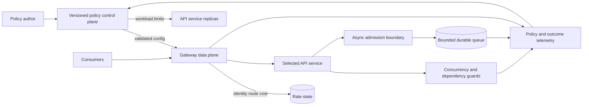

Keep configuration available independently from live authoring. A control-
plane outage can often leave last-known-good policy active, but the system
must define its maximum age and emergency revocation path. In multi-region
systems, distribute compatible policy versions before shifting traffic and
choose the usage-state strategy per policy class. Avoid making an
administrative control plane a synchronous dependency for every request.

## 9. Implementation

Implement a policy in this order so the numeric setting follows an
architectural requirement rather than substituting for one:

1. Identify the constrained resource and the event that consumes it.
2. Measure ordinary traffic, burst distribution, operation duration, and
   downstream saturation; identify legitimate client fan-out.
3. Define identity keys, trust sources, hierarchy, missing-identity
   behavior, and bounded cardinality.
4. Select rate, quota, concurrency, admission, or shedding controls and
   specify their independent limits.
5. Choose algorithm parameters: window, refill rate, capacity, cost units,
   retention, and retry estimate.
6. Decide whether state is local, shared atomic, approximate, or
   partitioned; document consistency and partition behavior.
7. Define response status and headers by reference to HTTP, plus safe error
   body, scope, and client backoff guidance.
8. Implement idempotent decision handling where retries could double debit,
   and make hierarchical checks atomic.
9. Shadow, stage, and ramp the policy; set rollback thresholds and owners.
10. Add metrics, traces, load tests, fault injection, and consumer contract
    tests before enforcement becomes a release gate.

Do not start with an arbitrary “requests per second” value. Baseline the
protected resource and test the policy under the request distribution it
will actually see, including expensive routes, shared IP populations,
credential rotation, and retry behavior.

## 10. Complete Code Examples

The following Python 3 examples use only the standard library and can run
offline. They are single-process teaching implementations: a production
multi-instance deployment still needs atomic shared state or an explicit
overshoot budget. Run each from the repository root with `python
code/python/rate-limiting-chapter/<filename>.py`.

1. [Token bucket](../code/python/rate-limiting-chapter/01_token_bucket.py)
   demonstrates refill, capacity, weighted cost, and a fake clock.
2. [GCRA sliding arrival schedule](../code/python/rate-limiting-chapter/02_gcra_limiter.py)
   demonstrates a compact rolling-rate policer and burst tolerance.
3. [Hierarchical tenant and route budgets](../code/python/rate-limiting-chapter/03_hierarchical_limiter.py)
   checks and debits both levels atomically within one process.
4. [Concurrency and admission limiter](../code/python/rate-limiting-chapter/04_concurrency_admission.py)
   bounds active work and waiting admission without blocking callers.

The examples print deterministic outcomes and include assertions. Their
purpose is to make state transitions inspectable, not to present an
Internet-facing HTTP server or a distributed algorithm as production-ready.

## 11. Performance

The limiter is part of the request's latency and resource budget. A local
token bucket is typically cheap but gives each replica independent state.
A shared counter adds a network round trip, serialization, and possible
contention on hot identities. A sliding log writes more state than a
counter; high-cardinality tenant-route combinations increase memory and
cleanup work. A policy that computes a complex request cost can itself
become an expensive precondition unless it is bounded and runs before
resolvers or downstream calls.

Measure limiter decision latency at tail percentiles, state-store errors,
key cardinality, allowed and rejected cost, and the effect on the protected
dependency. Do not optimize only average check time: one global hot key or
an unavailable store determines system behavior under load. Keep requests
for the limiter store bounded and avoid retries that turn a transient
counter delay into a request storm.

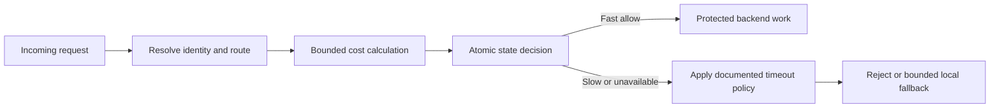

If the limiter's p99 latency approaches the API's overall deadline,
reconsider its placement, key partitioning, local caching, or policy model.
Do not improve latency by silently removing the hard limit. Separate
policy reads from state mutations when the model permits it, and cache
versioned configuration rather than mutable usage balances.

## 12. Scalability

Scaling request handlers does not automatically scale exact policy state.
Local counters scale horizontally but multiply effective allowance unless
budgets are divided. Central counters preserve a shared decision point but
can become a hot-key or throughput bottleneck. Partition keys by trusted
identity and use atomic operations; shard state only when the allocation
model remains correct across shards. For global limits, pre-allocate
regional shares or accept and measure bounded overshoot rather than
pretending independent regions share one exact counter.

State growth is part of capacity planning. Estimate active keys as
authenticated identities multiplied by routes and simultaneous policy
versions; expire inactive entries, bound route identifiers, and avoid
embedding arbitrary request parameters in keys. Plan for policy rollout
overlap, region failover, counter retention, and the extra recovery load
when traffic returns after an outage.

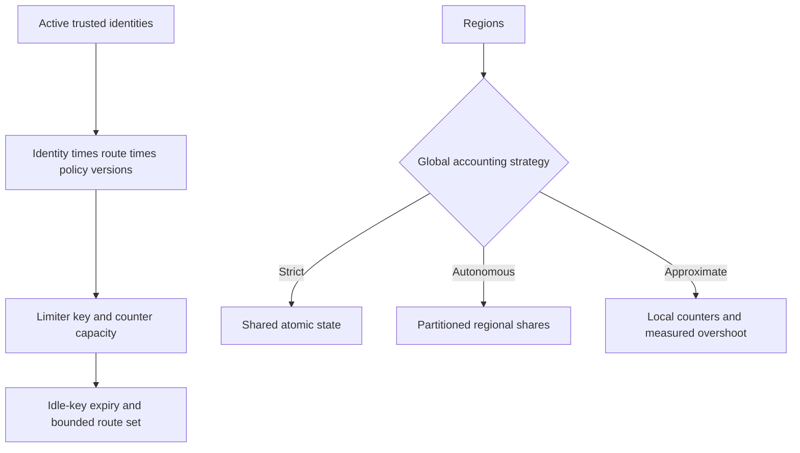

Plan for failover before it happens. If a region receives another region's
traffic, its local limit may be too small or its reserved share may be
exhausted. Dynamic reallocation improves utilization but requires a
control-plane protocol and a failure-safe lease or fencing model; do not
allow two regions to believe they own the same reserved quota.

## 13. Security

Rate controls can slow credential guessing, scraping, automated abuse, and
resource-exhaustion attempts, but a limiter is not an authentication or
authorization system. Security threat modeling, credential validation,
resource authorization, and comprehensive API attack controls belong to
[API Security (CH09)](CH09_API_Security.md). The
[API Gateway chapter (CH08)](CH08_API_Gateway.md) owns gateway integration;
this chapter addresses only the limiter-specific control risks.

Use trusted identity and proxy-chain configuration; do not let callers
choose their own tenant or forwarded source address. Apply a coarse
pre-authentication source limit where useful, then a separate authenticated
key after identity resolution. Ensure unknown credentials cannot generate
unbounded persistent state. Avoid exposing detailed account existence,
remaining quota, or internal policy identifiers to unauthenticated callers.
Protect limiter administration and policy updates with authorization,
audit, and staged rollout; a malicious threshold change can disable service
protection as effectively as an exploit.

Bypass resistance is part of this control's integrity: origins must not be
reachable through an alternate public route that skips intended policy,
trusted identity headers must be stripped and re-established at controlled
hops, and every protocol or route alias must map to the same effective
budget where required. Do not mistake source-IP limits for a complete abuse
defense or rate limiting for proof that an operation is safe.

## 14. Observability

Instrument the decision and its resource consequence. At minimum record
allowed and rejected requests by bounded route template, policy version,
plan class, algorithm, and decision reason; limiter check latency and
dependency errors; estimated wait; local-fallback use; active concurrency;
queue depth and age; and protected dependency saturation. Separate ordinary
policy rejection from unknown-identity handling, policy lookup failure,
state-store timeout, stale configuration, and local degraded admission.

Use metrics for aggregate signals and sampled structured events for
per-request diagnosis. Never put raw credential, user, tenant, or arbitrary
query values in metric labels. Logs should carry a safe request correlation
ID and policy version; tracing should show time spent resolving identity,
calculating cost, reading state, and forwarding work. Quota remaining may
be a useful client response field, but it must be treated as a snapshot,
not a reservation or guarantee that the next request will be admitted.

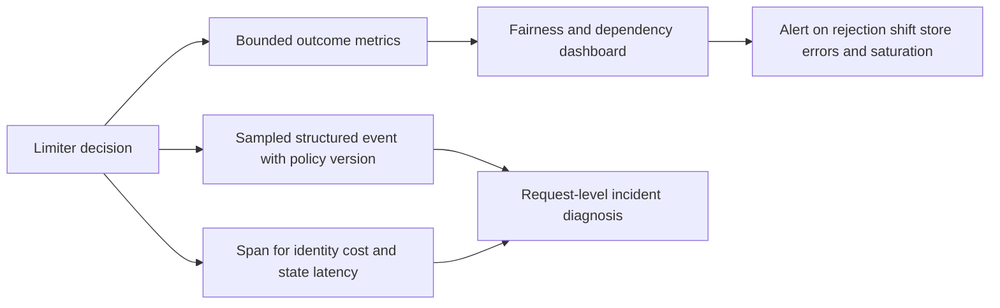

Build dashboards that compare tenants or plan classes without exposing
individual identities. A rising `429` rate may indicate successful abuse
containment, an accidentally reduced allowance, or a client retry storm;
correlate it with successful throughput, protected-resource health,
limiter latency, and client retry volume before changing thresholds.

## 15. Failure Scenarios

Rate policy failures are service failures even when the application
handlers remain healthy. The operator must be able to distinguish a
legitimate exhausted budget from inability to evaluate policy, and clients
must not amplify the latter with synchronized retries.

| Failure | Observable symptom | Containment |
|---|---|---|
| Shared state store unavailable | Limiter timeout or degraded-decision metric rises | Apply the route's fail policy; bound timeout; use only a capped local fallback |
| Counter race or non-atomic update | More work admitted than the stated limit | Restore atomic check-and-debit or revise the documented overshoot bound |
| Incorrect proxy identity | Many consumers share one IP bucket or key churn spikes | Correct trusted proxy chain and compare authenticated identities |
| Policy rollout error | Sudden rejection by route or tier | Roll back policy version and preserve last-known-good configuration |
| Clock jump or inconsistent time | Unexpected refill, reset, or negative wait | Use monotonic elapsed time locally and a defined server-time source for shared state |
| Retry storm after 429 | Attempts increase while useful success falls | Return meaningful retry timing; clients honor it and add jitter |
| Async backlog exhaustion | Queue age and admission rejection rise | Stop accepting excess work before acknowledgement; drain within downstream budget |
| Region isolation | Regions disagree about remaining allowance | Apply partitioned shares, bounded local policy, or strict denial as designed |

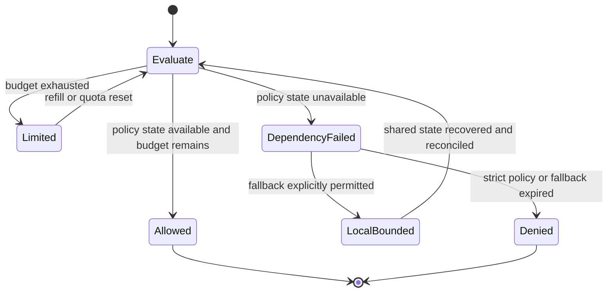

The most damaging incident pattern is self-amplification: a shared limiter
times out, handlers fail, clients retry immediately, and retries overload
both the limiter store and backend. Break the loop with bounded dependency
timeouts, explicit route-specific fallback, stable rejection meaning, and
client-side backoff. During recovery, gradually restore shared decisions;
do not reset every bucket to full and create a synchronized burst.

## 16. Testing

Test policy semantics, state transitions, integration, and failure behavior.

- **Algorithm tests:** exact boundary behavior, refill, burst capacity,
  weighted cost, rolling expiration, and retry-time calculations.
- **Identity tests:** shared NAT, trusted proxy chain, spoofed headers,
  credential rotation, missing identity, tenant/user hierarchy, and key
  cardinality bounds.
- **Atomicity tests:** concurrent check-and-debit races and all-or-none
  hierarchical budget consumption.
- **Contract tests:** correct rejection classification, documented error
  body, `Retry-After` where available, and client behavior with jittered
  retry and non-repeatable requests.
- **Distributed tests:** regional partition, failover, stale policy,
  local overshoot, quota reallocation, clock skew, and reconciliation.
- **Dependency fault injection:** slow or unavailable state store, stale
  policy control plane, unknown identity provider result, and recovery.
- **Load tests:** burst distributions, hot keys, mixed cost classes,
  tenant fairness, limiter p99 latency, and backend saturation.
- **Async tests:** queue full, worker concurrency reached, duplicate
  submission, crash around durable admission, and no acknowledgement when
  admission did not commit.
- **Rollout tests:** shadow versus enforced decision parity, policy
  version compatibility, cohort ramp, rollback, and telemetry cardinality.

Use deterministic clocks for algorithm tests and controlled concurrency
for race tests. A load test that exercises only a single key can miss
cross-tenant unfairness; one that uses random keys can hide a hot-key
bottleneck. Validate both. Keep an API contract test tied to the public
response semantics, while the HTTP chapter remains authoritative for the
status and header definitions.

## 17. Common Mistakes

- Using one global bucket for all consumers and calling the result fair.
- Treating a fixed window as an exact rolling limit.
- Setting token capacity without reasoning about maximum burst work.
- Using request count where backend cost varies by orders of magnitude.
- Keying by an untrusted forwarded header or caller-selected tenant field.
- Applying per-IP limits behind a proxy without a trusted identity chain.
- Checking a shared counter non-atomically across replicas.
- Calling an eventually consistent counter a hard contractual quota.
- Letting an async queue absorb work indefinitely instead of rejecting at
  its capacity boundary.
- Returning rejection without retry guidance, then blaming clients for
  immediate retries.
- Treating `Retry-After` as a reservation that guarantees later admission.
- Allowing local fallback to admit the entire global allowance per replica.
- Logging raw API keys or using user identifiers as unbounded metric labels.
- Deploying a stricter policy globally without shadowing, cohort rollout,
  and rollback criteria.

## 18. Best Practices

- Express each policy as resource, identity, algorithm, rate, burst, cost,
  consistency, response behavior, owner, and failure mode.
- Keep rate, period quota, concurrency, queue admission, and load shedding
  separate in configuration and client documentation.
- Use authenticated tenant identity for consumer fairness and a coarse
  pre-authentication control only for its narrower purpose.
- Normalize routes to stable templates and cost classes; avoid keying on
  arbitrary user-controlled strings.
- Make shared check-and-debit atomic, especially across hierarchical
  budgets.
- Tune limits from dependency saturation and observed demand, with explicit
  headroom for ordinary bursts.
- Return `429` for caller-specific exhaustion and provide `Retry-After`
  only when a useful estimate exists, per HTTP-owned wire semantics.
- Teach clients to honor retry guidance and apply exponential backoff with
  jitter; do not retry unsafe operations without an idempotency contract.
- Prefer last-known-good policy or a capped local fallback only where the
  route's risk allows it; record every degraded decision.
- Roll out in shadow mode or cohorts, compare outcomes by plan, and keep a
  tested rollback path.
- Observe rejection, success, backend health, retry volume, policy-store
  health, and fairness together.
- Reassess keys, limits, and tier promises when routes or workload costs
  change.

## 19. Anti-Patterns

### One number for every resource

A single requests-per-minute rule cannot simultaneously protect database
operations, worker slots, monthly entitlement, and queue storage. It hides
which resource is constrained and encourages thresholds that are too loose
for one path and too strict for another.

### Global limit without tenant isolation

A global ceiling protects the platform only after a consumer has already
consumed capacity. Without per-tenant or per-class allocation, a single
noisy neighbor can monopolize the shared allowance while every other
consumer receives rejections.

### Blind fail-open or fail-closed

One global failure toggle ignores route risk. Blind fail-open removes
protection exactly during an incident; blind fail-closed turns an optional
counter into a total availability dependency. Define policy by resource
and bounded fallback.

### Retry-after-immediate-retry

Clients that ignore `Retry-After` or retry synchronously after any failure
create positive feedback: more rejected attempts consume more edge and
limiter capacity without increasing successful work. Coordinate response
guidance, client backoff, and retry budgets.

### Limiter as the only security control

Rate limits do not authenticate identities, authorize object access, or
prevent an attacker with many identities from distributing traffic.
Security architecture and threat models belong to CH09; the limiter is one
bounded control, not a perimeter guarantee.

## 20. Trade-off Analysis

| Choice | Benefit | Cost or risk | Prefer when |
|---|---|---|---|
| Fixed window | Minimal state and simple period accounting | Boundary burst can approach twice the nominal threshold | Coarse limits tolerate reset-edge bursts |
| Sliding log | Exact rolling count | Per-request state and cleanup overhead | Strict rolling semantics justify storage cost |
| Sliding counter | Smooth approximation with compact state | Estimated, not exact, rolling count | Moderate smoothing is enough |
| Token bucket | Explicit sustained rate and burst capacity | Burst size can overwhelm downstream dependencies | Controlled bursts are useful and measurable |
| Leaky queue | Smooth output rate and absorb small bursts | Queue latency, memory, and head-of-line risk | Work can wait within a bounded latency objective |
| Central atomic state | Strong shared decision ordering | Added latency, hot keys, and dependency failure | Hard entitlement or costly over-admission |
| Local buckets | Low latency and regional autonomy | Aggregate overshoot grows with replica count | Small bounded excess is acceptable |
| Partitioned regional quota | Local hard shares during isolation | Unused capacity can be stranded | Regional autonomy matters more than perfect utilization |
| Request-count units | Easy to document | Ignores cost variance | Routes have roughly similar resource cost |
| Weighted cost units | Better aligns policy with work | Estimation and calibration complexity | API operations vary materially in cost |
| Fail closed | Prevents over-admission | Can reject legitimate traffic during state failure | Cost of excess work exceeds availability cost |
| Bounded fallback | Preserves limited service | Requires explicit local overshoot budget and reconciliation | Read traffic is low-risk and continuity matters |

No algorithm removes the policy trade-off. State its guarantee precisely:
for example, “each region admits at most its assigned 30% share while
isolated” is meaningful; “globally exact and always available” is usually
not.

## 21. Comparison Table

| Control | Measures | Typical horizon | State required | Primary purpose |
|---|---|---|---|---|
| Rate limit | Requests or weighted cost per time | Seconds to minutes | Counter, bucket, log, or virtual schedule | Bound arrival pressure and bursts |
| Quota | Cumulative usage | Hour, day, billing period | Durable meter and reset/replenishment rule | Enforce an entitlement or contract |
| Concurrency limit | Active in-flight work | Operation lifetime | Permit/lease count | Protect occupied workers, pools, or downstream slots |
| Admission control | Current backlog and capacity | Immediate/current state | Queue depth, age, health, or reservations | Avoid accepting work beyond service ability |
| Load shedding | Priority or utility under overload | Overload episode | Saturation and priority signals | Preserve core service by dropping lower-value work |

| Algorithm | Burst behavior | Accuracy | State and cost profile |
|---|---|---|---|
| Fixed window | Reset-edge burst | Exact per fixed period | One counter per active key and period |
| Sliding log | No boundary reset burst | Exact rolling interval | One timestamp per recent request |
| Sliding counter | Smoothed across boundary | Approximate rolling interval | A small number of counters per key |
| Token bucket | Explicit stored burst up to capacity | Exact with atomic state | Balance and last-refill time |
| Leaky queue | Queue then regular drain | Queue order and drain rate | Per-item queue state and bounded storage |
| GCRA | Configured tolerance around virtual schedule | Exact under chosen time model | Theoretical arrival time per key |

## 22. Real-World Case Study

Consider a fictional public data platform that serves catalog reads,
GraphQL product graphs, and asynchronous report exports to thousands of
partner tenants. Initially, a single gateway counter limits all traffic by
source IP. Partner traffic behind shared network address translation
(NAT) competes in one bucket, while unauthenticated clients can rotate
addresses. Export submissions are counted like cheap reads, and accepted
jobs accumulate during a worker outage.

The redesign begins by identifying distinct protected resources. A coarse
source-IP bucket remains before authentication to dampen simple floods;
after credential validation, tenant and route budgets provide fairness.
Catalog reads use a token bucket with a measured burst. GraphQL operations
use the schema-owned estimated cost before resolver execution, with a
separate tenant budget and persisted-operation controls for known clients.
Exports reserve a tenant active-job slot and bounded queue capacity at
durable admission. Service-local concurrency guards protect the database
and worker pools even if edge policy is degraded.

Because regions must continue serving reads during a short state-store
partition, each read region receives a bounded share of the allowance.
Export quota remains partitioned and strict; a region that has exhausted
its share rejects new admissions rather than creating work it cannot
complete. Consumers receive HTTP 429 for caller-specific exhaustion and
the API's retry estimate when known, following HTTP-owned `Retry-After`
semantics. Client libraries apply jittered backoff. The platform shadows
new policy versions, ramps by tenant cohort, and observes rejection,
successful throughput, fairness, store failures, queue age, and dependency
saturation together.

```mermaid
flowchart LR
    Partner[Partner client] --> Edge[Coarse source protection]
    Edge --> Auth[Verified credential and tenant]
    Auth --> Read[Read and route token budgets]
    Read --> GraphQL[GraphQL cost budget before resolvers]
    Read --> Export[Export quota and durable admission]
    Export --> Queue[Bounded fair queue]
    Queue --> Workers[Worker concurrency cap]
    Workers --> Data[Protected data services]
```

The lesson is not that every API needs five limiter layers. It is that
each layer should protect a named resource with an identity and algorithm
appropriate to that resource. The gateway remains the consumer-policy
placement, while service and worker boundaries enforce actual occupancy.
Regional guarantees and fallback behavior are explicit, and rejection
becomes a recoverable API outcome rather than an undocumented surprise.

## 23. Interview Questions

1. How do a rate limit, a quota, and a concurrency limit differ?
2. Why can a fixed-window counter allow nearly twice its nominal limit
   across a boundary?
3. How do token bucket capacity and refill rate affect different parts of
   the traffic contract?
4. When is a sliding log worth its state cost over a sliding counter?
5. How does GCRA represent a rate and burst tolerance without storing every
   request timestamp?
6. Which identity key would you choose before and after authentication,
   and what are the risks of source-IP keys?
7. Why can independent local buckets violate a global hard limit?
8. When would you choose partitioned quotas over a shared atomic counter?
9. How can a global cap coexist with fair per-tenant allocation?
10. Where should GraphQL query cost be estimated and when should it consume
    the shared tenant budget?
11. Why is rate-limiting async submissions insufficient to bound worker
    backlog?
12. What determines fail-open versus fail-closed behavior for a route?
13. How should clients handle `429` and `Retry-After` without amplifying an
    outage?
14. What is the difference between rejecting at the Gateway and enforcing
    concurrency near a service's database pool?
15. Which metrics distinguish a correct rejection policy from a broken
    limiter dependency?

## 24. Hands-on Exercises

1. Run the token-bucket and GCRA examples. Change burst tolerance while
   holding sustained rate constant; explain which requests change outcome.
2. Modify the hierarchical example to add a global budget. Force the tenant
   budget to reject and verify that the global budget is not partially
   debited.
3. Add a deterministic sliding-window counter and compare its decisions
   with an exact timestamp log around a boundary.
4. Add a bounded waiting queue to the concurrency example. Prove that
   waiting callers are rejected once the queue cap is reached.
5. Simulate two regions with local buckets. Calculate worst-case
   over-admission, then divide a fixed total budget among them.
6. Add a fake shared-state timeout and implement one strict route and one
   bounded-fallback route. Assert distinct decision reasons.
7. Instrument outcomes by route template and policy version. Demonstrate
   why putting tenant IDs in metric labels causes cardinality growth.

## 25. Design Exercises

### Multi-tenant analytics API

Design a policy for a read API with cheap lookup routes, expensive searches,
GraphQL graph queries, and asynchronous exports. Specify trusted identity
keys, per-tenant and global budgets, token capacity, weighted costs,
concurrency limits, durable admission checks, and client-visible rejection
behavior. Include a three-region state design and quantify the maximum
overshoot or stranded capacity.

### Shared database incident

A tenant's burst of nested GraphQL queries drives database saturation.
Define pre-execution cost estimation, per-tenant fairness, service-local
concurrency protection, fail behavior if the counter store is slow, and a
staged rollout. State which observations would justify restoring a stricter
limit and how clients learn to back off.

### Global monthly allowance

An API offers a 10-million-unit monthly plan across active-active regions.
Compare a central durable meter, regional quota partitioning, and an
approximate mergeable counter. Explain reset semantics, regional isolation,
capacity reallocation, billing correctness, and the consumer contract for
near-exhaustion.

## 26. Architecture Review Questions

- Which resource is each limiter protecting, and is the metered unit
  correlated with its cost?
- Are rate, quota, concurrency, queue admission, and load shedding
  represented as distinct controls?
- Are source, credential, tenant, user, route, and cost dimensions chosen
  intentionally and derived from trusted data?
- Can any caller control its limiter key or bypass the policy through an
  alternate origin, alias, or protocol route?
- Are fixed-window boundary behavior, token burst capacity, and GCRA
  tolerance stated accurately?
- Are hierarchical debits atomic, with no partial consumption on rejection?
- Is distributed consistency explicit, including region partitions,
  failover, clock behavior, and overshoot bounds?
- Does GraphQL use its style-owned cost estimate before resolver work?
- Does async admission bound durable backlog and active work before
  acceptance?
- Are HTTP rejection semantics recapped correctly and retry behavior
  documented without duplicating HTTP wire definitions?
- Does every route define limiter-store timeout, stale-policy age, and
  fail-open, fail-closed, or bounded-fallback behavior?
- Are policy versions reviewed, shadowed, rolled out gradually, observed,
  and reversible?
- Do metrics avoid high-cardinality identity labels while preserving
  incident diagnosis?
- Have algorithms, identity, concurrency races, client backoff, and
  dependency failures been tested under representative load?

## 27. Summary

API rate limiting is a capacity and fairness architecture, not just a
counter. A rate limit bounds arrival frequency or weighted request cost; a
quota bounds period usage; concurrency controls occupied work; admission
protects current backlog; load shedding protects a system already in
overload. Their keys and hierarchy decide who shares a budget. Fixed and
sliding windows, token buckets, leaky buckets, and GCRA make different
promises about accuracy, bursts, state, and latency.

Distributed enforcement requires an explicit consistency choice: shared
atomic state, local buckets with bounded overshoot, approximate counters,
or partitioned quotas. Gateway architecture owns placement; limiter policy
owns the algorithm. GraphQL cost analysis and asynchronous durable
admission remain with their API-style chapters, while this chapter explains
how they consume a shared capacity contract. `429` and `Retry-After` are
HTTP-owned wire semantics, recapped here so clients can recover correctly.
Reliable policy is versioned, observable, tested, resistant to bypass, and
deliberate about what happens when its own state dependency fails.