# Chapter: Amazon Web Services Architecture

Part: [09 — Cloud Computing](PART_OVERVIEW.md) · Status: Edited

## 1. Introduction

Amazon Web Services (AWS) is a public cloud platform: a catalog of managed and self-managed infrastructure capabilities delivered through regional data centers and Application Programming Interfaces (APIs), under consumption-based commercial terms. An architect does not design an AWS system by selecting a list of products in isolation. The architecture begins with workload requirements, trust boundaries, data movement, failure tolerance, operational ownership, and cost constraints; AWS services are candidate implementations of those decisions.

This chapter establishes the AWS-specific map needed to read the provider's service catalog: accounts and Organizations, Regions and Availability Zones, service scope, control and data planes, shared responsibility, the main service families, and the choices that shape an AWS deployment. It does not replace the later Part 09 chapters on compute, networking, storage, containers, Identity and Access Management (IAM), serverless, messaging, secrets, cost optimization, landing zones, or migration. It also does not teach the six-pillar AWS Well-Architected Framework in depth; that framework has a separate module in Part 11. Cross-provider workload patterns belong to the new Cloud Architecture module in Part 10.

## 2. Historical Evolution

Amazon launched AWS as a commercial infrastructure platform in the mid-2000s, initially exposing basic compute and storage primitives through APIs. The important architectural shift was not that a virtual machine could be rented by the hour; it was that infrastructure capabilities could be provisioned, replaced, and composed programmatically rather than requested as fixed physical capacity. Elastic Compute Cloud (EC2) and Simple Storage Service (S3) became familiar building blocks for teams that wanted to operate software without owning data-center hardware.

AWS expanded from infrastructure primitives into managed databases, queues, identity, serverless execution, analytics, machine learning, and higher-level application services. As the catalog grew, architecture shifted from choosing between a few infrastructure components to reasoning about service boundaries, regional scope, operational responsibility, integration contracts, and cost visibility. AWS Organizations and account-based governance made it practical to separate workloads and environments at an organizational boundary. Availability Zones enabled architectures to distribute resources across independent facilities inside a Region, while global edge services brought selected capabilities closer to users.

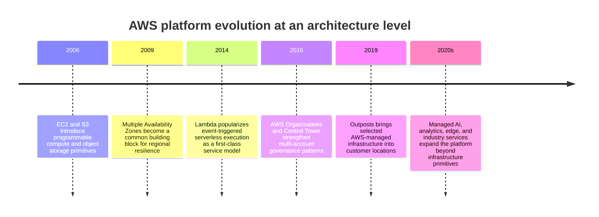

The platform did not evolve as a clean replacement of one architecture style by another. Virtual machines, containers, functions, managed platforms, and specialized services coexist. The current design task is to select the lowest-complexity service model that meets the workload's requirements without surrendering controls the organization needs.

## 3. Why It Exists

Cloud platforms turn capacity and infrastructure procurement into an architectural choice. A team can provision a database, virtual network, queue, or compute fleet when it is needed, but that flexibility shifts responsibility toward identity, configuration, cost control, data location, resilience, and operations. A workload can be technically deployable yet architecturally unsafe if it lives in the wrong account, relies on one Availability Zone, exposes an origin service directly, or has no reliable way to restore data.

AWS architecture provides a decision map across four questions. **Where** does the workload run, and which failure domains contain its data and compute? **Who** owns and can change each resource? **What** service model balances control and operational burden? **How** does the system behave when a dependency, Region, quota, or deployment fails? Answering those questions before choosing named services prevents architecture from collapsing into a product checklist.

A provider-specific overview is useful because AWS services have concrete scope and integration rules. The same architectural requirement can be implemented differently across providers, and a service's name alone does not reveal whether it is regional, zonal, global, managed, or customer-operated. This chapter teaches that vocabulary and decision process; later chapters own the detailed mechanics of each family.

## 4. Core Concepts

### 4.1 Global infrastructure: Regions, Availability Zones, and edge locations

**Definition.** An AWS Region is a distinct geographic area containing multiple isolated Availability Zones. An Availability Zone (AZ) is one or more discrete data centers with redundant power, networking, and connectivity, designed to be isolated from failures in other AZs while remaining connected within the Region. Edge locations and edge networks host selected content-delivery, DNS, security, and compute capabilities nearer to users; they are not interchangeable with a full Region.

**Mechanism.** A resource's scope determines where it can be used and which failures it can survive. Some resources are regional; some are explicitly zonal; some services expose global control surfaces while storing or processing data regionally. A Multi-AZ design places redundant resources in more than one AZ and depends on service-specific replication or failover behavior. A multi-Region design introduces a larger geographic boundary and requires explicit data replication, routing, conflict, and recovery decisions. Merely selecting an AWS Region does not make an application multi-AZ or disaster-recoverable.

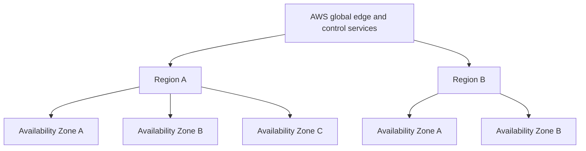

**Decision implications.** Choose Region from latency, data-residency, service availability, regulatory, cost, and recovery requirements, then choose AZ placement based on the workload's failure objectives. AZs are a regional resilience mechanism; separate Regions are a geographical recovery or locality decision with additional replication and operational cost. Edge services reduce user distance for supported traffic but do not move every data dependency to the edge.

**Common failure mode.** A design review sees multiple subnets and assumes the service is multi-AZ, although all subnets map to one AZ. Another failure is assuming a globally named service stores every configuration and datum globally; some control planes are global while data planes and customer data have regional scope. Record service scope explicitly in the architecture.

**Scenario.** A customer API serves users in one geography and must survive a facility-level failure. The team deploys stateless application capacity across three AZs in one Region and uses a database configuration whose documented failover behavior spans AZs. It does not add a second Region until its recovery-time and data-loss objectives justify the replication and testing burden.

### 4.2 Accounts, Organizations, and workload boundaries

**Definition.** An AWS account is a resource, security, quota, and billing boundary. AWS Organizations groups accounts under an organization and permits centrally managed policies and consolidated billing. Organizational Units (OUs) group accounts for policy inheritance. A multi-account design uses these boundaries to isolate environments, teams, workloads, or regulatory scopes instead of treating one account as an unlimited shared workspace.

**Mechanism.** A management account establishes the organization; member accounts own workload resources. OUs can group accounts by environment or function, such as production, non-production, security, and shared services. Service Control Policies (SCPs) constrain the maximum set of actions principals in member accounts may perform; they do not grant permissions on their own. Identity policies, resource policies, permission boundaries, and organization-level guardrails interact, so a successful authorization requires both an applicable allow and the absence of an overriding deny. Detailed IAM policy evaluation belongs to Part 09's IAM chapter; this subsection focuses on where account boundaries fit architecturally.

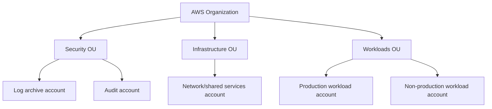

**Decision implications.** Separate accounts when isolation, independent ownership, quota boundaries, blast-radius reduction, or billing attribution outweigh the operational overhead of account vending and cross-account access. Avoid creating accounts only as a substitute for well-designed resource-level policies, but do not force unrelated production workloads into one account for convenience. Define break-glass access and central logging before the account count grows.

**Common failure mode.** A single shared account accumulates long-lived users, broad roles, production and test resources, and ambiguous cost ownership. Conversely, excessive account fragmentation without automated provisioning creates manual policy drift and difficult cross-account operations. Another error is assuming an SCP grants a role permission or replaces service/resource policies; it is a guardrail, not an identity grant.

**Scenario.** A company separates a central security/audit account, a network account, and per-product production accounts. A new product account inherits a restrictive baseline, sends audit logs to the central archive, and receives only the cross-account roles needed to use shared network services. The product team owns its workload resources and sees its costs independently.

### 4.3 Control plane and data plane

**Definition.** The control plane configures, discovers, and manages resources; the data plane handles the workload's actual traffic or data operations. For example, an API that creates a queue uses a control-plane operation, while a producer sending messages uses the queue data plane. The separation is conceptual and service-specific, but it is essential for understanding availability, latency, permissions, and failure behavior.

**Mechanism.** Control-plane operations usually create or modify resource configuration and may propagate asynchronously. Data-plane operations use the configured resource to serve workload traffic. A management API can be unavailable while an already provisioned data plane continues operating, or a control-plane change can succeed partially while data-plane health remains unchanged. Conversely, data-plane endpoints can fail even while the console and resource-management APIs respond normally. AWS exposes distinct endpoints, quotas, IAM actions, and availability behavior for many services.

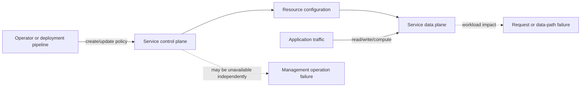

**Decision implications.** Identify the control and data paths separately in diagrams, IAM permissions, monitoring, and incident runbooks. A deployment pipeline needs control-plane permission; a workload role generally needs data-plane permission. During an outage, determine whether operators can make changes, whether existing resources continue serving, and whether new capacity can be added. Design emergency procedures around those differences.

**Common failure mode.** A production design assumes the management API is available during a regional incident and cannot scale or replace capacity when its control plane is degraded. Another mistake is granting a workload broad administrative actions because it needs data-plane access. Diagnose control-plane propagation lag separately from data-plane service latency.

**Scenario.** An application continues reading from an existing object bucket while a management endpoint temporarily rejects a lifecycle-policy update. The service's data path remains available, but the operations team cannot apply the intended configuration change. Monitoring separates object-request health from configuration-management health, allowing the team to avoid an unnecessary workload failover.

### 4.4 Service scope and the shared-responsibility boundary

**Definition.** A service's **scope** describes whether its resources, endpoints, and configuration are global, regional, or zonal. The **shared-responsibility model** describes which security and operational tasks AWS performs and which remain with the customer. The exact boundary depends on the service model: a virtual machine leaves more operating-system responsibility with the customer than a managed database or a fully managed function runtime.

**Mechanism.** AWS operates facilities and foundational infrastructure, while the customer configures identities, data classification, access, workload software, and service options. A managed service transfers some patching, hardware, and availability work to AWS but does not transfer the customer's responsibility for correct permissions, data lifecycle, application behavior, or recovery objectives. Scope and responsibility are independent: a managed regional service still requires the customer to decide whether and how to deploy across Regions.

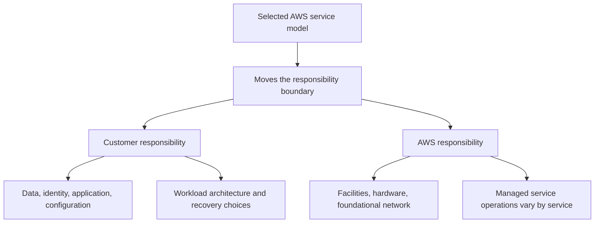

**Decision implications.** Choose a managed service when the transferred operational work is valuable and its constraints fit the workload. Choose more self-managed infrastructure only when the required control or portability justifies operating the additional layers. For each service, record responsibility for patching, backup, key management, data recovery, availability design, and incident response rather than relying on a generic provider diagram.

**Common failure mode.** Assuming "managed" means fully secured, backed up, or multi-Region. A managed database can still be publicly reachable due to configuration, retain data longer than policy permits, or fail an application recovery objective. The opposite failure is operating virtual machines and databases manually without a requirement that justifies the burden.

**Scenario.** A team moves a relational workload from self-managed virtual machines to a managed relational database. AWS now handles more of the database host and patching operations, but the application team still chooses network exposure, database credentials, encryption settings, backups, retention, multi-AZ behavior, and restore testing.

### 4.5 Service models and operational trade-offs

**Definition.** AWS offers services at different abstraction levels. Infrastructure services expose more of the operating environment; managed platforms take responsibility for additional operations; serverless and higher-level services abstract provisioning and scaling further. These are not a strict ladder of quality: they are choices about control, flexibility, responsibility, portability, and service constraints.

**Mechanism.** A virtual machine lets a team select the operating system and runtime, but that team owns patch cadence, host configuration, scaling, and much of failure recovery. A container platform manages scheduling and orchestration but still leaves image, cluster, and application concerns. A function service manages more runtime capacity but imposes packaging, execution, and integration constraints. A managed database or queue removes some operating tasks while introducing provider-specific API and service-limit considerations.

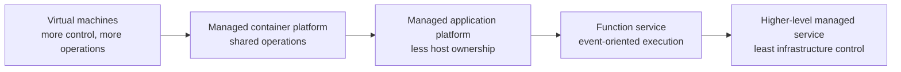

**Decision implications.** Choose the highest abstraction that satisfies requirements for runtime control, predictable performance, compliance, networking, portability, and operations. Do not equate serverless with lower cost or managed with zero operational work. Assess exit costs and failure visibility: a proprietary managed service may be a strong choice when its business value outweighs portability concerns, but the decision should be explicit.

**Common failure mode.** Selecting a service because it is fashionable or because a proof-of-concept was easy, without checking quotas, network behavior, deployment limits, failure semantics, or total operating cost. The inverse is running a custom platform on virtual machines when a managed service could safely remove undifferentiated work.

**Scenario.** A scheduled image-processing task is bursty and stateless, so an event-triggered function is a good initial fit. A continuously running low-latency inference service with specialized hardware and long warm-up time may fit a managed container or instance fleet better. Both choices are AWS-native; the workload shape, not the label, drives the decision.

### 4.6 AWS service families and responsibility map

**Definition.** AWS services can be grouped by architectural role: compute, networking, storage, databases, identity and security, integration and messaging, analytics, observability, and application platforms. The family map helps an architect identify which chapter or design concern to investigate; it does not replace service-specific documentation or imply that similarly named products have identical semantics.

**Mechanism.** An application architecture composes these roles: compute runs code; networking defines reachability; storage and databases retain state; identity controls actions; messaging decouples producers and consumers; observability supports operation; and platform services reduce undifferentiated work. Services connect through APIs, policies, network paths, event contracts, and deployment ownership. The interface between services often determines the failure behavior more than the product names themselves.

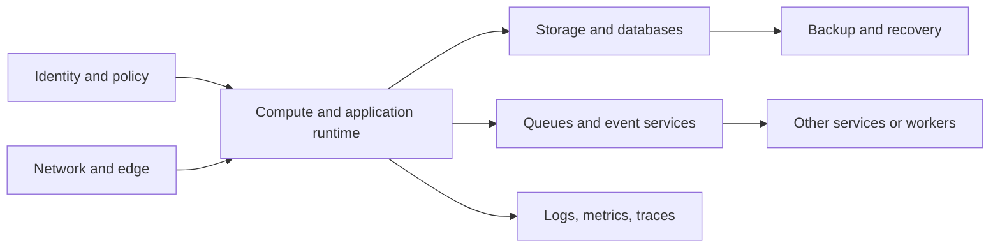

**Decision implications.** Use the service family map to ask the right architectural questions: where data resides, who owns access, what delivery guarantees apply, how a dependency fails, and how changes are rolled out. Later Part 09 chapters own detailed service mechanics. A compute choice is not complete until its networking, identity, data, observability, and recovery boundaries are understood.

**Common failure mode.** Drawing a diagram as a collection of AWS icons without showing ownership, traffic, data flow, trust boundaries, or recovery. Another failure is assuming two services in the same family are interchangeable because both are called a queue, database, or storage service.

**Scenario.** An order workload uses an API runtime, a relational store, a queue, and object storage. The architecture review traces the order identifier through each boundary, records which service owns authoritative state, defines how a queue redelivery is handled, and verifies the runtime role has no broader storage permissions than necessary.

### 4.7 Region selection and data locality

**Definition.** Region selection chooses the geographic AWS deployment boundary for a workload's data and runtime. It affects user latency, service availability, regulatory location, disaster recovery, pricing, and the availability of particular services or features. Region choice is therefore a system constraint, not an arbitrary deployment default.

**Mechanism.** A workload can use one Region, replicate selected data to another, or route users to regional deployments. Each choice defines where data is stored, where processing occurs, how state is synchronized, and which control planes configure the deployment. Some AWS services are global in control or naming but regional in their data path; verify the exact service behavior rather than inferring scope from the console or API name.

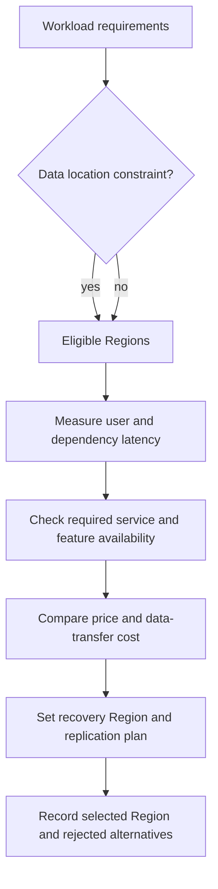

**Decision implications.** Choose an eligible Region by evaluating residency, latency, service availability, recovery strategy, and cost together. A nearby Region is not automatically best if required services are absent or recovery requirements need another location. Multi-Region deployment should be justified by explicit recovery-time, recovery-point, or locality requirements; it adds state replication, routing, testing, and operational complexity.

**Common failure mode.** Choosing a Region solely from a latency test and later discovering a residency restriction, quota constraint, missing service feature, or expensive cross-Region data transfer. Another failure is claiming multi-Region resilience when the application, identity dependencies, deployment pipeline, or data replication still has a single-Region dependency.

**Scenario.** A financial application must keep primary records in a specified geography and recover within a defined time. The team selects a primary Region that satisfies residency, checks service availability and quotas, then chooses a separate eligible recovery Region and tests replication and failover. It records which data is synchronous, asynchronous, or reconstructed after recovery.

### 4.8 AWS networking building blocks and workload reachability

**Definition.** A Virtual Private Cloud (VPC) is a logically isolated network associated with an AWS Region. Subnets are associated with Availability Zones; route tables define paths; gateways and endpoints connect selected traffic to public, private, or AWS service destinations. Security groups and network access control lists (network ACLs) provide different network-filtering boundaries. This overview names the architecture map; the Part 09 Networking chapter owns the detailed mechanics and configuration.

**Mechanism.** A workload instance receives network interfaces in subnets. Route tables and attached gateways determine next hops. An Internet Gateway enables eligible public routing; a Network Address Translation (NAT) Gateway permits outbound connectivity from private subnets without making those resources directly internet-addressable. VPC endpoints provide selected private paths to AWS services. Security groups are stateful resource-level filters, while network ACLs apply subnet-level stateless rules. Correctness depends on routes, DNS, security controls, and service policies together.

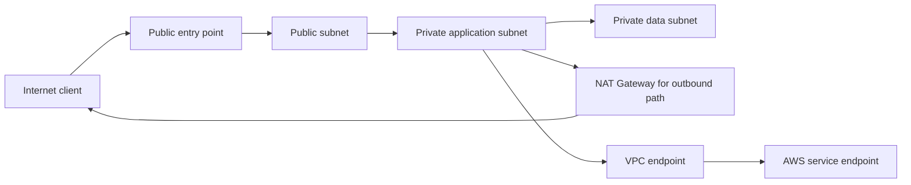

**Decision implications.** Make exposure explicit: distinguish internet ingress, private service-to-service paths, administrative access, and outbound egress. Use multiple AZs where workload availability requires it, and avoid placing data services in public subnets unless a documented requirement demands it. Prefer private endpoints where they materially improve access control or data path requirements. The Networking chapter will teach route, gateway, CIDR, and filtering mechanics in detail.

**Common failure mode.** A private subnet has a default route through a NAT Gateway and is mistakenly described as having no internet egress. Another is assuming a resource is private because it is in a VPC, despite a public address, permissive route, or overly broad security group. Network isolation and application authorization are separate controls.

**Scenario.** A web workload accepts public traffic only through a managed edge entry point. Application instances have no public addresses and can reach required AWS APIs through private endpoints; a separate, monitored NAT path handles remaining outbound dependencies. Data subnets accept connections only from the application tier.

### 4.9 Resilience, multi-AZ design, and recovery objectives

**Definition.** Availability is a property of a workload's end-to-end behavior, not a checkbox on one resource. Multi-AZ deployment distributes components across AZ failure domains; regional disaster recovery adds a separate geographic boundary. Recovery objectives describe the acceptable time to restore service and the amount of data loss after a disruption. The Resilience and Disaster Recovery part of Part 10 owns cross-cloud patterns; this chapter anchors those choices in AWS failure domains.

**Mechanism.** A resilient AWS design removes single-AZ dependencies where required, replicates or backs up state according to recovery objectives, detects health failures, and routes or promotes capacity through a tested process. Stateless application workers can often be replaced more easily than authoritative databases or unique files. Multi-AZ service options have service-specific failover behavior and limits. Multi-Region recovery may be backup/restore, pilot light, warm standby, or active-active; each changes cost, data-loss exposure, and operational complexity.

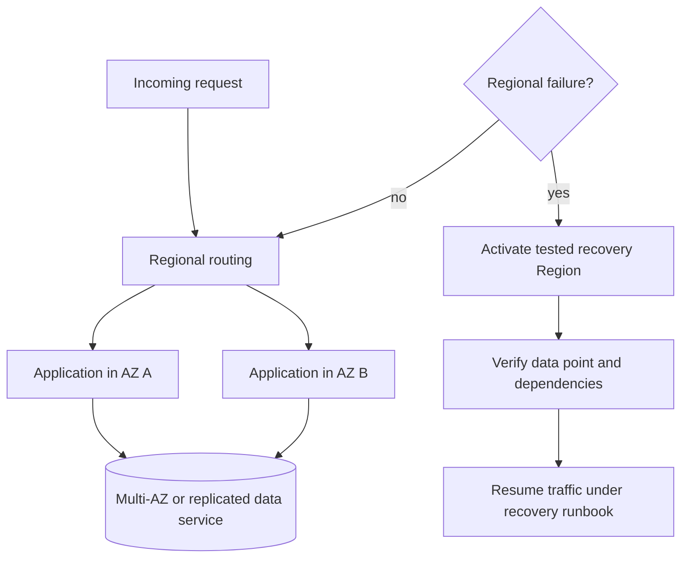

**Decision implications.** Set recovery-time and recovery-point objectives from business impact, then select service configuration and deployment pattern. Multi-AZ often addresses local facility failure; it does not replace backups or protect against account compromise and destructive changes. Multi-Region is not automatically stronger if replication propagates corruption or the recovery runbook is untested. Cost the idle recovery capacity and test data access, DNS/routing, credentials, quotas, and deployment artifacts.

**Common failure mode.** Treating a provider's managed failover as a complete disaster recovery plan. A database may fail over while application configuration, secrets, certificates, queues, or DNS remain unavailable. Another mistake is testing recovery only by checking that resources exist, without exercising realistic traffic and validating data consistency.

**Scenario.** An order service requires a four-hour recovery-time objective and a five-minute recovery-point objective. It uses multi-AZ production capacity for zonal failures and a separate Region with replicated critical state for regional recovery. A scheduled game day exercises dependency promotion, traffic switching, credentials, quotas, and reconciliation of the last replicated writes.

### 4.10 AWS architecture selection and service fit

**Definition.** AWS architecture selection is the process of mapping workload constraints to AWS service capabilities while accounting for operational ownership and exit cost. It is not a vendor-service popularity contest. A sound decision identifies the required behavior first, then tests candidate services against scope, limits, failure semantics, permissions, and integration needs.

**Mechanism.** Start with workload type and quality attributes. Identify authoritative state, request/event rates, latency and recovery objectives, regulatory boundaries, team operations capacity, and expected growth. Filter candidates by required interface and availability. Compare managed versus self-managed operational ownership. Validate quota, service scope, failure recovery, data movement, and cost, then prototype the riskiest assumption. Record the decision and the conditions that would trigger reevaluation.

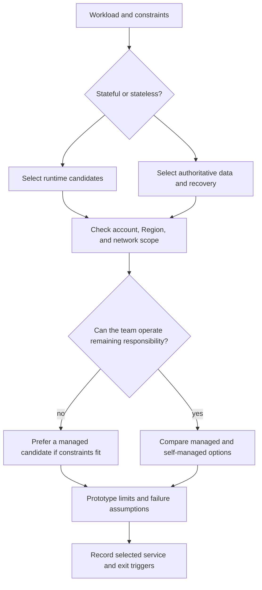

**Decision implications.** Service choice must include the integration contract and adjacent services. Selecting a queue requires decisions about delivery, ordering, retention, and consumer idempotency. Selecting a database requires access, backup, scaling, and recovery decisions. Managed services reduce undifferentiated work but can create quotas, feature constraints, cost surprises, and provider-specific dependencies. Build-versus-buy should compare total ownership, not only the monthly price.

**Common failure mode.** Selecting a service from a single benchmark or tutorial without validating production quotas, regional support, operational limits, and failure paths. Another is using a provider service merely because it appears in a reference diagram, without stating what requirement it satisfies.

**Scenario.** A team evaluates a managed queue and a self-managed streaming cluster for asynchronous order events. It compares ordering scope, retention, replay, throughput, operational staffing, multi-account integration, and recovery behavior. It prototypes the expected event rate and consumer-lag behavior before committing to the service.

## 5. Internal Working

AWS resources are usually created and configured through a control plane and then used through a service data plane. An infrastructure deployment tool submits desired resource changes to service APIs; those services validate identity, policy, quota, and configuration before reconciling the requested state. The data plane handles workload requests after the resource is available. The account and Region establish important scoping and authority boundaries, but service-specific behavior varies.

A simplified provisioning and request sequence looks like this:

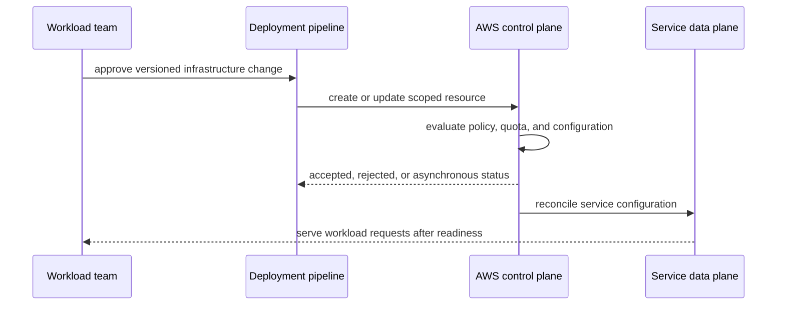

An accepted provisioning request does not always mean that the resource is immediately ready; some operations reconcile asynchronously. Deployment tooling should wait on explicit readiness and validate the resulting configuration. The workload's data path should be tested separately from the management API that created it.

## 6. Design Principles

- **Treat account and Region as architectural boundaries.** State ownership, blast radius, residency, and recovery intent explicitly.
- **Use managed services deliberately.** Transfer operational work only when the service's semantics and limits fit the workload.
- **Separate control-plane administration from workload data-plane permissions.** A runtime rarely needs resource-creation privileges.
- **Design for failure domains, not product labels.** Verify AZ and Region scope per service and test the actual recovery behavior.
- **Automate repeatable configuration.** Infrastructure changes should be reviewed, versioned, and safely reproducible.
- **Make data movement visible.** Cross-AZ and cross-Region transfer affects latency, cost, privacy, and recovery.
- **Budget for quotas and limits.** Service quotas are part of capacity planning and should be observed before the workload approaches them.
- **Prefer explicit ownership.** Each resource, alarm, backup, and recovery action needs a responsible team.

## 7. Architecture Patterns

**Multi-account workload isolation.** Place workloads in separate accounts and use Organizations guardrails and delegated roles to reduce blast radius and improve cost ownership. The landing-zone chapter in Part 09 owns implementation detail.

**Regional application with multi-AZ dependencies.** Distribute stateless compute across AZs and select compatible data services with documented failover and backup behavior. Do not infer resilience merely from subnet count.

**Hub-and-spoke network.** Shared connectivity and security services sit in a network account; workload accounts connect through controlled attachments. The Networking chapter owns route and service configuration mechanics.

**Event-driven integration.** Producers publish domain events to managed queues or event buses, and independent consumers process them with explicit retry and idempotency behavior. Part 07 owns general distributed delivery guarantees.

**Serverless event processing.** Functions respond to events without customer-managed worker hosts; the team still owns concurrency, timeout, retry, idempotency, observability, and data boundaries.

**Recovery topology.** Select backup/restore, pilot light, warm standby, or active-active according to business recovery objectives and data consistency requirements.

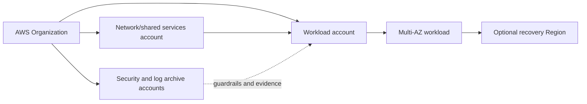

## 8. Production Architecture

A representative AWS workload separates organization-level governance, shared network services, application runtime, durable data, and recovery. This is a reference shape, not a mandatory AWS landing-zone product design.

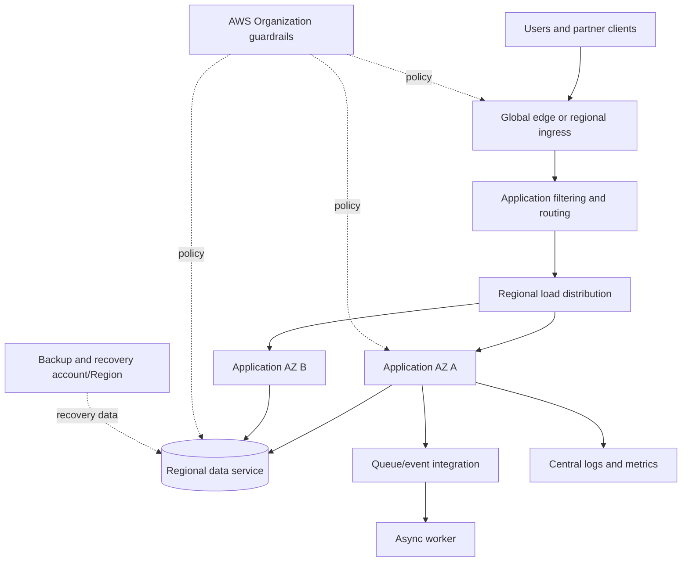

Production readiness requires documented ownership for identity, network
routes, quotas, backups, encryption, deployment, and alert response. An
architecture diagram that shows services but omits these operational
contracts is incomplete.

## 9. Implementation

Begin implementation by recording constraints before resource names:

1. List workload owners, users, data classes, request patterns, and quality
   objectives.
2. Choose account and Region boundaries based on security, residency,
   blast radius, and recovery.
3. Select service families and assign control-plane and data-plane roles.
4. Define network reachability, identity roles, secrets, and data access.
5. Define availability zones, backup, recovery, and failure handling.
6. Model resources in version-controlled infrastructure definitions and
   review changes before deployment.
7. Validate service limits and readiness after deployment; record evidence.

The examples in Section 10 are small design aids. They do not call AWS APIs
or replace infrastructure as code; their inputs and assumptions are
explicit so the architecture reasoning can be inspected offline.

## 10. Complete Code Examples

- [Region/AZ placement and failure-domain check](../code/python/aws-chapter/01_region_az_failure_domains.py)
- [Organizations account guardrail simulation](../code/python/aws-chapter/02_multi_account_guardrails.py)
- [Service selection decision matrix](../code/python/aws-chapter/03_service_selection_matrix.py)
- [Resilience/cost scenario calculator](../code/python/aws-chapter/04_resilience_cost_scenario.py)

Run with Python 3.10 or later from the repository root. The examples use
only the standard library and synthetic assumptions; they do not require an
AWS account or make network calls. Cost values are normalized units rather
than current AWS prices.

## 11. Performance

Performance depends on the data path and service limits, not only on compute
size. Measure request latency, service-side throttling, queue age, database
connections, storage throughput, and cross-AZ/Region traffic. Regional
placement can reduce user latency while increasing distance to a dependency
or data store. Benchmark the complete request path and include warm-up,
connection reuse, serialization, and downstream calls.

## 12. Scalability

Scale the constrained resource and preserve service quotas. Horizontal
compute scaling does not increase a database's connection limit or a
third-party API quota. Queue-based buffering can absorb bursts but increases
queue age and requires bounded retention and backpressure. Partitioning and
sharding are covered by the database and distributed-systems modules; AWS
service-specific partition limits belong in their later Part 09 chapters.

## 13. Security

Use account separation, least-privilege roles, private network paths, and
service-level resource policies as complementary controls. A VPC is not an
authorization boundary by itself, and a gateway does not replace object-level
checks in the application. Part 09's IAM chapter and Part 15 Security own
detailed permission evaluation and security architecture; this AWS overview
identifies where those controls attach. Protect management credentials and
avoid long-lived access keys in workloads.

## 14. Observability

Build observability across infrastructure, platform services, and
application behavior. Collect service metrics, structured application logs,
traces, deployment events, quota/throttle signals, and recovery status.
Central logging can improve investigation only if permissions and retention
are designed. CloudWatch is one AWS-native option; the Observability part
owns general telemetry architectures and analysis.

## 15. Failure Scenarios

**AZ impairment.** Determine which application and data resources span AZs,
what failover is automatic, and whether capacity remains sufficient.

**Region impairment.** Distinguish a regional data-plane failure from a
control-plane issue and follow the tested recovery procedure rather than
improvising resource creation.

**Quota exhaustion.** Identify which service rejected capacity or API calls,
which workloads share the quota, and whether backpressure or quota increase
is safe.

**Credential or policy error.** Separate unavailable identity dependencies
from an explicit deny or expired credential; do not respond by granting
broad administrator access.

**Cost anomaly.** Identify the resource, account, Region, traffic, and data
transfer changes that caused the increase before changing workload
behavior.

## 16. Testing

Test more than whether infrastructure creation succeeds. Validate account
boundaries, denied actions, resource reachability, AZ failure behavior,
backup restoration, service quota alarms, deployment rollback, and cost
allocation. Use sandbox accounts and synthetic data for destructive or
failure-injection tests. A recovery plan is not verified until the workload
has been restored and its business invariants checked.

## 17. Common Mistakes

- Treating a Region as a failure-proof unit or assuming one Region provides
  disaster recovery.
- Assuming a managed service owns every security, backup, or availability
  decision.
- Combining production and experimentation in one account without clear
  separation or guardrails.
- Granting broad administrative permissions to application runtimes.
- Drawing service icons without ownership, data flow, network path, or
  failure behavior.
- Selecting services before checking regional availability, quotas, and
  feature constraints.
- Treating cost as a billing cleanup instead of an architecture input.

## 18. Best Practices

- Record account, Region, AZ, and service scope in architecture decisions.
- Use repeatable account vending and infrastructure deployment pipelines.
- Establish centralized audit logs and independent security ownership.
- Assign cost tags and budgets at resource creation, not after launch.
- Test backup restore and regional recovery on a schedule.
- Keep service quotas, account boundaries, and dependency limits visible in
  capacity plans.
- Prefer managed capabilities when they reduce operational burden without
  violating workload constraints.
- Link service-specific design questions to the later owning Part 09 chapter.

## 19. Anti-Patterns

**One account for everything.** A shared account hides ownership, couples
quotas, and increases the blast radius of credential and configuration
mistakes.

**Multi-Region by slogan.** Replicating everything to a second Region
without a recovery objective creates cost and consistency complexity without
proving recoverability.

**Console-only infrastructure.** Manual changes cannot be reliably
reviewed, reproduced, or recovered after account or Region loss.

**Managed-service absolutism.** Selecting the highest abstraction without
checking constraints, quotas, portability, and failure semantics can create
an unsuitable dependency.

**Provider lock-in denial.** Pretending every managed service has a direct
cross-cloud equivalent prevents teams from pricing and governing the actual
trade-off.

## 20. Trade-off Analysis

| Decision | Benefit | Cost or risk |
|---|---|---|
| Single vs. multiple accounts | Simpler administration vs. isolation and cost attribution | Shared blast radius vs. cross-account governance overhead |
| One Region vs. multi-Region | Lower complexity and transfer cost vs. geographic recovery/locality | Longer regional recovery vs. replicated state and operational complexity |
| Managed vs. self-managed service | Less undifferentiated operations vs. greater runtime control | Service limits and provider coupling vs. staffing and patch burden |
| Edge vs. regional processing | Lower user latency vs. centralized data and policy | Distributed rollout and data synchronization |
| Synchronous vs. asynchronous integration | Immediate consistency vs. availability and decoupling | Latency/availability coupling vs. eventual consistency and retries |
| Shared platform vs. workload-owned services | Standardization vs. local autonomy | Central bottleneck vs. duplicated operations |

Decide by business impact and operational ownership, not by abstract
preference for managed services or multi-cloud portability.

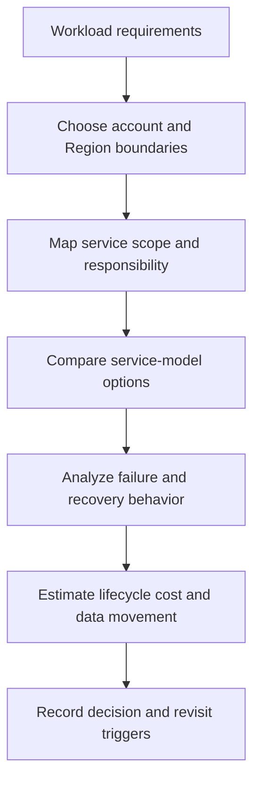

## 21. Comparison Table

| Dimension | AWS-specific question | Architecture implication |
|---|---|---|
| Region/AZ scope | Is the selected resource regional or zonal? | Determines placement and recovery boundaries |
| Account structure | Which account owns this workload and who can administer it? | Isolation, cost attribution, policy inheritance |
| Service responsibility | Which operations does AWS perform and what remains customer-owned? | Staffing, security, recovery, and operational burden |
| Integration | Which service APIs, events, or network paths connect components? | Coupling, retries, and failure behavior |
| Commercial model | How does use translate into metered cost? | Architecture and cost responsibility are connected |

Azure and Google Cloud Platform (GCP) provide corresponding cloud
capabilities, but their account/resource hierarchies, network primitives,
service semantics, and commercial models differ. Part 10 owns cross-provider
architecture comparisons; this chapter keeps the concrete AWS view.

## 22. Real-World Case Study

The February 2017 Amazon Simple Storage Service (S3) outage in the
US-EAST-1 Region demonstrated how a regional service can become a dependency
for systems beyond the direct object-storage workload. AWS's public post-
event analysis described an operator command that unintentionally removed
more servers than intended from S3 subsystems, causing a long recovery and
impacting services that relied on S3 in that Region. The architectural
lesson is not that S3 or cloud is inherently unreliable; it is that
regional dependencies and control/operational procedures have blast radii
that must be understood and tested.

A workload review should ask: which critical paths depend on the affected
service, which independent recovery artifacts exist, whether the application
can degrade safely, and how changes to foundational services are reviewed.
A second Region does not automatically remove the dependency if failover
state, deployment artifacts, credentials, or DNS are unavailable. The
recovery plan should account for these paths and exercise them before an
incident.

## 23. Interview Questions

1. What is the architectural difference between an AWS Region and an
   Availability Zone?
2. Why use multiple AWS accounts instead of a single account with tags?
3. What do Service Control Policies do, and what do they not do?
4. Explain the difference between a service control plane and data plane.
5. What does the shared-responsibility model leave with a customer using a
   managed database?
6. How would you select a Region for a regulated workload?
7. When does multi-Region architecture add value, and what new failure modes
   does it introduce?
8. How do service quotas affect capacity planning?
9. What is the difference between managed and serverless service models?
10. How would you validate a disaster-recovery design beyond checking that
    resources exist?

## 24. Hands-on Exercises

1. Run [region_az_failure_domains.py](../code/python/aws-chapter/01_region_az_failure_domains.py)
   and change the failed AZ. Identify which components continue serving and
   which assumptions are encoded in the placement model.
2. Run [multi_account_guardrails.py](../code/python/aws-chapter/02_multi_account_guardrails.py)
   and compare an allowed action with an organization-level explicit deny.
3. Modify [service_selection_matrix.py](../code/python/aws-chapter/03_service_selection_matrix.py)
   to prioritize operational control over time-to-market; explain how the
   selected service changes.
4. Adjust the recovery and cost assumptions in
   [resilience_cost_scenario.py](../code/python/aws-chapter/04_resilience_cost_scenario.py)
   and find the point where a warm standby fits the stated recovery objective.

## 25. Design Exercises

Design an AWS architecture for a multi-tenant order platform with public
APIs, background processing, sensitive customer data, a primary Region, and
an explicit recovery objective. Deliver an account/OU map, Region/AZ
placement diagram, service-family decisions, trust boundaries, data-flow,
backup/recovery plan, quota assumptions, cost allocation, and operational
ownership. Distinguish decisions owned by later Part 09 service chapters
from the AWS platform-level choices made here.

## 26. Architecture Review Questions

- Are account and Region boundaries aligned to risk, ownership, and data
  residency?
- Are AZ and Region failure assumptions verified for every critical
  dependency?
- Is control-plane administration separated from workload data-plane
  access?
- Are service responsibility boundaries explicitly assigned?
- Are quotas, service availability, data transfer, and lifecycle cost
  checked?
- Can the workload restore from backup and recover within its objective?
- Are shared services and account guardrails observable and owned?
- Which decisions are AWS-specific, and what would migration require?

## 27. Summary

AWS architecture is the discipline of composing provider-specific
infrastructure, service, account, Region, and operational boundaries around
workload requirements. Regions and Availability Zones define failure and
locality choices; accounts and Organizations create governance and blast-
radius boundaries; service scope and responsibility shape operational
ownership; and managed-service abstractions trade control for reduced
undifferentiated work. A useful AWS design records those choices, validates
service limits and recovery behavior, and treats security, performance,
reliability, and cost as connected architecture concerns.

**Further reading:** [Cloud Computing](PART_OVERVIEW.md) ·
[Cloud Architecture](../10_Cloud_Architecture/PART_OVERVIEW.md) ·
[AWS Well-Architected Framework](../11_AWS_Well_Architected_Framework/PART_OVERVIEW.md) ·
[Security](../15_Security/PART_OVERVIEW.md)
