# Chapter: Amazon Web Services Operating Model

Part: [09 — Cloud Computing](PART_OVERVIEW.md) · Status: Revised (in-depth rewrite)

## 1. Introduction

Amazon Web Services (AWS) is a catalog of more than two hundred services exposed through Application Programming Interfaces (APIs) and billed by consumption. Architects who are new to AWS often learn it product by product. That approach fails quickly, because a product name does not tell you where a resource lives, which failure it survives, who can change it, what limits it, or how it is metered. Those properties come from AWS's *operating model*: the hierarchy of organizations, accounts, Regions, and Availability Zones (AZs); the split between control planes and data planes; the scope rules that make one resource global and another zonal; and the contracts for responsibility, quotas, pricing, and support that wrap every service.

This chapter teaches that operating model. After working through it you should be able to:

- Place any AWS resource in the hierarchy of partition, organization, organizational unit, account, Region, and AZ, and say which failures and which administrators can affect it.
- Explain why the AWS account is the hard isolation and blast-radius boundary, and how AWS Organizations, Service Control Policies (SCPs), and Resource Control Policies (RCPs) put a ceiling on what any identity or resource in that account can do.
- Separate control-plane dependencies from data-plane dependencies in a design, and apply *static stability* so that recovery does not depend on the APIs most likely to be impaired during an incident.
- Read the shared-responsibility boundary for a specific service model, such as Amazon Elastic Compute Cloud (EC2), Amazon Relational Database Service (RDS), AWS Lambda, or Amazon Simple Storage Service (S3), rather than for "the cloud" in general.
- Trace a human or workload identity from sign-in to an API call through role assumption, and trace a packet from a private subnet to the internet or to an AWS service.
- Budget for Service Quotas and API throttling, estimate the pricing dimensions that dominate a bill (including inter-AZ traffic and Network Address Translation (NAT) processing), choose a support plan, and use AWS Health as an operational signal.
- Run a service-selection workflow that ends in recorded evidence instead of a product preference.

### 1.1 Scope and ownership boundaries

This is the first provider chapter of Part 09, and it deliberately stays at the level of the operating model. Several neighboring chapters own deeper mechanics, and this chapter recaps them in a few sentences and links to them:

| Topic | Owner | What this chapter does |
|---|---|---|
| Compute abstractions, instance shapes, autoscaling, placement | [Compute](CH04_Compute.md) | Introduces EC2's anatomy and the AWS compute families |
| Route tables, NAT, endpoints, peering, Transit Gateway, hybrid links | [Networking](CH05_Networking.md) | Traces the basic Virtual Private Cloud (VPC) route path |
| Block, file, object storage and backup | [Storage](CH06_Storage.md) | Uses Amazon Elastic Block Store (EBS) and S3 as scope examples |
| Full IAM policy evaluation, federation, workload identity | [IAM](CH09_IAM.md) | Recaps principals and the role-assumption path |
| Telemetry services | [Monitoring](CH10_Monitoring.md) | Mentions only AWS Health and audit trails |
| Lambda execution semantics | [Serverless](CH11_Serverless.md) | Uses Lambda as a responsibility example |
| Billing data, commitments, optimization | [Cost Optimization](CH14_Cost_Optimization.md) | Teaches the pricing dimensions an architect must estimate |
| Control Tower, account vending, baselines | [Landing Zones](CH15_Landing_Zones.md) | Explains how Control Tower relates to Organizations |
| Migration tooling and cutover | [Cloud Migration](CH16_Cloud_Migration.md) | Not covered beyond a pointer |

Outside Part 09, [Cloud Architecture (Part 10)](../10_Cloud_Architecture/PART_OVERVIEW.md) composes services into cross-provider workload architectures, the [AWS Well-Architected Framework (Part 11)](../11_AWS_Well_Architected_Framework/PART_OVERVIEW.md) owns the pillar-based review method, and [Security (Part 15)](../15_Security/PART_OVERVIEW.md) owns general security engineering. Where Microsoft Azure or Google Cloud Platform (GCP) behave in a materially different way, the chapter says so briefly; the [Azure](CH02_Azure.md) and [GCP](CH03_GCP.md) chapters own those providers.

Provider facts drift. Every quota, price, and product detail below was checked against AWS documentation at the time of writing, and numbers that change are marked accordingly. Treat them as worked-example inputs and verify current values before you rely on them.

## 2. The operating model in one picture

Every AWS resource has an address in a nested set of containers. Some containers are administrative (who owns and governs the resource), and some are physical (where it runs and what can fail together). The two hierarchies intersect at the account-Region pair, which is the unit in which most AWS resources, quotas, and API endpoints exist.

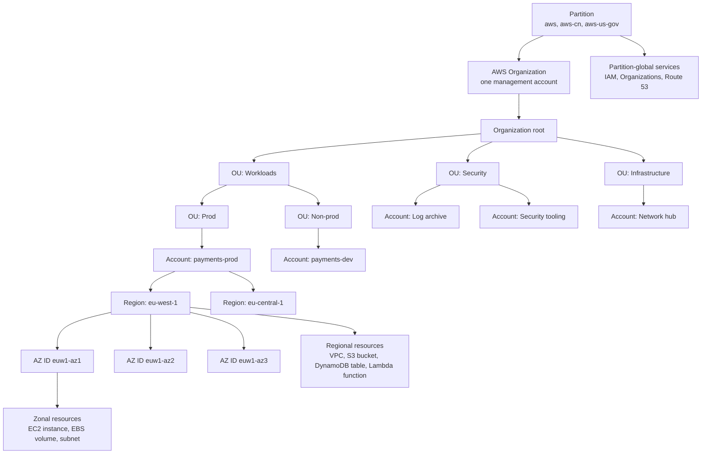

Read the diagram from top to bottom as a chain of scopes:

- A **partition** is a fully separate copy of AWS with its own identities and endpoints. The commercial partition is `aws`; China Regions run in `aws-cn`; AWS GovCloud (US) runs in `aws-us-gov`. Identities and resources do not cross partitions. Amazon Resource Names (ARNs) start with the partition, as in `arn:aws:s3:::example-bucket`.
- An **organization** groups accounts under one **management account** that pays the consolidated bill and administers policy. **Organizational units (OUs)** form a tree under the organization **root**, up to five levels deep.
- An **account** is the container that owns resources, identities, quotas, and charges. It is the strongest isolation boundary a customer controls.
- Inside an account, most resources are created in a **Region**, and some are pinned to a single **AZ** within it. A handful of services, notably AWS Identity and Access Management (IAM), AWS Organizations, and Amazon Route 53, are global within the partition.

Two consequences follow. First, the blast radius of a mistake is bounded by the scope at which it happens: a bad SCP at the root touches every member account, a deleted IAM role affects one account in all Regions, and a misconfigured route table affects one VPC in one Region. Second, the two hierarchies answer different questions. The administrative tree (organization, OU, account) tells you who can change a resource and which guardrails apply. The physical tree (Region, AZ) tells you what fails together. A good design states both for every critical resource.

## 3. Global infrastructure: Regions, Availability Zones, and extensions

### 3.1 Regions

A **Region** is a geographic area that contains at least three AZs, its own regional control planes, and its own service endpoints, such as `ec2.eu-west-1.amazonaws.com`. AWS builds Regions to be independent of one another: a regional service in one Region does not depend on the same service in another Region for its normal operation. This independence is the reason the Region is the unit of disaster recovery on AWS. It is also why multi-Region designs are expensive: nothing is replicated across Regions unless you configure it.

Regions differ in practical ways that matter to architects:

- **Service and feature availability.** New services and instance families reach some Regions first. A design that depends on a specific accelerator, database engine version, or managed feature must check the [AWS Capabilities by Region](https://docs.aws.amazon.com/global-infrastructure/latest/regions/aws-regions.html) listing for the target Region and the recovery Region.
- **Opt-in status.** Regions launched since 2019 are disabled by default and must be enabled per account. A disabled Region has no IAM credentials valid in it, which is a useful guardrail but also a common source of failed deployments.
- **Price.** The same instance type or gigabyte of storage can cost noticeably more in one Region than another.
- **Data location.** The Region is where your data is stored unless you replicate it elsewhere, which is the basis of most data-residency arguments.

### 3.2 Availability Zones, AZ names, and AZ IDs

An **Availability Zone** is one or more discrete data centers with redundant power, networking, and connectivity, physically separated from the other AZs in the Region but connected to them by low-latency links. AWS designs AZs so that a fire, flood, power event, or most software deployments affect at most one AZ at a time. Zonal services such as EC2 deliberately deploy changes one AZ at a time to keep that property.

AZs have two identifiers. The **AZ name**, such as `eu-west-1a`, is what most consoles and templates use. The **AZ ID**, such as `euw1-az1`, names the same physical location in every account. For accounts created before November 2025 in AWS's oldest Regions, AWS mapped AZ names to physical zones independently per account, so `us-east-1a` in one account could be a different building from `us-east-1a` in another; accounts created from November 2025 onward receive a consistent mapping ([AWS Availability Zones](https://docs.aws.amazon.com/global-infrastructure/latest/regions/aws-availability-zones.html)). The practical rule is simple: whenever two accounts must agree on placement, for example a shared VPC subnet, a cross-account PrivateLink endpoint, or a zonal failure analysis, use AZ IDs.

The same page documents **constrained AZs**: when an AZ cannot grow, AWS may block new zonal resources there for accounts that do not already use it, and eventually hide it from new accounts. Two accounts can therefore see a different number of AZs in the same Region. Templates that hard-code "three AZs, a, b, and c" break in exactly these cases; templates that discover AZs and record their IDs do not.

### 3.3 Local Zones, Wavelength Zones, Outposts, and the edge

AWS also offers infrastructure that is not a full Region. Each has a different scope and a different failure profile, and treating them as "small Regions" is a common mistake.

| Extension | What it is | Parent and control plane | Typical use | Key caution |
|---|---|---|---|---|
| **Local Zone** | AWS-operated capacity in a metropolitan area, such as `us-east-1-bos-1a` | Extends a parent Region; you extend a VPC subnet into it; control plane stays in the parent Region | Single-digit-millisecond latency to users in that metro, media rendering, gaming, local data processing | A Local Zone is usually a single zone, so it is a single failure domain; service catalog is a subset of the Region; must be opted in per zone group |
| **Wavelength Zone** | AWS capacity embedded in a telecommunications carrier's 5G network | Extends a parent Region; reached through a carrier gateway | Mobile edge applications | Traffic path and pricing are carrier-specific |
| **AWS Outposts** | AWS-managed racks or servers in your own facility | Anchored to a parent Region over a service link | Data that must stay on premises, low latency to factory or hospital systems | You own power, cooling, physical security, and the service link; if the link fails, management operations stop |
| **Edge locations and Regional edge caches** | Points of Presence (PoPs) for Amazon CloudFront, Route 53, AWS Global Accelerator, and AWS WAF (web application firewall) | Global data plane; control planes in a single Region | Content delivery, Domain Name System (DNS), traffic steering, filtering | Run only those edge services; they do not host your VPC or database |

The architectural question for every extension is "what happens when the link to the parent Region is impaired?" For a Local Zone, existing instances keep running, but creating or modifying resources depends on the parent Region's control plane. For Outposts, AWS documents that workloads continue to run during a service-link outage while management and monitoring stop. Design the extension so that its runtime behavior is statically stable, a concept explained in Section 6, and keep authoritative state either in the Region or in a deliberately replicated form.

### 3.4 Failure domains in practice

The following map shows what a typical workload footprint looks like across these domains, and which failures each layer is meant to contain.

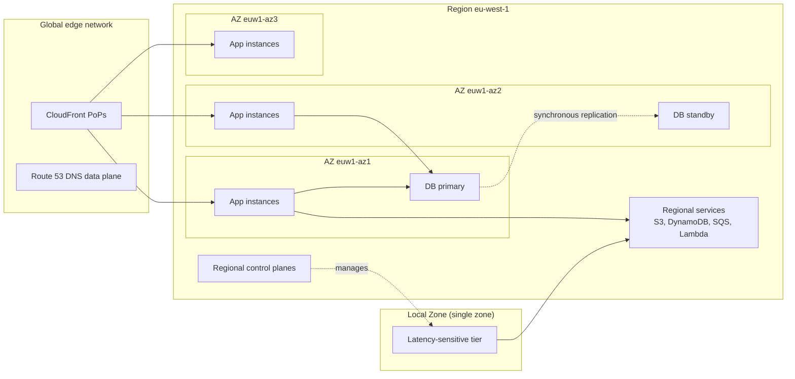

The map makes four containment claims, each of which a design must verify rather than assume:

1. **AZ failure** is contained when every tier that must survive has capacity in at least two AZs and the remaining AZs can carry the load. The DB primary in `euw1-az1` is a single point of failure for writes until the standby is promoted, which is why managed Multi-AZ databases matter.
2. **Region failure** is contained only if a second Region holds a copy of the data and the means to run. Nothing in the picture above does that.
3. **Local Zone failure** takes the latency-sensitive tier with it. Either that tier can fall back to the Region with higher latency, or the business accepts the outage.
4. **Edge failure** in one PoP is absorbed by routing to other PoPs; the edge's control plane, however, lives in one Region, which matters if a recovery plan relies on changing CloudFront or Route 53 configuration. Section 6.4 covers this.

### 3.5 Choosing a Region: a worked example

A European insurer is placing a claims platform. The constraints are: claims data must remain in the European Union (EU); 80% of users are in Germany and Austria; the design must use a managed PostgreSQL-compatible database with a specific major version; and the recovery Region must also be in the EU.

The selection proceeds as a filter, not a ranking:

1. **Residency filter.** EU Regions only. That leaves Frankfurt (`eu-central-1`), Ireland (`eu-west-1`), Paris (`eu-west-3`), Stockholm (`eu-north-1`), Milan (`eu-south-1`), and Spain (`eu-south-2`). Zurich (`eu-central-2`) is excluded because Switzerland is not in the EU, and London (`eu-west-2`) for the same reason.
2. **Capability filter.** The team checks that the database engine version, the instance family they benchmarked, and every other service on the bill of materials are available in each remaining Region. Two Regions lack one required feature at the time of the check and drop out.
3. **Latency measurement.** The team measures round-trip time from user networks rather than relying on geography. Frankfurt measures about 8 ms median from the main user population and Ireland about 30 ms. For an interactive application with roughly 15 sequential API calls per page, the difference is 15 × 22 ms = 330 ms of added latency per page if each call crosses the network, which is noticeable. Frankfurt becomes primary.
4. **Recovery pairing.** AWS does not define Region pairs the way Azure does, so the team picks the recovery Region itself. Ireland passes residency and capability checks and is far enough from Frankfurt to make a shared regional disaster unlikely. The team accepts that failover will add about 22 ms per call for German users.
5. **Cost check.** The team prices the same bill of materials in both Regions and records the difference; it does not change the decision, but it sets the expected cost of the warm standby.
6. **Record.** The decision record lists the rejected Regions and why, so that a future team knows which constraint to revisit if, for example, a missing feature becomes available.

Azure differs here in two material ways. Many Azure regions have a designated paired region with sequenced platform updates and prioritized recovery, and Azure maps logical availability zones to physical zones per subscription in a way that resembles AWS's legacy per-account AZ-name mapping. GCP zones, by contrast, are named consistently across projects, and a GCP VPC network is global with regional subnets, so the "which network spans which Regions" question has a different answer. The [Azure](CH02_Azure.md) and [GCP](CH03_GCP.md) chapters cover those models.

## 4. The account: hard isolation and blast-radius boundary

### 4.1 What an account isolates

An AWS account is more than a billing label. It is the default container for almost every security and operational property:

- **Identity namespace.** IAM users, roles, and policies exist inside one account. A principal in account A has no permissions in account B unless account B explicitly trusts it, through a role trust policy or a resource-based policy.
- **Resources.** Every resource has an owning account, recorded in its ARN. Deleting the account deletes its resources after the post-closure period.
- **Quotas.** Service Quotas are tracked per account and, for regional services, per Region. One team's runaway autoscaling cannot exhaust another account's EC2 virtual central processing unit (vCPU) quota.
- **Billing and cost attribution.** Charges accrue to the account, even under consolidated billing.
- **The root user.** Each account has a root user with unconditional authority over that account, subject only to organization policies.
- **Default network.** Each account gets its own default VPC per Region, and VPCs in different accounts are unreachable from each other unless connected.

Because these properties travel together, the account is the hard boundary in the sense that matters for security: crossing it always requires an explicit, auditable trust decision on the receiving side. Resource tags, naming conventions, and IAM path prefixes are soft boundaries. They can implement separation inside an account, but a single policy mistake, such as a wildcard `Resource: "*"`, erases them.

### 4.2 What an account does not isolate

An account boundary has limits that designs should state openly:

- **Physical infrastructure.** Accounts share AWS's physical fleet. Hardware isolation comes from the Nitro System and service design, not from account boundaries; dedicated hosts and instances exist for licensing and compliance needs.
- **Global services in the partition.** All accounts depend on the same IAM, Organizations, and Route 53 control planes.
- **Explicit trust.** If account B's role trusts `arn:aws:iam::111111111111:root`, any principal in account A that has `sts:AssumeRole` permission can reach account B. Cross-account trust is the main channel through which a compromise spreads.
- **Shared networks.** A Transit Gateway or shared VPC connects accounts at the network layer. The account boundary still governs API access, but packets can flow.
- **The management account.** SCPs and RCPs do not apply to the management account, so a compromise of the management account is a compromise of the organization's governance.

### 4.3 Choosing account boundaries

The working rule is to split accounts along lines where you want independent blast radius, independent ownership, or independent quotas, and to avoid splits that only add cross-account plumbing. Common splits, in order of how often they pay for themselves:

1. **Production versus non-production for each workload.** Production data and credentials never share an account with experiments.
2. **Security and audit functions.** A log-archive account holds immutable copies of AWS CloudTrail and AWS Config data; a security-tooling account hosts delegated administrators for services such as Amazon GuardDuty and AWS Security Hub. A workload compromise cannot erase the evidence.
3. **Shared infrastructure.** A network account owns Transit Gateway, central egress, and DNS; workload accounts attach to it.
4. **Workload or team.** Separate accounts per product or bounded context give clear cost ownership and quota isolation.
5. **Sandbox accounts.** Individual or team sandboxes with budget limits and no connectivity to production networks.

Each extra account carries a fixed cost in automation: baseline configuration, logging, identity assignments, network attachment, and budget alarms. That cost is small only when account creation is automated, which is the job of a landing zone ([Landing Zones](CH15_Landing_Zones.md)). Without automation, many accounts become a drift problem; with it, organizations run thousands. AWS Organizations starts new organizations at a default quota of 10 accounts and can raise it, upon request, up to tens of thousands ([Organizations quotas](https://docs.aws.amazon.com/organizations/latest/userguide/orgs_reference_limits.html), at the time of writing; verify current quotas).

### 4.4 Account compromise contained by organizational boundaries

The part-wide quality scenario for this chapter makes the account boundary measurable.

| Element | Value |
|---|---|
| **Stimulus** | An attacker obtains long-lived access keys for a developer role in `payments-dev` and attempts to escalate and move laterally |
| **Environment** | Organization with separate prod and non-prod OUs, a log-archive account, and SCPs that deny disabling CloudTrail, deny leaving the organization, and deny creation of IAM users with access keys outside an exception role |
| **Expected response** | The attacker can affect only resources in `payments-dev`; attempts to assume roles in `payments-prod` fail because no prod role trusts dev principals; attempts to stop logging are denied by SCP; the log archive retains a complete trail |
| **Measure** | Zero successful API calls in any account other than `payments-dev` (verified from the organization trail); CloudTrail delivery continuous during the incident; detection by GuardDuty within the alerting objective, for example 15 minutes; credential revocation within 30 minutes of detection |

The scenario passes only if three things are true at the same time: the trust graph between accounts has no edge from dev to prod, guardrails protect the evidence, and the logs live somewhere the compromised account cannot write. That is the reason security and logging accounts appear early in every AWS multi-account design.

## 5. AWS Organizations: OUs, guardrails, and Control Tower

### 5.1 The organization and its accounts

AWS Organizations turns a set of accounts into a managed hierarchy. An organization has exactly one management account, one root, and a tree of OUs up to five levels deep under that root. Every member account sits in exactly one place in the tree. Organizations provides four capabilities that matter architecturally:

1. **Consolidated billing.** One payer, with volume pricing and commitment discounts shared across accounts by default.
2. **Organization policies.** Policy documents attached to the root, an OU, or an account and inherited downward. The policy types are SCPs and RCPs (authorization guardrails), declarative policies (enforced configuration for supported services such as EC2), and management policies such as backup policies, tag policies, and AI services opt-out policies.
3. **Trusted access and delegated administration.** Services such as CloudTrail, AWS Config, GuardDuty, Security Hub, AWS IAM Identity Center, and AWS Backup can operate organization-wide. Their administration can be delegated to a member account, so that the management account is used as little as possible.
4. **Account lifecycle.** Creating, inviting, moving, and closing accounts through APIs.

Organizations is itself a global service whose control plane runs in US East (N. Virginia), `us-east-1` ([Organizations quotas](https://docs.aws.amazon.com/organizations/latest/userguide/orgs_reference_limits.html)). Account creation and policy changes therefore depend on that Region, while policy *enforcement* happens in each service's own authorization path in every Region. This is the control-plane and data-plane split of Section 6 applied to governance.

**The management account is special and should be nearly empty.** SCPs and RCPs do not affect it, it can remove any account from the organization, and it holds billing authority. AWS's guidance is to run no workloads there, to restrict who can sign in, and to delegate service administration elsewhere ([Organizations SCPs](https://docs.aws.amazon.com/organizations/latest/userguide/orgs_manage_policies_scps.html)).

### 5.2 Designing the OU tree

OUs exist to apply policy. An OU structure that mirrors the company's org chart is usually wrong, because teams reorganize more often than control requirements change. Design OUs around groups of accounts that need the same guardrails:

- **Security** for log archive and security tooling accounts, with the strictest change controls.
- **Infrastructure** for network, shared services, and identity-related accounts.
- **Workloads** with child OUs such as **Prod**, **Non-prod**, and sometimes **Regulated**, each carrying a different SCP set.
- **Sandbox** with permissive service access but strong budget and network isolation.
- **Policy staging** for accounts used to test new SCPs before attaching them higher in the tree.
- **Suspended** for accounts awaiting closure, with a deny-all SCP.

Keep the tree shallow. Every level adds an inheritance step that people must reason about when a request is denied.

### 5.3 Service Control Policies

An SCP sets the **maximum permissions** for IAM users and roles in the member accounts it applies to, including each member account's root user. An SCP never grants anything. A request succeeds only when an identity-based or resource-based policy allows it *and* every applicable SCP allows it.

The inheritance rule needs care because it differs for Allow and Deny:

- **Allow must be present at every level.** For an action to be permitted in an account, an SCP at the root, at every OU on the path, and at the account itself must allow it. That is why Organizations attaches the AWS-managed `FullAWSAccess` SCP to every entity by default. If you remove it from one OU and replace it with a narrower allow list, every account beneath that OU loses access to everything not on the list.
- **Deny anywhere on the path wins.** An explicit Deny at any level removes the action for all accounts beneath.

Most organizations therefore keep `FullAWSAccess` in place and add **deny-list** SCPs. Allow-list SCPs are stronger but expensive to maintain, because every new service an engineer needs requires a policy change on the path.

SCPs have documented exceptions that designers must remember ([Organizations SCPs](https://docs.aws.amazon.com/organizations/latest/userguide/orgs_manage_policies_scps.html)):

- They do not affect the management account.
- They do not affect service-linked roles, which AWS services use to act on your behalf.
- They do not affect principals from outside the organization accessing your resources. An SCP on account A does not stop an external account B from reading A's S3 bucket if A's bucket policy allows it. Closing that gap is the purpose of RCPs.

A typical deny-list SCP that protects audit and restricts Regions looks like this:

```json
{
  "Version": "2012-10-17",
  "Statement": [
    {
      "Sid": "ProtectAuditTrail",
      "Effect": "Deny",
      "Action": ["cloudtrail:StopLogging", "cloudtrail:DeleteTrail", "cloudtrail:UpdateTrail"],
      "Resource": "*",
      "Condition": {
        "ArnNotLike": {"aws:PrincipalArn": "arn:aws:iam::*:role/OrgSecurityBreakGlass"}
      }
    },
    {
      "Sid": "DenyOutsideApprovedRegions",
      "Effect": "Deny",
      "NotAction": ["iam:*", "organizations:*", "sts:*", "route53:*", "cloudfront:*", "support:*", "health:*"],
      "Resource": "*",
      "Condition": {
        "StringNotEquals": {"aws:RequestedRegion": ["eu-central-1", "eu-west-1"]}
      }
    }
  ]
}
```

The Region-restriction statement uses `NotAction` to exempt global services, because their API calls are signed for `us-east-1` regardless of where the workload runs. Forgetting that exemption is a classic way to lock everyone out of IAM. The exemption list above is illustrative; build yours from the services you actually use and test it in the policy-staging OU first. Size limits also apply: at the time of writing an SCP document can hold up to 10,240 characters and an RCP up to 5,120 ([Organizations quotas](https://docs.aws.amazon.com/organizations/latest/userguide/orgs_reference_limits.html); verify current quotas).

### 5.4 Resource Control Policies

RCPs, introduced in November 2024, are the resource-side counterpart to SCPs. An RCP sets the maximum permissions **for resources** in member accounts, regardless of who is calling: principals in the same organization, principals in other organizations, and even the root user of a member account ([Organizations RCPs](https://docs.aws.amazon.com/organizations/latest/userguide/orgs_manage_policies_rcps.html)). Like an SCP, an RCP never grants anything.

The rule of thumb in AWS's documentation is direct: use an SCP to limit what your principals can do; use an RCP to limit what anyone, especially principals outside your organization, can do to your resources. Together they let a central team build a **data perimeter**: "only our identities can access our resources, and our identities can access only our resources."

RCPs apply only to services that support them. At launch the list was S3, AWS Security Token Service (STS), AWS Key Management Service (KMS), Amazon Simple Queue Service (SQS), and AWS Secrets Manager. The list has since grown to include, among others, Amazon DynamoDB, Amazon Elastic Container Registry (ECR), Amazon CloudWatch Logs, and Amazon Cognito. EC2 is not on the list at the time of writing, so an RCP cannot constrain access to, for example, EBS snapshots shared with another account; check the current [supported-services list](https://docs.aws.amazon.com/organizations/latest/userguide/orgs_manage_policies_rcps.html) before designing around RCPs. RCPs share SCPs' main exceptions: they do not affect resources in the management account, they do not restrict service-linked roles, and they do not apply to AWS managed KMS keys.

A minimal perimeter RCP that denies access to S3, SQS, KMS, and Secrets Manager resources, and assumption of roles, by principals outside the organization, while still allowing AWS service principals acting on your behalf, looks like this:

```json
{
  "Version": "2012-10-17",
  "Statement": [
    {
      "Sid": "EnforceOrgIdentities",
      "Effect": "Deny",
      "Principal": "*",
      "Action": ["s3:*", "sqs:*", "kms:*", "secretsmanager:*", "sts:AssumeRole"],
      "Resource": "*",
      "Condition": {
        "StringNotEqualsIfExists": {"aws:PrincipalOrgID": "o-exampleorgid"},
        "BoolIfExists": {"aws:PrincipalIsAWSService": "false"}
      }
    }
  ]
}
```

AWS strongly recommends testing RCPs on individual accounts before attaching them at the root, because a perimeter policy that is too tight silently breaks legitimate third-party integrations, such as a vendor that reads a bucket through a cross-account role. Reviewing CloudTrail for `AccessDenied` events in the staging OU is the standard rehearsal.

### 5.5 How the guardrails combine

The full IAM evaluation algorithm, including session policies, permission boundaries, and the cross-account case, belongs to the [IAM](CH09_IAM.md) chapter. For navigation, the architect needs only the order of the gates and the rule that any explicit Deny ends the evaluation.

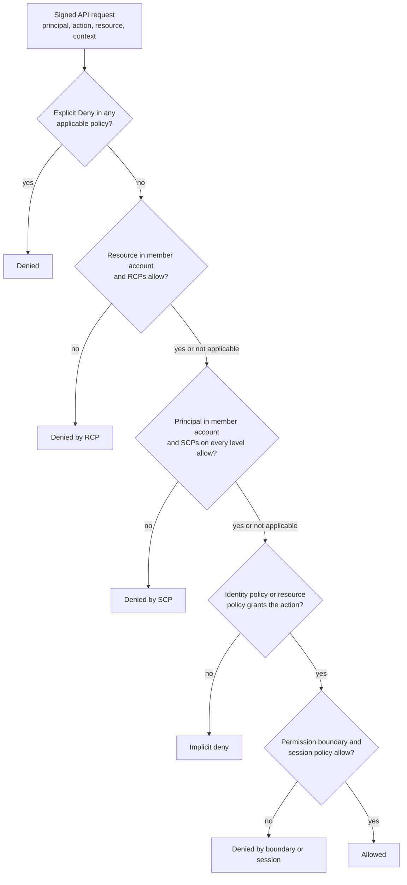

The diagram encodes three practical facts. First, organization policies are filters, not grants: a request that passes every guardrail still fails without an IAM grant, which is what the runnable example [02_multi_account_guardrails.py](../code/python/aws-chapter/02_multi_account_guardrails.py) demonstrates when `s3:DeleteBucket` is denied simply because no policy grants it. Second, SCPs filter by *who is calling* and RCPs filter by *whose resource is touched*, so a cross-organization request can be stopped by either side. Third, when a request is denied, the error message often tells you which policy type denied it; AWS includes the policy type in many `AccessDenied` messages, which makes this diagram a debugging guide as well as a design model.

### 5.6 Control Tower and the landing zone

AWS Control Tower is an orchestration layer on top of Organizations, IAM Identity Center, CloudTrail, AWS Config, and AWS CloudFormation StackSets. It sets up a **landing zone**: a predefined OU structure, a log-archive and an audit account, an organization trail, identity integration, and an account factory for vending new accounts. Its **controls** come in three behaviors: preventive controls implemented as SCPs or RCPs, detective controls implemented as AWS Config rules, and proactive controls implemented as CloudFormation hooks that block non-compliant templates before deployment.

Control Tower does not replace Organizations; it configures it. Every Control Tower guardrail is an Organizations policy or a Config rule you could inspect yourself. The practical decisions are whether to adopt Control Tower's opinionated structure or build an equivalent with infrastructure-as-code, how to handle drift when someone changes a Control Tower-managed resource directly, and how to roll out new controls progressively. Those decisions, and account vending in general, are owned by the [Landing Zones](CH15_Landing_Zones.md) chapter; Part 10's [Organizational Hierarchy and Landing Zones](../10_Cloud_Architecture/CH02_Organizational_Hierarchy_and_Landing_Zones.md) compares the providers.

### 5.7 How Azure and GCP differ

The three providers all have a hierarchy with inherited guardrails, but the units and the guardrail semantics differ:

- **Azure** uses a Microsoft Entra ID tenant, a management-group tree, subscriptions, and resource groups. The subscription is the closest analogue to an AWS account for billing and quotas, but identity lives in the tenant, not the subscription, so the identity boundary is wider than on AWS. Azure Policy can deny or modify resource *configurations* at deployment time, which is closer to AWS declarative policies and Control Tower proactive controls than to SCPs; Azure role-based access control (RBAC) grants and deny assignments handle authorization.
- **GCP** uses an organization, folders, and projects. The project is the resource and API container, while billing is attached through a separate billing account. Organization Policy constraints govern configuration, and IAM deny policies and principal access boundary policies provide permission ceilings.

The consequence for multi-cloud architects is that "one account per workload environment" on AWS does not translate mechanically into "one subscription" or "one project" elsewhere, because the identity and billing boundaries move.

## 6. Control plane, data plane, and static stability

### 6.1 The two planes

Every AWS service has a **control plane**, the APIs that create, read, update, delete, and list (CRUDL) resources, and a **data plane**, the path that delivers the service's primary function. For EC2, `RunInstances` and `ModifyInstanceAttribute` are control plane; the running instance, its network interface, and its EBS volume input/output (I/O) are data plane. For S3, `CreateBucket` and `PutBucketPolicy` are control plane; `GetObject` and `PutObject` are data plane. For DynamoDB, `CreateTable` and `UpdateTable` are control plane; `GetItem` and `PutItem` are data plane.

The planes have different engineering properties, and AWS documents the difference in its [Fault Isolation Boundaries](https://docs.aws.amazon.com/whitepapers/latest/aws-fault-isolation-boundaries/abstract-and-introduction.html) whitepaper:

| Property | Control plane | Data plane |
|---|---|---|
| Complexity | Workflows, validation, many dependencies | Deliberately simple, few dependencies |
| Request volume | Low | Very high |
| Consistency | Often asynchronous; changes propagate to the data plane | Serves the last configuration it received |
| Availability design | High, but lower than the data plane | Highest; designed to keep working when the control plane is impaired |
| Typical throttling | Low per-API rate limits | High or per-resource limits |

The key design implication is that the data plane caches the configuration it needs. A running EC2 instance does not ask the EC2 control plane for permission to keep running. A load balancer keeps routing to registered targets. An IAM role's credentials, once issued by STS, are validated by the target service without contacting the IAM control plane. Your design should exploit that property and avoid placing control-plane calls on the critical path of recovery.

### 6.2 Static stability

A system is **statically stable** if it keeps operating correctly when a dependency is impaired, *without having to make changes*. AWS uses the term for its own services and recommends it to customers. In practice it means two things:

1. **Pre-provision, do not react.** If losing one AZ out of three must not reduce capacity below demand, run enough capacity in the remaining two AZs *before* the failure. Reacting by launching instances during the event depends on the EC2 control plane, on capacity being available in the surviving AZs while every other customer is doing the same, and on your Auto Scaling group working correctly under stress.
2. **Keep recovery actions on the data plane.** Shift traffic using mechanisms that are data-plane operations, such as Route 53 health checks that are already configured, Amazon Application Recovery Controller routing controls, or load balancer target health, rather than by editing DNS records, creating new resources, or changing IAM policies during the incident.

The sizing arithmetic is straightforward. Suppose peak demand needs 12 instances' worth of capacity and you run in three AZs:

- **Reactive design:** 4 instances per AZ, 12 total. Losing one AZ leaves 8, which is 67% of peak, until Auto Scaling replaces the lost 4. If replacement takes 10 minutes and works, peak traffic sees 10 minutes of overload. If the control plane is degraded, it may not work.
- **Statically stable design:** to keep 12 after losing one AZ, the remaining two AZs need 6 each, so you run 6 per AZ, 18 total. That is 50% more capacity than peak. In general, with *n* AZs and a requirement to survive the loss of one, you need *n*/(*n* − 1) times peak: 1.5× for three AZs, 1.33× for four.

Teams often blend the two: provision for, say, 80% of peak after an AZ loss (6 × 0.8 ≈ 5 per AZ, 15 total, 1.25× peak) and accept degraded performance for the minutes Auto Scaling needs. The choice is a business decision, priced in instance-hours, and it belongs in the decision record.

### 6.3 Zonal failure with and without static stability

The sequence below contrasts the two designs during an AZ impairment in which the EC2 control plane for the Region is also slow, a combination that has occurred in real incidents.

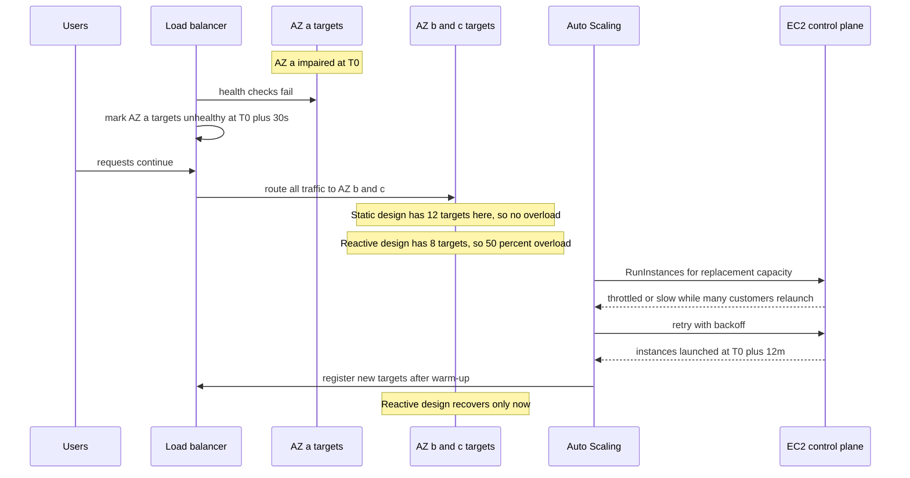

The statically stable design never needed the bottom half of the diagram to succeed. It still benefits from Auto Scaling restoring redundancy, but its customer-facing behavior does not depend on it. That is the distinction to look for in design reviews: which steps on the recovery path need a control plane, and what happens if those steps fail.

### 6.4 Global services and their control planes

A few AWS services are global within a partition. Their data planes are distributed, but their control planes run in one Region. AWS's [global services documentation](https://docs.aws.amazon.com/whitepapers/latest/aws-fault-isolation-boundaries/global-services.html) lists, among others:

| Service | Control plane location | Data plane |
|---|---|---|
| IAM | `us-east-1` | In every Region (authentication and authorization happen regionally) |
| AWS Organizations | `us-east-1` | Control-plane only; policies are enforced by each service |
| Route 53 | `us-east-1` (with a standby public-record endpoint in `us-west-2` announced in December 2025) | Global PoPs for public DNS; Regions for private hosted zones and health checks |
| CloudFront | `us-east-1` | Global PoPs |
| AWS Global Accelerator | `us-west-2` | Global PoPs |

Some regional services also have globally scoped *operations*. S3 bucket names are globally unique, so `CreateBucket` and `DeleteBucket` depend on `us-east-1` even when you create a bucket in Frankfurt, and several bucket-configuration APIs share that dependency. Creating a load balancer creates Route 53 records, so Elastic Load Balancing (ELB) provisioning depends on the Route 53 control plane.

This produces four rules for architects:

1. **Do not plan to edit IAM, DNS, or CloudFront during recovery.** Pre-create the roles, records, health checks, and distributions your failover needs, and switch traffic with data-plane mechanisms.
2. **Use regional STS endpoints**, such as `sts.eu-central-1.amazonaws.com`, rather than the legacy global endpoint, so that credential issuance in your Region does not depend on another Region. Credentials from any regional STS endpoint are valid in all Regions of the partition.
3. **Do not depend on creating a specific S3 bucket name** in a recovery workflow; create recovery buckets in advance.
4. **Treat global-service consoles like their control planes.** If the console for a global service is unavailable, the AWS Command Line Interface (CLI) against the same control plane is usually unavailable too.

An identity or key rotation is the other part-wide scenario this section touches. Rotating an IAM role's permissions or a KMS key policy is a control-plane change that propagates to regional data planes with a short, eventually consistent delay. A rotation runbook should therefore add the new credential or permission first, wait for propagation and verify it from each Region in use, and only then remove the old one. The [IAM](CH09_IAM.md) and [Secrets Management](CH13_Secrets_Management.md) chapters own the detailed rotation patterns.

## 7. Service scope: global, regional, and zonal

### 7.1 The three scopes

Every AWS resource has a **scope**, the smallest failure domain that contains it and the largest area across which it is usable without replication:

- **Zonal** resources live in one AZ and fail with it. EC2 instances, EBS volumes, subnets, zonal NAT gateways, and the nodes of a provisioned database instance are zonal.
- **Regional** resources are built by AWS across several AZs and survive the loss of one. VPCs, S3 buckets (in most storage classes), DynamoDB tables, SQS queues, Lambda functions, Application Load Balancers (ALBs), and EBS snapshots are regional.
- **Global** resources exist once per partition, with a control plane in a single Region and a distributed data plane: IAM roles and policies, Route 53 hosted zones, CloudFront distributions, and Organizations policies.

Scope tells you what you must do yourself to reach a given availability target. A zonal resource needs you to place copies in several AZs. A regional resource already spans AZs, so your remaining work is regional recovery. A global resource is shared across all your Regions, so its control plane is a dependency of every Region.

### 7.2 Scope of commonly used resources

| Resource | Scope | What the scope means in practice |
|---|---|---|
| IAM role, policy, user | Global (partition) | One definition used in every Region; changes depend on the `us-east-1` control plane |
| STS credentials | Issued regionally, valid partition-wide | Use regional STS endpoints |
| Route 53 public hosted zone | Global | Data plane at the edge; record changes depend on the control plane |
| S3 bucket | Regional data; global name | Objects stored in the bucket's Region across at least three AZs for standard classes; name uniqueness is global; S3 One Zone-Infrequent Access is zonal |
| EBS volume | Zonal | Attachable only to instances in the same AZ; survives instance failure, not AZ loss |
| EBS snapshot | Regional | Stored durably in the Region; restore into any AZ there, or copy to another Region |
| EC2 instance | Zonal | Placed in a subnet, therefore in one AZ |
| Amazon Machine Image (AMI) | Regional | Must be copied to use in another Region |
| VPC | Regional | Spans all AZs in the Region |
| Subnet | Zonal | Lives in exactly one AZ (or one Local Zone) |
| Security group | Regional, bound to a VPC | Referenced by interfaces in any AZ of that VPC |
| NAT gateway | Zonal by default; regional availability mode since November 2025 | A zonal NAT gateway fails with its AZ; a regional NAT gateway expands across AZs |
| Elastic Load Balancing (ELB) load balancer | Regional, with nodes per enabled AZ | Survives an AZ loss if targets exist in other enabled AZs |
| RDS DB instance, Multi-AZ | Primary zonal, standby in another AZ | Failover to the standby is automatic; a single-AZ instance is zonal |
| Amazon Aurora cluster | Storage regional (six copies across three AZs); instances zonal | Storage survives AZ loss; you need a replica in another AZ for fast compute failover |
| DynamoDB table | Regional | Global tables replicate across Regions |
| Lambda function | Regional | Runs across AZs; in a VPC it uses the subnets you give it, so give it several AZs |
| KMS key | Regional | Multi-Region keys exist for cross-Region decryption |

Two entries in that table generate many incidents. The first is **S3's split scope**: the bucket's data is in one Region, but the bucket name is a global namespace and some bucket-management calls depend on `us-east-1`. A Region-restriction SCP or a recovery plan must account for both halves. The second is **EBS's zonal scope**: an EBS volume cannot be attached across AZs, so a stateful EC2 workload with a single volume is a single-AZ workload no matter how many AZs its Auto Scaling group spans. The volume must be recovered from a snapshot, which is regional, into another AZ, and the recovery time is the snapshot restore time plus the warm-up of lazy-loaded blocks.

### 7.3 A scope map for a typical workload

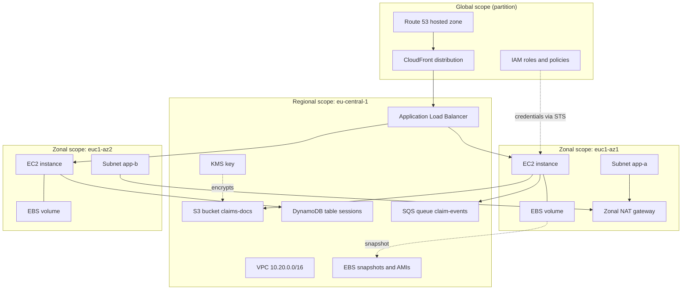

The map shows a defect that a scope review should catch: both application subnets route through `NAT1`, a zonal NAT gateway in `euc1-az1`. If that AZ fails, instances in `euc1-az2` survive but lose outbound internet access. The fixes are one zonal NAT gateway per AZ with per-AZ route tables, or a NAT gateway in regional availability mode. The map also shows why scope is listed per resource rather than per service: the workload uses EC2 (zonal instances), EBS (zonal volumes, regional snapshots), and VPC (regional network, zonal subnets) at the same time.

## 8. Shared responsibility by service type

### 8.1 The model

AWS's shared-responsibility model divides security and operations into "security *of* the cloud", which AWS owns (facilities, hardware, the global network, the virtualization layer, and the software of managed services), and "security *in* the cloud", which the customer owns (data, identities, configuration, and whatever software the customer runs). The model is often drawn as a single line. In practice the line moves with every service, and the useful question is always "for *this* service, which layers are mine?"

The general cross-provider form of this model is recapped in [Cloud Architecture Foundations](../10_Cloud_Architecture/CH01_Cloud_Architecture_Foundations.md). This section owns the AWS-specific boundary for the four service types that most designs combine.

### 8.2 The boundary for EC2, RDS, Lambda, and S3

```mermaid
flowchart LR
    subgraph EC2S["EC2: infrastructure service"]
        direction TB
        e1["Data and access policy: CUSTOMER"]
        e2["Application and runtime: CUSTOMER"]
        e3["Guest operating system patching: CUSTOMER"]
        e4["Network config, security groups: CUSTOMER"]
        e5["Hypervisor, host, hardware: AWS"]
        e6["Facilities and network backbone: AWS"]
        e1 --> e2 --> e3 --> e4 --> e5 --> e6
    end
    subgraph RDSS["RDS: managed database"]
        direction TB
        r1["Data, users, grants: CUSTOMER"]
        r2["Schema, queries, parameters: CUSTOMER"]
        r3["Backup retention, Multi-AZ choice, exposure: CUSTOMER"]
        r4["Engine patching in maintenance window: AWS"]
        r5["Operating system, host, storage: AWS"]
        r6["Facilities: AWS"]
        r1 --> r2 --> r3 --> r4 --> r5 --> r6
    end
    subgraph LAMS["Lambda: serverless compute"]
        direction TB
        l1["Data and function permissions: CUSTOMER"]
        l2["Function code and dependencies: CUSTOMER"]
        l3["Concurrency, timeout, VPC config: CUSTOMER"]
        l4["Managed runtime patching: AWS"]
        l5["Execution environment and fleet: AWS"]
        l6["Facilities: AWS"]
        l1 --> l2 --> l3 --> l4 --> l5 --> l6
    end
    subgraph S3S["S3: abstracted storage"]
        direction TB
        s1["Data classification and retention: CUSTOMER"]
        s2["Bucket policy, Block Public Access: CUSTOMER"]
        s3["Encryption choice, versioning, replication: CUSTOMER"]
        s4["Durability, scaling, service software: AWS"]
        s5["Storage hardware and facilities: AWS"]
        s1 --> s2 --> s3 --> s4 --> s5
    end
```

Read each column from the top. The customer always owns the top layers: data, who can access it, and how the service is configured. What changes is how far down the customer's ownership extends.

- **EC2 (infrastructure).** The customer owns the guest operating system (OS): patches, agents, hardening, local firewall, disk encryption choices, and backups of instance-store data. AWS owns everything beneath the hypervisor boundary. Most EC2 incidents that customers experience as "AWS problems" are actually guest-level issues such as an unpatched kernel, a full root volume, or an expired certificate.
- **RDS (managed service).** AWS installs and patches the database engine and operating system, monitors the host, replaces failed storage, and performs automated backups and Multi-AZ failover. The customer still decides whether Multi-AZ is on, how long backups are kept, whether the instance is publicly accessible, which minor-version upgrades are applied and when, how credentials are managed, and how queries and indexes perform. The customer also owns *testing restores*: AWS takes the snapshot, but only the customer can confirm the application recovers from it.
- **Lambda (serverless).** AWS patches the managed runtime and the execution environment. The customer owns the code, its third-party dependencies, the function's IAM role, its concurrency limits, its timeouts, and its retry and idempotency behavior. A function packaged with a vulnerable library is the customer's vulnerability, even though AWS patched the runtime. If the function uses a container image or a custom runtime, the customer also owns the patching of that image.
- **S3 (abstracted service).** AWS owns durability, availability, and the service software. The customer owns everything about access and data lifecycle: bucket policies, S3 Block Public Access settings, encryption with S3-managed keys or KMS keys, versioning, Object Lock, replication, and lifecycle rules. Nearly every S3 data exposure is a customer-side configuration failure.

### 8.3 Responsibilities that never move

Some responsibilities stay with the customer for every service type:

1. **Identity and access.** Who can call which APIs and read which data.
2. **Data classification, residency, and retention.**
3. **Recovery objectives.** AWS provides mechanisms such as snapshots, point-in-time recovery, and cross-Region replication; the customer decides the Recovery Time Objective (RTO) and Recovery Point Objective (RPO), configures the mechanisms, and proves them with restore tests.
4. **Architecture for availability.** A managed service is regional or zonal as documented. Multi-AZ and multi-Region choices are the customer's.
5. **Logging and detection configuration.** CloudTrail management events are recorded by default for 90 days in Event history; organization trails, data events, long-term retention, and alerting are customer decisions.

### 8.4 Worked scenario: moving a database from EC2 to RDS

A team runs PostgreSQL on two EC2 instances with streaming replication, scripted failover, and nightly `pg_dump` backups to S3. It spends about two engineer-days per month on patching, backup verification, and replication repairs. It evaluates Amazon RDS for PostgreSQL in a Multi-AZ deployment.

The responsibility ledger before and after:

| Task | On EC2 | On RDS Multi-AZ |
|---|---|---|
| OS patching | Customer | AWS |
| Engine minor-version patching | Customer | AWS, in a customer-chosen maintenance window, if auto minor upgrade is on |
| Replication and failover | Customer scripts | AWS-managed synchronous standby, automatic failover |
| Backups | Customer `pg_dump` | Automated snapshots and transaction logs for point-in-time restore, retention set by customer |
| Restore testing | Customer | Customer |
| Network exposure, security groups | Customer | Customer |
| Credentials and rotation | Customer | Customer, optionally with Secrets Manager integration |
| Query tuning, extensions, parameters | Customer | Customer, within supported extensions and parameters |
| Superuser access to OS and file system | Available | Not available |

The move transfers roughly the bottom half of the stack to AWS and removes most of the two engineer-days. It also removes OS access and limits extensions to those RDS supports. The team's decision depends on whether any required extension or OS-level tool is unsupported. If one is, the realistic alternatives are staying on EC2, removing the dependency, or checking whether Aurora PostgreSQL supports it. Amazon RDS Custom, which grants OS access to a managed database, supports only some engines (Oracle and SQL Server at the time of writing), so it is not an option here. The general rule is to check the specific engine, version, and feature against current documentation before assuming that a "custom" or "advanced" variant of a managed service exists.

## 9. IAM essentials for navigating AWS

The [IAM](CH09_IAM.md) chapter owns IAM's full policy language, evaluation logic, federation, and workload identity. This section gives the minimum an architect needs to navigate accounts and to read a role-assumption path.

### 9.1 Principals

- **Root user.** One per account, created with the account. It can do anything in the account that organization policies allow, including closing it. Use it only for the few tasks that require it, protect it with multi-factor authentication (MFA), and in member accounts consider centrally managed root access, which lets the organization remove root credentials from member accounts.
- **IAM users.** Long-term identities with passwords or access keys. Modern designs avoid them for humans and for workloads running on AWS, because long-lived access keys are the most common credential leaked in incidents.
- **IAM roles.** Identities with no long-term credentials. A principal assumes a role and receives temporary credentials from STS: an access key ID, a secret access key, and a session token, valid for between 15 minutes and the role's maximum session duration of up to 12 hours. Role chaining, where one assumed role assumes another, limits sessions to one hour.
- **AWS IAM Identity Center.** The workforce sign-in service. It connects to an external identity provider such as Microsoft Entra ID or Okta through Security Assertion Markup Language (SAML) 2.0, with user provisioning through the System for Cross-domain Identity Management (SCIM) protocol, or uses its own directory, and maps groups to **permission sets** in accounts. Behind the scenes, Identity Center creates IAM roles in each assigned account and federates users into them.
- **Service principals and service-linked roles.** AWS services act on your behalf as service principals (for example `lambda.amazonaws.com`) assuming roles you define, or through service-linked roles that the service creates and owns.

### 9.2 Two policies on every role

Every role has two policies that answer different questions. The **trust policy** is a resource-based policy that says *who may assume the role*. The **permissions policies** say *what the role may do* once assumed. A cross-account role in `payments-prod` that a deployment pipeline in a tooling account may assume looks like this:

```json
{
  "Version": "2012-10-17",
  "Statement": [
    {
      "Effect": "Allow",
      "Principal": {"AWS": "arn:aws:iam::222222222222:role/deploy-pipeline"},
      "Action": "sts:AssumeRole",
      "Condition": {
        "StringEquals": {"aws:PrincipalOrgID": "o-exampleorgid"}
      }
    }
  ]
}
```

Naming the exact role ARN, rather than the whole account (`arn:aws:iam::222222222222:root`), keeps the trust edge narrow. The `aws:PrincipalOrgID` condition is a belt-and-braces check that the caller still belongs to the organization. For a third party, an external ID condition (`sts:ExternalId`) defends against the confused-deputy problem.

### 9.3 The role-assumption path

The sequence below shows the two most common paths in one picture: an engineer signing in through Identity Center to operate in a production account, and an application on EC2 calling S3 with instance-profile credentials.

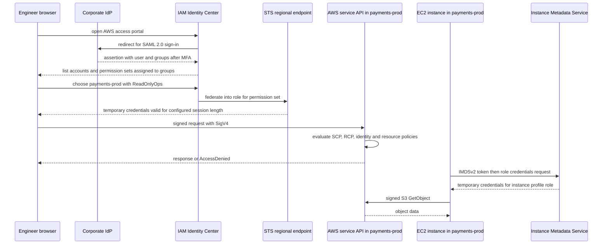

Several facts in this diagram matter for design:

- **No long-term secret leaves the identity provider.** The engineer's credentials end at the identity provider (IdP); AWS sees only a signed assertion, and the engineer holds only temporary STS credentials. Revoking access means disabling the user in the IdP and, for live sessions, revoking active role sessions.
- **The instance never stores a key.** EC2 delivers instance-profile credentials through the Instance Metadata Service (IMDS) and rotates them automatically before expiry. Enforcing IMDSv2, which requires a session token obtained with a `PUT` request, blocks a class of server-side request forgery attacks that read credentials through IMDSv1.
- **Authorization happens at the service.** Every request is signed with Signature Version 4 (SigV4) and evaluated by the target service against the policies in Section 5.5. STS issues credentials; it does not decide what they can do.
- **Cross-account access is a second `AssumeRole`.** If the pipeline in the tooling account deploys into `payments-prod`, its role calls `sts:AssumeRole` on the prod role whose trust policy appears in Section 9.2. That trust edge is exactly what the account-compromise scenario in Section 4.4 inspects.

Azure and GCP differ in the shape of the path rather than the principle. In Azure, identities live in the Entra ID tenant and receive role assignments at management-group, subscription, resource-group, or resource scope; there is no "assume a role in another subscription" step because the same identity is granted roles in many subscriptions. In GCP, principals receive IAM role bindings on resources in the hierarchy, and workloads use service accounts; cross-project access is a binding, while impersonation of a service account is the closest analogue to `AssumeRole`. The [IAM](CH09_IAM.md) chapter compares these models in detail.

## 10. VPC, subnets, and the route path

The [Networking](CH05_Networking.md) chapter owns route tables, NAT, endpoints, peering, Transit Gateway, and hybrid connectivity in depth. Security groups versus network access control lists (network ACLs) are taught in [Firewalls](../05_Networking_and_OS/CH14_Firewalls.md), and NAT translation mechanics in [NAT](../05_Networking_and_OS/CH12_NAT.md). This section gives the operating-model view: what the pieces are, how scope applies to them, and how to trace a packet.

### 10.1 The building blocks

- A **VPC** is a regional, logically isolated network with one or more Internet Protocol version 4 (IPv4) Classless Inter-Domain Routing (CIDR) blocks and optionally IPv6 blocks, from which it assigns Internet Protocol (IP) addresses. It spans all AZs in its Region.
- A **subnet** is a range within the VPC that lives in exactly one AZ. Subnets are where zonal placement becomes concrete: an instance's AZ is its subnet's AZ.
- A **route table** is associated with one or more subnets and decides the next hop for each destination prefix. Every route table contains an immutable `local` route for the VPC's CIDR, so all subnets in a VPC can reach each other unless filtered.
- An **internet gateway** attached to the VPC lets subnets whose route table sends `0.0.0.0/0` to it reach the internet, provided the instance has a public IPv4 address or the traffic is IPv6. A subnet is "public" only because of that route, not because of a label.
- A **NAT gateway** lets instances in private subnets start outbound connections to the internet without being reachable inbound. A public NAT gateway sits in a public subnet in zonal mode, or is created in regional availability mode without needing public subnets.
- **VPC endpoints** give private access to AWS services. *Gateway endpoints* for S3 and DynamoDB are route-table entries pointing to a prefix list and carry no hourly or per-GB charge. *Interface endpoints* (AWS PrivateLink) place elastic network interfaces (ENIs) with private IPs in your subnets for most other services, and are billed per endpoint-hour per AZ plus per gigabyte (GB) processed.
- **Security groups** are stateful filters attached to ENIs. **Network ACLs** are stateless filters attached to subnets.

### 10.2 Tracing a packet

The diagram traces three flows from an application instance in a private subnet: a call to an S3 bucket through a gateway endpoint, a call to a third-party API on the internet through a NAT gateway, and an inbound user request through an ALB.

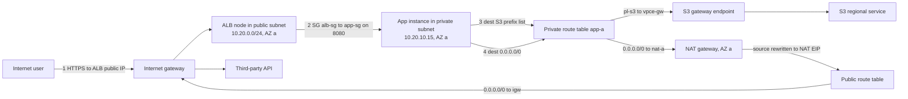

Follow the numbered flows:

1. **Inbound.** The user resolves the ALB's DNS name and connects to a public IP of an ALB node. The internet gateway delivers the packet to the ALB node in a public subnet. The ALB terminates Transport Layer Security (TLS) and opens a new connection to a registered target.
2. **ALB to app.** The target is in a private subnet. The app's security group allows port 8080 only from the ALB's security group, which is a reference to a group rather than a CIDR. Because security groups are stateful, the return traffic is allowed automatically.
3. **App to S3.** The app's route table contains a route whose destination is the S3 managed prefix list for the Region and whose target is the gateway endpoint. Longest-prefix match selects it over the default route, so S3 traffic never touches the NAT gateway. An endpoint policy and the bucket policy can both restrict access, for example with an `aws:SourceVpce` condition.
4. **App to internet.** Everything else matches `0.0.0.0/0` and goes to the NAT gateway in the same AZ. The NAT gateway rewrites the source to its Elastic IP address, and the public subnet's route table sends the packet to the internet gateway.

The diagram also shows where cost and failure hide. Flow 4 is billed twice, once for NAT processing and once for internet data transfer out, while flow 3 is free of both. If `nat-a` sits in AZ a and an app subnet in AZ b routes to it, AZ b's internet egress pays cross-AZ transfer as well and fails when AZ a fails. Section 14 prices these paths.

### 10.3 Common VPC design decisions

| Decision | Typical choice | Reason | Alternative and when it wins |
|---|---|---|---|
| CIDR size | A `/16` or `/20` per VPC from a central plan managed with Amazon VPC IP Address Manager (IPAM) | Avoid overlaps that block later peering or Transit Gateway routing | Smaller ranges where address space is scarce, accepting tighter subnet sizing |
| Subnet tiers | Public (load balancers, NAT), private app, private data, one per AZ for each tier | Exposure is set by routes; per-AZ subnets give per-AZ routing | Fewer tiers for simple workloads |
| AZ count | Three | Survive one AZ loss with static stability at 1.5× | Two AZs to save cost, accepting 2× static-stability overprovisioning |
| Egress | Per-AZ NAT gateways or one regional NAT gateway; centralized egress in a network account for large estates | Removes cross-AZ dependency; central egress allows inspection | Interface and gateway endpoints for AWS service traffic to cut NAT processing |
| Inter-VPC | Transit Gateway or AWS Cloud WAN for many VPCs; peering for a few | Peering is non-transitive and becomes a mesh | Amazon VPC Lattice or PrivateLink for service-level rather than network-level connectivity |

## 11. EC2 and the AWS service families

### 11.1 EC2 anatomy

EC2 is the base layer under much of AWS, including many managed services, so its vocabulary appears everywhere. The [Compute](CH04_Compute.md) chapter owns instance selection, images, autoscaling, and placement in depth. An instance is assembled from these parts:

- An **AMI**, a regional image containing the root volume snapshot, boot settings, and permissions on who may launch it.
- An **instance type**, whose name encodes family, generation, processor options, and size. In `m7g.xlarge`, `m` is the general-purpose family, `7` the generation, `g` an AWS Graviton (Arm) processor, and `xlarge` the size (4 vCPUs). Families such as `c` (compute-optimized), `r` (memory-optimized), `i` (storage-optimized), and `p` or `g` (accelerated) trade processor (CPU), memory, storage, and accelerator ratios.
- One or more **ENIs** in subnets of one AZ, carrying private IPs, optional public IPs, and security groups.
- **Storage**: EBS volumes, which are network-attached, persistent, and zonal, and possibly **instance store** volumes, which are physically attached and lost when the instance stops or its host fails.
- An **instance profile**, the container that passes an IAM role to the instance through IMDS.
- **User data** and launch templates that bootstrap the instance.

Modern instances run on the **AWS Nitro System**, which offloads networking, storage, and management to dedicated hardware and uses a minimal hypervisor. Nitro is the technical basis for AWS's claim that AWS operators have no mechanism to access customer memory on Nitro instances; virtualization fundamentals are taught in [Virtualization and Container Fundamentals](../05_Networking_and_OS/CH28_Virtualization_and_Container_Fundamentals.md).

### 11.2 The instance lifecycle

Many operational surprises on EC2 come from the lifecycle: what persists across stop and start, what is lost on termination, and how Spot interruptions arrive.

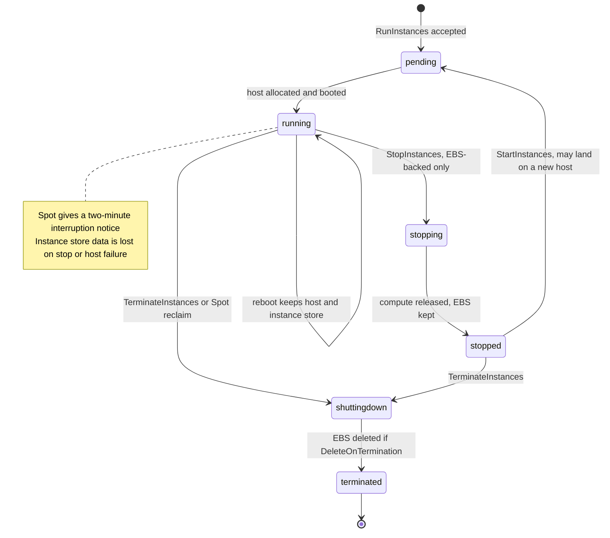

Three behaviors in this state machine drive design. A **stop and start** usually moves the instance to new hardware, which is why it fixes many hardware-related problems, and why instance store data and an auto-assigned public IPv4 address do not survive it. **Termination** deletes root EBS volumes by default, so state that matters must live on separately managed volumes, snapshots, or services. **Spot** instances can be reclaimed with a two-minute warning delivered through instance metadata and Amazon EventBridge, so Spot fits stateless, interruptible, or checkpointed work.

### 11.3 Purchase options in one paragraph

EC2 capacity is bought in several ways: On-Demand, billed per second for most Linux instances; Savings Plans and Reserved Instances, which trade a one- or three-year commitment for a lower rate; Spot, which sells spare capacity at a steep discount with interruption; and On-Demand Capacity Reservations or Capacity Blocks, which reserve capacity in a specific AZ, the only option that guarantees capacity rather than price. Commitments are a billing construct and do not guarantee capacity, a distinction that matters in the quota and capacity scenario of Section 13. Commitment strategy belongs to [Cost Optimization](CH14_Cost_Optimization.md); capacity economics belong to [Compute](CH04_Compute.md).

### 11.4 The service families

AWS's catalog becomes navigable when each service is read through three questions: which family does it belong to, what is its scope, and which Part 09 chapter owns its mechanics?

| Family | Representative services | Typical scope | Owning chapter |
|---|---|---|---|
| Compute | EC2, EC2 Auto Scaling, AWS Batch, Elastic Beanstalk | Zonal instances, regional groups | [Compute](CH04_Compute.md) |
| Containers | Amazon Elastic Container Service (ECS), Amazon Elastic Kubernetes Service (EKS) including EKS Auto Mode, AWS Fargate, ECR | Regional control planes, zonal tasks and nodes | [Containers](CH07_Containers.md), [Kubernetes](CH08_Kubernetes.md) |
| Serverless compute and workflow | Lambda, AWS Step Functions | Regional | [Serverless](CH11_Serverless.md) |
| Storage | S3, EBS, Amazon Elastic File System (EFS), Amazon FSx, AWS Backup | S3 and EFS regional; EBS zonal | [Storage](CH06_Storage.md) |
| Databases | RDS, Aurora, DynamoDB, Amazon ElastiCache, Amazon Aurora DSQL | Mostly regional with zonal nodes; multi-Region options | [Storage](CH06_Storage.md) and Part 06 |
| Messaging and events | SQS, Amazon Simple Notification Service (SNS), EventBridge, Amazon Kinesis Data Streams, Amazon Managed Streaming for Apache Kafka (MSK) | Regional | [Messaging](CH12_Messaging.md) |
| Networking and edge | VPC, ELB, Transit Gateway, AWS Direct Connect, Route 53, CloudFront, Global Accelerator, VPC Lattice | Regional networks, global edge | [Networking](CH05_Networking.md) |
| Identity and secrets | IAM, Identity Center, STS, KMS, Secrets Manager, AWS Certificate Manager (ACM) | IAM global; KMS and secrets regional | [IAM](CH09_IAM.md), [Secrets Management](CH13_Secrets_Management.md) |
| Security operations | GuardDuty, Security Hub, AWS WAF, AWS Shield, Amazon Inspector, Amazon Macie | Regional with organization aggregation | Part 15 |
| Observability and audit | Amazon CloudWatch, AWS X-Ray, CloudTrail, AWS Config | Regional with cross-account features | [Monitoring](CH10_Monitoring.md) |
| Governance and cost | Organizations, Control Tower, Service Quotas, AWS Cost Explorer, AWS Budgets | Global or single-Region control planes | [Landing Zones](CH15_Landing_Zones.md), [Cost Optimization](CH14_Cost_Optimization.md) |

The table is a navigation aid, not a statement of equivalence. Two services in the same family can give very different guarantees. SQS standard queues provide at-least-once delivery with best-effort ordering, while SQS first-in, first-out (FIFO) queues provide ordering within a message group with lower throughput per group. DynamoDB and Aurora are both "databases" with nothing else in common at the level of consistency, scaling, and failure behavior.

## 12. Managed-service patterns

### 12.1 Four ways AWS runs a managed service

A managed service's architecture determines where it lives in your network, how it fails, and what you can tune. Most AWS managed services follow one of four patterns:

| Pattern | Examples | Where it runs | How you reach it | Failure and maintenance behavior |
|---|---|---|---|---|
| **AWS-owned regional fleet** | S3, DynamoDB, SQS, SNS, KMS | AWS's own accounts and networks, across AZs | Regional public endpoint, or privately through gateway or interface endpoints | AWS handles AZ failure inside the service; you see it as elevated errors or latency, if at all |
| **Managed instances in your VPC** | RDS, Aurora, ElastiCache, Amazon OpenSearch Service, Amazon MQ | AWS-managed instances whose ENIs sit in your subnets | Private IPs and DNS names in your VPC | Zonal nodes; Multi-AZ options with DNS-based failover; maintenance windows for patching |
| **Managed control plane, customer data plane** | EKS with self-managed or managed node groups, ECS on EC2 | AWS-run control plane; workers are EC2 instances in your account | Cluster API endpoint; workloads on your nodes | Control plane highly available across AZs; node patching and capacity are yours unless you choose Fargate or EKS Auto Mode |
| **Serverless with optional VPC attachment** | Lambda, Fargate tasks, Step Functions | AWS-owned fleet | Service API or event sources; ENIs in your subnets when attached to a VPC | AWS spreads execution across AZs; VPC-attached functions depend on the subnets you supply |

The pattern answers practical questions before a proof of concept. Does the service consume IP addresses in my subnets? (Managed instances and VPC-attached serverless do; AWS-owned fleets do not.) Will traffic to it cross a NAT gateway? (AWS-owned fleets will, unless you add an endpoint.) Who chooses the patch time? (Managed instances use maintenance windows; AWS-owned fleets patch invisibly.)

### 12.2 DNS-based failover and client behavior

Managed instances in your VPC usually fail over by changing what a DNS name points to. When a Multi-AZ RDS primary fails, RDS promotes the standby and updates the instance's DNS endpoint to the new primary. AWS documents typical failover times in the range of one to two minutes for RDS Multi-AZ DB instances; Multi-AZ DB clusters with two readable standbys and Aurora usually fail over faster. The service-side failover is only half of recovery time. The other half is client behavior:

- Clients that cache DNS results indefinitely, such as a Java Virtual Machine with an unbounded DNS cache, keep connecting to the old address.
- Connection pools hold dead connections until they time out.
- Applications without retry logic surface the failover as user-visible errors.

A worked recovery budget makes the point. If the service fails over in 60 seconds, the DNS record has a 5-second time to live (TTL), the client honors TTL, and the connection pool validates connections on borrow with a 10-second timeout, the application recovers in about 60 + 5 + 10 = 75 seconds. With an unbounded DNS cache, it does not recover until restarted. The test for this is a forced failover in a staging environment while the application is under load; RDS exposes a reboot-with-failover operation for exactly that purpose. Amazon RDS Proxy, which keeps connections to the database and hides failover from clients, is a common mitigation.

### 12.3 Service-linked roles and AWS acting on your behalf

Managed services need permissions in your account: RDS needs to manage ENIs in your VPC; Auto Scaling needs to launch instances; Organizations-integrated services need to read account data. AWS implements this with **service-linked roles**, predefined IAM roles owned by the service with a trust policy only that service can use. Service-linked roles explain two exceptions met earlier. SCPs and RCPs do not restrict them, because a guardrail that blocked RDS from managing its own network interfaces would break the service in ways the customer could not diagnose. And they cannot be edited by the customer, only deleted when no resources depend on them. Audit their use through CloudTrail like any other role.

### 12.4 Managed-service failure modes

The common failure modes of managed services are not "AWS breaks it". They are:

1. **Hidden quotas.** Connection limits, partition throughput, API rates, or payload sizes that the proof of concept never approached.
2. **Assumed scope.** Treating a single-AZ deployment option as regional, for example an ElastiCache cluster without replicas in another AZ.
3. **Maintenance surprises.** Engine minor-version upgrades or certificate rotations that require client changes, such as the periodic rotation of RDS certificate authorities.
4. **Network coupling.** VPC-attached services consuming IP addresses until a subnet runs out, which blocks scaling of unrelated workloads in the same subnet.
5. **Control-plane reliance.** Recovery runbooks that create a new cluster or restore a snapshot under incident pressure, which is a control-plane operation subject to quotas and throttling.

## 13. Service Quotas and API throttling

### 13.1 Kinds of limits

AWS limits come in three kinds, and a capacity plan must track all of them:

- **Resource quotas** cap how much of something an account can have in a Region: running On-Demand vCPUs per instance-family group, VPCs per Region, Lambda concurrent executions, EBS storage per volume type, and so on.
- **Rate limits and API throttling** cap how fast you can call an API, usually per account and Region and per API action. These protect the control plane.
- **Fixed service limits** are design constraints that cannot be raised, such as Lambda's 15-minute maximum function timeout for standard functions or the maximum size of an S3 object.

Many resource quotas and most rate limits are **adjustable** on request; fixed limits are not. Quotas are scoped to the **account and Region** for regional services, so a multi-account design multiplies headroom, and an application that suddenly needs a new Region also needs its quotas raised there.

### 13.2 Finding and watching quotas

The **Service Quotas** service is the single place to view applied and default values, request increases, and see request history. Many services publish usage against quotas as Amazon CloudWatch metrics in the `AWS/Usage` namespace, so you can alarm at, for example, 80% of a quota. In an organization, **quota request templates** apply a standard set of increases automatically to new accounts as they are created, which removes the "new account, default quotas" trap for vended accounts. AWS Trusted Advisor includes service-limit checks as well.

Default quota values vary by account age and history, and AWS often starts new accounts below the published defaults and raises them with usage. The Lambda documentation states that new accounts have reduced concurrency quotas that AWS raises automatically, while the published default is 1,000 concurrent executions per Region ([Lambda quotas](https://docs.aws.amazon.com/lambda/latest/dg/gettingstarted-limits.html), at the time of writing; verify current quotas). The practical rule is to read the *applied* quota for your account in Service Quotas, never the default from a blog post.

### 13.3 How API throttling works

EC2 implements throttling with **token buckets**, and many other AWS services use the same model ([EC2 API throttling](https://docs.aws.amazon.com/ec2/latest/devguide/ec2-api-throttling.html)). Each API action has a bucket with a maximum capacity, which is the burst allowance, and a refill rate, which is the sustained rate. Each request removes one token; when the bucket is empty, requests fail with `RequestLimitExceeded` until tokens refill. EC2 groups actions into categories, such as non-mutating `Describe*` calls, unfiltered and unpaginated describes, mutating calls, and resource-intensive calls, each with different buckets.

Some actions use **resource rate limiting** in addition to request rate limiting. At the time of writing, AWS documents `RunInstances` with a default request bucket of 5 tokens refilling at 2 per second, and a separate resource bucket of 1,000 instances refilling at 2 instances per second. You can launch 1,000 instances immediately in any combination of requests, and after that bucket is empty you can launch only about 2 per second. Verify current values in Service Quotas, where each bucket appears as two quotas: maximum capacity and refill rate.

Clients should retry throttled calls with **exponential backoff and jitter**. The AWS software development kits (SDKs) implement this by default, with configurable retry modes. The thundering-herd reasoning behind jitter is taught in [WebSockets](../05_Networking_and_OS/CH17_WebSockets.md), and limiter design generally in [Rate Limiting](../08_API_Architecture/CH11_Rate_Limiting.md). The AWS-specific lesson is that throttling is shared: every pipeline, controller, monitoring agent, and human in the same account and Region draws from the same buckets. A monitoring tool that polls `DescribeInstances` without pagination can throttle the deployment pipeline.

### 13.4 Worked scenario: quota and capacity limits during scale-out

An online retailer runs its checkout tier on `m7i.xlarge` instances (4 vCPUs each) in one account in `eu-west-1`. Normal peak is 150 instances. For a sale event, the forecast is 3.5× normal peak, or 525 instances.

**Step 1: resource quota.** The applied quota for *Running On-Demand Standard instances*, which counts vCPUs across the standard families, is 1,024 vCPUs in this example account. Checkout's 150 instances use 600 vCPUs and other workloads use 160, so 760 are in use. Headroom is 1,024 − 760 = 264 vCPUs, which fits only 264 ÷ 4 = 66 more instances against the 375 needed. The event needs 525 × 4 = 2,100 vCPUs for checkout plus the 160 used elsewhere, so 2,260 vCPUs. The team requests an increase to 2,600 vCPUs, about 15% above the need, two weeks before the event, because quota increases can take time and large ones may need review.

**Step 2: launch rate.** Scaling from 150 to 525 instances means launching 375. The resource bucket has 1,000 tokens if nothing else has drawn it down, so the launches are not rate-limited by resources. But a nightly batch job in the same account launches 900 instances at 01:00 and terminates them by 03:00. If the sale begins at 06:00, the bucket has had three hours to refill at 2 per second, which is 21,600 tokens' worth, so it is full. If the batch job overlaps the sale, only about 100 tokens remain, and the remaining 275 launches take 275 ÷ 2 ≈ 138 seconds. That is acceptable here; for a larger event it would argue for moving the batch job to a separate account.

**Step 3: physical capacity.** A quota is permission, not capacity. During large events, a specific instance type in a specific AZ can be temporarily unavailable, which surfaces as `InsufficientInstanceCapacity`. The team diversifies the Auto Scaling group across `m7i`, `m6i`, and `m7g` instance types (after testing on Graviton), uses all three AZs, and buys On-Demand Capacity Reservations for the 375 additional instances for the event window, because that is the only purchase option that reserves capacity.

**Step 4: dependent quotas.** Scaling the web tier also scales its dependencies: database connections, ALB targets, NAT gateway connections, Secrets Manager calls at startup, and IP addresses in the subnets. Each `/24` subnet provides 251 usable addresses after AWS reserves five; three subnets give 753, enough for 525 instances plus other ENIs, but not with much margin if the team later adds VPC-attached Lambda functions to the same subnets.

The sequence below shows how the scale-out would look if the team had skipped step 1.

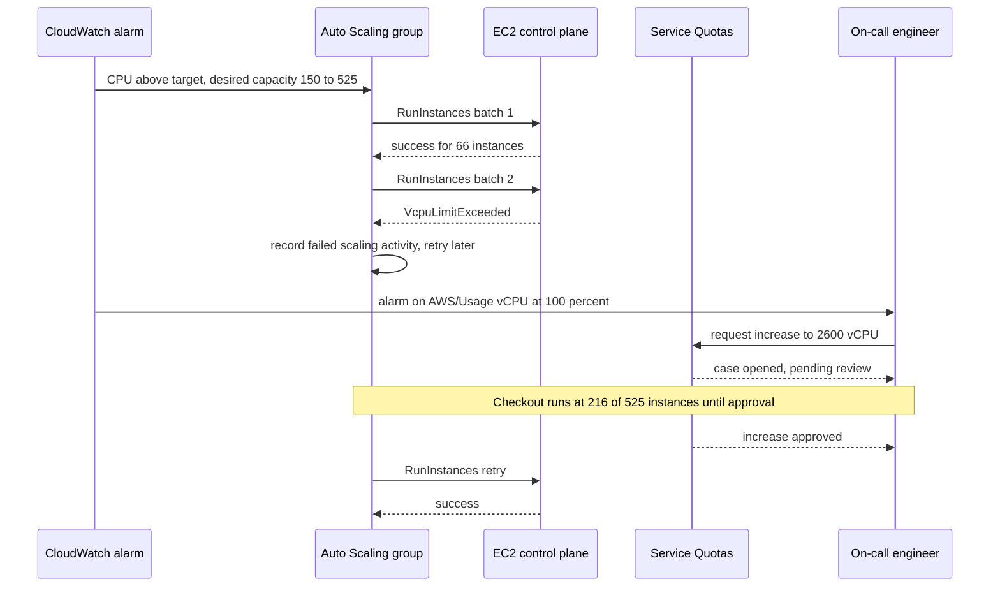

The quality scenario for this case:

| Element | Value |
|---|---|
| **Stimulus** | Traffic rises to 3.5× normal peak within 20 minutes at the start of a sale |
| **Environment** | Single production account and Region; capacity plan, quota increase, and capacity reservations prepared two weeks earlier |
| **Expected response** | Auto Scaling reaches 525 instances without any `VcpuLimitExceeded`, `RequestLimitExceeded` that exhausts SDK retries, or `InsufficientInstanceCapacity` errors |
| **Measure** | Desired capacity reached within 10 minutes of the scaling decision; quota utilization below 90% at peak; checkout p99 latency within its objective throughout |

Error codes point to different causes and different fixes:

| Error | Cause | Fix |
|---|---|---|
| `VcpuLimitExceeded` | Account's applied vCPU quota for the family group reached | Raise quota in advance; alarm on `AWS/Usage` |
| `RequestLimitExceeded` | API token bucket empty | Backoff and jitter; reduce polling; separate noisy workloads into other accounts; request higher refill rate |
| `InsufficientInstanceCapacity` | AWS has no capacity for that type in that AZ right now | Diversify types and AZs; Capacity Reservations for known events |
| `InsufficientFreeAddressesInSubnet` | Subnet out of IP addresses | Larger or additional subnets; prefix delegation planning |

## 14. Pricing dimensions

### 14.1 What AWS meters

The [Cost Optimization](CH14_Cost_Optimization.md) chapter owns billing data, allocation, commitments, and optimization tools. An architect needs to know the dimensions the bill is built from, because the architecture determines them before the first invoice. Almost every AWS charge is a product of one of these dimensions and a unit rate that varies by Region:

| Dimension | Unit | Examples |
|---|---|---|
| **Provisioned compute time** | Instance-seconds or hours, vCPU-hours, GB-hours | EC2, RDS instances, Fargate tasks, NAT gateway hours, interface endpoint hours |
| **Execution or request volume** | Per request, per million requests, per GB-second | Lambda invocations and duration, S3 `PUT` and `GET`, SQS requests, API Gateway calls, KMS API calls |
| **Stored data** | GB-month, sometimes with provisioned input/output operations per second (IOPS) or throughput | S3 by storage class, EBS by volume type, snapshots, CloudWatch Logs storage |
| **Data processed** | Per GB through a managed component | NAT gateway processing, interface endpoints, load balancer capacity units, CloudWatch Logs ingestion |
| **Data transfer** | Per GB by path | Internet egress, inter-Region, inter-AZ |
| **Fixed or per-resource fees** | Per month or per hour | Public IPv4 addresses, Route 53 hosted zones, KMS customer managed keys, support plans |

### 14.2 Data transfer: the dimension architecture controls most

Data transfer prices depend on the path a byte takes. At the time of writing, AWS's published us-east-1 list prices include (verify current pricing on the [EC2 On-Demand pricing](https://aws.amazon.com/ec2/pricing/on-demand/) and [VPC pricing](https://aws.amazon.com/vpc/pricing/) pages):

- **Inbound from the internet:** free.
- **Within one AZ using private IPs:** free.
- **Between AZs in a Region:** $0.01 per GB in each direction, so a GB that crosses an AZ boundary costs $0.02 in total once both sides are counted.
- **Between Regions:** typically around $0.02 per GB out of the source Region, varying by Region pair.
- **Out to the internet:** tiered, starting around $0.09 per GB in US Regions after a monthly free allowance (100 GB per month aggregated across services at the time of writing).
- **NAT gateway:** $0.045 per hour plus $0.045 per GB processed, regardless of destination, *in addition to* any data transfer charge for the same bytes.
- **Interface endpoints:** about $0.01 per hour per AZ plus $0.01 per GB processed; **gateway endpoints** for S3 and DynamoDB: no charge.
- **Public IPv4 addresses:** $0.005 per hour for every public IPv4 address, attached or idle, since February 2024.

Several managed services waive inter-AZ charges for their own internal traffic. RDS Multi-AZ replication between primary and standby is not billed as data transfer. ALB does not charge inter-AZ transfer between load balancer nodes and targets, whereas Network Load Balancer (NLB) traffic that crosses AZs with cross-zone load balancing enabled does incur charges. Your own application traffic between AZs, such as service-to-service calls, cache reads, or a Kafka cluster's replication, is billed.

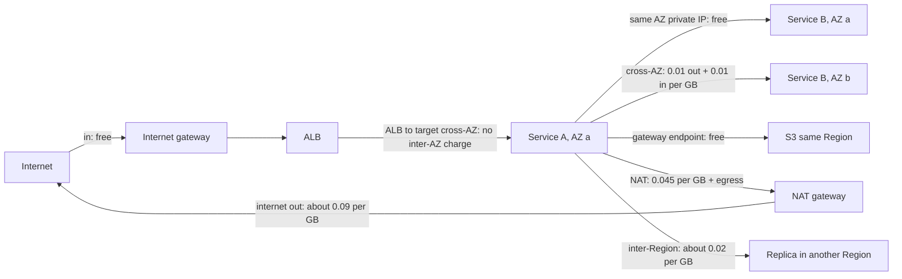

The diagram is a pricing map of one service's outbound paths. Its main lesson is that the same gigabyte can cost nothing or more than $0.13 depending on route: free to S3 through a gateway endpoint, $0.02 across AZs, about $0.135 to the internet through NAT ($0.045 processing plus $0.09 egress).

### 14.3 Worked cost estimate

A data-processing service in us-east-1 runs 12 EC2 instances across three AZs. Each month it:

- downloads 40 terabytes (TB), or 40,960 GB, of input from S3,
- sends 15 TB (15,360 GB) of internal remote procedure call (RPC) traffic between instances, spread evenly so that two thirds of it crosses AZ boundaries,
- calls third-party APIs and pulls container images, totaling 3 TB (3,072 GB) through NAT gateways (one per AZ), and
- has 12 public IPv4 addresses that it does not need, because the instances were launched in public subnets by default.

**Before changes:** S3 traffic routes through the NAT gateways because nobody added a gateway endpoint.

- NAT processing: (40,960 + 3,072) GB × $0.045 = 44,032 × 0.045 = **$1,981.44**
- NAT hours: 3 gateways × 730 hours × $0.045 = **$98.55**
- Inter-AZ RPC: 15,360 × 2/3 = 10,240 GB crossing; × $0.02 = **$204.80**
- Internet egress: most of the 3,072 GB is inbound (image layers and API responses), which is free; assume 300 GB outbound: 300 × $0.09 = **$27.00**, ignoring the account-wide monthly free allowance
- Public IPv4: 12 × 730 × $0.005 = **$43.80**
- **Total network-related cost: about $2,355.59 per month**

**After changes:** add an S3 gateway endpoint, move instances to private subnets without public IPs, and make the RPC client prefer same-AZ replicas when healthy so that only 20% of RPC traffic crosses AZs.

- NAT processing: 3,072 × $0.045 = **$138.24**
- NAT hours: unchanged at **$98.55**
- Inter-AZ RPC: 15,360 × 0.2 = 3,072 GB; × $0.02 = **$61.44**
- Internet egress: unchanged at **$27.00**
- Public IPv4: **$0**
- **Total: about $325.23 per month**, an 86% reduction, with no change to instance cost.

The S3 gateway endpoint alone saves $1,843.20 per month. That number appears again and again in AWS cost reviews because a private subnet's `0.0.0.0/0` route sends all non-local traffic, including S3 traffic, through NAT until someone adds a gateway endpoint. Zone-aware routing has a trade-off: it reduces cost and latency but can concentrate load if one AZ has fewer healthy replicas, so it needs a fallback to cross-AZ routing when local capacity is short.

### 14.4 Pricing dimensions in architecture decisions

Pricing is an input to scope and service choices, not an after-the-fact report:

- A **multi-AZ** database doubles instance cost; **cross-AZ replication** in self-managed systems adds transfer cost that managed Multi-AZ services often do not charge.
- A **multi-Region** active-passive design pays for standby capacity, inter-Region replication transfer, and duplicate fixed fees. The runnable [04_resilience_cost_scenario.py](../code/python/aws-chapter/04_resilience_cost_scenario.py) shows how normalized cost and recovery objectives pick the cheapest pattern that meets both.
- **Serverless** converts idle capacity cost into per-request cost, which is cheaper at low or spiky utilization and more expensive at sustained high utilization. The crossover depends on request rate and duration and should be calculated, not assumed.
- **Logging and monitoring** have per-GB ingestion and storage charges that grow with traffic; verbose debug logging at scale can cost more than the compute that produces it.

## 15. Support plans and AWS Health

### 15.1 Support plans

AWS Support is part of the operating model because it determines how fast you can reach an AWS engineer during an incident, and which operational tools you can use. AWS restructured its plans in December 2025. At the time of writing, the [AWS Support plans page](https://docs.aws.amazon.com/awssupport/latest/user/aws-support-plans.html) lists:

| Plan | Key properties | Typical fit |
|---|---|---|
| **Basic** | Account and billing help, service quota increases, documentation, forums, health checks; no technical cases | Experiments and personal accounts |
| **Business Support+** | 24x7 access to Cloud Support Engineers by phone, web, and chat; AI-assisted contextual responses; under 30 minutes for business-critical system-down cases; full Trusted Advisor checks; Support API; per-account minimum fee | Production workloads without a dedicated AWS relationship |
| **Enterprise Support** | Everything in Business Support+, plus a designated Technical Account Manager (TAM), up to 15-minute response for production-critical cases, AWS Security Incident Response, and event support | Organizations with business-critical workloads |
| **Unified Operations** | Designated TAM and domain specialist engineers, architecture guidance, critical workload reviews, and runbook support | Large estates that want AWS deeply involved in operations |

The older Developer, Business, and Enterprise On-Ramp plans stop on 1 January 2027 in commercial Regions, with Enterprise On-Ramp customers being moved to Enterprise Support during 2026. Plan prices are a percentage of monthly AWS spend above a minimum, so check the current pricing page for your spend level.

Two architectural points matter more than the plan names. First, **support is per account** unless you buy it for the organization, so a production account without a paid plan cannot open a technical case at 3 a.m. Second, **some tooling depends on the plan**, notably the AWS Health API and full Trusted Advisor checks.

### 15.2 AWS Health

AWS Health is AWS's authoritative channel for events that affect your resources. The **AWS Health Dashboard** in the console has two views: a public service-health view of all Regions and services, and an account-specific view of events that affect *your* resources, such as an EC2 host scheduled for retirement, an RDS certificate rotation, or an operational issue in an AZ where you run instances.

For operations, the important integrations are:

- **EventBridge events** for AWS Health, delivered in each Region, which let you route events to incident tooling, chat, or automation without polling.
- **The AWS Health API**, which requires Business Support+, Enterprise Support, or Unified Operations (or a legacy paid plan) at the time of writing, and returns `SubscriptionRequiredException` otherwise ([AWS Health API](https://docs.aws.amazon.com/health/latest/ug/health-api.html)).
- **Organizational view**, which aggregates Health events across all member accounts into the management account or a delegated administrator.

A good incident runbook treats AWS Health as a diagnostic input. If your own metrics show elevated errors in one AZ and AWS Health shows an operational issue in that AZ ID, the response is to shift traffic away from that AZ, using the zonal shift capability of Application Recovery Controller or by draining targets, rather than to debug your application. If AWS Health shows nothing, the problem is probably yours. Either way, do not wait for the public dashboard; AWS often posts account-specific events before or instead of public ones.

## 16. Service selection workflow with evidence

### 16.1 Why a workflow

The AWS catalog has several plausible services for almost every need. A team that wants to run a containerized API can choose ECS on EC2, ECS on Fargate, EKS with managed node groups, EKS Auto Mode, Lambda with container images, or plain EC2. A team that wants a queue can choose SQS, Amazon MQ, MSK, Kinesis, or EventBridge. Choosing by familiarity produces designs that fail on a quota, a scope, a responsibility gap, or a cost curve that nobody checked. A workflow forces each of those checks and leaves evidence that a reviewer can inspect.

### 16.2 The decision path

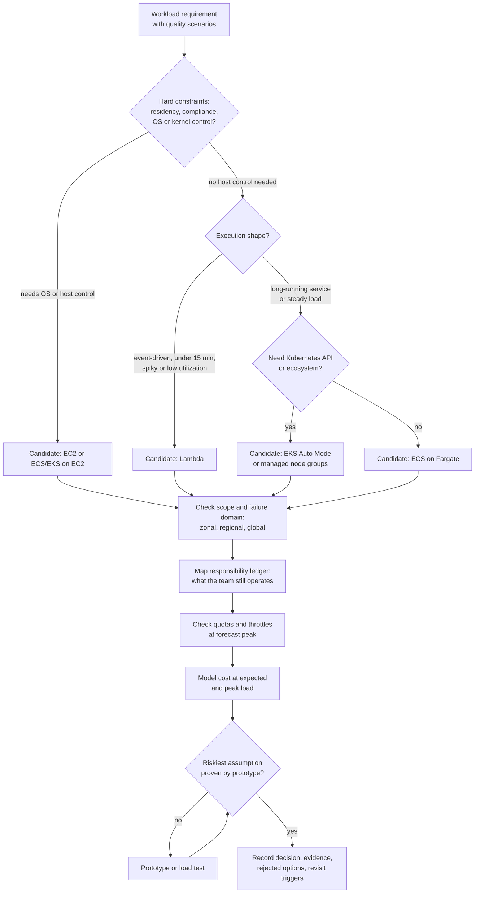

The tree is deliberately shaped around requirements, not around services. The first gate removes options that a hard constraint rules out. The second and third gates choose an abstraction level, preferring the one with the least remaining operational responsibility that still fits. The remaining steps, scope, responsibility, quotas, cost, and prototype, are the same for every candidate and are where most bad choices are caught. The runnable [03_service_selection_matrix.py](../code/python/aws-chapter/03_service_selection_matrix.py) shows the scoring step: with weights that favor low operational burden (weight 3) and burst fit (weight 2), Lambda scores 29, managed containers 25, and an EC2 fleet 18. Changing the weights to favor control and portability changes the winner, which is the point: weights are a recorded business judgement, not a law.

### 16.3 What counts as evidence

A decision record for an AWS service choice should contain evidence of these kinds, each linked to its source:

```yaml
decision: checkout-api-runtime
selected: ecs-fargate
requirements:
  availability: "survive loss of one AZ with no capacity loss"
  latency: "p99 under 250 ms at 1,800 requests per second"
  operations: "team of 5, no dedicated platform engineers"
evidence:
  scope: "Fargate tasks are zonal; service spans 3 AZ IDs euc1-az1..3"
  responsibility: "AWS patches hosts; team owns images, task roles, scaling"
  quotas:
    fargate_vcpu_applied: "checked in Service Quotas, 2026-03-02"
    headroom_at_peak: "38 percent"
  cost: "model in cost sheet v3, 1.5x static-stability capacity included"
  prototype: "load test run 2026-03-09, p99 182 ms at 2,100 rps"
rejected:
  - option: lambda
    reason: "sustained load makes per-request cost 2.3x Fargate at forecast volume"
  - option: eks-auto-mode
    reason: "no Kubernetes requirement; adds cluster upgrade responsibility"
revisit_when:
  - "traffic becomes spiky with idle periods over 60 percent"
  - "team adopts Kubernetes for other workloads"
```

The record is short, and it makes the decision falsifiable. If a later team wonders why the service is not on Lambda, the reason and its assumption are there, and so is the condition under which that reason stops holding.

## 17. Security, operations, and observability across the operating model

This section ties together the cross-cutting controls that every AWS estate needs. Each is owned in detail elsewhere; the point here is where they attach in the hierarchy.

- **Audit at the organization level.** An organization trail in CloudTrail records management events from every account and Region into the log-archive account's S3 bucket, with S3 Object Lock or restrictive bucket policies to prevent deletion. SCPs deny stopping or deleting the trail. Data events, such as S3 object-level reads, are optional and priced per event; enable them for sensitive buckets.
- **Configuration history.** AWS Config records resource configuration changes, and an aggregator in the security account gives an organization-wide view. Control Tower's detective controls are Config rules.
- **Threat detection.** GuardDuty and Security Hub with a delegated administrator in the security-tooling account, enabled in every Region you use, and also in Regions you do not use, because attackers launch resources where nobody looks. A Region-deny SCP reduces that exposure.
- **Encryption.** KMS keys are regional; multi-Region keys exist for data that must be decrypted after regional failover. Key policies are resource-based policies and are evaluated alongside identity policies; the [Secrets Management](CH13_Secrets_Management.md) chapter owns key hierarchies and rotation.
- **Data perimeter.** SCPs, RCPs, VPC endpoint policies, and resource policies combine into "trusted identities, trusted resources, expected networks". Section 5 covers the organization-level parts.
- **Observability.** CloudWatch metrics and logs are regional and per account, with cross-account observability that lets a monitoring account view source accounts' telemetry. The [Monitoring](CH10_Monitoring.md) chapter owns the design.
- **Tagging for ownership.** Tag policies in Organizations standardize keys such as `owner`, `cost-center`, and `data-classification`, which feed both cost allocation and incident routing.

## 18. Quality-attribute scenarios

The part-wide scenarios relevant to this chapter, with AWS-specific responses and measures. The account-compromise scenario appears in Section 4.4 and the quota scenario in Section 13.4; the remaining ones are summarized here.

| Scenario | Stimulus | AWS-specific expected response | Measure of success |
|---|---|---|---|
| **Zonal failure** | One AZ ID in the production Region becomes impaired, with elevated EC2 control-plane latency | Load balancers stop routing to unhealthy targets; Multi-AZ databases fail over; per-AZ NAT or regional NAT keeps egress; no recovery step needs `RunInstances` | Error rate back within objective within 3 minutes; no capacity below 100% of peak (static stability at 1.5×); AWS Health event correlated in the incident record |
| **Global control-plane impairment** | IAM or Route 53 control plane unavailable for an hour | Existing credentials and DNS answers keep working; no deployment needs IAM or DNS edits; failover uses pre-created health checks or routing controls | Zero customer-facing errors attributable to the impairment; deployment freeze declared and lifted per runbook |
| **Identity or key rotation** | Quarterly rotation of the cross-account deployment role's permissions and a KMS key policy change | New permissions added first, propagation verified in each Region, old ones removed after a soak period; KMS key rotation enabled for key material | No `AccessDenied` in pipeline runs during rotation; CloudTrail shows only the expected principals using the role |
| **Migration with reversible cutover** | Moving a database from EC2 to RDS | Replication from source to RDS, weighted DNS or connection-string switch, source kept read-write-ready for the rollback window | Cutover within the planned window; rollback rehearsed and achievable within 15 minutes; detailed mechanics in [Cloud Migration](CH16_Cloud_Migration.md) |

## 19. Provider comparison: guarantees, scopes, and responsibilities

Similar names hide different guarantees. The table compares the properties that change designs, not product names. Details are owned by the [Azure](CH02_Azure.md) and [GCP](CH03_GCP.md) chapters and compared again in Part 10.

| Property | AWS | Azure | Google Cloud |
|---|---|---|---|
| Hard isolation and quota container | Account | Subscription, but identity sits in the Entra ID tenant above it | Project, with billing in a separate billing account |
| Hierarchy for policy | Organization root, OUs (five levels), accounts | Management groups (six levels below the root), subscriptions, resource groups | Organization, folders, projects |
| Permission ceiling | SCPs (principal side), RCPs (resource side) | Azure RBAC deny assignments, limited customer use; Azure Policy for configuration | IAM deny policies, principal access boundary policies; Organization Policy for configuration |
| Who the ceiling ignores | Management account; service-linked roles | Depends on mechanism; owners can be exempted from policy | Depends on policy type |
| Zone identity across tenants | AZ IDs are consistent; legacy accounts have per-account AZ names | Logical zones mapped per subscription | Zone names are consistent |
| Network scope | VPC regional, subnet zonal | Virtual network regional, subnet regional (zone-spanning) | VPC global, subnet regional |
| Global identity control plane | IAM control plane in `us-east-1` | Entra ID, a global service | Google Cloud IAM, a global service |
| Typical inter-zone data charge | Billed per GB in each direction | Charging for inter-zone transfer has varied over time; check current pricing | Billed per GB between zones |
| Support tier for fastest response | Enterprise Support or Unified Operations | Unified or Enterprise agreements | Premium Support |

Two rows deserve emphasis. **Subnet scope** changes zonal design: on AWS each subnet is in one AZ, so you create one per AZ per tier; on Azure and GCP a subnet spans zones, so zonal placement is chosen per resource. **Network scope** changes multi-Region design: a GCP VPC can hold subnets in many Regions with routing between them, whereas AWS requires a separate VPC per Region connected by peering, Transit Gateway, or Cloud WAN.

## 20. Case study: a payments platform's first production AWS footprint

### 20.1 Context

A European payments company with 60 engineers is moving its card-authorization and merchant-reporting services to AWS. Requirements from its architecture board:

- Cardholder data must stay in the EU, and the Payment Card Industry Data Security Standard (PCI DSS) scope must be as small as possible.
- Card authorization: 1,200 requests per second at peak, p99 latency under 300 ms, availability 99.95% per month (about 22 minutes of allowed downtime), survive loss of one AZ without degradation.
- Regional disaster: RTO 1 hour, RPO 5 minutes.
- Platform team of four; product teams own their services.

### 20.2 Decisions

**Organization and accounts.** The company creates an organization with Control Tower, then extends it. OUs: Security, Infrastructure, Workloads/Prod, Workloads/Non-prod, Workloads/PCI, Sandbox, Policy-staging, Suspended. The card-authorization service runs in `cardauth-prod` in the PCI OU; merchant reporting in `reporting-prod` under Prod. Putting PCI workloads in their own accounts and OU keeps the assessment scope to those accounts plus the shared services they connect to.

*Rejected:* one production account with tag-based separation. It would have put reporting engineers inside PCI scope and shared quotas between a latency-critical service and a batch-heavy one.

**Guardrails.** SCPs at the root deny leaving the organization, stopping CloudTrail, and using Regions outside `eu-central-1` and `eu-west-1`, with the global-service exemptions of Section 5.3. The PCI OU adds SCPs denying creation of IAM users and denying unencrypted EBS volumes, and a declarative policy blocks public sharing of AMIs and EBS snapshots. An RCP at the root enforces the organization identity perimeter for S3, KMS, Secrets Manager, SQS, and STS. Before attachment, both were tested in Policy-staging for two weeks, and CloudTrail `AccessDenied` events were reviewed; the review found one vendor integration that needed an exception condition for the vendor's account.

**Region and AZs.** Frankfurt primary, Ireland recovery, per the selection method of Section 3.5. Three AZs in Frankfurt, identified by AZ ID in all templates.

**Compute.** Following Section 16, card authorization runs on ECS with Fargate across three AZs. Steady load made Lambda more expensive at forecast volume, and the team had no Kubernetes requirement. For static stability, the service runs 1.5× peak capacity: peak needs 24 tasks, so 12 per AZ, 36 in total.

**Data.** Aurora PostgreSQL with a writer and a reader in different AZs, so failover promotes a warm replica rather than waiting for a new instance. An Aurora Global Database secondary in Ireland meets the 5-minute RPO with typical replication lag measured under one second during load testing, and supports managed failover within the 1-hour RTO. RDS Proxy shields clients from failover.

**Network.** VPC IPAM allocates non-overlapping `/20` ranges. Each workload VPC has public, private-app, and private-data subnets in three AZs. Egress goes through a regional NAT gateway in each workload VPC for non-PCI accounts, and through a central inspection VPC in the network account for PCI accounts. Gateway endpoints for S3 and DynamoDB, and interface endpoints for ECR, Secrets Manager, KMS, CloudWatch Logs, and STS, keep AWS API traffic off the NAT path.

**Identity.** IAM Identity Center federated with the company's Entra ID tenant. Permission sets: `ReadOnlyOps`, `ServiceDeveloper` (non-prod only), `ProdDeployer` (only for the pipeline role), and `BreakGlass` (two named people, alarmed on use). The deployment pipeline in the tooling account assumes a narrowly trusted role in each prod account, as in Section 9.2. No IAM users exist outside the break-glass procedure.

**Quotas.** Quota request templates raise Fargate vCPU, ECS tasks, and Aurora instance quotas for every new PCI and Prod account at creation. CloudWatch alarms fire at 70% of each quota that matters at peak.

**Support and Health.** Enterprise Support for the organization. AWS Health organizational view routes events through EventBridge to the incident tool; AZ-scoped events trigger a runbook that evaluates zonal shift.

### 20.3 Validation evidence

The board accepted the design only after the team produced the following evidence:

1. **Account-compromise drill.** A red-team exercise used credentials from a non-prod developer role. The organization trail showed zero successful calls outside the non-prod account, and the attempt to stop CloudTrail was denied by SCP.
2. **Zonal failure game day.** Using AWS Fault Injection Service in staging, the team impaired one AZ's network for 30 minutes. Error rate peaked at 0.4% for 50 seconds while targets drained and Aurora failed over, then returned to baseline; p99 latency stayed under 300 ms after recovery; no scaling actions were needed.
3. **Regional recovery rehearsal.** A Global Database failover to Ireland in a staging copy completed in 21 minutes end to end, including DNS switch and smoke tests, against the 1-hour RTO. Replication lag at the time of failover was under one second.
4. **Cost model.** The network portion of the bill was estimated using Section 14's method; adding endpoints removed an estimated 70% of projected NAT processing charges.
5. **Quota check.** Applied quotas at 2× forecast peak in both Regions, confirmed in Service Quotas.

### 20.4 What the case shows

The service choices in this case are ordinary. What made the design defensible was the operating-model work around them: account boundaries matched to PCI scope and blast radius, guardrails tested before attachment, scope and static stability reasoned per resource, quotas raised before they were needed, and recovery proven with measurements rather than diagrams.

## 21. Common mistakes and anti-patterns

| Mistake | Cause | Consequence |
|---|---|---|
| **Workloads in the management account** | It was the first account, so everything started there | SCPs and RCPs do not protect those workloads, and a workload compromise becomes an organization compromise |
| **One account for everything** | Early convenience; tags treated as boundaries | Shared quotas, shared blast radius, unclear cost ownership, PCI or regulatory scope covering everyone |
| **AZ names in cross-account plans** | Templates written with `us-east-1a` style names | Two accounts believe they share an AZ but do not, so failure analysis and latency assumptions are wrong |
| **Allow-list SCP replacing `FullAWSAccess` on one OU** | Misreading inheritance | Every account below loses access to services not on the list, often discovered during an incident |
| **Region-deny SCP without global-service exemptions** | Not knowing that IAM, Organizations, and others sign requests for `us-east-1` | Administrators lose access to IAM and support |
| **Recovery runbook that creates resources** | Assuming the control plane works during an incident | Recovery fails or stalls on throttling and capacity exactly when it is needed |
| **Single NAT gateway for all AZs** | Cost saving | Cross-AZ charges on every egress byte and loss of egress for all AZs when one AZ fails |
| **S3 traffic through NAT** | No gateway endpoint in private route tables | Large, avoidable NAT processing charges |
| **Quota checked against published defaults** | Reading documentation, not the account | `VcpuLimitExceeded` at the first big scale-out |
| **"Managed" read as "backed up and multi-AZ"** | Misreading shared responsibility | Single-AZ databases, untested restores, data lost beyond RPO |
| **Long-lived IAM user keys for workloads** | Legacy scripts and third-party tools | Keys leak through source code or logs and grant persistent access |
| **No paid support on production accounts** | Support bought only for one account | No technical case path and no Health API during an incident |

## 22. Design-review checklist

Use this list when reviewing an AWS design. Each item should have an answer with evidence, not a yes or no.

- [ ] Which account and OU own each critical resource, and which SCPs and RCPs apply on the path?
- [ ] Is the management account free of workloads, and is its access restricted and alarmed?
- [ ] Do all cross-account trust policies name specific principals, with organization or external-ID conditions?
- [ ] Is each critical resource's scope recorded (zonal, regional, global), with AZ IDs where placement matters?
- [ ] Does the design survive loss of one AZ without any control-plane call, and at what over-provisioning factor?
- [ ] Which global control planes (IAM, Route 53, CloudFront, Organizations) sit on the recovery path, and how are they removed from it?
- [ ] Is the responsibility ledger written for each service, including restore testing and patching ownership?
- [ ] Are humans federated through IAM Identity Center and workloads using roles, with no long-lived keys?
- [ ] Do private subnets have per-AZ or regional NAT, and endpoints for high-volume AWS service traffic?
- [ ] Are applied quotas checked at forecast peak in every Region used, with `AWS/Usage` alarms and quota templates for new accounts?
- [ ] Are inter-AZ, inter-Region, NAT, and public IPv4 charges included in the cost model?
- [ ] Is the support plan appropriate for each production account, and are AWS Health events routed to incident tooling?
- [ ] Is there a decision record with evidence, rejected options, and revisit triggers for each major service choice?

## 23. Exercises

1. **Hierarchy design.** A company has three product lines, one of which processes health data under a regulation that requires a separate audit boundary. Draw the OU tree and account list, and state which SCPs and RCPs attach where. Explain how you would test a new RCP before attaching it at the root.
2. **Static stability sizing.** A service needs 20 instances at peak and runs in two AZs. How many instances does a statically stable design need to survive one AZ loss? What if it moves to three AZs? Compute the monthly instance-hour difference at 730 hours per month.
3. **Scope analysis.** A stateful EC2 application stores data on a single EBS volume and runs in an Auto Scaling group of size one spanning three AZs. What happens when its AZ fails? What is the recovery time made of, and what would you change?
4. **Cost path.** A service in private subnets downloads 10 TB per month from S3 and sends 2 TB to the internet through a single NAT gateway in AZ a, while half its instances run in AZ b. Price the monthly network cost at the list prices in Section 14.2, then redesign it and price the result.
5. **Interview question.** "SCPs already restrict what our identities can do. Why would we also need RCPs?" Answer with a concrete cross-organization access example that an SCP cannot stop.
6. **Service selection.** Use the workflow in Section 16 to choose a runtime for a nightly 3-hour batch job that processes 2 TB of files. Write the decision record, including at least two rejected options.

## 24. Summary

AWS becomes navigable when every resource is read through its operating model. The administrative hierarchy of organization, OUs, and accounts decides who can change a resource and which guardrails cap that power. The account is the hard isolation boundary for identity, resources, quotas, and cost. SCPs limit what your principals can do and RCPs limit what anyone can do to your resources, and neither grants anything. The physical hierarchy of Region and AZ decides what fails together, and each resource's scope, zonal, regional, or global, tells you what you must replicate yourself. Control planes are less available than data planes, and some global control planes live in a single Region, so statically stable designs pre-provision capacity and keep recovery on the data plane. Shared responsibility moves with the service model, but identity, data, configuration, and recovery always stay with the customer. Quotas, throttles, and data-transfer paths are architecture inputs, and the evidence for a service choice belongs in a decision record that a later team can check and overturn.

## 25. Code examples

The runnable examples are in [code/python/aws-chapter](../code/python/aws-chapter/README.md). They use only the Python standard library, make no AWS API calls, and use synthetic, normalized values rather than current prices. Run them from the repository root with Python 3.10 or later.

- [01_region_az_failure_domains.py](../code/python/aws-chapter/01_region_az_failure_domains.py) models components placed across AZs with a minimum healthy count, fails each AZ in turn, and shows that a single-AZ cache does not survive even though the API and worker tiers do (Sections 3.4 and 7).
- [02_multi_account_guardrails.py](../code/python/aws-chapter/02_multi_account_guardrails.py) simulates an SCP explicit deny intersecting with a role's permissions, showing that a guardrail removes `iam:CreateUser` and that an action with no grant is denied regardless of guardrails (Section 5.5).
- [03_service_selection_matrix.py](../code/python/aws-chapter/03_service_selection_matrix.py) scores an EC2 fleet, managed containers, and Lambda against weighted criteria; with the default weights Lambda ranks first, and changing the weights shows how the recorded priorities drive the result (Section 16).
- [04_resilience_cost_scenario.py](../code/python/aws-chapter/04_resilience_cost_scenario.py) compares backup and restore, pilot light, warm standby, and active-active against a 30-minute RTO and 5-minute RPO, and selects warm standby as the cheapest pattern that meets both (Section 14.4).
