# Chapter: Microsoft Azure Operating Model for Architects

Part: [09 — Cloud Computing](PART_OVERVIEW.md) · Status: Revised (in-depth rewrite)

## 1. Introduction

Microsoft Azure exposes several hundred services, but every one of them is created, governed, and reached through the same small set of mechanisms. A Microsoft Entra tenant decides who a caller is. A hierarchy of management groups, subscriptions, and resource groups decides where a resource lives and which rules it inherits. Azure Resource Manager (ARM) receives every management request, checks it against role-based access control (RBAC), Azure Policy, and resource locks, and then hands it to a resource provider that does the real work. Regions and availability zones decide which physical failures a resource can survive. Quotas decide whether a deployment can happen at all. An architect who understands these mechanisms can read any Azure service page and predict how that service will be governed, secured, placed, and supported. An architect who does not will discover the mechanisms one incident at a time.

This chapter teaches that operating model. After reading it you should be able to:

- Design a tenant, management-group, subscription, and resource-group hierarchy and explain which boundary each level provides (identity, policy, billing, quota, access, or lifecycle).
- Trace a management request from a client through Microsoft Entra ID, ARM, RBAC, Policy, locks, and a resource provider, and explain asynchronous operations, idempotent `PUT`, deployment modes, Bicep, and deployment stacks.
- Explain how Azure RBAC evaluates access, how deny assignments and data actions change the result, and why Azure Policy is a different control that answers a different question.
- Choose between zonal, zone-redundant, and nonzonal deployments, account for the per-subscription mapping between logical and physical zones, and decide when a region pair helps and when it does not.
- Describe the Azure virtual network and subnet model and the managed-identity access path well enough to review a design.
- Plan quota headroom for scale-out, select a support plan, and use Service Health and Resource Health in incident response.
- Explain what Azure Arc projects into Azure management and what it does not change.
- Produce a service responsibility matrix that states what Microsoft operates and what the customer still owns for each service model.

### 1.1 Scope and ownership boundaries

This chapter owns the Azure-specific definitions of the governance hierarchy, the ARM request and deployment lifecycle, the distinction between Azure Policy and Azure RBAC, Azure region-pair and availability-zone semantics, and Azure Arc as a hybrid management plane. Other chapters own adjacent material, and this chapter recaps it in a few sentences with a link rather than re-teaching it.

| Topic | Owner | What this chapter does |
|---|---|---|
| Cross-provider identity and access management (IAM) evaluation, federation, cross-subscription trust | [IAM](CH09_IAM.md) | Teaches Azure RBAC and managed identities as Azure mechanisms; links for comparative depth |
| Compute shapes, autoscaling, placement theory | [Compute](CH04_Compute.md) | Names the Azure compute families and their responsibility boundary |
| Virtual network routing, private endpoints, hybrid connectivity | [Networking](CH05_Networking.md) | Explains virtual network (VNet) and subnet scope and the packet path at review depth |
| Storage redundancy, snapshots, tiers | [Storage](CH06_Storage.md) | Names Azure storage families and redundancy options |
| Containers and managed Kubernetes | [Containers](CH07_Containers.md), [Kubernetes](CH08_Kubernetes.md) | Places Azure Container Apps and Azure Kubernetes Service (AKS) in the responsibility matrix |
| Azure Monitor, alerting, log retention | [Monitoring](CH10_Monitoring.md) | Covers Service Health and Resource Health only |
| Functions and event execution | [Serverless](CH11_Serverless.md) | Responsibility matrix entry only |
| Key Vault and secret rotation | [Secrets Management](CH13_Secrets_Management.md) | Uses Key Vault as the target of the managed-identity path |
| Billing data, budgets, commitments | [Cost Optimization](CH14_Cost_Optimization.md) | Explains the subscription as a billing boundary |
| Landing-zone products, subscription vending, guardrail rollout | [Landing Zones](CH15_Landing_Zones.md) | Defines the scopes that landing zones build on |
| Migration tooling and cutover | [Cloud Migration](CH16_Cloud_Migration.md) | Covers subscription moves and tenant transfers as governance operations |
| Cross-provider organizational architecture | [Organizational Hierarchy and Landing Zones](../10_Cloud_Architecture/CH02_Organizational_Hierarchy_and_Landing_Zones.md) | Provides the Azure facts that the cross-provider design uses |
| Resilience and disaster-recovery architecture | [Resilience, Availability, and Disaster Recovery](../10_Cloud_Architecture/CH09_Resilience_Availability_and_Disaster_Recovery_Architectures.md) | Provides region and zone semantics only |
| General RBAC theory | [RBAC](../15_Security/CH04_RBAC.md) | Applies the general model to Azure's scopes |

Provider facts drift. Where this chapter quotes a limit, it names the documentation page it came from and the number is stated "at the time of writing; verify current quotas." Where a number was not verifiable, the chapter describes the mechanism and where to find the limit instead.

## 2. The foundational model: three planes and four scopes

Two ideas organize everything else in Azure. The first is that there are three distinct planes, each with its own endpoints, credentials, and failure behavior. The second is that every Azure resource has an address inside a nested hierarchy of scopes, and that address decides which rules apply to it.

### 2.1 Identity plane, control plane, data plane

The **identity plane** is Microsoft Entra ID. It authenticates users, groups, applications, and managed identities and issues tokens. It does not by itself grant permission to touch Azure resources. A token says "this caller is principal X, member of groups Y and Z, intended for audience W."

The **control plane** (also called the management plane) is ARM, reached at `https://management.azure.com` in the global Azure cloud. Every create, read, update, delete, and action on a resource's configuration goes through it. ARM applies Azure RBAC, Azure Policy, management locks, and the Activity Log to those requests before forwarding them to a resource provider, according to Microsoft's [control plane and data plane](https://learn.microsoft.com/en-us/azure/azure-resource-manager/management/control-plane-and-data-plane) documentation.

The **data plane** is the service's own endpoint: `https://myaccount.blob.core.windows.net` for a storage account, a Structured Query Language (SQL) endpoint for a database, Remote Desktop Protocol (RDP) or Secure Shell (SSH) for a virtual machine. Data-plane requests do not pass through ARM. They are authorized by the service itself, sometimes using Azure RBAC data actions, sometimes using service-local mechanisms such as SQL logins or storage account keys.

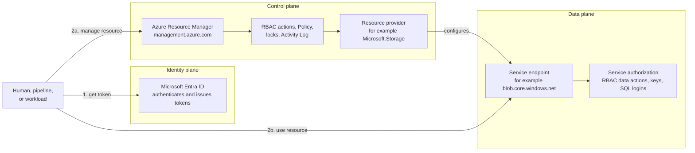

The diagram shows two separate paths after authentication. Path 2a changes what a resource *is*; path 2b uses what the resource *does*. Three consequences follow, and they recur through the chapter.

1. **Controls do not cross planes automatically.** A `ReadOnly` lock stops a storage account's configuration from changing, but it does not stop a client with a valid data-plane credential from deleting blobs. The same documentation states that a lock preventing deletion of a database does not prevent deleting data through queries.
2. **Availability is separate.** Microsoft documents that you can continue to use a storage account's data endpoint even when `management.azure.com` is unavailable. A runbook that needs ARM to fail over is therefore more fragile than a design that fails over on the data plane.
3. **Permissions are separate.** The Contributor role grants broad control-plane actions but no data actions. A pipeline that can create a storage account cannot, by that role alone, read a blob in it.

### 2.2 Four scopes and one address

Every Azure resource has a resource identifier (ID) that encodes its position in the hierarchy:

```text
/providers/Microsoft.Management/managementGroups/{mgId}                       management group scope
/subscriptions/{subscriptionId}                                               subscription scope
/subscriptions/{subscriptionId}/resourceGroups/{rg}                           resource group scope
/subscriptions/{subscriptionId}/resourceGroups/{rg}/providers/Microsoft.Storage/storageAccounts/{name}   resource scope
```

Azure RBAC role assignments, Azure Policy assignments, and locks attach to one of these scopes and apply to everything below it. Microsoft's [RBAC overview](https://learn.microsoft.com/en-us/azure/role-based-access-control/overview) lists exactly four levels: management group, subscription, resource group, and resource. The management group is not in the resource ID string of a resource. ARM resolves which management groups a subscription sits under at evaluation time, which is why moving a subscription between management groups instantly changes which policies and inherited roles apply to every resource in it.

The resource ID is also the unit of most failure analysis. Child resources, such as a blob service under a storage account or a subnet under a virtual network, extend the path. Extension resources, such as a diagnostic setting or a role assignment applied to a resource, append `/providers/{namespace}/{type}/{name}` to the parent ID. That path rule explains several later behaviors: locks inherit along it, policy evaluates along it, and asynchronous-operation status URLs are scoped to the subscription or resource group in it rather than to the resource.

## 3. The tenant and the management hierarchy

### 3.1 The Microsoft Entra tenant as the identity boundary

A Microsoft Entra tenant is a dedicated instance of Microsoft Entra ID: a directory of users, groups, applications, service principals, and managed identities, plus the authentication policies that govern them (Conditional Access, multifactor authentication, token lifetimes). Each Azure subscription trusts exactly one tenant at a time. Many subscriptions can trust the same tenant. When ARM receives a token, it accepts it only if the token was issued by the tenant that the target subscription trusts.

That one-to-many relationship makes the tenant the outermost identity boundary in Azure. Three architectural facts follow.

- **Principals are tenant-local.** A user, group, or managed identity exists in one tenant. A user from another tenant can be invited as a business-to-business (B2B) guest, which creates a guest object in the host tenant. Cross-tenant management of resources without guest accounts uses Azure Lighthouse, which projects delegated role assignments from a customer tenant to principals in a managing tenant.
- **Entra roles and Azure roles are different systems.** Entra directory roles, such as Global Administrator or User Administrator, govern directory objects. Azure roles, such as Owner or Reader, govern Azure resources. A Global Administrator has no Azure resource access by default. Microsoft's [management groups overview](https://learn.microsoft.com/en-us/azure/governance/management-groups/overview) states that no one has default access to the root management group and that Global Administrators are the only users who can elevate themselves to obtain it. Elevation grants User Access Administrator at root scope, which can then grant any Azure role anywhere in the tenant.
- **The tenant is the blast radius for identity compromise.** A compromised Global Administrator can elevate, grant itself Owner at the root management group, and reach every subscription. No management group, subscription, or policy boundary inside the tenant contains that attacker. Organizations that need a hard identity boundary, such as a separately administered regulated business unit or a vendor-managed environment, use separate tenants and accept the cost of duplicate identity administration.

**Decision: one tenant or several?** Most organizations should run production Azure in one tenant. Multiple tenants duplicate Conditional Access, privileged access, group management, and audit, and every cross-tenant interaction needs B2B or Lighthouse. Multiple tenants are justified when a legal entity must have independent administrators, when a merger has not yet consolidated identity, or when a test tenant is needed to experiment with directory-wide settings such as Conditional Access policies without risk to production. A separate tenant for "development" is usually a mistake: developers then hold separate credentials, pipelines need cross-tenant service principals, and policies drift between tenants.

### 3.2 The root management group and the management-group tree

Every tenant has exactly one root management group, displayed by default as "Tenant root group." Its ID is the tenant ID. It cannot be moved or deleted. New subscriptions land under it by default unless a hierarchy setting assigns a different default management group. Microsoft's documentation, at the time of writing, gives these limits (verify current values on the [management groups overview](https://learn.microsoft.com/en-us/azure/governance/management-groups/overview) and the [subscription service limits](https://learn.microsoft.com/en-us/azure/azure-resource-manager/management/azure-subscription-service-limits) page):

| Property | Value at the time of writing |
|---|---|
| Management groups per tenant | 10,000 |
| Depth of the tree | Six levels below the root, not counting the subscription level |
| Parents per management group or subscription | Exactly one |
| Children per management group | Many; subscriptions per management group are unlimited |

The single-parent rule is the central design constraint. A subscription cannot sit under both "Production" and "Europe." The tree must pick one dimension to express structurally, and every other dimension must be expressed through tags, policy parameters, or naming. Microsoft's Cloud Adoption Framework landing-zone design picks *governance archetype*: platform subscriptions (identity, management, connectivity) under one branch and application landing zones (often split into "Corp" for internally connected workloads and "Online" for internet-facing ones) under another, plus "Sandbox" and "Decommissioned" branches. Environment (production versus non-production) is often not a management-group level at all, because most guardrails should be the same in both and testing a policy in non-production is only meaningful if non-production has the same policy.

Why not use the depth? Each level adds a place where a policy or role can be assigned, and an engineer debugging a denied deployment must inspect every level. Six levels is a ceiling, not a target. Three or four levels below the root are usually enough.

**What to assign at the root.** Very little. Every subscription in the tenant, including new ones that land there by default, inherits from the root, so a bad assignment there has tenant-wide blast radius. A common practice is to create an intermediate management group directly under the root (for example, named after the organization) and assign the organization-wide baseline there. That keeps the root clean and lets a second intermediate group exist for a canary hierarchy that tests policy changes before they reach production.

### 3.3 Subscriptions as billing, quota, and access boundaries

A subscription is the unit Azure uses to bill, to apply most service quotas, and to bound a large set of management operations. A subscription is associated with a billing account through an agreement type, such as a Microsoft Customer Agreement (MCA), an Enterprise Agreement (EA), a Cloud Solution Provider (CSP) arrangement, or pay-as-you-go. That billing association is independent of the tenant association: a subscription can change which tenant it trusts without changing who pays for it, and vice versa.

A subscription is a boundary for:

- **Billing and cost attribution.** Every charge carries a subscription ID. Tags and resource groups refine attribution, but the subscription is the boundary that cannot be forgotten by a careless deployment. [Cost Optimization](CH14_Cost_Optimization.md) owns allocation.
- **Quotas.** Most quotas are per subscription per region. Virtual central processing unit (vCPU) quotas, for example, are tracked per subscription in each region (Section 11).
- **Throttling.** ARM request limits apply per subscription and per principal (Section 4.7).
- **Access.** A role assignment at subscription scope covers everything inside. A subscription Owner can grant roles to anyone within the subscription.
- **Zone mapping.** The mapping between logical and physical availability zones is assigned per subscription (Section 8.3).
- **Resource-provider registration.** Resource providers are registered per subscription (Section 4.1).
- **Role-assignment budget.** The limit on role assignments is counted per subscription (Section 5.5).

A subscription is **not** a network boundary. Virtual networks in different subscriptions can be peered, and private endpoints in one subscription can reach services in another. It is not a failure domain either: a subscription spans all regions.

**How many subscriptions?** The answer follows from which boundaries a workload needs. If two workloads need different quota pools, different owners, different cost centers, or containment of a compromised subscription Owner, they need different subscriptions. Microsoft's landing-zone guidance generally recommends a subscription per application per environment for anything beyond small estates. The cost of more subscriptions is automation: each one needs a baseline of policy, diagnostic settings, budget alerts, network attachment, and role assignments. [Landing Zones](CH15_Landing_Zones.md) owns the vending workflow that makes this affordable. Without that automation, subscription sprawl produces ungoverned subscriptions, which is worse than fewer, well-governed ones.

### 3.4 Resource groups and lifecycle

A resource group is a container inside one subscription. Every resource belongs to exactly one resource group. The resource group exists to manage resources that share a lifecycle: deploy them together, grant access to them together, delete them together.

Several properties surprise people.

- **A resource group has a location, but its resources do not have to match it.** The [resource group documentation](https://learn.microsoft.com/en-us/azure/azure-resource-manager/management/manage-resource-groups-portal) states that the resource group's location is where the group's metadata is stored, and resources inside can be in different regions. Choose the resource group's location deliberately when metadata residency matters, and keep it in the same region as the resources unless there is a reason not to, so that a regional problem affects metadata and resources together rather than independently.
- **A resource group is not a security boundary in the strong sense.** It is an RBAC scope, so it limits what a principal assigned at that scope can do. But a principal assigned at subscription scope sees through it, and resources in different resource groups can talk to each other freely on the data plane.
- **A resource group is not a failure domain.** It has no relationship to zones or racks.
- **Deleting a resource group deletes everything in it.** ARM orders the deletions by dependency. A `CanNotDelete` lock on any resource inside blocks the whole resource group deletion; there is no partial delete, per the [lock documentation](https://learn.microsoft.com/en-us/azure/azure-resource-manager/management/lock-resources).
- **Tags do not inherit by default.** A tag on a resource group is not copied to its resources. Inheritance requires an Azure Policy `modify` assignment (Section 6).

Limits at the time of writing, from the [subscription service limits](https://learn.microsoft.com/en-us/azure/azure-resource-manager/management/azure-subscription-service-limits) page: 980 resource groups per subscription; 800 resources of a given type per resource group for most types; 800 deployments in a resource group's deployment history, with automatic deletion as the history nears the limit; 50 tags per resource or resource group; 20 management locks per unique scope. Verify current quotas before designing against them.

**Grouping heuristic.** Put resources in the same resource group when they are created, changed, and retired together and when the same team owns them. Separate long-lived shared resources (a virtual network, a Key Vault holding certificates for several apps, a Log Analytics workspace) from frequently redeployed application resources. The test is simple: "If I delete this resource group, do I lose only things I meant to lose?"

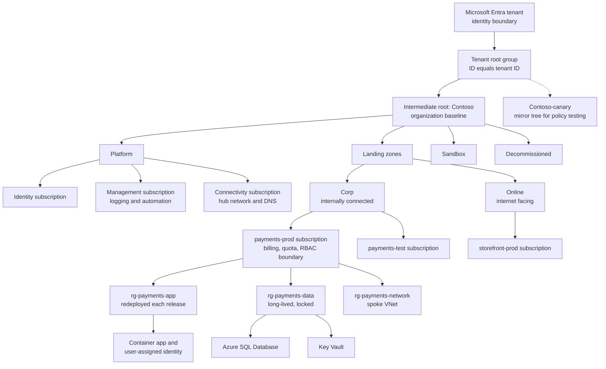

The diagram is the first of the topic map's required views: the tenant-to-subscription resource hierarchy. Read it top to bottom as a chain of narrowing boundaries. The tenant decides who can authenticate. The root and the intermediate root carry tenant-wide guardrails. The platform and landing-zone branches separate shared infrastructure from application workloads, so a policy that allows public Internet Protocol (IP) addresses in "Online" does not leak into "Corp." Each subscription is where billing, quota, throttling, and zone mapping attach. Each resource group expresses lifecycle: the application group is redeployed every release, while the data group is long-lived and protected. The dotted canary tree is not inside the production hierarchy, so a policy change can be tested on a realistic tree without production blast radius.

### 3.5 Moving resources, subscriptions, and tenants

Moves are governance operations with side effects that are easy to underestimate.

**Moving a resource between resource groups or subscriptions** changes its resource ID. Anything that refers to the old ID breaks: role assignments scoped directly to the resource are not moved and become orphaned (per Microsoft's [RBAC troubleshooting](https://learn.microsoft.com/en-us/azure/role-based-access-control/troubleshooting) guidance), monitoring rules and dashboards referencing the ID stop matching, and infrastructure-as-code (IaC) state files point at a resource that no longer exists at that address. Not every resource type supports moves, and some require dependent resources to move together.

**Moving a subscription between management groups** changes inherited policy and RBAC immediately. It requires write permission on the subscription and on both the source and target management groups. This is the most powerful governance action in Azure: moving a subscription from "Corp" to "Sandbox" might remove a deny policy on public IP addresses for every resource in it. Restrict it to the platform team.

**Transferring a subscription to a different tenant** is far more disruptive. Microsoft's [subscription transfer guide](https://learn.microsoft.com/en-us/azure/role-based-access-control/transfer-subscription) states that all role assignments and custom roles are permanently deleted, system-assigned managed identities must be disabled and re-enabled, user-assigned managed identities must be deleted and re-created, and Key Vault tenant IDs and access policies must be updated. Some resources, such as Azure SQL databases with Entra authentication enabled, cannot be transferred with that feature enabled. Treat a tenant transfer as a migration with a planned outage and a rehearsed runbook, not as an administrative toggle. Organizations can block such transfers with a subscription policy setting.

### 3.6 Worked scenario: containing a compromised subscription Owner

**Stimulus.** An attacker phishes a developer who holds an active Owner assignment on `payments-test`. The attacker attempts to (a) create a public storage account, (b) grant themselves access to `payments-prod`, and (c) move `payments-test` into `Sandbox` to escape policy.

**Expected response.**

- (a) A deny policy on public network access, assigned at the "Landing zones" management group, rejects the storage account creation. Owner on the subscription does not grant permission to change or exempt a policy assigned at a parent management group, because the assignment and any exemption require `Microsoft.Authorization/policyAssignments/*` or `policyExemptions/write` plus the `exempt/action` on the parent assignment.
- (b) Owner on `payments-test` has no permissions on `payments-prod`, a sibling subscription. The attacker can add role assignments only within `payments-test`.
- (c) Moving the subscription requires write permission on the target management group, which the developer does not hold.

**Measurable success criterion.** No resource changes outside `payments-test`; the Activity Log shows denied policy evaluations and authorization failures; the security operations team receives an alert on the role-assignment write within 15 minutes; and an access review shows no standing Owner assignments for humans on production subscriptions (Privileged Identity Management (PIM) eligible assignments only).

**What would have broken containment.** A standing Owner assignment at the "Landing zones" management group, a policy assigned at subscription scope (which a subscription Owner can delete), or any principal in the tenant holding Global Administrator without PIM and phishing-resistant authentication. The hierarchy contains Azure RBAC compromise. It does not contain identity-plane compromise.

### 3.7 How Amazon Web Services (AWS) and Google Cloud express the same boundaries

| Concept | Azure | AWS | Google Cloud |
|---|---|---|---|
| Identity directory | Microsoft Entra tenant, separate from resources | AWS Identity and Access Management (IAM) per account, plus AWS IAM Identity Center for workforce access | Cloud Identity or Google Workspace domain bound to an organization resource |
| Root of resource hierarchy | Tenant root management group | Organization root | Organization node |
| Grouping levels | Management groups, six levels below root | Organizational units (OUs), up to five levels below root at the time of writing | Folders, up to ten levels at the time of writing |
| Billing, quota, and isolation unit | Subscription | Account | Project (billing is a separate billing-account link) |
| Lifecycle grouping inside the unit | Resource group, mandatory | None mandatory; tags and CloudFormation stacks | None mandatory; labels |
| Guardrail mechanism | Azure Policy (configuration) plus deny assignments | Service Control Policies (SCPs) and resource control policies (permission ceilings) | Organization Policy (configuration constraints) and IAM deny policies |

The table is not a statement that these are equivalent. The important difference is where the guardrail sits. An AWS SCP limits what permissions can be used in an account; it evaluates the *action*. Azure Policy evaluates the *resource configuration* in the request body. An SCP can forbid `ec2:RunInstances` entirely; Azure Policy can allow virtual machine creation but deny any virtual machine whose size is outside a list. [AWS](CH01_AWS.md) and [Google Cloud Platform](CH03_GCP.md) cover their own hierarchies; [IAM](CH09_IAM.md) compares the evaluation models.

## 4. Azure Resource Manager and resource providers

ARM is the single front door for Azure management. The portal, the Azure command-line interface (CLI), Azure PowerShell, the software development kits (SDKs), Terraform's AzureRM provider, and Bicep all end up sending Representational State Transfer (REST) calls to the same endpoint. Understanding that path explains error messages, deployment timing, partial failures, and why some outages stop deployments while applications keep running.

### 4.1 Resource providers and resource types

A resource provider is a set of REST operations for one service, identified by a namespace such as `Microsoft.Compute`, `Microsoft.Storage`, or `Microsoft.KeyVault`. A resource type is `{namespace}/{type}`, for example `Microsoft.KeyVault/vaults`. Each resource type has its own list of supported regions and application programming interface (API) versions. ARM itself is available in all regions, but a resource type might not be, and a subscription might be restricted from some regions that support it, per Microsoft's [resource providers and types](https://learn.microsoft.com/en-us/azure/azure-resource-manager/management/resource-providers-and-types) page.

**Registration.** A subscription must be registered for a resource provider before resources of its types can be created. Some providers are registered by default; the portal and template deployments auto-register providers they use. Registering requires the `/register/action` permission for that provider, which Contributor and Owner include. Registration proceeds region by region, so a client should not wait for every region to finish before deploying in the one it needs. Microsoft recommends registering only providers you intend to use: each registration can add a first-party application to the tenant, and an unregistered provider cannot be used by a malicious user. A provider cannot be unregistered while resources of its types exist, and it must be re-registered to pick up newly added regions.

The architectural implication is that registration is part of subscription baseline, not an application concern. A subscription-vending process should register the agreed provider list. A workload pipeline whose identity holds only resource-group-scoped roles cannot register a provider, and its first deployment of a new resource type fails with a `MissingSubscriptionRegistration` error.

### 4.2 The management request path

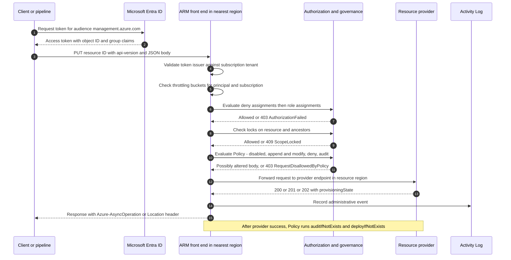

The sequence is a simplification of internal machinery, but each step corresponds to documented behavior and to an error code the reader will see in practice.

- **Steps 1 and 2.** The client obtains a token whose audience is ARM. Group memberships are carried as claims in the token (or as an overage indicator when there are too many), which is why a newly added group membership may not take effect until a new token is acquired.
- **Step 4.** ARM rejects a token issued by a tenant other than the one the subscription trusts. This is the error a user sees after a subscription is transferred to another tenant.
- **Step 5.** ARM counts the request against per-principal, per-subscription, and per-tenant token buckets (Section 4.7). The exact internal ordering of throttling and authorization is not documented, so the diagram places it early for readability. A `429 Too Many Requests` response includes a `Retry-After` header.
- **Steps 6 and 7.** RBAC evaluation, described in Section 5. A failure produces `AuthorizationFailed` with the missing action named in the message, which makes it the most debuggable error in Azure.
- **Steps 8 and 9.** Locks, described in Section 7. They apply regardless of role.
- **Steps 10 and 11.** Azure Policy request-time effects, described in Section 6. A deny produces `RequestDisallowedByPolicy` and names the assignment.
- **Step 12.** The resource provider validates service-specific rules (stock-keeping unit (SKU) availability, name uniqueness, quota) and performs or schedules the change. Quota failures, capacity failures (`AllocationFailed` or `SkuNotAvailable`), and invalid property combinations originate here.
- **Step 15 and the note.** The client gets a response, often before the work is done. Policy effects that depend on the final state of the resource, `auditIfNotExists` and `deployIfNotExists`, run only after the provider reports success.

Azure documents that RBAC data (role definitions, assignments, deny assignments) is stored and replicated globally, because ARM has a global endpoint that routes requests to the nearest region ([RBAC overview](https://learn.microsoft.com/en-us/azure/role-based-access-control/overview)). That design is why an access grant made in one region works from anywhere, and why a deleted assignment is deleted everywhere.

### 4.3 Asynchronous operations and the provisioning state machine

Many resource operations take seconds to tens of minutes: creating a virtual machine, a database server, or a virtual network gateway. ARM uses a standard asynchronous pattern described in Microsoft's [asynchronous operations](https://learn.microsoft.com/en-us/azure/azure-resource-manager/management/async-operations) guidance.

1. The initial `PUT`, `PATCH`, `DELETE`, or `POST` returns `201 Created` or `202 Accepted`.
2. The response carries either an `Azure-AsyncOperation` header (preferred) or a `Location` header, plus usually a `Retry-After` header in seconds.
3. The client polls the status URL. While the operation runs, the status is a provider-specific value such as `Accepted`, `Creating`, `Updating`, or `InProgress`.
4. The operation finishes in exactly one of three terminal states: `Succeeded`, `Failed`, or `Canceled`. Failed and canceled operations include an `error` object with a code and message.

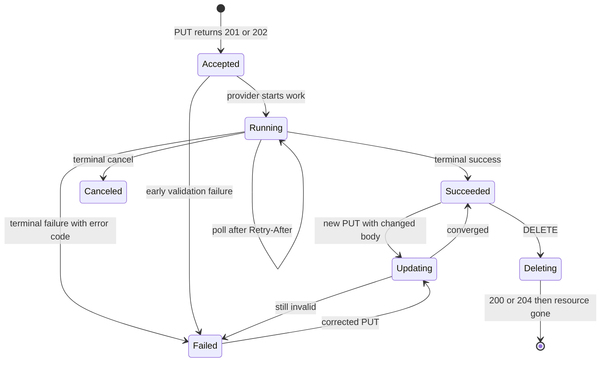

The state machine has three practical implications.

**Polling needs the right scope.** The status URL for an operation is often not scoped to the resource. Microsoft's example for starting a virtual machine returns a status URL at `/subscriptions/{id}/providers/Microsoft.Compute/locations/{region}/operations/{opId}`. A principal with a role only on the virtual machine can start the operation but cannot read its status. Pipelines whose identities are scoped to individual resources therefore see spurious "authorization failed" errors while polling. Scope deployment identities at least to the resource group.

**`Failed` is a state of the resource, not just the request.** A resource can exist with `provisioningState: Failed`. It occupies a name, may hold quota, and may need to be corrected by a new `PUT` or deleted. A deployment script that treats any non-2xx response as "nothing happened" leaves debris.

**Clients must be prepared for long tails.** A `Retry-After` of 17 seconds and a total runtime of 20 minutes for a gateway are both normal. When `Retry-After` is absent, the client must implement its own back-off. Short pipeline timeouts produce cancelled pipelines with resources still converging underneath.

### 4.4 Idempotent PUT and full-resource semantics

ARM resource operations follow a declarative contract: `PUT` to a resource ID with a body describing the desired state. If the resource does not exist, it is created. If it exists with the same properties, nothing happens. If it exists with different properties, it is updated. Microsoft's [control plane documentation](https://learn.microsoft.com/en-us/azure/azure-resource-manager/management/control-plane-and-data-plane) calls these the "green field" and "brown field" cases and notes that clients do not need to worry about creating identical resources. Repeating the same `PUT` is safe, which is what makes declarative deployment and retry possible.

The subtle part is that a `PUT` describes the *whole* resource, not a delta. The [deployment modes](https://learn.microsoft.com/en-us/azure/azure-resource-manager/templates/deployment-modes) documentation is explicit: when an existing resource is redeployed, all properties are reapplied, and properties not included are reset to their defaults. A template that defines a virtual network without its subnets, while the subnets were created separately, can remove those subnets on redeploy (or fail because they are in use). Microsoft recommends defining subnets inside the `subnets` property of the virtual network resource for exactly this reason.

`PATCH` exists for some resource types and does apply a partial update, but its support and semantics vary by provider. Tag-only changes have a dedicated tags API. A safe rule for IaC: one tool owns each resource, the template describes every non-default property, and nothing else writes to it except through that tool.

Two things cannot be changed by `PUT`: the resource's type and its location. Attempting either fails. Changing region means creating a new resource and migrating data.

### 4.5 Deployments: ARM templates, Bicep, modes, and what-if

An ARM template is a JavaScript Object Notation (JSON) document listing parameters, variables, resources, and outputs. Bicep is a domain-specific language that compiles ("transpiles") to ARM JSON; it adds modules, type checking, and readable syntax but no new runtime. Both are submitted as a **deployment**, which is itself an ARM resource of type `Microsoft.Resources/deployments` at one of four scopes: resource group, subscription, management group, or tenant. ARM's deployment engine builds a dependency graph from explicit `dependsOn` entries and implicit references, then issues `PUT` requests for independent resources in parallel and dependent ones in order.

A minimal Bicep example makes the shape concrete:

```bicep
targetScope = 'resourceGroup'

param location string = resourceGroup().location
param name string

resource sa 'Microsoft.Storage/storageAccounts@2023-05-01' = {
  name: name
  location: location
  sku: { name: 'Standard_ZRS' }
  kind: 'StorageV2'
  properties: {
    allowBlobPublicAccess: false
    publicNetworkAccess: 'Disabled'
    minimumTlsVersion: 'TLS1_2'
  }
}
```

Deploying it with `az deployment group create --resource-group rg-payments-data --template-file sa.bicep --parameters name=stpaydata01` creates a deployment record, a `PUT` for the storage account, and an entry in the resource group's deployment history.

**Deployments are not transactions.** If a template has 30 resources and resource 17 fails, resources 1 through 16 (and any independent resources already started) remain. ARM offers an "on error, redeploy last successful deployment" option, but it is a new deployment, not a rollback. The recovery path for a failed deployment is to fix the template and redeploy, relying on idempotency.

**Incremental and complete modes.** At resource group scope a deployment runs in one of two modes. *Incremental*, the default, creates or updates resources in the template and leaves other resources in the resource group untouched. *Complete* also deletes resources in the resource group that are not in the template. Microsoft now warns that complete mode is not recommended and will be gradually deprecated in favor of deployment stacks. Complete mode also has edge cases: resources whose `condition` evaluates false are deleted under newer API versions, copy loops that resolve to fewer instances delete the rest, and a locked resource group blocks the deletions.

**What-if.** The `what-if` operation (`az deployment group what-if`) asks resource providers to predict creates, modifies, deletes, and no-ops without applying them. It is the closest thing ARM has to a plan step. Its predictions depend on each provider's implementation, so some properties show as "noise" changes. Use it as a review gate, not as proof.

**Deployment history limits.** At the time of writing each resource group, subscription, and management group keeps up to 800 deployments in history, and ARM automatically deletes older entries as the limit nears. A `CanNotDelete` lock on a resource group prevents that automatic cleanup; the 801st deployment then fails. This is a common, confusing failure in locked production resource groups.

### 4.6 Deployment stacks

A **deployment stack** (`Microsoft.Resources/deploymentStacks`) is a resource that manages the set of resources produced by a Bicep file or ARM template as a unit. It addresses two weaknesses of plain deployments: there was no first-class record of which resources a template "owns," and there was no safe way to delete resources removed from a template other than complete mode. Microsoft's [deployment stacks documentation](https://learn.microsoft.com/en-us/azure/azure-resource-manager/bicep/deployment-stacks) describes these capabilities at the time of writing:

- A stack can be created at resource group, subscription, or management group scope and can deploy into its own scope or to child scopes (a subscription-scope stack can deploy into a resource group).
- **`actionOnUnmanage`** decides what happens to a resource that was in the previous stack version but is missing from the new template: detach it (leave it in place, unmanaged) or delete it. The CLI exposes values such as `detachAll`, `deleteResources`, and `deleteAll`.
- **Deny settings** create a deny assignment that the stack owns. `DenyDelete` blocks deletion of managed resources; `DenyWriteAndDelete` blocks changes too. Up to five principals can be excluded (groups are recommended for more), and up to 200 actions can be excluded.
- Deny settings apply only to control-plane operations on resources the template explicitly creates. Data-plane children, such as secrets or blob containers, are not protected, and resources created implicitly by a service (for example, the virtual machines AKS creates for node pools) are not covered.
- Two built-in roles exist: Azure Deployment Stack Contributor, which can manage stacks but not create or remove deny assignments, and Azure Deployment Stack Owner, which can.

Deployment stacks matter for this chapter because they are the generally available way for a customer to create a **deny assignment** (Section 5.4). Microsoft's [deny assignments](https://learn.microsoft.com/en-us/azure/role-based-access-control/deny-assignments) page states that customer-managed deny assignments created directly are in private preview, and that for generally available scenarios Azure creates and manages them, including through deployment-stack deny settings.

**Decision: locks, stack deny settings, or policy?** All three can stop someone from deleting a production database. A lock applies to everyone including Owners, is easy to remove for anyone with `Microsoft.Authorization/locks/*`, and has side effects (Section 7). A stack deny setting applies to everyone except excluded principals, so the deployment pipeline can still change the resource while humans cannot; removing it requires the Stack Owner role. A policy cannot block deletion of an existing resource except through `denyAction`, which is narrower. The usual choice for platform-owned foundations is a deployment stack with `DenyWriteAndDelete` and the pipeline's identity excluded, plus a `CanNotDelete` lock on a small number of irreplaceable resources as a second, independent control.

### 4.7 Throttling: a worked calculation

ARM limits request rates to protect itself. Since 2024 Microsoft applies throttling per region using a token-bucket algorithm. The [throttling documentation](https://learn.microsoft.com/en-us/azure/azure-resource-manager/management/request-limits-and-throttling) gives, at the time of writing:

| Scope | Operation | Bucket size | Refill per second |
|---|---|---|---|
| Subscription | Reads | 250 | 25 |
| Subscription | Writes | 200 | 10 |
| Subscription | Deletes | 200 | 10 |
| Tenant | Reads | 250 | 25 |
| Tenant | Writes | 200 | 10 |
| Tenant | Deletes | 200 | 10 |

Subscription limits apply per subscription, per service principal, and per operation type. A global per-subscription limit equal to 15 times the per-principal limit applies across all principals. Resource providers add their own limits; for example, storage account management writes are limited to 10 per second and 1,200 per hour per subscription per region. Verify current quotas before designing against them.

**Scenario.** A platform team runs 20 deployment pipelines, each with its own service principal, against one shared subscription. A coordinated release makes each pipeline issue 300 ARM writes within a few seconds.

- *Per principal.* Each pipeline spends its bucket of 200 immediately. The remaining 100 writes refill at 10 per second, taking 100 / 10 = 10 seconds. Alone, each pipeline finishes in about 10 seconds.
- *Global.* The global write bucket is 15 × 200 = 3,000 with refill 15 × 10 = 150 per second. Total demand is 20 × 300 = 6,000 writes. The first 3,000 pass; the remaining 3,000 refill at 150 per second, taking 3,000 / 150 = 20 seconds.
- *Result.* The global limit, not the per-principal limit, governs: the release takes roughly 20 seconds of throttled writes rather than 10, and clients that do not honor `Retry-After` will retry immediately, consume tokens as soon as they appear, and starve one another.

The scenario is benign at ARM level. The trap is the provider limit. If those pipelines also update storage account configuration, 1,200 writes per hour per subscription per region means a script touching 200 storage accounts six times each (1,200 writes) exhausts the hourly budget. Two design responses follow: spread unrelated workloads across subscriptions (one reason the subscription-per-workload pattern exists), and make automation read-before-write so that no-op updates are not sent. Microsoft also notes that heavy use of the per-resource metrics API is a common cause of read throttling and recommends the batch metrics API.

### 4.8 Control-plane failure versus data-plane failure

Because the planes are separate, an architect must design for each failing independently.

| Failure | Typical symptom | Effect on running workloads | Design response |
|---|---|---|---|
| ARM degraded in a region | Deployments, scaling operations, and portal actions fail or stall | Data-plane traffic usually continues | Do not put ARM calls on the request path; pre-provision capacity; fail over on data-plane mechanisms such as Domain Name System (DNS) records or traffic managers |
| Resource provider degraded | Creates and updates of one resource type fail | Existing resources of that type usually continue | Keep spare capacity rather than relying on just-in-time creation |
| Entra ID token issuance degraded | New sign-ins fail; managed-identity token refresh may fail | Workloads holding valid tokens continue until expiry | Use SDKs that cache tokens and refresh early; avoid per-request token acquisition |
| Data plane degraded | Application errors | Direct impact | Zone and region redundancy per service (Section 8) |

The practical rule: autoscaling, failover, and recovery runbooks should be tested under the assumption that the control plane is unavailable at the moment they are needed. A recovery plan that begins "create a new virtual machine scale set in the secondary region" depends on ARM, the compute provider, quota, and capacity in that region, all during a regional incident when many customers are trying to do the same thing.

## 5. Azure RBAC: who may perform which action at which scope

Azure RBAC is the authorization system for the control plane and for those data planes that integrate with it. The general theory of role-based access control is covered in [RBAC](../15_Security/CH04_RBAC.md); cross-provider comparison and federation are covered in [IAM](CH09_IAM.md). This section teaches the Azure-specific model precisely enough to predict an access decision.

### 5.1 Role definitions: actions, not-actions, data actions

A role definition is a named list of permissions with a set of assignable scopes. Each permission is a string `{provider}/{resourceType}/{action}`, with wildcards allowed. A definition has four lists:

```json
{
  "Name": "Payments App Operator",
  "Actions": [
    "Microsoft.App/containerApps/read",
    "Microsoft.App/containerApps/revisions/restart/action",
    "Microsoft.Insights/metrics/read"
  ],
  "NotActions": [],
  "DataActions": [
    "Microsoft.Storage/storageAccounts/blobServices/containers/blobs/read"
  ],
  "NotDataActions": [],
  "AssignableScopes": [ "/subscriptions/00000000-0000-0000-0000-000000000000" ]
}
```

- **Actions** are control-plane operations evaluated by ARM.
- **DataActions** are data-plane operations evaluated by services that integrate with Azure RBAC, such as Blob Storage, Queue Storage, Key Vault (in its RBAC permission model), Service Bus, Event Hubs, and Cosmos DB for its data-plane RBAC.
- **NotActions** and **NotDataActions** are subtracted from a wildcard. They are not denies. If one role grants `Microsoft.Storage/*` with `NotActions` of `Microsoft.Storage/storageAccounts/delete`, and another role assigned to the same principal grants `Microsoft.Storage/storageAccounts/delete`, the principal can delete.

The built-in roles show the split clearly. **Owner** grants `*` actions and so can manage access. **Contributor** grants `*` actions but subtracts the ability to manage role assignments, so it cannot grant access. **Reader** grants `*/read`. None of the three grants data actions. Reading a blob requires a role such as **Storage Blob Data Reader**. A Contributor can, however, call the storage account's `listKeys` action on the control plane and use the key to read data, which is why disabling shared-key access on storage accounts matters when Contributor is widely held.

### 5.2 Role assignments, scope, and inheritance

A role assignment binds three things: a security principal (user, group, service principal, or managed identity), a role definition, and a scope. Assignments at a scope apply to all child scopes. Azure RBAC is additive: a principal's effective permissions are the union of all assignments that apply at the target scope, across direct and transitive group memberships. The [RBAC overview](https://learn.microsoft.com/en-us/azure/role-based-access-control/overview) gives the example of Contributor at subscription and Reader on a resource group: the effective permission on that resource group is Contributor.

Assignments can carry **conditions**, written in an attribute-based expression language, that narrow a data action to resources with particular attributes, for example blobs in containers whose name begins with `invoices-`, or blobs with a given index tag. Conditions are also used to constrain *delegation*: a team lead can be given Role Based Access Control Administrator with a condition that allows assigning only Storage Blob Data Reader and only to service principals. That pattern lets platform teams delegate access management without delegating the ability to grant Owner.

### 5.3 The evaluation algorithm

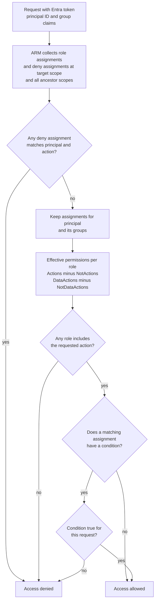

The diagram follows the steps Microsoft publishes for how Azure RBAC determines access. Read it with three edge cases in mind.

- **Deny assignments win.** They are checked first, and no role assignment overrides them. A principal excluded from a deny assignment is evaluated as if the deny assignment did not exist.
- **There is no explicit deny in role definitions.** `NotActions` only shapes one role. The only way to override a grant from another role is a deny assignment, a lock (for write and delete), or the absence of the grant.
- **Group claims come from the token.** If the principal's group membership changed after the token was issued, ARM evaluates the old membership until the token is refreshed. Role assignment changes themselves are read by ARM and, per Microsoft's [RBAC troubleshooting](https://learn.microsoft.com/en-us/azure/role-based-access-control/troubleshooting) guidance, can take up to 10 minutes to take effect because of caching. Built-in roles with data actions assigned at management group scope can take several hours to take effect on the data plane.

### 5.4 Deny assignments

A deny assignment attaches deny actions (and data actions) to principals at a scope, can exclude principals, and can be prevented from inheriting to child scopes. At the time of writing customers cannot create them directly except in private preview. They appear in three generally available situations: deployment stacks with deny settings, Azure managed applications that protect their managed resource group, and certain Azure-managed platform resources. When a user with Owner cannot delete a resource and no lock exists, a deny assignment is the next thing to check: `az role assignment list` does not show it, but the resource's Access control page has a "Deny assignments" tab, and `Get-AzDenyAssignment` lists them.

### 5.5 Limits and their architectural effect

At the time of writing Azure supports up to 5,000 role assignments per subscription, counting assignments at subscription, resource group, and resource scope but not management group scope, and Microsoft states that this limit cannot be increased ([RBAC limits troubleshooting](https://learn.microsoft.com/en-us/azure/role-based-access-control/troubleshoot-limits)). Eligible PIM assignments do not count. Verify current quotas.

**Worked calculation.** A shared platform subscription hosts 300 microservices. Each has a system-assigned managed identity that receives four role assignments (Key Vault Secrets User, Storage Blob Data Contributor, Service Bus Data Sender, and AcrPull on the registry). That is 300 × 4 = 1,200 assignments. Each service also has a deployment service principal with two assignments (600 more) and two human groups per team with three assignments each across 100 teams (600 more). Total: 1,200 + 600 + 600 = 2,400, which is 48 percent of the limit. Growth to 600 services doubles the service-identity component to 2,400 and the deployment component to 1,200, for a total of 4,200, or 84 percent, with no room for incident-time grants.

Three design responses reduce the count. First, assign to groups instead of individuals; Microsoft's guidance is that a user-assigned managed identity shared by several resources can play the role of a group for workloads. Second, assign at a broader scope where the access is genuinely uniform, such as resource group rather than individual resource. Third, split the estate across subscriptions so that each subscription's limit covers fewer workloads. Orphaned assignments also count: role assignments are not deleted when a managed identity is deleted, and they appear as "Identity not found" until someone removes them.

### 5.6 Privileged access

Standing high-privilege assignments are the largest RBAC risk in most estates. Microsoft Entra Privileged Identity Management (PIM) converts assignments into *eligible* assignments that a user activates for a bounded time with justification, approval, and multifactor authentication. PIM applies to both Entra roles and Azure roles. A reasonable baseline is: no standing Owner or User Access Administrator for humans at management group or production subscription scope; standing Reader where operations teams need visibility; a small number of break-glass accounts excluded from Conditional Access, protected by phishing-resistant credentials, and monitored for any sign-in. [IAM](CH09_IAM.md) compares this pattern with AWS IAM Identity Center permission sets and Google Cloud privileged access.

## 6. Azure Policy: what configuration is allowed to exist

Azure RBAC answers "may this principal perform this action?" Azure Policy answers a different question: "is the resulting resource configuration allowed, and if not, what should happen?" A Contributor who is allowed to create storage accounts can still be stopped from creating one with public network access enabled, because Policy inspects the request body and the resource's properties rather than the caller's permissions. Policy does not grant anything. A policy can never make a request succeed that RBAC would reject.

### 6.1 Definitions, initiatives, and assignments

A **policy definition** contains a rule with an `if` condition over resource properties (exposed through *aliases* such as `Microsoft.Storage/storageAccounts/publicNetworkAccess`) and a `then` block that names an effect. A definition is stored at a management group or subscription and can be assigned at or below that location.

```json
{
  "mode": "Indexed",
  "parameters": {
    "effect": { "type": "String", "allowedValues": [ "Audit", "Deny", "Disabled" ], "defaultValue": "Deny" }
  },
  "policyRule": {
    "if": {
      "allOf": [
        { "field": "type", "equals": "Microsoft.Storage/storageAccounts" },
        { "field": "Microsoft.Storage/storageAccounts/publicNetworkAccess", "notEquals": "Disabled" }
      ]
    },
    "then": { "effect": "[parameters('effect')]" }
  }
}
```

The `mode` matters. `All` evaluates resource groups, subscriptions, and all resource types. `Indexed` evaluates only types that support tags and location, which is what most tag and location policies need. Resource Provider modes, such as `Microsoft.Kubernetes.Data`, delegate evaluation to a service for data-plane-like configuration, for example Kubernetes admission control in AKS.

An **initiative** (policy set definition) groups definitions so they are assigned, parameterized, and reported together. Microsoft ships built-in initiatives such as the Microsoft cloud security benchmark, and regulatory initiatives map controls to definitions.

An **assignment** binds a definition or initiative to a scope with parameter values, optional `notScopes` (exclusions), an `enforcementMode` of `Default` or `DoNotEnforce`, optional resource selectors (to roll out by location or resource type), optional non-compliance messages, and, for effects that change resources, a managed identity.

### 6.2 Effects

Microsoft's [effect basics](https://learn.microsoft.com/en-us/azure/governance/policy/concepts/effect-basics) page lists, at the time of writing, `addToNetworkGroup`, `append`, `audit`, `auditIfNotExists`, `deny`, `denyAction`, `deployIfNotExists`, `disabled`, `manual`, `modify`, and `mutate`. The ones an architect uses daily are:

| Effect | When it acts | What it does | Typical use |
|---|---|---|---|
| `deny` | Request time, before the provider | Rejects a create or update whose body matches; flags existing matches non-compliant | Allowed regions, no public IP on network interfaces (NICs), required Transport Layer Security (TLS) version |
| `audit` | Request time and during compliance scans | Allows the request; records a warning event and non-compliant state | Rolling out a new rule before enforcing |
| `append` | Request time | Adds fields to the request body | Adding an IP rule or a setting if absent; largely superseded by `modify` |
| `modify` | Request time; remediation for existing resources | Adds, replaces, or removes properties or tags; needs a managed identity with rights | Tag inheritance from resource group, enforcing a setting the request omitted |
| `auditIfNotExists` | After the provider reports success, and in scans | Checks for a related resource and flags if missing | "Virtual machines should have a backup configured" |
| `deployIfNotExists` | After success, and via remediation | Deploys a template to create the missing related resource; needs a managed identity | Diagnostic settings, Defender plans, private DNS zone records for private endpoints |
| `denyAction` | Request time | Blocks a specific action, currently delete, on matching resources | Protecting resources with a tag from deletion |
| `disabled` | Never | Turns the rule off | Parameterized assignments |

`deny`, `audit`, and `modify` or `append` are often interchangeable through a parameter, and `auditIfNotExists` and `deployIfNotExists` are often interchangeable, per the same page. That interchangeability is the basis of safe rollout: assign with `audit`, observe, then change the parameter to `deny`.

### 6.3 Evaluation order and timing

For a create or update request in a Resource Manager mode, Policy builds the list of applicable assignments and evaluates them in a fixed order before the provider receives the request: `disabled` is checked; then `append` and `modify`, which may alter the request; then `deny`; then `audit`; then `manual`; then `auditIfNotExists`; and `denyAction` last. After the provider returns success, `auditIfNotExists` and `deployIfNotExists` evaluate against the resulting resource. Because `modify` runs before `deny`, a `modify` policy that adds a missing tag can prevent a `deny` policy requiring that tag from firing. That is intentional and useful.

Evaluation also happens outside requests. Microsoft's [compliance data](https://learn.microsoft.com/en-us/azure/governance/policy/how-to/get-compliance-data) page lists the triggers and timings at the time of writing:

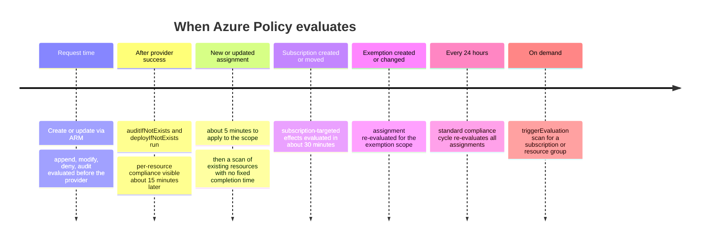

The timeline makes two architectural points.

**Prevention is immediate; detection is eventually consistent.** A `deny` assignment blocks a matching request a few minutes after assignment. The compliance dashboard showing which *existing* resources violate the rule may take hours on a large scope. A security team that assigns an audit at 09:00 and reads the dashboard at 09:30 may see an incomplete picture. Use an on-demand scan, or wait for the scan to complete, before reporting.

**Policy does not see data-plane changes.** If a property can be changed through the data plane, Policy learns about it only at the next scan. Blob container access level, for example, can be set through the data-plane API; a deny policy on container public access blocks the ARM request but not the data-plane call, and the account-level `allowBlobPublicAccess` property, which is control-plane, is the stronger control.

Microsoft also notes that resources under the `Microsoft.Resources` provider are exempt from evaluation except subscriptions and resource groups.

### 6.4 Inheritance, exclusions, and exemptions

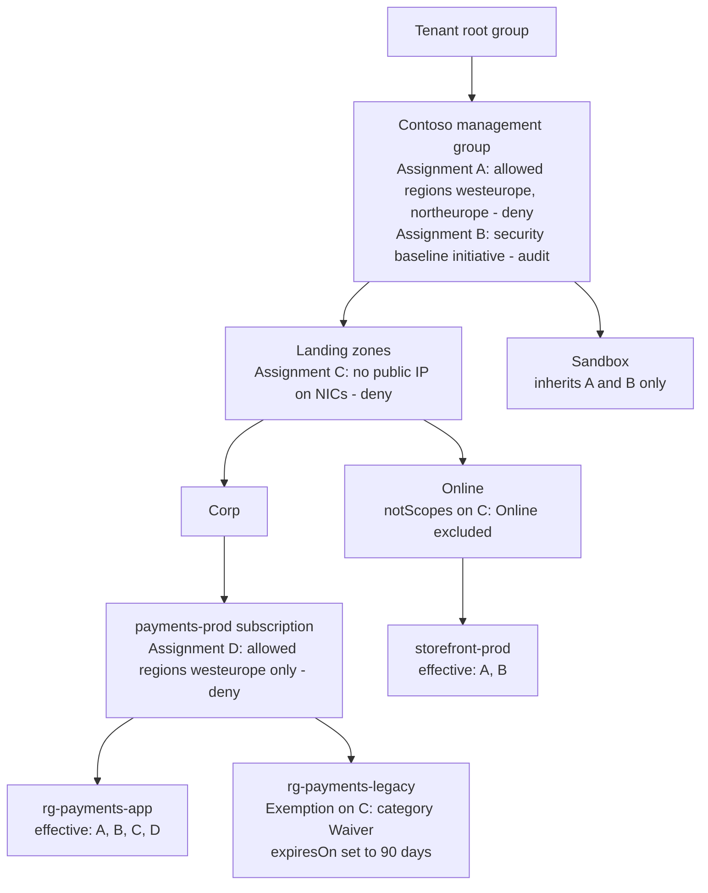

This is the topic map's second required view: policy inheritance and scope. Every assignment applies to its scope and every descendant. Nothing below can weaken an assignment from above; a lower assignment can only add restrictions. The effective policy at `rg-payments-app` is the set of all four assignments, each evaluated independently. Where two deny assignments overlap, the result is the most restrictive combination. Assignment A allows two regions and Assignment D allows one, so `payments-prod` can deploy only to `westeurope`. The [subscription governance example](../code/python/azure-chapter/02_subscription_governance.py) in this chapter's code folder computes exactly this intersection of allowed regions and union of required tags across inherited scopes.

Two mechanisms carve holes, and they are not the same.

- **Exclusions (`notScopes`)** are part of the assignment. They remove a child scope from the assignment entirely; resources there are not evaluated and do not appear in compliance. Online is excluded from Assignment C because internet-facing workloads legitimately need public IP addresses on some resources. Exclusions are for permanent, structural differences.
- **Exemptions** are separate resources (`Microsoft.Authorization/policyExemptions`) that reference an assignment and a scope. Resources under an exemption are still evaluated and appear as **Exempt**, with a compliance substate showing what they would be without the exemption. Exemptions have a category, **Waiver** (non-compliance temporarily accepted) or **Mitigated** (the intent is met by another control), an optional `expiresOn`, metadata for requester and approver, and can target specific definitions within an initiative. When an exemption expires it is no longer honored but the object remains for audit. Creating one requires `policyExemptions/write` at the exempted scope *and* the `exempt/action` on the referenced assignment, per the [exemption structure](https://learn.microsoft.com/en-us/azure/governance/policy/concepts/exemption-structure) documentation. That second permission is what prevents a subscription Owner from exempting itself from a management-group assignment.

The rule for choosing: if you would be uncomfortable seeing the scope disappear from compliance reports, use an exemption, not an exclusion. Exception lifecycle and approval workflow are owned by [Landing Zones](CH15_Landing_Zones.md).

### 6.5 Remediation

`modify` and `deployIfNotExists` act automatically on new and updated resources. Existing non-compliant resources are not fixed until someone creates a **remediation task** for the assignment, which iterates over non-compliant resources and applies the effect. Both effects require the assignment to have a managed identity (system-assigned or user-assigned) with the roles the effect needs, listed in the definition's `roleDefinitionIds`. Three failure modes are common:

1. **The identity lacks rights at the target scope.** A `deployIfNotExists` policy that creates diagnostic settings sending logs to a workspace in the management subscription needs rights on the workspace too, not only on the resource being remediated.
2. **The deployment conflicts with a lock or a deployment stack deny setting.** The remediation task fails for those resources. Exclude the policy's identity from stack deny settings where remediation is intended.
3. **Remediation is mistaken for enforcement.** `deployIfNotExists` runs after the resource is created. There is a window, often minutes, in which the resource exists without its required companion. If the companion is security-critical, pair the remediation with a `deny` on the unsafe configuration itself.

### 6.6 Azure Policy versus Azure RBAC

| Question | Azure RBAC | Azure Policy |
|---|---|---|
| What does it evaluate? | The principal and the action | The resource configuration in the request or at rest |
| Can it grant? | Yes; that is its purpose | No; it can only deny, alter, audit, or deploy |
| Default when nothing matches | Deny (no grant means no access) | Allow (no matching rule means no effect) |
| Applies to existing resources? | Only to future requests | Yes; compliance scans flag existing resources |
| Applies to data plane? | Yes, through data actions for integrated services | Mostly no; Resource Provider modes cover some services |
| Overrides | Deny assignments override grants | None; assignments combine to the most restrictive |
| Typical owner | Workload team within guardrails; platform team for high scopes | Platform or governance team |
| Failure signature | `AuthorizationFailed` naming the missing action | `RequestDisallowedByPolicy` naming the assignment |

A secure design needs both. RBAC limits who can change things; Policy limits what anyone, including authorized principals and automation, can turn things into. Neither controls the data plane well on its own: a compliant, correctly permissioned storage account still leaks data if the application holding Storage Blob Data Contributor is compromised.

### 6.7 Worked scenario: enforcing private storage across 120 subscriptions

**Context.** A platform team must ensure that no storage account in the landing-zone hierarchy permits public network access. There are 120 subscriptions and roughly 2,400 existing storage accounts.

**Plan and arithmetic.**

1. Assign the definition from Section 6.1 at "Landing zones" with effect `Audit` on day 0. The assignment applies in about five minutes; the first full scan completes some hours later.
2. On day 1 query compliance through Azure Resource Graph. Suppose 180 accounts (7.5 percent of 2,400) are non-compliant.
3. Classify them: 150 have no legitimate need and are remediated by owners or by a `modify` policy that sets `publicNetworkAccess` to `Disabled`; 25 are in "Online" and serve public static content through a content delivery network, so they get Mitigated exemptions referencing the front-door protection; 5 belong to a vendor integration being retired and get Waiver exemptions expiring in 90 days.
4. On day 14 switch the effect parameter to `Deny`. New violations are now blocked at request time.

**Validation evidence.** Compliance shows 0 non-compliant, 30 exempt, each with metadata naming an approver and a ticket; an attempt by a test pipeline to create a public storage account returns `RequestDisallowedByPolicy`; the Activity Log shows the denial.

**Edge case.** An application team's Bicep file sets no value for `publicNetworkAccess`. The service's default may be `Enabled`, so the `notEquals: Disabled` condition matches and the deny blocks the deployment, even though the team did not ask for public access. That is the correct outcome, but the non-compliance message must say how to fix it, or the platform team receives a support ticket per team.

## 7. Resource locks

A management lock is a control-plane guard applied at subscription, resource group, or resource scope. It applies to all principals, including Owners, which is the property that distinguishes it from RBAC. There are two levels, documented in Microsoft's [lock resources](https://learn.microsoft.com/en-us/azure/azure-resource-manager/management/lock-resources) page:

- **`CanNotDelete`** (portal: Delete): authorized users can read and modify the resource but not delete it.
- **`ReadOnly`** (portal: Read-only): authorized users can read but not modify or delete, similar to restricting everyone to Reader.

Locks inherit downward, and the most restrictive lock in the chain wins. Extension resources inherit from the resource they extend. Creating or removing a lock requires `Microsoft.Authorization/locks/*`, which Owner and User Access Administrator hold. A lock is therefore a guard against *accidents*, not against a determined administrator, who can remove it.

The side effects are where locks cause incidents. Because `ReadOnly` blocks any non-read control-plane operation, including `POST` actions, it blocks things that do not look like modifications:

- Listing storage account keys (a `POST`), so key-based clients break.
- Starting or restarting virtual machines in a locked resource group.
- Scaling an App Service plan in a locked resource group.
- Running Automation runbooks in a locked resource group.
- Reading Application Gateway backend health.
- Creating role assignments scoped to a locked storage account or its containers.

`CanNotDelete` has its own traps: it blocks deletion of role assignments on the locked scope, blocks automatic cleanup of deployment history (so the 801st deployment fails), and can break services that clean up after themselves, such as Azure Backup restore-point collections and Machine Learning compute scale-in. Locks do not affect the data plane: a `CanNotDelete` lock on a storage account does not stop a client from deleting every blob, and a lock does not block subscription cancellation.

**Controls for "don't break production" compared.**

| Control | Who it stops | Who can bypass | Data plane? | Main side effect |
|---|---|---|---|---|
| `CanNotDelete` lock | Everyone | Anyone with `locks/*`, by removing it | No | Blocks cleanup operations and history pruning |
| `ReadOnly` lock | Everyone | Same | No | Blocks many `POST` actions |
| Deployment stack deny setting | Everyone except up to five excluded principals | Stack Owner role holders | No | Requires stack-based deployment |
| Policy `denyAction` (delete) | Everyone matching the rule | Policy administrators via exemption | No | Narrow to delete actions |
| RBAC least privilege | Principals without the grant | Anyone who can assign roles | Yes for data actions | Requires disciplined role design |
| Soft delete and purge protection (service features) | Recovers after deletion | Service-specific | Yes | Retention cost |

Use locks sparingly and deliberately: `CanNotDelete` on irreplaceable shared resources such as the hub virtual network, the ExpressRoute circuit, the central Log Analytics workspace, and production Key Vaults (in combination with purge protection). Avoid `ReadOnly` on anything that runs. For data, rely on service features (soft delete, versioning, immutability, backups) owned by [Storage](CH06_Storage.md).

## 8. Regions, availability zones, and region pairs

Governance scopes say who controls a resource. Regions and zones say which physical failures can take it down. The two hierarchies are independent: a subscription spans every region, and a resource group's location says nothing about where its resources run.

### 8.1 Geographies and regions

An Azure **geography** is a market, usually a country or group of countries, that contains one or more regions and defines data-residency and compliance boundaries. A **region** is a set of datacenters within a latency-defined perimeter connected by a dedicated regional network. Each region has its own service catalog, its own instance of each regional resource provider, its own capacity, and, for many services, its own quota. Regions differ: a new region may lack some services or virtual machine sizes; a region may not support availability zones; and some regions are restricted, available only on request for specific scenarios such as in-country disaster recovery.

Region choice is made from several constraints together: where users are (latency), where data may legally reside, whether the required services and SKUs exist there, whether the region has zones, the region's price level, and what the secondary region for recovery will be. The [region and zone placement example](../code/python/azure-chapter/01_region_zone_placement.py) models the first check an architect should automate: for each service the workload needs, is it available in the candidate region, and does it support zone redundancy there? A data store that exists in `westeurope` but not `northeurope` fails that check for a two-region design before any cost discussion starts.

### 8.2 Availability zones and the three deployment types

Microsoft's [availability zones overview](https://learn.microsoft.com/en-us/azure/reliability/availability-zones-overview) defines an availability zone as a logical grouping of one or more physically separate datacenters within a region, with independent power, cooling, and networking. Zones are typically several kilometers apart and usually within 100 kilometers of each other. Microsoft targets inter-zone round-trip latency below roughly 2 milliseconds on the network links, which is low enough for synchronous replication. At the time of writing Microsoft states it does not charge for data transfer between availability zones in the same region, which differs from AWS, where inter-zone transfer is billed. Verify current pricing.

Each resource is deployed in one of three ways, and the difference decides who is responsible for surviving a zone failure.

| Deployment type | Where it runs | Who handles zone failure | Examples |
|---|---|---|---|
| **Zone-redundant** | Replicated or distributed across zones by the service | Microsoft; failover is automatic | Zone-redundant storage (ZRS), zone-redundant Azure SQL Database, zone-redundant App Service plans, Standard Load Balancer with a zone-redundant frontend |
| **Zonal** | Pinned to one zone the customer selects | The customer, by deploying instances in several zones and routing between them | A virtual machine with `zones: ["2"]`, a zonal managed disk, a zonal public IP |
| **Nonzonal (regional)** | Anywhere in the region, placement chosen by Azure | No one; it may be in the failed zone | A virtual machine with no zone specified; locally redundant storage (LRS) |

Three details matter in reviews.

- **Zone support depends on SKU and region.** A service may support zone redundancy only on premium tiers, or only in some regions. Do not infer it from the region having zones.
- **Zone count is not replica count.** A region may have three or more zones; a service may use a subset; a resource may run more replicas than zones. A resource is zone-resilient as long as it uses at least two zones and the remaining capacity is enough.
- **Microsoft deploys updates one zone at a time** in a region where it can. A workload already spread across zones benefits from that sequencing; a nonzonal workload does not.

### 8.3 Logical and physical zones

Zone numbers are not physical locations. Each datacenter belongs to a physical zone, and each subscription receives, at creation time, its own mapping from logical zone numbers (1, 2, 3) to physical zones. Microsoft documents that subscription A may have physical zone 1 mapped to logical zone 2, while subscription B has physical zone 1 mapped to logical zone 3. When Microsoft adds a zone to a region, existing subscriptions keep their mappings.

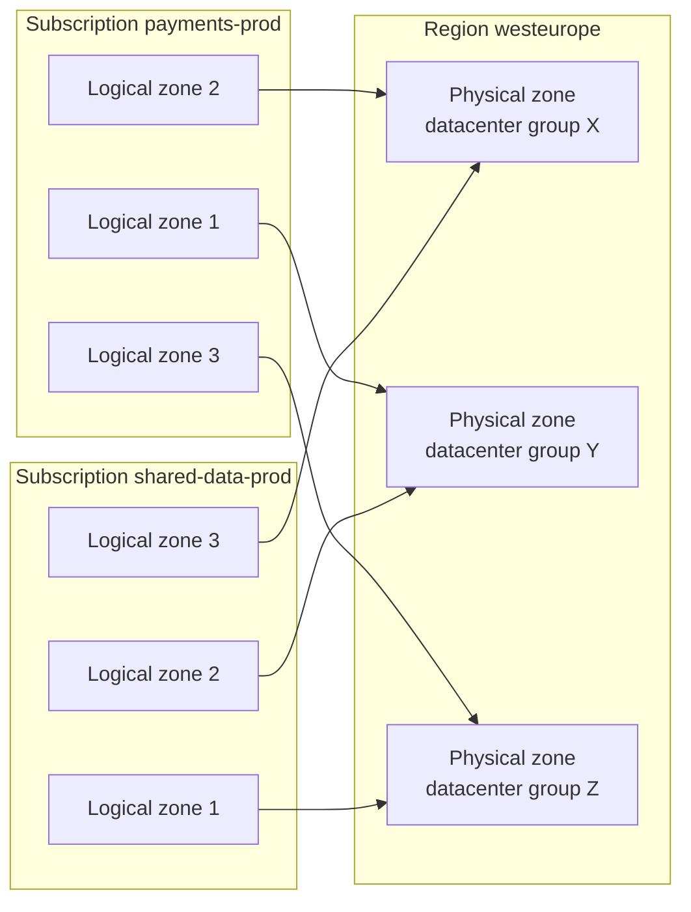

The diagram is a failure-domain map. The application in `payments-prod` pins its primary instance to logical zone 1, and the database team in `shared-data-prod` pins the primary replica to logical zone 1, both believing they are "zone-aligned." Physically, the application is in datacenter group Y and the database in Z. Every request crosses zones, adding inter-zone latency to every query. Worse, the team's failure analysis is wrong: they believe a failure of "zone 1" takes down both together and have designed failover for that case, but in fact a failure of group Y takes down only the application, and a failure of Z takes down only the database primary.

**How to find the mapping.** The Locations API returns `availabilityZoneMappings` per subscription:

```bash
az account list-locations \
  --query "[?name=='westeurope'].availabilityZoneMappings" -o json
```

The output lists each `logicalZone` with its `physicalZone` identifier, for example `westeurope-az2`. ARM also exposes a `checkZonePeers` operation that compares mappings between subscriptions. Compare mappings whenever zonal resources in different subscriptions must be co-located or deliberately separated.

**When this matters.** It matters for zonal resources only. Zone-redundant services handle placement internally. It matters most for latency-sensitive zonal pairs (application and database, cache and consumer), for capacity planning (if two subscriptions both "spread across zones 1 and 2," they may cover all three physical zones between them or only two), and for incident communication (Azure Service Health and status pages identify affected zones, and you need the mapping to translate that into your logical zone numbers). AWS has the same concept with zone names that differ per account and zone IDs such as `use1-az1` that are consistent; [AWS](CH01_AWS.md) covers it.

### 8.4 Quality scenario: a zonal failure

**Stimulus.** Physical zone Y in `westeurope` loses power at 14:00. In `payments-prod` that is logical zone 1.

**Architecture under test.** The payments API runs on a Virtual Machine Scale Set with Flexible orchestration and instances spread across zones 1, 2, and 3, behind a Standard Load Balancer with a zone-redundant frontend. Normal load needs 24 instances; the scale set runs 36 (12 per zone). The database is Azure SQL Database with zone redundancy enabled. Storage is ZRS.

**Arithmetic.** Losing one zone removes 12 of 36 instances, leaving 24, which exactly meets normal load. If the team had deployed 24 instances (8 per zone), losing one zone would leave 16, which is 67 percent of the required capacity, and the remaining instances would saturate. Replacing the missing capacity by scaling out during the incident would need 8 new instances in the surviving zones, which requires ARM, the compute provider, quota, and physical capacity in the two remaining zones at the moment every other customer in the region is asking for the same thing. Pre-provisioned N+1 zone capacity (here 36 / 24 = 1.5 times normal) removes that dependency.

**Expected response.** The load balancer's health probes mark zone 1 instances unhealthy within the probe interval and stop sending them traffic. The database fails over its primary replica to another zone automatically. ZRS continues serving reads and writes.

**Measurable success criterion.** Error rate stays below 1 percent after the first two minutes; 99th-percentile latency stays within 20 percent of baseline; no manual action needed; no data loss for committed transactions.

**What the test usually reveals.** A single-instance dependency that is nonzonal (for example, a self-hosted cache or a jump host), a zonal public IP address on a network virtual appliance, or a network address translation (NAT) gateway deployed as a zonal resource in the failed zone while serving the whole subnet's outbound traffic. Check the zone model of each NAT gateway SKU in use; it differs between SKUs. Trade-offs between recovery time objective (RTO), recovery point objective (RPO), and cost across recovery options are modeled by the [recovery cost scenario example](../code/python/azure-chapter/04_recovery_cost_scenario.py).

### 8.5 Region pairs and nonpaired regions

Many Azure regions are paired with another region, usually in the same geography. Microsoft's [region pairs](https://learn.microsoft.com/en-us/azure/reliability/regions-paired) page describes what pairing provides at the time of writing:

- **Recovery sequence.** In a geography-wide outage, one region in each pair is prioritized for recovery.
- **Sequential updates.** Microsoft staggers planned updates across a pair.
- **Data residency.** Almost all pairs are within the same geography, with documented exceptions.
- **Service geo-replication defaults.** A small number of services, notably geo-redundant storage (GRS) and its variants, replicate to the paired region.

Pairing does **not** replicate customer resources, configure failover, or provide high availability. Microsoft states that deploying to a region in a pair does not automatically make resources more resilient, and that customers should not rely on Microsoft-managed failover, such as GRS account failover, which Microsoft performs only in catastrophic situations, as their primary disaster-recovery approach.

Pairs are not always symmetric. Brazil South is paired with South Central US, which is outside the Brazil geography, and South Central US is paired with North Central US instead. West US 3 pairs one way with East US. Many newer regions have no pair at all and rely on availability zones; at the time of writing these include Italy North, Poland Central, Spain Central, Israel Central, Qatar Central, Mexico Central, New Zealand North, and others. Some pairs are restricted-access regions, such as Germany North for Germany West Central, which cannot host general workloads without an access request.

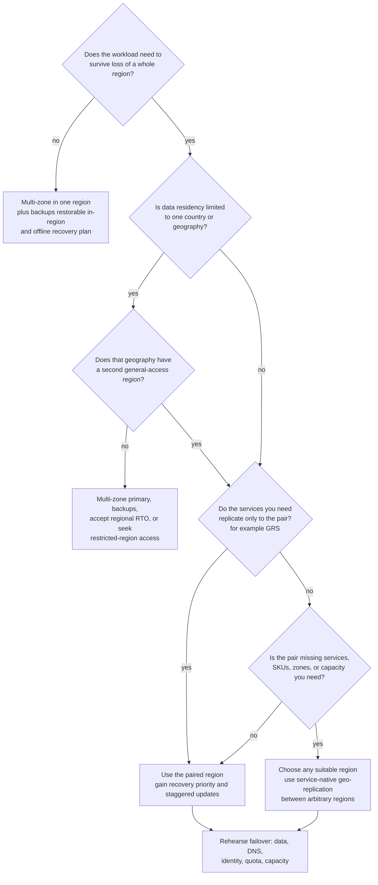

The decision tree shows that pairing is one input, not the answer. It is the right choice when the services you rely on use the pair implicitly (GRS, some platform-managed backups) and the pair has what you need. It is the wrong choice when the pair lacks zones, SKUs, or capacity, or when the region has no pair. Many services, such as Azure SQL Database active geo-replication and failover groups, Cosmos DB multi-region accounts, and Azure Storage object replication, replicate between arbitrary regions. Every branch ends in the same box: rehearse. A second region without tested data recovery, DNS cutover, identity availability, and quota is a cost, not a capability. Cross-provider recovery patterns belong to [Resilience, Availability, and Disaster Recovery](../10_Cloud_Architecture/CH09_Resilience_Availability_and_Disaster_Recovery_Architectures.md).

### 8.6 Data residency is broader than the primary region

A workload's data exists in more places than its primary database: geo-replicas, backup vaults (Azure Backup vaults can store GRS copies in the pair), diagnostic logs sent to a workspace in another region, exported analytics, and support cases with attachments. Some services are non-regional (global) and keep configuration or metadata in a location chosen at creation. Microsoft's landing-zone region guidance notes that even global resources require a deployment location because Azure tracks some metadata in a regional store. A residency review lists every copy and every service's documented data location, not just the region of the main resource.

## 9. Virtual networks and subnets

[Networking](CH05_Networking.md) owns routing, private endpoints, hybrid connectivity, and topology choices. This section gives the Azure-specific scope rules needed to review a design and draws the packet path that the topic map requires.

### 9.1 Scope rules

- A **virtual network (VNet)** belongs to one subscription, one resource group, and one region. It has one or more address spaces in Classless Inter-Domain Routing (CIDR) notation. It spans all availability zones in its region, unlike an AWS subnet, which lives in one zone.
- A **subnet** is a range inside the VNet. It is also regional and zone-spanning, so one subnet can hold virtual machines in all three zones. Azure reserves five addresses in every subnet: the network address, the first three host addresses (default gateway and two for Azure DNS mapping), and the broadcast address. A `/27` therefore offers 32 − 5 = 27 usable addresses.
- **Network security groups (NSGs)** are stateful allow and deny rule lists, associated with a subnet, a network interface, or both. Inbound traffic is evaluated by the subnet NSG then the NIC NSG; outbound in the reverse order. Rules are processed by priority, lowest number first, and the first match wins.
- **Route tables** containing **user-defined routes (UDRs)** associate with subnets and override Azure's system routes, typically to send `0.0.0.0/0` to a firewall or network virtual appliance (NVA).
- **Peering** connects two VNets in the same or different regions, subscriptions, or even tenants. It is non-transitive: if A peers with B and B with C, A cannot reach C through B without a router or firewall in B and UDRs pointing to it.
- **Delegated subnets** are handed to a platform service, such as Azure Container Apps environments, App Service virtual network integration, or Azure Database for PostgreSQL flexible server, which then controls what runs in them. Plan their size from the service's documentation; some cannot be resized while in use.
- **Private endpoints** place a network interface with a private IP in your subnet that maps to one instance of a platform service. Name resolution through a private DNS zone (for example `privatelink.blob.core.windows.net`) is what makes clients use it.
- **Outbound access must be explicit.** Microsoft's [default outbound access](https://learn.microsoft.com/en-us/azure/virtual-network/ip-services/default-outbound-access) documentation states that, for API versions released after March 31, 2026, subnets in new VNets default to private, with `defaultOutboundAccess` set to false, and that existing VNets are not changed. Virtual machines in private subnets need a NAT gateway, a load balancer outbound rule, a public IP, or a firewall route to reach the internet. Design for explicit egress regardless of the API version.

### 9.2 The packet path

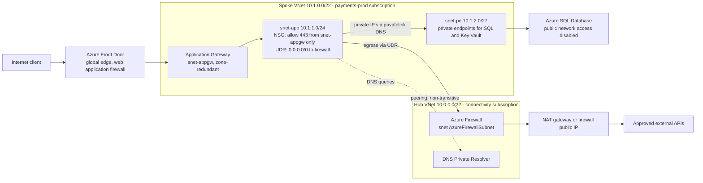

This is the topic map's third required view: virtual-network and subnet connectivity. Follow a request from left to right. A user reaches Azure Front Door at the global edge, which forwards to Application Gateway in a dedicated subnet. The gateway forwards to application instances in `snet-app`, whose NSG admits port 443 only from the gateway subnet. The application connects to Azure SQL Database by its normal hostname; the private DNS zone linked to the hub resolver returns the private endpoint's address in `snet-pe`, so the traffic never leaves the VNet. Outbound calls to external APIs follow the UDR to Azure Firewall in the hub, which applies egress rules and translates the source address.

The implications for review are concrete. Disabling public network access on the SQL server is separate from creating the private endpoint; without it, the public endpoint remains reachable from the internet subject to its firewall rules. The private DNS zone must be linked to the VNet whose resolver the application uses, or the application resolves the public address and fails (or worse, succeeds over the public path). Because peering is non-transitive, a second spoke can reach this one only through the firewall, which is intended. And because the firewall is in another subscription, the spoke's owners cannot change egress rules; that is the separation of duties the hub-and-spoke pattern exists to provide.

## 10. Managed identities and the access path

Managed identities remove stored credentials from workloads running on Azure. [IAM](CH09_IAM.md) compares workload identity federation across providers, and [Secrets Management](CH13_Secrets_Management.md) covers Key Vault rotation. This section explains how Azure's mechanism works, because its lifecycle and caching behavior shape design decisions.

### 10.1 System-assigned and user-assigned

A managed identity is a special type of service principal in the Entra tenant that the subscription trusts. It can only be used by Azure resources, and Azure manages its credential, a certificate issued internally by the Managed Identity resource provider and rotated by the platform, per Microsoft's [how managed identities work](https://learn.microsoft.com/en-us/entra/identity/managed-identities-azure-resources/how-managed-identities-work-vm) page.

| Property | System-assigned | User-assigned |
|---|---|---|
| Created | As a property of one resource | As a standalone resource (`Microsoft.ManagedIdentity/userAssignedIdentities`) |
| Lifecycle | Deleted with the resource | Independent; must be deleted explicitly |
| Sharing | One resource only | Many resources |
| Role assignments survive resource rebuild | No; a rebuilt resource gets a new principal | Yes |
| Can be granted access before the resource exists | No | Yes |
| Good fit | A single long-lived resource whose permissions should die with it | Fleets, frequently recreated resources, pre-authorized deployments |

A resource can have one system-assigned identity and several user-assigned identities at the same time. When several are attached, code must pass the identity's client ID to choose one.

**Decision.** For a container app redeployed every release, a user-assigned identity avoids re-creating role assignments each time and avoids a gap in which the new revision has no access. It also reduces role-assignment count (Section 5.5): four virtual machines sharing one user-assigned identity need one set of assignments, not four. A system-assigned identity is better when an auditor needs a one-to-one mapping from identity to resource, or when the permissions should be guaranteed to disappear with the resource. Role assignments are not automatically deleted in either case, so cleanup is still needed.

### 10.2 The token path

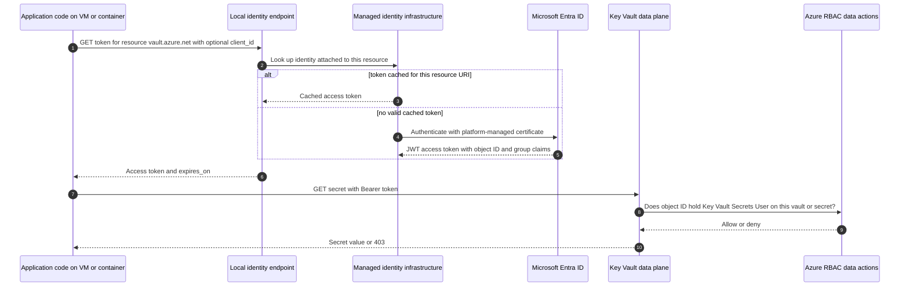

This is the topic map's fourth required view: the managed identity access path. On a virtual machine, the local endpoint is the Azure Instance Metadata Service (IMDS) at `http://169.254.169.254/metadata/identity/oauth2/token`, reachable only from inside the machine and requiring the `Metadata: true` header. App Service, Functions, and Container Apps expose an equivalent endpoint through `IDENTITY_ENDPOINT` and `IDENTITY_HEADER` environment variables. Azure Arc-enabled servers expose one at `http://localhost:40342` (Section 15). The SDK class `DefaultAzureCredential` or `ManagedIdentityCredential` hides these differences.

The token is a JSON Web Token (JWT) with an audience for one resource (Key Vault, Storage, ARM, SQL). The workload presents it to that service's data plane, which checks Azure RBAC data actions (for Key Vault in the RBAC permission model) or its own access model (for Key Vault access policies, or SQL users created from external providers).

### 10.3 Caching, revocation, and the "anyone who runs code" rule

Two documented behaviors shape security design, both from Microsoft's [managed identity best practices](https://learn.microsoft.com/en-us/entra/identity/managed-identities-azure-resources/managed-identity-best-practice-recommendations).

**Token caching delays revocation through groups.** The back-end services for managed identities cache tokens per resource uniform resource identifier (URI) for around 24 hours, and a token cannot be forcibly refreshed. Group membership is a claim inside the token. So if a managed identity's access comes from membership in an Entra group, removing it from the group can take several hours to take effect. Direct role assignments are evaluated by the target service at request time from current RBAC data, so removing a direct assignment takes effect on the order of the general RBAC propagation delay (up to about 10 minutes), not hours. Microsoft therefore recommends granting permissions directly to a user-assigned identity, used as a group, when quick revocation matters.

**Anyone who can run code on the resource can use its identity.** If a managed identity with write access to a storage account is attached to a Logic App, any user who can edit that Logic App's workflow can act with the storage permissions. Anyone with permission to *assign* a user-assigned identity (the Managed Identity Operator role) can attach it to a resource they control and inherit its permissions. Treat "can deploy code to X" and "can assign identity Y" as equivalent to holding X's and Y's permissions.

### 10.4 Quality scenario: revoking a compromised workload's access

**Stimulus.** Security operations detect that a container image in `payments-prod` was tampered with and is exfiltrating secrets. The workload uses user-assigned identity `id-payments-api`, which holds Key Vault Secrets User directly on `kv-payments-prod`.

**Response.** (1) Remove the role assignment from `id-payments-api` on the vault. (2) Rotate every secret the identity could read, through the procedure owned by [Secrets Management](CH13_Secrets_Management.md). (3) Deploy a clean revision with a *new* user-assigned identity, granted access after the secrets are rotated. (4) Delete the old identity and its remaining assignments.

**Measurable success criterion.** Key Vault diagnostic logs show `403` responses for `id-payments-api` within 10 minutes of step 1; no successful reads after that; all exposed secrets rotated within 60 minutes; the clean revision serves traffic within 90 minutes.

**Why the design passes.** Access came from a direct assignment, so removal propagates in minutes. Had access come through an Entra group that the identity belonged to, step 1 would have been "remove from group," and cached tokens could have kept working for hours. The only immediate containment would then have been network-level (disable the vault's public access or tighten its firewall) or deleting the identity.

## 11. Quotas, capacity, and limits

A deployment can be authorized, compliant, and correctly placed, and still fail because the subscription is not allowed to have that much of something or because the region does not physically have it. Azure separates those two conditions, and so must an architect.

### 11.1 Quota versus capacity

Microsoft's [virtual machine quotas](https://learn.microsoft.com/en-us/azure/virtual-machines/quotas) page makes the distinction directly. **Quota** is the subscription's permission to deploy a number of vCPUs or virtual machines in a region. **Capacity** is the physical hardware available in that region or zone. A request can pass the quota check and still fail with an allocation error because the requested size is not available in the chosen zone at that moment. Quota is raised by request; capacity is guaranteed only by an **on-demand capacity reservation**, which reserves a number of instances of a size in a region or zone and bills for them whether used or not.

### 11.2 The two-tier vCPU quota

For virtual machines and scale sets, vCPU quota is tracked per subscription, per region, in two tiers that are enforced separately:

1. **Total Regional vCPUs** across all families.
2. **Per-family vCPUs**, such as "Standard DSv5 Family vCPUs."

A deployment must fit within both. Spot virtual machines have a separate regional quota. A separate quota limits the total number of virtual machines in a region. Quota counts allocated *and deallocated* virtual machines' cores; stopping a virtual machine without deallocating it, or even deallocating it, does not free quota until it is deleted. Microsoft's [service limits](https://learn.microsoft.com/en-us/azure/azure-resource-manager/management/azure-subscription-service-limits) page notes that default limits vary by offer type and are deliberately low for new subscriptions. Check current values with:

```bash
az vm list-usage --location westeurope -o table
```

Other services have their own quotas: public IP addresses per region, App Service plans, AKS clusters and node pools (which consume the underlying vCPU quota), Azure SQL Database server and database counts, storage accounts per region per subscription, and so on. Many quotas can be raised self-service through the portal's Quotas experience or the `Microsoft.Quota` API; some need a support request. Increases are per region: raising `westeurope` does nothing for `northeurope`.

### 11.3 Worked calculation: quota headroom for a scale-out and a failover

**Context.** The payments API in `payments-prod` uses `Standard_D4s_v5` (4 vCPUs, DSv5 family). Current quotas in `westeurope`: DSv5 family 200 vCPUs, total regional 300 vCPUs. Other workloads in the subscription use 60 vCPUs of other families. The API normally runs 36 instances (Section 8.4). A peak-season forecast calls for 54 instances, and blue-green deployment temporarily doubles the instance count during a release.

**Steady state.** 36 × 4 = 144 DSv5 vCPUs. Family headroom: 200 − 144 = 56. Regional usage: 144 + 60 = 204 of 300, headroom 96.

**Peak.** 54 × 4 = 216 DSv5 vCPUs, which exceeds the family quota of 200. The scale set would stop at floor(200 / 4) = 50 instances. Autoscale reports a failure; latency climbs.

**Peak plus release.** Blue-green at peak needs 2 × 216 = 432 DSv5 vCPUs and 432 + 60 = 492 regional vCPUs. Both quotas fail by a wide margin.

**Failover from the secondary.** If `northeurope` is the recovery region and must absorb peak traffic, it needs at least 216 DSv5 vCPUs and 216 plus whatever else runs there regionally, *already granted*, because quota increases during a regional incident compete with every other customer's requests.

**Plan.** Request DSv5 family 480 and regional 560 in `westeurope` (432 + 60 = 492 rounded up with margin), or change the release strategy to rolling with a 25 percent surge (54 × 1.25 = 67.5, so 68 instances, 272 vCPUs) and request family 300, regional 400. Request matching quota in `northeurope`. Consider capacity reservations for the minimum instance count needed for failover. Alert when usage reaches 80 percent of any quota tier.

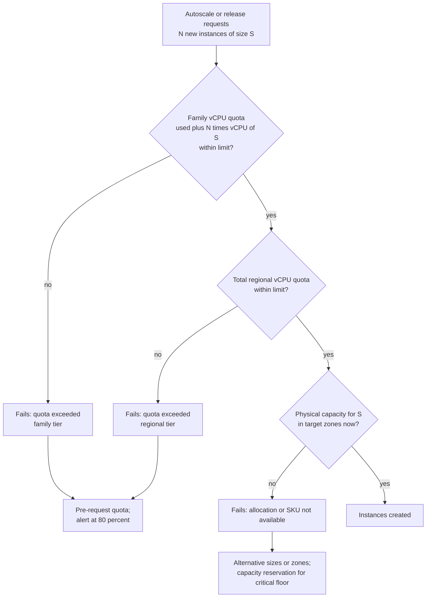

The decision flow shows that a scale-out passes three independent gates, each owned by a different party. The first two are under the customer's control, through quota requests made in advance. The third is Microsoft's, mitigated by flexibility (more than one acceptable virtual machine size, more than one zone) or by paying for reserved capacity. An autoscale configuration that allows only one size in one zone has made the third gate as narrow as possible.

### 11.4 Other limits that shape design

| Limit (at the time of writing; verify current quotas) | Value | Design effect |
|---|---|---|
| Role assignments per subscription | 5,000, fixed | Group-based and user-assigned identity assignments; split subscriptions |
| Resource groups per subscription | 980 | Avoid one resource group per microservice in shared subscriptions |
| Resources of one type per resource group | 800 for most types | Large fleets need several resource groups |
| Deployments in history per scope | 800, auto-pruned unless locked | Do not `CanNotDelete`-lock resource groups that receive frequent deployments without a pruning plan |
| Resources per deployment | 800 | Split very large templates into modules or stacks |
| Management locks per scope | 20 | Locks are for a few critical resources |
| ARM request body | 4,194,304 bytes | Large templates should use template specs or modules |
| ARM writes per principal per subscription | Bucket 200, refill 10 per second | Section 4.7 |
| Management group depth | Six levels below root | Keep the tree shallow |

## 12. Compute and storage service families

The later Part 09 chapters own these services. This section places them in Azure's operating model: what kind of resource each is, how it is scoped, and where its responsibility boundary sits.

### 12.1 Compute

| Family | Azure service | Scope and zone model | Who operates the guest | Owning chapter |
|---|---|---|---|---|
| Virtual machines | Azure Virtual Machines | Zonal or nonzonal | Customer: operating system, patching, agents | [Compute](CH04_Compute.md) |
| Virtual machine fleets | Virtual Machine Scale Sets, Uniform and Flexible orchestration | Can span zones | Customer for guest; platform for instance orchestration | [Compute](CH04_Compute.md) |
| Batch compute | Azure Batch | Pool-level placement | Shared: platform schedules, customer supplies images and tasks | [Compute](CH04_Compute.md) |
| Web application platform | Azure App Service | Zone-redundant plans on supported tiers | Platform operates operating system and runtime; customer owns code and configuration | [Compute](CH04_Compute.md) |
| Serverless functions | Azure Functions, several hosting plans | Plan-dependent | Platform operates hosts; customer owns code, triggers, concurrency settings | [Serverless](CH11_Serverless.md) |
| Serverless containers | Azure Container Apps; Azure Container Instances | Zone redundancy for Container Apps environments on supported configurations | Platform operates orchestration; customer owns images | [Containers](CH07_Containers.md) |
| Managed Kubernetes | Azure Kubernetes Service (AKS) | Node pools can span zones | Platform operates the control plane; customer shares node and workload operations | [Kubernetes](CH08_Kubernetes.md) |

Two Azure-specific points cut across the table. First, every family that uses virtual machines underneath (Scale Sets, AKS node pools, Batch pools, App Service dedicated plans) consumes vCPU quota from the subscription's family and regional tiers, sometimes in a family the team did not choose directly. Second, services that create infrastructure on your behalf often place it in a separate, platform-managed resource group (AKS creates a node resource group, conventionally prefixed `MC_`, and managed applications create a locked managed resource group). Those resource groups inherit subscription-level policy and count toward subscription limits, but changing them by hand can break the service. The [service selection matrix example](../code/python/azure-chapter/03_service_selection_matrix.py) scores Virtual Machines, App Service, and Functions against weighted requirements (runtime fit, burst fit, private-network fit, operational simplicity); its scores are prompts for review, not benchmarks.

### 12.2 Storage

| Family | Azure service | Redundancy options | Owning chapter |
|---|---|---|---|
| Object | Blob Storage in a storage account; Data Lake Storage with hierarchical namespace | LRS, ZRS, GRS, read-access GRS (RA-GRS), geo-zone-redundant storage (GZRS), read-access GZRS (RA-GZRS) | [Storage](CH06_Storage.md) |
| File | Azure Files (Server Message Block and Network File System protocols); Azure NetApp Files | Service-dependent | [Storage](CH06_Storage.md) |
| Block | Azure managed disks (Standard hard disk drive (HDD), Standard and Premium solid-state drive (SSD), Premium SSD v2, Ultra Disk) | LRS or ZRS depending on disk type; zonal attachment to virtual machines | [Storage](CH06_Storage.md) |
| Queue and table | Queue Storage, Table Storage in a storage account | Inherits the account's redundancy | [Messaging](CH12_Messaging.md) for queues |

A storage account is the Azure-specific unit to notice. It is one ARM resource that exposes several data-plane endpoints (blob, file, queue, table, and Data Lake), shares one redundancy setting, one network configuration, one set of account keys, and per-account scalability targets. Putting unrelated workloads into one storage account couples their network exposure, key rotation, and throughput limits. The account-level settings that most often matter in reviews are `allowSharedKeyAccess` (disable to force Entra authorization), `allowBlobPublicAccess`, `publicNetworkAccess`, `minimumTlsVersion`, and the redundancy SKU. "GRS" replicates asynchronously to the paired region (Section 8.5), so its recovery point depends on replication lag and its failover is a customer-initiated or Microsoft-initiated action, not automatic high availability.

## 13. The Azure service responsibility matrix

Every Azure service divides operational work between Microsoft and the customer. The division moves as the service model becomes more abstract, but some responsibilities never move.

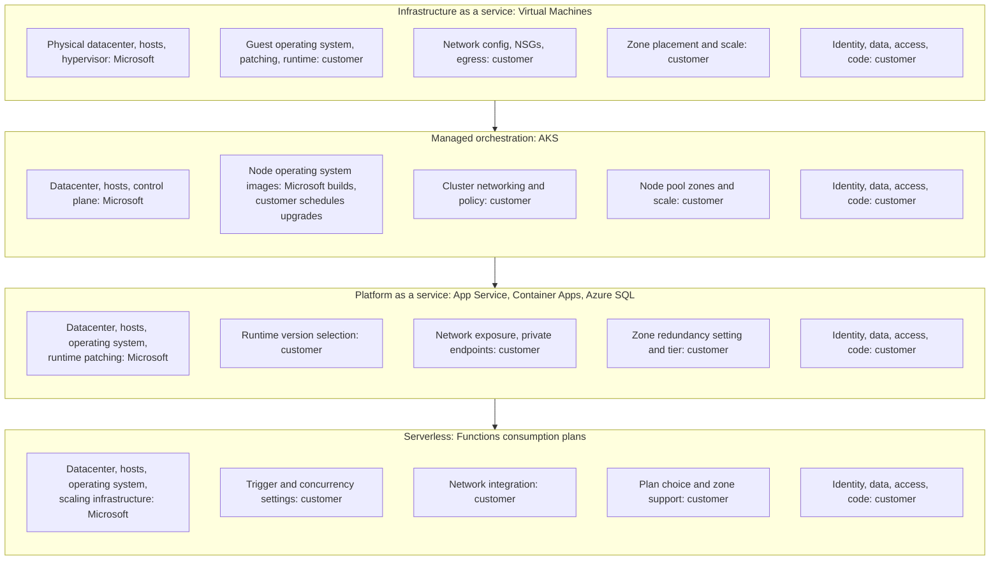

This is the topic map's fifth required view. Read each column top to bottom: the top row is always Microsoft's, the bottom row is always the customer's, and the middle rows move as you go right. The arrow is not a recommendation to move right; it shows the direction in which operational work transfers to Microsoft and configuration freedom decreases. The same information in table form, with the evidence that proves each responsibility is met:

| Responsibility | Virtual Machines | AKS | App Service / Container Apps | Azure SQL Database | Functions (consumption) | Evidence the customer should hold |
|---|---|---|---|---|---|---|
| Physical security, hardware, host patching | Microsoft | Microsoft | Microsoft | Microsoft | Microsoft | Microsoft compliance reports from the Service Trust Portal |
| Guest operating system patching | Customer | Shared: Microsoft publishes node images, customer applies upgrades or enables auto-upgrade | Microsoft | Microsoft | Microsoft | Update compliance reports; AKS node image version |
| Runtime or engine version | Customer | Customer (Kubernetes version within support window) | Customer selects; Microsoft patches | Microsoft | Customer selects language version | Version inventory and support-window review |
| Zone redundancy | Customer deploys across zones | Customer configures node pools | Customer enables on supported tier | Customer enables | Plan-dependent | Configuration export and zone-failure test result |
| Backup and restore | Customer | Customer (workload state) | Customer for content; platform backup on some tiers | Microsoft takes automated backups; customer sets retention and tests restore | Customer for state stores | Restore test with measured RTO and RPO |
| Network exposure | Customer | Customer | Customer | Customer | Customer | Reachability tests from inside and outside |
| Identity and access | Customer | Customer | Customer | Customer | Customer | Access reviews; role-assignment export |
| Data classification and protection | Customer | Customer | Customer | Customer | Customer | Data inventory; encryption key ownership |
| Quota and capacity planning | Customer | Customer | Customer | Customer | Customer, within plan limits | Quota usage dashboards; reservations |
| Incident detection for the workload | Customer | Customer | Customer | Customer | Customer | Alerts tied to service-level objectives |

The rows that never change color are the important ones: identity, data, access, network exposure, quota, and incident detection for the workload are always the customer's. A managed database removes patching, not the obligation to test restores. General shared-responsibility theory is recapped in [Cloud Architecture Foundations](../10_Cloud_Architecture/CH01_Cloud_Architecture_Foundations.md).

## 14. Support plans, Service Health, and Resource Health

### 14.1 Support plans

Azure support is a contract, not a service feature, and it decides how fast a human at Microsoft engages during an incident. At the time of writing Microsoft's [support plans comparison](https://azure.microsoft.com/en-us/support/plans) lists Basic (included, billing and subscription support only, no technical support cases), Developer (business-hours access to support engineers, intended for trial and non-production environments), Standard (24x7 technical support with a one-hour initial response for critical business impact), Professional Direct (adds faster response for lower severities, a support API to create cases programmatically, and advisory services from delivery managers), and Microsoft Unified for enterprise coverage across Microsoft products with a faster target for "business system down" cases. Prices and response targets change; verify the current page.

Architectural implications:

- A production workload on Basic support has no path to a Microsoft engineer during an outage. Severity A (critical business impact) cases require at least Standard.
- The support plan attaches through the billing relationship and agreement type, so the platform team should confirm which subscriptions it covers rather than assume. A support case can only be opened for a subscription the plan covers.
- A support case is itself a data flow. Diagnostic data and attachments uploaded to a case may be processed by support engineers in other locations. Include support access in the data-residency review (Section 8.6).
- Programmatic case creation (Professional Direct and above) lets an incident runbook open a case automatically with the resource IDs, correlation IDs, and timestamps already attached, which saves the most valuable minutes of an incident.

### 14.2 Service Health and Resource Health

Azure exposes provider-side health at two levels, both reached through the portal, ARM APIs, and Activity Log alerts.

**Azure Service Health** reports events that affect Azure services in the regions and subscriptions you use: *service issues* (active incidents), *planned maintenance*, *health advisories* (changes that need action, such as feature retirements), and *security advisories*. Unlike the public status page, it is personalized to your subscriptions and includes tracking IDs, impacted regions and services, and post-incident reviews. Service Health alerts route through action groups to email, text messages, webhooks, or incident-management tools.

**Azure Resource Health** reports the health of an individual resource as **Available**, **Degraded**, **Unavailable**, or **Unknown**, with a reason annotation where one is available (for example, whether a platform event or a customer action caused the change) and a health history. It answers "is it them or us?" for a specific virtual machine, database, or gateway. Arc-enabled servers also report Resource Health based on agent heartbeats.

Use both in incident triage: Resource Health first, to see whether Azure considers the failing resource unhealthy; Service Health next, to see whether there is a known platform event; then your own telemetry, owned by [Monitoring](CH10_Monitoring.md). Absence of a Service Health event is not proof the platform is healthy, because events are often posted after detection and investigation. A workload alert should never wait for a Service Health event before paging.

## 15. Azure Arc as a hybrid management plane

Azure Arc projects resources that run outside Azure (physical servers, virtual machines in other clouds or on VMware vSphere, Kubernetes clusters anywhere, SQL Server instances) into ARM as Azure resources. Once projected, they have a resource ID in a subscription and resource group, so Azure RBAC, Azure Policy (including machine configuration for in-guest settings), tags, locks, Resource Graph queries, Defender for Cloud, Azure Monitor agents, and Update Manager can apply to them through the same control plane as native resources.

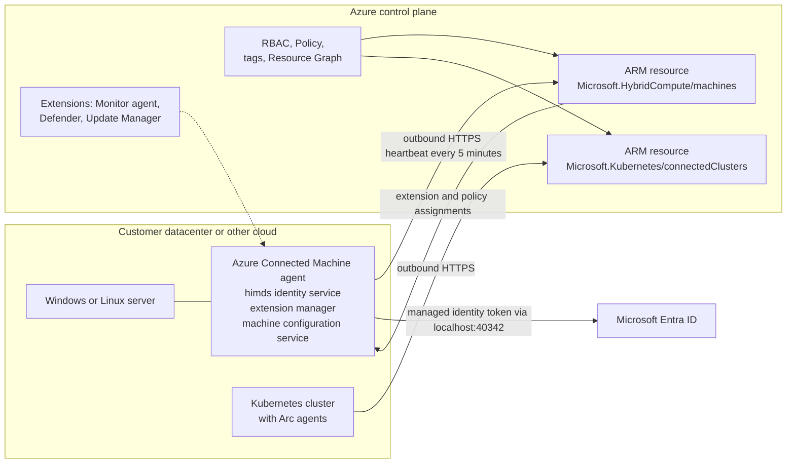

The diagram shows a projection, not a migration. The server still runs where it ran. What Arc adds is an outbound-only management channel: the Connected Machine agent sends heartbeats over Hypertext Transfer Protocol Secure (HTTPS), receives extension and policy assignments, and exposes a local identity endpoint (`IDENTITY_ENDPOINT` set to `http://localhost:40342/metadata/identity/oauth2/token`) so code on the server can obtain Entra tokens for a system-assigned managed identity, per the [Connected Machine agent overview](https://learn.microsoft.com/en-us/azure/azure-arc/servers/agent-overview). Members of the local "Hybrid agent extension applications" group can request those tokens, which is the Arc version of the "anyone who runs code" rule in Section 10.3.

Arc does not change the underlying failure domains, physical security, or networking of the projected machine. Microsoft documents that an Azure Arc outage does not affect the workload itself, only management through Arc, and that in a regional outage the service fails over to another region in the same geography with agents showing Disconnected until it completes. The agent sends heartbeats every five minutes; after 15 minutes without one, the machine shows as disconnected.

**Decision criteria.** Arc is a good fit when an organization wants one policy, inventory, and patch-management plane across Azure and non-Azure servers, or wants managed-identity tokens on on-premises servers instead of stored secrets. It adds an agent to every machine, outbound connectivity requirements (or the Arc gateway), per-server costs for some services, and a new privileged path: anyone with rights to deploy extensions to an Arc machine can run code on it. Do not connect a golden image to Arc and then clone it; clones share a resource ID and fail. Hybrid and multicloud architecture choices are owned by [Hybrid and Multi-Cloud Architecture](../10_Cloud_Architecture/CH10_Hybrid_and_Multi_Cloud_Architecture.md).

## 16. Security, operations, and failure scenarios

The mechanisms above combine into a small number of scenarios that every Azure design review should run. Each is stated with a stimulus, an expected response, and a measurable success criterion.

### 16.1 Quality-attribute scenarios

| Scenario | Stimulus | Expected response | Success criterion | Mechanisms relied on |
|---|---|---|---|---|
| Subscription compromise contained | Attacker gains Owner on one workload subscription | Changes limited to that subscription; guardrails from parent management groups hold | Zero changes outside the subscription; policy denials logged; alert on role-assignment writes within 15 minutes | Section 3.6: hierarchy, policy at management-group scope, `exempt/action`, PIM |
| Zonal failure | One physical zone unavailable | Zone-redundant services fail over; zonal fleets lose one third of instances with N+1 headroom | Error rate under 1 percent after 2 minutes; no manual action | Section 8.4: zone-redundant SKUs, logical-zone mapping, pre-provisioned capacity |
| Quota limit during scale-out | Peak traffic needs 54 instances; family quota allows 50 | Pre-requested quota absorbs peak; alert fired at 80 percent weeks earlier | Scale-out completes within autoscale cooldown; no `QuotaExceeded` errors in Activity Log | Section 11.3: two-tier vCPU quota, quota alerts, capacity reservation for floor |
| Identity revocation | Compromised workload identity | Direct role assignment removed; secrets rotated; new identity issued | Data-plane `403` within 10 minutes; rotation within 60 minutes | Section 10.4: direct assignments, user-assigned identity, token caching |
| Control-plane degradation | ARM writes fail in a region for 2 hours | Running workloads unaffected; deployments paused; no runbook depends on ARM to keep serving | Zero customer-visible errors attributable to the ARM incident | Section 4.8: plane separation, pre-provisioned capacity |
| Reversible migration cutover | Workload moves from a legacy shared subscription into a new landing-zone subscription | Parallel deployment, data sync, DNS-weighted cutover, rollback by DNS until the rollback boundary | Rollback rehearsed and completed within 15 minutes before cutover; post-cutover error rate within baseline | Section 16.2 |
| Policy rollout regression | A new deny policy blocks a legitimate deployment pattern | Audit phase finds it first; non-compliance message tells teams how to comply | Zero unplanned production deployment failures from the rollout | Section 6.7: audit-then-deny, exemptions with expiry |

### 16.2 Worked scenario: a reversible move into a landing-zone subscription

A team's application lives in `legacy-shared`, a subscription created years ago under the root management group with dozens of unrelated workloads. It must move to `orders-prod` under "Corp."

**Why not use ARM resource move?** Moving resources between subscriptions changes their resource IDs, orphans resource-scoped role assignments, breaks IaC state, is unsupported for some resource types, and is not quickly reversible: moving back is another move with the same side effects. Moving the whole `legacy-shared` subscription under "Corp" would apply Corp policy to every other workload in it at once.

**Chosen approach.** Redeploy the application from IaC into `orders-prod` (where the landing-zone baseline already applies), replicate data (for Azure SQL Database, through active geo-replication or a database copy followed by transactional sync, as [Cloud Migration](CH16_Cloud_Migration.md) describes), and shift traffic with weighted DNS or Front Door routing.

**Timeline with numbers.** The database is 400 gigabytes. Initial seeding at an effective 200 megabytes per second takes 400,000 / 200 = 2,000 seconds, about 33 minutes; plan for 2 hours given variance. Replication lag at steady state is under 5 seconds. Cutover steps: shift 10 percent of read-only traffic for 24 hours; then make the new database primary during a 15-minute write freeze; then shift 100 percent of traffic. The rollback boundary is the moment the new primary accepts writes that the old one does not have. Before that, rollback is a DNS weight change, with time to effect bounded by the record's time to live (TTL) of 60 seconds plus client caching. After it, rollback requires reverse replication, which must be configured before cutover if the team wants to keep rollback cheap.

**Validation evidence.** Policy compliance at 100 percent in `orders-prod` before cutover; role-assignment export showing no humans with standing write access; a rehearsal in `orders-test` that completed rollback in 9 minutes; and Resource Health and application telemetry showing baseline error rates for 72 hours after cutover. The old resources in `legacy-shared` are kept, stopped, for 14 days, then deleted.

### 16.3 Operations practices specific to Azure

- **Use Azure Resource Graph for estate questions.** Resource Graph queries, written in Kusto Query Language (KQL), run across every subscription the caller can read and return in seconds. They answer "which storage accounts allow shared-key access," "which virtual machines are nonzonal," and "which role assignments reference deleted identities" far faster than iterating ARM list calls, and they do not consume ARM read throttling budget in the same way.
- **Route the Activity Log centrally.** The Activity Log records every control-plane write, policy evaluation event, and Service Health event per subscription and is retained for 90 days by default. Export it through diagnostic settings, deployed by a `deployIfNotExists` policy, to a workspace the workload teams cannot alter. [Monitoring](CH10_Monitoring.md) owns retention design.
- **Tag at creation through policy.** Owner, cost center, environment, and data classification tags should be required by `deny` (for the creator to supply) or inherited by `modify` (from the resource group or subscription). Retroactive tagging projects rarely finish.
- **Pin API versions and review them.** Templates specify `apiVersion` per resource type. New versions add properties and sometimes change defaults. Upgrading an API version is a change that needs what-if review.
- **Keep a break-glass path that does not depend on the thing that is broken.** Two cloud-only accounts with phishing-resistant credentials, excluded from Conditional Access policies that depend on external systems, eligible for elevation at the intermediate root, monitored for any use.

## 17. Provider comparison: guarantees, scopes, and responsibilities

The table compares what the mechanisms guarantee, not just their names. A matching row label does not mean matching semantics.

| Dimension | Azure | AWS | Google Cloud |
|---|---|---|---|
| Identity boundary | Entra tenant; subscriptions trust one tenant | Account-level IAM; IAM Identity Center for workforce across an organization | Organization bound to a Cloud Identity or Workspace domain |
| Isolation and billing unit | Subscription | Account | Project, linked to a separate billing account |
| Mandatory lifecycle container | Resource group, single region of metadata, multi-region contents | None | None |
| Hierarchy depth | Six management-group levels below root | Five OU levels below root at the time of writing | Ten folder levels at the time of writing |
| Configuration guardrail | Azure Policy evaluates resource properties at request time and in scans; can modify and deploy | SCPs and resource control policies cap permissions; AWS Config rules detect; Control Tower proactive controls use CloudFormation hooks | Organization Policy constraints evaluate resource configuration at request time |
| Explicit deny in authorization | Deny assignments, created by platform features, not directly by customers in general availability | Explicit `Deny` in any IAM policy wins | IAM deny policies |
| Accidental-deletion guard | Management locks at any scope; deployment stack deny settings | Termination protection per service; SCP denies | Project liens; deletion protection per service |
| Single management endpoint | Yes, ARM for all services | No; each service has its own regional or global endpoint | Partly; service-specific APIs under a common resource model |
| Zone identity | Logical zones mapped per subscription; mapping discoverable by API | Zone names mapped per account; zone IDs consistent | Zone names such as `us-central1-a`; see [Google Cloud Platform](CH03_GCP.md) |
| Inter-zone data transfer | Not charged within a region at the time of writing | Charged | Charged for most traffic at the time of writing |
| Region pairing | Many regions paired, used by GRS and update sequencing; many new regions unpaired | No pairing concept | No pairing concept; dual-region and multi-region storage locations |
| Network scope | VNet regional; subnets span zones | Virtual Private Cloud (VPC) regional; subnets zonal | VPC global; subnets regional |
| Workload identity without secrets | Managed identities (system- or user-assigned) | IAM roles for compute (instance profiles, task roles, Amazon Elastic Kubernetes Service (EKS) Pod Identity) | Attached service accounts; Workload Identity Federation |
| Hybrid management projection | Azure Arc projects external servers and clusters as ARM resources | AWS Systems Manager hybrid nodes; EKS Hybrid Nodes; Outposts for AWS-run hardware | Google Distributed Cloud; Google Kubernetes Engine (GKE) attached and multicloud clusters |
| Support for critical production incidents | Standard or higher for 24x7 critical-severity response | A paid AWS Support tier; plan names and targets change, so verify current terms | A paid Google Cloud Customer Care tier; verify which tier offers critical-priority response |

The rows that cause the most migration surprises are the guardrail row (Azure Policy can *change* resources and *deploy* companions, which neither SCPs nor most Organization Policy constraints do), the network row (an Azure subnet spans zones, so a zone-redundant design does not need one subnet per zone), and the endpoint row (ARM's single front door makes throttling, RBAC, Policy, and locks uniform across services in Azure in a way that AWS does not provide). Verify current product names and limits; [IAM](CH09_IAM.md) and [Networking](CH05_Networking.md) carry the detailed comparisons.

## 18. Case study: Northwind Clinical moves onto Azure

Northwind Clinical is a fictional European provider of clinical-trial software with 40 product teams, 250 engineers, and customers in the European Union (EU). Its requirements: patient-identifiable data must remain in the EU; the trial-data service must tolerate a zone failure with no data loss and a region failure with a recovery point objective (RPO) of 15 minutes and a recovery time objective (RTO) of 4 hours; auditors require evidence that every production change was made by a pipeline; finance needs cost by product and environment; and an on-premises laboratory system of 60 Linux servers must stay on site for three years.

### 18.1 Decisions

**Tenant.** One production tenant, already used for Microsoft 365. A second tenant is kept only as a test tenant for Conditional Access and directory-setting experiments. *Rejected:* a separate tenant for regulated workloads. It would have duplicated identity administration for 250 engineers and required B2B guests for everyone, while the threat it addresses (compromise of tenant-wide administrators) is better handled with PIM, phishing-resistant credentials, and a small number of Global Administrators.

**Hierarchy.** Intermediate root `northwind`, with Platform (identity, management, connectivity), Landing zones (Corp, Online), Sandbox, and Decommissioned, plus a `northwind-canary` tree under the root for testing policy. Depth: three levels below root. *Rejected:* environment-based management groups (Prod, Non-prod). Most guardrails are the same in both; the few that differ (for example, allowed virtual machine sizes in non-production) are expressed as assignment parameters keyed on a subscription tag.

**Subscriptions.** One per product per environment, created by a vending pipeline owned by the platform team; 40 products � 3 environments = 120 subscriptions, plus 4 platform subscriptions. *Rejected:* one subscription per environment shared by all products. It would have concentrated 40 products into one 5,000-role-assignment budget, one throttling budget, and one quota pool, and made one Owner compromise affect all of them.

**Policy.** An organization initiative at `northwind`: allowed locations `westeurope` and `northeurope` (deny), required tags (deny), Activity Log export (`deployIfNotExists`), Defender plans (`deployIfNotExists`). At Corp: deny public network access for platform as a service (PaaS) resources, deny public IPs on network interfaces, private DNS zone records for private endpoints (`deployIfNotExists`). Every new deny policy runs in audit for 14 days on the canary tree, then on production in audit, then switches to deny. Exemptions require a ticket, an approver from the security team, and a maximum 180-day expiry.

**RBAC.** No standing human write access on production subscriptions; PIM-eligible Contributor for on-call engineers, 4-hour activation with justification. Pipelines use workload identity federation from the source-control system to a user-assigned identity per product, holding Contributor on the product's resource groups and Role Based Access Control Administrator with a condition limiting assignable roles to a short list of data roles.

**Deployment.** Bicep in deployment stacks at subscription scope, `actionOnUnmanage` set to detach for data resources and delete for stateless resources, deny settings `DenyWriteAndDelete` with the pipeline identity and the policy remediation identity excluded. `CanNotDelete` locks only on the hub virtual network, the ExpressRoute circuit, and the central Log Analytics workspace.

**Regions and zones.** Primary `westeurope`, secondary `northeurope`, the paired region in the same geography. *Why the pair:* the trial-data service uses GZRS storage for document archives, which replicates to the pair; both regions have three zones; and both offer every service needed. *Rejected:* Sweden Central as secondary, which would have required replacing GZRS with object replication and validating additional services, for no residency benefit. The trial-data database uses Azure SQL Database Business Critical with zone redundancy in the primary and an auto-failover group to the secondary. The application runs on Azure Container Apps with zone redundancy enabled. The team verified logical-to-physical zone mappings for the three subscriptions that host zonal virtual machines (a legacy reporting engine) and documented them in the runbook.

**Quota.** For each production subscription the vending pipeline requests regional and family vCPU quotas in both regions sized for peak plus a 25 percent surge, and an Azure Monitor alert fires at 80 percent of any quota. A capacity reservation in `northeurope` covers the reporting engine's minimum of eight virtual machines.

**Hybrid.** The 60 laboratory servers are connected through Azure Arc into a dedicated `lab-onprem` subscription under Corp. Machine configuration policies enforce SSH hardening; Update Manager schedules patching; the servers use their Arc managed identities to write results into a storage account through a private endpoint over ExpressRoute, replacing a shared storage key that had been on every server.

**Support.** Professional Direct, for one-hour critical response and programmatic case creation from the incident runbook. *Rejected:* Microsoft Unified, whose broader coverage was not needed for the Azure-only estate at this stage.

### 18.2 Validation evidence

| Requirement | Evidence produced |
|---|---|
| EU residency | Policy compliance export showing zero resources outside two regions; data inventory listing backups, logs, and replicas with locations; support plan data-handling terms reviewed |
| Zone failure, no data loss | Quarterly fault test using Azure Chaos Studio zone-down experiments on the application tier; database failover test in a staging environment with zone-redundant configuration; measured error rate below 0.5 percent after 90 seconds |
| Region failure, RPO 15 minutes and RTO 4 hours | Semi-annual failover rehearsal: failover group switched in 4 minutes with measured replication lag of 6 seconds; full application recovery in 2 hours 10 minutes, including DNS and quota checks |
| Every production change by pipeline | Activity Log query showing all writes on production subscriptions by pipeline identities or PIM-activated identities with linked change tickets |
| Cost by product and environment | Subscription per product per environment; tag compliance at 100 percent; cost exports grouped by subscription and tag |
| Compromise containment | Red-team exercise with Owner on a test subscription; no impact outside it; detection within 7 minutes |

### 18.3 What went wrong, and what changed

During the first failover rehearsal, recovery took 6 hours instead of 4. Two causes: the secondary region's DSv5 quota had been requested for the reporting engine but not for a batch job that also had to run after failover, and the private DNS zone for the SQL failover group listener was linked only to the primary hub. Both were fixed in the vending pipeline, and the rehearsal checklist now includes "quota usage in the secondary at peak" and "resolve every private endpoint name from the secondary hub."

## 19. Common mistakes and anti-patterns

**Treating the resource group as a security or failure boundary.** *Cause:* the portal presents resource groups as the main container. *Consequence:* a subscription-scoped role sees through them, and nothing about them protects against zone or region loss.

**Using one subscription for everything.** *Cause:* initial convenience. *Consequence:* one quota pool, one throttling budget, one 5,000-assignment limit, one cost line, and one blast radius; later separation needs resource moves with ID changes.

**Assigning policy at subscription scope for controls that must survive a compromised Owner.** *Cause:* teams assign policy where they work. *Consequence:* a subscription Owner can delete the assignment. Put mandatory guardrails at management-group scope.

**Believing Contributor cannot read data.** *Cause:* Contributor has no data actions. *Consequence:* Contributor can call `listKeys` and other secret-returning actions. Disable shared-key access where possible and treat Contributor as data access in reviews.

**Expecting the policy dashboard to be real-time.** *Cause:* deny takes effect quickly, so audit is assumed to as well. *Consequence:* reports produced before the scan completes understate non-compliance.

**Relying on `deployIfNotExists` for security-critical settings.** *Cause:* auto-remediation seems sufficient. *Consequence:* a window exists after creation in which the setting is missing. Pair with `deny` on the unsafe state.

**Assuming zone 1 is the same place in every subscription.** *Cause:* zone numbers look like physical identifiers. *Consequence:* cross-subscription "zone-aligned" deployments are not aligned, adding latency and invalidating failure analysis.

**Assuming the paired region is a disaster-recovery plan.** *Cause:* pairing is described as a resilience feature. *Consequence:* no replication, failover, DNS, or quota exists in the secondary until someone builds it.

**Placing `ReadOnly` locks on running workloads.** *Cause:* a desire to freeze production. *Consequence:* virtual machine restarts, App Service scaling, key listing, and runbooks fail during incidents.

**Granting managed-identity access through Entra groups when fast revocation matters.** *Cause:* group-based access is good practice for humans. *Consequence:* managed-identity tokens cached for around 24 hours keep group-derived access alive for hours after removal.

**Waiting for quota until it is needed.** *Cause:* default quotas seem high enough in development. *Consequence:* scale-out and failover fail at the worst moment, competing with other customers' requests.

**Using complete-mode deployments to clean up.** *Cause:* it is the only template-native delete. *Consequence:* conditional resources and shrinking copy loops delete more than intended. Use deployment stacks.

**Opening production on Basic support.** *Cause:* support is treated as a cost line. *Consequence:* no technical case can be opened during a platform incident.

## 20. Design-review checklist

### 20.1 Identity and hierarchy

- [ ] Is there exactly one production tenant, and is any additional tenant justified by a named administrative or legal boundary?
- [ ] Are Global Administrator and root-scope elevation limited, PIM-protected, and monitored?
- [ ] Is the management-group tree three to four levels deep, with an intermediate root and a canary tree?
- [ ] Does each workload environment have its own subscription, created by a vending process that registers resource providers and applies baseline policy?
- [ ] Do resource groups group by lifecycle and ownership, with long-lived shared resources separated?

### 20.2 Control plane and deployment

- [ ] Are deployments declarative, idempotent, and owned by one tool per resource?
- [ ] Do pipeline identities hold roles at resource-group scope or above, so they can poll asynchronous operations?
- [ ] Is what-if output reviewed before production deployments?
- [ ] Are deployment stacks used for lifecycle and deny settings, with the pipeline and policy identities excluded?
- [ ] Do recovery runbooks avoid depending on ARM writes in the affected region?

### 20.3 Authorization and governance

- [ ] Are mandatory guardrails assigned at management-group scope?
- [ ] Is every exemption categorized, approved, and set to expire?
- [ ] Are `modify` and `deployIfNotExists` identities granted only the roles listed in their definitions, at the scopes they need?
- [ ] Is role-assignment usage per subscription below 70 percent of the limit, with orphaned assignments cleaned?
- [ ] Are locks limited to irreplaceable shared resources, with no `ReadOnly` locks on running workloads?

### 20.4 Placement and resilience

- [ ] Does each service use a zone-redundant SKU or a multi-zone zonal design with N+1 capacity?
- [ ] Have logical-to-physical zone mappings been compared for zonal resources that span subscriptions?
- [ ] Is the secondary region chosen on service, SKU, zone, capacity, and residency evidence, not only on pairing?
- [ ] Has failover been rehearsed with measured RTO and RPO?

### 20.5 Network and identity paths

- [ ] Is public network access disabled on services reached through private endpoints, and does every client resolve the private address?
- [ ] Is outbound access explicit, through NAT gateway, firewall, or load balancer rules?
- [ ] Do workloads use managed identities, with direct (not group-based) assignments where fast revocation is required?
- [ ] Is the ability to deploy code to, or assign identities to, a resource treated as equivalent to holding that identity's permissions?

### 20.6 Operations

- [ ] Are quota alerts at 80 percent configured for each tier in both primary and secondary regions?
- [ ] Is the support plan Standard or higher for production, and does the incident runbook include opening a case?
- [ ] Are Service Health and Resource Health alerts routed to the on-call rotation?
- [ ] Is the Activity Log exported to a protected workspace?
- [ ] For Arc-connected servers, are extension deployment rights restricted and heartbeat-loss alerts configured?

## 21. Exercises

1. **Hierarchy design.** A company has a regulated payments business, an unregulated marketing site, and a data-science group that needs broad experimentation rights. Design the tenant, management-group tree, and subscription layout. For each policy you assign, state the scope and explain why that scope rather than one level higher or lower.
2. **Access debugging.** A pipeline identity has Contributor on `rg-app` and can start a virtual machine but the pipeline reports "AuthorizationFailed" while waiting for the operation to finish. Explain why, using the asynchronous-operation status URL, and propose the smallest role change that fixes it.
3. **Policy versus RBAC.** A developer with Owner on a subscription creates a storage account with public access. A deny policy assigned at the subscription should have blocked it, but the developer deleted the assignment first. Redesign the controls so the same developer cannot repeat this, and name the permission that blocks them from creating an exemption instead.
4. **Zone mapping.** Your application subscription pins its cache to logical zone 2, and a different team's subscription pins its database to logical zone 2. Write the commands you would run to check whether they are in the same physical zone, and explain what you would change in each case.
5. **Quota arithmetic.** A scale set of `Standard_E8s_v5` (8 vCPUs) normally runs 30 instances, needs N+1 across three zones, and uses a rolling upgrade with a 20 percent surge. Compute the family and regional vCPU quota you would request, assuming 80 other regional vCPUs are in use.
6. **Revocation timing.** A managed identity reaches a Service Bus namespace through membership in an Entra group with Azure Service Bus Data Receiver. Security wants access revoked in under 15 minutes. Explain why removing the identity from the group may not achieve that, and redesign the access path.
7. **Arc trust boundary.** An operations engineer has the Azure Connected Machine Resource Administrator role on an Arc-enabled server. List what that engineer can do on the machine through extensions and how that interacts with the server's managed identity permissions.
8. **Interview question.** "What does it mean that Azure Policy is not an authorization system?" Answer in five sentences or fewer, using one concrete example of each mechanism.

## 22. Summary

Azure's operating model rests on a few mechanisms that every service shares. The Microsoft Entra tenant is the identity boundary and the limit of what internal hierarchy can contain. Management groups carry inherited governance in a single-parent tree up to six levels below the root. Subscriptions are the boundary for billing, most quotas, throttling, zone mapping, and the role-assignment budget. Resource groups express lifecycle, not security or resilience.

Every management request passes through ARM, which applies RBAC, locks, and Policy before a resource provider performs an asynchronous, idempotent `PUT`. Deployments are not transactions; deployment stacks add ownership, safe deletion, and deny settings. Azure RBAC is additive, has no explicit deny inside roles, and is overridden only by deny assignments. Azure Policy evaluates configuration, never grants, combines to the most restrictive result across scopes, and is preventive at request time but eventually consistent in its reporting.

Availability zones protect only resources that are zone-redundant or deliberately spread, and zone numbers are mapped per subscription. Region pairs provide recovery priority, update staggering, and implicit replication for a few services, not disaster recovery. Virtual networks are regional with zone-spanning subnets; managed identities remove secrets but carry token-caching and "anyone who runs code" consequences. Quotas and capacity are separate gates that must be planned before scale-out and failover. The customer always owns identity, data, access, network exposure, quota, and workload incident detection, whatever the service model; support plans, Service Health, and Resource Health shape how quickly Microsoft joins an incident; and Azure Arc extends the same control plane to resources Azure does not run, without changing their failure domains.

## 23. Code examples

The examples in [`code/python/azure-chapter/`](../code/python/azure-chapter/) use synthetic inputs and Python's standard library. They do not call Azure APIs, need credentials, or reflect current prices or quotas.

- [01_region_zone_placement.py](../code/python/azure-chapter/01_region_zone_placement.py) checks whether each required service is available, and zone-redundant, in a candidate region, and reports the first service that blocks the placement (Section 8.1).
- [02_subscription_governance.py](../code/python/azure-chapter/02_subscription_governance.py) simulates inherited policy across scopes by intersecting allowed regions and combining required tags, then evaluates example resources against the result (Section 6.4).
- [03_service_selection_matrix.py](../code/python/azure-chapter/03_service_selection_matrix.py) ranks Virtual Machines, App Service, and Azure Functions with weighted scores capped by workload requirements, as a prompt for a service-selection review (Section 12.1).
- [04_recovery_cost_scenario.py](../code/python/azure-chapter/04_recovery_cost_scenario.py) compares backup-and-restore, warm standby, and active-active options against RTO and RPO targets and sorts those that meet them by normalized cost (Sections 8.4 and 18).
