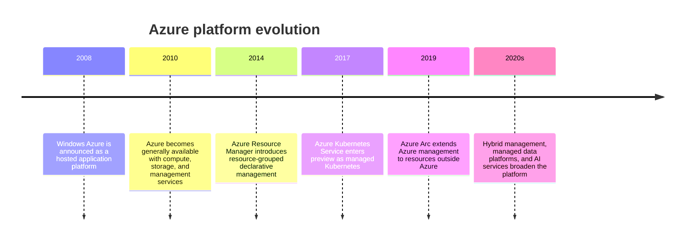
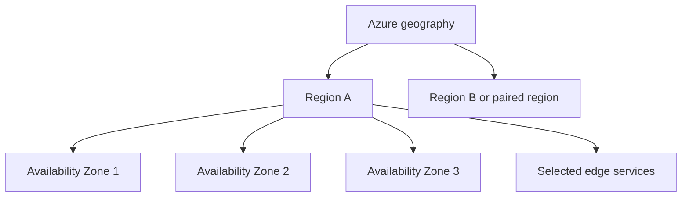
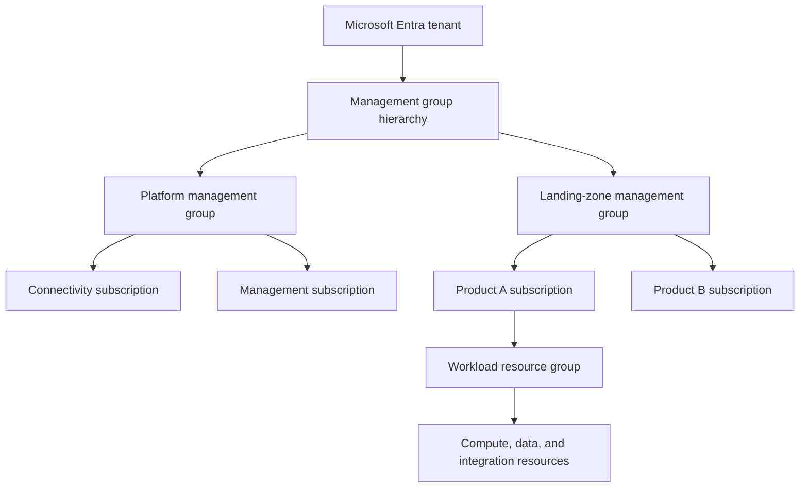
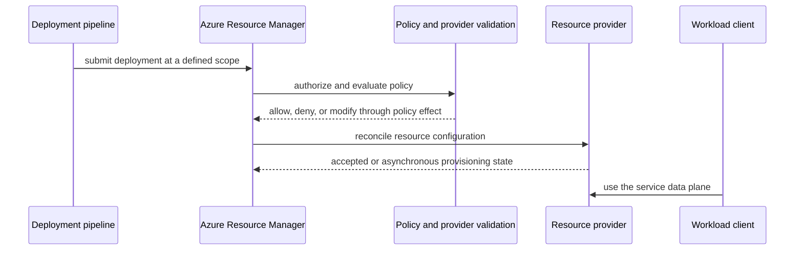
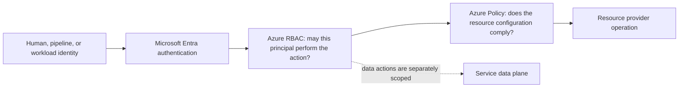
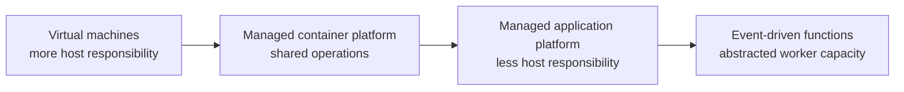
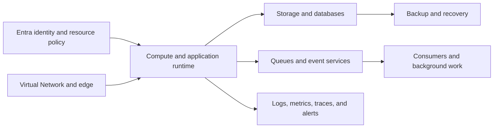
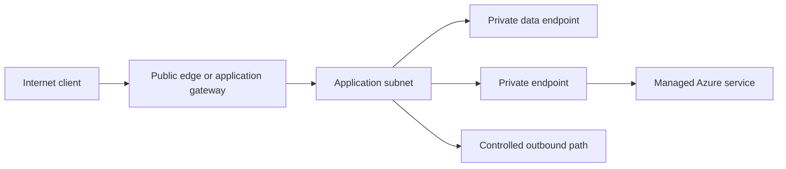
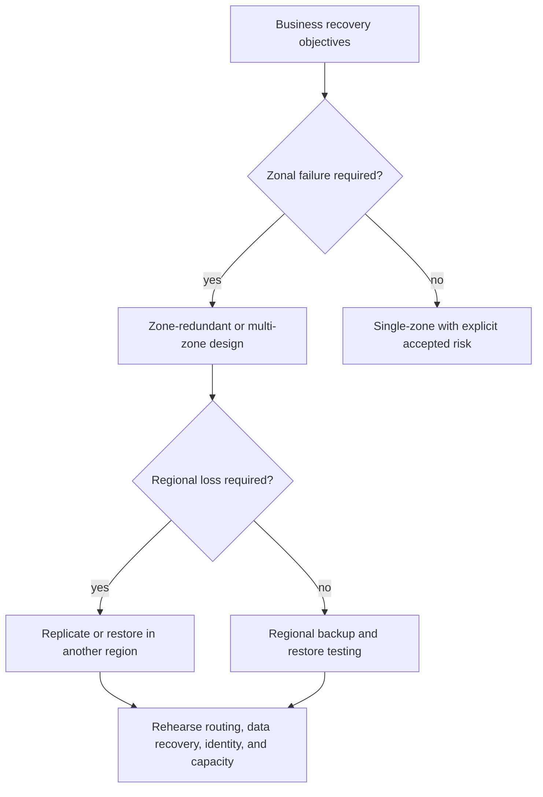
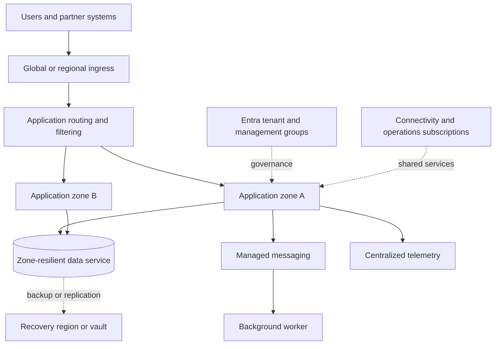

# Chapter: Microsoft Azure Architecture

Part: [09 — Cloud Computing](PART_OVERVIEW.md) · Status: Drafted

## 1. Introduction

Microsoft Azure is a public cloud platform that exposes infrastructure, data, application, identity, and management capabilities through regional services and application programming interfaces (APIs). An Azure architecture is not a diagram of product names: it is a set of decisions about tenant and subscription boundaries, resource ownership, geography, workload execution, data movement, identity, operational responsibility, and recovery. Azure services implement those decisions, but their names do not establish their scope, failure behavior, or security properties.

This chapter gives architects a provider-specific map of Azure: its global infrastructure, Microsoft Entra tenants, management groups, subscriptions and resource groups, Azure Resource Manager (ARM), service models, major service families, and decision boundaries. It does not replace the later Part 09 chapters on compute, networking, storage, containers, Identity and Access Management (IAM), monitoring, serverless, messaging, secrets, cost, landing zones, and migration. Cross-provider workload composition belongs to [Cloud Architecture](../10_Cloud_Architecture/PART_OVERVIEW.md); AWS-specific framework application belongs to [Part 11](../11_AWS_Well_Architected_Framework/PART_OVERVIEW.md).

## 2. Historical Evolution

Azure began as a platform for hosted application execution and expanded into a broad cloud operating environment. Its evolution reflects a recurring architectural shift: move from a provider-managed application runtime toward infrastructure primitives, then add declarative resource management, managed data and integration services, containers, hybrid controls, and higher-level services. These models coexist; each changes how much of the stack a customer operates.

The platform did not replace its earlier service models. Virtual machines, App Service, Kubernetes, functions, and managed databases remain viable alternatives. The architect's task is to match workload constraints to service boundaries and operational ownership, not to assume the newest abstraction is always preferable.

## 3. Why It Exists

Azure provides on-demand infrastructure and managed capabilities without requiring each workload team to procure and operate a complete physical platform. This reduces some provisioning and maintenance work but makes identity, policy, network reachability, data placement, quotas, deployment safety, and cost allocation explicit design concerns. A managed resource can still be misconfigured, exposed, placed in the wrong region, or unrecoverable.

A provider overview helps distinguish Azure's management hierarchy from workload topology. A subscription is not a virtual network; a resource group is not a failure domain; a Microsoft Entra tenant is not a billing account; and a paired region is not an automatic disaster-recovery configuration. Architects need those distinctions before service selection, because each boundary has different authority, lifecycle, and failure implications.

## 4. Core Concepts

### 4.1 Global infrastructure: geographies, regions, and availability zones

**Definition.** An Azure geography is a broad market and data-residency boundary containing one or more regions. A region is a deployment area with a service catalog and regional control/data paths. Where supported, Availability Zones are physically separate locations within a region with independent power, cooling, and networking. Edge sites and edge services serve selected workloads near users; they are not equivalent to a region.

**Mechanism.** A resource may be regional, zonal, zone-redundant, or global. A regional resource is not necessarily replicated between zones. A zone-redundant service distributes or replicates data across zones according to that service's contract; a zonal resource is pinned to a selected zone. Azure region pairs can support some platform recovery and sequencing behavior, but pairing alone does not replicate every customer resource or satisfy a workload recovery objective.

**Decision implications.** Choose geography and region using data residency, user latency, service availability, recovery, and cost. Then verify each selected service's zone support, replication mode, and recovery contract. Treat multi-region as an application and data architecture decision, not a checkbox on a resource.

**Common failure mode.** A team assumes a resource group or a region pair supplies resilience. Neither does: resource groups are management/lifecycle containers, and paired regions do not automatically configure workload replication, routing, or failover.

**Scenario.** A regional API must survive a datacenter failure. The team distributes stateless instances across supported zones, selects a zone-redundant data option, and rehearses regional recovery separately. It documents which dependencies remain regional and does not claim multi-region recovery until the data and traffic paths have been tested.

### 4.2 Tenants, management groups, subscriptions, and resource groups

**Definition.** A Microsoft Entra tenant is an identity and directory boundary. Management groups organize subscriptions for inherited governance. A subscription is a resource, quota, access-control, and billing scope. A resource group is a lifecycle and management container for related resources in one subscription; it is not an identity tenant or a failure domain.

**Mechanism.** An organization can place subscriptions beneath management groups, apply Azure Policy assignments at chosen scopes, and grant role-based access through Azure role-based access control (Azure RBAC). Resource groups collect resources that are deployed and managed together, while resources retain their own service-level scopes and dependencies. A subscription can contain many resource groups, and subscriptions can be associated with a tenant's directory.

**Decision implications.** Use tenant boundaries for identity and organizational separation; management groups for policy hierarchy; subscriptions for workload isolation, quota, and cost boundaries; and resource groups for coordinated resource lifecycle. Automate subscription vending and baseline policy when the organization has enough subscriptions that manual consistency becomes a risk.

**Common failure mode.** Treating a resource group as a security boundary or placing unrelated production systems in one subscription because it is administratively convenient. The reverse failure is creating subscriptions without automated ownership, policy, logging, and billing controls.

**Scenario.** A company gives each product environment a subscription under a governed landing-zone hierarchy. Shared connectivity and security operations use separate subscriptions. A workload resource group contains resources released together, while tenant-level identity and management-group policy remain centrally governed.

### 4.3 Azure Resource Manager and the control/data-plane distinction

**Definition.** Azure Resource Manager is the control-plane service through which clients authenticate, authorize, validate, and submit resource-management operations. A service's data plane handles workload operations such as reading a blob, querying a database, or serving application traffic. The two planes can have different endpoints, permissions, availability, and propagation behavior.

**Mechanism.** A deployment submits a declarative or imperative request to ARM at a scope such as a management group, subscription, or resource group. ARM evaluates the caller's authorization and applicable policy, then routes the request to the resource provider. The provider creates or updates the resource, often asynchronously. The service data plane becomes usable according to service-specific readiness and authorization rules. Data-plane access is not implied by permission to create the resource, nor is management-plane access normally required for ordinary application requests.

**Decision implications.** Draw management and workload paths separately. Give deployment identities only the control-plane permissions they need, and give runtime identities narrowly scoped data-plane permissions. Monitor provisioning completion and validate the resulting service behavior instead of treating an accepted deployment request as proof of readiness.

**Common failure mode.** A team grants an application broad Contributor access because it needs to read data, or assumes an ARM outage necessarily stops an already-running data plane. Conversely, an incident runbook may depend on management operations that are unavailable during a control-plane event.

**Scenario.** A web service continues serving from an existing storage account while a deployment pipeline cannot update a lifecycle policy. The incident dashboard distinguishes customer data-plane health from ARM deployment health, and the runtime identity has no resource-creation role.

### 4.4 Identity, role assignment, and policy boundaries

Microsoft Entra ID provides identity authentication; Azure RBAC authorizes actions on Azure resources at a scope; Azure Policy evaluates resource configuration against governance rules. These mechanisms answer different questions. Authentication establishes the principal, RBAC determines permitted operations, and Policy constrains resource state or deployment behavior. A deployment can be authorized yet violate policy, or be compliant yet inaccessible to the intended workload identity.

Role assignments inherit from broader scopes unless constrained by the platform's applicable controls. A policy denial is not a role grant, and a permitted deployment does not prove that the deployed service is privately reachable or that its data-plane access is narrow. Separate human, pipeline, and workload identities; use groups and managed identities where appropriate; and review inherited scope before granting broad roles. The Part 09 IAM chapter owns the detailed authorization model; this section establishes how identity and policy boundaries shape the Azure architecture.

**Decision implications.** Apply broad guardrails at stable management scopes and narrowly scoped role assignments at the resource scope needed by each actor. Keep policy definitions versioned and test policy effects before enforcing them across production subscriptions. For exceptions, record the risk owner, expiry, and compensating control.

**Common failure mode.** A team treats a policy-compliant resource as secure even though a broad role assignment permits unauthorized access, or assumes a Contributor role grants the data-plane permission required by an application. These are independent checks and require separate tests.

**Scenario.** A deployment pipeline can create a storage account in an approved region, and policy requires private access and diagnostic settings. The application receives a managed identity with read access to one container, not the deployment pipeline's resource-management role. A deployment test verifies both the policy outcome and a real data-plane read.

### 4.5 Service models and shared responsibility

Infrastructure as a service exposes more operating-system and runtime control; platform services assume selected host or orchestration tasks; serverless services abstract more capacity management for supported execution models. These categories describe responsibility boundaries, not a strict ladder. Azure Virtual Machines, App Service, AKS, and Functions differ in deployment shape, runtime control, scaling, and integration; none is universally the most managed or the most suitable.

**Mechanism.** With a virtual machine, the customer selects and patches the guest operating system, configures the runtime, and plans host-level capacity. A managed application platform owns more host operations but constrains supported runtimes, networking, and deployment behavior. AKS manages the Kubernetes control plane, while the customer still owns workload configuration, images, access, and much of cluster operation. Functions abstracts worker provisioning for event-oriented execution but introduces trigger, timeout, concurrency, and cold-start considerations. The exact boundary is service-specific and changes over time; consult the current service contract.

**Decision implications.** Choose the most abstract service that meets runtime, networking, compliance, performance, and recovery constraints while keeping operations sustainable. Compare the work that moves to the provider with the new constraints the service introduces. Azure operates the facilities and service layers it offers, but the customer remains responsible for workload identity, data classification, application behavior, configuration, and recovery decisions. A managed database does not automatically establish private access, correct retention, or tested restores.

**Common failure mode.** Teams choose a serverless service because it appears to remove operations, then discover that long-running work, startup latency, execution limits, or specialized runtime requirements do not fit. The opposite failure is retaining guest operating-system patching and scaling for a workload that fits a managed platform.

**Scenario.** A scheduled image transformation is short-lived, stateless, and unevenly loaded, so Functions is a candidate after timeout and concurrency tests. A continuously running low-latency service with a specialized runtime is compared against App Service and AKS instead. Both decisions record the operational work transferred and the constraints accepted.

### 4.6 Azure service families and responsibility map

Azure's service catalog spans compute, networking, storage, databases, identity, integration, analytics, security, and operations. Examples include Virtual Machines, App Service, Azure Kubernetes Service (AKS), Azure Functions, Virtual Network, Blob Storage, Azure SQL Database, Cosmos DB, Service Bus, Event Grid, Azure Monitor, and Key Vault. The later Part 09 chapters teach the detailed mechanics; this chapter uses the families to locate architecture decisions.

An end-to-end workload depends on interfaces between families: network routes and private endpoints, identity and resource policies, data contracts, queue delivery behavior, telemetry, and recovery. A product-family diagram without these contracts hides the most important failure and security paths.

### 4.7 Region choice and data locality

**Definition.** Data locality is the relationship between where data is stored or processed, where users and dependent services run, and the legal or contractual boundaries that apply. Azure's service scope and data replication behavior are service-specific; a resource's deployment region does not prove that every control plane, backup, support path, or derived dataset is confined to that region.

**Mechanism.** A workload can store authoritative data in one region, replicate it to another, and process copies in additional locations. Each movement creates latency, cost, consistency, and residency implications. Some services provide configuration for a geography or region; others have global control surfaces or service-managed redundancy. Read the service's current data-residency and replication documentation and include backups, logs, telemetry, and disaster-recovery copies in the data inventory.

Region choice affects latency, legal and contractual residency, service availability, quota, data-transfer cost, and recovery design. The region of a control-plane endpoint may not reveal the location or replication behavior of the service's data. Global services may still have regional configuration or data boundaries.

**Decision implications.** Choose locations using user latency, applicable residency obligations, service availability, and recovery objectives together. If the data cannot leave a geography, verify that the selected service and its backups meet that constraint before adopting a multi-region pattern.

**Common failure mode.** A team documents the primary database region but ignores exports, backups, diagnostic logs, or secondary indexes that contain the same sensitive data. A region-pair setting is mistaken for proof that all copies stay within a required boundary.

**Scenario.** A healthcare application serves one market and must keep identifiable records within a defined geography. The architecture records the primary store, backup vault, analytics copy, and support-access path, then verifies each service's current terms before approving the design. Stateless compute can be placed closer to users only after its data-access path is reviewed.

### 4.8 Azure networking building blocks and workload reachability

Azure Virtual Network (VNet) provides private Internet Protocol (IP) connectivity for supported resources. Subnets create address and policy segments; user-defined routes influence next hops; network security groups filter traffic; gateways connect selected networks; and peering links VNets. Private endpoints map a supported service to a private address in a VNet, with name resolution and service access policies determining whether clients actually use that path.

Design Domain Name System (DNS) resolution, routes, service firewalls, identity, and outbound dependencies as one reachability contract. Private Link can reduce public exposure, but a private endpoint alone does not disable a service's public endpoint. Validate the resolved address from each workload network and test that unauthorized paths fail. The Part 09 Networking chapter owns detailed VNet, routing, and service-endpoint mechanics.

**Decision implications.** Centralized hub connectivity can simplify shared inspection and hybrid links, while direct spoke connectivity can reduce routing dependencies. Select the model by traffic policy, team ownership, scale, and failure isolation. Keep egress explicit and test DNS behavior for private endpoints across peered or hybrid networks.

**Common failure mode.** The application resolves a public service name to a public address because private DNS is missing or linked to the wrong VNet. A security review sees the private endpoint resource and incorrectly assumes the public route is closed.

**Scenario.** An application subnet accesses a managed database through a private endpoint. The team disables public network access where supported, links the private DNS zone to the application VNet, tests name resolution from the runtime, and confirms that an external client cannot connect.

### 4.9 Availability, backup, and regional recovery

Availability is an end-to-end property. Zone-redundant deployment reduces exposure to selected zonal failures; backups protect recoverability; regional recovery adds a geographic boundary and requires data replication or restore, traffic steering, identity, quotas, and operational procedures. Recovery time objective (RTO) and recovery point objective (RPO) state the acceptable restoration time and data loss.

Do not treat platform redundancy as a substitute for application-level consistency and restore tests. Confirm whether each service replicates synchronously or asynchronously, what is customer-configurable, and which failures its service-level agreement (SLA) excludes.

### 4.10 Azure service selection and fit

**Mechanism.** Translate requirements into observable tests before comparing services. A runtime requirement might be a maximum startup time; a network requirement might be private access from a hybrid network; a recovery requirement might bound both restore time and data loss. Eliminate candidates that fail hard constraints, then compare remaining candidates on operational burden, service limits, integration, performance evidence, and exit cost.

Service selection begins with workload constraints: runtime shape, state, latency, throughput, network needs, data residency, team skills, compliance evidence, recovery objectives, and cost. Compare candidates by operational responsibility, limits, failure semantics, deployment model, integration, and exit cost. A service's managed label is not itself a decision criterion.

**Decision implications.** Use a decision record to explain why the chosen service fits better than the nearest alternatives, what assumptions could invalidate the choice, and which service quotas or behaviors must be tested. Revisit the choice when workload shape or organizational constraints change.

**Common failure mode.** Selecting from a feature checklist without testing the workload's critical constraints. A proof of concept can succeed at low traffic while hiding quota limits, data-transfer costs, service-specific failover, or the operational effort required to exit the service.

**Scenario.** A team compares Virtual Machines, App Service, and Functions for an API. It first rejects options that fail the runtime and recovery constraints, then load-tests the remaining candidates, checks regional availability and quota, and records which operational tasks each choice transfers to Azure.

## 5. Internal Working

An Azure deployment begins with a caller and a target scope. The caller obtains a token from Microsoft Entra ID, submits an operation to ARM, and is evaluated against Azure RBAC and applicable policy. ARM routes the operation to a resource provider, which validates service-specific settings and reconciles resource state. The operation may be synchronous or asynchronous; the deployment system must poll for completion and verify the data plane independently.

Declarative templates such as Bicep describe desired resources and dependencies. A deployment engine compares the request with existing state, orders dependencies, and submits operations. Declarative does not mean transactional: a deployment can partially succeed, and rollback behavior depends on the operation and resource provider. Use idempotent deployment practices, controlled change scopes, and explicit post-deployment checks.

## 6. Design Principles

- Use tenant, management group, subscription, and resource group boundaries for their distinct purposes.
- Treat region, zone, and service scope as explicit architecture facts.
- Separate deployment identities from workload identities and human access.
- Use policy to prevent unsafe configuration, not as a substitute for runtime authorization.
- Select the highest service abstraction that satisfies workload constraints and operational needs.
- Make public and private network paths, including DNS and outbound dependencies, visible.
- Test restore and failover behavior against declared recovery objectives.
- Automate subscription provisioning, policy assignment, and resource deployment.
- Track quotas, regional availability, data-transfer cost, and service-specific limits.

## 7. Architecture Patterns

**Governed landing-zone hierarchy.** A tenant and management-group tree apply baseline policy while platform subscriptions provide connectivity and operations. Product subscriptions preserve workload ownership. Part 09's Landing Zones chapter owns the full operating model.

**Private application platform.** Public traffic enters through a managed edge or application gateway, while application and data services use private network paths. DNS, identity, egress, and service-level public access settings are reviewed together.

**Zone-resilient regional service.** Stateless application capacity spans supported zones and stateful dependencies use documented zone-redundant or failover behavior. The design still has a regional failure boundary.

**Hybrid management.** Azure Arc can project selected non-Azure resources into Azure management and governance workflows. It does not convert those resources into Azure-hosted services or remove the underlying platform's failure and access boundaries.

## 8. Production Architecture

The following topology separates governance, connectivity, application runtime, data, and recovery. It is a reference shape; service choice and redundancy must be verified against the actual workload and region.

Production readiness also requires named ownership for access reviews, service quotas, key rotation, deployment, incident response, restore testing, and cost attribution. A diagram that omits those operational contracts is incomplete.

## 9. Implementation

1. Record workload owners, user locations, data classification, traffic shape, and quality objectives.
2. Choose tenant and subscription boundaries; identify shared platform responsibilities.
3. Select regions and verify required services, zones, quotas, and data-residency constraints.
4. Define identity, policy, network paths, private access, and controlled egress.
5. Select compute, data, and integration services from explicit workload requirements.
6. Define backup, recovery, deployment, telemetry, and operational ownership.
7. Express infrastructure as reviewed templates and deploy through a least-privilege pipeline.
8. Validate readiness, network reachability, authorization, failure behavior, and recovery evidence.

## 10. Complete Code Examples

- [Azure region and zone placement validator](../code/python/azure-chapter/01_region_zone_placement.py)
- [Subscription hierarchy and policy simulation](../code/python/azure-chapter/02_subscription_governance.py)
- [Cloud service selection matrix](../code/python/azure-chapter/03_service_selection_matrix.py)
- [Recovery objective and cost scenario calculator](../code/python/azure-chapter/04_recovery_cost_scenario.py)

The examples use synthetic inputs and Python's standard library. They do not call Azure APIs, require credentials, or represent current Azure prices. They make architecture assumptions executable and reviewable; they are not substitutes for Bicep or Terraform deployment validation.

## 11. Performance

Measure application latency by dependency and region, not only by virtual-machine utilization. Relevant signals include percentile latency, throttling, database connection pressure, queue age, storage throughput, DNS resolution, and cross-region or cross-zone traffic. Managed service limits and noisy-neighbor controls can shape observed performance even when the application tier has spare CPU.

Place latency-sensitive components near their authoritative data when residency allows. Avoid accidental synchronous cross-region calls in request paths. Load-test the actual service tier and network path, and distinguish application saturation from service throttling or regional dependency latency.

## 12. Scalability

Scalability depends on partitioning work, managing state, and staying within service quotas. Virtual Machine Scale Sets, App Service scaling, AKS, and Functions expose different scaling signals and warm-up behavior. Autoscaling can react only to observable signals and available quota; it cannot fix a hot key, unbounded queue, connection storm, or downstream bottleneck.

Define scale-out and scale-in policies with stabilization windows, maximum capacity, and dependency protection. Test cold starts, deployment overlap, and quota exhaustion. Treat regional capacity availability as a deployment constraint for critical recovery plans.

## 13. Security

Use least privilege across control and data planes, prefer managed identities over embedded credentials, and apply policy baselines to supported resource configurations. Private endpoints reduce exposure only when DNS, service public-access settings, routes, and identity policies agree. Encrypt data in transit and at rest according to classification, and define key ownership and recovery.

Security is shared across the cloud provider and customer. The service model changes who patches the host, but the customer still owns workload code, data access, identity lifecycle, configuration, and incident response. The IAM and Secrets Management chapters own those mechanics in depth.

## 14. Observability

Azure Monitor provides platform capabilities for metrics, logs, alerts, and diagnostic settings, but each service's telemetry coverage and retention configuration differ. Define service-level indicators for user-visible behavior, correlate traces across dependencies, and route security and audit events to an independently protected destination.

Monitor both workload and platform boundaries: application latency, dependency errors, throttling, provisioning failures, policy denials, quota headroom, and recovery readiness. Alert on symptoms that require action, and document the owner and runbook for each alert.

## 15. Failure Scenarios

| Failure | Likely symptom | Architectural response |
|---|---|---|
| Zone unavailable | Capacity or dependency failures in one zone | Route to healthy zones; verify data-service failover and spare quota |
| Region unavailable | Regional endpoints or resources fail | Execute tested restore or replication plan and shift traffic |
| ARM operation degraded | Deployments or management changes stall | Keep existing data paths healthy; use documented emergency procedures |
| Policy blocks deployment | Resource creation or update is denied | Inspect assignment scope and exemption governance; do not bypass blindly |
| Quota exhausted | Scale-out or resource creation fails | Alert before exhaustion; request quota and test capacity assumptions |
| Identity or DNS misconfiguration | Authentication or private endpoint resolution fails | Keep break-glass access, test name resolution, and separate identity diagnosis |
| Bad deployment | New version degrades workload | Use staged rollout, health gates, and a known rollback or forward-fix path |

Recovery actions must account for dependencies that are shared across environments, such as identity, DNS, network connectivity, key services, and deployment pipelines. A recovery region that cannot authenticate operators or obtain required quota is not operationally ready.

## 16. Testing

Test templates before deployment, then validate effective policy, role assignments, network reachability, DNS, and service readiness in a representative environment. Unit tests can check parameter constraints; integration tests must exercise the actual identity and private network path. Staging should resemble production in service tier and topology where the risk warrants it.

Run failure-injection exercises for zone loss, dependency timeouts, throttling, credential rotation, and restore. Measure achieved recovery time and data loss; a backup-success metric alone does not prove recoverability. Re-run tests after material changes to service configuration or deployment automation.

## 17. Common Mistakes

- Treating a resource group as a security or availability boundary.
- Assuming a region pair automatically replicates workload data.
- Confusing Azure RBAC permissions with Azure Policy compliance.
- Giving runtime identities deployment-level permissions.
- Enabling a private endpoint but leaving an unintended public path active.
- Treating accepted ARM deployment as proof that the service is ready.
- Planning regional recovery without testing identity, DNS, quota, and traffic routing.
- Assuming managed services eliminate backup, patch, or incident responsibilities without checking the service contract.

## 18. Best Practices

- Maintain a versioned subscription and management-group baseline.
- Use policy initiatives and reviewed exemptions to encode guardrails.
- Prefer managed identities and scoped role assignments over long-lived secrets.
- Document resource scope, data location, and network exposure in architecture records.
- Deploy with repeatable templates and post-deployment verification.
- Configure diagnostic settings and cost ownership as part of resource provisioning.
- Rehearse backup restores and regional failover with measured objectives.
- Review service limits and availability by target region before committing to a design.

## 19. Anti-Patterns

**One subscription for every workload.** This couples quotas, access, billing, and blast radius. Consolidation may be acceptable for small environments, but the boundary should be an explicit choice with a growth path.

**Policy as the only security control.** Policy can constrain resource configuration but does not replace runtime authorization, network controls, data protection, or application security.

**Multi-region by diagram.** Drawing a second region without replication semantics, conflict handling, recovery automation, and tested routing creates cost without demonstrated recovery capability.

**Unbounded managed-service adoption.** Managed services reduce some operations but can add quotas, provider-specific interfaces, and hidden data-transfer costs. Evaluate those constraints before making a service foundational.

## 20. Trade-off Analysis

| Decision | Benefits | Costs and risks | Choose when |
|---|---|---|---|
| More subscriptions | Isolation, quota and cost boundaries | More governance and automation work | Workload ownership or blast-radius boundaries differ |
| Managed platform over virtual machines | Less host operation and faster delivery | Less runtime control and more platform constraints | The service contract fits workload needs |
| Zone redundancy | Better tolerance of selected facility failures | Possible cost, latency, and service-specific limits | The availability target justifies it |
| Multi-region recovery | Geographic recovery and locality options | Replication, consistency, routing, and operations complexity | Business objectives require regional recovery |
| Private endpoint | Reduced public exposure | DNS, routing, and operational complexity | Private reachability is required and can be tested |
| Azure-specific managed service | Deep platform integration and reduced undifferentiated work | Exit and portability costs | Differentiating value exceeds migration cost |

## 21. Comparison Table

| Dimension | Azure | AWS | Google Cloud Platform (GCP) |
|---|---|---|---|
| Top-level identity boundary | Microsoft Entra tenant | AWS account / Organizations | Organization resource and identity domain |
| Main workload governance scopes | Management groups, subscriptions, resource groups | Organizations, organizational units, accounts | Organization, folders, projects |
| Resource management | Azure Resource Manager and resource providers | Service-specific control planes and APIs | Google Cloud resource hierarchy and service APIs |
| Virtual network model | Regional Virtual Network (VNet) | Regional Virtual Private Cloud (VPC) | Global VPC with regional subnets |
| Declarative deployment options | Bicep, ARM templates, Terraform | CloudFormation, Terraform | Infrastructure Manager, Terraform, Config Connector |
| Resilience boundary | Region and supported Availability Zones | Region and Availability Zones | Region and zones |

These are architectural entry points, not claims that equivalent labels have identical semantics. Verify each provider's service scope, authorization, network behavior, quotas, and recovery contract. The planned GCP chapter adds its provider-specific service scope and recovery details.

## 22. Real-World Case Study

### Azure landing zone for a regulated enterprise

Microsoft's [Azure landing-zone guidance](https://learn.microsoft.com/en-us/azure/cloud-adoption-framework/ready/landing-zone/) describes a common enterprise design in which a platform team establishes governance, security, and shared capabilities, while application teams deploy into governed workload landing zones. Its guidance recommends defining organizational requirements across design areas before implementation and provides both infrastructure-as-code accelerators and custom-build options. This is a published reference architecture rather than a claim about one named customer's implementation.

The architecture separates platform subscriptions from application subscriptions, applies policy through management-group scopes, centralizes logging and security operations, and gives workload teams controlled autonomy. The important design result is not the hierarchy by itself; it is the assignment of ownership for network changes, identity, policy exceptions, subscription lifecycle, and incident response.

The pattern works when policy is automated and the platform team provides a usable subscription-vending path. It fails when governance is only a manual approval queue, when broad inherited roles defeat workload isolation, or when shared connectivity becomes an undocumented dependency. A useful adoption measure is whether a team can deploy a compliant workload repeatedly without bespoke platform intervention, while still producing evidence for audit and recovery.

## 23. Interview Questions

1. How do tenant, management group, subscription, and resource group differ?
2. Why does a paired region not prove that an application is disaster-recoverable?
3. How do Azure RBAC and Azure Policy differ, and where can each be assigned?
4. Why should deployment and workload identities be separated?
5. What must be true before a private endpoint actually removes public reachability?
6. How would you test that a regional recovery plan meets its RTO and RPO?
7. What does an ARM deployment acceptance response prove, and what does it not prove?
8. How do you decide whether to use a managed platform or virtual machines?

## 24. Hands-on Exercises

1. Run the region and zone placement validator. Add an unsupported service/zone combination and make the validator report the risk.
2. Extend the subscription governance simulation with an inherited deny policy and a narrowly scoped exemption. Explain who can approve the exemption.
3. Run the service selection matrix for a bursty job and a continuously running low-latency API. Change the workload requirements and compare the result.
4. Modify the recovery calculator to model asynchronous replication lag and a restore-time constraint.

## 25. Design Exercises

1. Design the tenant, management-group, subscription, and resource-group hierarchy for a company with separate regulated and non-regulated products. Include ownership, billing, and exception processes.
2. Design a zone-resilient order API with private data access. Show control-plane and data-plane identities, network paths, telemetry, and regional recovery.
3. Migrate a legacy application with a fixed IP dependency to Azure. Identify which parts should remain unchanged initially and which dependencies block a later platform migration.
4. Compare a managed database with a self-managed database on virtual machines for a workload requiring a specific extension, private access, and a short recovery objective.

## 26. Architecture Review Questions

- Are tenant, management group, subscription, and resource group boundaries used for distinct, documented purposes?
- Are service region, zone support, data location, and public exposure verified rather than inferred?
- Are deployment, human, and runtime identities separate and least-privileged?
- Do policy assignments, exemptions, and inherited roles have named owners?
- Are DNS, routes, private endpoints, and service public-access settings tested end to end?
- Are backup restore and regional recovery measured against explicit RTO/RPO values?
- Are quota, cost, service limits, deployment readiness, and telemetry included in release gates?
- Does the team understand what the provider operates and what remains customer-owned?

## 27. Summary

Azure architecture depends on choosing the right governance scope, identity boundary, region, service model, and workload interfaces. Tenants, management groups, subscriptions, and resource groups solve different organizational problems; ARM and service data planes have different roles; and region pairs or managed services do not automatically deliver application recovery. Use service-specific contracts, least-privilege identities, explicit network paths, and tested recovery procedures to turn Azure's catalog into a dependable workload architecture.

Further reading: [AWS Architecture](CH01_AWS.md) for a provider comparison; [Cloud Architecture](../10_Cloud_Architecture/PART_OVERVIEW.md) for cross-provider compositions; [Landing Zones](PART_OVERVIEW.md) for governance implementation; and [Azure Well-Architected Framework](https://learn.microsoft.com/azure/well-architected/) for Azure-specific assessment guidance.
