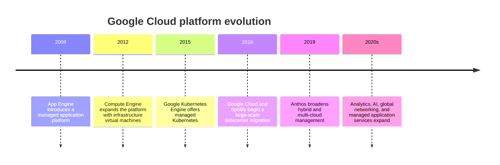
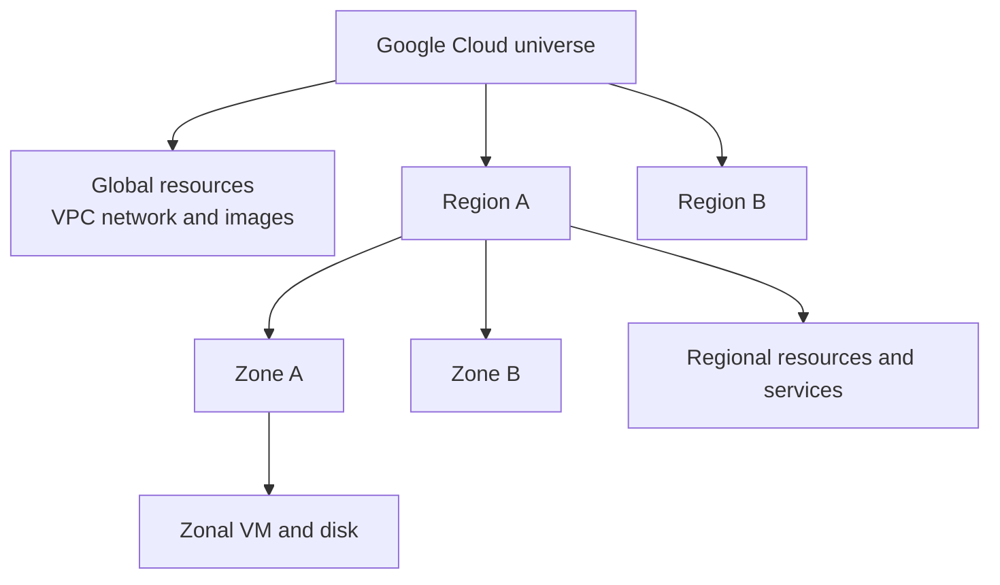
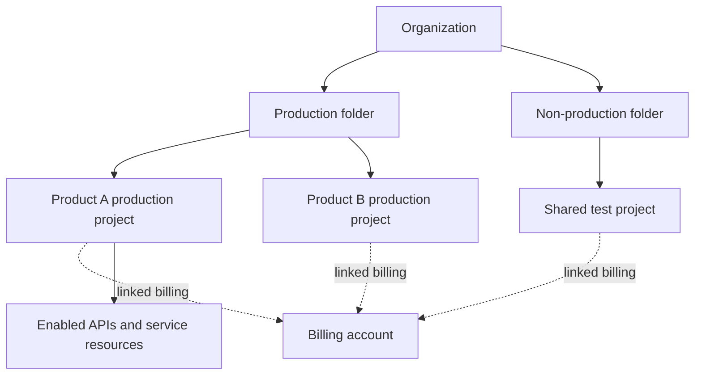
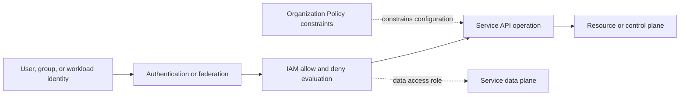
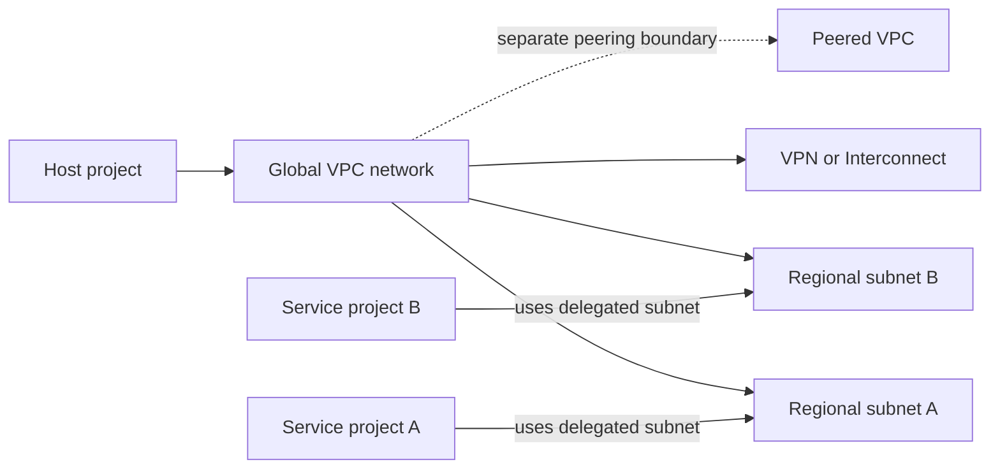
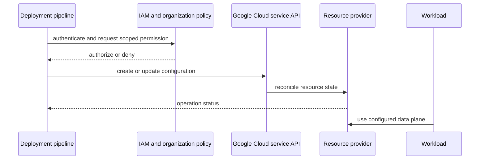
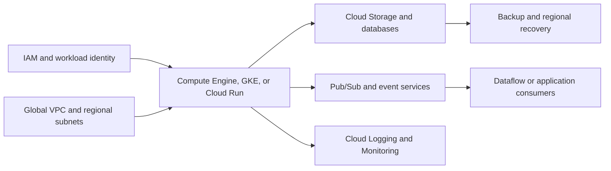
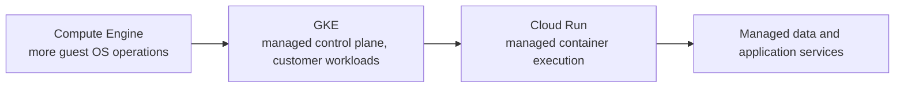
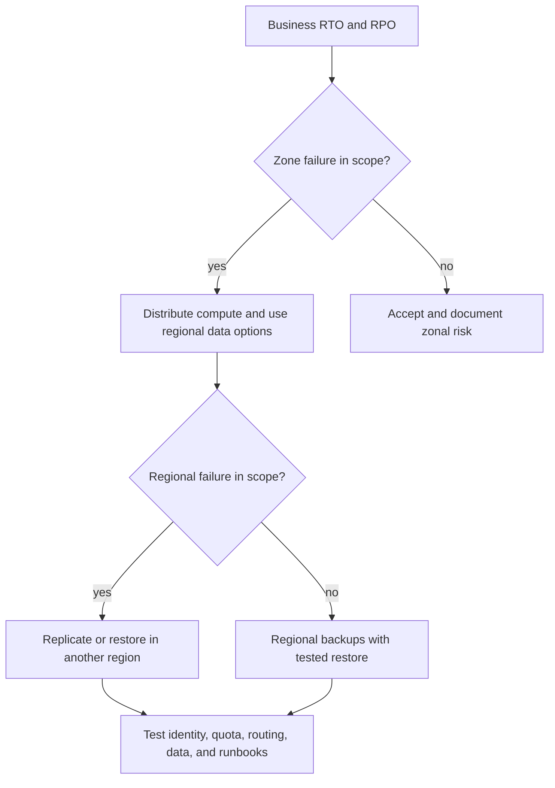
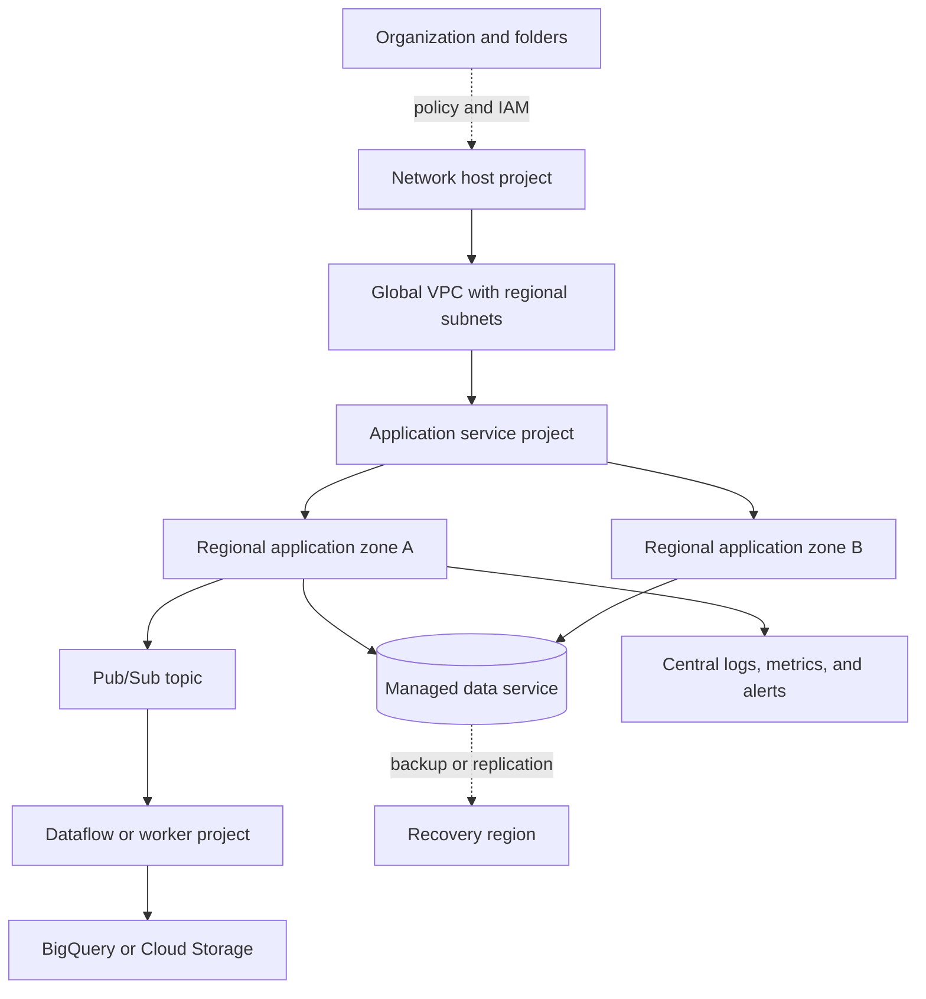

# Chapter: Google Cloud Platform Architecture

Part: [09 — Cloud Computing](PART_OVERVIEW.md) · Status: Drafted

## 1. Introduction

Google Cloud Platform (GCP), commonly branded Google Cloud, provides infrastructure, data, application, identity, and management services through a globally distributed cloud platform. An architecture on Google Cloud is shaped by the resource hierarchy, project boundaries, global and regional resource scope, network topology, service APIs, workload identity, and operational responsibility. Product selection follows those constraints; service names alone do not reveal authorization scope, data location, or recovery behavior.

This chapter establishes the Google Cloud map: organization, folders, projects, billing accounts, locations, resource scope, Identity and Access Management (IAM), Virtual Private Cloud (VPC), service families, and service-selection decisions. It does not replace the later Part 09 chapters on compute, networking, storage, containers, managed Kubernetes, IAM, monitoring, serverless, messaging, secrets, cost, landing zones, or migration. Cross-provider workload compositions belong to [Cloud Architecture](../10_Cloud_Architecture/PART_OVERVIEW.md).

## 2. Historical Evolution

Google Cloud evolved from an application platform into a broad infrastructure and managed-services portfolio. App Engine introduced a managed application model; Compute Engine added virtual machines; Kubernetes Engine brought managed Kubernetes; and services for data analytics, event processing, machine learning, and global networking expanded the platform's reach. The result is not one preferred service model but a set of options with different control and operational boundaries.

Platform evolution changes which operations a customer performs, but it does not eliminate architecture work. A managed service still has quotas, interfaces, data boundaries, and failure semantics that must fit the workload.

## 3. Why It Exists

Google Cloud provides on-demand infrastructure and managed services so organizations can build and operate workloads without owning every underlying facility and platform layer. The platform can reduce undifferentiated operations, but its abstractions introduce explicit decisions about projects, billing, identity, global network reach, locations, quotas, and service dependencies.

Several Google Cloud boundaries are easy to conflate. A project is the primary container for most services and API enablement, but it is not itself a network or a billing account. A global VPC can span regions, but workloads and services still have regional and zonal constraints. A folder can organize projects and inherit policy, but it is not a workload's automatic failure boundary. An architect must understand these distinctions before relying on them for isolation or resilience.

## 4. Core Concepts

### 4.1 Universe, region, zone, and resource scope

**Definition.** A universe is a logically separate Google Cloud environment; the public Google Cloud universe is the standard deployment target for most customers. A region is a geographic area containing zones. A zone is a deployment area within a region. Resources are global, regional, or zonal according to the service. The scope of a resource controls where it can be addressed and which other resources can use it; it does not by itself prove high availability.

**Mechanism.** A global resource, such as a VPC network, can be used across regions in its universe. A regional resource, such as a regional address, is bound to a region. A zonal resource, such as a virtual machine or attached disk, is bound to a zone. Services enforce compatibility constraints: a zonal disk cannot simply attach to a virtual machine in another zone. Higher availability requires a service-specific design such as managed regional replication, multi-zone instances, or application-level replication.

**Decision implications.** Select location from data residency, latency, service availability, quota, and recovery requirements. Then check every dependency's resource scope and replication contract. Global network reachability and global naming are not substitutes for regional redundancy or cross-region data recovery.

**Common failure mode.** A design treats a global resource as globally resilient. A global VPC provides a network boundary spanning regions, but a regional database or single-zone compute tier can still fail independently.

**Scenario.** A service requires zonal failure tolerance. Its stateless Compute Engine instances run across two zones, while its data tier uses a regional service configuration whose failover semantics have been tested. A second region is added only after the team specifies how writes, routing, and recovery work there.

### 4.2 Organization, folders, projects, and billing

**Definition.** The organization resource is the root of a managed Google Cloud hierarchy. Folders optionally group projects or nested folders. A project is the primary resource container for enabling services, applying project-level configuration, and creating most resources. A billing account is a separate commercial object linked to projects; one project is associated with one billing account at a time, while a billing account can pay for multiple projects.

**Mechanism.** Organization and folder policies and IAM grants can be inherited by descendants. Project resources carry an immutable project number and a project ID used by APIs and tools. Resources belong to projects, while project usage is charged through the linked billing account. The hierarchy expresses governance and ownership; billing linkage expresses payment responsibility. Shared VPC and cross-project IAM allow selected collaboration without collapsing these scopes.

**Decision implications.** Use projects as service, quota, access, and lifecycle boundaries when those responsibilities align. Use folders to express stable policy and delegation groupings. Keep billing account ownership separate from project resource ownership, and automate project creation, API enablement, budgets, logging, and baseline policies.

**Common failure mode.** Projects are created under individual users or outside the organization, so the organization loses consistent governance and project ownership when staff leave. Another failure is making one project a catch-all, coupling APIs, quotas, permissions, and billing attribution for unrelated workloads.

**Scenario.** A product team receives separate production and non-production projects under a governed folder. Both projects link to the product's billing account, inherit organization controls, and send audit logs to a central security project. The platform team retains shared network ownership through Shared VPC.

### 4.3 IAM, organization policy, and service identities

Google Cloud IAM grants principals roles on resources. Organization Policy constrains resource configuration or permitted behaviors across the hierarchy. These mechanisms are distinct: IAM answers which actions a principal may perform; Organization Policy constrains what configurations or operations are allowed. Service accounts represent workload identities, and attached service accounts or workload identity federation can avoid distributing long-lived user credentials.

An IAM binding can be granted at an organization, folder, project, or supported resource scope and inherited by descendants. Effective access depends on inherited allow and deny policies, principal membership, supported permissions, and service-specific checks. Organization Policy constraints are not role grants. Resource policies, service-agent identities, and data-plane authorization may add further checks. The Part 09 IAM chapter owns the complete authorization mechanics; this section defines the provider-specific architectural surfaces.

**Decision implications.** Use group-based human access, narrowly scoped service accounts, and inherited roles only when the descendant scope is appropriate. Use Organization Policy for enforceable configuration guardrails and document exceptions. Review effective permissions at project and resource level; a role granted high in the hierarchy can have a much larger blast radius than the project team expects.

**Common failure mode.** A service account key is checked into a repository because a workload needs authentication, or a broad project role is given where a resource-level data role would suffice. Another error is using Organization Policy as though it granted the deployment identity permission to create resources.

**Scenario.** A build pipeline deploys to a production project using workload identity federation, with a deployment role limited to that project. Runtime instances use a separate service account with read access to one data resource. Organization Policy disallows public IPs for selected resource types, independently of both identities' permissions.

### 4.4 Global VPC and cross-project network ownership

Google Cloud VPC networks are global resources with regional subnets. A VPC can provide private address space across regions; subnet ranges remain regional. Routes, firewall rules, peering, Cloud VPN, Cloud Interconnect, and load-balancing resources define different portions of connectivity. Global network scope does not mean every project can automatically use every network.

Shared VPC lets a host project own a network and expose selected subnets to service projects. This separates network administration from workload resource ownership. VPC Network Peering connects networks without merging their administrative boundaries; peering is not transitive by default. Private Service Connect provides service-oriented connectivity across supported producer-consumer boundaries. These models have different route visibility, DNS, policy, and scale implications.

The detailed network, route, and firewall mechanics belong to the Part 09 Networking chapter. Here the key design choice is whether network ownership is centralized in a host project or distributed among workload projects and which connectivity mechanism preserves the required isolation.

### 4.5 Control plane and data plane

The Google Cloud control plane manages resource configuration through service APIs and resource-management APIs. The data plane handles workload requests such as object reads, database queries, or application traffic. A service's management availability, data availability, endpoint scope, and IAM permissions may differ.

Separate deployment identities and runtime identities. Verify asynchronous operation status and service readiness after a successful control-plane request. During an incident, determine whether the management operation failed, the data plane failed, or both; a control-plane outage does not always stop existing data service, but may prevent repair or scale-out.

### 4.6 Service families and architecture composition

Google Cloud service families include Compute Engine, Google Kubernetes Engine (GKE), Cloud Run, Cloud Storage, Cloud SQL, Spanner, BigQuery, Pub/Sub, Dataflow, Cloud Monitoring, and Secret Manager. Their names are signposts, not interchangeable capabilities. An architecture composes runtime, network, identity, data, integration, security, and operations services through explicit contracts.

The compute, storage, messaging, IAM, monitoring, and serverless chapters own detailed mechanics. Select services by data semantics, scope, limits, delivery guarantees, and operations rather than by catalog category alone.

### 4.7 Shared responsibility and abstraction choices

Google operates physical facilities and the service layers described by each offering. Customers remain responsible for workload code, identities, data classification, configuration, access policies, and recovery choices. Virtual machines, managed Kubernetes, serverless platforms, and managed data services move different operational tasks to Google; no generic label such as “managed” establishes the precise boundary.

Choose an abstraction based on runtime control, network requirements, performance, compliance, failure behavior, team skills, and portability. Managed service adoption can reduce maintenance while increasing dependence on provider APIs, quotas, and data-transfer behavior. Record the operations transferred and the constraints accepted.

### 4.8 Region choice and data location

Location affects latency, residency, service availability, capacity, and cost. The service's resource scope and replication mode determine where customer data and replicas reside. A global VPC does not make regional data global, and a global service API does not prove that every data copy is stored worldwide or within one region.

Inventory authoritative data, replicas, backups, analytics copies, logs, and support paths. Verify service-specific location documentation and contractual commitments before placing regulated data. Avoid synchronous cross-region calls in latency-sensitive paths unless the consistency and latency trade-off is intentional.

### 4.9 Availability, backup, and recovery

Availability is an end-to-end property, not a property inherited from the provider's global network. Zonal redundancy, regional managed services, backups, and multi-region architectures address different failure modes. Recovery time objective (RTO) and recovery point objective (RPO) define acceptable restore time and data loss; each selected service must have a recovery mechanism that can meet both.

Test restore, failover, and dependency recovery under realistic constraints. A second region without replicated data, operator identity, quota, and traffic routing is not a complete recovery architecture.

### 4.10 Google Cloud service selection

Translate workload requirements into hard constraints before comparing products: runtime, state, latency, throughput, protocol, data location, private access, recovery, and operating model. Eliminate candidates that cannot satisfy hard constraints; then compare remaining options on quotas, performance evidence, cost, managed operations, integration, and exit cost.

Keep a decision record with the selected service, alternatives rejected, evidence gathered, assumptions, and triggers for revisiting the choice. The official [Google Cloud Well-Architected Framework](https://docs.cloud.google.com/architecture/framework) provides provider-specific recommendations across operational excellence, security, reliability, cost, performance, and sustainability; this chapter maps the platform rather than teaching that framework in detail.

## 5. Internal Working

A project establishes the context for most Google Cloud service operations. A caller selects a project, authenticates through a supported identity mechanism, and sends a request to a service API. IAM and applicable organization policies are evaluated at relevant scopes; quota, service configuration, and resource state are then checked. Long-running operations may return an operation handle that a deployment tool must poll until completion.

Infrastructure as code expresses resources and dependencies, but a multi-resource deployment is not necessarily an atomic transaction. Some resources may succeed while another fails. Use repeatable plans, narrow change scopes, explicit API enablement, asynchronous-operation waits, and post-deployment tests of actual data-plane access.

## 6. Design Principles

- Use organization, folder, project, and billing-account scopes for their distinct purposes.
- Treat global, regional, and zonal resource scope as an explicit service property.
- Separate project ownership from billing ownership and automate project lifecycle.
- Grant human and workload access through groups, federated identities, and narrowly scoped roles.
- Use Organization Policy for configuration guardrails, not as a substitute for IAM.
- Make Shared VPC ownership, delegated subnet use, and cross-project access explicit.
- Validate the actual data path, not only successful resource creation.
- Design and rehearse recovery against measurable RTO and RPO targets.
- Review quotas, APIs, regional availability, and cost before workload launch.

## 7. Architecture Patterns

**Organization-wide governance.** Folders group projects by stable policy or ownership boundaries; organization policy and IAM guardrails flow downward. Keep exceptions reviewable and avoid deeply nested hierarchies that no longer match actual ownership.

**Shared VPC host project.** A network team owns the host project and delegates subnet use to service projects. Workload teams operate their own resources while central teams manage routes and network policy.

**Regional application with global network.** A global VPC connects regional application tiers, while regional services and data are explicitly replicated or recovered. Global reachability is not confused with global service availability.

**Event-driven analytics pipeline.** Producers publish events to Pub/Sub; Dataflow or application consumers transform them; BigQuery or Cloud Storage stores analytical outputs. The event schema, retention, replay, delivery, and privacy contracts are part of the architecture, not implementation afterthoughts.

## 8. Production Architecture

This reference topology separates organization governance, network ownership, workload projects, event processing, data, and recovery. It illustrates one possible design rather than a universal Google Cloud landing zone.

Production readiness includes service API enablement, project ownership, billing budgets, quotas, identity, DNS, audit logging, key access, backup retention, and named incident responders. The diagram is incomplete until these operational contracts are assigned.

## 9. Implementation

1. Record workload owners, data classes, user locations, traffic, and service objectives.
2. Choose organization, folder, project, and billing boundaries that match ownership.
3. Select locations and confirm each service's scope, availability, API, and quota.
4. Define IAM principals, service accounts, organization policies, and project bootstrap.
5. Select network ownership, Shared VPC or peering, DNS, and outbound paths.
6. Choose compute, data, and integration services from workload constraints.
7. Define deployment, telemetry, budget, backup, and regional recovery processes.
8. Validate control-plane completion and real workload data-plane paths after deployment.

## 10. Complete Code Examples

- [Project hierarchy and inherited-guardrail simulation](../code/python/gcp-chapter/01_project_hierarchy_guardrails.py)
- [Global VPC and resource-scope validator](../code/python/gcp-chapter/02_resource_scope_validator.py)
- [Cloud service selection matrix](../code/python/gcp-chapter/03_service_selection_matrix.py)
- [Recovery objective and cost scenario calculator](../code/python/gcp-chapter/04_recovery_cost_scenario.py)

Run with Python 3.10 or later from the repository root. The examples use only the standard library and synthetic assumptions. They do not call Google Cloud APIs, require credentials, or encode current prices.

## 11. Performance

Measure latency along the user-to-service-to-data path, including DNS, cross-region calls, queue age, database access, and service throttling. Global networking does not remove application-level distance or data locality effects. Select locations based on measured user distribution and data constraints, then test regional paths under representative load.

Check service quotas, concurrency limits, connection pools, autoscaling delays, and data-processing throughput. A workload can be CPU-light yet bottleneck on a regional API, a hot partition, or a constrained downstream service. Optimize the dominant measured constraint rather than increasing every resource tier.

## 12. Scalability

Compute Engine instance groups, GKE, Cloud Run, and event-driven services scale through different mechanisms. Stateless workers can often scale horizontally, while stateful services require partitioning, replication, or service-specific limits. Autoscaling based on CPU alone can miss queue backlog, request concurrency, or downstream saturation.

Set maximum capacity and concurrency deliberately, reserve or verify quota for expected bursts, and protect dependencies with backpressure. Test scale-in behavior as well as scale-out; abrupt scale-in can terminate work or overload a smaller dependency pool.

## 13. Security

Use least-privilege IAM, workload identity, organization policies, private network paths where needed, and service-specific data protection. Prefer federated workload credentials over exported service-account keys. Audit inherited permissions at organization, folder, project, and resource scopes, and ensure that service agents receive only the roles required by the managed service.

Security responsibility changes with the service model but never transfers data classification, application correctness, access decisions, or incident response wholesale to the provider. The IAM and Secrets Management chapters own detailed identity and credential mechanics.

## 14. Observability

Cloud Logging and Cloud Monitoring provide service telemetry, but collection, retention, labels, and metric availability vary. Enable audit logging appropriate to the control objectives and route critical logs to a protected project with independent access. Correlate application traces and service metrics so operators can identify whether latency originates in workload code, the network, or a managed dependency.

Track service API errors, quotas, data freshness, queue age, regional health, deployment completion, billing anomalies, and recovery readiness. Define alert ownership and a runbook for each actionable signal.

## 15. Failure Scenarios

| Failure | Likely symptom | Architectural response |
|---|---|---|
| Zone loss | Zonal instances or disks become unavailable | Route to healthy zones and verify regional data behavior |
| Region loss | Regional services and endpoints fail | Restore or promote data and shift traffic using tested procedures |
| Project disabled or deleted | Broad workload and service access loss | Protect project lifecycle, use recovery controls, and maintain clear ownership |
| API not enabled | Deployment or client calls fail | Include API enablement in bootstrap and detect disabled-service drift |
| IAM change | New calls denied or unexpected access granted | Audit inherited bindings and use tested rollback/break-glass procedures |
| Quota exhaustion | Resource creation or scale-out fails | Monitor quota headroom and verify recovery-region capacity |
| Shared VPC path failure | Multiple service projects lose connectivity | Define network ownership, change controls, and alternate paths where justified |
| Bad deployment | New resources or configuration partially applied | Stage changes, check operation completion, and use idempotent recovery |

Recovery plans must include project access, service APIs, billing status, workload identity, network paths, and quota. A region can be technically available while the recovery procedure remains blocked by missing control-plane prerequisites.

## 16. Testing

Validate infrastructure plans, project policies, IAM bindings, API enablement, and network paths before production. Integration tests should run as the real workload identity from the intended network and project. Test data access, not only successful deployment.

Exercise zone failure, service throttling, project-level misconfiguration, credential rotation, restore, and regional recovery. Measure actual RTO and RPO, including the time required to regain operator access and quota. Re-run critical tests after changes to service tier, project hierarchy, or network ownership.

## 17. Common Mistakes

- Treating a project as a billing account or a folder as a network boundary.
- Creating production projects outside the organization hierarchy.
- Assuming global VPC scope makes zonal or regional services resilient.
- Sharing service-account keys instead of using workload identity.
- Applying broad inherited roles without reviewing their project-wide effect.
- Assuming VPC peering is transitive or equivalent to Shared VPC.
- Forgetting API enablement, quotas, billing linkage, or audit logging in project bootstrap.
- Treating successful control-plane deployment as proof of application data-plane access.

## 18. Best Practices

- Establish organization ownership and project-creation controls early.
- Use folders for durable policy and delegation boundaries, not arbitrary chart depth.
- Automate project provisioning, billing linkage, API enablement, budgets, and audit exports.
- Use workload identity and service accounts scoped to actual data and API needs.
- Centralize network ownership only where it provides clear policy or operational value.
- Document resource scope and data location for every critical dependency.
- Set quota alerts and verify recovery-region capacity before an incident.
- Test backups, failover, and project recovery with measured results.

## 19. Anti-Patterns

**One project for the whole company.** This entangles API enablement, permissions, quotas, billing attribution, and lifecycle. A small proof of concept can start compactly, but production growth requires explicit isolation criteria.

**One project per microservice by reflex.** Project boundaries create governance and operational overhead. Use them when permission, quota, lifecycle, or ownership differences justify separation, not as a substitute for thoughtful resource organization.

**Global network means global resilience.** A global VPC improves network composition across regions but does not replicate a regional database, preserve a single-zone service, or route users after a regional outage.

**Permanent keys for automation.** Exported service-account keys create long-lived secret custody and rotation risks. Prefer federation or attached workload identity where supported.

## 20. Trade-off Analysis

| Decision | Benefits | Costs and risks | Choose when |
|---|---|---|---|
| More projects | Isolation, quota and billing attribution | Bootstrap, policy, and operations overhead | Workload ownership or blast radius differs |
| Centralized Shared VPC | Consistent connectivity and network policy | Host-project dependency and central-team coupling | Network controls need central ownership |
| VPC per workload | Independent changes and isolation | More peering, routing, and governance | Workloads need separate network lifecycles |
| Managed service | Less undifferentiated operations | Service limits and provider-specific interfaces | Service behavior meets workload constraints |
| Multi-region design | Geographic recovery and locality | Replication, consistency, and operating cost | Business objectives require it |
| Broad inherited IAM | Simple initial administration | Large and difficult-to-audit blast radius | Rarely; only with a narrowly bounded role and scope |

## 21. Comparison Table

| Dimension | Google Cloud | AWS | Azure |
|---|---|---|---|
| Main resource hierarchy | Organization, folders, projects | Organizations, organizational units, accounts | Tenant, management groups, subscriptions, resource groups |
| Billing boundary | Billing account linked to projects | Account billing with consolidated Organizations options | Subscription billing scope and billing profiles |
| Network scope | Global VPC with regional subnets | Regional VPC | Regional VNet |
| Workload identity | IAM principals and service accounts | IAM roles and service principals | Microsoft Entra identities and managed identities |
| Policy mechanisms | IAM allow/deny and Organization Policy | IAM policies and Service Control Policies | Azure RBAC and Azure Policy |
| Geographic resource scopes | Global, regional, or zonal per service | Global, regional, or zonal per service | Global, regional, or zonal per service |

These labels are not semantic equivalents. Validate how each provider evaluates permissions, attaches networks, bills resources, and implements failover before translating an architecture between providers.

## 22. Real-World Case Study

### Spotify's migration and data platform

Google Cloud's [published Spotify customer story](https://cloud.google.com/customers/spotify) reports that the companies began a migration in 2016 involving 1,200 online services, data-processing workflows, and 20,000 daily job executions across more than 100 Spotify teams. The account also identifies BigQuery, Pub/Sub, and Dataflow as important services for analytics and data processing. These figures and product descriptions are from the provider's customer story and should be read as a published case account, not an independent benchmark.

The architectural lesson is that cloud adoption at this scale is an operating-model migration as much as a compute relocation. The story emphasizes managed services reducing backend operations so teams could focus on product and data work. Such a shift requires teams to standardize project ownership, identity, data access, event contracts, observability, and cost visibility while transitioning a large service portfolio.

The evidence does not establish that every one of the 1,200 services moved to the same architecture or that the migration alone caused business growth. A sound review therefore separates reported scale and adopted services from causal claims. For a similar program, inventory dependencies, migrate in bounded waves, measure operational outcomes, and preserve rollback or coexistence paths until data and service contracts are verified.

## 23. Interview Questions

1. How do organization, folder, project, and billing account differ?
2. What does it mean for a VPC network to be global while its subnets are regional?
3. How do IAM and Organization Policy differ?
4. What is the difference between a service account key and workload identity federation?
5. Why is VPC Network Peering not a substitute for Shared VPC?
6. How would you design project creation and API enablement for a large organization?
7. What must be tested before a second region qualifies as a recovery site?
8. How would you select between Compute Engine, GKE, and Cloud Run?

## 24. Hands-on Exercises

1. Run the project hierarchy simulator. Add a folder-level restriction and show how it affects a child project.
2. Run the resource-scope validator. Change a zonal dependency to a different region and report the incompatibility.
3. Run the service selection matrix for a bursty event consumer and a steady low-latency API; explain why the score is only a screening aid.
4. Change RTO and RPO targets in the recovery calculator and compare the feasible topologies.

## 25. Design Exercises

1. Design an organization and folder hierarchy for three business units with distinct data policies and shared network operations.
2. Design a Shared VPC architecture with production and development service projects. Show subnet delegation, service identity, DNS, and failure ownership.
3. Design a multi-region analytics pipeline that handles delayed, duplicated, and replayed events while respecting data-location constraints.
4. Plan a phased migration of a large service portfolio, including project bootstrap, network connectivity, data migration, observability, and rollback criteria.

## 26. Architecture Review Questions

- Is every production project under an owned organization hierarchy with billing and lifecycle controls?
- Do folders and projects correspond to real policy, quota, ownership, or blast-radius boundaries?
- Are global, regional, and zonal resource scopes documented for critical services?
- Are human and workload identities separate, federated where possible, and least-privileged?
- Are IAM grants and Organization Policy assignments reviewed at inherited scopes?
- Are Shared VPC, peering, routes, DNS, and service access tested from actual workloads?
- Are API enablement, quota, audit logging, billing, and budget alerts part of project bootstrap?
- Does regional recovery meet measured RTO/RPO targets, including access and capacity prerequisites?

## 27. Summary

Google Cloud architecture depends on the organization/folder/project hierarchy, explicit billing linkage, resource scope, IAM, and network ownership. Projects organize most service resources, while billing accounts remain separate; VPC networks are global while subnets and many services are regional or zonal. Use workload identity, inherited governance with care, tested service contracts, and measured recovery procedures to turn the platform's managed capabilities into a dependable workload architecture.

Further reading: [AWS Architecture](CH01_AWS.md), [Microsoft Azure Architecture](CH02_Azure.md), [Cloud Architecture](../10_Cloud_Architecture/PART_OVERVIEW.md), and the [Google Cloud Well-Architected Framework](https://docs.cloud.google.com/architecture/framework).
