# Chapter: Google Cloud Platform Architecture

Part: [09 — Cloud Computing](PART_OVERVIEW.md) · Status: Revised (in-depth rewrite)

## 1. Introduction

Google Cloud Platform (GCP), now branded Google Cloud, gives an architect a small number of structural primitives and a large catalog of services built on top of them. The primitives decide almost everything that matters for governance and blast radius: which directory owns your identities, where a project sits in the resource hierarchy, which billing account pays for it, which policies flow down to it, which network it attaches to, and in which region or zone each resource lives. Service selection comes after those decisions, because a service inherits all of them.

This chapter teaches that operating model. After reading it you should be able to:

- Explain how a Google Workspace or Cloud Identity account produces the organization resource, and why identity administration and cloud administration are separate roles.
- Design a folder and project structure, and justify each project boundary by access, quota, lifecycle, billing, or blast radius.
- Distinguish project ID, project number, and project name, and plan application programming interface (API) enablement, deletion protection, and the 30-day deletion lifecycle.
- Treat billing accounts as a separate hierarchy, link projects to them deliberately, and attribute cost from the billing export.
- Predict effective access from Identity and Access Management (IAM) allow policies, deny policies, principal access boundary policies, and IAM conditions on tags.
- Use Organization Policy constraints, including custom constraints, and predict how inheritance, merge, and override produce the effective policy.
- Explain what a Virtual Private Cloud (VPC) Service Controls perimeter adds on top of IAM.
- Explain the global VPC network with regional subnets, Shared VPC host and service projects, and the evaluation order of hierarchical firewall policies and VPC firewall rules.
- Classify resources as global, regional, or zonal and reason about the failure domain each implies.
- Plan quota headroom, distinguish quota from physical capacity, and read rate, allocation, and concurrent quotas.
- Place a workload on a service using a responsibility and placement decision, and state what Google operates and what you still own under "shared fate."

### 1.1 Scope and ownership boundaries

This chapter is the Google Cloud map. Later Part 09 chapters own the mechanics of each service family, and other parts own provider-neutral theory. Where this chapter touches their material, it recaps in a few sentences and links.

| Topic | Owner | What this chapter does |
|---|---|---|
| Virtual machine (VM) shapes, autoscaling, images, placement | [Compute](CH04_Compute.md) | Names Compute Engine scopes and families |
| Routing, Cloud NAT (network address translation), load balancers, hybrid links, private endpoints | [Networking](CH05_Networking.md) | Teaches global VPC scope and Shared VPC ownership, recaps Private Google Access and Private Service Connect |
| Disk, file, and object storage classes and recovery | [Storage](CH06_Storage.md) | Names storage scopes and location types |
| Registries and container execution | [Containers](CH07_Containers.md) | Places Cloud Run and Artifact Registry in the service map |
| Google Kubernetes Engine (GKE) | [Kubernetes](CH08_Kubernetes.md) | Places GKE in the responsibility spectrum |
| Cross-provider IAM patterns, workload identity federation, rotation | [IAM](CH09_IAM.md) | Teaches Google Cloud policy types and inheritance; recaps service accounts and federation |
| Cloud Logging and Monitoring internals | [Monitoring](CH10_Monitoring.md) | Covers audit-log categories needed for governance |
| Functions and serverless execution | [Serverless](CH11_Serverless.md) | Names Cloud Run functions |
| Pub/Sub and event services | [Messaging](CH12_Messaging.md) | Mentions only |
| Secret Manager and Cloud Key Management Service (KMS) | [Secrets Management](CH13_Secrets_Management.md) | Mentions only |
| Commitments, rightsizing, anomaly response | [Cost Optimization](CH14_Cost_Optimization.md) | Teaches billing hierarchy, linkage, and the export as an attribution source |
| Landing-zone products and onboarding workflow | [Landing Zones](CH15_Landing_Zones.md) | Teaches the primitives that a landing zone assembles |
| Migration tooling and cutover | [Cloud Migration](CH16_Cloud_Migration.md) | Uses a reversible cutover as one quality scenario |
| Cross-provider organizational architecture | [Organizational Hierarchy and Landing Zones](../10_Cloud_Architecture/CH02_Organizational_Hierarchy_and_Landing_Zones.md) | Provides the Google Cloud facts that Part 10 composes |
| Provider-neutral authorization theory | [Authorization](../15_Security/CH03_Authorization.md) and [ABAC](../15_Security/CH05_ABAC.md) | Applies them to Google Cloud |

Provider facts drift. Limits quoted in this chapter were checked against Google Cloud documentation at the time of writing and are marked where they are likely to change. Always confirm current quotas and limits on the product's quotas page before you design to a number.

## 2. The operating model in one picture

Most confusion about Google Cloud comes from treating four separate structures as one. They are related, but each answers a different question.

1. **The identity directory** answers "who is this?" It is a Google Workspace or Cloud Identity account, identified by a customer ID, holding users, groups, and verified domains. External identity providers can feed it or federate with it.
2. **The resource hierarchy** answers "who governs this?" It is a tree of one organization resource, optional folders, projects, and the resources inside projects. IAM allow and deny policies, Organization Policy, tags, hierarchical firewall policies, and some quotas attach to nodes of this tree and flow downward.
3. **The billing hierarchy** answers "who pays for this?" Cloud Billing accounts are their own resources with their own IAM. Each project links to at most one billing account at a time, and that link can change without moving the project in the resource tree.
4. **The location model** answers "where does this run and what fails with it?" Every resource is global, regional, or zonal. Location is a property of each resource, not of the project or folder.

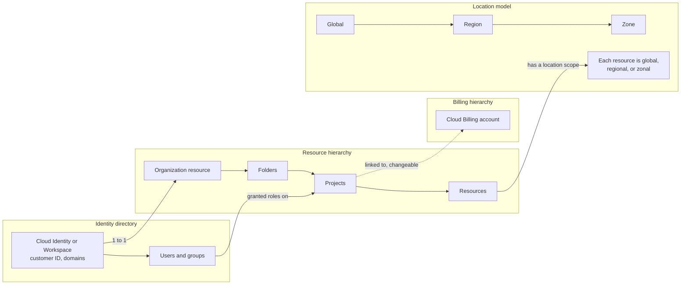

The diagram shows the relationships that matter. The directory and the organization are tied one to one. Users and groups from the directory receive roles on nodes of the resource tree. Projects link to a billing account by a changeable association that is outside the resource tree. Each resource, independently of its project, has a location scope. The practical consequence is that you can reorganize folders without changing who pays, change who pays without changing policy, and put resources in five regions inside one project. Each of those freedoms is useful, and each removes an assumption that a reader coming from another provider might carry. In AWS, the account is both the billing unit and the isolation unit; in Google Cloud, those are two different objects. The [AWS chapter](CH01_AWS.md) and [Azure chapter](CH02_Azure.md) describe the equivalent models for those providers.

Two policy planes act on the resource tree:

- **Who may do what** is IAM: allow policies grant roles, deny policies block permissions, and principal access boundary policies limit which resources a principal is eligible to touch.
- **What may be configured** is the Organization Policy Service: constraints restrict resource configurations regardless of who asks.

A third plane, VPC Service Controls, restricts where data can move between Google APIs. The rest of the chapter follows this model from the top of the tree down to the location of a single disk.

## 3. The organization resource and its identity linkage

### 3.1 How an organization comes into existence

The organization resource is the root node of a governed Google Cloud hierarchy. It is not created by itself. It is provisioned from an identity account: a Google Workspace account or a Cloud Identity account (Free or Premium). Each such account has a customer ID and one or more verified domains. Google Cloud provisions exactly one organization resource for that customer ID, and the organization's display name is the primary domain, for example `example.com`.

According to the [security baseline documentation](https://docs.cloud.google.com/resource-manager/docs/manage-baseline-constraints), Google Cloud automatically provisions an organization resource for a new customer when a user from the domain signs in for the first time or creates a billing account that has no associated organization. That automatic step is convenient and also a governance trap, because the organization starts with permissive defaults that someone must harden.

The linkage has several consequences:

- **One directory, one organization.** You cannot create a second organization for the same Cloud Identity account. Organizations that need separate roots, for example a regulated subsidiary, need a separate identity account and therefore a separate customer ID. Most enterprises are better served by one organization with folders, because cross-organization sharing requires explicit exceptions to domain-restricted sharing and cannot use folder inheritance.
- **Domains are aliases of one customer.** Secondary domains added to the same Workspace or Cloud Identity account belong to the same organization. Acquiring a company with its own Workspace account does not add it to your organization; you must migrate identities or projects.
- **The organization ID is numeric and immutable**, for example `organizations/123456789012`. Tooling, Organization Policy names, and deny-policy attachment points reference it.

### 3.2 Two administrator populations

Identity administration and cloud resource administration are separate privileges held in separate systems.

- **Super administrators** live in the Workspace or Cloud Identity Admin console. They manage users, groups, domains, and single sign-on (SSO) settings. A super admin can grant themselves the Organization Administrator role in Google Cloud, so the super admin accounts are the highest-privilege identities in the whole estate even if they hold no Cloud IAM roles day to day.
- **Organization Administrators** (`roles/resourcemanager.organizationAdmin`) manage the cloud resource hierarchy and its IAM policy. They do not, by that role, manage users.

A sound design keeps super admin accounts few (commonly two or three named break-glass accounts), protected with hardware security keys, excluded from daily use, and monitored. Cloud administration happens through groups such as `gcp-org-admins@example.com` that receive Organization Administrator. Granting cloud roles to groups rather than users is the single most effective IAM simplification in Google Cloud, because group membership is managed in the directory, audited there, and reflected everywhere the group is bound.

### 3.3 Default grants and the first hardening steps

When an organization is created, the [project creation documentation](https://docs.cloud.google.com/resource-manager/docs/creating-managing-projects) notes that the Project Creator role is granted to the entire domain. Billing Account Creator is also granted to the domain by default. Left alone, every employee can create projects under the organization root and create new billing accounts. Removing those two domain-wide grants and moving project creation into an automated pipeline is usually the first change a platform team makes.

Organizations created on or after May 3, 2024 also receive a security baseline of enforced Organization Policy constraints. At the time of writing these include disabling service account key creation and key upload, preventing automatic Editor grants to default service accounts, restricting allowed policy member domains, restricting Essential Contacts domains, restricting protocol forwarding to internal addresses, and enforcing uniform bucket-level access in Cloud Storage ([security baseline constraints](https://docs.cloud.google.com/resource-manager/docs/manage-baseline-constraints)). Older organizations do not have these by default. When you inherit an organization, list its effective policies before assuming it has them.

The sequence below shows the bootstrap path and where each control enters.

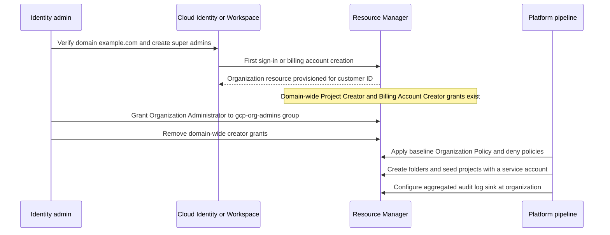

Reading the sequence top to bottom: identity comes first, the organization appears as a side effect, and the defaults are open until a human or pipeline closes them. The window between provisioning and hardening is where shadow projects appear. An architect taking over an estate should check for projects created before hardening, especially projects with no folder parent and owners who have left.

### 3.4 Identity sources and federation

Most enterprises already have a primary identity provider (IdP) such as Microsoft Entra ID, Okta, or on-premises Active Directory (AD). Google Cloud supports two patterns:

- **Synchronize and federate SSO.** Users and groups are provisioned into Cloud Identity, either with Google Cloud Directory Sync from AD or Lightweight Directory Access Protocol (LDAP), or with System for Cross-domain Identity Management (SCIM) provisioning from Entra ID or Okta. Sign-in is delegated to the IdP through Security Assertion Markup Language (SAML) or OpenID Connect. Users exist as Cloud Identity accounts, so every Google Cloud service recognizes them.
- **Workforce Identity Federation.** Users stay only in the external IdP. Google Cloud accepts federated tokens and maps them to principal identifiers such as `principal://iam.googleapis.com/locations/global/workforcePools/POOL/subject/SUBJECT`. Nothing is synchronized. The trade-off is that some products and console features do not support workforce identities, so you must check product support before choosing this pattern for a whole estate.

Workload identities, service accounts, service account impersonation, and Workload Identity Federation for external workloads are taught in the [IAM chapter](CH09_IAM.md). For this chapter, the relevant fact is that service accounts are resources that live inside a project, and their project's lifecycle and policies apply to them.

### 3.5 Failure modes at the root

- **Unmanaged consumer accounts.** Before a company adopts Cloud Identity, employees may have created consumer Google accounts with their corporate email address. These "conflicting accounts" are outside your control. Cloud Identity provides a transfer process; until it completes, those users can hold project roles that your directory cannot revoke by disabling the employee.
- **Single super admin.** If the only super admin leaves or loses their security key, account recovery goes through a slow Google support process that requires proving domain ownership. Two or three protected break-glass accounts avoid this.
- **Projects outside the organization.** Projects created by consumer accounts, or before the organization existed, have no parent. They inherit no policy. Use Resource Manager search across the organization, billing account project lists, and billing exports to find them, then migrate them under a folder.
- **Directory outage.** If sign-in is federated to an external IdP and that IdP fails, humans cannot sign in. Workloads using service accounts continue to work. Break-glass accounts should authenticate directly with Google, not through the federated IdP.

## 4. Folders and hierarchy design

### 4.1 What a folder is

A folder is a node between the organization and projects. It can contain projects and other folders. It holds an IAM allow policy, can be a deny-policy attachment point, can carry Organization Policy, can have tags bound to it, can be associated with hierarchical firewall policies, and can be the scope for folder-level quotas and aggregated log sinks. A folder holds no workload resources and costs nothing.

Google Cloud documents two structural limits that matter to design. At the time of writing, folders can be nested up to 10 levels deep, and a parent can contain at most 300 direct child folders ([Resource Manager limits](https://docs.cloud.google.com/resource-manager/docs/limits)). Folder creation and moves are also rate limited. Those limits rarely bind a reasonable design, but they do rule out generating one folder per team per application per environment by script.

Projects and folders can be moved. A move is a governance event: the moved node immediately stops inheriting from its old ancestors and starts inheriting from its new ones. A project that moves from `nonprod` to `prod` gains production deny policies and loses development-friendly exceptions in the same instant. Moves therefore need the same review as a policy change, and the mover needs permissions on both the source and destination parents.

### 4.2 Choosing the first level

The first level of folders should express the boundary that most often drives a different policy. Three patterns are common.

| Pattern | First level | Fits when | Weakness |
|---|---|---|---|
| Environment first | `prod`, `nonprod`, `sandbox` | Policies differ mostly by environment, such as stricter locations, no external IPs, change control in production | Business units that need different data rules must be expressed lower, often repeated under each environment |
| Business unit first | `retail`, `payments`, `corporate` | Units have distinct regulators, data residency, or administrators | Environment policy must be repeated under each unit |
| Hybrid | Business unit, then environment | Both dimensions matter | Deeper tree, more places to make an exception |

A fourth folder, often named `common` or `platform`, holds shared projects: Shared VPC hosts, central logging, security tooling, and the project that owns the billing export dataset. Shared projects belong outside workload folders because their access model differs. A workload team should not inherit write access to the logging project because both sit under `retail`.

The guiding test is: for each folder, can you name at least one policy, access grant, or quota that is different from its siblings? If not, the folder is decoration. Decoration has a cost. Every level is a place where someone can attach an allow binding that grants more than intended.

### 4.3 The reference hierarchy

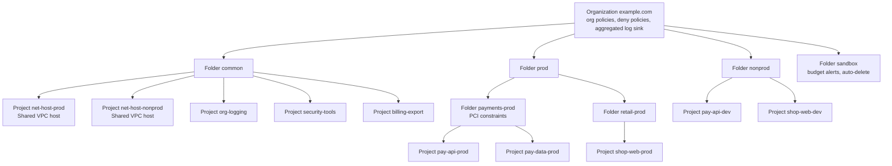

The diagram shows an environment-first hierarchy with one business-unit split under production, because only payments has a distinct regulator. Organization-wide controls sit on the root. The `common` folder isolates shared platform projects. The `payments-prod` folder carries Payment Card Industry (PCI) specific constraints such as restricted locations and VPC Service Controls membership, while `retail-prod` does not need them. Non-production is flat because nothing under it differs enough to justify more folders. The design implication is that the hierarchy is asymmetric on purpose. A symmetric tree that repeats `payments` and `retail` under every environment would double the places to maintain policy with no difference in policy.

### 4.4 Worked sizing example

An organization has 12 products, each with `dev`, `staging`, and `prod`. Each product needs one project per environment, and two products need a separate data project in production because their data access group differs from their application deployers. Shared platform projects are two Shared VPC hosts, logging, security tooling, billing export, a Continuous Integration and Continuous Delivery (CI/CD) project, and a KMS project.

- Workload projects: 12 × 3 = 36, plus 2 data projects = 38.
- Platform projects: 7.
- Total: 45 projects, under 4 first-level folders and 2 second-level folders.

Forty-five projects is well within normal project quotas for an organization, but it is not within the default project-creation quota of an individual user. That is one more reason project creation runs as a pipeline service account with an organization-level quota rather than as individual engineers. If the company later adds per-developer sandboxes for 200 engineers, the count jumps to 245 and the sandbox folder needs automatic cleanup, because a deleted project still counts against project quota during its 30-day recovery period (section 5.4).

## 5. Projects: identity, namespace, quota, and lifecycle

A project is the base container in which Google Cloud APIs are enabled and most resources are created. It is simultaneously an IAM attachment point, an API namespace, a default quota boundary, the default unit of billing attribution, and a lifecycle unit. Each of those roles is a reason to create a project, and each is a reason to keep two workloads in separate projects.

### 5.1 Three identifiers

Every project has three identifiers that people often mix up. The [project creation documentation](https://docs.cloud.google.com/resource-manager/docs/creating-managing-projects) defines them.

| Identifier | Example | Mutable | Unique | Used by |
|---|---|---|---|---|
| Project name | `Payments API (prod)` | Yes, any time | No | Console display only; no API uses it |
| Project ID | `pay-api-prod-7f3a` | No, fixed at creation | Globally, forever, including after deletion | gcloud, most API paths, resource names such as `projects/pay-api-prod-7f3a/...`, service account emails, some default hostnames |
| Project number | `482910374615` | No, assigned by Google | Globally | Service agents, some APIs and resource names, billing export, audit logs, VPC Service Controls perimeter membership |

Project IDs must be 6 to 30 characters of lowercase letters, digits, and hyphens, start with a letter, and not end with a hyphen. They cannot reuse an ID that ever existed, including deleted projects, and cannot contain restricted strings such as `google` or `ssl`.

These rules create design decisions:

- **Treat the project ID as public.** It appears in service account emails, bucket paths, and web addresses. Do not encode customer names or anything sensitive in it.
- **Add a suffix.** Because IDs are global and permanent, a clean name like `payments-prod` may already be taken by someone else in the world, or by your own deleted project. A short random or sequence suffix generated by the provisioning pipeline avoids collisions and makes recreation possible.
- **Store both ID and number in your inventory.** Some systems, such as VPC Service Controls perimeters and many service agent identities, use the number. Others use the ID. Joining logs, perimeters, and billing data requires both.

### 5.2 API enablement and the project as a service namespace

A Google Cloud service cannot be used in a project until its API is enabled there, for example `compute.googleapis.com` or `run.googleapis.com`. Enablement is a project-level state managed by the Service Usage API. Enabling an API can have side effects:

- Google creates **service agents**, Google-managed service accounts such as `service-PROJECT_NUMBER@compute-system.iam.gserviceaccount.com`, and grants them roles in the project so the service can act on your behalf.
- Some APIs create **default service accounts**, such as the Compute Engine default service account `PROJECT_NUMBER-compute@developer.gserviceaccount.com`. In older organizations it receives the Editor role automatically, which is why the baseline constraint `iam.automaticIamGrantsForDefaultServiceAccounts` exists.
- Some APIs create **default resources.** Enabling Compute Engine in a new project creates a `default` VPC network in auto mode with permissive firewall rules, unless the `compute.skipDefaultNetworkCreation` constraint is enforced.
- Enabling an API makes its **quota** visible and consumable in that project, and its usage billable to the project's billing account.

The project is also the namespace for resource names. Two projects can each have a VPC named `main`, a Cloud Run service named `api`, or a Pub/Sub topic named `orders`. Fully qualified resource names include the project: `projects/pay-api-prod-7f3a/topics/orders`. This is why cross-project references are explicit and why IAM can be granted at project level without collisions.

Some client-side APIs bill quota to a **quota project**, the project named in the request rather than the project that owns the resource. When a developer calls an API with user credentials, the gcloud command-line interface (CLI) or client library sends a quota project header (`X-Goog-User-Project`), set with `gcloud auth application-default set-quota-project`. An automation that calls APIs across 40 projects can therefore consume rate quota from a single quota project, which can throttle unexpectedly. Choosing the quota project deliberately is part of designing automation.

API enablement belongs in project provisioning, in code, alongside the explicit list of APIs a project may use. Disabling an API is not harmless. It can delete or orphan the service's resources in that project, so "disable unused APIs" cleanups need review.

### 5.3 The project as quota and blast-radius boundary

Most quotas apply at project level, and many are also regional or zonal within the project (section 14). Two workloads in one project share one pool of regional central processing unit (CPU) quota, one pool of API request quota, one set of project-level IAM bindings, and one deletion fate. Splitting them into two projects gives each its own pool and its own blast radius. That is the strongest technical argument for project-per-workload-per-environment.

The opposite argument is overhead. Each project needs bootstrapping, monitoring, budget alerts, and an owner. Services that need private connectivity to each other across projects need Shared VPC, Private Service Connect, or cross-project IAM. The working rule is to split when at least one of these differs: the group that can change it, its quota consumption pattern, its data classification, its lifecycle, or the cost center that pays for it. Do not split when all of those are the same, for example a web front end and its background worker owned by one team and deployed together.

### 5.4 Deletion lifecycle and liens

Projects have a lifecycle state. The [delete and restore documentation](https://docs.cloud.google.com/resource-manager/docs/delete-restore-projects) describes the timeline.

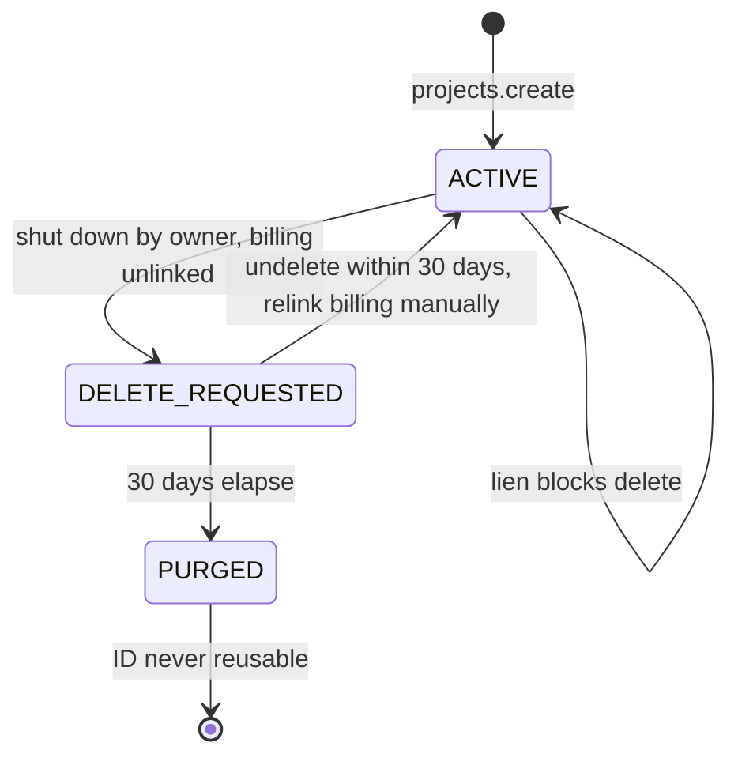

When a project is shut down, it becomes unusable immediately, notifications go to the deleting user and the technical Essential Contacts, and the billing account is disconnected. The project stays in `DELETE_REQUESTED` for 30 days. A project owner can restore it during that window, but the billing link is not restored automatically, some services may take up to 36 hours to resume, and some services, such as Cloud Storage and Pub/Sub, may delete resources sooner than 30 days so they might not be fully recoverable. After 30 days the project and its data are permanently deleted and its ID can never be used again. A project in `DELETE_REQUESTED` still counts against project quota.

The state diagram has two implications. First, the 30-day window is a recovery mechanism for the project shell, not a backup for data. Data that must survive project deletion belongs in another project with independent ownership, which is the [Storage chapter](CH06_Storage.md)'s independent-backup boundary. Second, the most dangerous single action in Google Cloud is often `gcloud projects delete` on a production project. It takes effect at once and is reversible only in part.

A **lien** prevents that action. A lien is an object on a project that blocks the listed restriction, typically `resourcemanager.projects.delete`, until someone with `resourcemanager.projects.updateLiens` removes it ([project liens](https://docs.cloud.google.com/resource-manager/docs/project-liens)):

```bash
gcloud alpha resource-manager liens create \
  --project=pay-api-prod-7f3a \
  --restrictions=resourcemanager.projects.delete \
  --reason="Production payments project. Remove only via change ticket." \
  --origin=platform-pipeline
```

Google places some liens automatically. Attaching a service account from one project to a resource in another puts a lien on the service account's project so that deleting it does not break the dependency. Enabling a project as a Shared VPC host also places a lien on it, because deleting a host would break every attached service project.

A lien alone is weak, because a project owner can remove it. Stronger protection layers a deny policy that denies project deletion (and, where the deny-supported permission list allows, lien removal) on production-tagged projects to everyone except a break-glass group (section 8.1), and Organization Policy constraints such as `compute.restrictXpnProjectLienRemoval` for Shared VPC hosts. Google also offers change-risk recommendations that warn before deleting projects it considers important.

### 5.5 Failure scenario: the accidental deletion

A contractor with Owner on `shop-web-prod` runs a cleanup script against the wrong project ID. The project enters `DELETE_REQUESTED` at 14:02. Traffic fails at once. The platform on-call restores the project at 14:20, then relinks billing at 14:35 after a short wait. Cloud Run services resume within minutes, but a Cloud Storage bucket used for uploaded images had already been scheduled for deletion and some objects are unrecoverable.

The review finds three gaps: the contractor had Owner rather than a deploy role, no lien or deny policy protected the project, and the image bucket had no copy in a separate project. The fixes are a project-scoped deploy role, a production deny policy on project deletion with a break-glass exception, and a scheduled transfer of the bucket to a backup project in another folder. This scenario is one instance of the part-wide "account compromise contained by organizational boundaries" scenario; the same controls contain a malicious actor holding the contractor's credentials.

## 6. Billing accounts and cost attribution

### 6.1 A separate hierarchy

A Cloud Billing account is a resource that holds a payment profile and receives charges. It is not a node in the resource tree above projects. It has its own IAM policy, it can be owned by an organization as its parent for governance, and it can pay for projects in that organization or, if permitted, in other organizations. Each project is linked to zero or one billing account at a time. A billing account can pay for many projects.

| Billing role | Granted on | Allows |
|---|---|---|
| Billing Account Administrator | Billing account | Manage the account, payment, users, budgets, exports |
| Billing Account User | Billing account | Link projects to this account |
| Billing Account Viewer | Billing account | Read cost and transactions |
| Project Billing Manager | Project or above | Change the project's billing link |

Linking a project to a billing account requires permissions on both objects: `billing.resourceAssociations.create` on the billing account, normally through Billing Account User, and the project billing-assignment permission on the project, held by Project Billing Manager or Owner. The two-sided check is the point of the design. The finance team decides which accounts exist and who may charge to them. The platform team decides which projects exist. Neither alone can attach an arbitrary project to an arbitrary payment method.

Billing account types matter commercially. A self-serve account pays by card or bank debit. An invoiced account is set up through Google sales with credit terms. Resellers and large enterprises can use billing subaccounts under a parent account to separate invoices. These are commercial arrangements, so confirm the current options with your account team.

### 6.2 What unlinking does

Removing a project's billing link, or a billing account becoming disabled through payment failure, stops paid services in the project. Resources that require billing are shut down, and some may be deleted if billing is not restored. This makes billing linkage an availability dependency. Two design consequences follow:

- **Budgets do not cap spend.** A Cloud Billing budget sends alerts at thresholds and can publish notifications to Pub/Sub. If you want automatic action, you write a function that reacts to the notification. Automatically unlinking billing on budget breach is a valid pattern for sandboxes and a dangerous one for production.
- **Billing account ownership must be durable.** A production billing account whose only administrator is one finance employee is a single point of failure for every linked project.

### 6.3 The attribution path

Cost attribution follows the usage record. Each service meters usage per project and per Stock Keeping Unit (SKU), the priced item such as "N2 instance core running in europe-west1." Usage records carry the project, the resource's labels, Google-applied system labels, location, and, in the detailed export, resource names. Cloud Billing prices them, applies credits such as committed use discounts and sustained use discounts, and writes them to the billing account.

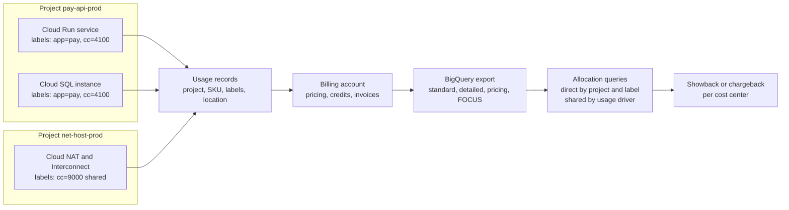

The diagram makes the attribution boundaries visible. Costs incurred inside `pay-api-prod` attribute directly to the project and its labels. Costs incurred inside the Shared VPC host project are real but attribute to the network team's project, not to the service projects that caused them. Without an allocation step, payments looks cheaper than it is and networking looks expensive. Projects are the most reliable attribution key because every usage record has one, while labels are only as complete as your tagging discipline.

### 6.4 Labels versus tags

Google Cloud has two key-value mechanisms that are easy to confuse.

- **Labels** are metadata on individual resources, such as `cc=4100`. They appear in the billing export and in filtering. They are not access controls. Anyone who can edit the resource can usually edit its labels, and they are not inherited.
- **Tags** (Resource Manager tags) are separate resources. A tag key such as `env` and a tag value such as `prod` are created under the organization or a project, governed by IAM, and bound to organizations, folders, projects, or supported resources. Bound tags are inherited down the hierarchy. Tags can be referenced in IAM conditions, deny-policy conditions, Organization Policy conditions, and firewall policies. Tags bound to resources also appear in billing export data.

The [Resource Manager limits page](https://docs.cloud.google.com/resource-manager/docs/limits) lists, at the time of writing, a maximum of 50 tag key-value pairs attached per resource, 1,000 keys per organization or project, and 1,000 values per key. Use tags for things that drive policy, such as environment and data classification. Use labels for things that drive reporting, such as cost center and application.

### 6.5 Cloud Billing export

The Cloud Billing export to BigQuery writes daily cost data to a dataset you choose. At the time of writing it offers standard usage cost, detailed usage cost (adds resource-level rows), pricing, and a FinOps Open Cost and Usage Specification (FOCUS) format ([export documentation](https://docs.cloud.google.com/billing/docs/how-to/export-data-bigquery)). Two behaviors matter for design:

- If the dataset is in the `US` (United States) or `EU` (European Union) multi-region, the first enablement backfills cost data from the start of the previous month. If the dataset is in a single region, there is no backfill. Enable the export on the day the billing account is created, and pick the location deliberately.
- Changing the export to a new dataset does not copy history. Keep the export dataset in a stable, protected project (the `billing-export` project in section 4.3).

The export is the system of record for attribution. A simple direct-cost query by project and cost-center label for one invoice month:

```sql
SELECT
  project.id AS project_id,
  (SELECT value FROM UNNEST(labels) WHERE key = 'cc') AS cost_center,
  SUM(cost) + SUM(IFNULL((SELECT SUM(c.amount) FROM UNNEST(credits) c), 0)) AS net_cost
FROM `billing-export.billing.gcp_billing_export_v1_XXXXXX_XXXXXX_XXXXXX`
WHERE invoice.month = '202501'
GROUP BY project_id, cost_center
ORDER BY net_cost DESC;
```

Credits are stored as negative amounts in a nested field, so net cost adds them. Export data is not real time. Plan for usage to appear hours after it occurs, and for some adjustments to arrive later in the month.

### 6.6 Worked shared-cost allocation

The Shared VPC host project `net-host-prod` costs 18,000 currency units per month: 6,000 for Cloud Interconnect ports and attachments (fixed), 4,000 for Cloud NAT gateways and their data processing, and 8,000 for a pool of network inspection appliances that run as VMs in the host project. Three service projects use it. Data transfer from a workload VM is generally charged to the project that owns the VM, so it already lands in the service projects; verify this per SKU in the export rather than assuming. The allocation drivers are chosen per cost type:

| Cost | Driver | pay-api-prod | shop-web-prod | pay-data-prod |
|---|---|---|---|---|
| Interconnect 6,000 | Equal share of fixed capacity | 2,000 | 2,000 | 2,000 |
| NAT 4,000 | Share of NAT bytes: 50%, 30%, 20% | 2,000 | 1,200 | 800 |
| Inspection 8,000 | Share of inspected bytes: 25%, 70%, 5% | 2,000 | 5,600 | 400 |
| Total 18,000 | | 6,000 | 8,800 | 3,200 |

Byte shares come from VPC Flow Logs, NAT logs, or appliance logs aggregated by source subnet, because each service project uses its own subnets in the host. This is why subnet-per-service-project is a useful convention even when one large subnet would work technically. It turns a network log into an allocation key. The [Cost Optimization chapter](CH14_Cost_Optimization.md) owns allocation methods and commitment strategy in depth.

## 7. IAM allow policies and inheritance

### 7.1 The model

Google Cloud IAM authorizes a **principal** to perform an action on a resource if some applicable policy grants a **role** containing the required **permission**, and no other policy blocks it.

- **Principals** include Google accounts (users), Google groups, service accounts, Cloud Identity or Workspace domains, workforce and workload identity pool identities, and special sets such as `allAuthenticatedUsers` and `allUsers`.
- **Permissions** have the form `service.resource.verb`, for example `storage.objects.get` or `compute.instances.delete`. You never grant permissions directly.
- **Roles** are collections of permissions. Basic roles (Owner, Editor, Viewer) are broad and predate fine-grained roles. Predefined roles, such as `roles/run.developer`, are maintained by Google. Custom roles are defined by you at organization or project level; they cannot be defined at folder level.
- **Allow policies** are attached to a resource and contain bindings. Each binding maps one role to a list of principals, optionally with a condition.

```json
{
  "bindings": [
    {
      "role": "roles/run.developer",
      "members": ["group:pay-deployers@example.com"]
    },
    {
      "role": "roles/secretmanager.secretAccessor",
      "members": ["serviceAccount:pay-api@pay-api-prod-7f3a.iam.gserviceaccount.com"],
      "condition": {
        "title": "Only pay secrets",
        "expression": "resource.name.startsWith('projects/482910374615/secrets/pay-')"
      }
    }
  ],
  "etag": "BwYb2...",
  "version": 3
}
```

Policy version 3 is required for conditional bindings. The `etag` implements optimistic concurrency. A read-modify-write that loses a race fails rather than silently overwriting someone else's binding, which is why automation should always read, modify, and write with the `etag` rather than replace the whole policy from a template that might be stale. Note that the condition uses the project number in the resource name, because Secret Manager resource names use it.

### 7.2 Inheritance is a union

Allow policies can be attached to the organization, folders, projects, and many individual resources such as buckets, topics, secrets, and service accounts. The effective allow policy on a resource is the **union** of the policy attached to it and the policies on all its ancestors. There is no override and no subtraction. A role granted on a folder applies to every project and resource below that folder, and nothing set on a project can remove it.

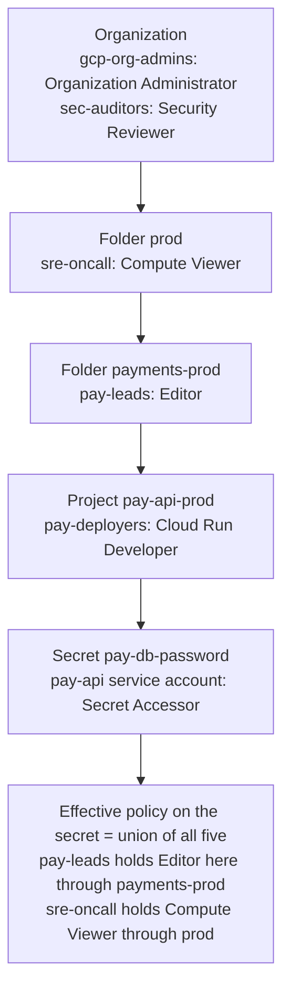

The path shows how access accumulates. Every principal bound on any ancestor carries its role down to the secret. A review finding often hides in the indirect path. Whether a basic role such as Editor contains a particular data permission varies by service, so check the role's permission list rather than assuming. Even where Editor lacks a direct data permission, it usually includes enough to deploy a workload that runs as a service account that has it. Effective access includes what a principal can reach through impersonation or deployment, not only what its role lists. Policy Analyzer and the IAM recommender exist to answer that broader question.

Three rules follow from union semantics:

1. **Grant at the lowest scope that works.** A grant at the organization or a broad folder is a grant to every current and future project below it.
2. **Never use a lower level to "take away" access.** It is impossible with allow policies. Use a deny policy (section 8.1) or move the grant lower.
3. **Review inherited bindings, not only local ones.** The project IAM page in the console shows inherited bindings. Audit tools must query the ancestors too.

### 7.3 IAM conditions and tags

A condition is a Common Expression Language (CEL) expression attached to a binding. The binding applies only when the expression is true. Useful attributes include request time (`request.time`), resource name and type (`resource.name`, `resource.type`), the service (`resource.service`), and tags (`resource.matchTag`, `resource.matchTagId`). Conditions support patterns such as temporary access that expires and grants limited to resources whose name has a prefix.

Tag-based conditions are the scalable form of attribute-based access control (ABAC) in Google Cloud, which the [ABAC chapter](../15_Security/CH05_ABAC.md) explains in general terms. A single binding at a folder can grant a role only on projects or resources tagged `env=dev`:

```json
{
  "role": "roles/compute.instanceAdmin.v1",
  "members": ["group:app-engineers@example.com"],
  "condition": {
    "title": "Dev resources only",
    "expression": "resource.matchTag('123456789012/env', 'dev')"
  }
}
```

The tag key is referenced by its namespaced name, the organization ID followed by the short key name. The condition is only as safe as the control on who can bind tags. If `app-engineers` can bind `env=dev` to a production project, the condition grants them production. Grant `roles/resourcemanager.tagUser` on the tag value only to the platform pipeline, and keep tag administration with the platform team.

Not every service evaluates every condition attribute, and conditions on some resources are limited to the attributes that service supplies. Check the service's IAM conditions support before relying on a condition for a security boundary.

### 7.4 Service accounts in the hierarchy

A service account is both a principal and a resource. As a principal, it receives roles on other resources. As a resource, it has its own allow policy that controls who can act as it, for example `roles/iam.serviceAccountUser` (attach it to a workload) and `roles/iam.serviceAccountTokenCreator` (impersonate it). A user who can impersonate a service account has that service account's access, so the service account's allow policy is part of every effective-access review. The [IAM chapter](CH09_IAM.md) covers impersonation chains, short-lived credentials, and federation.

### 7.5 Propagation and consistency

IAM policy changes are eventually consistent. Google documents that most changes take effect within minutes, but propagation can take longer, especially for group membership changes. Design consequences: a deployment pipeline that grants a role and immediately uses it should retry with backoff, and revocation during an incident is not instantaneous. When you need immediate containment, disable the service account or the user in the directory and revoke its keys, in addition to removing bindings.

### 7.6 Worked effective-access scenario

`alex@example.com` is in groups `sre-oncall` and `pay-leads`. What can Alex do on `pay-api-prod`?

- From the organization: nothing, Alex is not in `gcp-org-admins` or `sec-auditors`.
- From `prod`: Compute Viewer on every production project.
- From `payments-prod`: Editor on both payments projects.
- From the project: nothing directly.

Effective access is Editor plus Compute Viewer on `pay-api-prod`. If security wants Alex to retain Editor in `pay-data-prod` but be unable to delete Cloud SQL instances anywhere in production, an allow change cannot do it, because Editor is inherited from the folder. The options are to replace the folder Editor grant with narrower project grants, or attach a deny policy on `prod` that denies Cloud SQL instance deletion to everyone except a database break-glass group, after confirming that the permission appears on the deny-supported list. The first is better long term. The second is faster and auditable during a transition.

## 8. Deny policies and principal access boundary policies

Allow policies can only add. Two additional policy types restrict.

### 8.1 Deny policies

A deny policy is attached to an organization, folder, or project and is inherited by descendants. It contains rules that name denied principals, optional exception principals, denied permissions, and an optional condition. If a deny rule matches, the request is refused even if an allow policy grants the permission.

```json
{
  "displayName": "Protect production projects from deletion",
  "rules": [
    {
      "denyRule": {
        "deniedPrincipals": ["principalSet://goog/public:all"],
        "exceptionPrincipals": ["principalSet://goog/group/gcp-breakglass@example.com"],
        "deniedPermissions": [
          "cloudresourcemanager.googleapis.com/projects.delete"
        ],
        "denialCondition": {
          "title": "Production only",
          "expression": "resource.matchTag('123456789012/env', 'prod')"
        }
      }
    }
  ]
}
```

```bash
gcloud iam policies create protect-prod-deletion \
  --attachment-point="cloudresourcemanager.googleapis.com/organizations/123456789012" \
  --kind=denypolicies \
  --policy-file=deny-prod-deletion.json
```

Deny policies use a different permission format from allow policies: the service's fully qualified domain followed by the resource and verb. Lien removal, billing-link changes, and audit-configuration changes are natural companions to project deletion in this rule, but add them only after confirming that the deny-policy supported permissions list includes them. Check every permission string against that list, because not every permission can be denied, and a permission that cannot be denied gives no protection even though the policy appears to cover it. Deny conditions are limited to tag-based expressions, so tags become the way to scope a deny rule to production.

Deny policies are the right tool when:

- A small set of destructive actions must be blocked everywhere except for a break-glass group: deleting projects, removing liens, changing billing links, disabling audit logging, creating service account keys.
- A broad inherited allow grant cannot be removed yet, and a specific permission inside it must be blocked.

They are the wrong tool for everyday least privilege. Long deny lists are hard to reason about and create surprise denials. Start from small allow grants, and use deny as a guardrail.

### 8.2 Principal access boundary policies

Allow and deny policies are attached to resources and answer "who can access this resource?" A principal access boundary (PAB) policy is bound to a set of principals and answers "which resources are these principals eligible to access at all?" ([PAB documentation](https://docs.cloud.google.com/iam/docs/principal-access-boundary-policies)).

Key mechanics at the time of writing:

- A PAB policy lists resources (organizations, folders, projects) that principals are eligible to access. Its only effect is `ALLOW` eligibility. It never grants access; an allow policy must still grant a role.
- PAB policies are created under the organization and bound through policy bindings to principal sets: a workforce identity pool, a workload identity pool, a Workspace domain, or the principal set of a project, folder, or organization. A project's principal set contains its service accounts, workload identity pools, and agent identities. A folder's or organization's principal set contains all of its descendants' principal sets.
- If a principal is subject to no PAB policy, it is eligible for every resource. If it is subject to one or more, it is eligible only for the union of resources those policies list.
- Each PAB policy has an enforcement version that determines which permissions it can block. Permissions outside that version are not blocked. Using `latest` auto-adopts new versions and can remove access unexpectedly.
- Evaluation fails closed. If IAM cannot evaluate a PAB policy, often because a new principal has not finished propagating, access is denied.
- Binding conditions can use only `principal.type` and `principal.subject`, for example to apply a boundary only to service accounts.

The main use is exfiltration prevention from the identity side. A deny policy or VPC Service Controls perimeter protects your resources from outsiders. A PAB policy prevents your principals from using their credentials against someone else's organization, for example a phished employee granted Editor in an attacker's project, or a compromised service account writing data to an external bucket. A typical first PAB policy binds the organization's principal set to a boundary that lists only the organization:

```json
{
  "displayName": "Only example.com resources",
  "details": {
    "rules": [
      {
        "description": "Eligible for own organization",
        "resources": ["//cloudresourcemanager.googleapis.com/organizations/123456789012"],
        "effect": "ALLOW"
      }
    ],
    "enforcementVersion": "4"
  }
}
```

Roll it out carefully. Partners' projects, Google-hosted public datasets, and third-party marketplace resources that your principals legitimately use are outside the organization and must be listed or the access breaks.

### 8.3 Evaluation order

Google describes evaluation as simultaneous, but it is easier to reason about in stages, as documented in [policy types](https://docs.cloud.google.com/iam/docs/policy-types).

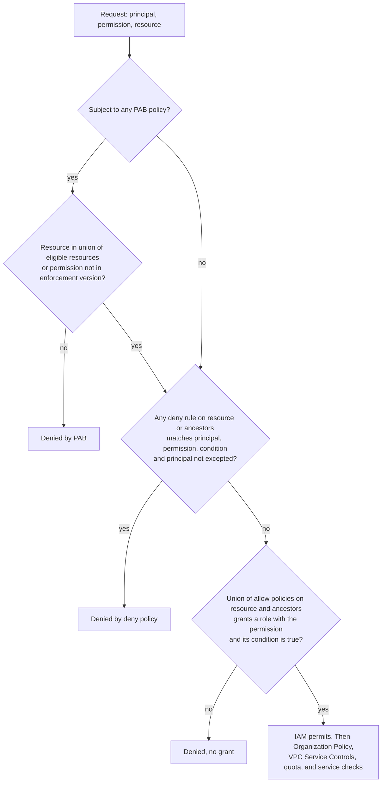

The decision tree shows that IAM can say no at three distinct stages and yes only at the end. Troubleshooting follows the same order: the audit log entry for a denied request, and the Policy Troubleshooter, indicate which stage refused. The final node is a reminder that an IAM "yes" is necessary but not sufficient. Organization Policy can still reject a configuration, VPC Service Controls can still reject a cross-perimeter request, and quota can still reject the operation. Each produces a different error, and a team that understands only IAM will misdiagnose the others as permission problems.

## 9. The Organization Policy Service

### 9.1 What it governs

IAM decides whether a principal may call an API. The Organization Policy Service decides whether the resulting configuration is allowed, regardless of who calls. An Organization Administrator holding every IAM permission still cannot create a VM with an external Internet Protocol (IP) address in a folder where `compute.vmExternalIpAccess` denies it. The two systems are complementary.

| Question | IAM | Organization Policy |
|---|---|---|
| What is evaluated | Principal, permission, resource | Resource configuration on create or update |
| Who is the subject | A principal | Every caller equally |
| Typical statement | "Group X may create instances in project Y" | "No instance in folder F may have an external IP" |
| Grants access | Allow policies do | Never |
| Inheritance | Union for allow, inherited deny | Inherit, merge, replace, or reset per policy |
| Failure symptom | `PERMISSION_DENIED` naming a permission | Failed precondition naming a constraint |

An organization policy is a policy object set on an organization, folder, or project for exactly one **constraint**. The [constraints documentation](https://docs.cloud.google.com/resource-manager/docs/organization-policy/understanding-constraints) describes three kinds at the time of writing:

- **Legacy managed constraints** are the original Google-defined constraints, such as `gcp.resourceLocations` or `compute.vmExternalIpAccess`. Each is either a **list** constraint, with allowed and denied values, or a **boolean** constraint, enforced or not.
- **Managed constraints**, with names such as `iam.managed.disableServiceAccountKeyCreation`, are Google-defined replacements built on the custom-constraint engine. They support parameters and better simulation through Policy Intelligence tools.
- **Custom constraints** are written by you in CEL against fields of a supported resource type and are enforced or not.

### 9.2 Inheritance, merge, override, and reset

The [hierarchy evaluation rules](https://docs.cloud.google.com/resource-manager/docs/organization-policy/understanding-hierarchy) determine the effective policy at each node.

- **No policy set on a node:** the node inherits its parent's effective policy. If no ancestor sets a policy, the constraint's Google-managed default applies, which for most constraints means unrestricted and for a few means restricted.
- **Policy set with `inheritFromParent: false`** (the default): the node's policy replaces the parent's. For a list constraint, its allowed and denied values are the whole story. For a boolean constraint, `enforce: false` at a child turns off an enforcement set above.
- **Policy set with `inheritFromParent: true`** (list constraints only): the node's values merge with the parent's effective policy. Allowed values add together and denied values add together, and a denied value always wins over an allowed one.
- **Policy with `reset: true`:** the node ignores ancestors and uses the constraint's default.

Because a child can override, the security property comes from IAM on Organization Policy itself. The Organization Policy Administrator role (`roles/orgpolicy.policyAdmin`) should be held only by the platform team at the organization, optionally conditioned on tags to delegate a slice. Project Owners do not need it, and granting it lower lets the guarded team remove the guardrail.

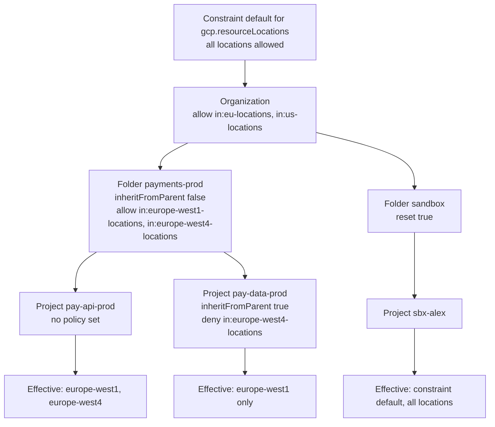

The diagram traces one list constraint through the hierarchy. The organization narrows the default to the EU and US. The payments folder replaces that with two specific regions, so even a US location allowed at the organization is not allowed beneath it. `pay-api-prod` sets nothing and inherits the folder. `pay-data-prod` merges with the folder and adds a denied value, so only `europe-west1` remains, because denial wins. The sandbox folder resets to the default, which is a deliberate choice for an experimentation area but should be paired with budgets and automatic cleanup. The implication for reviewers is that the effective policy at a project cannot be read from the project alone. Use `gcloud org-policies describe CONSTRAINT --project=P --effective` or the console's effective policy view.

A policy in the current format looks like this:

```yaml
name: folders/987654321098/policies/gcp.resourceLocations
spec:
  inheritFromParent: false
  rules:
  - values:
      allowedValues:
      - in:europe-west1-locations
      - in:europe-west4-locations
```

### 9.3 Enforcement timing and scope

Organization Policy is evaluated when a resource is created or updated. It does not retroactively delete or change existing resources. Enforcing `compute.vmExternalIpAccess` today leaves yesterday's external IPs in place, though an update to that VM may then fail. Before enforcing a constraint on an existing estate, find current violations with Policy Analyzer or Security Command Center, remediate them, and then enforce.

Each constraint applies only to the services that implement it. `gcp.resourceLocations`, for example, restricts where supported services create location-bound resources. It does not by itself make every global service keep data in a region, and it does not control where support staff or global control planes process metadata. Data-residency claims need each service's location documentation and, where required, Assured Workloads controls, not just this constraint.

### 9.4 Dry run, simulation, and conditional rules

A policy can carry a `dryRunSpec` alongside or instead of `spec`. Dry-run violations are logged but not enforced. The safe rollout sequence is dry run on the organization, watch the logs for a defined period, fix violations, enforce on non-production folders, then enforce organization-wide. The Policy Simulator for Organization Policy can estimate the impact of a proposed change against existing resources for supported constraints.

Rules inside a policy can carry tag conditions. One rule can enforce a constraint where `env=prod`, and another can leave it unenforced elsewhere, all in one policy at the organization. This often beats creating extra folders purely to vary a single constraint.

### 9.5 Custom constraints

A custom constraint expresses a rule over a resource's fields that no Google-defined constraint covers. This example, adapted from Google's documentation pattern, requires GKE node pools to have auto-upgrade enabled:

```yaml
name: organizations/123456789012/customConstraints/custom.gkeNodePoolAutoUpgrade
resourceTypes:
- container.googleapis.com/NodePool
methodTypes:
- CREATE
- UPDATE
condition: "resource.management.autoUpgrade == true"
actionType: ALLOW
displayName: Require node pool auto-upgrade
description: Node pools must have auto-upgrade enabled.
```

The constraint is defined once at the organization, then enforced through an organization policy at whatever node needs it. Custom constraints are evaluated only for the resource types and methods listed, and only for services that support custom constraints. A constraint that checks a field the API does not populate at creation can block every create, so test in dry run first.

### 9.6 A baseline set and its reasoning

| Constraint | Purpose | Why at organization level |
|---|---|---|
| `iam.allowedPolicyMemberDomains` | Only identities from your customer IDs can be granted roles | Blocks accidental grants to personal or external accounts everywhere |
| `iam.managed.disableServiceAccountKeyCreation` | No long-lived service account keys | Keys are the most common credential leak; exceptions go in a tagged rule |
| `iam.automaticIamGrantsForDefaultServiceAccounts` | Default service accounts do not get Editor | Prevents broad privilege on every VM by default |
| `compute.skipDefaultNetworkCreation` | No `default` network in new projects | The default network has permissive firewall rules and auto-mode ranges |
| `compute.vmExternalIpAccess` | No external IPs on VMs except listed ones | Forces egress through Cloud NAT and ingress through load balancers |
| `storage.uniformBucketLevelAccess` | Bucket access only through IAM | Removes per-object access control lists that audits miss |
| `gcp.resourceLocations` | Restrict regions | Residency and support coverage |
| `compute.restrictSharedVpcHostProjects` | Only named projects can be Shared VPC hosts | Prevents shadow network hubs |

These constraints carry most of the "secure by default" posture in a Google Cloud foundation. The [Landing Zones chapter](CH15_Landing_Zones.md) owns how a landing zone packages, tests, and grants exceptions to them.

## 10. VPC Service Controls

### 10.1 The problem it solves

IAM answers whether a credential is authorized. It does not ask where the request comes from or where the data is going. If an attacker steals a valid service account credential, IAM will honor it from anywhere on the internet. If an insider with legitimate read access copies a dataset to a bucket in a personal project, IAM sees two authorized calls.

VPC Service Controls adds a context check around Google-managed APIs. A **service perimeter** is a set of projects, and optionally VPC networks, plus a list of **restricted services** such as `storage.googleapis.com` and `bigquery.googleapis.com`. For restricted services, requests that cross the perimeter boundary are refused, even when IAM allows them. Requests inside the perimeter, between protected projects, proceed normally.

### 10.2 Components

- **Access policy.** An organization-level container for perimeters and access levels, managed through Access Context Manager. Scoped access policies can delegate perimeter management for a folder or project.
- **Perimeter membership.** Projects are listed by project number. A project can be in only one regular perimeter.
- **Access levels.** Named conditions on request origin: IP ranges, device policy attributes, identities, or combinations. An access level lets a request from outside the perimeter in, for example from the corporate egress IP range.
- **Ingress and egress rules.** Fine-grained exceptions naming identities, sources, target projects, services, and methods. An egress rule might allow the perimeter's Dataflow service account to read from one partner bucket and nothing else.
- **Dry-run configuration.** Each perimeter can have a dry-run version that logs would-be violations without blocking.
- **VPC accessible services.** Restricts which Google APIs can be called from VPC networks inside the perimeter.
- **Restricted virtual IP.** The `restricted.googleapis.com` endpoint (199.36.153.4/30) serves only APIs supported by VPC Service Controls. Pointing on-network Domain Name System (DNS) records for `*.googleapis.com` at it keeps internal clients from reaching unsupported services that cannot be policed.

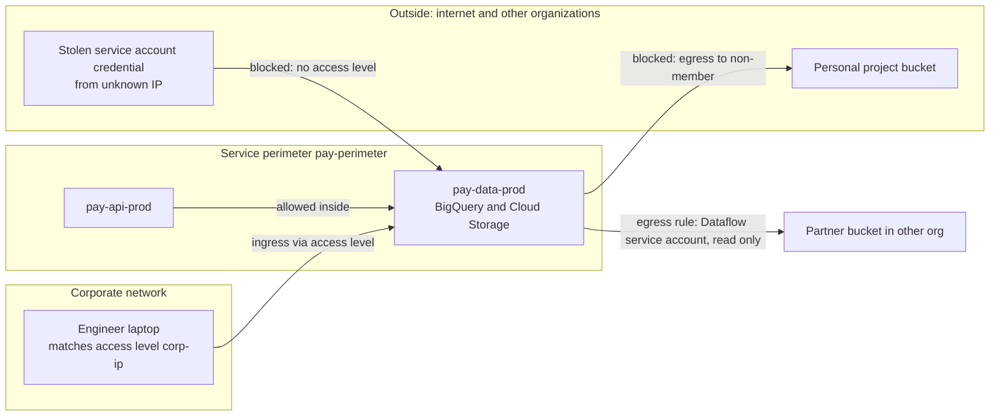

The trust-boundary diagram shows four request types. A stolen credential used from an unknown network is rejected because the request lacks an access level, even though IAM would allow it. A copy from a protected bucket to a personal bucket is rejected because the destination is not in the perimeter. An engineer on the corporate network enters through an access level. A narrowly defined egress rule permits one service account to read from one partner bucket. The implication is that VPC Service Controls turns data exfiltration from "one authorized API call" into "an authorized call from an approved context to an approved destination," which is a much harder bar for an attacker.

### 10.3 Limits and failure modes

- **Supported services only.** Only services listed as supported by VPC Service Controls are protected, and some have documented limitations. A perimeter does not protect a service that is not on its restricted list.
- **It is not a firewall.** VPC Service Controls polices Google API calls. It does not filter VM-to-VM traffic or internet traffic from your workloads.
- **It does not replace IAM.** Requests inside the perimeter still need IAM grants.
- **Breakage is the main operational risk.** Enabling a perimeter in enforced mode without dry run commonly breaks CI/CD pipelines running outside the perimeter, console access from home networks, Google-managed service agents that read cross-project, and integrations such as log export to a project outside. Run dry run for weeks, read the violation logs, and add ingress and egress rules before enforcing.
- **Membership is by project.** A project moved into a perimeter's folder does not automatically join the perimeter unless your automation adds it. Perimeter membership belongs in the same provisioning pipeline as the project.

### 10.4 Quality scenario: credential theft contained

- **Stimulus:** a service account key for `pay-etl@pay-data-prod` is leaked in a public repository and used from an unknown IP to export a BigQuery table.
- **Expected response:** VPC Service Controls rejects the request because it comes from outside the perimeter with no matching access level. The Policy Denied audit log records the attempt, and an alert fires to the security on-call.
- **Measurable success:** zero bytes leave the perimeter; the alert fires within 5 minutes of the first denied request; the key is disabled within 30 minutes. A follow-up verifies that the `iam.managed.disableServiceAccountKeyCreation` exception that allowed the key is removed.

## 11. Networking: global VPC, Shared VPC, and firewalls

Detailed routing, load balancing, Cloud NAT, hybrid connectivity, and private endpoints belong to the [Networking chapter](CH05_Networking.md). This section teaches the Google Cloud scope model and ownership model that every later network decision assumes.

### 11.1 A global network with regional subnets

A Google Cloud VPC network is a **global** resource inside one project. It has no region. Its **subnets** are **regional**: each subnet has a primary Internet Protocol version 4 (IPv4) range, optional secondary ranges (used, for example, for GKE Pods and Services), and optional IPv6 ranges, and it spans every zone in its region. A VM in any zone of `europe-west1` can take an address from any `europe-west1` subnet in the network. A VM in `us-central1` uses a `us-central1` subnet in the same network.

Routes and VPC firewall rules are also global resources belonging to the network. Subnet routes are created automatically, so every subnet can reach every other subnet in the network across regions over internal addresses on Google's backbone, without virtual private network (VPN) tunnels or peering between regions. Dynamic routes learned by Cloud Router from on-premises over Border Gateway Protocol (BGP) can be made visible only in the router's region (regional dynamic routing mode) or in all regions (global dynamic routing mode).

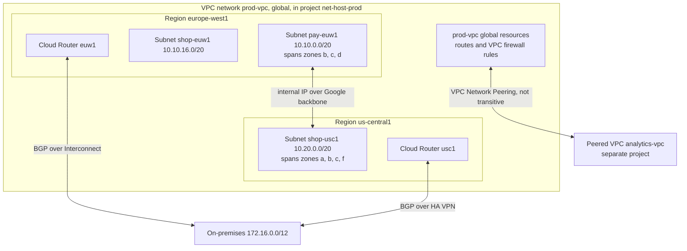

The topology shows a single network crossing two regions with no inter-region plumbing, two Cloud Routers exchanging routes with on-premises in different regions over Cloud Interconnect and high-availability (HA) VPN, and a peered network that remains a separate administrative domain. Several implications follow. First, address planning is global: subnet ranges in all regions of a network must not overlap with each other, with peered networks, or with on-premises. Second, global reach is not global resilience. A regional subnet disappears with its region, and the regional services attached to it do too. Third, inter-region traffic inside one VPC is still billed as inter-region data transfer, and latency still follows geography. Fourth, peering is not transitive: `analytics-vpc` cannot reach on-premises through `prod-vpc` by default, and two networks peered to `prod-vpc` cannot reach each other.

Two creation modes exist. **Auto mode** networks create one subnet per region from a fixed `10.128.0.0/9` block and add subnets as new regions open. **Custom mode** networks create only the subnets you define. Production uses custom mode, because auto-mode ranges collide across networks and with on-premises. A subnet's primary range can be expanded later but not shrunk, so start conservatively and leave room.

How this differs from the other providers matters when translating designs. An AWS VPC is regional and its subnets are zonal, so a multi-region AWS design needs a VPC per region and an inter-region connection, and a subnet failure domain is an Availability Zone. An Azure virtual network is regional and its subnets span the region's zones. In Google Cloud, one network can span regions and a subnet is regional. A zonal failure in Google Cloud therefore does not remove a subnet; it removes the zonal resources using it.

### 11.2 Shared VPC: host and service projects

Shared VPC separates who owns the network from who owns the workloads. A **host project** contains the VPC networks. **Service projects** are attached to the host and create resources, such as VMs, GKE clusters, internal load balancers, and Cloud Run services with Direct VPC egress, whose network interfaces use the host's subnets. The workload resources and their costs live in the service project. The subnets, routes, firewall rules, Cloud Routers, and hybrid attachments live in the host project.

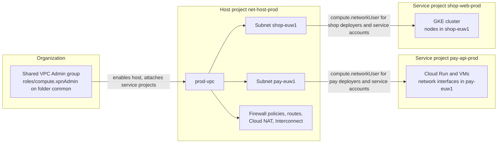

The diagram shows the three roles in the arrangement. The Shared VPC Admin, granted `roles/compute.xpnAdmin` at the organization or a folder, enables host projects and attaches service projects. The network team owns everything inside the host. Service project principals, including the service agents of services like GKE and Cloud Run, receive `roles/compute.networkUser` either on specific subnets or on the whole host project. Subnet-level grants are the stronger design, because they keep `pay-api-prod` from placing workloads in `shop-euw1`.

```bash
gcloud compute shared-vpc enable net-host-prod
gcloud compute shared-vpc associated-projects add pay-api-prod --host-project=net-host-prod
gcloud compute networks subnets add-iam-policy-binding pay-euw1 \
  --region=europe-west1 --project=net-host-prod \
  --member="group:pay-deployers@example.com" --role="roles/compute.networkUser"
```

Rules and properties to design around:

- A service project can be attached to only one host project at a time. A host project cannot also be a service project.
- Enabling a host places a lien on the host project (section 5.4). Deleting a host is meant to be hard.
- The host is a shared dependency. A bad firewall or route change in the host affects every service project. Host changes need stricter change control than workload changes.
- Limits exist on attached service projects and on networks per host. Check the current Shared VPC quotas before designing a single host for hundreds of service projects.
- Organization Policy constraints `compute.restrictSharedVpcHostProjects` and `compute.restrictSharedVpcSubnetworks` restrict which hosts and subnets service projects may use.

| Option | Ownership | Choose when | Cost |
|---|---|---|---|
| Shared VPC | Central network team, delegated subnets | Central control of routes, hybrid links, egress, and firewall is a requirement | Host becomes a shared failure and change bottleneck |
| VPC per project with peering | Each team owns its network | Teams need independent network lifecycles and few cross-team paths | Non-transitive peering, per-network hybrid links, duplicated egress |
| VPC per project with Private Service Connect | Producer and consumer stay separate | Services are consumed across teams through narrow endpoints | Per-service endpoints, no general network reachability |
| Network Connectivity Center hub | Hub-and-spoke of VPCs | Many VPCs need transitive connectivity with central routing | Additional product and design complexity |

Most enterprises use one Shared VPC host per environment class (production and non-production), as in section 4.3, and add Private Service Connect for producer-consumer services that should not share a network. The [Networking chapter](CH05_Networking.md) compares these attachment models in depth.

### 11.3 Firewall rules and hierarchical firewall policies

Google Cloud firewalls are distributed and stateful. They are enforced at each VM's network interface (and at certain managed proxies), not at a central appliance. Return traffic for an allowed connection is allowed automatically. Several rule containers exist, and Cloud Next Generation Firewall (Cloud NGFW) evaluates them in a defined order.

- **Hierarchical firewall policies** are created at the organization or a folder and associated with the organization or folders. Their rules apply to VMs in all projects below. Each rule has an action of `allow`, `deny`, `goto_next`, or `apply_security_profile_group` (Layer 7 inspection). A lower level cannot override an `allow` or `deny` decided above; `goto_next` delegates the decision downward.
- **VPC firewall rules** are the classic per-network rules with priority 0 to 65535 (lower number wins), direction, action, and targets by network tag or service account.
- **Global and regional network firewall policies** are policy containers attached to networks, with features such as IAM-governed secure tags, fully qualified domain name (FQDN) and geolocation objects, and threat intelligence lists.
- **Implied rules** close the evaluation: deny ingress to VM interfaces and allow egress.

The [evaluation order documentation](https://docs.cloud.google.com/firewall/docs/firewall-policies-rule-eval-order) sets the default order, `AFTER_CLASSIC_FIREWALL`, as follows. A network can switch to `BEFORE_CLASSIC_FIREWALL`, which evaluates network firewall policies before VPC firewall rules.

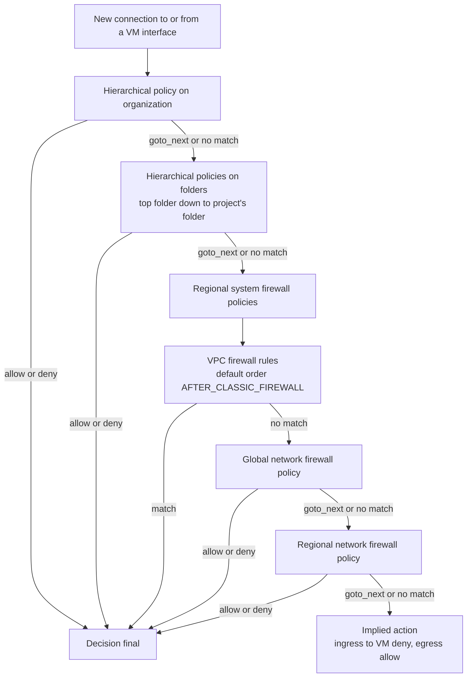

The flow shows why hierarchical policies are the platform team's tool. Whatever they decide with `allow` or `deny` is final, so an organization rule denying ingress from the internet to port 22 cannot be undone by a project's VPC firewall rule. Whatever they delegate with `goto_next` lands in the hands of the network owner of the VPC. A common pattern at the organization is:

1. `allow` health-check source ranges and Identity-Aware Proxy (IAP) Transmission Control Protocol (TCP) forwarding (35.235.240.0/20) to required ports.
2. `deny` ingress from `0.0.0.0/0` to administrative ports such as 22 and 3389.
3. `goto_next` for everything else.

```bash
gcloud compute firewall-policies rules create 1000 \
  --firewall-policy=org-baseline --organization=123456789012 \
  --direction=INGRESS --action=deny \
  --src-ip-ranges=0.0.0.0/0 --layer4-configs=tcp:22,tcp:3389 \
  --description="No direct admin access from the internet"
```

One security subtlety: classic network tags can be changed by anyone who can edit the instance, so a rule targeting `tag:allow-db` can be widened by a developer adding that tag to a VM. Target by service account, or by IAM-governed secure tags in network firewall policies, when the rule is a security boundary.

### 11.4 Private Google Access and Private Service Connect (recap)

Workloads without external IP addresses still need Google APIs. **Private Google Access** is a per-subnet setting that lets such VMs reach Google APIs and services through the network's default internet gateway route to Google's API ranges, without traversing the public internet in the usual sense. Pairing it with DNS for `private.googleapis.com` (199.36.153.8/30) or `restricted.googleapis.com` (199.36.153.4/30, VPC Service Controls only) gives predictable addresses for routes and firewall rules. **Private Service Connect** creates an endpoint with an internal IP address in your VPC for Google APIs or for a producer's published service, which works across projects and organizations without network peering. **Private services access** uses a peering connection to a Google-managed producer network for services such as Cloud SQL private IP. The [Networking chapter](CH05_Networking.md) owns their routing, DNS, and lifecycle details.

## 12. Regions, zones, and resource scope

### 12.1 Locations

A **region** is a geographic location such as `europe-west1` (Belgium) or `us-central1` (Iowa). A **zone** is a deployment area inside a region, named by suffix, such as `europe-west1-b`. Zones in a region are designed to fail independently of each other for most failure causes, and most regions have three or more zones. Some services also offer **multi-region** or **dual-region** locations, such as the `EU` and `US` multi-regions for Cloud Storage and BigQuery. Region and zone counts grow over time. Check the current locations page rather than relying on a number.

Zone suffix letters are not a stable physical mapping between products or a promise about which zones exist. Region `us-central1` has zones `a`, `b`, `c`, and `f`, for example, with no `d` or `e`. Automation should list zones per region instead of assuming `-a`, `-b`, `-c`.

### 12.2 Every resource has a scope

Scope determines where a resource can be referenced, what it can attach to, and which failure takes it out.

| Scope | Examples | Fails with |
|---|---|---|
| Global | VPC networks, routes, VPC firewall rules, global network firewall policies, images, global instance templates, global external Application Load Balancer components, global static external IPs, IAM and service accounts | Rarely a location; failures are usually configuration or control-plane incidents with global blast radius |
| Multi-region or dual-region | Cloud Storage `EU` or dual-region buckets, BigQuery `US` datasets, Spanner multi-region configurations | Designed to survive a single-region loss, with service-specific consistency and replication behavior |
| Regional | Subnets, Cloud Router, Cloud NAT, regional static IPs, regional managed instance groups (MIGs), regional Persistent Disk, Cloud Run services, Cloud SQL instances, regional GKE clusters, regional buckets | The region |
| Zonal | VM instances, zonal Persistent Disk and Hyperdisk, Local SSD (solid-state drive), zonal MIGs, zonal GKE clusters, reservations | The zone |

Compatibility rules follow scope. A zonal disk attaches only to a VM in the same zone. A VM's network interface must use a subnet in the VM's region. A regional MIG spreads instances across zones in its region. The resource-scope validator in the code examples, [02_resource_scope_validator.py](../code/python/gcp-chapter/02_resource_scope_validator.py), models the first rule: it rejects attaching a disk in `us-central1-b` to a VM in `us-central1-a`, which is the same error the real API returns.

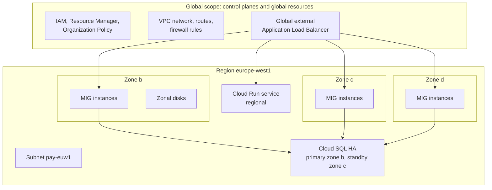

The failure-domain map shows what each failure removes. Losing zone `b` removes one third of the MIG instances, the zonal disks in `b`, and the Cloud SQL primary, which fails over to the standby in `c`. The subnet, the Cloud Run service, and the load balancer survive because they are regional or global. Losing the whole region removes everything in the `REG` box. The global resources survive, but they now route to nothing unless a second region exists. A global misconfiguration, such as a bad firewall rule or IAM change, can affect every region at once, which is why global resources need the strictest change control even though they rarely fail on their own. Google's infrastructure reliability guidance describes these choices as deployment archetypes (zonal, regional, multi-regional, global) with increasing resilience and cost.

### 12.3 Control plane and data plane

Each service has a control plane, which creates and changes resources through APIs, and a data plane, which serves workload traffic. They can fail independently. During a regional control-plane incident, existing VMs may keep serving while new VMs cannot be created, so autoscaling and recovery stall. Recovery designs that depend on creating resources during an incident depend on the control plane being healthy at the worst moment. Pre-provisioned capacity, such as running standby instances or a warm regional replica, depends only on the data plane. That difference is often the deciding factor between "pilot light" and "warm standby" recovery tiers.

### 12.4 Worked zonal-failure capacity

A stateless API needs 1,200 virtual CPUs (vCPUs) at peak to meet its latency objective. It runs in a regional MIG across three zones.

- To survive the loss of one zone at peak, the remaining two zones must carry 1,200 vCPUs, so each zone needs 600 vCPUs.
- Provisioned: 3 × 600 = 1,800 vCPUs, which is 50% over peak.
- With only two zones, each zone must carry the full 1,200, so 2,400 vCPUs total, 100% over peak.
- With four zones, each carries 400 and the total is 1,600, about 33% over peak.

If instead the team relies on autoscaling to replace the lost zone's capacity, provisioned capacity can stay near 1,200, but recovery then depends on the regional control plane, the remaining zones having physical capacity, and regional quota (section 14). Autoscaler warm-up delays add minutes during which latency objectives are missed. The [Compute chapter](CH04_Compute.md) owns autoscaling and placement mechanics.

**Quality scenario, zonal failure.**

- **Stimulus:** zone `europe-west1-b` becomes unavailable at peak.
- **Expected response:** load balancer health checks remove `b` instances; Cloud SQL fails over to `c`; the MIG recreates the lost capacity in `c` and `d` as quota and physical capacity allow.
- **Measurable success:** error rate above 1% lasts under 2 minutes; 95th-percentile (p95) latency stays within the objective after failover; no committed transactions lost (Cloud SQL HA uses synchronous replication to the standby's disk).

## 13. Compute and storage service families

The service catalog is large, but most architectures use a handful of families. This section places each in the scope and responsibility model. The owning chapters teach how to select and operate them.

### 13.1 Compute

| Service | Scope | You operate | Google operates | Owner chapter |
|---|---|---|---|---|
| Compute Engine VMs and MIGs | Zonal VMs, zonal or regional MIGs | Guest operating system (OS), patching, agents, images, scaling policy | Hypervisor, hosts, live migration for maintenance | [Compute](CH04_Compute.md) |
| GKE Standard | Zonal or regional cluster | Node pools, node sizing, workloads, upgrades policy | Control plane | [Kubernetes](CH08_Kubernetes.md) |
| GKE Autopilot | Regional cluster | Workloads and their requests | Control plane and nodes | [Kubernetes](CH08_Kubernetes.md) |
| Cloud Run services and jobs | Regional | Container image, concurrency, scaling bounds, identity | Servers, scaling infrastructure, request routing | [Containers](CH07_Containers.md), [Serverless](CH11_Serverless.md) |
| Cloud Run functions | Regional | Function code, triggers, identity | Runtime and scaling | [Serverless](CH11_Serverless.md) |
| App Engine | Regional, one region per project fixed at creation | App code and configuration | Runtime and scaling | [Serverless](CH11_Serverless.md) |
| Batch | Regional jobs on Compute Engine VMs | Job definitions, images | Scheduling and VM lifecycle | [Compute](CH04_Compute.md) |

Compute Engine offers machine families for general-purpose, compute-optimized, memory-optimized, storage-optimized, and accelerator-optimized workloads, and Spot VMs for interruptible capacity at lower price. Cloud Functions was renamed Cloud Run functions in 2024, and Google positions it as part of Cloud Run. An App Engine application's region cannot be changed after creation, which is a notable exception to the "region is a property of each resource" rule and a reason to choose the region carefully.

### 13.2 Storage and data

| Service | Location types | Durability or availability model | Owner chapter |
|---|---|---|---|
| Persistent Disk, Hyperdisk | Zonal, or regional with synchronous replication across two zones | Block storage independent of the VM lifecycle; snapshots stored regionally or multi-regionally | [Storage](CH06_Storage.md) |
| Local SSD | Zonal, attached to a host | Ephemeral; data lost when the VM stops or the host fails | [Storage](CH06_Storage.md) |
| Filestore | Zonal or regional tiers | Managed Network File System (NFS) | [Storage](CH06_Storage.md) |
| Cloud Storage | Region, dual-region, multi-region | Objects in classes Standard, Nearline, Coldline, Archive | [Storage](CH06_Storage.md) |
| Cloud SQL, AlloyDB | Regional, with optional cross-region replicas | Managed relational engines with zonal or HA configurations | [Storage](CH06_Storage.md) and Part 06 |
| Spanner | Regional or multi-region instance configurations | Globally distributed relational database with synchronous replication | Part 06 |
| Bigtable, Firestore | Regional or multi-region options | Wide-column and document stores | Part 06 |
| BigQuery | Regional or multi-region datasets | Serverless analytics warehouse | Part 06 |

Two scope facts drive many designs. Cloud Storage bucket location is fixed at creation; moving data to a new location means a new bucket and a transfer. A BigQuery query cannot join datasets in different locations, so dataset location becomes an architectural constraint for analytics.

## 14. Quotas and capacity

### 14.1 Quota types

Google Cloud quotas limit how much of a resource a project (or folder, or organization) can use. The [Cloud Quotas overview](https://docs.cloud.google.com/docs/quotas/overview) defines three types.

- **Allocation quotas** limit how much of a resource you hold, such as the number of N2 vCPUs in a region, in-use external IP addresses, or SSD disk gigabytes. They are released when you delete the resource.
- **Rate quotas** limit consumption over time, such as API requests per minute per project. They reset when the period resets. Per-day quotas reset at midnight Pacific Time; per-minute quotas use a rolling window.
- **Concurrent quotas** limit how many long-running operations run at once, such as concurrent Compute Engine insert operations.

Quotas also have a hierarchy level and a location dimension.

- **Level:** most quotas are per project, so usage in one project does not affect another. Some are per folder or per organization, where children's usage adds up. A few are per user or service account, such as project creation.
- **Location:** a quota can be global, regional, or zonal. A resource can have both a regional and a zonal quota, so using capacity in zone `b` reduces the regional pool available to zones `c` and `d`.

**System limits** are fixed constraints, such as maximum object size, that cannot be raised. Quota values can be adjusted by request; most requests are evaluated automatically against undisclosed criteria, some go to human review, and some increases may require prepayment. The quota adjuster can request increases automatically for projects with enough usage history.

### 14.2 Quota is not capacity

A quota is permission to ask. It is not a reservation. If a zone has no physical capacity for a machine type, creation fails with a resource-exhausted error even with plenty of quota. Capacity guarantees come from **reservations**, which are zonal and reserve specific machine types (and are billed whether used or not), and from future reservations for planned events. Critical recovery and peak events need both: enough quota and reserved or proven capacity.

### 14.3 Worked headroom calculation

A retail API runs on N2 VMs with 16 vCPUs each in a regional MIG in `europe-west1`. The project's approved regional N2 vCPU quota is 2,400 (a value assumed for this example; real values vary by project and are visible in the Quotas page).

- Normal load: 40 instances × 16 = 640 vCPUs, 27% of quota.
- Promotion forecast: 4× normal, 160 instances × 16 = 2,560 vCPUs. That exceeds 2,400. The autoscaler stops at 2,400 ÷ 16 = 150 instances, 10 short.
- A rolling update during the promotion with a surge of 20% of 160 instances adds 32 instances, 512 vCPUs, for a peak of 3,072 vCPUs.
- Zonal headroom: if zone `b` fails, the MIG recreates its instances in `c` and `d`. Regional quota is unchanged, but those two zones must have the physical capacity.

The plan is to request 3,200 N2 vCPUs (3,072 plus about 4% margin) at least two weeks before the event, freeze rolling updates during the promotion window, buy zonal reservations for the 120 instances above baseline split across the three zones, and add monitoring on the quota usage metric with alerts at 70% and 90%. Also check every other quota the scale-out consumes: in-use IP addresses for the new instances, SSD or Hyperdisk capacity, and the Compute Engine API's rate quotas, which the autoscaler, Terraform, and monitoring tools all draw on in the same project.

**Quality scenario, quota during scale-out.**

- **Stimulus:** traffic reaches 4× normal in 10 minutes.
- **Expected response:** the MIG scales to 160 instances without quota or capacity errors; the load balancer spreads load across three zones.
- **Measurable success:** zero `QUOTA_EXCEEDED` or resource-exhausted errors in the MIG's operation logs; peak quota usage below 90%; p95 latency within objective after a 5-minute warm-up.

### 14.4 Quotas and project design

Because quotas are per project by default, project boundaries are also quota boundaries. A batch analytics job and a customer-facing API in one project share regional CPU quota, so a runaway batch job can block API scale-out. Putting them in separate projects gives each its own quota. The reverse also applies. A recovery region in a new project starts with default quotas, which may be far below production values. Disaster recovery readiness therefore includes requesting matching quota in the recovery project and region in advance and testing that requests succeed.

## 15. Shared responsibility, shared fate, and support

### 15.1 Responsibility by service type

Google is responsible for the security and operation of its infrastructure: facilities, hardware, the network backbone, hypervisors, and the services' own control planes. Customers are responsible for what they configure and put into the services. Where the line falls depends on the service.

| Responsibility | Compute Engine | GKE Standard | GKE Autopilot | Cloud Run | Cloud SQL | BigQuery |
|---|---|---|---|---|---|---|
| Facilities, hardware, hypervisor | Google | Google | Google | Google | Google | Google |
| Guest OS or node patching | Customer | Shared: Google ships node images, customer sets upgrade policy | Google | Google | Google | Google |
| Runtime, database engine patching | Customer | Customer for workloads | Customer for workloads | Google for platform, customer for image | Google, in maintenance windows customer chooses | Google |
| Scaling configuration | Customer | Customer | Shared | Customer sets bounds | Customer sizes the instance | Google, customer manages slots or on-demand limits |
| High availability configuration | Customer: MIG, zones | Customer: regional cluster, pod spread | Customer: pod spread | Regional by default | Customer chooses HA | Google within dataset location |
| Backup and recovery | Customer | Customer | Customer | Customer for state elsewhere | Customer configures, Google runs | Customer configures time travel and copies |
| IAM, network policy, data classification, application code | Customer | Customer | Customer | Customer | Customer | Customer |

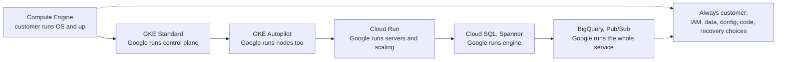

The spectrum reads left to right as Google taking over more operational layers. The dotted lines mark what never moves: identity and access, data and its classification, configuration choices, code, and recovery decisions stay with the customer at every point. The implication for architects is that a move to the right buys less toil but also less control. Cloud Run removes OS patching but fixes the maximum request timeout, concurrency model, and networking options to what Cloud Run supports. BigQuery removes capacity planning but makes cost control a matter of query governance. Record which operations you transferred and which constraints you accepted.

### 15.2 Shared fate

Google describes its stance as **shared fate** rather than shared responsibility alone ([shared responsibility and shared fate](https://docs.cloud.google.com/architecture/framework/security/shared-responsibility-shared-fate)). In practice the term covers concrete offerings: secure-by-default organization baselines (section 3.3), the enterprise foundations blueprint and other Terraform blueprints with security controls enabled, Well-Architected Framework guidance, Assured Workloads for regulated control packages, and the Risk Protection Program that connects customers with cyber insurers using posture evidence.

Shared fate does not move accountability. If your Cloud Storage bucket is public because someone granted `allUsers` read access, Google's secure defaults may have made that harder, but the data and the decision remain yours. Treat shared fate as better starting points and tooling, and still write down which controls you own.

### 15.3 Support model

Google Cloud Customer Care is sold in tiers. At the time of writing they are Basic (billing and documentation support), Standard (Priority 2 cases with a 4-hour first-response target), Enhanced (Priority 1 cases with a 1-hour first-response target), and Premium (Priority 1 cases with a 15-minute first-response target, a Technical Account Manager, and additional proactive services). See the [Customer Care overview](https://docs.cloud.google.com/support/docs/overview) and verify current tiers and targets, since packaging changes.

Architectural points about support:

- **Support response targets are not service availability guarantees.** Availability commitments come from each service's Service Level Agreement (SLA), which defines a monthly uptime percentage and financial credits. Credits rarely approach business impact, so the SLA is an input to risk analysis, not a recovery plan.
- **Case access is IAM.** Opening and viewing cases uses roles such as Tech Support Editor and Tech Support Viewer. Grant them to the on-call group, or the people handling an incident will not be able to open a case.
- **Status signals.** The Google Cloud Service Health dashboard shows broad incidents; Personalized Service Health shows incidents affecting your projects and can feed alerts. Route both to the incident channel.
- **Essential Contacts** decide who receives security, technical, billing, and legal notifications per organization, folder, or project. Deletion notices, abuse reports, and security advisories go there. Set group addresses, not individuals.

## 16. Service placement decision

Placement is the decision that ties the chapter together: for a new workload, which folder, which project, which region and zones, which runtime, which network, and which perimeter. The order matters. Each step constrains the next.

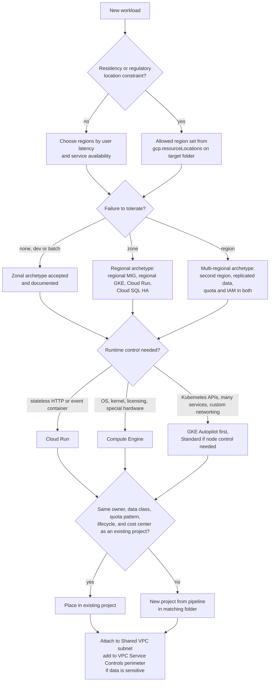

The decision tree shows the dependency chain. Location constraints come first because they are set by policy on the folder and cannot be negotiated per workload. Failure tolerance comes next because it decides whether the runtime and data must be regional or multi-regional. Runtime choice comes third and is driven by how much control the workload needs. Project placement follows from ownership and isolation, and the network and perimeter attachment come last because they follow from the project and data class. Teams that start with "we want GKE" and back-fill the rest commonly discover late that their data cannot live in the region they chose or that their project shares quota with a batch system.

### 16.1 Worked placement

A new payment-notification service receives events, calls a partner API, and stores delivery records. Requirements: EU residency, survive a zonal failure, recovery time objective (RTO) of 2 hours and recovery point objective (RPO) of 30 minutes for a regional disaster, stateless Hypertext Transfer Protocol (HTTP) and event handlers, team `payments`.

1. **Location:** the `payments-prod` folder allows `europe-west1` and `europe-west4`. Primary `europe-west1`, recovery `europe-west4`.
2. **Failure tolerance:** zonal tolerance from regional services. For a regional disaster, the recovery calculator in [04_recovery_cost_scenario.py](../code/python/gcp-chapter/04_recovery_cost_scenario.py) with RTO 2 hours and RPO 0.5 hours shows that backup and restore (10 hours, 4 hours) misses both, warm standby (1 hour, 0.25 hours, cost 4 units) meets them, and active-active (0.1 hours, 0.05 hours, cost 9 units) meets them at more than twice the cost. Warm standby is chosen.
3. **Runtime:** the selection matrix in [03_service_selection_matrix.py](../code/python/gcp-chapter/03_service_selection_matrix.py), with requirements runtime 4, event 5, network 4, simplicity 4, scores Cloud Run 34, GKE 28, and Compute Engine 25. Cloud Run is chosen after checking the scores against hard facts: request timeout fits, Direct VPC egress through the Shared VPC subnet is supported, and Pub/Sub push or Eventarc triggers fit the event source.
4. **Project:** the payments team already owns `pay-api-prod`, but delivery records are classified differently from card data in `pay-data-prod`, and the notification service has a spiky quota pattern. A new project `pay-notify-prod` is created by the pipeline under `payments-prod`, which inherits location, deny, and perimeter policy.
5. **Network and perimeter:** subnet `pay-notify-euw1` in `net-host-prod`, `compute.networkUser` for the service's deployers and the Cloud Run service agent, and membership in `pay-perimeter`. No perimeter egress rule is needed for the partner API, because partner calls are internet HTTPS (HTTP over Transport Layer Security) through Cloud NAT rather than Google API calls, which VPC Service Controls does not police. The delivery-records database is Cloud SQL HA in `europe-west1` with a cross-region replica in `europe-west4` for warm standby.

Scores from the matrix are a screening aid. The decision rests on the hard checks in step 3 and the recovery numbers in step 2, both recorded in the decision record.

## 17. Operations, audit, and quality scenarios

### 17.1 Audit logs as governance evidence

Every control in this chapter needs evidence that it worked. Cloud Audit Logs provide it in four categories, which the [Monitoring chapter](CH10_Monitoring.md) covers as part of the broader telemetry design.

- **Admin Activity** logs record configuration changes, such as IAM policy changes, resource creation, and Organization Policy updates. They are always on, cannot be disabled, and are not charged for.
- **Data Access** logs record reads of configuration and reads or writes of user data. They are off by default for most services (BigQuery is a notable exception) because they can be very large. Enable them selectively through audit configuration at the organization or folder for sensitive services, and budget for their volume.
- **System Event** logs record Google-initiated changes, such as live migration of a VM.
- **Policy Denied** logs record requests refused by a security policy, such as VPC Service Controls violations.

Admin Activity, System Event, and Policy Denied logs go to each project's `_Required` log bucket, which has a fixed retention that you cannot shorten. Other logs go to the `_Default` bucket with configurable retention. An **aggregated sink** at the organization with `includeChildren` routes logs from every project into a central `org-logging` project, where a locked retention policy prevents deletion even by that project's owners. The central project lives in the `common` folder, with read access for the security group and no write access for workload teams. Without the aggregated sink, an attacker who gains Owner on a project can delete that project, and its `_Default` logs go with it.

### 17.2 Asynchronous operations and drift

Most Google Cloud management calls return a long-running operation that completes later. Infrastructure-as-code tools poll these operations; when a multi-resource change fails halfway, some resources exist and others do not. Plans should be idempotent so that re-applying converges. Post-deployment checks should test the data path as the real workload identity, not just the success of the API call. A Cloud Run deployment can succeed while the service account lacks access to the secret it reads at start-up.

Drift happens when people change resources outside the pipeline. Admin Activity logs, Cloud Asset Inventory feeds, and scheduled plan runs detect it. For guardrails, Organization Policy and deny policies make some drift impossible rather than merely detectable.

### 17.3 The part-wide quality scenarios

The table collects the part-wide scenarios that apply to the Google Cloud operating model and points to where each is worked.

| Scenario | Stimulus | Primary controls | Success criterion | Worked in |
|---|---|---|---|---|
| Compromise contained by organizational boundaries | Contractor credentials misused against production | Project-per-workload, deny policy on deletion, lien, separate backup project | Blast radius limited to one project; no data loss; recovery under 1 hour | Section 5.5 |
| Credential theft and exfiltration | Leaked service account key used from internet | VPC Service Controls, PAB, key-creation constraint | Zero bytes exfiltrated; alert under 5 minutes | Section 10.4 |
| Zonal failure | Zone unavailable at peak | Regional MIG, Cloud SQL HA, N+1 zonal capacity | Errors above 1% for under 2 minutes | Section 12.4 |
| Quota limit during scale-out | 4× traffic in 10 minutes | Quota headroom, reservations, alerts | No quota errors; usage under 90% | Section 14.3 |
| Identity rotation | Replace a workload's service account | Parallel identity, traffic split, usage verification | Zero authorization failures; old identity unused before deletion | Below |
| Migration with reversible cutover | Move a service from a standalone VPC to Shared VPC | Parallel deployment, weighted load balancing, rollback window | Rollback in under 5 minutes at any step | Below |

**Identity rotation.** The service `shop-web` runs as `shop-web@shop-web-prod`, which was granted broad roles years ago. The team wants a new, least-privilege service account.

- **Stimulus:** the old service account is to be retired.
- **Response:** create `shop-web-v2`, grant only the roles the IAM recommender shows as used in the last 90 days, deploy a new Cloud Run revision with the new identity, and split 10% of traffic to it. Watch for `PERMISSION_DENIED` in logs. Move to 100% over a day, then disable (not delete) the old account, and delete it after 30 days without authentication events.
- **Measurable success:** zero authorization errors attributable to the new identity at 100% traffic; the old account shows no authentication in its usage metrics for 30 days before deletion; rollback is one traffic-split command. The [IAM chapter](CH09_IAM.md) covers credential rotation and the [Secrets Management chapter](CH13_Secrets_Management.md) covers key rotation with overlapping versions.

**Migration with reversible cutover.** An older service runs in project `legacy-orders` with its own auto-mode VPC. It must move to `orders-prod`, a service project on the Shared VPC.

- **Stimulus:** the network team retires standalone VPCs.
- **Response:** deploy the service in `orders-prod` on a Shared VPC subnet; place both deployments behind one global external Application Load Balancer using a backend service per environment with weighted traffic; shift 5%, 25%, 50%, then 100% over a week, with automated rollback if error rate exceeds 0.5%. Keep `legacy-orders` running for 14 days after 100%, with a lien to prevent premature deletion.
- **Measurable success:** each traffic step can be reversed in under 5 minutes; error rate and p95 latency at 100% within 5% of baseline; no data divergence, because the database is shared and moves separately in its own migration. The [Cloud Migration chapter](CH16_Cloud_Migration.md) owns wave planning and data cutover.

## 18. Provider comparison

Similar product names hide different guarantees and scopes. The table compares the governance and scope properties that change designs, not product lists. The [AWS](CH01_AWS.md) and [Azure](CH02_Azure.md) chapters teach their columns.

| Property | Google Cloud | AWS | Azure |
|---|---|---|---|
| Hierarchy root tied to identity | Organization, 1:1 with a Workspace or Cloud Identity customer | Organization with a management account; workforce identity through IAM Identity Center | Microsoft Entra tenant with a tenant root management group |
| Grouping levels | Folders, up to 10 levels at the time of writing | Organizational units (OUs) | Management groups, then subscriptions, then resource groups |
| Primary isolation unit | Project | Account | Subscription, with resource groups for lifecycle grouping |
| Billing linkage | Project linked to a separate billing account, changeable | Account belongs to the organization's consolidated billing | Subscription linked to a billing account and billing profile or invoice section |
| Inherited permission grants | Union of allow policies down the tree; a lower level cannot revoke | No inherited grants from OUs; IAM is per account | Azure role-based access control (RBAC) assignments inherited down scopes; lower scope cannot revoke |
| Permission guardrail above admins | Deny policies on organization, folder, project; PAB policies on principal sets | Service control policies and resource control policies on OUs and accounts | Deny assignments, created only by Azure-managed features |
| Configuration guardrail | Organization Policy constraints, including custom constraints | Mix of service control policies with conditions, AWS Config rules, and other control features | Azure Policy with deny, audit, and modify effects |
| API data perimeter | VPC Service Controls perimeters | Condition keys in policies plus VPC endpoint policies | Private Link plus network security perimeter where supported |
| Network scope | VPC is global | VPC is regional | Virtual network is regional |
| Subnet scope | Regional, spans zones | Zonal (one Availability Zone) | Regional, spans zones |
| Cross-team network sharing | Shared VPC host and service projects | VPC sharing through AWS Resource Access Manager | Hub-and-spoke peering or Virtual WAN |
| Central firewall hierarchy | Hierarchical firewall policies at organization and folders | AWS Firewall Manager across accounts | Azure Firewall Manager policy inheritance |
| Deletion safety for the isolation unit | 30-day restore window, liens, deny policies | Closed accounts have a post-closure period before permanent closure | Resource locks; canceled subscriptions have a retention period |
| Default quota scope | Per project, often regional or zonal | Per account per region | Per subscription per region |

Three rows deserve emphasis. Network and subnet scope differ in all three providers, so a translated design must change its failure-domain reasoning, not only its names. Inherited permission grants exist in Google Cloud and Azure but not between AWS accounts, which makes high-level grants in Google Cloud far more consequential than an equivalent-looking OU attachment in AWS. And Google Cloud's billing link is independent of the resource tree, while AWS ties billing to the account's organization membership.

## 19. Case study: Alder Insurance moves to Google Cloud

This case study is a composite built to apply the chapter's reasoning end to end. The organization and numbers are illustrative.

### 19.1 Context and requirements

Alder Insurance is a European insurer with three business units: Personal Lines, Commercial Lines, and Claims. It runs 30 applications on premises and plans to move them to Google Cloud over 18 months. Its constraints:

- Policyholder and claims data must stay in the EU. Claims data includes health information and is subject to stricter access rules.
- The insurance regulator expects evidence of access reviews, change control, and tested recovery for critical systems.
- Identity is Microsoft Entra ID; the security team will not run a second user directory.
- Finance wants monthly showback per business unit and per application within 2% of the invoice.
- Critical systems (policy administration, claims intake) need RTO 4 hours and RPO 15 minutes for a regional disaster, and must tolerate a zonal failure without manual action.

### 19.2 Decisions

**Identity and organization.** Alder creates a Cloud Identity Free account for `alder.example`, provisions users and groups from Entra ID with SCIM, and federates sign-in with SAML. Three super admin break-glass accounts use hardware keys and authenticate directly with Google. Day-to-day cloud administration runs through groups. *Rejected:* Workforce Identity Federation without synchronization. It met the "no second directory" wish more literally, but at the time of decision several products the teams needed had partial support for workforce identities. SCIM provisioning keeps Entra ID as the source of truth while giving Cloud Identity accounts that every product recognizes. *Rejected:* one organization per business unit. Claims needed stricter controls, but a folder with its own policies achieves that without breaking folder inheritance and domain-restricted sharing.

**Hierarchy.** Environment-first with a regulated split, as in section 4.3: `common`, `prod`, `nonprod`, `sandbox`, and under `prod` a `claims-prod` folder. The test for each folder holds: `claims-prod` differs in perimeter membership, Data Access logging, and allowed groups; `sandbox` differs in budgets and cleanup.

**Projects.** One project per application per environment, plus separate data projects for the two claims applications. Project IDs follow `{app}-{env}-{4 hex}`. The pipeline service account creates projects, enables an allow-listed set of APIs, links billing, sets Essential Contacts, binds tags `env` and `bu`, attaches to Shared VPC, and places a lien on production projects. The domain-wide Project Creator and Billing Account Creator grants are removed on day one. Projected count: 30 × 3 environments + 2 data projects + 8 platform projects = 100 projects.

**Billing.** One invoiced billing account with the export to a BigQuery dataset in the `EU` multi-region, enabled on the first day for backfill. Attribution uses project as the primary key, and labels `app` and `cc` on resources for finer splits. Shared network and security costs are allocated by byte share and by project count as in section 6.6. *Rejected:* one billing account per business unit. It would have made business-unit totals trivial but complicated commitments, which pool better on one account, and the project key already gives business-unit totals.

**IAM.** Groups only, granted at project level or lower. No basic roles in production. A deny policy at the organization blocks project deletion on `env=prod` except for the break-glass group, and another blocks service account key creation as defense in depth over the Organization Policy constraint. A PAB policy binds the organization's principal set to the organization, with additions for two partner projects and Google's public datasets. It ran for four weeks with the binding scoped by `principal.subject` to the platform team before widening.

**Organization Policy.** The baseline from section 9.6, with `gcp.resourceLocations` set to `in:eu-locations` at the organization and to `in:europe-west3-locations` and `in:europe-west4-locations` on `prod`. All constraints ran in dry run for 30 days before enforcement. The dry run found 14 VMs with external IPs in migrated test projects, which were moved behind IAP before enforcing.

**Perimeter.** A VPC Service Controls perimeter around all `claims-prod` projects restricting Cloud Storage, BigQuery, Cloud SQL, Secret Manager, and Cloud KMS. Access level: the corporate egress range. Ingress rule for the CI/CD service account from the build project. It ran six weeks in dry run, which found three violations: the CI/CD pipeline, a log export to the central logging project, and a nightly analytics copy. Each became an explicit ingress or egress rule. *Rejected:* one perimeter around all of production. It would have protected more data but required many more exceptions for non-claims applications that integrate with external services, increasing breakage risk for little benefit.

**Network.** Two Shared VPC hosts (production and non-production), custom mode, with subnets per service project in `europe-west3` (Frankfurt) and `europe-west4` (Netherlands). Global dynamic routing so that both regions learn on-premises routes from Cloud Routers in each region. Hierarchical firewall policy at the organization denies internet ingress to administrative ports and allows IAP and health checks; network firewall policies with secure tags govern application rules. Private Google Access and `restricted.googleapis.com` DNS in claims subnets. *Rejected:* VPC per project with peering. With 100 projects and on-premises connectivity required by most, non-transitive peering would have needed either many hybrid attachments or a hub product, and central firewall ownership was a regulatory expectation.

**Placement and recovery.** Policy administration runs on GKE Autopilot (regional) in `europe-west3`, with Cloud SQL HA and a cross-region replica in `europe-west4`. Claims intake runs on Cloud Run with Cloud SQL HA and a replica. Both use warm standby in `europe-west4`: Autopilot cluster and Cloud Run services deployed and scaled to minimum, with quota pre-approved in the recovery projects. *Rejected:* active-active. It would have met RTO in minutes but needed multi-writer data handling that the policy administration application does not support.

**Support.** Enhanced Support for the first year, with a review against Premium after the critical systems migrate. The on-call group holds Tech Support Editor on the organization, and Personalized Service Health alerts route to the incident channel.

### 19.3 Validation evidence

| Claim | Evidence |
|---|---|
| Guardrails enforced | Effective policy export for every production project; Policy Denied logs during a red-team test of external IP creation and cross-perimeter copy |
| Access reviewed | Quarterly Policy Analyzer report of who can access claims data, signed off by Claims data owners |
| Deletion protected | Test in a staging copy: project delete attempt by an Owner denied by deny policy; lien listed on all production projects |
| Zonal tolerance | Game day draining one zone of the Autopilot cluster and forcing Cloud SQL failover: errors above 1% for 70 seconds |
| Regional recovery | Failover exercise to `europe-west4`: RTO measured at 2 hours 10 minutes against 4-hour target; RPO 4 minutes of replication lag against 15-minute target |
| Quota | Load test at 3× forecast peak in the recovery projects with no quota errors |
| Cost attribution | Month 3 showback reconciles to 98.7% of the invoice by project, with the remaining 1.3% in unallocated support and tax lines |

The evidence table is the deliverable for the regulator and the design review. Each line maps a design claim to a test or an export someone can re-run.

## 20. Common mistakes and anti-patterns

**Treating the project as the billing account.** *Cause:* habits from providers where the isolation unit is also the billing unit. *Consequence:* billing links changed casually, projects unlinked by mistake, and production stopping when a sandbox billing account is disabled for non-payment.

**Granting roles at the organization "for convenience."** *Cause:* a team needs access to many projects. *Consequence:* union inheritance grants the role to every current and future project, including regulated ones, and no lower level can remove it.

**Using a lower-level policy to try to remove access.** *Cause:* expecting override semantics. *Consequence:* the inherited grant stays in force while the team believes it is gone.

**Leaving the domain-wide creator roles in place.** *Cause:* not knowing they exist. *Consequence:* projects and billing accounts appear outside the pipeline, without baselines, owners, or budgets.

**Encoding meaning in project IDs without a suffix.** *Cause:* wanting readable IDs. *Consequence:* collisions with IDs used anywhere in the world or by deleted projects, and inability to recreate a project with the same ID.

**Assuming project deletion is a soft delete for data.** *Cause:* knowing about the 30-day restore window. *Consequence:* objects and messages deleted sooner by their services, billing left unlinked after restore, and data lost.

**Enforcing a VPC Service Controls perimeter without dry run.** *Cause:* urgency after an audit finding. *Consequence:* broken pipelines, log exports, and service-agent access, followed by emergency rollback that erodes trust in the control.

**Using network tags as a security boundary.** *Cause:* tags are the easiest firewall target. *Consequence:* any instance editor can add a tag and open a path.

**Relying on Organization Policy to fix existing resources.** *Cause:* expecting retroactive enforcement. *Consequence:* old violations remain while dashboards show the constraint as enforced.

**Equating quota with capacity.** *Cause:* quota pages look like capacity reservations. *Consequence:* scale-out or recovery fails with resource-exhausted errors in a zone that has no capacity for the machine type.

**Treating a global VPC as a resilience feature.** *Cause:* "global" sounds like "highly available." *Consequence:* single-region data and compute behind a global network fail with their region.

**One giant project.** *Cause:* starting small and never splitting. *Consequence:* shared quota, shared IAM, shared deletion fate, and cost attribution that relies entirely on labels.

**One project per microservice by reflex.** *Cause:* over-applying isolation. *Consequence:* hundreds of projects with identical owners and policies, cross-project wiring for every call, and governance overhead without isolation benefit.

## 21. Design-review checklist

Identity and organization:

- [ ] Super admins are two or three protected break-glass accounts, not daily users.
- [ ] Cloud roles are granted to groups sourced from the corporate directory.
- [ ] Domain-wide Project Creator and Billing Account Creator grants are removed.
- [ ] No projects exist without an organization parent.

Hierarchy and projects:

- [ ] Every folder differs from its siblings in at least one policy, grant, or quota.
- [ ] Each project boundary is justified by owner, data class, quota pattern, lifecycle, or cost center.
- [ ] Project IDs carry a suffix and contain nothing sensitive; inventory stores both ID and number.
- [ ] Projects are created by a pipeline that enables an approved API list and sets Essential Contacts.
- [ ] Production projects have liens and a deny policy on deletion with a break-glass exception.

Billing:

- [ ] Billing accounts have at least two administrators and a documented owner.
- [ ] The billing export is enabled, located deliberately, and stored in a protected project.
- [ ] Budgets exist per project or folder, with notification routing and a clear rule on automated action.
- [ ] Shared costs have a documented allocation driver.

IAM and policy:

- [ ] No basic roles in production; grants are at the lowest workable scope.
- [ ] Inherited bindings at folder and organization are reviewed, not only project bindings.
- [ ] Tag binding rights are restricted when tags drive IAM conditions or deny rules.
- [ ] PAB policies, if used, have a tested list of external resources and an explicit enforcement version.
- [ ] Organization Policy baseline is enforced at the organization; exceptions are tag-scoped rules with owners and expiry.
- [ ] Organization Policy Administrator is held only at the organization.

Data perimeter and network:

- [ ] Sensitive-data projects are in a VPC Service Controls perimeter whose membership is managed by the project pipeline.
- [ ] Perimeters went through dry run, and all ingress and egress rules are documented.
- [ ] VPC networks are custom mode with non-overlapping ranges across regions, peers, and on-premises.
- [ ] Shared VPC grants `compute.networkUser` on subnets, not the whole host project.
- [ ] Hierarchical firewall policy enforces organization-wide denies; security-relevant rules target service accounts or secure tags.

Location, quota, and support:

- [ ] Every critical resource's scope (global, regional, zonal) and failure behavior is documented.
- [ ] Zonal capacity is sized for N+1 zones or the autoscaling dependency is explicit.
- [ ] Quota headroom covers peak plus rollout surge, and recovery projects have matching quota.
- [ ] Reservations exist where capacity, not quota, is the binding constraint.
- [ ] Aggregated audit-log sink to a locked central bucket is in place, with Data Access logs on for sensitive services.
- [ ] Support tier matches criticality; on-call holds case-access roles; Personalized Service Health routes to incidents.

## 22. Exercises

### 22.1 Interview questions

1. A role granted on a folder gives a team access you no longer want in one child project. What are your options, and which do you choose?
2. Explain the difference between project ID, project number, and project name, and give a system that uses each.
3. How do IAM deny policies and principal access boundary policies differ in what they attach to and what they protect against?
4. A list constraint is set at the organization and at a folder with `inheritFromParent: true`. How is the effective policy computed, and what happens to a value that is allowed above and denied below?
5. Why might a request that IAM allows still fail with a VPC Service Controls error? How would you diagnose it?
6. Your VPC has subnets in two regions. What survives the loss of one region, and what does not?
7. A scale-out fails with plenty of quota remaining. What is the likely cause and the fix?
8. What does a project's 30-day deletion window protect, and what does it not?

### 22.2 Hands-on exercises with the code examples

1. Run [01_project_hierarchy_guardrails.py](../code/python/gcp-chapter/01_project_hierarchy_guardrails.py). It intersects allowed regions and unions required labels across the `organization` and `regulated` scopes, so `orders-prod` passes and `analytics-prod` fails on region `us-central1` and the missing `data_classification` label. Add a third scope that allows only `europe-west4` and explain why `orders-prod` then fails. Then compare the script's always-intersect rule with Organization Policy's real behavior, where a child without `inheritFromParent` replaces the parent.
2. Run [02_resource_scope_validator.py](../code/python/gcp-chapter/02_resource_scope_validator.py). Move the disk to `us-central1-a` and confirm the attachment passes. Add a regional disk model that is valid in two zones of a region and update the check.
3. Run [03_service_selection_matrix.py](../code/python/gcp-chapter/03_service_selection_matrix.py) with the default requirements, then for a long-running TCP service needing kernel tuning (raise `network_fit` and `runtime_fit` to 5, drop `event_fit` to 1). Explain why the ranking changes and which hard constraint the score cannot capture.
4. Run [04_recovery_cost_scenario.py](../code/python/gcp-chapter/04_recovery_cost_scenario.py) with RTO 12 hours and RPO 6 hours, then with RTO 0.5 hours and RPO 0.1 hours. Map each chosen option to a Google Cloud deployment archetype and list the quota and IAM prerequisites in the recovery region.

### 22.3 Design exercises

1. Design the hierarchy, billing, and IAM for a company with two regulated subsidiaries that may later be sold. Decide between one organization and several, and state what a divestiture would require in each case.
2. Write the deny policy, PAB policy, and Organization Policy set that together prevent production data from being copied to a personal project, and explain which layer stops which path.
3. Plan a migration of 50 projects from standalone VPCs to two Shared VPC hosts with reversible cutover per project, including address re-planning and firewall migration to hierarchical and network firewall policies.
4. A product needs an RTO of 15 minutes for a regional loss. Design placement across two regions, including quota, reservations, IAM in the recovery project, and the evidence you would present at review.

## 23. Summary

Google Cloud's operating model rests on four separate structures. The identity directory, a Workspace or Cloud Identity account, produces exactly one organization resource. The resource hierarchy of organization, folders, and projects carries IAM, deny policies, Organization Policy, tags, hierarchical firewall policies, and some quotas downward. The billing hierarchy links each project to one changeable billing account and is the system of record for attribution through the BigQuery export. The location model gives every resource a global, regional, or zonal scope that decides its failure domain.

Projects are the working unit: the namespace where APIs are enabled, the default quota pool, the attachment point for most grants, and a lifecycle with a 30-day deletion window that liens and deny policies should guard. IAM allow policies inherit as a union and cannot be revoked lower down. Deny policies and principal access boundary policies restrict from above and from the principal side. Organization Policy constrains configuration regardless of identity, with inheritance, merge, replace, and reset semantics. VPC Service Controls adds request context to API access. The global VPC with regional subnets, Shared VPC, and hierarchical firewall policies separate network ownership from workload ownership. Quota is permission rather than capacity. Under shared fate, Google provides stronger defaults and blueprints while customers still own identity, data, configuration, and recovery choices. The placement decision applies all of this in order: location policy, failure tolerance, runtime, project, then network and perimeter.

## 24. Code examples

Run with Python 3.10 or later from the repository root. The examples use only the standard library and synthetic data. They do not call Google Cloud APIs, need no credentials, and encode no current prices or quotas.

- [01_project_hierarchy_guardrails.py](../code/python/gcp-chapter/01_project_hierarchy_guardrails.py) computes an effective region allow list and required labels across inherited scopes and evaluates two projects against them, illustrating why effective policy must be computed from ancestors.
- [02_resource_scope_validator.py](../code/python/gcp-chapter/02_resource_scope_validator.py) models global, regional, and zonal resource scope and rejects a cross-zone disk attachment.
- [03_service_selection_matrix.py](../code/python/gcp-chapter/03_service_selection_matrix.py) scores Compute Engine, GKE, and Cloud Run against weighted workload requirements as a screening step before hard-constraint checks.
- [04_recovery_cost_scenario.py](../code/python/gcp-chapter/04_recovery_cost_scenario.py) filters backup and restore, warm standby, and active-active options by RTO and RPO targets and ranks those that pass by relative cost.

Further reading: [Google Cloud Well-Architected Framework](https://docs.cloud.google.com/architecture/framework), [Cloud Architecture](../10_Cloud_Architecture/PART_OVERVIEW.md), and [Cloud Identity and Access Architecture](../10_Cloud_Architecture/CH04_Cloud_Identity_and_Access_Architecture.md).
