# Chapter: Cloud Compute Selection and Operation

Part: [09 — Cloud Computing](PART_OVERVIEW.md) · Status: Revised (in-depth rewrite)

## 1. Introduction

Every cloud workload eventually runs on a processor that someone else owns, in a building someone else operates, reached through an application programming interface (API) that someone else designed. The compute decision is the choice of how much of that machinery the workload team sees and controls. At one end, a team rents a virtual machine (VM), installs an operating system (OS) image, and owns everything above the hypervisor. At the other end, a team uploads a function and the provider decides where, when, and on how many hosts it runs. Between those ends sit fleets of identical VMs, managed container platforms, and batch schedulers, each moving a different set of responsibilities from the customer to the provider.

This chapter teaches how to select and operate compute on Amazon Web Services (AWS), Microsoft Azure, and Google Cloud Platform (GCP, also called Google Cloud). After reading it you should be able to:

- Place a workload on the compute abstraction spectrum and justify why a higher or lower abstraction was rejected.
- Read an instance shape and predict which resource will bottleneck first: virtual central processing units (vCPUs), memory, network bandwidth, local storage, or an accelerator.
- Design an image pipeline and bootstrap path that produce identical, verifiable instances, and protect the instance metadata service from credential theft.
- Operate a fleet: launch templates, rolling replacement, health checks, and connection draining.
- Tune an autoscaler as a feedback controller, including warm-up, cooldown, bounds, warm pools, and protection for downstream dependencies, and reason through its timing with real numbers.
- Map instances onto failure domains (zones, racks, hosts) so that the loss of any one domain leaves enough capacity.
- Buy capacity sensibly: on-demand, commitments, capacity reservations, and interruptible (Spot or preemptible) capacity.
- Predict and handle quota and capacity errors during scale-out.
- Assign patching and OS responsibility, and explain the pricing dimensions that make up a compute bill.

### 1.1 Scope and ownership boundaries

This chapter owns cloud compute service-model selection, shape-to-workload matching, capacity procurement trade-offs, autoscaling as a capacity feedback controller, image and fleet lifecycle, and placement across failure domains. Several adjacent topics are owned elsewhere and are recapped here only as far as compute decisions need them:

- Hypervisors, hardware-assisted virtualization, namespaces, cgroups, and microVMs are taught in [Virtualization and Container Fundamentals](../05_Networking_and_OS/CH28_Virtualization_and_Container_Fundamentals.md). This chapter assumes you know that a VM runs its own guest kernel on a hypervisor and a container shares the host kernel.
- Container registries and managed container services are taught in [Containers](CH07_Containers.md). Managed Kubernetes control planes and node pools are taught in [Kubernetes (cloud-managed)](CH08_Kubernetes.md). Function invocation, concurrency, and cold starts are taught in [Serverless](CH11_Serverless.md).
- Workload identity and role assumption are taught in [Identity and Access Management (IAM)](CH09_IAM.md). Commitment utilization risk and cost allocation are taught in [Cost Optimization](CH14_Cost_Optimization.md).
- Load-balancer health checking, connection draining, and slow start are taught in [Load Balancer](../05_Networking_and_OS/CH10_Load_Balancer.md).
- Composed runtime architecture across providers is owned by [Compute Placement and Runtime Architecture](../10_Cloud_Architecture/CH05_Compute_Placement_and_Runtime_Architecture.md) in Part 10, and resilience and disaster recovery architecture by [Resilience, Availability, and Disaster Recovery Architectures](../10_Cloud_Architecture/CH09_Resilience_Availability_and_Disaster_Recovery_Architectures.md).

Provider limits, defaults, and product names change often. Where this chapter quotes a number, it is the value documented at the time of writing; verify current quotas and defaults in the linked provider documentation before relying on them.

## 2. The compute abstraction spectrum

### 2.1 What actually changes along the spectrum

It is tempting to describe compute services as "more managed" or "less managed". That phrase hides the decisions that matter. Moving along the spectrum changes six concrete properties at once:

1. **Unit of deployment.** A disk image, a container image, a function package, or a job definition.
2. **Unit of scaling.** A VM, a container task or replica, a function execution environment, or a batch worker.
3. **Startup path and time.** A VM boots a kernel, runs bootstrap scripts, and starts the application, which usually takes tens of seconds to several minutes. A container on already-running capacity starts in seconds. A function execution environment may already be warm, or may need a cold start.
4. **Control surface.** Whether the team can choose the kernel, install agents, load kernel modules, pin processor features, attach arbitrary disks, or open arbitrary ports.
5. **Responsibility for patching and capacity.** Who patches the guest OS, who replaces failed hosts, and who decides how much spare capacity exists.
6. **Billing unit.** Per VM-second, per vCPU-second and gigabyte-second of a task, per request plus per gigabyte-second of a function, or per job's worker time.

The diagram below arranges the common forms along that spectrum. The arrow is not a ranking. It shows the direction in which control and operating burden both shrink.

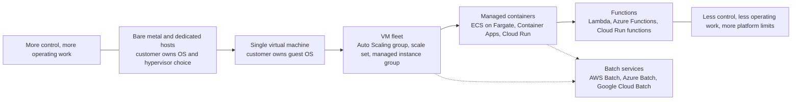

Bare metal sits at the far left: the customer gets a whole physical server and may run its own hypervisor. A single VM gives guest-OS control on a shared or dedicated host. A VM fleet adds a controller that keeps a desired count of identical VMs alive, replaces failures, and scales. Managed containers remove the VM from the customer's view; the customer supplies a container image and resource request. Functions remove even the long-running process; the platform invokes code per event. Batch services are drawn as a side branch because they are a scheduling layer that sits on top of VM fleets or containers: they own the queue of jobs and the lifecycle of workers, not a new kind of execution.

The practical implication is that the spectrum is a set of trade-offs rather than a maturity ladder. A team should pick the rightmost point that satisfies its hard constraints, because each step to the right removes routine work (patching, capacity math, host replacement). It should stop as soon as a step to the right would violate a constraint such as a custom kernel module, a 40-minute request, a licensed host, or a graphics processing unit (GPU) driver version.

### 2.2 The forms in more detail

**Virtual machines.** Amazon Elastic Compute Cloud (EC2) instances, Azure Virtual Machines, and Google Compute Engine instances. The customer picks a shape (instance type, VM size, or machine type), an image, disks, network interfaces, and an identity. The provider operates the physical host, the hypervisor, and the virtual hardware. The customer operates the guest OS, every agent on it, and the application. A single VM is a single failure unit: if its host fails, the provider may restart it elsewhere (AWS automatic recovery, Azure service healing, Compute Engine automatic restart), but the workload is down during that restart.

**VM fleets.** EC2 Auto Scaling groups, Azure Virtual Machine Scale Sets, and Compute Engine managed instance groups (MIGs). The fleet controller holds a desired count and a template. It launches instances to reach the count, replaces instances that fail health checks, spreads them across zones, and changes the count when a scaling policy asks. Fleets are the unit you should design with for any production VM workload, even a fleet of two, because they turn "a VM died" from an incident into a routine replacement.

**Managed containers.** Amazon Elastic Container Service (ECS) with AWS Fargate, Azure Container Apps and Azure Container Instances, and Google Cloud Run. The customer supplies a container image, central processing unit (CPU) and memory requests, and scaling rules. The provider runs the hosts and their OS. These are taught in depth in [Containers](CH07_Containers.md). Managed Kubernetes services (Amazon Elastic Kubernetes Service (EKS), Azure Kubernetes Service (AKS), Google Kubernetes Engine (GKE)) sit between fleets and managed containers: the provider runs the control plane, and depending on the mode (for example GKE Autopilot or EKS Auto Mode) either the customer or the provider operates the worker nodes. See [Kubernetes (cloud-managed)](CH08_Kubernetes.md).

**Functions.** AWS Lambda, Azure Functions, and Cloud Run functions. The customer supplies code and a trigger; the platform creates execution environments on demand and bills per invocation and duration. Functions impose hard execution limits (for example, Lambda's maximum timeout of 15 minutes at the time of writing) and their own concurrency model. These mechanics belong to [Serverless](CH11_Serverless.md); this chapter only uses functions as a point of comparison.

**Batch.** AWS Batch, Azure Batch, and Google Cloud Batch accept job definitions, queue them, provision workers (often a mix of on-demand and Spot), run the jobs with retries, and tear workers down. Batch is the right abstraction when work arrives as discrete, independent, retryable jobs with no user waiting on a socket. It removes the need to write your own queue-driven autoscaler and Spot replacement logic, which section 7 and section 9 show is harder than it looks.

**Bare metal and dedicated hosts.** AWS offers `.metal` instance sizes and Dedicated Hosts; Azure offers Azure Dedicated Host (a physical server reserved for your VMs) and specialized bare-metal offerings for specific workloads; Google Cloud offers bare-metal machine types in some series and sole-tenant nodes. Two different needs drive this choice. The first is access to hardware features a hypervisor hides, such as hardware performance counters or running your own nested hypervisor. The second is host-level isolation or licensing, where a contract requires that no other tenant shares the physical server or that licenses are counted per physical socket or core. These are different products with different guarantees. A dedicated host still runs the provider's hypervisor; a bare-metal instance does not.

### 2.3 Responsibility by form

The following table makes the responsibility split explicit. "Customer" means the workload or platform team; "Provider" means the cloud provider.

| Responsibility | Bare metal | VM | VM fleet | Managed containers | Functions | Batch |
|---|---|---|---|---|---|---|
| Physical host and replacement | Provider | Provider | Provider | Provider | Provider | Provider |
| Hypervisor | Customer (optional) or none | Provider | Provider | Provider | Provider | Provider |
| Guest OS image and patching | Customer | Customer | Customer | Provider | Provider | Customer (VM workers) or provider (container workers) |
| Replace failed instances | Customer | Customer, with provider auto-recovery for host faults | Fleet controller, configured by customer | Provider | Provider | Batch service |
| Capacity count and scaling policy | Customer | Customer | Customer policy, provider controller | Customer rules, provider execution | Provider, within customer concurrency limits | Batch service, within customer bounds |
| Runtime and libraries | Customer | Customer | Customer | Customer (container image) | Shared: provider runtime, customer code and layers | Customer |
| Application and data | Customer | Customer | Customer | Customer | Customer | Customer |

Two rows deserve emphasis. First, the "guest OS image and patching" row flips from customer to provider at managed containers. That one change removes the largest recurring compute toil for most teams, and is the main reason to move right on the spectrum. Second, the "capacity count" row never becomes fully the provider's problem. Even a function has a concurrency limit you must set to protect a database, and even a managed container platform has a maximum replica count. Somebody always owns the decision of how much load the workload is allowed to put on its dependencies.

### 2.4 Worked example: what does moving right remove?

Consider a stateless internal API running on a fleet of 12 VMs across three zones. The team measured last quarter's operating work:

- Monthly OS patch cycle: build a new image, test, roll the fleet. About 6 engineer-hours per month.
- Agent upgrades (logging, security, monitoring): about 2 hours per month.
- Fleet incidents (bad image, disk full, kernel regression): two incidents per quarter at about 5 hours each, so about 3.3 hours per month.
- Capacity reviews and shape changes: about 1 hour per month.

That totals about 12.3 engineer-hours per month for 12 VMs. Moving to a managed container service removes the patch cycle, most agent work, and the host-level incidents, perhaps 10 of those hours. It adds new work: container image builds (which the team already needed for local development), platform limit reviews, and learning a new deployment model. It also changes cost. The managed container platform charges per vCPU-second and gigabyte-second of each task, which is typically priced above an equivalent VM. If the API averages 30% CPU utilization on its VMs, though, the container platform can pack it into fewer billed resources, because the team pays for requested task size rather than whole VMs.

The decision is not settled by the hours alone. It is settled by checking whether any hard constraint blocks the move (section 16 gives the full decision tree). If the API needs a kernel module for a hardware security device, the VM fleet stays. If it does not, the removed toil is usually worth more than the price difference.

## 3. Instance shapes and workload matching

### 3.1 Anatomy of a shape

A shape is a bundle of resources sold together: vCPUs, memory, maximum network bandwidth, maximum attached-storage throughput, optional local disks, optional accelerators, and a processor generation. Providers organize shapes into **families** (the resource ratio and purpose), **generations** (the hardware revision), and **sizes** (the multiple within a family).

Each provider encodes this differently:

- **AWS** instance types read as family letter, generation number, optional attribute letters, and size. In `m7g.2xlarge`, `m` is general purpose, `7` the generation, `g` an AWS Graviton (Arm) processor, and `2xlarge` the size (8 vCPUs). Attribute letters include `i` (Intel), `a` (AMD), `d` (local NVMe instance storage), `n` (enhanced networking), and `e` (extra memory or storage). Families include `m` (general), `c` (compute), `r` and `x` (memory), `i` and `d` (storage), `t` (burstable), `p` and `g` (GPU), `trn` (AWS Trainium), `inf` (AWS Inferentia), and `hpc` (high-performance computing).
- **Azure** VM sizes read as family, optional subfamily, vCPU count, additive feature letters, and version. In `Standard_D8ds_v5`, `D` is general purpose, `8` the vCPU count, `d` a local temporary disk, `s` premium storage support, and `v5` the version. `a` indicates AMD, `p` indicates an Arm processor (for example Azure Cobalt or Ampere), and `l` indicates lower memory per vCPU. Families include `B` (burstable), `D` (general), `F` (compute), `E` and `M` (memory), `L` (storage), `N` (GPU), and `H` (high-performance computing).
- **Google Cloud** machine types read as series, a predefined type, and vCPU count. In `n2-highmem-16`, `n2` is the series, `highmem` the memory ratio, and `16` the vCPU count. The `standard`, `highmem`, and `highcpu` suffixes encode memory per vCPU. Series include `e2` (cost-optimized, including shared-core types), `n2`, `n2d`, and `n4` (general), `c3`, `c4`, and `c4a` (compute-focused general purpose, with `c4a` on Google Axion Arm processors), `h3` (high-performance computing), `m3` (memory), `z3` (storage), and `a2`, `a3`, and `g2` (accelerators). Many series also allow **custom machine types**, where you choose vCPU and memory independently within the series' limits.

The naming is only a hint. Two shapes with the same vCPU count and memory can differ in clock speed, memory bandwidth, cache size, network ceiling, and disk throughput. Always read the provider's per-shape specification table and benchmark.

### 3.2 vCPU versus physical cores and simultaneous multithreading

A vCPU is the unit the hypervisor schedules, and on most x86 shapes it is **one hardware thread**, not one physical core. Modern Intel and AMD server processors use simultaneous multithreading (SMT, Intel's version is called Hyper-Threading), which presents two hardware threads per physical core. The two threads share the core's execution units, level 1 and level 2 caches, and branch predictors.

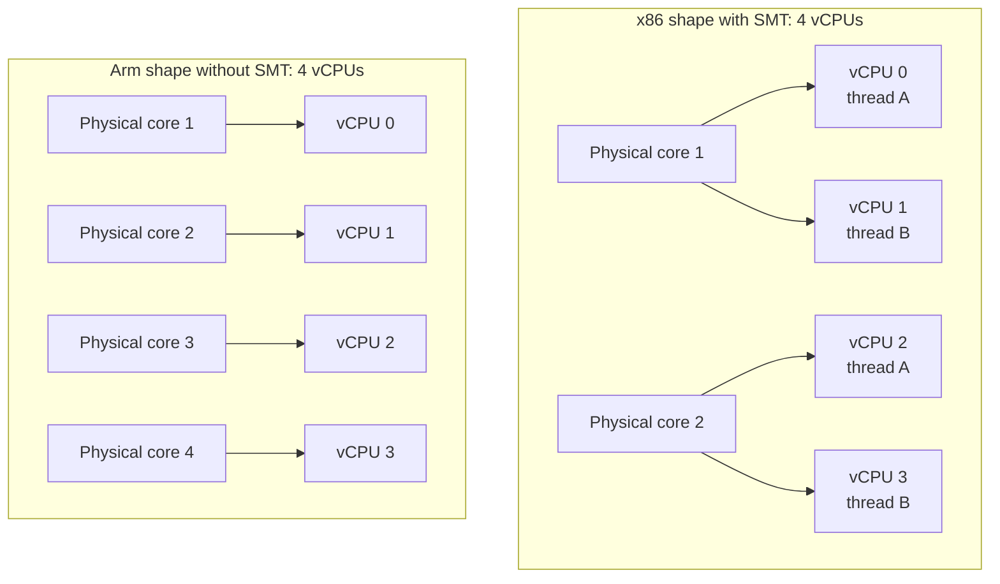

The diagram shows why "4 vCPUs" is not a fixed amount of compute. On the x86 shape, the four vCPUs come from two physical cores. On the Arm shapes offered by all three providers (AWS Graviton, Azure Cobalt 100 and Ampere-based sizes, Google Axion and Ampere-based Tau T2A), each vCPU is a full physical core, because those processors do not implement SMT. Some x86 high-performance computing shapes also disable SMT.

The consequences show up in three places:

- **Throughput per vCPU.** Two threads on one core typically deliver well under twice the throughput of one thread, because they compete for the same execution units. Compute-bound code that keeps the arithmetic units busy (encoding, compression, numerical loops) gains little from the second thread. Code that stalls often on memory or I/O gains more, because the second thread fills the stalls.
- **Benchmark translation.** A service that needs 16 vCPUs on an x86 SMT shape may need fewer vCPUs on an Arm shape, or the reverse, depending on the code. Never convert by vCPU count; convert by measured requests per second at your latency target.
- **Licensing.** Some software is licensed per physical core. All three providers let you control threads per core on many shapes: AWS calls this CPU options (you can set threads per core to 1 at launch), Google Cloud calls it the visible core count and threads-per-core setting, and Azure offers constrained-vCPU sizes that keep memory and bandwidth while exposing fewer vCPUs. Disabling SMT halves the vCPU count you are billed for on some licenses while keeping the instance price, which can be a large net saving for per-core licensed databases.

### 3.3 Memory per vCPU

The memory ratio is the most common reason a shape is wrong. Families are built around a ratio of gibibytes (GiB) of memory per vCPU. Rough ratios at the time of writing: compute-optimized families near 2 GiB per vCPU, general purpose near 4 GiB per vCPU, memory-optimized near 8 GiB per vCPU, and specialized large-memory families at 14 GiB per vCPU or more. Google Cloud's `highcpu`, `standard`, and `highmem` suffixes encode the same idea, and custom machine types let you choose an in-between ratio.

The working set, not the allocated heap, decides the ratio. A Java service with a 12 GiB heap, 2 GiB of metaspace, thread stacks, and off-heap buffers, plus OS page cache for its logs, may need 18 GiB resident. If that service runs comfortably on 4 vCPUs, a general-purpose shape with 16 GiB will swap or be killed by the OS out-of-memory handler, while a memory-optimized shape with 4 vCPUs and 32 GiB fits. Buying a general-purpose shape with 8 vCPUs to get 32 GiB pays for 4 idle vCPUs.

### 3.4 Burstable shapes and CPU credits

Burstable shapes (AWS `t` family, Azure B-series, and Google Cloud shared-core `e2-micro`, `e2-small`, and `e2-medium`) sell a **baseline** fraction of each vCPU plus the ability to burst above it. AWS and Azure meter this with CPU credits. While the instance runs below its baseline, it earns credits; while it runs above, it spends them. When the balance reaches zero, the instance is throttled to baseline unless it is in a mode that bills for surplus usage (AWS calls this unlimited mode, which is the default for `t3`, `t3a`, and `t4g` at the time of writing). Google Cloud's shared-core types allow bursting for short periods without a customer-visible credit balance.

A worked example shows why burstable shapes fail under sustained load. AWS defines one CPU credit as one vCPU running at 100% for one minute. Suppose a two-vCPU burstable instance has a baseline of 20% per vCPU (check the per-size table; baselines differ by size).

- Credits earned per hour at baseline: 2 vCPUs × 20% × 60 minutes = 24 credits per hour.
- At a sustained 70% utilization on both vCPUs, credits spent per hour: 2 × 70% × 60 = 84 credits per hour.
- Net drain: 84 − 24 = 60 credits per hour.
- If the instance starts with 288 credits in the bank, it lasts 288 / 60 = 4.8 hours before it is throttled to 20%.

At 20% of two vCPUs, a service that needed 70% now has less than a third of its required CPU. Latency jumps, health checks start timing out, and an autoscaler may replace the instance with a fresh one that also starts with a limited balance. In unlimited mode the instance keeps running at 70% and the provider bills the surplus, which on sustained load usually costs more than a non-burstable general-purpose shape.

Use burstable shapes for workloads whose average is well under the baseline and whose peaks are short: development environments, bastion hosts, low-traffic internal tools. Monitor the credit balance metric and alert before it reaches zero. Do not put a steady production service on a burstable shape to save money; the saving disappears the first week it runs at sustained load.

### 3.5 Network bandwidth

Every shape has a network bandwidth ceiling, and many small shapes advertise "up to" a figure. On AWS, instances with "up to" bandwidth have a lower **baseline** and burst above it using a network I/O credit mechanism similar to CPU credits, so a sustained transfer settles at the baseline after the credits are used. The ceiling also depends on the path. AWS documents that single-flow traffic (one five-tuple connection) is limited to 5 gigabits per second (Gbps) when instances are not in the same cluster placement group, and is higher within one ([EC2 instance network bandwidth](https://docs.aws.amazon.com/AWSEC2/latest/UserGuide/ec2-instance-network-bandwidth.html), at the time of writing). Traffic to the internet or through a gateway may have further limits. Azure publishes expected network bandwidth per VM size and requires Accelerated Networking (single-root I/O virtualization) for the highest rates. Google Cloud sets per-VM egress bandwidth by machine type and vCPU count, with a higher Tier_1 networking option on some series.

Two consequences follow. First, a data-transfer job's time is set by the slowest of the instance's network ceiling, the per-flow limit, and the destination. Copying 2 tebibytes (TiB) over one connection capped at 5 Gbps takes at least 2 × 1,099.5 gigabytes × 8 bits per byte / 5 Gbps ≈ 3,518 seconds, about 59 minutes, before any protocol overhead. Splitting the copy across eight parallel connections on a shape with a 25 Gbps ceiling brings the floor to about 12 minutes, because the instance limit rather than the per-flow limit becomes binding. Second, network-heavy services such as proxies, caches, and stream processors can be network-bound on a shape whose CPU looks idle. Measure bytes per second against the documented ceiling, not only CPU.

Attached block storage has its own throughput ceiling per shape. On AWS, Amazon Elastic Block Store (EBS) bandwidth is a separate per-instance-type limit; Azure publishes uncached and cached disk throughput per VM size; Google Cloud ties persistent disk and Hyperdisk throughput limits partly to vCPU count. A database on a large volume with high provisioned I/O operations per second (IOPS) can still be capped by a small VM's storage bandwidth. [Storage](CH06_Storage.md) teaches volume performance; the compute lesson is that the VM shape is part of the storage path.

### 3.6 Local NVMe storage

Some shapes include local Non-Volatile Memory Express (NVMe) solid-state drives physically attached to the host: AWS instance store (the `d` attribute and the `i` family), Azure temporary disks and local NVMe on L-series, and Google Cloud Local SSD. Local NVMe offers far lower latency and higher IOPS than network-attached block storage because the I/O never leaves the host.

The cost is durability. Local disk data does not survive the loss of the host, and on most shapes it does not survive a stop and start, because the restarted VM may land on a different host. Each provider documents slightly different rules for reboot, stop, live migration, and host maintenance; read them for the specific shape. The architectural rule is the same everywhere: local NVMe is a cache or a scratch space, or it holds data that is replicated across instances by the software itself (for example a distributed database with replication factor three, or a search index that can be rebuilt). It never holds the only copy of anything.

### 3.7 Arm versus x86

All three providers now offer Arm-based general-purpose shapes: AWS Graviton, Azure Cobalt 100 and Ampere Altra sizes, and Google Axion (`c4a`) and Ampere-based `t2a`. Providers generally price Arm shapes below comparable x86 shapes, and as section 3.2 explained, each Arm vCPU is a physical core.

Moving to Arm is a build and dependency question more than an infrastructure question:

- Interpreted and managed-runtime code (Java, Python, Node.js, .NET, Go) usually runs unchanged, provided every native dependency has an Arm build. Python wheels with C extensions, Java libraries with bundled native code, and agents (security, monitoring, backup) are the usual blockers.
- Container images must be built for the `arm64` architecture or as multi-architecture images. A fleet that mixes architectures needs a registry manifest list so each node pulls the right variant.
- Proprietary software may not be supported on Arm at all.

The decision method is the same as for any shape change: build, run the load test, compare requests per second per unit cost at the latency target, and keep an x86 fallback template until the Arm fleet has run through a full traffic peak.

### 3.8 A shape-matching method with a worked example

Shape selection is a measurement process:

1. **Profile the workload under representative load.** Record CPU utilization per core, resident memory, garbage-collection behavior, network bytes per second, disk IOPS and throughput, and latency percentiles.
2. **Identify the binding resource.** The binding resource is the one that reaches its limit first as load increases. It is often not CPU.
3. **Choose the family whose ratio matches.** Memory-bound goes to memory-optimized, network-bound to a network-enhanced shape, and so on.
4. **Choose a size by load test.** Find the requests per second per instance at which the latency objective is still met. Call this the safe per-instance rate.
5. **Compute fleet size with headroom.** Headroom covers zonal loss (section 8), autoscaler lag (section 7), and forecast error.
6. **Check availability and quota.** Confirm the shape exists in every target zone and that the vCPU quota covers peak plus headroom (section 10).

The [capacity and shape estimator](../code/python/compute-chapter/01_capacity_shape_estimator.py) implements step 5. Its example uses a measured 400 requests per second (RPS) per instance and a headroom factor of 1.5, so the safe capacity per instance is 400 / 1.5 ≈ 266.7 RPS. At a peak of 4,800 RPS, it needs ⌈4,800 / 266.7⌉ = 18 instances. At 0.8 normalized cost units per instance-hour, that is 18 × 0.8 × 24 × 30 = 10,368 cost units per 30-day month.

Now apply the method to a real choice. A Java order API is profiled on a general-purpose x86 shape with 4 vCPUs and 16 GiB:

- CPU averages 35% at 300 RPS, but p99 (99th percentile) latency exceeds the 250 millisecond objective above 300 RPS.
- Garbage-collection pauses grow sharply above 300 RPS, and resident memory sits at 15.2 GiB of 16 GiB.

Memory, not CPU, binds. The team tests two alternatives:

| Candidate | vCPUs / memory | Safe RPS at p99 under 250 ms | Relative price per hour | Price per 1,000 RPS of safe capacity |
|---|---|---|---|---|
| General purpose x86, 4 vCPU, 16 GiB (current) | 4 / 16 GiB | 300 | 1.00 | 1.00 / 0.300 = 3.33 |
| Compute-optimized x86, 8 vCPU, 16 GiB | 8 / 16 GiB | 320 | 1.70 | 1.70 / 0.320 = 5.31 |
| Memory-optimized x86, 4 vCPU, 32 GiB | 4 / 32 GiB | 560 | 1.30 | 1.30 / 0.560 = 2.32 |

Doubling vCPUs barely helped, because the heap was still full. Doubling memory let the team raise the heap, which reduced garbage-collection pressure and nearly doubled the safe rate. The memory-optimized shape costs 30% more per hour but about 30% less per unit of safe capacity. This is the general lesson: compare price per unit of measured safe throughput, never price per hour or price per vCPU.

## 4. Accelerators

### 4.1 What the device types are for

Accelerators are processors built for a narrower class of computation than a general-purpose CPU, usually dense linear algebra. The cloud exposes four kinds:

- **Graphics processing units (GPUs).** NVIDIA GPUs are offered by all three providers (AWS `p` and `g` families, Azure `NC`, `ND`, and `NV` series, Google Cloud `a2`, `a3`, `g2` and attachable GPUs on `n1`), and AMD GPUs on some Azure sizes. GPUs serve training, inference, rendering, and some simulation workloads. The CUDA (Compute Unified Device Architecture) software stack makes NVIDIA GPUs the default target for most machine learning frameworks.
- **Tensor Processing Units (TPUs).** Google-designed accelerators available only on Google Cloud, sold as single hosts or as **slices** of a pod connected by a dedicated inter-chip network. TPUs run models expressed through JAX, TensorFlow, or PyTorch via the Accelerated Linear Algebra (XLA) compiler.
- **AWS Trainium.** AWS-designed training accelerators (`trn` instances), programmed through the AWS Neuron software development kit.
- **AWS Inferentia.** AWS-designed inference accelerators (`inf` instances), also programmed through Neuron.

Other devices exist (field-programmable gate arrays on some shapes, video transcoding accelerators), but the four above cover most architectural decisions.

The choice between a GPU and a provider-designed accelerator is mainly a portability and software-stack decision. A model that runs on NVIDIA GPUs on one provider usually runs on NVIDIA GPUs on another with modest changes. A model compiled for Trainium or TPUs needs the corresponding toolchain and may need code changes, but can offer better price per unit of training throughput or better availability than scarce top-end GPUs. Teams that need multi-provider portability, or that depend on CUDA-specific kernels, usually stay on GPUs; teams that commit to one provider for a large training program often evaluate the provider's own accelerators.

### 4.2 What makes accelerator shapes different

Accelerator instances differ from CPU instances in ways that change the compute design:

- **Scarcity.** High-end accelerators are often supply-constrained. A regional quota increase does not create hardware, so a request can be approved while launches still fail with insufficient-capacity errors. Section 10 covers those errors.
- **Interconnect.** Distributed training spreads one model across many accelerators that exchange gradients every step. Throughput depends on the accelerator-to-accelerator network inside a host (NVLink on NVIDIA systems) and between hosts (AWS Elastic Fabric Adapter, InfiniBand on Azure ND-series, Google Cloud's GPUDirect-capable networking on A3 machines, and TPU inter-chip interconnect). These hosts must be placed close together, which is why compact or cluster placement (section 8) is a requirement, not an optimization, for large training jobs.
- **Maintenance behavior.** Compute Engine normally live-migrates VMs during host maintenance, but most GPU VMs cannot be live-migrated and must be stopped and restarted. Plan for accelerator VMs to be interrupted by maintenance on every provider, and checkpoint long jobs.
- **Driver and image coupling.** The image must contain a driver version compatible with the device, the CUDA or Neuron runtime, and the framework. A driver mismatch makes the device invisible to the application while the VM itself looks healthy.
- **Cost per idle hour.** An accelerator instance can cost tens of times more per hour than a general-purpose instance. An idle accelerator is the most expensive kind of waste in a compute estate.

### 4.3 Procuring scarce accelerator capacity

Because supply is the binding constraint, providers offer ways to secure accelerator time ahead of use:

- **Capacity reservations.** AWS On-Demand Capacity Reservations, Azure on-demand capacity reservations, and Compute Engine reservations hold capacity of a specific shape in a specific zone. You pay for the reserved capacity whether or not you use it.
- **Time-boxed blocks.** AWS EC2 Capacity Blocks for ML (machine learning) reserve GPU or Trainium instances for a defined future window. Google Cloud's Dynamic Workload Scheduler offers a flex-start mode, which queues a request until capacity is available for a bounded duration, and a calendar mode, which reserves capacity for a future window. Check current availability by region and accelerator type.
- **Commitments.** Long-term commitments (section 9) lower price but do not by themselves guarantee capacity unless combined with a reservation.
- **Spot accelerators.** Discounted interruptible accelerators suit inference batch jobs and fault-tolerant training with frequent checkpoints, but are often the first capacity to disappear.

A worked example shows how to compare a reservation with on-demand attempts. A team needs 16 accelerator instances for a 10-day training run. On-demand attempts in the target zone have succeeded for 16 instances only intermittently. A capacity block costs 1.15 times the on-demand hourly rate.

- On-demand cost if capacity were always available: 16 × 240 hours × 1.00 = 3,840 instance-hour units.
- Capacity block cost: 16 × 240 × 1.15 = 4,416 units.
- The premium is 4,416 − 3,840 = 576 units.
- If waiting for on-demand capacity delays the start by three days, a research team of eight engineers loses 8 × 3 = 24 engineer-days, and the model ships three days later. The block pays for itself if an engineer-day is worth more than 576 / 24 = 24 units, before counting the value of the earlier release. In most organizations it is worth far more.

The point is that accelerator procurement is a scheduling decision, not only a price decision. Reserve capacity when a delay is expensive, and use flexible or interruptible capacity when the work can wait.

### 4.4 Operating an accelerator pool

Keep accelerators in a **separate fleet** from CPU workloads, with its own images, quotas, placement, and scaling policy. Measure **device utilization** (for example GPU streaming-multiprocessor utilization and memory use) rather than host CPU, because a GPU-bound job may show low CPU while the device is saturated, and a misconfigured job may show high CPU while the device idles. Use queues and batch schedulers so expensive devices are released when work ends, and alert on accelerators that have been allocated but idle for longer than a defined window.

## 5. Images and bootstrap

### 5.1 The bake-versus-bootstrap continuum

An instance becomes useful through two steps: it boots from an **image** (a disk snapshot containing an OS and possibly software), and then it runs **bootstrap** logic (scripts and agents that configure it at first boot). Teams choose how much work to put in each step:

- **Fully baked (golden) image.** The image contains the OS, patches, agents, runtime, and application. Bootstrap only injects environment-specific configuration and starts the service. Boot is fast and every instance is identical, but every application change needs a new image.
- **Base image plus bootstrap.** The image contains a hardened OS and agents; bootstrap downloads the application artifact or container image at launch. Image builds are rarer, but boot is slower and depends on the artifact store being reachable.
- **Minimal image plus configuration management.** A stock image and a configuration management tool install everything at boot. This gives the slowest, least reproducible boot and the most moving parts during a scale-out.

The decision depends on scale-out speed and dependency risk. During an incident or traffic spike, every network fetch in bootstrap is a dependency that can fail or slow down. A fleet that downloads 800 megabytes of packages from a public mirror at boot may scale fine on a normal day and fail during a regional event when that mirror is overloaded. Bake what changes rarely (OS, agents, runtime), and fetch at boot only what must vary per environment or per release. Container-based fleets usually bake the OS and agents into the VM image and pull the application container at boot, which keeps a clean split between infrastructure and application release cadences.

### 5.2 Provider image services

- **AWS.** Amazon Machine Images (AMIs) are regional; copy them to each region you use. EC2 Image Builder runs build, test, and distribution pipelines. AMIs can be shared across accounts and deprecated on a schedule. Systems Manager Parameter Store publishes the latest AWS-provided base AMI identifiers (IDs) as public parameters, which lets templates resolve the newest base image at build time.
- **Azure.** Managed images and Azure Compute Gallery (formerly Shared Image Gallery) store versioned image definitions with replication to multiple regions and sharing across subscriptions and tenants. Azure VM Image Builder runs build pipelines based on HashiCorp Packer.
- **Google Cloud.** Custom images are global resources usable in any region. **Image families** point to the most recent non-deprecated image in a family, so a template that references a family picks up new images automatically. Images can be deprecated, obsoleted, or deleted, and shared across projects. Google Cloud does not offer a dedicated managed image builder; teams typically use Packer with Cloud Build.

Whatever the provider, treat an image like any other release artifact: a versioned, immutable identifier; a build record linking it to source and package versions; a vulnerability scan result; and a promotion path from test to production. Never reference "latest" in a production fleet template, including Google Cloud image families. A family reference means the next scale-out may launch an image that was never tested with the current application. Resolve the family to a specific image at release time and record that ID in the template.

### 5.3 The image pipeline

A minimal production image pipeline has six stages:

1. **Source.** A base image ID pinned by version, and a build definition (for example a Packer template or Image Builder recipe) in version control.
2. **Build.** Launch a temporary builder VM, apply OS patches, install agents and runtime, harden configuration, and clean up (remove build credentials, Secure Shell (SSH) host keys, machine IDs, and logs, so clones do not share identity).
3. **Test.** Boot the candidate image, run smoke tests and compliance checks, and confirm agents report in.
4. **Scan.** Run vulnerability and configuration scanning; fail the build above a defined severity.
5. **Distribute.** Copy to target regions and accounts, subscriptions, or projects; tag with version, source commit, and scan result.
6. **Promote and retire.** Update fleet templates through the normal release process; deprecate images older than the retention policy, keeping at least one known-good previous version for rollback.

Rebuild on a schedule even when nothing in your build definition changed, because the OS packages underneath change every week. A monthly rebuild means instances run with up to a month of unpatched packages plus however long it takes to roll the fleet.

### 5.4 Bootstrap: user data, cloud-init, and agents

When a VM boots, its first-boot agent reads instance configuration that the customer supplied with the launch request. On AWS this is **user data**; on Azure it is **custom data** or **user data**; on Google Cloud it is **metadata** keys such as `startup-script` or `user-data`. On Linux, the common agent is **cloud-init**, which detects the cloud, fetches the data from the metadata service, and runs modules for users, packages, files, and commands. Windows uses provider agents (EC2Launch on AWS, the Azure VM Agent, and the Google Compute Engine guest environment).

The sequence below shows a container-based fleet instance from the launch request to receiving traffic.

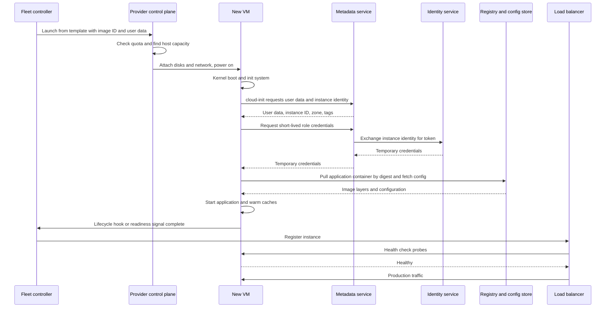

The diagram makes three implications visible. First, the instance depends on at least four services to become useful: the control plane, the metadata service, the identity service, and the registry or configuration store. Any of them can be the reason a scale-out stalls. Second, the fleet controller and load balancer each make their own decision about whether the instance is ready, and those decisions must agree (section 6.3). Third, the time from launch to traffic is the sum of every step. Section 7 shows that this sum, not the boot time alone, is what an autoscaler must plan around.

A minimal cloud-init document for the pattern above might look like this:

```yaml
#cloud-config
# Bootstrap must be idempotent: re-running it must not break the instance.
write_files:
  - path: /etc/orders/env
    permissions: "0600"
    content: |
      ENVIRONMENT=prod
      CONFIG_PREFIX=/orders/prod/
runcmd:
  - [systemctl, enable, --now, orders-agent.service]
  - [/usr/local/bin/pull-and-run, "registry.example.internal/orders@sha256:3f1c..."]
```

Notice what is absent: no passwords, no API keys, no tokens. User data is readable by anything on the instance that can reach the metadata service, it is visible to anyone with permission to describe the instance's launch configuration, and it often ends up in logs. Bootstrap should fetch secrets at runtime using the instance's identity, as described in [Secrets Management](CH13_Secrets_Management.md). The container is referenced by digest rather than by tag, so every instance launched from this template runs the same bits.

Bootstrap must be **idempotent**, because agents re-run some modules on reboot and operators re-run scripts during debugging. It must also **fail loudly**. A bootstrap script that silently skips a failed step produces an instance that passes a shallow health check and serves errors.

### 5.5 The instance metadata service and its protections

Each provider runs an instance metadata service (IMDS) reachable from inside the VM at a link-local address, `169.254.169.254`, which is also published as `metadata.google.internal` on Google Cloud. It returns instance identity, network configuration, user data, and, most importantly, **temporary credentials for the identity attached to the instance**: the IAM role in an AWS instance profile, the Azure managed identity, or the Google Cloud service account. Those credentials let the application call provider APIs without stored secrets, which is the correct design. It also makes the metadata service the most valuable target on the instance.

The classic attack is server-side request forgery (SSRF). An application that fetches a uniform resource locator (URL) supplied by a user (an image-thumbnail service, a webhook tester, a Portable Document Format (PDF) renderer) can be tricked into fetching the metadata credential path and returning the response to the attacker. The attacker then calls provider APIs as the instance's identity from anywhere.

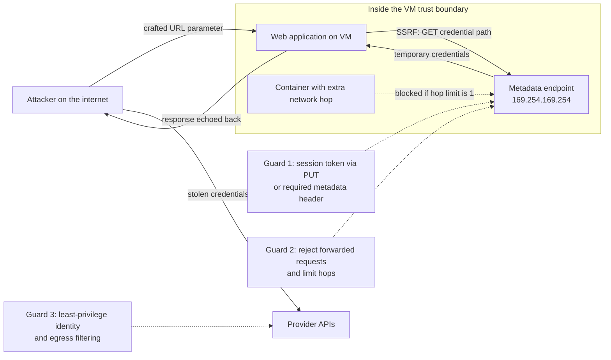

The diagram shows the trust boundary that SSRF crosses: the attacker never logs in to the VM, but borrows the application's ability to reach a link-local address. The guards on the dotted lines are the controls that break the path.

Each provider protects the endpoint differently, and the differences matter:

- **AWS IMDSv2.** Instance Metadata Service Version 2 requires a session. The caller first sends a Hypertext Transfer Protocol (HTTP) `PUT` to `/latest/api/token` with a `X-aws-ec2-metadata-token-ttl-seconds` header, receives a token, and then presents it in a `X-aws-ec2-metadata-token` header on every `GET`. Most SSRF bugs let an attacker control a URL for a `GET` but not the method or headers, so they cannot obtain a token. IMDSv2 also rejects token requests carrying an `X-Forwarded-For` header, which blocks naive reverse-proxy paths, and sets the Internet Protocol (IP) time-to-live (the **hop limit**) on token responses to 1 by default, so a token cannot travel past one network hop. Containers using bridge networking sit one hop further away; to let them use instance credentials you would need a hop limit of 2, which is a deliberate trade-off. The stronger practice is to give containers their own identity (for example ECS task roles or EKS Pod Identity) and leave the hop limit at 1. Enforce IMDSv2 with `HttpTokens=required` in launch templates, and use the account-level default and an organization policy to prevent launching instances that allow IMDSv1.
- **Azure IMDS.** Requests must include the header `Metadata: true`, and requests containing an `X-Forwarded-For` header are rejected. The required header defeats SSRF bugs that cannot set headers, but there is no token exchange, so an SSRF bug that lets the attacker set arbitrary headers still reaches managed identity tokens.
- **Google Cloud metadata server.** Requests must include the header `Metadata-Flavor: Google`, and requests with `X-Forwarded-For` are rejected. As with Azure, the protection is a required header rather than a session.

```bash
# AWS IMDSv2: obtain a session token, then use it.
TOKEN=$(curl -sX PUT "http://169.254.169.254/latest/api/token" \
  -H "X-aws-ec2-metadata-token-ttl-seconds: 300")
curl -s -H "X-aws-ec2-metadata-token: $TOKEN" \
  http://169.254.169.254/latest/meta-data/placement/availability-zone

# Azure and Google Cloud: a required header instead of a session.
curl -s -H "Metadata: true" \
  "http://169.254.169.254/metadata/instance/compute/location?api-version=2021-02-01&format=text"
curl -s -H "Metadata-Flavor: Google" \
  http://metadata.google.internal/computeMetadata/v1/instance/zone
```

No metadata protection replaces the two controls that limit the damage of a stolen credential: a **least-privilege identity** on the instance (an instance that only reads one queue should not be able to list storage buckets), and **egress filtering** so a compromised instance cannot freely reach arbitrary destinations. [IAM](CH09_IAM.md) covers identity design and the provider conditions that can restrict where instance credentials are used from.

### 5.6 Bootstrap failure modes

| Failure | What the fleet sees | Prevention |
|---|---|---|
| Image references a deleted or unshared snapshot | Launch API error; desired count never reached | Retention policy that never deletes an image referenced by a template; launch tests in each account and region |
| Package mirror or registry unreachable at boot | Instances stay unhealthy until replaced, then the replacement fails too | Bake dependencies; use a regional registry with replication; cache artifacts |
| Secret retrieval denied after an identity change | Application starts but fails on first request | Canary launch after any identity or policy change; readiness check that exercises secret access |
| Bootstrap script exits non-zero but service still starts | Instance passes a shallow health check and serves errors | Strict script mode; readiness check that tests real dependencies |
| Clock, hostname, or machine ID duplicated from the image | Agents collide, logs merge, licenses fail | Generalize images during build (remove machine identity) |
| Image built for a different architecture | Immediate boot or exec failure | Separate templates and image families per architecture |

The common theme is that a launch request succeeding proves very little. An instance is ready only when the application on it has proved it can do real work.

## 6. Fleet lifecycle

### 6.1 The fleet object model

Each provider splits a fleet into a **template** (what to launch) and a **group** (how many, where, and how to keep them healthy):

| Concept | AWS | Azure | Google Cloud |
|---|---|---|---|
| Template | Launch template (versioned) | Scale set model, part of the scale set resource | Instance template (immutable; create a new one to change it) |
| Group | EC2 Auto Scaling group | Virtual Machine Scale Set, Uniform or Flexible orchestration | Managed instance group, zonal or regional |
| Multiple shapes per group | Mixed instances policy with instance type list or attribute-based selection | Flexible orchestration with instance mix | Instance flexibility (multiple machine types) on regional MIGs |
| Health-based replacement | Health checks (EC2 status, Elastic Load Balancing, custom) | Automatic instance repairs with Application Health extension or load balancer probe | Autohealing with an application health check |
| Rolling update | Instance refresh | Rolling upgrade policy, automatic OS image upgrade | Proactive or opportunistic updates with surge and unavailable limits |

Azure has two orchestration modes. **Uniform** orchestration manages identical instances as a single resource and is the older model. **Flexible** orchestration manages instances as standard VMs, supports mixing sizes and Spot with regular capacity, and is Microsoft's recommended mode for new deployments at the time of writing. Google Cloud's instance templates are immutable, so every change produces a new template and a rollout, which enforces the versioning discipline that AWS launch template versions make optional.

### 6.2 The instance lifecycle as a state machine

A fleet instance moves through a set of states that the fleet controller tracks separately from the VM's own power state. The diagram below is modeled on the EC2 Auto Scaling lifecycle, which exposes these states explicitly; Azure and Google Cloud have equivalent stages with different names and fewer customer hooks.

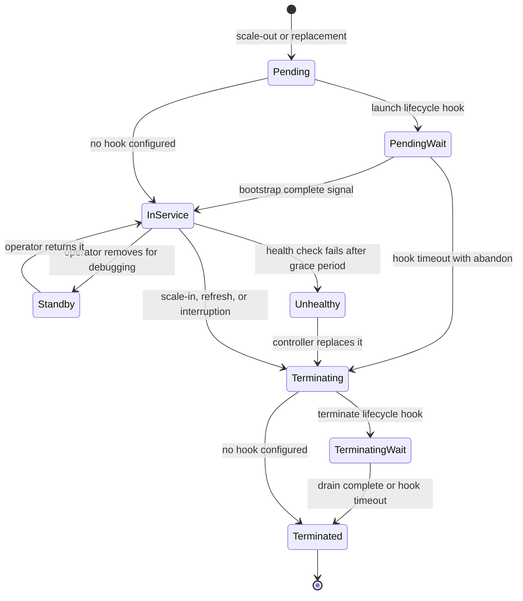

The states that matter most are the two **wait** states created by lifecycle hooks. A launch hook holds a new instance out of service until bootstrap signals completion, so the group does not count it as capacity and the load balancer does not send it traffic. A terminate hook holds a leaving instance so it can drain connections, flush buffers, upload logs, or deregister from service discovery. Each hook has a timeout (on EC2 Auto Scaling the default heartbeat timeout is one hour at the time of writing) and a default result: **continue** or **abandon**. On launch, abandon means the instance is terminated; on terminate, both results end in termination, and the result only determines whether other hooks run.

Azure Virtual Machine Scale Sets offer **terminate notifications** delivered through Scheduled Events, with a configurable delay, so an instance can drain before deletion. Google Cloud MIGs rely on the guest's shutdown handling and on load-balancer connection draining rather than a customer-controlled hook.

The **Standby** state is an operational tool: it takes an instance out of the load balancer and out of the desired count without terminating it, so an engineer can examine a misbehaving instance while the group launches a replacement.

### 6.3 Health checks: platform, load balancer, and application

There are three layers of health, and confusing them causes most fleet incidents:

1. **Platform health.** Is the VM running and reachable by the hypervisor? EC2 status checks, Azure VM availability, and Compute Engine instance status report this. They catch host failures and kernel panics, but not application failures.
2. **Load-balancer health.** Does the instance answer the balancer's probe? This decides whether the instance gets traffic. It does not, by itself, cause replacement unless the fleet is told to use it.
3. **Application health for replacement.** Should the fleet controller kill and replace this instance? On AWS you enable Elastic Load Balancing health checks on the Auto Scaling group; on Azure you configure automatic instance repairs with the Application Health extension or a load-balancer probe; on Google Cloud you attach a health check to the MIG's autohealing policy.

The probe design rules for traffic admission (probe what matters, do not make the probe depend on shared downstream services, set thresholds to balance detection speed against false positives) are taught in [Load Balancer](../05_Networking_and_OS/CH10_Load_Balancer.md). The compute-specific rules concern **replacement**:

- **Grace periods.** A new instance fails health checks while it boots. The fleet must ignore failures for a grace period at least as long as worst-case bootstrap. EC2 Auto Scaling calls this the health check grace period (the console default is 300 seconds and the API default is 0 at the time of writing, so check what your infrastructure-as-code tool sets). Google Cloud calls it the autohealing initial delay. Azure automatic repairs have a grace period too. A grace period shorter than bootstrap creates a **replacement loop**: every instance is killed before it finishes booting, and the group never becomes healthy.
- **Replacement-check scope.** A replacement check should fail only for conditions a new instance would fix. If the check fails because a shared database is down, every instance fails, and the fleet replaces them all, adding boot load to an incident and destroying the logs you need. Use a shallow liveness check (process up, can serve a static response) for replacement, and a deeper readiness check for traffic admission.
- **Replacement rate.** Providers limit how fast health-based replacement happens to some degree, but you should not rely on it. Alert when replacement rate exceeds a threshold; mass replacement almost always means a systemic cause.

### 6.4 Rolling replacement and instance refresh

Immutable infrastructure means you never change a running fleet instance; you replace it with one launched from a new template. Rolling replacement does this in batches while keeping enough capacity in service. The controls are similar across providers:

- **AWS instance refresh** replaces instances in an Auto Scaling group while keeping at least a **minimum healthy percentage** in service, optionally allowing a maximum healthy percentage above 100% so it can launch before terminating. It supports **checkpoints** (pause after a percentage for bake time), **skip matching** (do not replace instances that already match the target template), and **automatic rollback** when the refresh fails or a configured CloudWatch alarm fires.
- **Azure rolling upgrades** set a maximum batch percentage, a maximum unhealthy percentage for the batch and for the whole set, and a pause between batches. Automatic OS image upgrade rolls new platform images through the same mechanism.
- **Google Cloud MIG updates** set **max surge** (extra instances above target during the update) and **max unavailable** (instances that can be offline), and can be proactive (replace now) or opportunistic (apply only when instances are recreated for other reasons). A **canary** update applies a second template to a fixed number or percentage of instances.

A worked rollout calculation shows how the parameters interact. A fleet runs 30 instances. Each needs 4 minutes from launch to healthy, and the team wants a 10-minute bake after the first 10% to watch error rates. The fleet must never fall below 90% of its serving capacity.

- **Terminate-then-launch, minimum healthy 90%.** At most 3 instances (10% of 30) can be out of service at once. Each batch of 3 takes about 4 minutes to replace, plus a few seconds of drain. There are 30 / 3 = 10 batches, about 40 minutes, plus the 10-minute checkpoint after the first batch: about 50 minutes total.
- **Launch-before-terminate, max surge of 6 (120%).** The fleet launches 6 new instances, waits until they are healthy, then terminates 6 old ones. Capacity never drops below 100%. There are 30 / 6 = 5 batches, about 20 minutes, plus the 10-minute checkpoint: about 30 minutes, at the cost of temporarily needing 36 instances of quota and capacity.

The surge approach is faster and safer for capacity but needs 20% extra quota and available host capacity at the moment of the rollout. If the rollout is happening because of an urgent security patch during a capacity shortage, the surge launches may fail, and the team needs a fallback plan with surge 0. Section 10 returns to this.

### 6.5 Draining and termination

Draining is the act of letting an instance finish its current work before it stops. For request-serving fleets, the load balancer's **deregistration delay** or **connection draining timeout** stops new requests to the instance while letting in-flight requests complete. For workers, the instance must stop pulling new messages, finish or checkpoint current ones, and release leases. For stateful members of a cluster (a cache node, a stream processor), draining may mean handing partitions to other members.

The termination sequence should be:

1. The fleet decides to remove the instance (scale-in, refresh, health, or interruption notice).
2. The instance is deregistered from the load balancer or service discovery, so new work stops arriving.
3. A terminate hook or notification gives the instance time to finish in-flight work. The drain time must be longer than the slowest normal request and shorter than any hard deadline (an interruption notice gives at most a short window; see section 9).
4. The OS shutdown runs, giving the process its signal (for example `SIGTERM` on Linux) and time to exit cleanly.
5. The instance terminates.

Two failures recur. A drain timeout shorter than the longest request truncates uploads or long queries during every deployment, which looks like a random error spike. A worker that ignores the shutdown signal loses the message it was processing; unless the queue's visibility timeout returns the message, the work is lost, and if it does return, the work is duplicated, which is why idempotent processing (see [Idempotency](../07_System_Design_and_Distributed_Systems/CH16_Idempotency.md)) is required for any fleet that scales in.

Scale-in also chooses **which** instance to remove. EC2 Auto Scaling's default termination policy first balances across zones, then prefers instances from the oldest launch template or configuration; Google Cloud MIGs and Azure scale sets similarly balance zones first. You can protect specific instances from scale-in (EC2 instance scale-in protection, Azure instance protection) when they hold long-running work, but protected instances also block rollouts, so use protection with a removal path.

## 7. Autoscaling as a feedback controller

### 7.1 The control-loop model

An autoscaler is a feedback controller. It measures a signal, compares it with a target, computes a correction, and applies that correction to a system that responds after a delay. Thinking of it this way explains almost every autoscaling failure, because feedback controllers fail in predictable ways: they react too late when the delay is long, they oscillate when they react too strongly to noisy signals, and they make things worse when the thing they control is not the real bottleneck.

The controller has these parts:

- **Process variable.** The measured signal: CPU utilization, requests per instance, queue backlog per worker, or a custom metric.
- **Set point.** The target value, for example 50% CPU or 300 messages of backlog per worker.
- **Control law.** How the error between measurement and target becomes a capacity change. Target tracking uses a proportional law; step scaling uses a lookup table; scheduled scaling ignores the measurement entirely; predictive scaling uses a forecast.
- **Actuator.** The fleet controller that changes desired capacity and launches or terminates instances.
- **Dead time.** The delay between a change in demand and the moment new capacity serves traffic. It includes metric collection, evaluation, launch, boot, bootstrap, and health checks.
- **Constraints.** Minimum and maximum size, quota, available host capacity, and the capacity of downstream dependencies.

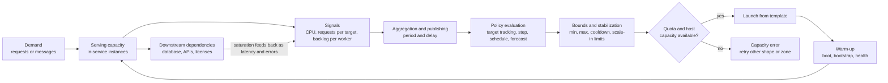

The loop shows two paths that people often forget. The quota and capacity check sits between the policy and the launch, so a correct decision can still fail to produce capacity. The dependency path at the bottom feeds back into the signals: if added instances overload a database, latency rises and CPU may fall (instances wait on the database), which can make a CPU-based autoscaler scale **in** during an overload. Every autoscaling design should be checked against both paths.

### 7.2 Policy types

**Target tracking** keeps a metric near a set point. The core law is proportional:

desired capacity = ⌈current capacity × (current metric value / target value)⌉

If 10 instances run at 80% CPU with a 50% target, desired capacity is ⌈10 × 80 / 50⌉ = 16. This law assumes the metric scales inversely with instance count, which is true for utilization and per-instance load metrics and false for metrics such as total latency or total queue depth. All three providers implement target tracking: EC2 Auto Scaling target tracking policies, Azure Monitor autoscale for scale sets (expressed as rules, plus metric-based targets on some services), and Compute Engine autoscaler target utilization for CPU, load-balancer serving capacity, or Cloud Monitoring metrics. Target tracking scales out aggressively and in conservatively, which is the right asymmetry for most services, because under-capacity costs users while over-capacity costs only money.

**Step scaling** maps ranges of a metric to fixed adjustments, for example "CPU 60-75%: add 2; above 75%: add 6". It suits metrics where the proportional law does not hold, and gives explicit control over how hard to react at each level. Azure autoscale rules are essentially step policies: a condition on a metric over a time window and an action (increase by count or percentage) followed by a cooldown.

**Scheduled scaling** sets minimum, maximum, or desired capacity at specific times. It is the only policy that acts before demand arrives, which makes it the right tool for known events: business-hours ramps, batch windows, a marketing launch. EC2 Auto Scaling scheduled actions, Azure autoscale profiles with recurrence or fixed dates, and Compute Engine scaling schedules all implement it. Scheduled scaling should normally raise the **minimum** rather than set an exact count, so a reactive policy can still add more if the event is bigger than forecast.

**Predictive scaling** forecasts load from history (typically daily and weekly patterns) and schedules capacity ahead of the forecast. EC2 Auto Scaling predictive scaling, Azure predictive autoscale for Virtual Machine Scale Sets, and Compute Engine predictive autoscaling all exist, with Azure and Google Cloud basing predictions on CPU at the time of writing. Predictive scaling works only for cyclical demand with enough history; it cannot foresee a one-off event, so it is used together with a reactive policy, never alone. Run it in forecast-only mode first and compare its forecast with actual load before letting it act.

### 7.3 Warm-up, cooldown, and stabilization

Three timing settings decide whether the loop is stable.

**Warm-up** is how long a newly launched instance is excluded from the aggregated metric. While an instance boots, it reports low CPU and no requests. If the controller counted it immediately, the average would drop, and the controller would conclude it had added enough capacity before any of it was serving. EC2 Auto Scaling's **default instance warmup** setting covers this and, when set, also replaces older cooldown settings for target tracking and step policies; AWS recommends setting it ([default instance warmup](https://docs.aws.amazon.com/autoscaling/ec2/userguide/ec2-auto-scaling-default-instance-warmup.html)). Compute Engine calls this the **initialization period**, with a default of 60 seconds at the time of writing; Google's documentation recommends measuring your real startup time instead of relying on the default. Set warm-up to the measured time from launch to stable serving, not boot time.

**Cooldown** is a pause after a scaling action during which the controller does not start another action of the same kind. It prevents repeated corrections while the first correction is still taking effect. AWS now recommends target tracking or step scaling with warm-up instead of simple scaling with cooldowns ([scaling cooldowns](http://docs.aws.amazon.com/autoscaling/ec2/userguide/Cooldown.html)). Azure autoscale rules each have a cooldown, and Azure Monitor autoscale also applies flapping protection: before scaling in, it estimates whether the smaller count would immediately trigger a scale-out and skips the scale-in if so.

**Stabilization** smooths scale-in. Compute Engine's autoscaler, for example, bases scale-in on the peak recommendation over a trailing window (10 minutes at the time of writing) and supports **scale-in controls** that limit how many instances can be removed within a time window. Kubernetes' Horizontal Pod Autoscaler has a similar stabilization window. The effect is that short lulls in traffic do not trigger scale-in followed by an immediate scale-out.

A short example shows why stabilization matters. A fleet of 20 instances serves traffic that dips for 90 seconds every 10 minutes when an upstream batch job pauses. Without stabilization, the controller sees the dip, scales in to 12, and then the traffic returns to a fleet that is 40% too small for the four-plus minutes it takes to add capacity back. Over an hour that is six overload windows. With a 10-minute stabilization window, the controller ignores the dips because the peak recommendation in the window stays at 20.

### 7.4 Warm pools and standby capacity

When dead time is long, the most effective fix is to remove part of it. A **warm pool** keeps pre-initialized instances outside the serving fleet, so scale-out only has to start or attach them.

- **EC2 Auto Scaling warm pools** hold instances in a `Stopped`, `Running`, or `Hibernated` state after they have run their launch lifecycle hooks. On scale-out, the group moves instances from the pool into service. Stopped instances cost only their storage, but take time to start; running instances cost full price but join almost immediately.
- **Azure standby pools** for Virtual Machine Scale Sets keep a configured number of VMs in running or deallocated state, ready to be added to the scale set.
- **Google Cloud** MIGs support suspending and stopping instances and, at the time of writing, a standby pool feature for MIGs; check feature status and supported states in the current documentation.

Warm pools change the economics of the baseline. A service that needs 30 instances at peak, 10 at night, and has a 6-minute bootstrap could keep a minimum of 18 instances all night to absorb a sudden burst. With a warm pool of 12 stopped instances that can be in service in 60 seconds, it can keep a minimum of 10 and pay only for 12 stopped disks. The trade-off is that pooled instances age: they run the image they were launched with, so instance refreshes must also cycle the pool, and secrets or configuration fetched at initialization may be stale by the time a pooled instance joins.

### 7.5 Bounds and dependency protection

The **minimum** is the capacity the service needs when the autoscaler is broken, when metrics stop arriving, or when the region is short of capacity. It is a resilience setting, not a cost setting. Set it to the capacity required to serve normal load after losing one zone (section 8).

The **maximum** is a safety limit, and its main purpose is to protect what the fleet depends on. A fleet that can grow without limit can exhaust database connections, overrun a third-party API's rate limit, consume a licensed seat pool, or burn the vCPU quota that another workload needs to recover.

Derive the maximum from the most constrained dependency. A worked example: a relational database is configured for 2,000 connections. Each application instance runs a connection pool of up to 40 connections. Administrative tools and a reporting job reserve 200 connections. The application's share is 1,800, so the maximum fleet size is 1,800 / 40 = 45 instances. During a rolling update with 20% surge the fleet temporarily holds 1.2 times its count, so the maximum steady-state size that keeps surge within the limit is ⌊45 / 1.2⌋ = 37. Setting the Auto Scaling group maximum to 37 makes the database limit a property of the compute configuration instead of a surprise during an incident. Connection pool sizing itself is covered in [Connection Pools](../19_Performance_Engineering/CH10_Connection_Pools.md).

The maximum alone does not protect a dependency from a burst of new connections during scale-out, or from the retry storm that follows a slowdown. The application should also apply backpressure and bounded retries, and the platform should scale the dependency deliberately rather than letting compute scaling push load onto it.

### 7.6 Worked control-loop example

This example traces one scale-out event with real timing. A web fleet runs behind a load balancer.

- Each instance reaches 100% CPU at 400 RPS, so CPU percentage ≈ RPS per instance / 4.
- The fleet uses target tracking on average CPU with a target of 50% (200 RPS per instance).
- Steady state: 1,800 RPS on 10 instances, 180 RPS per instance, 45% CPU.
- At time 0, a promotion starts. Traffic ramps linearly to 4,800 RPS over 2 minutes and stays there.
- Metric pipeline: one-minute average CPU, and the policy needs the metric above target for enough consecutive periods that the first scale-out decision is made at 3:00 (three minutes after the start).
- Dead time from launch decision to serving: 90 seconds of launch and boot, 150 seconds of bootstrap and application warm-up, and 20 seconds of health checks (two probes 10 seconds apart). Total 260 seconds, about 4 minutes 20 seconds.

**First decision at 3:00.** The fleet is at 100% CPU because demand (4,800 RPS) exceeds capacity at saturation (10 × 400 = 4,000 RPS). The proportional law gives ⌈10 × 100 / 50⌉ = 20 instances. The real requirement is 4,800 / 200 = 24 instances. The controller under-shoots because **CPU saturates at 100%**: once the fleet is overloaded, CPU can no longer express how overloaded it is.

**New capacity serving at 7:20.** Twenty instances serve 4,800 RPS at 240 RPS each, 60% CPU.

**Second decision about 9:20** (after warm-up and two periods of fresh data). ⌈20 × 60 / 50⌉ = 24 instances. The extra four serve at about 13:40. The fleet then sits at 4,800 / 24 = 200 RPS per instance, exactly on target.

**Overload window.** Demand exceeds saturated capacity (4,000 RPS) from 88 seconds, when the ramp passes 4,000 RPS ((4,000 − 1,800) / 25 RPS per second ≈ 88 seconds), until 7:20. Requests above capacity:

- From 1:28 to 2:00, excess rises from 0 to 800 RPS: about 32 seconds × 400 RPS average ≈ 12,800 requests.
- From 2:00 to 7:20, excess is 800 RPS for 320 seconds: 256,000 requests.
- Total: about 269,000 requests either rejected or queued, and every other request saw a saturated fleet's latency for almost six minutes.

The Gantt chart below lays out the timeline.

```mermaid
gantt
    title Scale-out timeline with CPU target tracking
    dateFormat HH:mm:ss
    axisFormat %M:%S
    section Demand
    Ramp from 1800 to 4800 RPS      :d1, 00:00:00, 00:02:00
    Sustained 4800 RPS               :d2, 00:02:00, 00:15:00
    section Fleet state
    Overloaded at 100 percent CPU    :crit, f1, 00:01:28, 00:07:20
    20 instances at 60 percent CPU   :f2, 00:07:20, 00:13:40
    24 instances at target           :f3, 00:13:40, 00:15:00
    section Controller
    Metric collection and evaluation :c1, 00:00:00, 00:03:00
    Launch boot bootstrap and health :c2, 00:03:00, 00:07:20
    Second evaluation                :c3, 00:07:20, 00:09:20
    Launch 4 more                    :c4, 00:09:20, 00:13:40
```

The chart shows that the overload lasts as long as detection plus dead time, and that the under-shoot adds a second, slower correction. Each fix attacks one segment of the timeline:

1. **Use a signal that does not saturate.** Scale on requests per instance (for example the Application Load Balancer request-count-per-target metric on AWS, or load-balancer serving capacity on Google Cloud). At 3:00 the controller sees 480 RPS per instance against a 200 target and requests ⌈10 × 480 / 200⌉ = 24 instances in one step. The second correction disappears.
2. **Shorten dead time with a warm pool.** If pooled instances serve in 60 seconds instead of 260, capacity arrives at 4:00 instead of 7:20. The overload falls from about 269,000 requests to about 12,800 + 120 × 800 = 108,800.
3. **Shorten detection.** Higher-resolution metrics and a step policy with an aggressive top step can make the first decision at about 1:30 instead of 3:00.
4. **Act before demand for known events.** A scheduled action that raises the minimum to 24 at 23:50 the night before removes the overload entirely. Since the promotion was planned, this is the correct primary fix. Reactive scaling is the backstop for the unplanned part.

Combining 1 and 2 brings the worst case for an unplanned surge of this shape down to roughly two and a half minutes of overload, and combining all four brings it to zero for planned events.

The same reasoning applies to worker fleets. For a queue-driven fleet, the signal should be **backlog per worker**, computed as visible messages divided by in-service workers, and the target should come from the latency objective: if each worker processes 10 messages per second and the business accepts 30 seconds of queueing, the target backlog per worker is 30 × 10 = 300 messages. The [autoscaling controller example](../code/python/compute-chapter/02_autoscaling_controller.py) implements this law with a target of 100 messages per worker, a minimum of 2, and a maximum of 12. For queue depths of 80, 250, 1,200, 700, and 90 it produces 2 (hold), 3, 12, 7, and 2 workers. The jump from 3 to 12 at a depth of 1,200 shows the maximum acting as a hard bound, and the drop from 12 to 7 shows that the example has no stabilization, which section 7.3 explains a production policy needs.

### 7.7 Choosing the signal

| Signal | Good for | Weakness |
|---|---|---|
| Average CPU | CPU-bound services with steady per-request cost | Saturates at 100%; misleads when instances wait on I/O or dependencies |
| Requests per instance | Request-serving fleets behind a load balancer | Assumes requests have similar cost; mixes cheap and expensive endpoints |
| Backlog per worker | Queue consumers | Needs a known processing rate; poison messages inflate backlog |
| Oldest message age | Latency-sensitive queues | Lagging indicator; a single stuck message can trigger scale-out |
| Custom business metric (concurrent sessions, active jobs) | Workloads where none of the above tracks demand | You own its correctness and its delivery pipeline |
| Latency | Usually a poor primary signal | Rises for reasons more instances will not fix, such as a slow database |

Prefer a **demand** signal (requests, backlog) over a **resource** signal (CPU) when both are available, because demand does not saturate and does not fall when a dependency stalls. Use multiple policies where needed: when several policies apply, EC2 Auto Scaling and the Compute Engine autoscaler choose the one that gives the largest capacity, which makes combining a CPU policy with a request-rate policy safe on scale-out.

## 8. Placement and failure domains

### 8.1 The failure-domain hierarchy

A failure domain is a set of resources that can fail together. Cloud compute has a nested hierarchy of them:

- **Region.** A geographic area with independent control planes for most services.
- **Zone** (Availability Zone on AWS and Azure, zone on Google Cloud). One or more data centers in a region with independent power, cooling, and networking, connected to other zones by low-latency links. The generic theory of failure domains and recovery objectives is in [Resilience, Availability, and Disaster Recovery Architectures](../10_Cloud_Architecture/CH09_Resilience_Availability_and_Disaster_Recovery_Architectures.md). The provider definitions are in [AWS](CH01_AWS.md), [Azure](CH02_Azure.md), and [GCP](CH03_GCP.md).
- **Within-zone domains.** Racks, power distribution units, and top-of-rack switches. Providers expose these indirectly: AWS spread and partition placement groups, Azure fault domains (in availability sets and in Flexible scale sets), and Google Cloud availability domains in spread placement policies.
- **Host.** One physical server. Every VM on it fails if it fails.

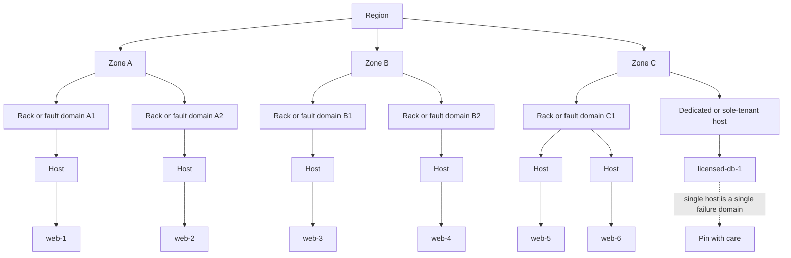

Reading the map from the top down tells you what a failure takes out. A zone failure removes every rack, host, and VM under it: in this layout, losing zone C removes web-5, web-6, and the licensed database. A rack failure removes only the hosts in it. The dedicated host at the bottom is a reminder that pinning a workload to a specific host for licensing or isolation also makes it a single-host failure domain unless you buy and use more than one host.

### 8.2 Zonal and regional fleets

A fleet can be confined to one zone or spread across several:

- **AWS.** An Auto Scaling group spans the subnets you give it, and each subnet lives in one Availability Zone. Listing subnets in three zones makes the group multi-zone; it tries to keep instance counts balanced and rebalances when a zone recovers.
- **Azure.** A Virtual Machine Scale Set is given a list of zones. Uniform scale sets offer **zone balance** (strict even distribution); Flexible scale sets spread across zones and, within a zone, across fault domains according to the platform fault domain count.
- **Google Cloud.** A **zonal MIG** lives in one zone. A **regional MIG** spans zones in a region and has a **target distribution shape**: `EVEN` (balanced across zones), `BALANCED` (prefer balance but allow imbalance to obtain capacity), `ANY` (place wherever capacity exists, useful for Spot and batch), and `ANY_SINGLE_ZONE` (all instances in one zone chosen by the platform, useful when instances must be close together).

The choice between strict balance and capacity-seeking placement is a real trade-off. Strict balance guarantees that losing one zone loses a predictable fraction of capacity, but a scale-out fails or stalls if one zone has no capacity of the requested shape. Capacity-seeking placement finds capacity more often, but can leave the fleet concentrated in one zone, so a zone failure takes out more than planned. Request-serving fleets with zonal-failure objectives should use balanced placement and a diverse shape list (so each zone has more than one way to satisfy the request). Batch and Spot fleets, where losing work is cheap, should seek capacity.

Cross-zone placement has costs. Traffic between zones adds latency (typically around a millisecond or less, but measure it) and, on AWS and Google Cloud, is billed as inter-zone data transfer. Azure's inter-zone transfer pricing has changed over time, so check its current pricing page. A chatty service whose instances call each other across zones can generate significant transfer cost.

### 8.3 Placement inside a zone

Inside a zone, placement controls trade correlated-failure risk against network proximity:

| Need | AWS | Azure | Google Cloud |
|---|---|---|---|
| Lowest latency and highest bandwidth between instances | Cluster placement group | Proximity placement group (co-locates resources, can combine with zones) | Compact placement policy |
| Each instance on distinct hardware | Spread placement group (at the time of writing, at most seven running instances per Availability Zone per group) | Availability set fault domains, or Flexible scale set with fault domain spreading | Spread placement policy, up to eight availability domains ([placement policies](https://docs.cloud.google.com/compute/docs/instances/placement-policies-overview)) |
| Groups of instances on distinct hardware, topology visible to software | Partition placement group (partitions do not share racks; the partition number is exposed to the instance) | Fault domain number visible in instance metadata | Availability domain set per instance |
| Separate maintenance waves | Not exposed as a placement control | Update domains in availability sets | Not exposed as a placement control |

**Cluster and compact** placement packs instances onto nearby hardware for low latency and high throughput, which is what tightly coupled high-performance computing and distributed training need. It increases correlated-failure risk and makes capacity harder to obtain, because the provider must find enough free capacity in one network segment. Launch the whole group at once, use a single shape, and pair it with a capacity reservation for large groups.

**Spread** placement puts each instance on distinct hardware. It suits a small number of critical instances, such as a three-node quorum (for example a consensus cluster; see [Consensus](../07_System_Design_and_Distributed_Systems/CH07_Consensus.md)) where losing two members to one rack failure loses quorum.

**Partition** placement suits large replicated systems (Hadoop Distributed File System, Cassandra, Kafka) that can place replicas topology-aware. The software reads the partition or fault domain from metadata and ensures each replica of a data item lives in a different partition.

**Azure availability sets** are the older within-datacenter construct. They spread VMs across fault domains (separate power and network) and update domains (groups rebooted together during planned maintenance), but they do not span zones. For new deployments in regions with zones, zonal deployment or Flexible scale sets are generally preferred; availability sets remain relevant in regions without zones and for workloads that need update-domain control.

### 8.4 Dedicated and sole-tenant hosts

AWS Dedicated Hosts, Azure Dedicated Host, and Google Cloud sole-tenant nodes give you a physical server whose capacity only your VMs use. AWS Dedicated Instances are a lighter variant: your instances do not share hardware with other accounts, but you do not control which host they run on. Reasons to use them:

- **Licensing** that counts physical sockets or cores, or that requires bring-your-own-license on dedicated hardware.
- **Compliance** that requires single-tenant hardware.
- **Host-level control**, such as choosing which VMs share a host or controlling maintenance timing.

Costs and constraints: you pay for the whole host whether it is full or not, so bin-packing efficiency becomes your problem; host capacity is fixed, so scaling requires buying more hosts; and a host is a failure domain. A design that puts all licensed VMs on one dedicated host to minimize license count has created a single point of failure. Use at least two hosts in different zones for anything that needs availability, and use the provider's host-group or node-group features to spread VMs. Google Cloud placement policies cannot be applied to sole-tenant instances, so spreading on sole-tenant nodes is done through node groups and affinity labels.

### 8.5 Worked example: surviving a zone loss

A service needs 24 instances to carry peak load at its utilization target. It runs in a region with three zones. Two strategies exist.

**Strategy 1: rely on scale-out after the failure.** Run 24 instances, 8 per zone. When a zone fails, 16 remain, which is 67% of required capacity. The autoscaler requests 8 more in the two surviving zones. The service is short of capacity for at least detection plus dead time, perhaps 5-8 minutes, and that assumes the launches succeed. During a zone failure, every other customer in the region is also trying to launch replacements in the same surviving zones, so capacity errors are more likely than on any normal day, and the provider's control plane may itself be degraded.

**Strategy 2: static stability.** AWS uses the term static stability for designs that keep working through a failure without needing to make changes, especially control-plane changes; the general idea is taught in [AWS](CH01_AWS.md), and this section applies it to fleet sizing. Size each zone so that the surviving zones carry full load without launching anything: required per surviving zone = 24 / 2 = 12, so run 12 per zone, 36 in total. Losing a zone leaves 24, which is exactly enough.

The cost of static stability is 50% more instances (36 versus 24). With four zones the overhead falls to 24 / 3 = 8 per zone, 32 total, 33% more. Many organizations choose a middle path: static stability for the critical tier, and scale-out recovery for less critical tiers, with capacity reservations or commitments covering the critical tier so its baseline is not subject to on-demand availability.

The [placement checker](../code/python/compute-chapter/04_placement_checker.py) tests whether capacity remains after losing each zone. Its example places 3 replicas in zone A and 3 in zone B, none in zone C, with a nominal capacity of 4 per zone and a requirement of 6. It warns about nothing and reports `pass` for losing either zone A or zone B, because 8 units of capacity remain. Notice what that pass depends on: 4 of the 8 units are in zone C, where no replica runs. The check assumes that zone C capacity can be launched on demand during the failure. That is Strategy 1's assumption. A statically stable check would count only running replicas: after losing zone A, 3 replicas remain against a requirement of 6, which fails. Use the example to see how easily a capacity model can hide a dependency on the control plane.

### 8.6 Quality scenario: zonal failure

| Element | Value |
|---|---|
| Stimulus | Zone B becomes unavailable during weekday peak; instances there stop responding and launches into zone B fail |
| Environment | Peak load of 4,800 RPS; three-zone regional fleet of 36 instances, 12 per zone |
| Expected response | Load balancer health checks remove zone B targets; the remaining 24 instances absorb load; the fleet controller attempts but does not depend on replacing zone B capacity; no manual action is required |
| Success criteria | Error rate returns below 0.5% within 2 minutes of the zone failure; p99 latency remains under 400 ms; no scaling or control-plane action is required to meet the objective; when zone B recovers, the fleet rebalances without dropping below 24 healthy instances |
| Evidence | A game day that blocks zone B through network rules or a provider fault-injection service (AWS Fault Injection Service, Azure Chaos Studio) and records the metrics above; see [Chaos Engineering](../13_DevOps/CH17_Chaos_Engineering.md) |

## 9. Capacity procurement

### 9.1 Three different promises

Cloud capacity is sold under three kinds of promise, and confusing them is the root of most procurement mistakes:

1. **A price promise.** A commitment discount lowers the rate you pay for usage that matches the commitment. It says nothing about whether capacity will be available when you launch.
2. **A capacity promise.** A capacity reservation holds hardware of a specific shape in a specific zone for you. It says nothing about price; you pay on-demand rates for the reservation whether you use it or not, unless a discount also applies.
3. **No promise.** Spot and preemptible capacity is spare hardware sold at a deep discount that the provider can reclaim with short notice.

On-demand capacity sits between them: no commitment, full price, and availability subject to quota and to whatever the zone has free at the moment of launch.

### 9.2 On-demand

On-demand capacity is billed per unit of time with no commitment. It is the default and the most flexible option. Its weakness is availability rather than price: during regional events, large launches, or for scarce shapes, an on-demand launch can fail with an insufficient-capacity error even though the account has quota. On-demand is the right choice for the variable part of a workload, for new workloads whose steady state is not yet known, and for anything you might shut down soon.

### 9.3 Commitment discounts

Each provider offers term commitments that trade flexibility for a lower rate. The product names look similar, but the scope of each discount differs:

- **AWS Savings Plans** commit to a dollar amount of compute spend per hour for one or three years. **Compute Savings Plans** apply across instance families, sizes, regions, operating systems, and also to AWS Fargate and AWS Lambda usage. **EC2 Instance Savings Plans** apply to one instance family in one region but give a larger discount. **Reserved Instances** are the older model; a **zonal** Reserved Instance also reserves capacity in its Availability Zone, while a **regional** one does not.
- **Azure Reservations** commit to a specific VM size family in a region for one or three years, with instance size flexibility within a group. The **Azure savings plan for compute** commits to an hourly spend amount across eligible compute services and regions, analogous to AWS Compute Savings Plans. **Azure Hybrid Benefit** separately lets you apply existing Windows Server and SQL Server licenses.
- **Google Cloud committed use discounts (CUDs)** come in two forms. **Resource-based** commitments buy a quantity of vCPUs, memory, GPUs, or local SSD in a region for one or three years. **Flexible** (spend-based) commitments commit to an hourly spend that applies across eligible machine series and regions. **Sustained use discounts** apply automatically, without any commitment, to some machine series (for example N1 and N2) when they run for a large part of the month; other series (for example E2) do not receive them.

Two structural facts matter more than the percentages. First, broader scope (any family, any region) means lower risk and a smaller discount; narrower scope means a larger discount and a higher chance that architecture changes leave the commitment stranded. Second, commitments are generally not cancellable. A team that commits to three years of one x86 family in one region and then migrates to Arm or to another region keeps paying.

A worked example shows the trade-off. A workload uses instances that cost 1.00 unit per hour on demand. Its usage over a 30-day month with 22 weekdays:

- Baseline: 40 instances all month, 40 × 720 = 28,800 instance-hours.
- Weekday daytime peak: 40 more instances for 12 hours on 22 days, 40 × 12 × 22 = 10,560 instance-hours.
- Nightly retryable batch: 60 instances for 6 hours on 30 days, 60 × 6 × 30 = 10,800 instance-hours.

The discount rates below are illustrative; real rates depend on provider, term, payment option, shape, and region. Assume a commitment rate of 0.65, a Spot rate of 0.35, and 10% rework overhead on Spot due to interruptions.

| Plan | Arithmetic | Monthly cost |
|---|---|---|
| All on-demand | 28,800 + 10,560 + 10,800 | 50,160 |
| Commit to the 40-instance baseline, peak on-demand, batch on Spot | 28,800 × 0.65 + 10,560 × 1.00 + 10,800 × 1.10 × 0.35 = 18,720 + 10,560 + 4,158 | 33,438 |
| Over-commit to 60 instances, remaining peak on-demand, batch on Spot | 60 × 720 × 0.65 + 20 × 264 × 1.00 + 4,158 = 28,080 + 5,280 + 4,158 | 37,518 |

Committing to the true baseline saves 33%. Committing to 60 instances looks like more discount but costs 4,080 more per month than the right-sized plan, because 20 committed instance-equivalents sit unused for 720 − 264 = 456 hours each month: 20 × 456 × 0.65 = 5,928 units of paid, unused commitment. The rule is to commit to the floor of measured usage, not its average. [Cost Optimization](CH14_Cost_Optimization.md) owns commitment utilization risk and coverage reporting; the compute-side discipline is to keep the committed baseline aligned with the families and regions your roadmap will actually use.

### 9.4 Capacity reservations

**AWS On-Demand Capacity Reservations**, **Azure on-demand capacity reservations**, and **Compute Engine reservations** hold capacity of a specific shape in a specific zone. They are billed at the on-demand rate whether used or not, and commitment discounts can apply to them. Use them for:

- The statically stable baseline of a critical service (section 8.5), so recovery does not depend on on-demand supply during a regional event.
- Known large events, by creating the reservation days ahead and releasing it afterwards.
- Accelerators and other scarce shapes (section 4.3).
- Disaster recovery capacity in a secondary region, if the recovery objective cannot tolerate a capacity shortfall at failover time.

The trade-off is direct: a reservation converts availability risk into a fixed cost. A reservation for 36 instances that are only used at 24 during normal operation costs 12 idle instances, which is the price of static stability. That price is often worth paying for the critical tier and rarely worth paying for anything else.

### 9.5 Spot and preemptible capacity

**AWS Spot Instances**, **Azure Spot Virtual Machines**, and **Google Cloud Spot VMs** (the successor to preemptible VMs) sell spare capacity at large discounts. The provider reclaims them when it needs the capacity back. The interruption contract differs by provider:

| Property | AWS Spot Instances | Azure Spot Virtual Machines | Google Cloud Spot VMs |
|---|---|---|---|
| Notice before reclaim | Two-minute interruption notice, plus an earlier best-effort rebalance recommendation | At least 30 seconds, delivered as a `Preempt` Scheduled Event ([Azure Spot eviction](https://learn.microsoft.com/en-us/azure/architecture/guide/spot/spot-eviction)) | Best-effort shutdown period of up to 30 seconds |
| Where the notice appears | Instance metadata (`spot/instance-action`) and Amazon EventBridge events | Scheduled Events endpoint in Azure IMDS | Metadata server preemption flag and an Advanced Configuration and Power Interface (ACPI) shutdown signal that runs shutdown scripts |
| What happens on reclaim | Terminate (default), stop, or hibernate, depending on configuration | Deallocate (default) or delete, set by eviction policy | Stop or delete, set by termination action |
| Price model | Variable Spot price; optional maximum price | Variable price; optional maximum price (or -1 for "never evict for price") | Variable price set by Google Cloud |
| Maximum runtime | None | None | None for Spot VMs; older preemptible VMs stopped after 24 hours |

Values are at the time of writing; verify in each provider's documentation ([Google Cloud Spot VMs](https://cloud.google.com/compute/docs/instances/create-use-spot)).

The sequence below shows how a well-behaved Spot worker handles reclaim on AWS. The Azure and Google Cloud versions follow the same shape with a 30-second notice and no separate rebalance signal.

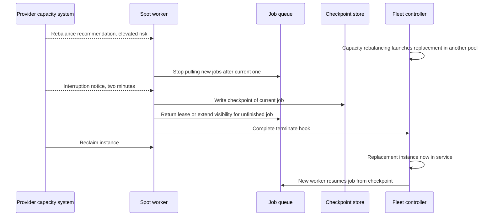

The diagram shows that interruption handling has three parts: stop taking new work, save progress, and make sure someone else can finish the work. The fleet controller's job is to replace capacity from a **different** capacity pool, because the pool that was just reclaimed is the one under pressure.

**Diversification** is the main defense against reclaim. A Spot capacity pool is one shape in one zone. Reclaims are correlated within a pool and often across similar shapes in the same zone. A fleet of 40 instances of one shape in one zone can lose all 40 in one reclaim wave. The same 40 spread across 8 pools (for example four interchangeable shapes in two zones) of 5 each loses 5 to a single-pool reclaim, 12.5% of capacity. The provider controls that support this:

- **AWS** Auto Scaling groups with a mixed instances policy list several instance types (or attribute-based instance type selection), set an **on-demand base capacity** and an **on-demand percentage above base**, and choose an allocation strategy. AWS recommends the `price-capacity-optimized` strategy, which favors pools with the most spare capacity and then the lowest price. **Capacity Rebalancing** launches replacements when a rebalance recommendation arrives.
- **Azure** Flexible scale sets support **Spot Priority Mix**, which keeps a base count of regular VMs and a percentage split of regular and Spot above the base, and can use several VM sizes.
- **Google Cloud** MIGs can use the Spot provisioning model with instance flexibility across machine types, and regional MIGs with the `ANY` distribution shape place Spot VMs wherever capacity exists.

The [interruptible capacity example](../code/python/compute-chapter/03_interruptible_capacity.py) makes the cost of missing checkpoints concrete. It runs 120 jobs on 4 stable and 8 interruptible workers, with all interruptible workers reclaimed at step 10. The stable workers finish 40 jobs, the interruptible workers process 80, and the 8 jobs in flight on reclaimed workers are lost because they had no checkpoint: 112 completed, 8 to retry. With checkpointing, the retry would resume from the last checkpoint rather than from zero; with idempotent processing, a job that was partly applied before the reclaim can be safely repeated.

Spot is the right choice when work is retryable, can be checkpointed, and has a deadline longer than the expected replacement time: batch processing, rendering, continuous integration runners, stateless workers behind a queue, and fault-tolerant training. It is the wrong choice for the only replicas of a synchronous user-facing service, for stateful single-instance databases, and for work that cannot finish its shutdown inside a 30-second notice.

## 10. Quotas and capacity errors during scale-out

### 10.1 Quota is not capacity

A scale-out can fail for two unrelated reasons:

- **Quota** is an administrative limit on what your account, subscription, or project may use. It is a number the provider will raise on request, usually after review. Quota never guarantees capacity.
- **Capacity** is the physical supply of a shape in a zone at a moment. No request form raises it. You work around a shortage by changing shape, zone, region, or time, or by holding a reservation.

Each provider structures compute quotas differently, and the structure determines which scale-outs are at risk:

- **AWS** expresses EC2 On-Demand quotas in vCPUs per region, grouped by instance family (for example one quota covers the standard general-purpose, compute, memory, and burstable families together, and separate quotas cover GPU and other specialized families). Spot instances have their own vCPU quotas. Quotas are viewed and raised in Service Quotas. Related quotas, such as Elastic IP addresses, network interfaces, and EBS storage, can also block a launch, and the EC2 API applies request rate limits.
- **Azure** applies vCPU quotas per subscription per region at two levels: a total regional vCPU quota and a per-VM-family vCPU quota. A launch needs headroom in both. Spot VMs use a separate Spot vCPU quota. Azure Resource Manager also throttles API requests.
- **Google Cloud** applies quotas per project per region, including CPU quotas per machine family (for example separate quotas for N2 and C3 vCPUs), GPU quotas per GPU model per region plus a global all-regions GPU quota, Spot (preemptible) CPU quotas, persistent disk and IP address quotas, and API rate quotas.

### 10.2 What the errors look like

The fleet controller logs these errors in its activity history; your alerting should distinguish them because the responses differ.

| Cause | AWS | Azure | Google Cloud | Response |
|---|---|---|---|---|
| Quota exceeded | `VcpuLimitExceeded`, `MaxSpotInstanceCountExceeded` | `OperationNotAllowed` with a quota message | `QUOTA_EXCEEDED` | Request an increase; reduce footprint; shift to a family with headroom |
| No capacity for the shape in the zone | `InsufficientInstanceCapacity` | `AllocationFailed`, `ZonalAllocationFailed` | `ZONE_RESOURCE_POOL_EXHAUSTED` (stockout) | Try other shapes and zones; use reservations; wait and retry with backoff |
| Shape not offered where requested | `Unsupported` instance type in that zone | `SkuNotAvailable` | Machine type not available in the zone | Fix the template; check availability per zone before deploying |
| API throttling | `RequestLimitExceeded` | HTTP 429 from Resource Manager | Rate quota exceeded | Back off; reduce automation call volume |

Error names are as documented at the time of writing; providers add more specific variants over time.

### 10.3 Handling capacity errors in the scale-out path

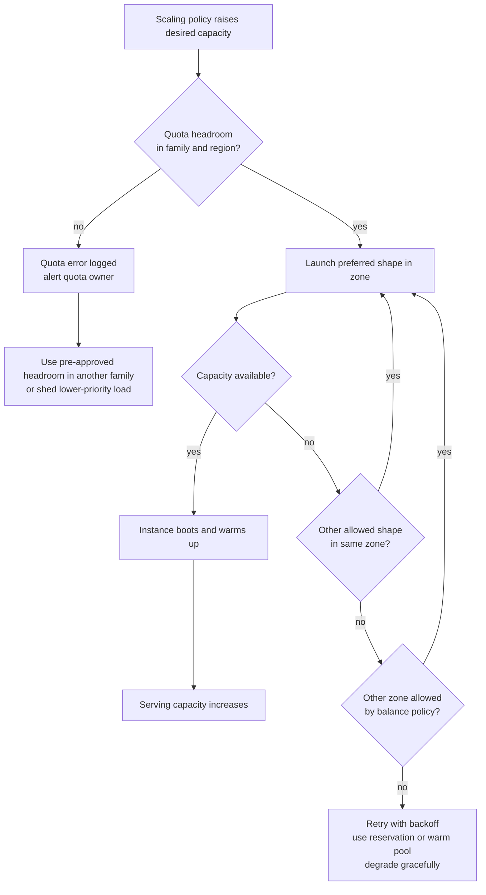

The flowchart shows the order in which a fleet should fall back. Quota is checked first because it fails fast and identically in every zone. Within quota, the fleet should try **alternative shapes** before **alternative zones**, because a zone change can break balance and therefore weaken the zonal-failure plan. If every shape and zone fails, the service must degrade gracefully: queue work, shed optional features, or serve from cache. Most of this fallback logic is configured rather than coded: listing several instance types in an AWS mixed instances policy, several VM sizes in an Azure Flexible scale set, or instance flexibility in a Google Cloud regional MIG gives the fleet controller alternatives to try on its own.

### 10.4 Worked example: quota headroom

A team runs three workloads in one AWS region, all drawing on the same standard-family On-Demand vCPU quota of 2,000 vCPUs (an example value; check your own account).

- **Web fleet.** 8-vCPU instances. Peak 60 instances is 480 vCPUs. A rolling refresh with 20% surge needs 72 instances, 576 vCPUs.
- **Batch fleet.** Runs on-demand during month-end close, peaking at 1,200 vCPUs.
- **Internal tools.** Steady 300 vCPUs.

If a web rollout happens during month-end close: 576 + 1,200 + 300 = 2,076 vCPUs, which exceeds 2,000. The rollout's surge launches fail. If the rollout is an urgent security patch, the team discovers the quota problem in the middle of an incident.

Now add disaster recovery. If this region is also the failover target for another region's web fleet of 60 instances at 8 vCPUs, failover adds 480 vCPUs: 2,556 in total. The quota request should therefore be at least 2,556 plus a margin for forecast error, for example 3,000. Quota increases are often approved quickly for modest amounts and need review for large ones, so request them before they are needed and record them as part of the recovery plan.

Track **quota utilization** (current usage divided by quota) as a metric, alert at a threshold such as 70%, and include quota headroom in the design review for any new workload sharing a region. On AWS, Service Quotas exposes usage metrics in CloudWatch; Azure exposes usage through the quotas and usage APIs and portal; Google Cloud exposes quota usage in Cloud Monitoring.

### 10.5 Quality scenario: quota or capacity limit during scale-out

| Element | Value |
|---|---|
| Stimulus | A traffic surge drives desired capacity from 24 to 40 instances; launches of the preferred shape in zone A fail with insufficient capacity |
| Environment | Three-zone regional fleet with a mixed shape list of three interchangeable families; quota headroom alarm at 70% |
| Expected response | The fleet launches the alternative shapes in zone A and in the other zones within the balance policy; queues absorb excess work; operators are alerted with the specific error class |
| Success criteria | 90% of the requested 16 instances are in service within 8 minutes; error rate for user requests stays under 1%; no quota error occurs because headroom was pre-approved; alert identifies capacity versus quota cause in its title |
| Evidence | A test that uses a non-existent shape or a deliberately exhausted test quota in a non-production account to force the error path, plus fleet activity logs showing fallback launches |

## 11. Patching, maintenance, and operating-system responsibility

### 11.1 Where the responsibility line sits

For VMs, the provider patches and maintains the physical hosts, firmware, and hypervisor; the customer patches the guest OS, every package and agent inside it, and the application. This is the compute slice of the shared-responsibility model described in [AWS](CH01_AWS.md), [Azure](CH02_Azure.md), and [GCP](CH03_GCP.md). It does not change because a fleet is autoscaled: a fleet launched from a six-month-old image is a fleet with six months of missing patches, however new the instances are.

### 11.2 Two patching models

**Immutable replacement** builds a new image with current patches (section 5.3) and rolls it out with instance refresh, rolling upgrades, or MIG updates (section 6.4). It produces identical instances, leaves a clean rollback path (roll back to the previous image), and tests exactly what runs in production. It requires fast, reliable rollouts and stateless or externally stateful instances.

**In-place patching** applies updates to running instances with a patch service: AWS Systems Manager Patch Manager, Azure Update Manager, or Google Cloud VM Manager OS patch management. It suits long-lived, stateful, or hard-to-replace VMs (licensed databases, legacy servers), and urgent fixes that cannot wait for an image build. It creates drift: instances patched at different times are not identical, and an instance that misses a patch window stays exposed.

Most estates use both. Fleets are patched by replacement on a regular cadence; long-lived VMs are patched in place inside maintenance windows; and an emergency in-place patch is followed by an image rebuild so the next scale-out does not reintroduce the vulnerability.

A worked cadence check: the security policy requires critical vulnerabilities to be remediated within 7 days. The image pipeline takes 2 hours to build and scan, the test stage needs one business day of soak in staging, and production rollout takes about 50 minutes per region across 3 regions in sequence, about 2.5 hours. End to end, that is roughly 1.5 days, which meets the 7-day objective with room for a failed first attempt. If the rollout instead required a manual change approval with a weekly board, the policy would be missed whenever the vulnerability landed just after a board meeting, which is the kind of process constraint the cadence check is meant to expose.

### 11.3 Provider maintenance events

Providers also maintain the hosts under your VMs, and the behavior differs:

- **AWS** publishes **scheduled events** (instance retirement, system reboot, instance stop) through the console, API, Amazon EventBridge, and AWS Health. Instances on degraded hardware are scheduled for retirement and must be stopped and started (moving to a new host) or replaced before the deadline.
- **Azure** performs many updates with **memory-preserving maintenance**, which pauses a VM for a short time without a reboot. Guests can watch the **Scheduled Events** endpoint for `Freeze`, `Reboot`, `Redeploy`, `Preempt`, and `Terminate` events. **Maintenance configurations** let customers control timing for some resources, such as dedicated hosts and isolated VMs.
- **Google Cloud** **live-migrates** most VMs to another host during maintenance without a reboot, which is the default host maintenance policy. VMs with most GPUs and some other configurations cannot be live-migrated and are stopped instead. The metadata server publishes an upcoming `maintenance-event`, and some series support advance maintenance notifications and on-demand maintenance.

For fleets, the right response to a maintenance event is usually to let the fleet controller replace the instance, so instance-level maintenance never needs human attention. For single long-lived VMs, maintenance events need monitoring and a runbook.

## 12. Security of compute

Compute security combines several controls already covered elsewhere in this chapter with a few compute-specific ones:

- **Identity.** Attach an instance role, managed identity, or service account with the minimum permissions the workload needs, and protect the metadata endpoint (section 5.5). Never put long-lived keys on instances. Trust and federation design belongs to [IAM](CH09_IAM.md).
- **Administrative access without inbound ports.** AWS Systems Manager Session Manager and EC2 Instance Connect, Azure Bastion, and Google Cloud Identity-Aware Proxy TCP forwarding with OS Login let operators reach instances through the provider's identity system, with audit logs, and without opening SSH or Remote Desktop Protocol (RDP) ports to the internet. In a fleet built on immutable images, interactive access should be rare enough that every session is reviewed.
- **Boot integrity.** Azure Trusted Launch, Google Cloud Shielded VM, and AWS Unified Extensible Firmware Interface (UEFI) Secure Boot with NitroTPM provide secure boot and a virtual Trusted Platform Module (vTPM) so that tampered boot loaders or kernels are detected or blocked.
- **Disk encryption.** All three providers encrypt block storage at rest by default with provider-managed keys; customer-managed keys add control over key lifecycle and revocation, at the cost of making the key service a launch dependency (an instance cannot start if its disk key is unavailable). Key hierarchy design belongs to [Secrets Management](CH13_Secrets_Management.md).
- **Confidential computing.** Confidential VMs encrypt memory while in use with hardware support (AMD Secure Encrypted Virtualization with Secure Nested Paging (SEV-SNP) and Intel Trust Domain Extensions (TDX)) and provide attestation that the VM is running on genuine, unmodified hardware and firmware. Azure confidential VMs and Google Cloud Confidential VM support these technologies on specific series; AWS supports AMD SEV-SNP on some instance types and offers AWS Nitro Enclaves for isolated processing inside an instance. Use confidential computing when the threat model includes the cloud operator or host-level compromise, and verify which series, regions, and features (such as live migration) are supported, because coverage is narrower than for ordinary VMs.
- **Image provenance and guardrails.** Restrict launches to approved images: AWS offers an Allowed AMIs setting, Azure Policy can restrict image sources, and Google Cloud's organization policy constraint for trusted image projects limits which projects images may come from. Combine this with organization-level rules that require IMDSv2, deny public IP addresses on instances that do not need them, and require encryption.

## 13. Operations and observability

A compute estate needs telemetry at three levels. Provider monitoring services and their routing, retention, and cost are covered in [Monitoring](CH10_Monitoring.md); this section lists what compute specifically needs.

**Fleet controller state.** Track desired, pending, in-service, standby, and terminating counts separately. Desired above in-service for longer than the expected warm-up means launches are failing or instances are stuck in bootstrap. Record every scaling activity with its cause and outcome: AWS Auto Scaling activity history, Azure autoscale run history and activity log, and the Compute Engine autoscaler's status and logs.

**Launch and bootstrap health.** Measure launch failures by error class (quota, capacity, configuration), time from launch to in-service as a distribution (median and 95th percentile), bootstrap failures, and health-based replacement rate. A rising 95th percentile of bootstrap time warns that warm-up settings and capacity plans are becoming wrong before any incident.

**Instance and workload signals.** CPU and memory (memory requires an in-guest agent on all three providers, because the hypervisor cannot see guest memory use), disk and network throughput against shape ceilings, CPU credit balance for burstable shapes, accelerator utilization, Spot interruption and rebalance counts, and quota utilization.

Alert only on conditions with an owner and an action:

| Alert | Why it matters | Action |
|---|---|---|
| Desired capacity above in-service for 2 × warm-up | Scale-out is not producing capacity | Check activity history for quota, capacity, or bootstrap errors |
| Fleet at maximum for 15 minutes | The safety limit is binding | Confirm dependency headroom, then raise maximum or shed load |
| Health replacements above 3 per 10 minutes | Systemic failure being treated as instance failure | Pause replacement or rollout; investigate image, config, dependency |
| Quota utilization above 70% | Next large scale-out or failover may fail | Request quota increase |
| Burstable credit balance near zero | Instance will throttle | Move to non-burstable shape |
| Accelerator idle for more than 1 hour while allocated | Expensive waste | Release capacity or fix the scheduler |

## 14. Pricing dimensions

A compute bill has more components than the instance price. Understanding them prevents both surprises and false savings.

- **Instance time.** Billed per second on all three providers for most Linux VMs, with minimum charges (for example, 60 seconds) and different rules for some OS images and license types. A running instance is billed whether or not it is busy.
- **Operating system and software licenses.** Windows Server, SQL Server, Red Hat Enterprise Linux, and marketplace images add per-hour or per-core charges. Bring-your-own-license options and Azure Hybrid Benefit change this line.
- **Storage.** Boot disks and attached volumes are billed by provisioned size and, for some types, by provisioned IOPS and throughput. Snapshots and images incur storage charges. Stopped instances still pay for disks.
- **Network.** Data transfer to the internet, between regions, and in many cases between zones; network address translation (NAT) gateway processing; load balancer hours and capacity units; and public IP addresses (AWS charges for all public IPv4 addresses, including those attached to running instances, at the time of writing).
- **Accelerators and dedicated hardware.** GPUs attached to VMs (billed separately on Google Cloud when attached to N1), dedicated host fees, and sole-tenant node premiums.
- **Telemetry.** Detailed monitoring, log ingestion, and agent-collected custom metrics can be a meaningful fraction of the cost of small instances.
- **Discounts.** Commitments, sustained use discounts, and Spot pricing (section 9) apply to some lines and not others.

A worked monthly cost for one web instance makes the hidden lines visible. Illustrative unit prices: instance 0.20 per hour, 100 gigabyte (GB) boot and data volume at 0.08 per GB-month, public IPv4 at 0.005 per hour, 500 GB of inter-zone traffic at 0.01 per GB each direction, and 30 GB of logs at 0.50 per GB ingested.

- Instance: 0.20 × 720 = 144.00
- Storage: 100 × 0.08 = 8.00
- Public IPv4: 0.005 × 720 = 3.60
- Inter-zone transfer: 500 × 0.01 × 2 = 10.00
- Logs: 30 × 0.50 = 15.00
- Total: 180.60, of which 36.60 (20%) is not the instance

Rightsizing the instance by half saves 72 per month. Removing the public IP (instances behind a load balancer do not need one) saves 3.60, and cutting log volume by two-thirds saves 10.00. Those two changes together save 13.60 with no performance risk at all. [Cost Optimization](CH14_Cost_Optimization.md) covers allocation, tagging, and anomaly response across the whole bill.

## 15. Provider comparison

The table compares guarantees, scopes, and responsibilities rather than product names. Similar names do not imply identical behavior; check each row against current documentation before relying on it.

| Dimension | AWS | Azure | Google Cloud |
|---|---|---|---|
| Image scope | AMI is regional; copy per region | Compute Gallery image versions replicated to chosen regions | Custom image is global; image families resolve to latest non-deprecated image |
| Managed image build service | EC2 Image Builder | Azure VM Image Builder | None dedicated; Packer with Cloud Build is common |
| Template mutability | Launch templates have versions; groups can track default or latest | Scale set model is updated in place, then rolled to instances | Instance templates are immutable; changes require a new template |
| Multi-zone fleet | Auto Scaling group across subnets in several zones | Scale set with a zone list; Uniform zone balance or Flexible spreading | Regional MIG with a target distribution shape (`EVEN`, `BALANCED`, `ANY`, `ANY_SINGLE_ZONE`) |
| Within-zone spreading | Spread and partition placement groups | Fault domains (availability sets, Flexible scale sets), update domains in availability sets | Spread placement policy with availability domains |
| Low-latency packing | Cluster placement group | Proximity placement group | Compact placement policy |
| Default host-maintenance behavior | Scheduled events; retirement requires stop and start or replacement | Memory-preserving updates for many events; Scheduled Events notify guests | Live migration by default for most VMs; GPU VMs usually stopped |
| Metadata credential protection | IMDSv2 session token via `PUT`, hop limit, forwarded-header rejection | Required `Metadata: true` header, forwarded-header rejection | Required `Metadata-Flavor: Google` header, forwarded-header rejection |
| Interruptible capacity notice | Two minutes plus rebalance recommendation | At least 30 seconds via Scheduled Events | Up to 30 seconds, best effort |
| Commitment scope options | Compute Savings Plans (broad), EC2 Instance Savings Plans and Reserved Instances (narrow) | Savings plan for compute (broad), Reservations (narrow) | Flexible CUDs (broad), resource-based CUDs (narrow), automatic sustained use discounts on some series |
| Capacity guarantee product | On-Demand Capacity Reservations, zonal Reserved Instances, Capacity Blocks for ML | On-demand capacity reservations | Reservations, future reservations, Dynamic Workload Scheduler calendar mode |
| Compute quota structure | vCPUs per region per instance family group; separate Spot quotas | vCPUs per subscription per region, total and per family; separate Spot quota | Per project per region, per machine family CPUs; GPU per model plus global GPU quota; Spot CPUs |
| In-place patch service | Systems Manager Patch Manager | Azure Update Manager | VM Manager OS patch management |
| Health-based replacement | Auto Scaling health checks with optional load balancer checks | Automatic instance repairs with Application Health extension or probe | MIG autohealing with health check |
| Termination hook | Lifecycle hooks with heartbeat timeout | Terminate notification via Scheduled Events | Shutdown scripts and load balancer draining; no customer lifecycle hook |
| Predictive scaling | Predictive scaling policies on custom or predefined metrics | Predictive autoscale for scale sets, CPU-based | Predictive autoscaling, CPU-based |

Three rows deserve attention because they change designs. Image scope decides how many copies of each image you manage and how a region expansion is done. Host-maintenance behavior decides how much a long-lived single VM is disturbed: Google Cloud's live migration means most VMs survive host maintenance without a reboot, while on AWS a retiring host forces a stop and start. The metadata protection row decides whether an SSRF bug that can set headers still reaches credentials: on AWS the session-token step adds an extra barrier, while on Azure and Google Cloud the required header is the only one, so least-privilege identity and egress control carry more of the defense.

## 16. Workload-to-compute decision tree

The decision tree applies the spectrum from section 2 with hard constraints first, because hard constraints eliminate options outright, while soft preferences only rank what remains.

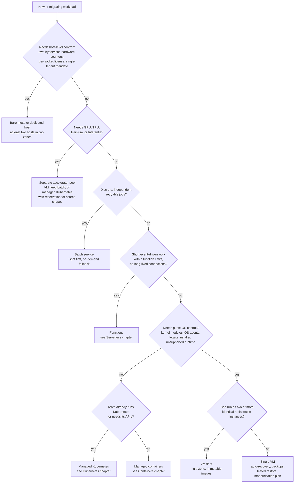

Read the tree from the top. Host-level needs come first because they rule out every shared option. Accelerators come next because their scarcity and cost shape everything else. The batch and function questions identify work that does not need a long-running server at all. Only then does the tree ask whether the workload needs OS control, which is the dividing line between VM-based and container-based options. The final branch, a single VM, is a legitimate outcome for a legacy system that cannot be replicated, but it should always carry a plan that names its recovery time and its route off a single instance.

Two cautions apply. First, a "no" at one level is a measured fact, not a preference: "we would rather not rewrite the installer" is a cost to weigh, not a hard constraint. Second, the tree chooses an abstraction, not a provider product. Within managed containers, for example, ECS on Fargate, Azure Container Apps, and Cloud Run have different scaling, networking, and request-duration contracts; [Containers](CH07_Containers.md) and [Serverless](CH11_Serverless.md) compare them.

## 17. Case study: compute for a freight-tracking platform

### 17.1 Context

A fictional logistics company, here called Northwind Freight, is moving its freight-tracking platform from a colocation facility to AWS, with a requirement to keep the design portable enough to describe on Azure and Google Cloud for a future acquisition. The platform has five workloads:

1. **Tracking API.** Java, stateless, called by customers and partners. Average 1,500 RPS, peak 6,000 RPS on weekday mornings between 07:30 and 10:00, p99 objective 300 ms, availability objective 99.95%, must survive the loss of one zone without manual action.
2. **Route optimization.** Nightly CPU-heavy batch, about 400 vCPU-hours of work, must finish between 01:00 and 05:00. Each route region is an independent job.
3. **Electronic data interchange (EDI) gateway.** Windows Server with third-party middleware licensed per vCPU visible to the OS, about 300 messages per second, must not lose messages.
4. **Estimated time of arrival (ETA) inference.** A gradient-boosted and neural ensemble model with a GPU-accelerated component, about 200 predictions per second, p99 objective 80 ms.
5. **Partner webhooks.** Bursty, small, event-driven callbacks, from near zero up to 2,000 per second during partner batch uploads.

### 17.2 Decisions

**Tracking API: managed containers on Arm.** The decision tree says no host control, no accelerator, not batch, not a function (long-lived connection pools to a cache and database, sustained load), and no OS control. The team does not run Kubernetes. The API goes to Amazon ECS on AWS Fargate, using Arm (Graviton) tasks after a load test showed the same safe throughput per task at lower task cost.

- Sizing: load tests show a safe 250 RPS per 2-vCPU task at the p99 objective. Peak needs 6,000 / 250 = 24 tasks.
- Zonal failure: three zones, statically stable during the peak window, so 24 / 2 = 12 tasks per zone, 36 tasks. Outside the peak window, the minimum drops to 12 tasks (4 per zone), which covers 1,500 RPS average with one zone lost: 8 surviving tasks × 250 = 2,000 RPS.
- Scaling: target tracking on requests per target at 180 RPS per task (72% of safe throughput, leaving room for the scaling lag), plus a scheduled action that raises the minimum to 36 at 07:15 on weekdays and lowers it at 10:30.
- Dependency protection: the database accepts 1,500 application connections; each task uses a pool of 20, so the maximum is 1,500 / 20 = 75 tasks. With 20% deployment surge, the maximum is set to ⌊75 / 1.2⌋ = 62.
- Rejected: an EC2 Auto Scaling group (would add a monthly image and patch cycle for no control the API needs); AWS Lambda (sustained load at 1,500-6,000 RPS with connection pooling fits a long-running service better, and per-request pricing at this volume was higher in the cost model).

**Route optimization: batch on Spot with an on-demand fallback.** Jobs are independent and retryable, so the tree goes to batch. The team uses AWS Batch with two compute environments attached to one job queue in order: a Spot environment first, an on-demand environment second.

- Capacity: 400 vCPU-hours in a 4-hour window needs 100 vCPUs on average. The team targets completion in 2.5 hours to leave margin, so 400 / 2.5 = 160 vCPUs.
- Spot diversification: six compute-optimized and general-purpose instance types across three zones, with the `SPOT_PRICE_CAPACITY_OPTIMIZED` allocation strategy.
- Checkpointing: each job writes its state to object storage every 5 minutes, so an interruption loses at most 5 minutes of one job's work. With the two-minute notice, the worker usually writes a final checkpoint before reclaim.
- Deadline protection: if by 03:00 less than 60% of jobs are complete, an automation raises the on-demand environment's maximum so remaining jobs run on on-demand capacity. The remaining work at that point is at most 40% of 400 = 160 vCPU-hours; at 160 on-demand vCPUs it finishes in about one hour, by 04:00.
- Rejected: a fixed on-demand fleet (paying full price for work that tolerates delay); a Spot-only design (no deadline guarantee).

**EDI gateway: a small VM fleet with SMT disabled.** Windows middleware with no container support needs OS control, and the gateway can run as two active instances behind a network load balancer, so the tree gives a VM fleet.

- Shape: a memory-optimized 16-vCPU x86 type with CPU options set to one thread per core, exposing 8 vCPUs. The middleware counts 8 licensed vCPUs instead of 16. The load test showed that 8 physical cores without SMT handle 450 messages per second, 1.5 times the requirement, so one instance can carry the full load if the other fails.
- Fleet: an Auto Scaling group with minimum and maximum both 2, across two zones, using load-balancer health checks for replacement with a grace period of 600 seconds (bootstrap measured at 7 minutes because the middleware's service start is slow).
- Durability: messages are written to a durable queue before acknowledgment, so an instance loss does not lose messages; the terminate lifecycle hook drains in-flight sessions for up to 5 minutes.
- Patching: monthly image rebuild with EC2 Image Builder and instance refresh with a minimum healthy percentage of 50% and a maximum of 150%, so one new instance is in service before an old one is removed.
- Rejected: Dedicated Hosts (the license does not require single-tenant hardware, and two dedicated hosts would cost several times as much); a single larger VM (one failure unit for a system that must not lose messages).

**ETA inference: a small GPU fleet, with Inferentia evaluated.** The model's neural component needs an accelerator for the latency objective.

- Shape: a single-GPU inference instance type handles 140 predictions per second at p99 70 ms. Requirement 200 per second, so 2 instances at peak, 3 for zone loss tolerance at full load.
- Capacity: a capacity reservation for 3 instances across the zones because GPU launches failed intermittently in testing.
- Evaluation: the team compiled the model for AWS Inferentia using the Neuron SDK. It delivered similar latency at about 40% lower cost per 1,000 predictions in their test, but one operator in the model was unsupported and required a fallback to CPU. They adopted GPUs for launch and scheduled the Inferentia migration once the operator issue was resolved.

**Partner webhooks: functions.** Short, bursty, event-driven work goes to AWS Lambda behind an API with a reserved concurrency limit of 200 to protect the queue writer. Function mechanics are covered in [Serverless](CH11_Serverless.md).

### 17.3 Quota and procurement

The team inventoried vCPU demand at the worst simultaneous moment, a weekday morning during a delayed batch run:

- Route optimization on-demand fallback: 160 vCPUs (standard family quota).
- EDI gateway: 2 instances × 16 vCPUs = 32 vCPUs. The team did not assume that disabling SMT reduces quota consumption, and planned for the instance type's full 16 vCPUs each.
- ETA inference: 3 GPU instances, counted against the GPU family quota.
- Fargate and Lambda have their own service quotas, reviewed separately.

Standard family demand in the worst case is 192 vCPUs plus 20% surge headroom, about 230. Requested quota: 400 to leave room for a future disaster-recovery role. The GPU family quota was raised to cover 6 instances, twice the reservation, so a rolling replacement can surge.

Commitments were deferred for three months, until production usage established the floor. After three months, the team bought a Compute Savings Plan sized to the overnight floor of the tracking API's Fargate usage plus the EDI gateway, because a Compute Savings Plan covers both Fargate and EC2 and survives a family change.

### 17.4 Validation evidence

| Test | Result |
|---|---|
| Load test of tracking API to 7,200 RPS (120% of peak) | p99 260 ms at 36 tasks; scaling from 12 to 36 tasks under an unscheduled ramp completed in 3 minutes 40 seconds |
| Zone-loss game day during simulated peak | One zone's tasks stopped; error rate peaked at 0.3% for 40 seconds; no scaling required to hold p99 under 300 ms |
| Spot interruption test with AWS Fault Injection Service on batch | 20% of Spot workers interrupted mid-run; jobs resumed from checkpoints; run finished at 03:55 |
| EDI instance termination | Surviving instance carried 300 messages per second; no message loss; replacement in service in 8 minutes |
| GPU launch failure drill | Launch outside the reservation failed with insufficient capacity; reserved instances unaffected |
| IMDS check | Organization policy rejects any launch template without `HttpTokens=required`; SSRF test against the tracking API's URL-fetch feature failed to obtain credentials |

### 17.5 Equivalent designs on Azure and Google Cloud

| Workload | Azure | Google Cloud | Material differences |
|---|---|---|---|
| Tracking API | Azure Container Apps | Cloud Run | Scaling rules, minimum instances, and concurrency settings differ; verify request timeouts and zone redundancy settings |
| Route optimization | Azure Batch with Spot nodes and dedicated-node fallback | Google Cloud Batch with Spot VMs | 30-second notice instead of two minutes, so checkpoints must be more frequent or final checkpoints smaller |
| EDI gateway | Flexible scale set of two Windows VMs across zones, constrained-vCPU size for licensing | Regional MIG of two Windows VMs with visible core count reduced | Google Cloud live-migrates during maintenance; Azure uses memory-preserving updates |
| ETA inference | NC-series VMs with on-demand capacity reservation | G2 VMs with a reservation | GPU VMs on Google Cloud stop for host maintenance rather than live-migrate |
| Webhooks | Azure Functions | Cloud Run functions | Concurrency and scaling limits differ; see Serverless chapter |

## 18. Common mistakes and anti-patterns

**Sizing by average CPU.** Cause: the CPU graph is the easiest metric to find. Consequence: memory-bound, network-bound, or I/O-bound workloads are given the wrong family, and teams buy more vCPUs that sit idle while the real bottleneck remains (section 3.8).

**Converting shapes by vCPU count.** Cause: assuming one vCPU is a fixed unit. Consequence: an x86 SMT vCPU and an Arm vCPU deliver different throughput, so a migration either over-buys or misses its latency target. Convert by measured safe throughput.

**Burstable shapes for steady load.** Cause: the low hourly price. Consequence: credits drain within hours under sustained load, the instance throttles to baseline, or unlimited-mode surplus charges exceed the price of a standard shape.

**Secrets in user data or images.** Cause: bootstrap needs credentials and user data is convenient. Consequence: anyone who can read launch configuration or the metadata endpoint, and every log that captures bootstrap output, has the secret, and rotation requires rebuilding images.

**Leaving IMDSv1 enabled or using an over-privileged instance identity.** Cause: default settings in older templates, and broad roles granted to "get it working". Consequence: a single SSRF bug becomes account-level compromise.

**Health check grace period shorter than bootstrap.** Cause: default values and bootstrap times that grow over time. Consequence: a replacement loop in which every new instance is killed before it becomes healthy, often triggered by a deploy that adds a few seconds to startup.

**Replacement checks that test shared dependencies.** Cause: one deep health endpoint used for both traffic admission and replacement. Consequence: a database outage causes the fleet controller to replace every instance, destroying evidence and adding boot load during the incident.

**Autoscaling on a saturating signal only.** Cause: CPU is the default metric. Consequence: the controller under-shoots during overload (section 7.6) and can scale in when a stalled dependency lowers CPU.

**No maximum, or a maximum unrelated to dependencies.** Cause: treating the maximum as a cost cap. Consequence: scale-out exhausts database connections or third-party rate limits, turning a traffic spike into an outage.

**Counting instances in one zone as redundancy.** Cause: replicas launched from a single-zone template or subnet. Consequence: a zone failure removes every replica at once.

**Relying on scale-out to recover from a zone loss.** Cause: the capacity model counts capacity that could be launched, not capacity that is running. Consequence: during a regional event, launches compete with every other customer and may fail when they are needed most (section 8.5).

**All-Spot critical services, or single-pool Spot fleets.** Cause: chasing the discount. Consequence: one reclaim wave removes most of the capacity at once, and a 30-second or two-minute notice is not enough to replace it.

**Committing before measuring.** Cause: wanting the discount immediately. Consequence: commitments sized to average or forecast usage leave paid, unused hours, or lock the estate to a family or region it later leaves (section 9.3).

**Treating quota as capacity.** Cause: a quota increase is approved and the team assumes launches will succeed. Consequence: insufficient-capacity errors during the event the quota was raised for.

**Referencing "latest" images in production templates.** Cause: convenience of image families or latest-AMI lookups at launch time. Consequence: a scale-out launches an untested image, and two instances in the same fleet run different software.

**One large VM as the availability plan.** Cause: the workload is easier to run on one machine. Consequence: a host failure, maintenance event, or bad patch takes the whole service down, and recovery time equals restart or restore time.

## 19. Design-review checklist

Use this list when reviewing a compute design. Each item should have evidence, not just an answer.

- **Abstraction.** Which point on the spectrum was chosen, which hard constraint blocks the next point to the right, and what evidence shows that constraint is real?
- **Shape.** What is the binding resource, measured how? What is the safe per-instance throughput at the latency objective? Was price compared per unit of safe throughput?
- **vCPU semantics.** Does the design account for SMT versus non-SMT vCPUs, and for per-core licensing?
- **Burstable shapes.** If used, is average load below baseline, and is the credit balance monitored?
- **Network and storage ceilings.** Are per-instance and per-flow network limits and attached-storage throughput limits above the workload's needs?
- **Local disks.** Is every byte on local NVMe either a cache, scratch, or replicated by software?
- **Accelerators.** Is there a separate pool, a capacity plan for scarce shapes, device-level utilization monitoring, and checkpointing for maintenance stops?
- **Images.** Is every production template pinned to a specific, scanned, versioned image? What is the rebuild cadence, and does it meet the patch policy?
- **Bootstrap.** Is bootstrap idempotent, free of secrets, and limited in external dependencies? What is its measured 95th-percentile duration?
- **Metadata protection.** Is IMDSv2 required on AWS? Are instance identities least-privilege? Is egress filtered?
- **Health.** Are replacement checks shallow and traffic checks deeper? Is the grace period longer than worst-case bootstrap?
- **Rollouts.** What are the batch size, surge, minimum healthy, bake time, and rollback trigger? Is there quota for surge?
- **Drain.** Is the drain timeout longer than the slowest normal request, and do workers handle shutdown signals?
- **Autoscaling.** Which demand signal is used, and does it saturate? Are warm-up and stabilization set from measurements? Are scheduled actions in place for known events?
- **Bounds.** Is the minimum sized for zone loss? Is the maximum derived from the most constrained dependency, including surge?
- **Placement.** How many zones, how is balance enforced, and does the design survive zone loss with running capacity or only with launched capacity?
- **Within-zone placement.** Are quorum members or replicas on distinct hardware where it matters?
- **Procurement.** What is the measured usage floor, and what fraction is committed? What is reserved for capacity? What runs on Spot, with what diversification and fallback?
- **Quotas.** What is the worst-case simultaneous vCPU demand per family and region, including surge and failover, and how does it compare with approved quota?
- **Patching and maintenance.** Who patches the guest OS, by which model, on which cadence? How are provider maintenance events handled?
- **Observability.** Are desired versus in-service capacity, launch errors by class, bootstrap time, replacement rate, quota utilization, and Spot interruptions monitored with owned alerts?
- **Cost.** Are non-instance lines (storage, IPs, transfer, logs, licenses) included in the cost model?

## 20. Exercises

### 20.1 Interview questions

1. A service shows 30% CPU but misses its latency objective at peak. How would you determine whether the shape is wrong, and what would you measure?
2. Explain why a 4-vCPU x86 shape and a 4-vCPU Arm shape can deliver different throughput, and how that affects licensing.
3. Walk through what happens between an autoscaler deciding to add capacity and that capacity serving traffic. Which steps can fail, and how would you see each failure?
4. Why does CPU-based target tracking under-shoot during overload? What signal would you use instead for a web fleet and for a queue worker?
5. Compare AWS IMDSv2 with the Azure and Google Cloud metadata protections. Which SSRF bugs does each defeat, and what controls remain necessary on all three?
6. What is the difference between a commitment discount and a capacity reservation? Give a workload that needs both.
7. A quota increase was approved, but launches still fail. What are the likely causes, and how do you design around them?

### 20.2 Design exercises

1. **Planned surge.** An e-commerce API normally serves 2,000 RPS and expects 10,000 RPS for two hours during a sale announced a week in advance. Safe throughput is 300 RPS per instance, bootstrap takes 5 minutes, and the database allows 3,000 connections with 50 per instance. Design the scaling policies, bounds, and capacity procurement. Show your arithmetic for the maximum.
2. **Spot rendering.** A rendering farm processes 5,000 frames per night, each taking 6 minutes on one 8-vCPU instance, with an 8-hour window. Design the Spot strategy on Google Cloud, including diversification, checkpoint frequency given a 30-second notice, and an on-demand fallback trigger.
3. **Licensed legacy system.** A database licensed per physical core runs on one VM today. The business wants zone-failure tolerance. Compare dedicated hosts, SMT-disabled shapes, and a replicated pair on standard VMs, including licensing, cost, and recovery time.
4. **Zone-loss audit.** You inherit a regional MIG with distribution shape `ANY` serving a customer-facing API. Explain the risk, propose a change, and design a game day that proves the change works.

### 20.3 Hands-on exercises with the code examples

1. Run the capacity estimator, then change the headroom factor from 1.5 to 1.2 and to 2.0. Explain what each value implies about zone loss and scaling lag.
2. Run the autoscaling controller and add a stabilization rule that never scales in by more than 2 workers per step. Re-run the queue series and compare the worker counts.
3. Run the interruptible capacity example and change it so interrupted workers lose only half a job's work (a checkpoint halfway). How do completed and retried counts change?
4. Run the placement checker, then change it to count only running replicas rather than nominal zone capacity. Which example placements now fail?

## 21. Summary

Compute selection starts with the abstraction spectrum: choose the most managed form whose constraints the workload can live with, because each step to the right removes patching and capacity toil, and stop where a hard constraint such as OS control, host-level licensing, accelerators, or execution limits blocks the next step. Within the chosen form, match shapes to measured binding resources, remember that vCPUs differ between SMT x86 and Arm, avoid burstable shapes for steady load, and check network, storage, and local-disk properties as carefully as CPU and memory.

Treat images as versioned, scanned release artifacts, keep bootstrap idempotent and secret-free, and protect the metadata service, because it hands out the instance's credentials. Run production VMs as fleets with templates, health-based replacement, grace periods longer than bootstrap, rolling replacement with known surge and minimum-healthy settings, and drain on termination.

Tune autoscaling as a feedback controller: use demand signals that do not saturate, set warm-up and stabilization from measurements, act ahead of known events with schedules, shorten dead time with warm pools, and derive the maximum from the most constrained dependency. Spread capacity across zones and, where it matters, across racks; prefer static stability for critical tiers over recovery that depends on launches during a regional event. Buy capacity in layers: commit to the measured floor, reserve what must be guaranteed, run on-demand for the variable part, and use diversified Spot for retryable work. Plan quota for the worst simultaneous moment, including surge and failover, and remember that quota is not capacity. Finally, own the guest OS: patch by replacement where you can, in place where you must, and include every line of the compute bill in the cost model.

## 22. Code examples

The examples are in [`code/python/compute-chapter/`](../code/python/compute-chapter/). They use only the Python standard library (Python 3.10 or later), synthetic inputs, and normalized cost units; they do not call cloud APIs or represent provider prices.

- [01_capacity_shape_estimator.py](../code/python/compute-chapter/01_capacity_shape_estimator.py) computes instance count and normalized monthly cost from peak load, measured per-instance throughput, and a headroom factor (section 3.8).
- [02_autoscaling_controller.py](../code/python/compute-chapter/02_autoscaling_controller.py) applies a bounded backlog-per-worker scaling law to a queue-depth series and shows hold, scale-out, and scale-in decisions without stabilization (section 7.6).
- [03_interruptible_capacity.py](../code/python/compute-chapter/03_interruptible_capacity.py) compares stable and interruptible workers for a batch run and counts work lost to reclaim when jobs are not checkpointed (section 9.5).
- [04_placement_checker.py](../code/python/compute-chapter/04_placement_checker.py) checks replica spread across zones and remaining nominal capacity after each zone is lost, and illustrates how counting launchable capacity hides a control-plane dependency (section 8.5).
