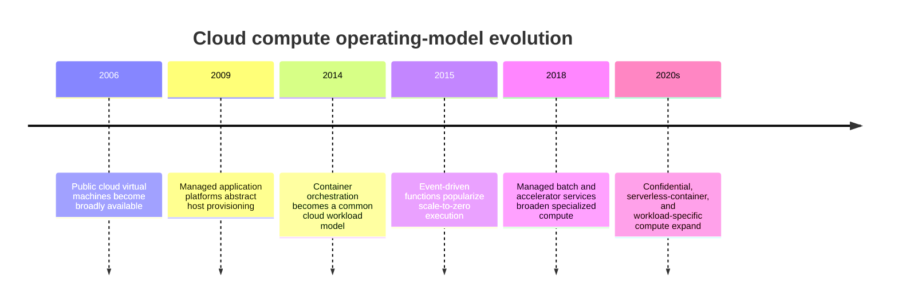
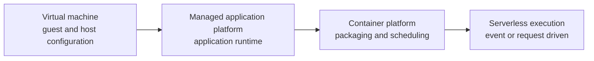
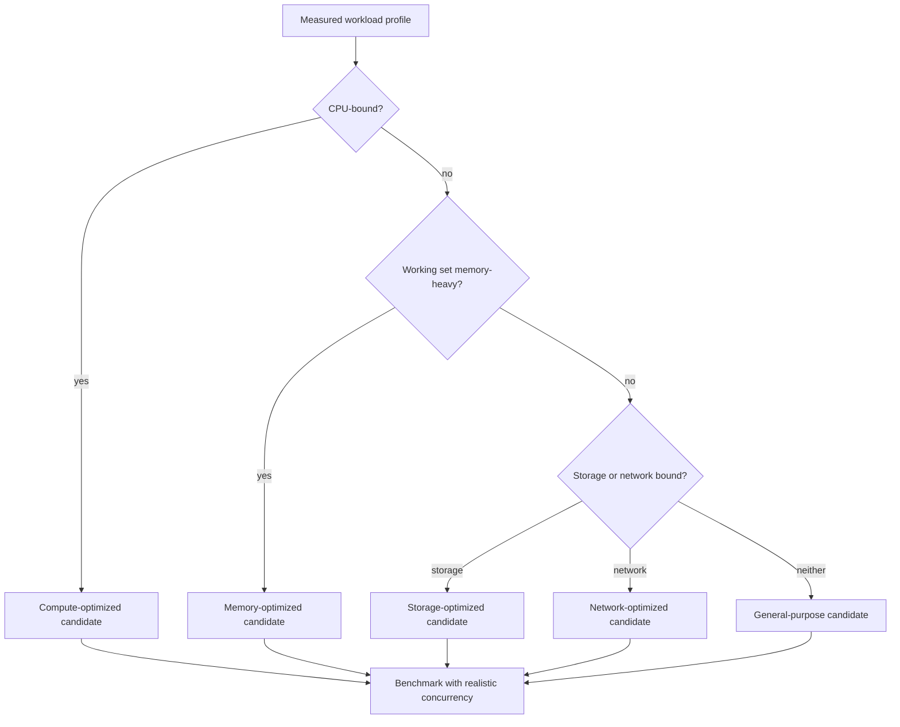
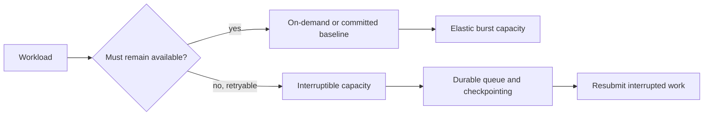
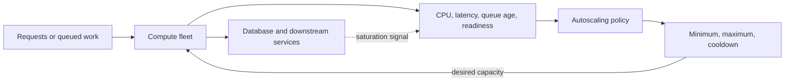
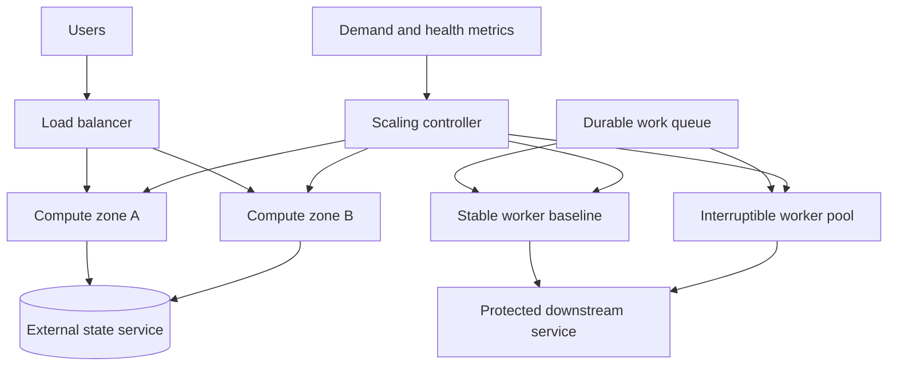

# Chapter: Cloud Compute Architecture

Part: [09 — Cloud Computing](PART_OVERVIEW.md) · Status: Drafted

## 1. Introduction

Cloud compute is the set of services and operating models used to execute application code in provider-hosted capacity. Options range from Infrastructure as a Service (IaaS) virtual machines (VMs) to managed application platforms, batch services, containers, and serverless runtimes. The choice determines how much capacity, host configuration, scaling, deployment, and recovery the workload team owns.

This chapter focuses on cloud-facing compute decisions: workload fit, instance shape, placement, capacity procurement, image lifecycle, and autoscaling. Part 05 owns hypervisor, guest-kernel, and container-isolation mechanics. Part 09's Containers, Kubernetes, and Serverless chapters own those service models in detail. The goal here is to match execution needs to an operating model rather than treating instance size as the whole compute architecture.

## 2. Historical Evolution

Cloud compute evolved from rentable virtual machines into a spectrum of managed execution services. Early virtual-machine offerings made capacity available through application programming interfaces (APIs). Teams could then provision, replace, and decommission servers without physical procurement. Autoscaling groups, managed application platforms, container schedulers, batch services, and functions later shifted more lifecycle and capacity work to the provider.

These models coexist because workloads differ in runtime, state, latency, isolation, hardware, and operational needs. A newer service does not automatically replace a VM fleet; it changes the constraints and responsibilities that must be evaluated.

## 3. Why It Exists

Compute capacity is a workload resource and a failure boundary. Provisioning too little can cause queue growth and missed latency objectives; provisioning too much can waste money and still fail to meet availability goals if all capacity shares one failure domain. Cloud providers make capacity acquisition more flexible, but quotas, regional supply, startup time, image readiness, and dependency limits still constrain scaling.

Compute architecture therefore asks more than “how many cores?” It asks what execution model fits, which hardware characteristics matter, where capacity should run, how it is replaced, how it scales, and what happens when capacity is unavailable or interrupted. Those answers affect the application, deployment system, network, data tier, security boundary, and cost model.

## 4. Core Concepts

### 4.1 Compute service models and responsibility boundaries

**Definition.** A compute service model describes which layer runs the workload and which party provisions and operates the surrounding execution environment. VMs expose guest operating-system control. Managed platforms operate more host layers. Container platforms schedule packaged workloads but still require workload and platform configuration. Serverless services abstract capacity management for defined execution patterns.

**Mechanism.** A VM request specifies a machine shape and image; the provider allocates a host and starts a guest instance. A managed application platform accepts application artifacts or containers and owns more of the host lifecycle. A batch service coordinates queued work and temporary workers. A function service starts execution in response to an event or request and may scale independently of a continuously running fleet. Each model has its own quota, startup, networking, runtime, and failure behavior.

**Decision implications.** Select the highest abstraction that satisfies runtime control, performance, networking, security, portability, and recovery requirements. Compare operational work transferred with the constraints introduced; “managed” is not itself a workload requirement.

**Common failure mode.** A team selects a function runtime for a long-running process with specialized hardware, then discovers execution and startup constraints. The reverse is keeping a large VM estate for simple stateless work when a managed platform would safely remove routine host operations.

**Scenario.** A daily media-conversion job is queued, independent, and retryable. A batch service or event-driven workers may match better than an always-on VM fleet. A latency-sensitive API with a custom native runtime may still require a long-running managed container or VM deployment.

### 4.2 Machine shape and workload resource profile

**Definition.** A machine shape is a provider-defined bundle of virtual central processing unit (vCPU), memory, network, storage, accelerator, and sometimes licensing characteristics. A workload profile describes its sustained and peak demands, including central processing unit (CPU) utilization, memory working set, input/output (I/O), network throughput, accelerator needs, and concurrency.

**Mechanism.** Families optimize different resource ratios: general purpose balances vCPU count and memory; compute-optimized provides more vCPUs per unit of memory; memory-optimized targets large working sets; storage-optimized targets local or attached I/O; accelerator instances expose graphics processing units (GPUs) or other specialized devices. Names and ratios vary by provider and generation. A shape with adequate average CPU utilization can still bottleneck on memory bandwidth, network limits, local disk, or accelerator availability.

**Decision implications.** Measure representative load and select a candidate shape based on the limiting resource, not vendor naming. Include per-instance quotas, attached volume throughput, network ceilings, and regional availability in the comparison. Re-benchmark after major runtime or data changes.

**Common failure mode.** Rightsizing only by average CPU or selecting the newest generation without checking supported regions, machine quotas, storage constraints, or licensing. Another failure is optimizing instance price while ignoring the instance count required to meet latency.

**Scenario.** A Java application programming interface (API) service shows low CPU utilization but frequent garbage-collection pauses and high resident memory. A memory-optimized shape with a smaller fleet performs better than a compute-optimized shape, even though the latter has a lower per-vCPU price.

### 4.3 Placement, failure domains, and affinity

**Definition.** Placement determines the physical or logical location where compute runs: region, zone, host group, edge location, or provider-managed placement domain. Affinity and anti-affinity rules express which workloads should share or avoid sharing placement domains.

**Mechanism.** A zonal VM depends on a specific zone and often zone-scoped storage. Regional managed fleets can distribute instances across zones according to provider configuration. Host groups or dedicated hosts can constrain placement for licensing, isolation, or performance. Placement policies may reduce correlated failure but also limit available capacity and create scheduling constraints.

**Decision implications.** Place redundant replicas in distinct failure domains when the availability objective requires it, while measuring cross-zone latency and data-transfer cost. Pin workloads only when licensing, locality, or hardware needs justify reduced flexibility. Verify how placement behaves during scale-out and recovery.

**Common failure mode.** Multiple instances are counted as redundant even though they share one zone or host group. Another failure is hard-pinning a fleet and then discovering that the target region lacks capacity during an incident.

**Scenario.** An online service needs to survive a zone outage. Its stateless fleet is distributed across zones, while the data service has an independently verified regional mode. The recovery test removes one zone's capacity and checks whether quota, balancing, and downstream limits allow the remaining zones to carry load.

### 4.4 Capacity procurement: on-demand, commitments, and interruption-prone capacity

**Definition.** Cloud capacity can be purchased on demand, reserved or committed for a term, or acquired at a discount when provider capacity is interruptible. Product names differ, but the economic distinction is between flexible unit pricing, committed usage, and lower-cost capacity with weaker availability guarantees.

**Mechanism.** On-demand capacity is requested when needed and is generally the most flexible, but remains subject to quota and supply. Reservations or commitments exchange flexibility for a lower effective rate or capacity assurance under specified terms. Spot, preemptible, or spare capacity is offered at a discount and may be reclaimed by the provider with limited notice. The application must checkpoint, retry, or replace interrupted work.

**Decision implications.** Keep an availability baseline on capacity the workload can rely on, and use interruptible capacity only for work that can tolerate loss and retry. Analyze commitment utilization, cancellation terms, regional supply, and the operational cost of diversification.

**Common failure mode.** Placing all production capacity on discounted interruptible instances, or purchasing commitments against optimistic forecasts that do not match eventual instance families and regions.

**Scenario.** A rendering fleet keeps enough stable workers to drain urgent jobs within the service objective and fills the remaining queue with interruptible workers. Each job is idempotent and checkpointed, so a provider interruption delays work but does not lose completed progress.

### 4.5 Autoscaling as a feedback controller

**Definition.** Autoscaling changes capacity in response to measured workload or resource signals. It is a feedback controller with a target, observation window, scale action, startup delay, and stabilization policy. It is not an unlimited supply guarantee.

**Mechanism.** A metric such as CPU, queue age, request concurrency, or custom demand is sampled. A policy compares the measured value with a target and computes a desired instance count. The platform applies bounds, cooldowns, and readiness checks while instances boot and join service. Scale-in removes capacity only after drain or termination policy. Signals and actions are delayed, so aggressive scaling can oscillate or arrive too late.

**Decision implications.** Scale on the signal closest to user demand while protecting downstream dependencies. Choose minimum and maximum capacity, warm-up time, cooldown, scale-in drain, and quota headroom intentionally. Keep a fixed or reserved baseline for workloads that cannot tolerate cold starts.

**Common failure mode.** CPU remains low while queue age rises, so the fleet never scales; or autoscaling responds to CPU by overwhelming a database. A short cooldown can also cause repeated scale-out/scale-in oscillation.

**Scenario.** An asynchronous worker fleet scales on oldest-message age and has a maximum concurrency derived from database capacity. A minimum of two workers handles steady traffic; queued jobs absorb burst demand while the controller adds capacity.

### 4.6 Images, bootstrap, and instance lifecycle

**Definition.** A machine image captures an operating-system and software baseline; bootstrap configures an instance at launch; lifecycle management handles creation, replacement, patching, draining, and retirement. Immutable replacement reduces configuration drift when the workload can be recreated from versioned artifacts.

**Mechanism.** A launch template references an image, machine shape, identity, network, storage, and startup configuration. The orchestration layer creates capacity and health-checks it. Bootstrap obtains configuration and secrets, registers the instance, and signals readiness. Deployments replace instances in batches, drain connections, and roll back or forward based on health. Image pipelines patch, scan, version, and retain known-good images.

**Decision implications.** Keep images reproducible and small, separate secrets from images, and make bootstrap idempotent. Select in-place patching or immutable replacement based on statefulness, compliance, and recovery requirements. A launch that succeeds is not ready until application health and dependencies are verified.

**Common failure mode.** A mutable image tag or ad hoc bootstrap script makes fleet members inconsistent. Another failure is a replacement fleet that cannot start because its image, secrets, or control-plane dependency is unavailable during an incident.

**Scenario.** A production fleet uses signed, versioned images produced by a controlled pipeline. A canary group receives a new image; health and latency gates decide whether the rest of the fleet rolls forward. Stateful data remains on separately managed storage.

### 4.7 Compute workload-fit decision

Workload fit compares execution duration, state, protocol, runtime customization, startup latency, scaling pattern, hardware, network access, and operational ownership. A long-running service, a batch job, a GPU training task, and a scheduled function have different control needs even if all execute code.

Use hard constraints to eliminate unsuitable models, then compare operating burden, resilience, performance, portability, and cost. The cloud provider service overview chapters explain product catalogs; this chapter's service-area scope is the decision logic common across them.

## 5. Internal Working

A VM-based deployment typically defines an image, machine shape, network interfaces, identity, disks, placement, and lifecycle policy. A control plane allocates capacity and boots the guest; bootstrap configures application dependencies; health checks decide whether the instance joins traffic. Autoscaling controllers observe metrics and request changes, but capacity becomes useful only after startup, configuration, and readiness complete.

The path from desired capacity to serving capacity includes quota checks, regional supply, image retrieval, instance initialization, secrets access, registration, and load-balancer health. A scale policy should therefore account for end-to-end startup time. For burst workloads, queues, warm pools, pre-provisioned baseline capacity, or managed execution can bridge that delay.

## 6. Design Principles

- Select execution models from workload constraints, not service fashion.
- Profile CPU, memory, storage, network, and accelerator needs under realistic load.
- Place redundant capacity across independent failure domains.
- Maintain a stable baseline for critical services and burst only within dependency limits.
- Use interruptible capacity only for retryable or checkpointed work.
- Scale on demand signals while protecting downstream services.
- Treat images and launch configuration as versioned, tested artifacts.
- Drain gracefully and verify application health before routing traffic.
- Model quota and regional capacity as operational constraints.

## 7. Architecture Patterns

**Stateless autoscaled service.** A load balancer distributes requests to replaceable instances across zones. Health checks control admission, and external state is stored in managed data services.

**Queue-backed elastic workers.** A durable queue absorbs burst demand; workers scale on backlog age while a concurrency cap protects downstream systems. Retry and idempotency mechanics belong to the messaging and distributed-systems chapters.

**Stable baseline plus interruptible workers.** Critical demand uses reliable capacity; retryable overflow uses discounted interruptible instances. The queue or scheduler resubmits interrupted work.

**Specialized accelerator pool.** GPU or other accelerator workloads use a separate pool with explicit quota, image, driver, placement, and utilization controls. Avoid reserving expensive hardware without measured scheduling demand.

## 8. Production Architecture

Production architecture defines how instances are created, drained, replaced, patched, and recovered. It also assigns ownership for image security, quota, scaling bounds, health checks, and downstream protection.

## 9. Implementation

1. Classify each workload as request-serving, batch, event-driven, accelerator-bound, or mixed.
2. Measure the bottleneck dimensions and startup/readiness time.
3. Identify hard constraints: runtime, isolation, network, location, compliance, and recovery.
4. Compare VM, managed platform, container, and serverless choices without duplicating their detailed chapters.
5. Select instance families, placement, stable capacity, and optional interruptible capacity.
6. Define image build, scan, rollout, health, drain, and rollback processes.
7. Tune autoscaling signals, min/max, cooldown, warm-up, and downstream concurrency limits.
8. Validate quotas, regional supply, load behavior, and recovery under failure.

## 10. Complete Code Examples

- [Compute capacity and shape estimator](../code/python/compute-chapter/01_capacity_shape_estimator.py)
- [Autoscaling feedback simulation](../code/python/compute-chapter/02_autoscaling_controller.py)
- [Interruptible worker replacement simulation](../code/python/compute-chapter/03_interruptible_capacity.py)
- [Placement and failure-domain checker](../code/python/compute-chapter/04_placement_checker.py)

Run with Python 3.10 or later. The examples use only the standard library, synthetic inputs, and normalized cost units; they do not call cloud APIs or represent provider prices.

## 11. Performance

Performance depends on instance generation, workload profile, placement, network path, storage, and startup. Benchmark end-to-end user latency and throughput, not only CPU. Measure tail latency, memory pressure, disk and network throughput, accelerator utilization, and dependency saturation under realistic concurrency.

Right-size after removing avoidable application bottlenecks. Compare vertical scaling with horizontal scaling, accounting for state, coordination, and per-instance overhead. Re-test after machine-family changes because CPU generation, memory bandwidth, and network limits can alter behavior even when vCPU counts match.

## 12. Scalability

Horizontal scaling adds workers; vertical scaling increases per-instance resources. Horizontal scaling can improve fault tolerance and burst capacity but requires suitable state and coordination design. Vertical scaling can simplify tightly coupled workloads but has finite size limits and may increase replacement risk.

Autoscaling requires observable demand, available quota, capacity in the target location, and time for new instances to become healthy. Queue-based smoothing can protect systems from sudden spikes, while maximum concurrency limits protect dependencies. Test both scale-out and scale-in behavior.

## 13. Security

Use hardened, patched images; restrict administrative access; attach workload identities with minimal permissions; encrypt disks and network traffic; and isolate management access from application traffic. Keep secrets out of images and startup logs. Use dedicated hosts or confidential-compute options only where isolation, compliance, or licensing requirements justify their cost and constraints.

The provider operates physical hosts and the virtualization layer, but the customer remains responsible for guest configuration, application security, data access, and identity. Part 05 owns hypervisor internals; this chapter focuses on the cloud customer controls around compute.

## 14. Observability

Collect host and application metrics: CPU, memory, disk, network, process health, request latency, queue age, and startup duration. Track desired, pending, healthy, and terminated capacity separately. Emit lifecycle events for scale decisions, image versions, health-check failures, and interruption notices.

Alert on signals that have an owner and action: capacity nearing maximum, quota headroom, failed bootstraps, repeated health-check replacement, sustained queue age, or expensive idle accelerators. Correlate fleet changes with deployment and dependency telemetry.

## 15. Failure Scenarios

| Failure | Likely symptom | Architectural response |
|---|---|---|
| Zone capacity loss | Instances fail or replacement capacity cannot launch | Shift to other zones and reserve quota headroom |
| Quota exhaustion | Scale-out request is denied | Alert on headroom and request quota before release |
| Bad image | New instances fail readiness | Stop rollout, restore known-good image, preserve launch metadata |
| Bootstrap dependency failure | Instances remain pending or unhealthy | Reduce boot dependencies and keep tested cached artifacts |
| Interruptible capacity reclaimed | Worker count drops | Checkpoint, retry, and keep stable baseline capacity |
| Autoscaler oscillation | Repeated scale-out and scale-in | Increase stabilization and use a less noisy demand signal |
| Downstream saturation | Added compute increases errors and latency | Cap concurrency, apply backpressure, and scale the dependency deliberately |
| Credential or identity outage | New instances cannot access dependencies | Maintain least-privilege recovery identity and avoid embedded secrets |

Recovery procedures must distinguish failed capacity from failed application, identity, image, network, or dependency paths. Replacing instances is useful only if the replacement can boot and become healthy under the incident conditions.

## 16. Testing

Load-test representative instance shapes and verify throughput and tail latency. Test image builds, bootstrap failure, rolling replacement, graceful drain, and rollback. Simulate capacity interruption for retryable workers and verify that checkpoints and idempotency prevent lost or duplicated effects.

Exercise autoscaling with realistic demand traces, including sudden bursts and sustained load. Confirm minimum and maximum boundaries, quota behavior, downstream protections, and recovery when one zone cannot supply capacity. Test accelerator jobs against real driver and scheduling constraints before committing capacity.

## 17. Common Mistakes

- Choosing a machine shape from average CPU alone.
- Treating instances in one zone as independent replicas.
- Scaling compute without checking database and network capacity.
- Using interruptible capacity for non-retryable stateful work.
- Assuming a successful launch request means the application is ready.
- Baking credentials into images or startup scripts.
- Setting autoscaling bounds without quota or regional supply checks.
- Keeping mutable, undocumented images in production.

## 18. Best Practices

- Benchmark representative profiles and document why a machine family fits.
- Use multi-zone placement for workloads with zone-failure requirements.
- Keep a stable capacity baseline for critical traffic.
- Use queues and concurrency limits to absorb bursts safely.
- Build immutable, scanned, versioned images and use canary rollouts.
- Make bootstrap idempotent and minimize external startup dependencies.
- Observe scaling decisions, capacity state, and interruption events.
- Review utilization and commitment coverage against actual usage regularly.

## 19. Anti-Patterns

**One large instance as the availability plan.** A large VM can simplify an application but remains a single failure and maintenance boundary. Use it only when the workload accepts that risk or has another tested recovery mechanism.

**Autoscale everything to zero.** Cold starts, quota, and bootstrap can violate latency objectives. Scale-to-zero is appropriate only when its startup delay and availability trade-off are accepted.

**Commit before measurement.** Long-term discounts can lock an organization into the wrong family, region, or baseline. Measure stable demand and preserve flexibility for uncertain or seasonal load.

**Treat spot capacity as guaranteed.** Discounted capacity can be reclaimed. It belongs behind retry, checkpoint, and replacement logic, not as the sole foundation for a critical synchronous path.

## 20. Trade-off Analysis

| Choice | Benefits | Costs and risks | Choose when |
|---|---|---|---|
| VM fleet | Runtime control and broad compatibility | Guest lifecycle and patch responsibility | Workload needs OS or runtime control |
| Managed application platform | Less host operations | Runtime and platform constraints | Application fits supported platform model |
| Vertical scaling | Simpler coordination | Finite size and larger failure unit | Workload scales efficiently on one host |
| Horizontal scaling | Elasticity and placement redundancy | State and coordination complexity | Work can be partitioned or replicated |
| Capacity commitment | Lower effective cost or reserved capacity | Reduced flexibility | Baseline demand is measured and stable |
| Interruptible capacity | Lower cost for spare capacity | Reclamation and retries | Work is restartable and delay-tolerant |

## 21. Comparison Table

| Dimension | Compute Engine / Amazon Elastic Compute Cloud (EC2) / Azure Virtual Machines | Managed platform | Serverless runtime |
|---|---|---|---|
| Host control | Highest customer control | Shared by provider and customer | Lowest host control |
| Startup behavior | Image and guest boot | Platform-dependent | Trigger and runtime-dependent |
| Scaling unit | Instance or instance group | Application instance or replica | Request, event, or execution unit |
| Operational burden | Guest patching and fleet lifecycle | Runtime and platform configuration | Application, trigger, limits, and observability |
| Typical fit | Legacy, custom OS, specialized runtime | Web applications and managed workloads | Bursty, event-oriented, short-lived tasks |
| Main constraint | Fleet maintenance and capacity planning | Supported runtime and platform limits | Execution, concurrency, and cold-start semantics |

The table is a decision aid, not a guarantee; compare actual provider service contracts. Containers, Kubernetes, and serverless receive their own Part 09 chapters.

## 22. Real-World Case Study

### Netflix's cloud compute operating model

Netflix's [technology blog](https://netflixtechblog.com/) documents its use of AWS infrastructure and engineering practices for a globally distributed streaming service. Its architecture uses elastic cloud capacity as one component of a broader system that includes regional deployment, service discovery, resilience mechanisms, and application-level recovery. This is not a claim that compute scaling alone provides Netflix's availability.

The compute lesson is to design capacity as replaceable and to treat failures as expected operating conditions. A fleet needs health-based admission, deployment controls, and enough regional or zonal capacity to handle the loss of part of the estate. Elasticity helps the system react to demand, but only when quotas, dependency capacity, and failure behavior are engineered with it.

For a smaller service, copying Netflix's scale would be wasteful. The transferable decision is to identify the failure unit, define the capacity needed after its loss, and rehearse replacement under load. The right target may be two zones and a modest warm baseline rather than global active-active infrastructure.

## 23. Interview Questions

1. How do you select a compute model for a long-running API versus a batch job?
2. Why is instance count not sufficient evidence of high availability?
3. How do you choose between vertical and horizontal scaling?
4. Which signals should drive an autoscaler for an asynchronous worker?
5. When is interruptible capacity appropriate, and what application changes does it require?
6. What does a successful instance launch prove about application readiness?
7. How do machine-family choices affect network, memory, storage, and accelerator limits?
8. How do commitments change the capacity and cost risk profile?

## 24. Hands-on Exercises

1. Run the capacity estimator with CPU-bound and memory-bound profiles and compare candidate shapes.
2. Run the autoscaler simulation with a bursty demand series. Change cooldown and maximum capacity and observe queue behavior.
3. Simulate interruption of a worker pool and compare retryable with non-retryable tasks.
4. Run the placement checker with two instances in the same zone and then in separate zones; explain what the simplified check cannot prove.

## 25. Design Exercises

1. Design compute for a low-latency API with a predictable baseline and a 5x traffic burst. Include quotas and database concurrency limits.
2. Design a batch video-transcoding service that uses interruptible capacity without losing completed work.
3. Select a compute model for a legacy application requiring a custom kernel module and a separate modernization target for a stateless API.
4. Design a regional recovery plan that can operate after losing one zone, including instance supply and image/bootstrap dependencies.

## 26. Architecture Review Questions

- Are machine shapes supported by workload measurements and required accelerators?
- Is critical capacity distributed across intended failure domains?
- Are quota, regional supply, and recovery capacity verified?
- Do autoscaling signals reflect demand and protect downstream dependencies?
- Can instances be replaced safely through versioned images and idempotent bootstrap?
- Is interruptible capacity limited to checkpointed or retryable work?
- Are health checks, draining, rollout gates, and rollback behavior tested?
- Are capacity commitments based on measured stable demand?

## 27. Summary

Cloud compute architecture chooses how code executes, which resource profile it needs, where capacity runs, how it is procured, and how it scales or fails. VMs, managed platforms, containers, and serverless services transfer different operating responsibilities and impose different constraints. Measure workload behavior, keep critical capacity across independent failure domains, protect dependencies from scaling bursts, and treat quotas, images, and recovery capacity as part of the compute design.

Further reading: [AWS Architecture](CH01_AWS.md), [Microsoft Azure Architecture](CH02_Azure.md), [Google Cloud Platform Architecture](CH03_GCP.md), [Virtualization and Container Fundamentals](../05_Networking_and_OS/CH28_Virtualization_and_Container_Fundamentals.md), and [Cloud Architecture](../10_Cloud_Architecture/PART_OVERVIEW.md).
