# Chapter: Cloud Networking

Part: [09 — Cloud Computing](PART_OVERVIEW.md) · Status: Revised (in-depth rewrite)

## 1. Introduction

A cloud network looks familiar on a diagram: networks, subnets, route tables, gateways, firewalls. Underneath, it behaves differently from a physical network. There are no cables to trace and no router you can log in to. Each provider runs a distributed control plane that turns your application programming interface (API) calls into forwarding and filtering state on the hosts that run your workloads. The packet your virtual machine sends is judged by that state before it ever reaches a wire. Getting cloud networking right means knowing what state each provider creates, in what order it is evaluated, and what happens when a part of it fails.

This chapter teaches the provider mechanics of Amazon Web Services (AWS), Microsoft Azure, and Google Cloud Platform (GCP) networking. After working through it, you should be able to:

- Explain how the scope of an AWS Virtual Private Cloud (VPC), an Azure Virtual Network (VNet), and a Google Cloud VPC network differs, and how that scope changes subnet and failure-domain design.
- Produce an Internet Protocol (IP) address plan with a worked Classless Inter-Domain Routing (CIDR) allocation that accounts for provider-reserved addresses, growth, container address consumption, and hybrid overlap.
- Predict which route a packet takes in each provider, including longest-prefix match and the provider-specific tie-breakers between system, static, propagated, and custom routes.
- Design internet ingress and egress with public addresses, internet gateways, and Network Address Translation (NAT) gateways, including zonal versus regional NAT behavior, port exhaustion, and cost.
- Distinguish security groups, network access control lists (NACLs), network security groups (NSGs), and Google Cloud firewall rules and policies by state, attachment point, evaluation order, and priority.
- Select load balancers by layer, scope, and cross-zone behavior.
- Configure private access to provider services with AWS PrivateLink and gateway endpoints, Azure Private Link, private endpoints, and service endpoints, and Google Cloud Private Service Connect and Private Google Access, including the Domain Name System (DNS) changes each requires.
- Choose between peering and transit (AWS Transit Gateway and Cloud WAN, Azure hub-and-spoke and Virtual WAN, Google Cloud Network Connectivity Center).
- Build hybrid connectivity with site-to-site Virtual Private Network (VPN) tunnels and dedicated circuits, exchange routes with Border Gateway Protocol (BGP), and place redundancy across real failure domains.
- Operate the network with flow logs, path-analysis tools, quota headroom checks, and cost models.

### 1.1 Ownership boundaries

This chapter owns provider network behavior. Several neighboring chapters own the concepts it builds on, and this chapter recaps them in two or three sentences with a link rather than re-teaching them.

- Part 05 owns protocol and network fundamentals: [TCP/IP](../05_Networking_and_OS/CH03_TCPIP.md) (addressing, CIDR, ports, the Transmission Control Protocol (TCP) state machine), [NAT](../05_Networking_and_OS/CH12_NAT.md) (translation tables, port address translation, why NAT is not a security boundary), [Firewalls](../05_Networking_and_OS/CH14_Firewalls.md) (stateful versus stateless filtering and rule evaluation), [Load Balancer](../05_Networking_and_OS/CH10_Load_Balancer.md) (Layer 4 versus Layer 7, algorithms, health checks), [DNS](../05_Networking_and_OS/CH08_DNS.md) (resolution, zones, split-horizon), [VPN](../05_Networking_and_OS/CH13_VPN.md) (Internet Protocol Security (IPsec) and tunnel architecture), [Transport Layer Security (TLS)](../05_Networking_and_OS/CH06_TLS.md), and the [Open Systems Interconnection (OSI) model](../05_Networking_and_OS/CH02_OSI_Model.md) (encapsulation and maximum transmission unit effects).
- Part 10 owns cross-service and cross-provider network architecture in [Cloud Network and Connectivity Architectures](../10_Cloud_Architecture/CH03_Cloud_Network_and_Connectivity_Architectures.md) and [Hybrid and Multi-Cloud Architecture](../10_Cloud_Architecture/CH10_Hybrid_and_Multi_Cloud_Architecture.md). This chapter supplies the provider facts those designs depend on.
- Part 12 owns Kubernetes networking in [Kubernetes Networking](../12_Kubernetes/CH06_Networking.md). This chapter covers only how cluster address consumption affects VPC address plans.
- Within Part 09, the provider chapters ([AWS](CH01_AWS.md), [Azure](CH02_Azure.md), [GCP](CH03_GCP.md)) own the canonical account, subscription, and project hierarchies; [Identity and Access Management (IAM)](CH09_IAM.md) owns authorization; [Monitoring](CH10_Monitoring.md) owns telemetry pipelines; [Cost Optimization](CH14_Cost_Optimization.md) owns billing mechanics; and [Landing Zones](CH15_Landing_Zones.md) owns the governed foundation into which these networks are placed.

Provider facts drift. Where this chapter quotes a limit, a price, or a default, it says so and links to the source. Treat every number as "at the time of writing; verify current quotas" before you build on it.

## 2. The foundational model: a network made of distributed policy

In a data center, a packet's fate depends on physical devices: the switch port it enters, the router that forwards it, the firewall it crosses. In a cloud provider, those devices are replaced by software that runs on every host and on provider-operated gateway fleets. When you create a route table or a firewall rule, the provider's control plane validates the request, stores it, and pushes the resulting state to the data plane. The data plane is the hypervisor networking stack (for example the AWS Nitro system, the Azure host networking stack, and Google's Andromeda virtual network stack) plus managed gateway fleets for functions such as NAT, load balancing, and VPN termination.

Two consequences follow. First, the "router" in a cloud subnet does not exist as a box. The first usable address in a subnet answers as the default gateway, but forwarding decisions are made on the sending host. Second, configuration is eventually consistent. Google's documentation states that route changes propagate to virtual machine controllers with an eventually consistent design ([Google Cloud routes overview](https://docs.cloud.google.com/vpc/docs/routes)), and the same is true in practice for every provider. An API call that returns success means the change was accepted, not that every host already enforces it.

Every packet leaving a cloud workload passes a sequence of decisions. It helps to name them explicitly, because most connectivity incidents come from one decision point that the operator forgot existed.

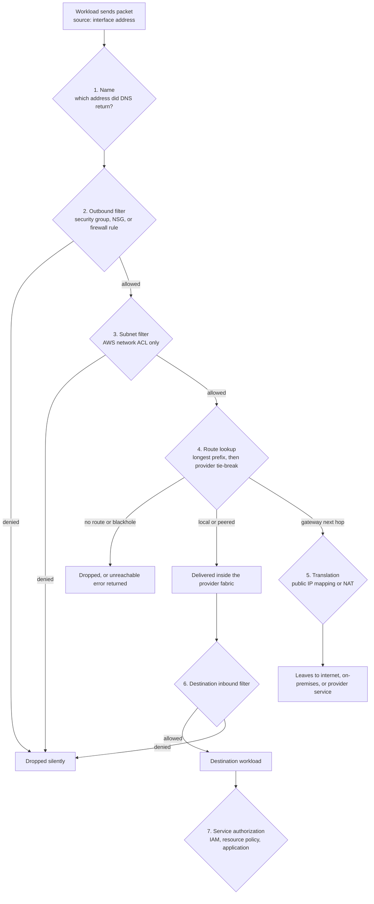

The diagram shows seven decision points, and each is owned and configured separately. Name resolution decides which address the workload even tries. The source-side filter (security group, NSG, or firewall rule) and, on AWS, the stateless subnet filter decide whether the packet may leave. The route lookup decides the next hop. A translation step decides the source address the outside world sees. The destination filter decides whether the packet is accepted, and finally the destination service decides whether the caller is authorized. A packet can pass every network check and still fail at step 7. A packet can also be authorized by IAM and never arrive because step 4 sends it to a blackhole. Troubleshooting is a walk down this list, and later sections use it as the spine for the packet-path trace in Section 8.

Three more principles shape everything that follows:

- **Reachability is not authorization.** A route and an allow rule give a packet a path. Whether the request succeeds depends on the identity checks owned by [IAM](CH09_IAM.md) and the application.
- **Scope determines blast radius.** A resource's scope (zonal, regional, or global) tells you which failures it survives and which failures it spreads. A global VPC is convenient, and a global misconfiguration is global.
- **Defaults differ and change.** AWS, Azure, and Google Cloud make different default choices about outbound internet access, cross-zone balancing, and firewall posture, and they revise those defaults. Azure, for example, changed new VNets to private subnets by default for Azure Resource Manager API versions released after 31 March 2026 ([Azure default outbound access](https://learn.microsoft.com/en-in/azure/virtual-network/ip-services/default-outbound-access)). Write the behavior you need into your infrastructure-as-code definitions instead of inheriting it.

## 3. Network scope: regional VPC, regional VNet, global VPC

The most consequential difference between the three providers is the scope of the network object and of its subnets. Scope controls where a subnet can place workloads, which failure a subnet shares, how many subnets you need, and how routes reach other regions.

### 3.1 AWS: regional VPC, zonal subnets

An AWS VPC exists in one region. Each subnet in it belongs to exactly one Availability Zone (AZ). An instance's network interface, called an elastic network interface (ENI), lives in one subnet and therefore one AZ. To run a workload across three AZs, you create at least three subnets per tier, one in each AZ.

The zonal subnet is a deliberate failure-domain marker. A subnet's route table can point to a zonal resource in the same AZ (for example a zonal NAT gateway or a firewall endpoint), so a single AZ impairment affects only the subnets in that AZ if you keep routing zone-local. The cost is subnet count: a three-tier, three-AZ VPC already has nine subnets, and adding endpoint and transit-attachment tiers brings it to fifteen.

An IPv4 VPC CIDR block can be between /16 and /28, and a VPC can have additional (secondary) CIDR blocks added later. A subnet cannot be resized after creation. If a subnet runs out of addresses, you add a new subnet, usually from a secondary block, and move workloads.

### 3.2 Azure: regional VNet, regional subnets

An Azure VNet also exists in one region, but its subnets are regional. A single subnet can hold virtual machines in all availability zones of the region. Zone placement is a property of the resource (a zonal virtual machine, a zone-redundant load balancer front end), not of the subnet.

This reduces subnet count: one application subnet can serve all three zones. It also removes a convenient failure-domain marker. A route table, NSG, or NAT gateway attached to that subnet affects all zones at once, so a mistake in one of them is a regional event. When you want zone-local egress on Azure, you choose resources that are themselves zone-aware, such as a zone-redundant StandardV2 NAT gateway, rather than splitting subnets by zone.

Azure reserves several subnet names for platform services and expects particular sizes. Azure Firewall requires a subnet named `AzureFirewallSubnet` of at least /26. A VPN or ExpressRoute gateway requires `GatewaySubnet`, for which Microsoft recommends /27 or larger. Azure Bastion uses `AzureBastionSubnet`. These subnets must be planned into the hub address space from the start.

### 3.3 Google Cloud: global VPC, regional subnets

A Google Cloud VPC network is a global resource. Its subnets are regional, and a virtual machine (VM) in any zone of that region can use the subnet. One VPC can therefore hold subnets in `us-central1`, `europe-west1`, and `asia-southeast1`, and VMs in those regions reach each other over Google's backbone using internal addresses without peering or a transit gateway ([Google Cloud subnets](https://docs.cloud.google.com/vpc/docs/subnets)).

Routes and firewall rules are also defined at the network level and apply across regions unless scoped by network tags, service accounts, or secure tags. The dynamic routing mode of the network decides whether routes learned by a Cloud Router in one region are used only in that region (`REGIONAL`) or across all regions (`GLOBAL`).

The global network removes a great deal of plumbing. It also means one firewall rule with a broad target can apply in every region at once, and an overly broad custom route can steer traffic from every region. Treat a Google Cloud VPC network as a global policy domain that needs global change review.

The canonical definition of the global VPC lives in the [GCP chapter](CH03_GCP.md). This chapter uses that scope to explain routing, attachment, and failure behavior.

### 3.4 What scope changes in practice

The following diagram shows a segmented topology for the same three-tier workload in each provider. It is the reference topology for the rest of the chapter.

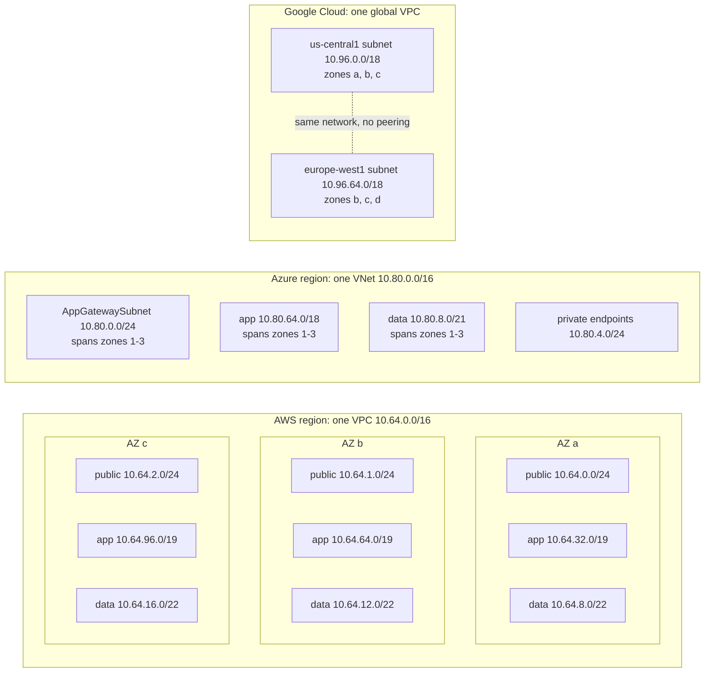

The AWS column needs one subnet per tier per AZ, so the address plan has to be divided three ways and each tier's route tables can be zone-specific. The Azure column has one subnet per tier for the whole region, which simplifies the plan but makes every subnet-level attachment a regional dependency. The Google Cloud column has one subnet per region, and two regions share one network, one route table, and one firewall policy. The implications run through the rest of the chapter:

- **Failure domain.** On AWS a subnet shares the fate of its AZ. On Azure and Google Cloud a subnet spans zones, so zonal resilience comes from the resources inside it.
- **Cross-region reachability.** On AWS and Azure, two regions require peering or a transit service. On Google Cloud, two regions in one VPC are already connected.
- **Policy scope.** AWS route tables and NACLs are per subnet; security groups are per VPC. Azure route tables and NSGs are per subnet or per network interface. Google Cloud routes and firewall rules are per network, targeted by tags or service accounts.
- **Address planning.** Zonal subnets fragment the address space into more, smaller blocks. Regional subnets allow fewer, larger blocks.

### 3.5 Who owns the network: shared networks and workload networks

A second scope decision is organizational: which account, subscription, or project owns the network, and which teams may place workloads into it. This chapter owns the cloud application of that choice. Generic segmentation theory belongs to [Firewalls](../05_Networking_and_OS/CH14_Firewalls.md), and cross-provider topology belongs to [Part 10](../10_Cloud_Architecture/CH03_Cloud_Network_and_Connectivity_Architectures.md).

Each provider offers a way for a central team to own the network while workload teams own the resources inside it:

- **AWS VPC sharing.** The owner account shares subnets with other accounts in the same AWS Organization through AWS Resource Access Manager (RAM). Participant accounts launch instances, databases, and load balancers into the shared subnets but cannot modify the VPC, its route tables, or its NACLs. Each participant's resources stay billed to and governed by the participant account.
- **Azure hub-and-spoke across subscriptions.** Azure does not share a subnet across subscriptions in the same way. Workload teams own spoke VNets in their own subscriptions, and the platform team owns the hub VNet in a connectivity subscription. Central control comes from peering, routing through the hub, and Azure Policy plus Azure Virtual Network Manager configurations that can enforce connectivity and security admin rules across many VNets.
- **Google Cloud Shared VPC.** A host project owns the VPC network, its subnets, routes, and firewall policy. Service projects attach to the host project, and their principals receive the `compute.networkUser` role on specific subnets. Workloads in service projects consume addresses from the host's subnets while billing stays in the service project ([GCP chapter](CH03_GCP.md) owns the project model).

The choice between a shared network and per-workload networks rests on four questions:

1. **Who must approve a route or firewall change?** If the answer is a central team for every change, a shared network fits. If workload teams change their own policy daily, give them their own networks and govern the attachments.
2. **What is the blast radius you can accept?** A shared VPC or a single Azure hub is one change domain for many teams. A bad route in a Shared VPC host project affects every service project.
3. **How scarce is address space?** A shared network packs many workloads into fewer, larger subnets with less fragmentation. Per-workload networks each need their own non-overlapping range.
4. **How strong is the isolation requirement?** Separate accounts or subscriptions with separate networks give the cleanest boundary against a compromised workload account, because that account has no permission over shared routing. The quality scenario in Section 18 tests this.

A common hybrid is a central team owning transit, hybrid connectivity, DNS, and egress inspection, while workload teams own their VPCs or VNets and attach them under a documented contract. The case study in Section 20 uses that model.

## 4. IP address planning

Address planning is the one network decision that is expensive to reverse. Routes, firewall rules, and gateways can be changed in minutes. Renumbering a subnet means moving every workload in it.

### 4.1 Recap: CIDR and subnetting

A CIDR prefix such as `10.64.0.0/16` fixes the first 16 bits and leaves 16 bits for hosts, giving 2^16 = 65,536 addresses. Each extra prefix bit halves the block. Route summarization works because a set of contiguous, aligned blocks can be advertised as one shorter prefix. Part 05's [TCP/IP chapter](../05_Networking_and_OS/CH03_TCPIP.md) owns the full treatment of addressing, CIDR, and subnet sizing. This section applies it to provider constraints.

### 4.2 Provider-reserved addresses per subnet

Each provider takes addresses from every subnet for its own functions. Small subnets lose a large share of their capacity to this.

| Provider | Reserved per IPv4 subnet | Which addresses | Smallest IPv4 subnet | Usable in a /24 |
|---|---|---|---|---|
| AWS | 5 | Network address; `.1` VPC router; `.2` reserved for the Amazon-provided DNS resolver; `.3` reserved for future use; the last address | /28 (11 usable) | 251 |
| Azure | 5 | Network address; `.1` default gateway; `.2` and `.3` mapped to Azure DNS; the last address | /29 (3 usable) | 251 |
| Google Cloud | 4 | Network address; second address (default gateway); second-to-last address (reserved for future use); the last address | /29 (4 usable) | 252 |

The AWS resolver is also reachable at the VPC base address plus two and at `169.254.169.253`. Azure's platform DNS, Dynamic Host Configuration Protocol (DHCP), and health-probe source is the virtual public address `168.63.129.16`. Google Cloud's metadata server, which also answers DNS for VMs, is `169.254.169.254`. Firewall rules that block these addresses break name resolution and instance metadata, a failure that looks like an application outage.

### 4.3 Worked allocation for a three-provider organization

Consider an organization with an existing data center using `10.0.0.0/12` and a plan to run production in AWS, a Microsoft-centric business unit in Azure, and analytics in Google Cloud. The address plan works top-down from an enterprise registry, so that every block is assigned before any network is created.

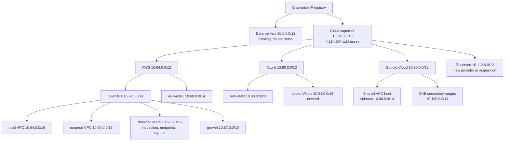

The tree shows three properties worth copying. Each provider gets a contiguous /12, so the on-premises routers can learn one summary route per provider. Each region gets an aligned /14 that summarizes four VPCs. A /12 is held in reserve for an acquisition or a fourth environment, because merging with a company that also used `10.64.0.0/10` is a common and painful source of overlap.

Now size the production VPC `10.64.0.0/16` in us-east-1 across three AZs. Start from demand, not from round numbers.

The application tier runs Amazon Elastic Kubernetes Service (EKS) with the Amazon VPC Container Network Interface (CNI) plugin, which gives each pod an address from the VPC subnet. Peak planning per AZ is 80 nodes with up to 30 pods each:

- Pods: 80 × 30 = 2,400 addresses.
- Nodes: 80 addresses.
- Steady-state demand: 2,480 addresses.
- Rolling deployments run old and new pods together for a short time. Allow 25 percent surge: 2,480 × 1.25 = 3,100.
- Plan for two years of growth at the business forecast of doubling: 3,100 × 2 = 6,200.
- The next power of two above 6,200 + 5 reserved addresses is 8,192, a /19.

The data tier holds managed database instances, cache nodes, and their failover interfaces. The estimate is 300 interfaces per AZ with growth, so a /22 (1,024 addresses, 1,019 usable) fits with room to spare.

The public tier holds load balancer nodes and, if used, zonal NAT gateways. A /24 per AZ (251 usable) is generous, which is intentional: Application Load Balancers scale by adding nodes, and each node consumes a subnet address.

Interface endpoints for provider services place one network interface per endpoint per AZ. Forty endpoints need 40 addresses per AZ, so a /24 per AZ leaves room for growth. Transit Gateway attachments need only a few addresses per AZ, and AWS recommends a small dedicated subnet for them so that attachment routing is independent of workload routing. A /28 per AZ is enough.

The resulting allocation:

| Tier | AZ a | AZ b | AZ c | Size | Usable each |
|---|---|---|---|---|---|
| Public | 10.64.0.0/24 | 10.64.1.0/24 | 10.64.2.0/24 | /24 | 251 |
| Transit attachment | 10.64.3.0/28 | 10.64.3.16/28 | 10.64.3.32/28 | /28 | 11 |
| Interface endpoints | 10.64.4.0/24 | 10.64.5.0/24 | 10.64.6.0/24 | /24 | 251 |
| Data | 10.64.8.0/22 | 10.64.12.0/22 | 10.64.16.0/22 | /22 | 1,019 |
| Application | 10.64.32.0/19 | 10.64.64.0/19 | 10.64.96.0/19 | /19 | 8,187 |
| Unallocated | 10.64.3.48–10.64.3.255, 10.64.7.0/24, 10.64.20.0–10.64.31.255 | | | | |
| Reserved for growth | 10.64.128.0/17 | | | /17 | 32,768 addresses |

Check the arithmetic. Allocated: 3 × 256 + 3 × 16 + 3 × 256 + 3 × 1,024 + 3 × 8,192 = 768 + 48 + 768 + 3,072 + 24,576 = 29,232 addresses, or 44.6 percent of 65,536. The reserved /17 holds another 50 percent. Leaving half the VPC unallocated looks wasteful until the day a new tier is needed, because a VPC cannot shrink a subnet and a new tier from the reserve keeps the plan contiguous.

The same workload on Azure uses fewer subnets. Because Azure subnets span zones, the application tier becomes one regional subnet sized for the sum of three zones: 3 × 6,200 = 18,600 addresses, rounded to a /17 (32,768) or a /18 (16,384) if the growth forecast is trimmed. Azure Kubernetes Service (AKS) with Azure CNI Overlay assigns pod addresses from a private overlay range rather than the VNet, which would shrink the application subnet to just the nodes. That choice is covered in [Kubernetes Networking](../12_Kubernetes/CH06_Networking.md). The hub VNet needs `AzureFirewallSubnet` (/26), `GatewaySubnet` (/27), and `AzureBastionSubnet` (/26) before any shared service subnet.

On Google Cloud, Google Kubernetes Engine (GKE) in VPC-native mode draws pod and service addresses from secondary ranges on the subnet (alias IP ranges). A subnet with primary range `10.96.0.0/20` for nodes can carry a `/14` pod secondary range and a `/20` service secondary range. Secondary ranges must not overlap anything that will ever be routed to that network, including on-premises ranges, even though they are not used for node interfaces.

### 4.4 Non-routable ranges for pods, and IPv6

When routable private space runs short, a common technique is to give pods addresses from a range that is never routed outside the VPC, such as part of `100.64.0.0/10` (shared address space from Request for Comments (RFC) 6598), and translate their traffic at the node or at a private NAT gateway when it leaves. AWS supports adding such a range as a secondary VPC CIDR. The trade-off is that pods are no longer directly reachable from on-premises networks, and every flow leaving the VPC passes a translation point that must be sized and monitored.

IPv6 removes the scarcity problem but not the planning problem. An AWS VPC receives a /56 and its subnets use /64. Google Cloud subnets use /64 ranges, either internal unique local addresses or external global addresses. Azure supports dual-stack VNets with /64 subnets. IPv6 changes the egress model: there is no NAT for global IPv6 addresses, so outbound-only behavior comes from an egress-only internet gateway on AWS or from firewall rules elsewhere. Most organizations still run dual-stack, so the IPv4 plan remains mandatory.

### 4.5 Address-plan failure modes

- **Overlap discovered at attachment time.** Two VPCs built independently with `10.0.0.0/16` cannot be peered, and on-premises routers cannot reach both. The fix is renumbering or translating one side with private NAT, both expensive. The [address allocation checker](../code/python/networking-chapter/01_address_allocation.py) shows the overlap test that should run in the provisioning pipeline before any network is created.
- **Exhaustion during scale-out.** A /24 application subnet with pod-per-address networking runs out at roughly 250 pods. The symptom is pods stuck pending with address-allocation errors, often during the incident that triggered the scale-out.
- **Fragmentation from zonal subnets.** On AWS, three /24s in three AZs cannot later be merged. Plan aligned blocks so that a tier can be summarized.
- **Resizing assumptions.** AWS subnets cannot be resized. Google Cloud allows expanding a subnet's primary range but not shrinking it. Azure restricts changes to a subnet range that has resources in it. Size for growth up front.
- **Hidden consumers.** Load balancer nodes, interface endpoints, NAT gateways, managed database failover interfaces, and serverless functions attached to a VPC all consume subnet addresses. Count them.

Provider IP address management (IPAM) services help enforce the plan. Amazon VPC IP Address Manager can allocate VPC CIDRs from pools and audit overlap across an AWS Organization. Azure Virtual Network Manager includes IP address management pools. Google Cloud's Network Analyzer reports subnet utilization. None of them knows your on-premises allocations unless you import them, so the enterprise registry remains the source of truth.

## 5. Routing: route tables, longest-prefix match, and provider priority

### 5.1 The common model

Every provider gives a subnet (AWS, Azure) or a network (Google Cloud) a route table. Each route has a destination prefix and a next hop. When a packet leaves an interface, the host's virtual switch finds every route whose prefix contains the destination address and picks the one with the longest prefix. A `/32` beats a `/24`, which beats a `/16`, which beats `0.0.0.0/0`. Longest-prefix match is universal. The providers differ in three places:

1. **Where the table attaches.** Per subnet on AWS and Azure; per network, with optional tag scoping, on Google Cloud.
2. **What happens when two routes have the same prefix.** Each provider has its own tie-break order among system, static, propagated, and dynamic routes.
3. **Which routes you cannot override.** Each provider protects some routes, such as the VPC-local route, from being replaced by broader customer routes.

Most "the route is there but traffic goes somewhere else" incidents come from the second and third differences.

### 5.2 AWS route tables

Each AWS VPC has a main route table, and each subnet is associated with either the main table or a custom table. Every table contains a `local` route for each VPC CIDR block, which cannot be deleted. Targets include an internet gateway (`igw-`), NAT gateway (`nat-`), transit gateway (`tgw-`), VPC peering connection (`pcx-`), gateway VPC endpoint (`vpce-` with a prefix list destination), network interface (`eni-`), virtual private gateway (`vgw-`), Gateway Load Balancer endpoint, and an AWS Cloud WAN core network.

AWS also supports **gateway route tables**, which are associated with an internet gateway or virtual private gateway rather than a subnet. They apply to traffic entering the VPC through that gateway, which lets you send inbound internet traffic to a firewall endpoint before it reaches the destination subnet. You can also add routes more specific than the local route, for example sending `10.64.32.0/19` to a firewall endpoint from another subnet, to insert inspection between subnets of the same VPC.

When routes overlap, AWS applies the following order ([How route priority works](https://docs.aws.amazon.com/vpc/latest/userguide/route-tables-priority.html)):

1. Longest prefix wins, regardless of route type.
2. For identical prefixes, a static route wins over a propagated route. Static routes include routes to an internet gateway, NAT gateway, network interface, instance, gateway VPC endpoint, transit gateway, peering connection, and Gateway Load Balancer endpoint.
3. A route referencing a prefix list wins over a propagated route with the same destination.
4. Among propagated routes from a virtual private gateway for the same prefix: AWS Direct Connect BGP routes, then Site-to-Site VPN static routes, then Site-to-Site VPN BGP routes.

Route tables have quotas on the number of routes, and propagated BGP routes count separately and have their own lower limit. At the time of writing the default for non-propagated routes is 50 per table and can be raised; check the [Amazon VPC quotas](https://docs.aws.amazon.com/vpc/latest/userguide/amazon-vpc-limits.html) page before designing a table with hundreds of entries. Summarized on-premises prefixes keep you well below these limits.

### 5.3 Azure route tables

Azure creates **system routes** for every subnet. They include the VNet address space (next hop `VirtualNetwork`), `0.0.0.0/0` to `Internet`, and next hop `None` for private ranges not in the VNet, so that traffic to an unknown `10.x` address is dropped rather than sent to the internet. Additional system routes appear when you enable features: peered VNet ranges, routes learned by a virtual network gateway, and service endpoint routes.

A **route table** resource holds user-defined routes (UDRs) and is associated with one or more subnets. UDR next-hop types are `VirtualAppliance` (an IP address, usually a firewall or network virtual appliance, NVA), `VirtualNetworkGateway`, `VnetLocal`, `Internet`, and `None`. The route table has a setting to disable propagation of gateway (BGP) routes, which is how spoke subnets are forced to send on-premises traffic to a hub firewall instead of directly to the gateway.

Azure's selection order is longest-prefix match first, and for an identical prefix, UDR over BGP route over system route ([Azure virtual network traffic routing](https://learn.microsoft.com/en-us/azure/virtual-network/virtual-networks-udr-overview)).

Private endpoints add a special case. Each private endpoint injects a `/32` system route for its address. Because longest prefix wins, a UDR for `0.0.0.0/0` to a firewall does not capture traffic to the private endpoint. To force private endpoint traffic through a firewall, enable network policies for private endpoints on the subnet and add a UDR whose prefix is equal to or narrower than the VNet address space ([Manage network policies for private endpoints](https://learn.microsoft.com/en-us/azure/private-link/disable-private-endpoint-network-policy)).

Azure Route Server lets an NVA exchange routes with the VNet over BGP, so firewalls and software-defined wide-area network (SD-WAN) appliances can inject routes without static UDRs. The Network Watcher "effective routes" view on a network interface shows the final merged table, which is the only reliable answer to "which route applies".

### 5.4 Google Cloud routes

A Google Cloud VPC network has one route table for the whole network. Routes can be scoped to instances with particular network tags, but there is no per-subnet table. Route types are:

- **Subnet routes** for each subnet's primary and secondary ranges, created automatically, plus peering subnet routes and Network Connectivity Center subnet routes.
- **Static routes** that you create, with a next hop such as the default internet gateway, an instance, an IP address, a Cloud VPN tunnel, or an internal passthrough Network Load Balancer.
- **Dynamic routes** learned by Cloud Router over BGP from Cloud VPN or Cloud Interconnect.
- **Policy-based routes** that match on source, destination, and protocol and send traffic to an internal passthrough Network Load Balancer, used to insert appliances.
- A default `0.0.0.0/0` route to the default internet gateway, priority 1000, which you can delete.

Google documents the selection order explicitly ([Google Cloud routes overview](https://docs.cloud.google.com/vpc/docs/routes)):

1. Special routing paths (for example, to the metadata server and to Google front ends for health checks) apply first and are not shown in the route table.
2. Policy-based routes, evaluated by their own priority.
3. Subnet routes, which are evaluated before any custom route. A static route cannot pull traffic away from a destination inside a subnet range; use a policy-based route for that.
4. Custom static and dynamic routes: the most specific destination wins; among those, the lowest numeric priority (0 to 65535) wins; remaining ties follow provider preference rules, and equal routes are used with equal-cost multipath (ECMP).

Dynamic routes carry a priority derived from the BGP multi-exit discriminator (MED) that the peer advertises. In `GLOBAL` dynamic routing mode, routes learned in another region receive an added inter-region cost, so the local region's routes are preferred when both exist.

### 5.5 Route selection, side by side

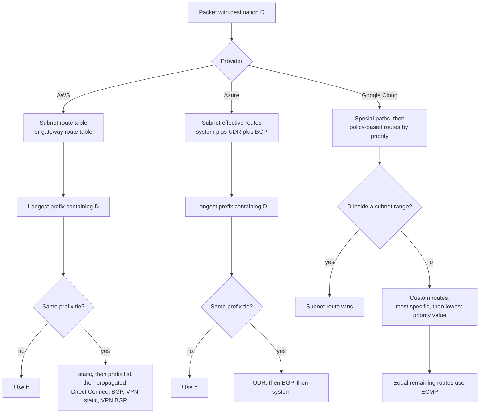

The tree shows why the same intent needs different configuration per provider. On AWS, a more specific propagated route from on-premises beats your static default route, and an identical static route beats a propagated one. On Azure, the UDR wins any tie, so a UDR for an on-premises prefix silently overrides what BGP learns. On Google Cloud, subnet routes are protected, so inserting a firewall between two subnets of the same network needs a policy-based route rather than a static route.

### 5.6 Worked example: predicting the next hop

The [route-table simulator](../code/python/networking-chapter/02_route_table_simulator.py) models a spoke subnet with three routes:

| Destination | Next hop |
|---|---|
| 10.0.0.0/8 | private transit (Transit Gateway or hub) |
| 10.40.0.0/16 | shared services |
| 0.0.0.0/0 | NAT egress |

- `10.40.8.12` matches all three. The longest prefix is `/16`, so it goes to shared services.
- `10.55.1.5` matches `10.0.0.0/8` and `0.0.0.0/0`. The `/8` wins, so it goes to private transit.
- `192.0.2.10` matches only `0.0.0.0/0`, so it goes to NAT egress.

Now add hybrid routing. On-premises advertises `10.40.0.0/16` over both a Direct Connect connection and a backup Site-to-Site VPN, both propagated into the same AWS route table. The prefixes are identical, so AWS prefers the Direct Connect BGP route. If an engineer also adds a static route `10.40.0.0/16 → tgw-…`, the static route beats both propagated routes, and the Direct Connect versus VPN preference no longer matters for this subnet. The simulator implements only longest-prefix match. Extending it with a route-type field and the AWS tie-break list is a useful exercise (Section 23).

### 5.7 Routing failure modes

- **Asymmetric routing through a stateful device.** The request crosses a firewall, and the response returns by a different path. The firewall sees half a connection and drops it. Section 8 shows how to prevent this with return routes.
- **Blackholed routes.** On AWS, a route whose target was deleted (a NAT gateway, a peering connection) shows the state `blackhole` and drops traffic. Alert on route state, not just on target health.
- **A more specific advertisement captures traffic.** A branch office advertises `10.64.32.0/24` by mistake. Every provider prefers it over the VPC summary, and part of production becomes unreachable from on-premises or from other VPCs. Route filters at the BGP edge are the control (Section 13).
- **Propagation disabled or enabled by accident.** On Azure, turning off gateway route propagation on a spoke removes on-premises routes from it. On AWS, enabling propagation on a route table that also has a static route for the same prefix has no visible effect until the static route is removed.
- **Eventual consistency.** A route change that passed the API call has not necessarily reached every host. Validate with the provider's path-analysis tools before declaring a change complete.

## 6. The internet edge: public addresses, internet gateways, and NAT

### 6.1 Public addresses and the internet gateway

On **AWS**, an internet gateway (IGW) is a horizontally scaled, redundant VPC component. A subnet becomes "public" only because its route table sends `0.0.0.0/0` to the IGW. An instance with a public IPv4 address never sees that address on its interface. The IGW performs one-to-one translation between the instance's private address and its public address. Since February 2024, AWS charges for every public IPv4 address, in use or idle, at a per-hour rate (at the time of writing, verify current pricing on the [Amazon VPC pricing](https://aws.amazon.com/vpc/pricing/) page). This turns "give every instance a public IP" into a recurring cost as well as an exposure problem.

On **Azure**, public IP addresses are separate resources attached to a network interface, a load balancer front end, a NAT gateway, or a firewall. Historically, a VM without any explicit outbound method still reached the internet through "default outbound access" from a Microsoft-owned address. That path is being retired, and for API versions released after 31 March 2026, new VNets create private subnets that have no default outbound access ([Azure default outbound access](https://learn.microsoft.com/en-in/azure/virtual-network/ip-services/default-outbound-access)). The explicit methods are a NAT gateway, a public load balancer with outbound rules, a public IP on the network interface, or routing through Azure Firewall.

On **Google Cloud**, there is no internet gateway object. A VM reaches the internet when two conditions hold: a route to the default internet gateway (the default `0.0.0.0/0` route), and either an external IP address on the VM or a Cloud NAT gateway covering its subnet. Deleting the default route or omitting both the external IP and Cloud NAT gives an internal-only VM.

The three designs share a principle: **exposure is a combination of address, route, and filter.** A private address with a route to NAT can still reach every site on the internet. A public address behind a filter that allows nothing inbound is not reachable. Reviews must check all three, which is what the [exposure audit example](../code/python/networking-chapter/03_exposure_audit.py) does for a simplified rule set.

### 6.2 Recap: what NAT does

Source NAT rewrites the source address and port of outbound connections so that many private hosts share a few public addresses, keeping a translation table entry per connection so that replies can be mapped back. The translation table is finite: each public address has roughly 64,000 usable source ports, and a port can be in use for only one connection to a given destination address, port, and protocol at a time. NAT also blocks unsolicited inbound connections as a side effect, which is not a security policy. [NAT](../05_Networking_and_OS/CH12_NAT.md) in Part 05 owns the translation mechanics, port address translation, and the per-destination port exhaustion model. This section covers how each provider packages it.

### 6.3 AWS NAT gateways: zonal and regional

The original **zonal NAT gateway** lives in one AZ, in a public subnet, with one or more Elastic IP addresses. It is redundant within its AZ but is not multi-AZ. The standard design deploys one NAT gateway per AZ and gives each AZ's private subnets a route table pointing to the NAT gateway in the same AZ. If AZ b's subnets point to AZ a's NAT gateway, an AZ a failure takes AZ b's egress down too, and every byte crosses AZs and incurs inter-AZ data transfer charges.

Key mechanics at the time of writing ([NAT gateway basics](https://docs.aws.amazon.com/vpc/latest/userguide/nat-gateway-basics.html)):

- Each IPv4 address on a NAT gateway supports up to 55,000 simultaneous connections to each unique destination, where a destination is the combination of destination IP, destination port, and protocol. A zonal NAT gateway can have up to 8 addresses.
- When that limit is reached, new connections fail and the `ErrorPortAllocation` CloudWatch metric increases.
- A NAT gateway does not have security groups. Filtering happens on the instances' security groups, the subnet NACLs, or an inspection firewall in the path.
- A **private NAT gateway** has no Elastic IP and translates to a private address. It is used to connect networks with overlapping ranges through a transit gateway.

In November 2025 AWS added a **regional availability mode** ([Regional NAT gateways](https://docs.aws.amazon.com/vpc/latest/userguide/nat-gateways-regional.html)). A regional NAT gateway is created against a VPC rather than a subnet, does not need a public subnet, and automatically expands into the AZs where your workloads have network interfaces and contracts from AZs where they no longer do. It supports up to 32 addresses per AZ, each adding 55,000 connections per unique destination. Two details matter for design:

- Expansion into a newly used AZ can take up to 60 minutes. Until then, traffic from that AZ is processed in another AZ, which means cross-zone dependency and cross-zone charges during the gap. Pre-warm by placing a workload interface in each AZ you plan to use.
- Regional mode does not support private NAT. Overlapping-network designs still need zonal private NAT gateways.

The `create-nat-gateway` API defaults to zonal mode. New designs without private NAT requirements should evaluate regional mode because it removes per-AZ route tables and public subnets that exist only to host NAT. Converting from zonal to regional resets existing connections, so plan a maintenance window.

### 6.4 Azure NAT Gateway: Standard and StandardV2

Azure NAT Gateway attaches to one or more subnets and becomes the outbound path for all of them, taking precedence over other outbound methods for those subnets ([NAT gateway design](https://learn.microsoft.com/en-us/azure/nat-gateway/nat-gateway-design)). Each public IP address provides 64,512 source NAT (SNAT) ports, and a NAT gateway can use up to 16 public addresses, roughly one million ports. NAT gateway can reuse the same SNAT port for connections to different destinations, so the limit is again per destination.

The **Standard** stock-keeping unit (SKU) is either zonal (pinned to one zone) or "no zone" (Azure picks a zone, with no zone resilience guarantee). Because Azure subnets span zones, a zonal Standard NAT gateway serving a regional subnet makes all zones depend on one zone. The **StandardV2** SKU is zone-redundant by default and serves all zones in the region ([Azure NAT Gateway SKUs](https://learn.microsoft.com/en-us/azure/nat-gateway/nat-sku)). StandardV2 requires StandardV2 public IP addresses rather than Standard public IPs. For a new regional subnet that must survive a zone loss, StandardV2 is the straightforward choice, and the Standard SKU is appropriate only when you deliberately build per-zone stacks with separate subnets.

When Azure Firewall is the egress point, its own SNAT capacity per public IP is much lower than NAT Gateway's (Microsoft documents 2,496 ports per public IP per backend instance). Associating a NAT gateway with `AzureFirewallSubnet` moves SNAT to the NAT gateway and removes that bottleneck ([Integrate Azure Firewall with NAT Gateway](https://learn.microsoft.com/en-us/azure/firewall/integrate-with-nat-gateway-v2)).

### 6.5 Google Cloud NAT

Cloud NAT is a regional, software-defined service configured on a Cloud Router. It is not a proxy and not a gateway instance. Google's virtual network stack performs translation on the host where the VM runs, which is why Cloud NAT has no throughput bottleneck of its own and no zonal placement to manage. A Cloud NAT gateway covers chosen subnets (or all subnets) in one region of a VPC network. Public NAT translates to external addresses. Private NAT translates between VPC networks or to hybrid networks with overlapping ranges.

Port allocation is explicit. Each NAT IP address has 64,512 usable ports. With static port allocation, every VM receives a fixed minimum number of ports, which defaults to 64. With dynamic port allocation, each VM starts at a minimum (as low as 32) and grows toward a configured maximum as it needs more. A VM's port allocation limits its concurrent connections to the same destination IP address, port, and protocol.

### 6.6 Worked example: NAT port exhaustion

**AWS.** A payment-reconciliation fleet of 600 instances in one AZ calls a single partner API at `203.0.113.10:443` over TCP. Each instance keeps up to 120 concurrent connections in its pool.

- Demand: 600 × 120 = 72,000 concurrent connections to one destination.
- Capacity with one Elastic IP: 55,000. The fleet is 17,000 connections short, and new connections fail with `ErrorPortAllocation` once the pool fills during the nightly batch.
- Option 1, add addresses: ⌈72,000 / 55,000⌉ = 2 addresses, giving 110,000, which leaves 38,000 (35 percent) headroom.
- Option 2, fix the client: reduce the pool to 40 connections per instance with keep-alive. Demand falls to 24,000, which fits in one address with 56 percent headroom.

Both are valid. Adding addresses is fast but requires the partner to allow-list a new source IP, which is a coordination step people forget. Fixing the pool is cheaper and also lowers load on the partner.

**Google Cloud.** A crawler fleet of 400 VMs needs up to 500 concurrent connections each to the same API endpoint.

- With the default minimum of 64 ports per VM, each VM can hold only 64 concurrent connections to that destination. Connections fail long before the NAT IP pool is full.
- Set the minimum to 512 ports per VM (the next power of two above 500). Each NAT IP serves ⌊64,512 / 512⌋ = 126 VMs.
- NAT IPs needed: ⌈400 / 126⌉ = 4 addresses.
- With dynamic port allocation (minimum 64, maximum 1,024), idle VMs keep only 64 ports, and the same 4 addresses would cover far more VMs at average load. The cost is that a sudden burst on many VMs at once can exhaust the shared pool, so monitor allocation failures.

The general rule: estimate concurrent connections per destination, not total connections, and compare that with the per-address, per-destination limit of the provider's NAT.

### 6.7 Worked example: NAT cost and the gateway endpoint

AWS prices a NAT gateway per hour and per gigabyte processed. At the time of writing, in us-east-1, both rates are USD 0.045 (verify on [Amazon VPC pricing](https://aws.amazon.com/vpc/pricing/)). A three-AZ workload with zonal NAT gateways processing 20 TB per month costs:

- Hourly: 3 gateways × 730 hours × 0.045 = USD 98.55.
- Processing: 20 × 1,024 GB × 0.045 = 20,480 × 0.045 = USD 921.60.
- Total: about USD 1,020 per month, before internet data-transfer-out charges, which are billed separately.

Flow logs show that 15 TB of the 20 TB is traffic to Amazon Simple Storage Service (Amazon S3) in the same region. An S3 gateway endpoint has no hourly or processing charge. Routing S3 through it removes 15,360 GB × 0.045 = USD 691.20 per month of NAT processing, a 68 percent reduction in NAT cost, and also takes that traffic off the internet path (Section 10). Azure NAT Gateway and Cloud NAT also charge for processed data, with different rate structures. Cloud NAT, for example, charges per VM-hour up to a cap plus per gigabyte. The same reasoning applies: measure what goes through NAT, and move provider-service traffic to private paths.

## 7. Network filtering: security groups, network ACLs, NSGs, and firewall rules

### 7.1 Recap: stateful and stateless filtering

A stateless filter evaluates every packet on its own, so allowing a request means writing a second rule for the response, including the client's ephemeral port range. A stateful filter tracks connections and allows return traffic for a connection it allowed. Rule sets are evaluated either as "all rules, any allow wins" or as "ordered by priority, first match wins". [Firewalls](../05_Networking_and_OS/CH14_Firewalls.md) in Part 05 owns the general theory, including the security-group versus network-ACL distinction in the abstract. This section gives the provider-specific evaluation rules, which are where mistakes happen.

### 7.2 AWS security groups and network ACLs

A **security group** is attached to an ENI. It is stateful and contains only allow rules. AWS evaluates all rules from all security groups attached to the interface, and a packet is allowed if any rule allows it. There is no rule order and no deny. A rule's source can be a CIDR, a prefix list, or another security group, which means "any interface that carries that group", so tier-to-tier policy can be written without addresses:

```hcl
resource "aws_vpc_security_group_ingress_rule" "app_from_alb" {
  security_group_id            = aws_security_group.app.id
  referenced_security_group_id = aws_security_group.alb.id
  ip_protocol                  = "tcp"
  from_port                    = 8443
  to_port                      = 8443
}
```

A new security group allows all outbound traffic by default. Remove that rule if egress should be explicit. Security groups also have quotas on rules per group and groups per interface, which multiply into an effective per-interface rule budget. Check the [Amazon VPC quotas](https://docs.aws.amazon.com/vpc/latest/userguide/amazon-vpc-limits.html) page when generating rules from service catalogs.

Stateful tracking consumes per-instance connection-tracking capacity. Instance types have a connection-tracking allowance, and the Elastic Network Adapter exposes a `conntrack_allowance_exceeded` counter when it is exhausted. High-connection-rate services such as DNS resolvers or proxies can hit it before they hit central processing unit (CPU) limits.

A **network ACL** is attached to a subnet. It is stateless and contains numbered allow and deny rules, evaluated from the lowest number upward, with the first match deciding. A final `*` rule denies anything unmatched. The default network ACL allows everything. Custom NACLs deny everything until you add rules, and because they are stateless, an inbound allow for TCP 443 needs an outbound allow for the ephemeral ports the clients use (AWS recommends 1024–65535). NACLs are useful for coarse subnet-level denies, such as blocking a known-bad range, that security groups cannot express. They are a poor place for fine-grained policy.

### 7.3 Azure network security groups

An **NSG** is stateful and contains allow and deny rules with priorities from 100 to 4096. Lower numbers are evaluated first, and the first match wins. Every NSG also contains default rules at priorities 65000 and above: allow traffic within `VirtualNetwork`, allow inbound from `AzureLoadBalancer`, allow outbound to `Internet`, and deny everything else. Default rules cannot be deleted, only overridden by higher-priority rules.

An NSG can be associated with a subnet, a network interface, or both. When both exist, inbound traffic is evaluated by the subnet NSG first and then the interface NSG, and outbound traffic by the interface NSG first and then the subnet NSG. Both must allow the traffic. Placing NSGs at both levels doubles the review effort, so most designs choose subnet-level NSGs and use interface-level ones only for exceptions.

Rules can refer to **service tags** such as `Internet`, `VirtualNetwork`, `AzureLoadBalancer`, or `Storage.EastUS`, and to **application security groups (ASGs)**, which play the role of AWS security-group references. One property of `VirtualNetwork` surprises reviewers: it includes the VNet's address space, peered VNets, and on-premises ranges learned through a virtual network gateway. A rule that allows "VirtualNetwork to VirtualNetwork" therefore allows traffic from the data center and from every peered spoke unless a higher-priority rule denies it.

**Azure Virtual Network Manager security admin rules** are evaluated before NSG rules. A platform team can use them to enforce organization-wide denies (for example, block inbound Remote Desktop Protocol from the internet) or "always allow" rules (for example, monitoring traffic) that workload NSGs cannot override.

### 7.4 Google Cloud firewall rules and policies

Google Cloud filtering is stateful, defined at the network level, and applied per VM interface. There are two families:

- **VPC firewall rules** (often called classic rules). Each rule has a direction, a priority from 0 to 65535 (lower is evaluated first), an action of allow or deny, and a target: all instances, instances with a network tag, or instances running as a service account. If an allow and a deny rule share the same priority and both match, the deny wins. Every network has two implied rules at priority 65535: deny all ingress and allow all egress. The auto-created `default` network also has permissive pre-populated rules such as `default-allow-internal` and Secure Shell (SSH) from anywhere, which is one reason production networks should be custom-mode networks without them.
- **Firewall policies.** Hierarchical firewall policies attach to the organization or to folders. Global and regional network firewall policies attach to a VPC network. Rules in hierarchical policies can allow, deny, or `goto_next`, which delegates the decision to the next level.

The evaluation order, with the default enforcement setting `AFTER_CLASSIC_FIREWALL`, is: the organization's hierarchical policy, then folder policies from the top folder down, then VPC firewall rules, then the global network firewall policy, then regional network firewall policies, then the implied rules ([Evaluation order for firewall policies and rules](https://docs.cloud.google.com/firewall/docs/firewall-policies-rule-eval-order)). The network can be switched to `BEFORE_CLASSIC_FIREWALL`, which evaluates network firewall policies before the classic rules.

Targeting matters for security. Any principal who can edit an instance can add a network tag to it, so a tag-targeted allow rule is only as strong as instance-edit permissions. Service-account targets and IAM-governed **secure tags** in network firewall policies tie the rule to an identity that is harder to change.

```bash
gcloud compute firewall-rules create allow-lb-to-app \
  --network=prod-vpc --direction=INGRESS --priority=1000 \
  --action=ALLOW --rules=tcp:8443 \
  --source-ranges=35.191.0.0/16,130.211.0.0/22 \
  --target-service-accounts=app@prod-proj.iam.gserviceaccount.com
```

The source ranges in this example are Google's documented health-check and proxy ranges for its load balancers. Forgetting them is a common reason a new backend never becomes healthy.

### 7.5 Managed firewalls beyond the basic filters

Security groups, NSGs, and VPC firewall rules filter on addresses, ports, and identities. Inspection of domain names, the TLS Server Name Indication (SNI) field, or intrusion signatures needs a managed firewall in the routed path:

- **AWS Network Firewall** deploys a firewall endpoint per AZ. Route tables send traffic to the endpoint. It supports stateless and stateful rule groups, including domain lists and Suricata-compatible rules. **Gateway Load Balancer** inserts third-party appliances in the same way, using Generic Network Virtualization Encapsulation (GENEVE) to preserve the original packet.
- **Azure Firewall** runs in `AzureFirewallSubnet` of a hub. The Standard tier adds fully qualified domain name (FQDN) filtering and threat intelligence. The Premium tier adds TLS inspection and intrusion detection and prevention. UDRs send spoke traffic to its private address.
- **Google Cloud Next Generation Firewall (Cloud NGFW)** comes in Essentials, Standard, and Enterprise tiers. Standard adds FQDN and geolocation objects and threat intelligence to firewall policies. Enterprise adds intrusion prevention through zonal firewall endpoints.

### 7.6 Comparison and evaluation order

| Property | AWS security group | AWS network ACL | Azure NSG | Google Cloud firewall rules and policies |
|---|---|---|---|---|
| Attachment | Network interface | Subnet | Subnet and/or network interface | Network, organization, or folder, targeted to VM interfaces |
| State | Stateful | Stateless | Stateful | Stateful |
| Actions | Allow only | Allow and deny | Allow and deny | Allow, deny, and `goto_next` in hierarchical policies |
| Ordering | None; any allow wins | Lowest rule number first, first match | Priority 100–4096, first match | Policy hierarchy, then priority 0–65535; deny wins a same-priority tie |
| Default | New group: no inbound, all outbound | Default NACL allows all; custom NACL denies all | Default rules allow intra-VNet and outbound internet, deny other inbound | Implied deny ingress and allow egress |
| Identity-based targets | Security group references | None | Application security groups, service tags | Service accounts, secure tags, network tags |

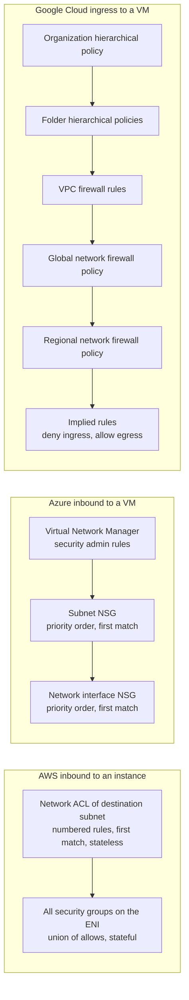

The diagram shows that each provider evaluates a different number of layers in a different order, and that a central team controls the first layer in Azure and Google Cloud. On AWS, the central controls are subnet NACLs, AWS Firewall Manager policies that create and audit security groups, and routed inspection. On Azure, security admin rules sit above every NSG. On Google Cloud, an organization-level hierarchical policy can deny traffic that no project can re-allow, or delegate with `goto_next`. When a flow is unexpectedly blocked, walk the layers in this order and stop at the first match.

## 8. Tracing a packet through route, NAT, and firewall

This section ties routing, translation, and filtering into one end-to-end path. The scenario is an AWS VPC with distributed inspection: application instances in private subnets reach a partner API on the internet through AWS Network Firewall and a zonal NAT gateway in the same AZ. The partner API is at `203.0.113.10:443`. The NAT gateway's Elastic IP is `198.51.100.7`.

The route tables in AZ a are:

| Route table | Associated subnet | Destination | Target |
|---|---|---|---|
| app-a | app 10.64.32.0/19 | 10.64.0.0/16 | local |
| app-a | | 0.0.0.0/0 | firewall endpoint vpce-fw-a |
| fw-a | firewall 10.64.7.0/28 | 0.0.0.0/0 | nat-a |
| public-a | public 10.64.0.0/24 | 0.0.0.0/0 | igw |
| public-a | | 10.64.32.0/19 | firewall endpoint vpce-fw-a |

The last row is the one people omit. Without it, the reply from the NAT gateway to `10.64.32.15` matches the `local` route and goes straight to the instance, bypassing the firewall. The firewall saw the outbound SYN but never sees the SYN-ACK. A stateful firewall then drops later packets of a flow it considers half-open, and the application sees timeouts that appear random.

```text
OUTBOUND (request)                                   src -> dst
---------------------------------------------------------------------------------
[1] instance 10.64.32.15 (app subnet, AZ a)          10.64.32.15:49152 -> 203.0.113.10:443
     | security group: outbound tcp/443 to partner prefix list   ALLOW
     | network ACL app subnet: outbound rule 100 tcp/443         ALLOW
     | route app-a: 0.0.0.0/0 -> vpce-fw-a (same AZ)
     v
[2] Network Firewall endpoint, AZ a                  unchanged
     | stateful rule: allow TLS SNI api.partner.example          ALLOW
     | flow entry created
     | route fw-a: 0.0.0.0/0 -> nat-a
     v
[3] NAT gateway nat-a (public subnet, AZ a)          198.51.100.7:1034 -> 203.0.113.10:443
     | SNAT: source rewritten, translation entry stored
     | route public-a: 0.0.0.0/0 -> igw
     v
[4] internet gateway -> internet -> partner API

RETURN (response)
---------------------------------------------------------------------------------
[5] partner API -> igw                               203.0.113.10:443 -> 198.51.100.7:1034
     v
[6] NAT gateway nat-a                                203.0.113.10:443 -> 10.64.32.15:49152
     | reverse translation from stored entry
     | route public-a: 10.64.32.0/19 -> vpce-fw-a   (longest prefix beats local /16)
     v
[7] Network Firewall endpoint, AZ a                  matches existing flow     ALLOW
     | route fw-a: 10.64.0.0/16 -> local
     v
[8] network ACL app subnet: inbound ephemeral 1024-65535        ALLOW
    security group: return traffic of tracked connection          ALLOW
    instance receives SYN-ACK
```

The trace shows every decision point from Section 2. Steps 1 and 8 are the instance's own filters: the security group is stateful, so the reply needs no inbound rule, but the NACL is stateless, so it needs an explicit inbound rule for ephemeral ports. Step 2 inspects the request by name. Step 3 changes the source address, which is why the partner allow-lists `198.51.100.7` and why the firewall must sit before the NAT gateway if its rules refer to internal addresses. Step 6 is the critical return route. The more specific `10.64.32.0/19` route beats the `/16` local route because of longest-prefix match, which keeps the flow symmetric.

The same sequence, shown as messages:

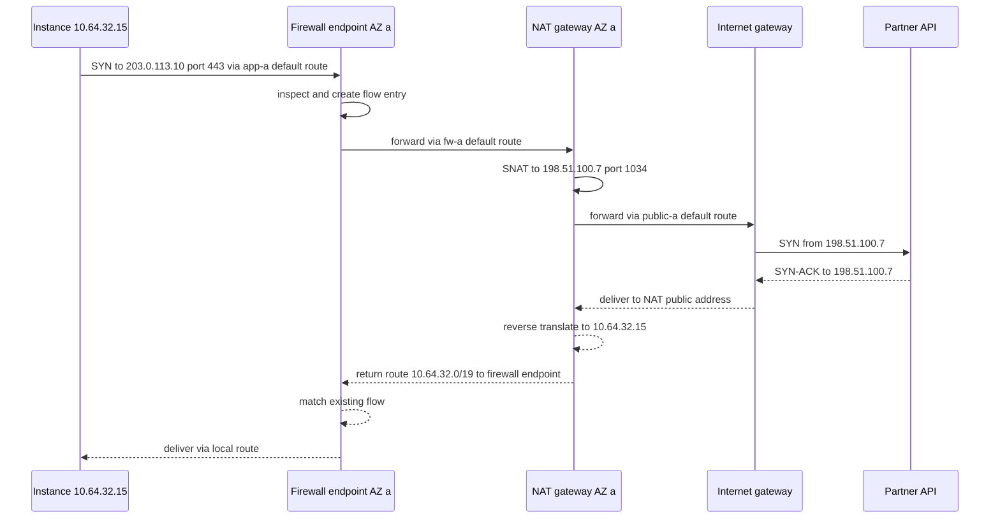

The sequence makes the symmetry requirement visible. Every hop on the way out appears on the way back. If the return arrow from the NAT gateway went directly to the instance, the firewall's flow table would never see the reply.

The same pattern exists in the other providers. In an Azure hub-and-spoke, spoke subnets have a UDR `0.0.0.0/0 → firewall private IP`, and the `GatewaySubnet` needs UDRs for spoke prefixes pointing to the firewall so that traffic arriving from on-premises is also inspected. On Google Cloud, a policy-based route or a static route to an internal passthrough Network Load Balancer fronting the appliances inserts the inspection hop, and the appliances' own routes must return traffic through the same load balancer path. For centralized AWS inspection through a Transit Gateway, enable **appliance mode** on the inspection VPC attachment, so that the Transit Gateway keeps both directions of a flow on the same AZ's firewall endpoint.

## 9. Load balancers: layer, scope, and cross-zone behavior

### 9.1 Recap: what the layer and the proxy model change

A Layer 4 (L4) load balancer distributes TCP or User Datagram Protocol (UDP) connections without reading the application payload. A Layer 7 (L7) load balancer terminates the client connection, parses Hypertext Transfer Protocol (HTTP) requests, and opens its own connection to a backend, which enables path routing, header manipulation, and web application firewall (WAF) inspection at the cost of hiding the client's address behind a header. [Load Balancer](../05_Networking_and_OS/CH10_Load_Balancer.md) owns algorithms, health-check theory, connection draining, and global server load balancing. [TLS](../05_Networking_and_OS/CH06_TLS.md) owns termination patterns. The cloud questions are four: which layer, which scope (zonal, regional, global), whether the product is a proxy or a pass-through, and how it spreads traffic across zones.

### 9.2 AWS

- **Application Load Balancer (ALB).** Regional, L7, a proxy. It places nodes in each enabled AZ's subnet. Cross-zone load balancing is always on at the load balancer level, though it can be turned off per target group. Client addresses arrive in `X-Forwarded-For`.
- **Network Load Balancer (NLB).** Regional, L4 (TCP, UDP, TLS), one static address per AZ. Cross-zone load balancing is off by default. With instance targets, it preserves the client source address. NLB nodes in each AZ forward only to targets in their own AZ unless cross-zone is enabled, and enabling it incurs inter-AZ data charges.
- **Gateway Load Balancer.** L3, used to insert inspection appliances transparently, as described in Section 7.5.
- **Global entry.** AWS Global Accelerator provides two anycast static addresses that send users over the AWS backbone to the nearest healthy regional endpoint. Amazon CloudFront is the content delivery network (CDN) and L7 edge. Amazon Route 53 provides DNS-based latency, weighted, and failover routing.

### 9.3 Azure

- **Azure Load Balancer (Standard SKU).** L4 pass-through, regional, with zone-redundant or zonal front ends. Health probes originate from `168.63.129.16`, which NSGs must allow (the default `AllowAzureLoadBalancerInBound` rule does). A global tier, the cross-region load balancer, provides a single anycast front end over regional load balancers.
- **Application Gateway v2.** Regional L7 proxy with optional WAF, autoscaling, and zone redundancy. It requires its own dedicated subnet.
- **Azure Front Door.** Global L7 edge with anycast entry, caching, WAF, and the ability to reach origins through Private Link.
- **Azure Traffic Manager.** DNS-based global traffic steering. It returns an endpoint address and is not in the data path, so failover speed depends on DNS time-to-live (TTL) and client caching.
- **Gateway Load Balancer.** Chains third-party NVAs into the path of a Standard Load Balancer or public IP.

### 9.4 Google Cloud

Google Cloud splits its family along three axes: application (L7) or network (L4), proxy or passthrough, and global or regional.

- **Global external Application Load Balancer.** One anycast address announced from Google's edge, Envoy-based proxies, Cloud CDN and Google Cloud Armor integration, and backends in multiple regions. Traffic goes to the closest region with capacity and overflows to the next region when backends reach their configured capacity.
- **Regional external and internal Application Load Balancers**, plus a cross-region internal Application Load Balancer, for L7 inside a region or across regions on internal addresses.
- **Proxy Network Load Balancers** (global or regional) for TCP with optional TLS offload.
- **Passthrough Network Load Balancers** (external and internal), regional, built on Google's Maglev system. They preserve the client address and return traffic directly from the backend. The internal passthrough Network Load Balancer is also the next hop used to insert appliances into routes.

Google Cloud load balancers use capacity-based balancing modes (rate, utilization, connections) across zones and, for global products, regions. The cross-zone question becomes "what is each backend group's configured capacity", rather than an on/off switch.

### 9.5 Choosing an entry point

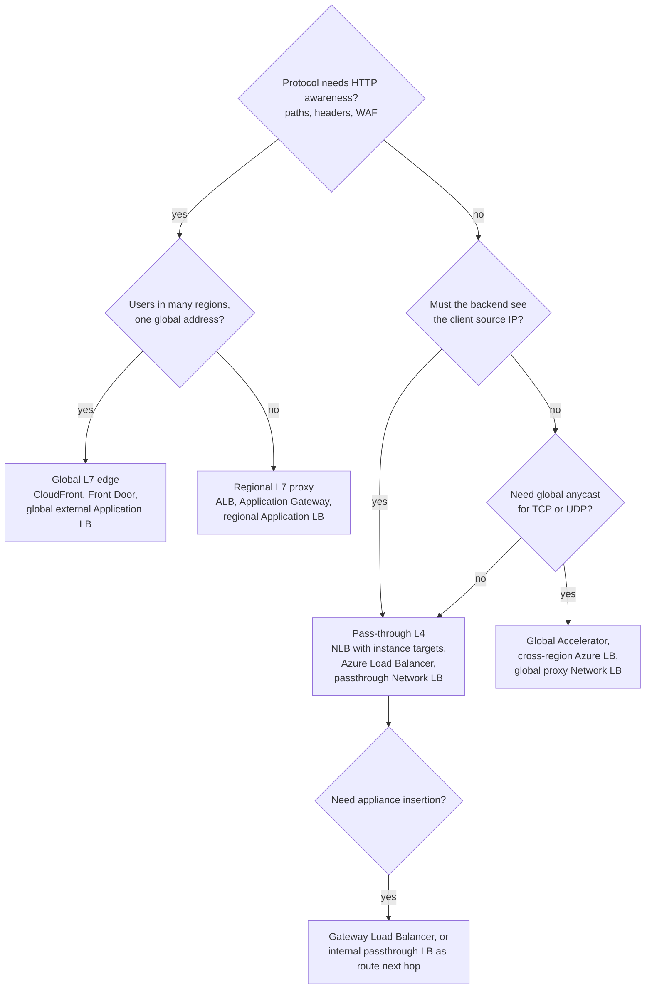

The decision tree starts with the protocol because it rules out half the products immediately. It then asks about geography and source-address preservation, which are the two properties that most often force a redesign later. A team that picks a regional L7 proxy and later needs the client address for a non-HTTP protocol has to change products, not settings. A team that picks DNS-based global steering and later needs sub-minute failover finds that the limit is client DNS caching, not the provider.

### 9.6 Worked example: cross-zone behavior and zonal failure

**Uneven targets without cross-zone balancing.** An NLB spans three AZs with cross-zone load balancing off. A deployment left 2 targets in AZ a, 6 in AZ b, and 4 in AZ c. Clients resolve the NLB name to the three per-AZ addresses roughly evenly, so each AZ's NLB node receives one third of 9,000 connections per second, or 3,000.

- AZ a: 3,000 / 2 = 1,500 per target.
- AZ b: 3,000 / 6 = 500 per target.
- AZ c: 3,000 / 4 = 750 per target.

AZ a's targets run at three times the load of AZ b's. Turning cross-zone on gives each target 9,000 / 12 = 750, at the cost of inter-AZ data charges for roughly two thirds of the traffic. The alternative is to keep cross-zone off and enforce equal target counts per AZ in the autoscaling configuration, which keeps traffic zone-local.

**Sizing for a zone loss.** A service behind an ALB peaks at 4,800 requests per second. Each target handles 500 requests per second at the target CPU utilization. The design runs 4 targets per AZ across three AZs, 12 in total, and 6,000 requests per second of capacity.

- If one AZ fails, 8 targets remain: 8 × 500 = 4,000 requests per second, which is 800 short of peak.
- To survive the loss of one AZ at peak, each AZ must carry peak / (AZs − 1) = 4,800 / 2 = 2,400 requests per second, which needs ⌈2,400 / 500⌉ = 5 targets per AZ, 15 in total.
- The extra 3 targets are the price of zonal resilience. Relying on autoscaling to add them after the failure assumes capacity is available in the surviving AZs at the moment everyone else is also scaling there, which is the quota and capacity scenario in Section 18.

Quality scenario, zonal failure: **Stimulus:** AZ b suffers packet loss to its targets at peak traffic. **Response:** health checks (three consecutive failures at a 10-second interval) remove AZ b targets within about 30 seconds, and operators apply a zonal shift (for example with Amazon Application Recovery Controller) to stop sending traffic to AZ b's load balancer nodes. **Measure:** error rate returns below 0.5 percent within 2 minutes, and p99 latency stays under the service objective with 15 pre-provisioned targets.

## 10. Private access to provider services

Workloads call provider services such as object storage, key management, databases, and queues. By default those services have public endpoints, so a private workload reaches them through NAT and the internet edge. Private service access replaces that path. The two families of mechanisms behave differently, and confusing them is a frequent design error.

### 10.1 Two models

**Model A: a service route.** Traffic still goes to the service's public endpoint addresses, but the provider changes routing or identity so that the traffic stays on its network and can be restricted to your network. DNS does not change. Examples: AWS gateway endpoints, Azure service endpoints, and Google Cloud Private Google Access.

**Model B: an endpoint in your network.** The provider places an interface with a private address from your subnet and maps it to a service, or to a specific resource of a service. DNS must change so that the service name resolves to that private address. Examples: AWS interface VPC endpoints (AWS PrivateLink), Azure private endpoints (Azure Private Link), and Google Cloud Private Service Connect endpoints.

| Property | Model A: service route | Model B: endpoint in your network |
|---|---|---|
| Address the client connects to | Public service address | Private address in your subnet |
| DNS change required | No (except Google's special VIP domains) | Yes, private zone or provider-managed private DNS |
| Reachable from on-premises or peered networks | Generally no | Yes, if routing and DNS forwarding are in place |
| Granularity | Whole service in the region | Whole service (AWS, Google APIs) or one resource (Azure private endpoint) |
| Typical cost | No charge (AWS gateway endpoints, Azure service endpoints) | Hourly per endpoint plus data processed |

### 10.2 AWS

**Gateway endpoints** exist for Amazon S3 and Amazon DynamoDB. You associate the endpoint with route tables, and AWS adds a route whose destination is a managed prefix list of the service's addresses in the region. Because a prefix-list route beats a propagated route and the prefix list is more specific than `0.0.0.0/0`, S3 traffic leaves through the endpoint instead of NAT. Gateway endpoints are free, work only within the same region, and cannot be reached from on-premises or across peering. An **endpoint policy** restricts which buckets or tables can be reached through the endpoint, which is the control against data exfiltration to a bucket in someone else's account:

```json
{
  "Statement": [{
    "Effect": "Allow",
    "Principal": "*",
    "Action": ["s3:GetObject", "s3:PutObject"],
    "Resource": "arn:aws:s3:::example-prod-ledger/*",
    "Condition": {"StringEquals": {"aws:ResourceOrgID": "o-exampleorgid"}}
  }]
}
```

**Interface endpoints** (AWS PrivateLink) create an ENI in each chosen subnet, one per AZ, with security groups attached. With private DNS enabled, the regional service name (for example `sqs.us-east-1.amazonaws.com`) resolves to the endpoint addresses inside that VPC. That requires the VPC attributes `enableDnsSupport` and `enableDnsHostnames`. Interface endpoints are billed per endpoint per AZ-hour plus per gigabyte processed. At the time of writing, us-east-1 rates are USD 0.01 per AZ-hour and USD 0.01 per GB for the first tier (verify on [AWS PrivateLink pricing](https://aws.amazon.com/privatelink/pricing/)).

PrivateLink also works for your own services. A provider places a service behind an NLB and publishes an **endpoint service**. Consumers in other accounts create interface endpoints to it. Traffic flows only from consumer to provider, and the two VPCs may have overlapping CIDRs because no routes are exchanged.

### 10.3 Azure

**Service endpoints** are a subnet setting per service (for example `Microsoft.Storage`). Traffic from the subnet to that service uses the subnet's private address as its source identity on the Azure backbone, and the service's firewall can allow that subnet by VNet rule. The service's public endpoint and public DNS name stay the same, and the service is still reachable from the internet unless its firewall blocks it. **Service endpoint policies** for Azure Storage restrict which storage accounts the subnet may reach.

A **private endpoint** is a network interface with a private address in your subnet, connected to one resource and one sub-resource, for example the `blob` sub-resource of one storage account. Azure's public DNS for `mystorage.blob.core.windows.net` returns a CNAME to `mystorage.privatelink.blob.core.windows.net`. If the resolving VNet is linked to a private DNS zone named `privatelink.blob.core.windows.net` containing an A record for `mystorage`, the name resolves to the private address. Elsewhere it resolves to the public address. Creating a private endpoint does not disable public access. You set public network access on the resource to `Disabled` separately. **Private Link service** publishes your own Standard Load Balancer-fronted service to consumers in other tenants, comparable to an AWS endpoint service.

Because each private endpoint maps to a single resource, Azure deployments create many of them. The standard pattern is a central set of `privatelink.*` private DNS zones in the connectivity subscription, linked to the hub and resolver VNets, with Azure Policy creating the DNS records automatically when a workload creates a private endpoint.

### 10.4 Google Cloud

**Private Google Access** is a subnet setting. VMs without external addresses in that subnet can reach Google APIs and services through the default internet gateway route without NAT. By default they use the public API addresses. Two special domains provide narrower virtual IP ranges: `private.googleapis.com` (`199.36.153.8/30`) for most APIs, and `restricted.googleapis.com` (`199.36.153.4/30`) for APIs supported by VPC Service Controls. To use them, you create a private DNS zone that maps `*.googleapis.com` to those addresses and a route for the range. On-premises hosts can use the same addresses through Cloud VPN or Cloud Interconnect if the range is advertised to them.

**Private Service Connect (PSC)** creates an endpoint, a forwarding rule with an internal address in your network, that targets either a bundle of Google APIs (`all-apis` or `vpc-sc`) or a producer's **service attachment**. Producers can be Google-managed services or your own services behind an internal load balancer. PSC endpoints for Google APIs come with an automatically created DNS zone for `p.googleapis.com` names, and you can add private zones so that standard API names resolve to the endpoint.

Google Cloud also has **private services access**, which is different again. It connects your VPC to a Google-managed service producer network by VPC Network Peering over an allocated address range you reserve. Cloud SQL and other services use it for private IP connectivity. Because it is peering, it is subject to peering's non-transitivity (Section 11), and on-premises networks reach it only if you export custom routes over the peering.

### 10.5 The DNS coupling, step by step

Model B works only when the client resolves the service name to the endpoint address. The sequence below shows an Azure workload, an on-premises client, and an internet client resolving the same storage account name.

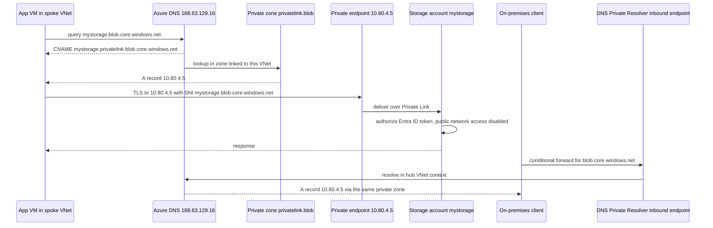

The sequence shows three things a design must provide. The private DNS zone must be linked to the VNet whose resolver answers the query, which for spokes is usually the hub or resolver VNet when spokes use custom DNS. The client must keep the original hostname in the TLS handshake, which it does when it connects by name, so certificate validation still succeeds against the public certificate. On-premises clients must forward the public zone (`blob.core.windows.net`), not just the `privatelink` zone, to a resolver inside Azure, because their first answer is the CNAME from public DNS. An internet client following the same CNAME chain without the private zone gets the public address and is refused because public network access is disabled.

AWS and Google Cloud follow the same pattern with different plumbing. AWS interface endpoints with private DNS enabled override the service name only within the endpoint's VPC. Other VPCs need a Route 53 private hosted zone shared to them, or Route 53 Profiles, and on-premises clients need a Route 53 Resolver inbound endpoint. Google Cloud PSC endpoints need private zones in Cloud DNS, shared by DNS peering zones or by authorizing the zone for other networks.

### 10.6 Failure modes and a quality scenario

- **Private endpoint, public resolution.** The endpoint exists, but the client's resolver is not linked to the private zone, so it resolves the public address, traffic goes through NAT, and the call fails because public access is disabled, or worse, succeeds because it is not.
- **Duplicate private zones.** Two teams each create `privatelink.blob.core.windows.net` and link them to different VNets. Each zone knows only its own records, and clients see the wrong address depending on which VNet resolves.
- **Stale records.** An endpoint is deleted, the DNS record remains, and clients connect to an address that no longer answers.
- **Exfiltration through a private path.** A gateway endpoint or service endpoint without a policy lets a compromised workload write to a storage bucket or account owned by an attacker over the private path, avoiding egress inspection. Endpoint policies, Azure service endpoint policies, and Google Cloud VPC Service Controls perimeters close this.
- **Endpoint cost sprawl.** Forty interface endpoints in three AZs in each of 30 VPCs is 3,600 endpoint-AZ-hours per hour. At USD 0.01 each that is about USD 26,280 per month before data processing. Centralizing endpoints in a shared VPC and sharing DNS across VPCs reduces the count to 120 endpoint-AZs, about USD 876 per month, at the cost of a shared dependency and Transit Gateway processing charges on the traffic.

Quality scenario, key rotation and private paths: **Stimulus:** the security team rotates the customer-managed key for a storage account and, in the same change window, disables public network access. **Response:** workloads resolve the account to its private endpoint, authenticate with managed identities, and continue reading data encrypted under the new key version. **Measure:** zero requests to the account's public endpoint in its logs after the change, and zero authorization failures from production identities during the rotation.

## 11. Peering versus transit

### 11.1 Peering

Peering connects two networks directly so that each can reach the other's subnets with private addresses. All three providers implement it in their fabric without a gateway in the path, so it has no single device to fail and no throughput bottleneck beyond the instances' own limits. Peering is **non-transitive** in all three. If A peers with B and B peers with C, A cannot reach C through B.

- **AWS VPC peering** works within and across regions and accounts. It also forbids edge-to-edge routing: a VPC cannot use its peer's internet gateway, NAT gateway, VPN connection, or Direct Connect link. Peered VPCs cannot have overlapping CIDRs. Security groups in the same region can reference groups in the peer VPC.
- **Azure VNet peering** works within a region and globally. It has one controlled exception to non-transitivity, **gateway transit**: a hub with a VPN or ExpressRoute gateway can allow peered spokes to use that gateway (`allowGatewayTransit` on the hub side, `useRemoteGateways` on the spoke side). Spoke-to-spoke traffic still needs either an NVA or Azure Firewall in the hub with UDRs, a direct peering, or a connectivity configuration from Azure Virtual Network Manager.
- **Google Cloud VPC Network Peering** exchanges subnet routes automatically and custom (static and dynamic) routes only if you enable import and export. Firewall rules are not exchanged, so each side controls its own ingress. Peering is limited per network and per peering group, so check quotas before designing around it.

A full mesh of n networks needs n(n − 1) / 2 peerings. For 12 VPCs that is 66 peerings, and each VPC's route tables need 11 peer routes. At 30 VPCs it is 435 peerings, past the point where people can review them.

### 11.2 Transit

A transit service is a regional or global router you attach networks to. Its route tables decide which attachments can reach which others, so it gives transitivity and central segmentation at the cost of being a shared component in the path.

- **AWS Transit Gateway** is a regional router. Attachments include VPCs, VPN connections, Direct Connect gateways, Transit Gateway Connect (generic routing encapsulation tunnels with BGP for SD-WAN appliances), and peering to transit gateways in other regions. Each attachment is associated with one Transit Gateway route table and can propagate its routes into any number of tables. Segmentation comes from this split: production attachments associate with a production table that has routes only to production and shared services; development attachments associate with a development table. Inter-region transit gateway peering uses static routes. Transit Gateway bills per attachment-hour and per gigabyte processed.
- **AWS Cloud WAN** defines a global core network from a JavaScript Object Notation (JSON) policy document. The policy declares regions (core network edges), segments (routing domains such as production and development), and attachment rules that place a VPC in a segment based on its tags. It suits organizations with many regions that want one policy instead of a mesh of regional transit gateways.
- **Azure hub-and-spoke (customer-managed).** A hub VNet holds Azure Firewall or an NVA, gateways, and shared services. Spokes peer to the hub. Spoke UDRs send `0.0.0.0/0` and other spokes' prefixes to the firewall's private address, and the firewall routes between spokes. You own the routing and the capacity of the firewall.
- **Azure Virtual WAN.** Microsoft manages the hub router. Virtual WAN hubs provide any-to-any transit among connected VNets, VPN sites, ExpressRoute circuits, and other hubs. A secured virtual hub contains Azure Firewall, and **routing intent** sends private traffic, internet traffic, or both through it without hand-written UDRs.
- **Google Cloud Network Connectivity Center (NCC).** A hub with spokes. VPC spokes in a **mesh** topology (the default) exchange subnet routes so that every VPC spoke can reach every other, giving the transitivity that peering lacks. A **star** topology limits edge spokes to reaching center spokes. Hybrid spokes (Cloud VPN, virtual local area network (VLAN) attachments for Cloud Interconnect, and router appliances) can exchange routes with VPC spokes, and site-to-site data transfer lets the hub connect on-premises sites to one another over Google's network ([NCC connectivity topologies](https://docs.cloud.google.com/network-connectivity/docs/network-connectivity-center/concepts/connectivity-topologies)).
- **Google Cloud Shared VPC** is an alternative that removes the need for transit between many workload teams by giving them one network in the first place.

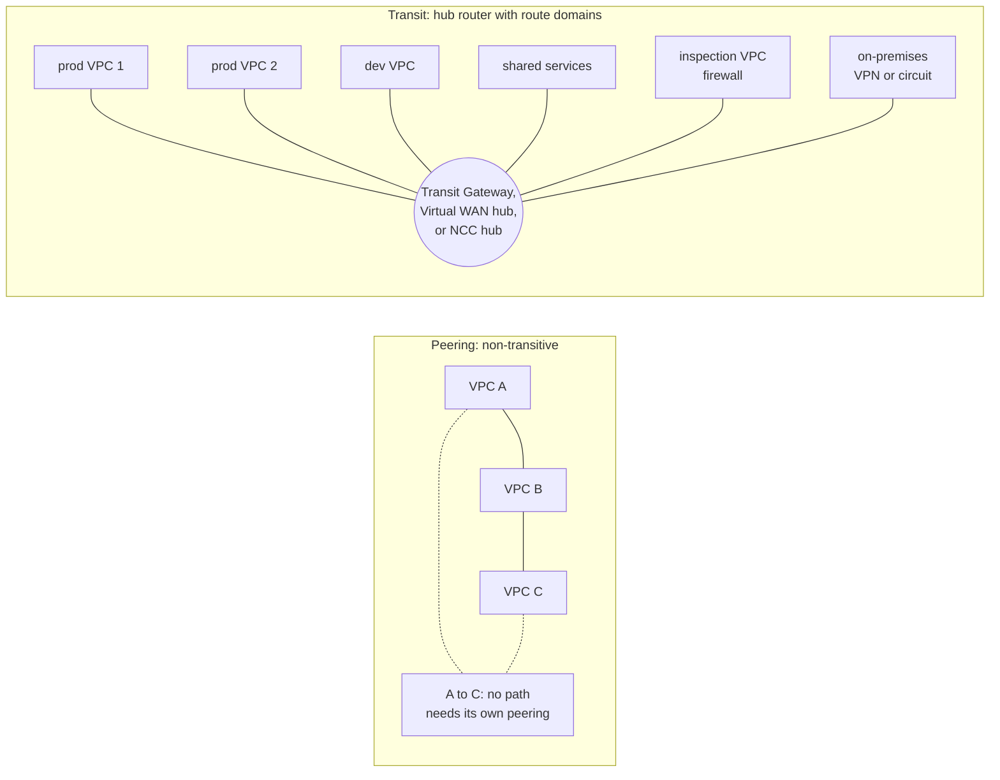

The left side shows why peering stops scaling: reachability exists only along direct edges, so every new pair is a new object to create, route, and review. The right side shows a hub with route domains. Production attachments can be given routes to each other, to shared services, and to on-premises, while the development attachment sees only shared services. Inspection sits on the hub path. The hub is now a component whose quotas, capacity, and change process every attached network depends on.

### 11.3 Choosing between them

Use peering when there are few networks, when a pair carries very heavy traffic, or when latency must be minimal. Use transit when there are many networks, when segmentation or inspection must be central, or when hybrid connections must be shared. The two combine well. On AWS, a high-volume pair can have a direct peering alongside the transit attachment. The peering route for the peer's exact CIDR is more specific than a `10.0.0.0/8` route to the transit gateway, so longest-prefix match sends that pair's traffic over peering and everything else through transit.

Worked cost comparison for 12 AWS VPCs with 50 TB per month of east-west traffic, using us-east-1 prices at the time of writing (USD 0.05 per attachment-hour and USD 0.02 per GB processed for Transit Gateway; verify on [Transit Gateway pricing](https://aws.amazon.com/transit-gateway/pricing/)):

- Transit Gateway attachments: 12 × 730 × 0.05 = USD 438 per month.
- Transit Gateway processing: 50 × 1,024 × 0.02 = USD 1,024 per month.
- Peering: no hourly or processing charge. Standard data transfer charges apply to traffic crossing AZs or regions, as they also do with a transit gateway.

If 30 TB of the 50 TB is between two analytics VPCs, peering that pair saves 30,720 × 0.02 = USD 614.40 per month of processing while the other ten VPCs stay on transit. The choice becomes cost-driven only after reachability, segmentation, and inspection needs are met. A pair that must be inspected cannot simply be peered around the firewall.

### 11.4 Transit failure modes

- **Route domain leakage.** A development attachment propagates into the production route table by mistake. On a transit gateway, review propagations as carefully as routes.
- **Asymmetric inspection.** The inspection VPC attachment does not have appliance mode enabled, so the two directions of a flow choose firewall endpoints in different AZs, and stateful inspection drops the replies.
- **Hub as a single change domain.** A bad firewall policy or route in a shared hub breaks every spoke at once. Stage hub changes, and keep a tested rollback.
- **Quota ceilings.** Routes per transit route table, attachments per transit gateway, peerings per VNet, and peering-group route limits in Google Cloud are all finite. They appear during growth, not on day one.

## 12. DNS in cloud networks

### 12.1 Recap: split-horizon resolution

Private networks need names that resolve differently depending on where the query comes from: a private address inside, a public address or nothing outside. This is split-horizon DNS, and it depends on which resolver a client asks and which zones that resolver can see. [DNS](../05_Networking_and_OS/CH08_DNS.md) owns resolution mechanics, zones, records, TTL behavior, and split-horizon design. Here the question is how each provider wires private zones, resolvers, and forwarding.

### 12.2 Provider resolvers and private zones

**AWS.** Each VPC has a Route 53 Resolver at the VPC base address plus two (also `169.254.169.253`). **Private hosted zones** are associated with one or more VPCs, including VPCs in other accounts after an authorization step. **Resolver inbound endpoints** are interfaces in your subnets that on-premises resolvers can forward queries to. **Resolver outbound endpoints** plus **forwarding rules** send queries for chosen domains (for example `corp.example.com`) to on-premises servers. Rules can be shared across accounts with AWS RAM, and Route 53 Profiles bundle private hosted zones, rules, and DNS Firewall rule groups for association with many VPCs. **Route 53 Resolver DNS Firewall** blocks or alerts on queries to listed domains, which is a useful egress control because most exfiltration channels start with a lookup.

**Azure.** VMs use Azure-provided DNS at `168.63.129.16` unless the VNet is set to custom DNS servers. **Private DNS zones** are linked to VNets through virtual network links, optionally with auto-registration of VM records. **Azure DNS Private Resolver** provides inbound endpoints (targets for on-premises forwarders) and outbound endpoints with **DNS forwarding rulesets** linked to VNets, so you no longer need DNS server VMs in the hub.

**Google Cloud.** VMs query the metadata server at `169.254.169.254`, which is Cloud DNS. **Private zones** are authorized for one or more VPC networks. **Forwarding zones** send queries for a domain to on-premises name servers. **Peering zones** let one network resolve names using another network's DNS configuration, which is how a Shared VPC or hub resolves for others. An **inbound server policy** creates forwarder addresses in each region's subnets for on-premises resolvers to target. **Response policies** override answers for chosen names.

One Google Cloud detail causes many hybrid outages: queries that Cloud DNS forwards to on-premises name servers come from the source range `35.199.192.0/19`. On-premises firewalls must allow that range, and on-premises routers must route replies to it back through Cloud VPN or Cloud Interconnect. Cloud Router advertises the range only if you configure a custom advertisement.

### 12.3 Hybrid DNS topology

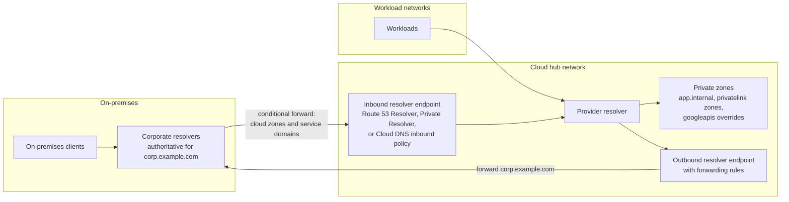

The diagram shows the two directions of hybrid resolution. On-premises resolvers forward cloud-private zones, and the public service domains that private endpoints override, to an inbound endpoint inside the cloud. The cloud resolver forwards corporate zones to on-premises through an outbound endpoint. Workloads in spokes use the provider resolver and see the private zones because those zones are associated with, linked to, or peered into their networks. Every arrow crosses the hybrid connection, so DNS has the same failure domain as the VPN or circuit. A design that survives a circuit failure for application traffic but loses DNS has not survived it. Place inbound and outbound endpoints in at least two zones, and give on-premises forwarders at least two targets.

### 12.4 DNS failure modes

- **Forwarding loops.** On-premises forwards `example.com` to the cloud, and the cloud has a rule forwarding `example.com` back. Queries time out.
- **Zone not associated.** A new VPC or spoke is created without the private zone association or link, and its workloads resolve private names publicly or not at all. Automate associations in the network vending process ([Landing Zones](CH15_Landing_Zones.md)).
- **Resolver blocked by filters.** A deny-all egress rule blocks `169.254.169.253`, `168.63.129.16`, or `169.254.169.254`, or a NACL blocks UDP 53 to the inbound endpoint subnet.
- **TTL during cutover.** A migration plans to switch a record and roll back by switching it again, but the record had a 24-hour TTL. Lower TTLs well before the cutover. Part 05 owns the TTL trade-off.

## 13. Hybrid connectivity

### 13.1 Recap: tunnels, circuits, and BGP

A site-to-site VPN carries encrypted IPsec tunnels between a customer gateway and a provider gateway, usually over the internet. A dedicated circuit is a physical or partner-provided private link from a colocation facility to the provider's edge. It does not encrypt traffic by itself. [VPN](../05_Networking_and_OS/CH13_VPN.md) owns IPsec phases, tunnel modes, and hub-and-spoke versus mesh VPN topology.

Both kinds of link usually exchange routes with BGP. Each side has an autonomous system number (ASN) and advertises the prefixes it can reach. When a router learns the same prefix from several neighbors, BGP picks one using an ordered list of attributes. The attributes that matter for cloud hybrid design are: longest prefix (applied by the forwarding table before BGP attributes), local preference (set by a router to choose its own outbound path), AS path length (shorter wins; prepending your own ASN makes a path look longer, which steers the other side's choice), and MED (a hint to a neighbor about which of several links to use into your network). Communities are tags that ask the neighbor to apply a policy such as a local preference value. BGP keepalive and hold timers detect failure in tens of seconds. Bidirectional Forwarding Detection (BFD), where supported, detects it in about a second.

### 13.2 Site-to-site VPN products

- **AWS Site-to-Site VPN.** Each VPN connection has two tunnels that terminate on different AWS endpoints. A connection attaches to a virtual private gateway (one VPC) or to a Transit Gateway or Cloud WAN (many VPCs). Standard tunnels support up to 1.25 Gbps. Large Bandwidth Tunnels, available on Transit Gateway and Cloud WAN attachments, support up to 5 Gbps per tunnel ([Tunnel options](https://docs.aws.amazon.com/vpn/latest/s2svpn/VPNTunnels.html)). Transit Gateway can use ECMP across tunnels of several connections with BGP to aggregate bandwidth. A virtual private gateway does not.
- **Azure VPN Gateway.** Deployed into `GatewaySubnet` with a SKU that sets throughput and tunnel count. A gateway runs two instances, either active-standby (the default) or active-active with two public addresses. Zone-redundant SKUs spread the instances across zones. BGP is optional but needed for active-active designs and for coexistence with ExpressRoute. Check current SKU guidance, as Microsoft has been consolidating VPN gateway SKUs toward zone-redundant variants.
- **Google Cloud HA VPN.** A regional gateway with two interfaces, each with its own external address. Google offers a 99.99 percent availability service level agreement (SLA) when both interfaces have tunnels to a peer gateway configured as documented. Routes are exchanged through Cloud Router. Per-tunnel throughput is limited, so bandwidth scales by adding tunnels with ECMP. Classic VPN is the older single-interface option and should not be used for new designs.

### 13.3 Dedicated connectivity products

**AWS Direct Connect.** Dedicated connections are physical ports at a Direct Connect location, at 1, 10, 100, or 400 Gbps. Hosted connections come from partners at lower speeds. Over a connection you create virtual interfaces (VIFs): a private VIF to a virtual private gateway or a Direct Connect gateway, a transit VIF to a Direct Connect gateway associated with transit gateways, or a public VIF to reach AWS public service addresses. A **Direct Connect gateway** is a global object that lets one connection reach VPCs or transit gateways in many regions. AWS limits the number of prefixes you may advertise on a private or transit VIF, and exceeding the limit puts the BGP session into an idle state, which drops all traffic on that VIF. Encryption is MACsec (IEEE 802.1AE link-layer encryption, where IEEE is the Institute of Electrical and Electronics Engineers) on supported dedicated connections, or IPsec VPN over the circuit, or application TLS.

AWS publishes resiliency models in its Direct Connect Resiliency Toolkit. **Maximum resiliency** uses separate connections terminating on separate devices in more than one Direct Connect location. **High resiliency** uses one connection at each of two locations. **Development and test** uses two connections on separate devices at one location. The model you build determines which failures you survive, not the SLA label on the order form.

**Azure ExpressRoute.** A circuit is provisioned through a connectivity provider at a peering location. Every circuit has two connections, to a primary and a secondary Microsoft Enterprise Edge (MSEE) router, and each peering (private peering for VNets, Microsoft peering for Microsoft public services) runs a pair of BGP sessions across them ([ExpressRoute circuits and peering](https://learn.microsoft.com/en-us/azure/expressroute/expressroute-circuit-peerings)). Both connections are at one peering location in the standard model, so a site-wide failure at that location takes the circuit down. **ExpressRoute Metro** provides high resiliency by placing the two connections at two peering locations in the same metropolitan area. **Maximum resiliency** uses two circuits at two distinct peering locations ([Design ExpressRoute for resiliency](https://learn.microsoft.com/en-us/azure/expressroute/design-architecture-for-resiliency)). VNets connect to a circuit through an ExpressRoute gateway in `GatewaySubnet`. FastPath can bypass the gateway in the data path for supported scenarios. ExpressRoute Direct provides dedicated 10 or 100 Gbps ports with MACsec. Global Reach connects on-premises sites to each other through Microsoft's backbone.

**Google Cloud Interconnect.** Dedicated Interconnect provides physical connections at a colocation facility. Partner Interconnect provides connectivity through a service provider at a range of capacities. Either way, you create VLAN attachments that connect to a Cloud Router in a region. Google ties its SLA to topology. The 99.9 percent topology needs at least two connections in the same metro, in different edge availability domains ([99.9% for Dedicated Interconnect](https://cloud.google.com/interconnect/docs/tutorials/dedicated-creating-999-availability)). The 99.99 percent topology needs at least four connections, two in each of two metros, with the connections in each metro in different edge availability domains, and Cloud Routers in two regions with global dynamic routing ([99.99% for Dedicated Interconnect](https://cloud.google.com/network-connectivity/docs/interconnect/tutorials/dedicated-creating-9999-availability)). Cross-Cloud Interconnect provides dedicated connections between Google Cloud and other providers. MACsec is available for Cloud Interconnect, and HA VPN over Cloud Interconnect provides IPsec encryption on the circuit.

### 13.4 Route exchange and preference by provider

Each provider decides between parallel hybrid paths differently, and each gives you different levers.

- **AWS.** For the same prefix in a VPC route table propagated from a virtual private gateway, Direct Connect beats static VPN, which beats BGP VPN (Section 5.2). Among several Direct Connect paths, AWS honors BGP communities that set its local preference (`7224:7100` low, `7224:7200` medium, `7224:7300` high) and then AS path length, so on-premises routers tag routes to choose AWS's outbound path ([Direct Connect routing and BGP](https://docs.aws.amazon.com/directconnect/latest/UserGuide/routing-and-bgp.html)). On your side, set local preference to choose your outbound path.
- **Azure.** When the same prefix is learned over ExpressRoute and site-to-site VPN, Azure prefers ExpressRoute. Between two ExpressRoute circuits, use the connection weight on the gateway connection or AS path prepending from on-premises. To prefer ExpressRoute for traffic from Azure to Microsoft services, apply local preference on your routers ([Optimize routing for ExpressRoute](https://learn.microsoft.com/en-us/azure/expressroute/expressroute-optimize-routing)).
- **Google Cloud.** Cloud Router converts the MED it receives into the learned route's priority, and lower wins. In global dynamic routing mode, routes from another region carry an added inter-region cost. The advertised route priority you configure becomes the MED that on-premises sees, which lets you mark one attachment as preferred.

Route filters are as important as preference. Advertise only summarized cloud ranges to on-premises. Accept only approved on-premises prefixes, with a maximum-prefix limit below the provider's limit. Accept a default route from on-premises only when you deliberately want forced tunneling of internet traffic through the data center, which Azure supports explicitly and which otherwise silently sends all internet-bound cloud traffic over the circuit.

### 13.5 Failure domains in hybrid connectivity

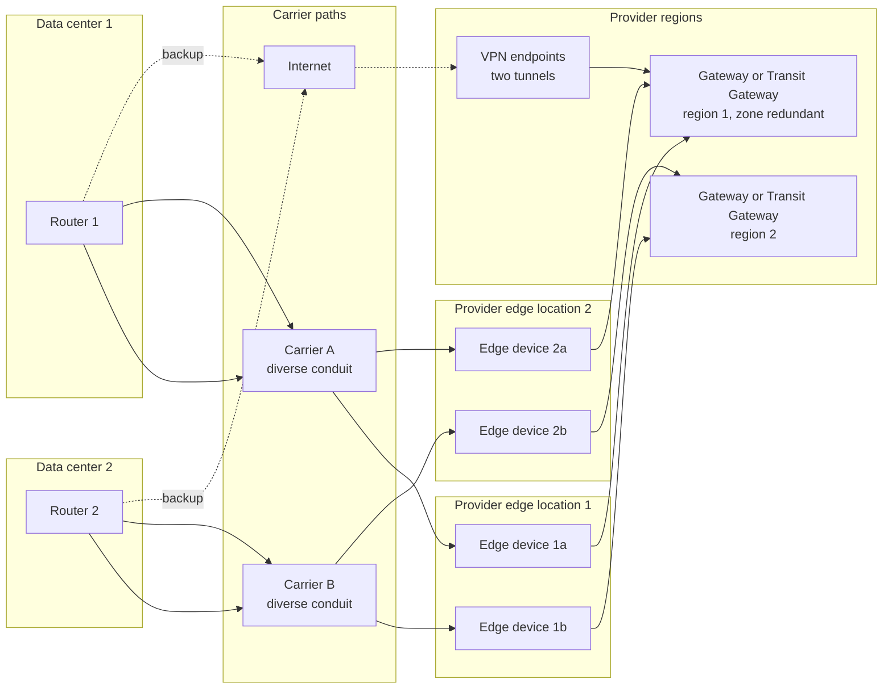

The map shows the failure domains a hybrid design must name: each customer router and data center, each carrier and its physical conduit, each provider edge location, each edge device within a location, and each region's gateway. A pair of links survives a failure only if they share none of the failed domain. Two Direct Connect connections or ExpressRoute connections at one location survive a device failure but not a location failure. Two circuits from one carrier through one conduit survive neither a carrier outage nor a backhoe. A VPN backup over the internet survives circuit failures but has less bandwidth and may share the customer router. Write the domain list into the design document and confirm diversity in writing with the carriers, because a shared conduit is invisible in a cloud console.

A hybrid path also moves through states, and the time spent in each one is what users notice:

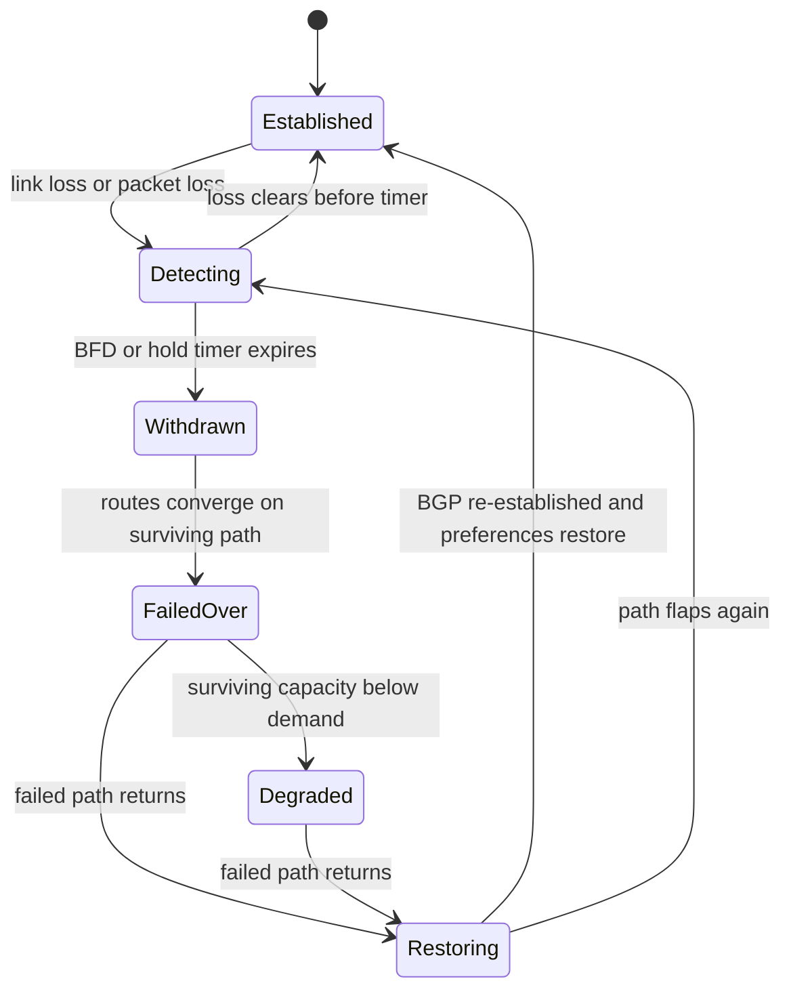

The state machine separates detection from convergence. With BGP timers alone, the `Detecting` state can last for the hold time, commonly 90 seconds, during which traffic is lost. BFD shortens it to around a second where both sides support it. Convergence then depends on how quickly every route table receives the withdrawal. `Degraded` is the state many designs never consider: the backup path is up but too small. `Restoring` deserves attention too, because a flapping circuit that keeps returning to `Established` can cause repeated failovers. BGP dampening or a hold-down before restoring preference prevents that.

### 13.6 Worked example: capacity after a failure

The [hybrid capacity planner](../code/python/networking-chapter/04_hybrid_capacity.py) starts with two 400 Mbps tunnels and a 500 Mbps requirement. Configured capacity is 800 Mbps, so the design looks fine. After either tunnel fails, 400 Mbps remains, which misses the requirement by 100 Mbps. The rule it demonstrates is N+1 per path: each surviving combination of paths must carry the required load on its own.

A larger example. A company needs 600 Mbps of steady hybrid traffic and, for six months, 3 Gbps of database replication for a migration.

- Primary: two 10 Gbps Direct Connect connections at two locations (high resiliency). Either one carries 3.6 Gbps alone, with 64 percent headroom.
- Backup: one VPN connection to a Transit Gateway with two standard tunnels and ECMP, 2 × 1.25 = 2.5 Gbps.
- If both circuits fail, the VPN carries 2.5 Gbps against 3.6 Gbps of demand. The plan is to pause replication (a scheduled job) and keep the 600 Mbps of production traffic, which fits with 76 percent headroom. The runbook names who pauses it and how.

Transfer time is the other half of capacity. The initial copy is 200 TB over an effective 3 Gbps:

- 200 TB = 200 × 8 × 10^12 bits = 1.6 × 10^15 bits.
- 1.6 × 10^15 / (3 × 10^9 bits per second) ≈ 533,000 seconds ≈ 6.2 days.

If six days is too long, the options are more circuit capacity for the migration window, a physical transfer device, or seeding from a backup. [Cloud Migration](CH16_Cloud_Migration.md) owns that decision.

## 14. Egress control and inspection

Egress is where data leaves, malware calls home, and unexpected bills arrive. NAT gives outbound connectivity. It does not decide which destinations are allowed. Egress control is a separate design with three questions: where outbound traffic is enforced, by what attribute (address, domain, identity), and who owns the allow list.

### 14.1 Distributed or centralized

**Distributed egress** puts NAT and filtering in each VPC or VNet. It has no shared bottleneck, and each workload's egress fails independently. Policy is harder to keep consistent, and there are more NAT gateways and public addresses to pay for and allow-list.

**Centralized egress** sends all spokes' internet traffic through a hub:

- On AWS, spoke route tables send `0.0.0.0/0` to a transit gateway, whose route table sends it to an egress or inspection VPC containing AWS Network Firewall endpoints and NAT gateways. Appliance mode is required on that attachment.
- On Azure, spoke UDRs send `0.0.0.0/0` to Azure Firewall in the hub, or Virtual WAN routing intent does it for you. A NAT gateway on `AzureFirewallSubnet` handles SNAT scale.
- On Google Cloud, Cloud NAT translates only traffic from VMs in its own network's subnets and does not translate traffic arriving from peered networks. Centralized egress across networks therefore uses appliances behind an internal passthrough Network Load Balancer as a route next hop, Secure Web Proxy as an explicit proxy, or a Shared VPC so that all workloads are in one network with one Cloud NAT and one firewall policy.

Centralized egress costs more per gigabyte. On AWS, 20 TB per month through a transit gateway and a NAT gateway is 20,480 × (0.02 + 0.045) = USD 1,331 per month in processing before firewall charges, against USD 922 for NAT alone in the distributed design of Section 6.7. The premium buys one policy, one set of logs, and a small set of egress addresses that partners can allow-list.

### 14.2 Filtering by address, domain, and identity

Address-based egress rules (security groups, NSGs, firewall rules) work for partners with stable addresses. They fail for software-as-a-service (SaaS) endpoints behind CDNs whose addresses change. Domain-based filtering handles those: AWS Network Firewall can match TLS Server Name Indication and HTTP Host headers, Azure Firewall supports FQDN rules and FQDN tags, and Cloud NGFW Standard supports FQDN objects in firewall policies. DNS filtering (Route 53 Resolver DNS Firewall, Cloud DNS response policies, Azure DNS security policies where available) blocks the lookup before the connection. Because a client can connect by address without a lookup, DNS filtering complements a firewall and does not replace it.

TLS inspection decrypts traffic to inspect content. It needs a certificate authority trusted by every client, breaks applications that pin certificates, and creates a place where plaintext data exists. Use it for targeted categories (for example, uploads to unknown file-sharing sites), not as a blanket default.

### 14.3 Egress through private paths

Private service access is an egress path too. An S3 gateway endpoint, an Azure service endpoint, or Private Google Access sends traffic to the provider without passing the egress firewall. Endpoint policies, service endpoint policies, and VPC Service Controls are the egress controls for those paths, as Section 10.6 described. A review that inspects only the internet path misses them.

## 15. Observability: flow logs and path analysis

[Monitoring](CH10_Monitoring.md) owns telemetry pipelines, retention, and cross-account visibility. This section covers the network-specific sources and what each can and cannot tell you.

### 15.1 Flow logs

- **AWS VPC Flow Logs** can be enabled for a VPC, subnet, or ENI and delivered to Amazon CloudWatch Logs, Amazon S3, or Amazon Data Firehose. Records summarize flows over an aggregation interval of 1 or 10 minutes, with an `ACCEPT` or `REJECT` action. Custom formats add fields such as `pkt-srcaddr` (the original source behind NAT or a load balancer), `flow-direction`, `traffic-path`, and `tcp-flags`. Flow logs do not record traffic to the Amazon DNS resolver, the instance metadata service, or DHCP, so they cannot diagnose DNS failures. Transit Gateway Flow Logs cover traffic through the transit gateway.
- **Azure virtual network flow logs** are set at the VNet, subnet, or interface level and record flows with the NSG and Virtual Network Manager rule that decided them. NSG flow logs are being retired: new NSG flow logs cannot be created after 30 June 2025, and the feature retires on 30 September 2027 ([NSG flow logs migration](https://learn.microsoft.com/en-us/azure/network-watcher/nsg-flow-logs-migrate)). Traffic Analytics aggregates flow logs into topology and top-talker views.
- **Google Cloud VPC Flow Logs** are enabled per subnet with a sampling rate and aggregation interval. They are sampled, so they are good for patterns and poor for proving a single packet's fate. Firewall Rules Logging records which rule allowed or denied a connection, and Cloud NAT logging records translations and allocation failures.

Flow-log volume grows with connections, not bytes. A fleet of short-lived connections (DNS-heavy services, health checks, chatty microservices) generates large volumes. Sampling, longer aggregation intervals, and storage-tier destinations control the cost.

### 15.2 Path-analysis tools

Flow logs show what happened. Configuration analyzers show what should happen, which is faster when a flow never starts:

- **AWS:** Reachability Analyzer traces a path between two resources through route tables, security groups, NACLs, and gateways and names the blocking component. Network Access Analyzer checks whether any path exists that violates a stated requirement, for example "no path from the internet to the data subnets". Traffic Mirroring copies packets for deep analysis.
- **Azure:** Network Watcher provides IP flow verify (which NSG rule decides a given five-tuple), next hop, effective security rules, effective routes, connection troubleshoot, and Connection Monitor for continuous tests.
- **Google Cloud:** Connectivity Tests simulate a path through routes and firewall policies and, for some paths, check the live data plane. Network Intelligence Center adds topology views, Performance Dashboard, Firewall Insights (shadowed, unused, and overly permissive rules), and Network Analyzer.

Run these tools in the deployment pipeline as well as during incidents. A Reachability Analyzer or Connectivity Test that asserts "app can reach database on 5432" and "internet cannot reach database" is a regression test for the network.

### 15.3 Signals to alert on

Alert on signals a team can act on: NAT port allocation errors and dropped packets, VPN tunnel and BGP session state, Direct Connect, ExpressRoute, or Interconnect link state and light levels, transit gateway blackhole drops, subnet address utilization above 70 percent, private endpoint connection state, route-change and firewall-policy-change audit events, and egress to new destinations from data subnets. Route each alert to the team that owns the resource.

## 16. Quotas and limits

### 16.1 How network quotas work

Network quotas fall into three kinds. **Per-resource limits** cap the size of one object, such as rules per security group, routes per route table, or prefixes per BGP session. **Aggregate quotas** cap how many objects an account, subscription, or project may have in a region, such as VPCs per region, NAT gateways per AZ, private endpoints per VNet, or peerings per network. **Rate limits** cap API calls and are hit by automation that reconciles many resources at once. Some quotas are adjustable by request; others are fixed by the platform design.

Find current values in AWS Service Quotas (and the Amazon VPC quotas page), the Azure networking limits page and `az network list-usages`, and the Google Cloud Quotas page and Cloud Quotas API. Quote them in design documents with the date checked, because providers change them.

### 16.2 Worked example: a prefix limit on a hybrid session

At the time of writing, AWS accepts a default of 100 IPv4 prefixes from on-premises on a private or transit VIF, which prefix controls can raise to 1,000. If more prefixes than the configured allocation are advertised, the BGP session goes idle and is reported as down ([Direct Connect quotas](https://docs.aws.amazon.com/directconnect/latest/UserGuide/limits.html)).

An organization connects 20 branch offices and two data centers to AWS over a Direct Connect transit VIF with the default allocation. Each branch advertises four prefixes, and each data center advertises ten: 20 × 4 + 2 × 10 = 100 prefixes, exactly at the limit, and the session works. The network team then onboards branch 21. Its four prefixes raise the count to 104, the BGP session goes idle, and the entire VIF stops carrying traffic. One new branch takes down hybrid connectivity for every site.

The fix is summarization. If branches are allocated from `10.200.0.0/16` and data centers from `10.0.0.0/12`, on-premises advertises two prefixes plus a handful of exceptions. Add a maximum-prefix limit on the customer router below the provider's limit, so that a leak is stopped on your side with a warning instead of on AWS's side with an outage. ExpressRoute and Cloud Router have their own learned-route limits with similar consequences.

### 16.3 Quality scenario: quota or capacity limit during scale-out

**Stimulus:** a marketing event triples traffic, and the EKS cluster requests 160 new nodes per AZ with 30 pods each, which needs 4,800 additional addresses per AZ. **Expected response:** the application subnets (8,187 usable each, 3,000 in use) absorb the new nodes and pods, and an alert at 70 percent subnet utilization fires so that the team can add a secondary CIDR before the next event. **Measure:** scale-out to three times capacity completes within 15 minutes with zero address-allocation failures. Pre-event checks confirm headroom for subnet addresses, NAT ports per destination (Section 6.6), load balancer target limits, and EC2 instance quotas in each AZ.

Run the arithmetic before the event: 3,000 + 4,800 = 7,800 of 8,187, which is 95 percent. The scale-out succeeds, but the 70 percent alert fires at 5,731, and the next growth step will fail. The quota review turns this into a planned secondary-range addition rather than an incident.

## 17. Cost drivers

[Cost Optimization](CH14_Cost_Optimization.md) owns billing data and allocation. Network costs come from a short list of meters, and most surprises come from traffic crossing a meter nobody drew on the diagram.

| Cost driver | AWS | Azure | Google Cloud |
|---|---|---|---|
| NAT | Per gateway-hour and per GB processed | Per gateway-hour and per GB processed | Per VM-hour (capped) and per GB processed |
| Public IPv4 addresses | Hourly charge per address, in use or idle | Hourly charge per public IP resource | Charges for external IP addresses, varying by type and use |
| Private service access | Interface endpoints per AZ-hour and per GB; gateway endpoints free | Private endpoints per hour and per GB; service endpoints free | PSC endpoints and data processing; Private Google Access free |
| Transit | Transit Gateway per attachment-hour and per GB; Cloud WAN per edge and attachment | Virtual WAN hub-hours and data processing; hub firewall | NCC per spoke-hour and data transfer |
| Zone and region crossing | Inter-AZ and inter-region transfer per GB | Inter-region transfer; check current inter-zone policy | Inter-zone and inter-region transfer per GB |
| Hybrid | Port-hours and data transfer out | Circuit monthly fee by bandwidth and plan, gateway hours | Connection and VLAN attachment hours, egress |
| Internet egress | Data transfer out per GB, tiered | Bandwidth out per GB, tiered | Egress per GB, by network tier |

Two worked figures from earlier sections show the scale. Moving 15 TB per month of S3 traffic from NAT to a gateway endpoint saved about USD 691 per month (Section 6.7). Enabling NLB cross-zone balancing on 100 TB per month, of which two thirds crosses AZs, costs about 68,267 GB × USD 0.02 (0.01 in each direction, at the time of writing) ≈ USD 1,365 per month. That is the price of the even distribution shown in Section 9.6, and it is a reason to prefer balanced target counts per AZ.

## 18. Failure scenarios and quality-attribute scenarios

### 18.1 Failure catalog

| Failure | Likely symptom | Architectural response |
|---|---|---|
| Address overlap | Peering or attachment rejected, or hybrid routes ambiguous | Registry and pipeline overlap check before creation; private NAT as a last resort |
| Subnet exhaustion | Pods pending, instances fail to launch with address errors | Utilization alerts at 70 percent; pre-planned secondary ranges |
| Route withdrawal or blackhole | Destination unreachable from some subnets | Alert on route state; verify both directions with path analysis |
| Asymmetric routing through inspection | Intermittent timeouts, half-open flows in firewall logs | Return routes through the same endpoint; appliance mode on transit attachments |
| NAT port exhaustion | New outbound connections fail to one destination | More NAT addresses, connection pooling, per-VM port tuning |
| Connection-tracking exhaustion | Packet drops on busy instances despite low CPU | Larger instance types, fewer long-lived idle connections, monitor allowance counters |
| DNS misconfiguration | Private service resolves publicly or not at all | Central private zones, automated associations, resolver endpoints in two zones |
| Circuit or tunnel loss | Hybrid traffic drops or shifts | Diverse paths, BFD, tested failover, capacity N+1 |
| Prefix-limit breach | Entire VIF or circuit session goes down | Summarization, customer-side maximum-prefix limits |
| Hub saturation or bad hub change | Many workloads degrade at once | Staged hub changes, capacity tests, emergency bypass runbook |
| Firewall policy error | Allowed flow blocked or forbidden flow admitted | Versioned policy, positive and negative tests in the pipeline |
| Zone failure | Targets in one zone unhealthy | Pre-provisioned N+1 capacity per zone, zone-local egress, zonal shift |
| Regional outage | Regional entry, NAT, and transit unavailable | Tested alternate region with its own egress, DNS, and hybrid paths |

### 18.2 Quality-attribute scenarios

**Account compromise contained by organizational boundaries.** Stimulus: an attacker gains administrator access to a workload account that participates in a shared VPC or attaches to a transit gateway. Expected response: the attacker can modify resources in that account but cannot change shared route tables, transit route tables, NACLs, hub firewall policy, or DNS, because those live in the network account (AWS), the connectivity subscription (Azure), or the Shared VPC host project and organization-level firewall policy (Google Cloud). Organization-level guardrails such as service control policies prevent the account from creating an internet gateway or a new peering. Measure: in a red-team exercise, the compromised account cannot open a new path to the internet or to another workload network, and every attempt appears in the central audit log within 5 minutes.

**Zonal failure.** Covered in Section 9.6. Measure: error rate below 0.5 percent within 2 minutes, with zone-local NAT and pre-provisioned capacity in the surviving zones.

**Quota or capacity limit during scale-out.** Covered in Section 16.3. Measure: three times scale-out within 15 minutes, zero address or NAT port allocation failures.

**Identity or key rotation.** Stimulus: the pre-shared keys for all site-to-site VPN tunnels must be rotated after a staff departure. Expected response: tunnels are rotated one at a time. Each tunnel is re-keyed on both sides while BGP keeps traffic on the other tunnel, then traffic is confirmed on the rotated tunnel before the next one. Certificate-based authentication, where the provider supports it, replaces shared keys for the future. Measure: no loss of hybrid connectivity during rotation, and the old keys fail authentication when tested afterward. The private-endpoint key rotation scenario in Section 10.6 covers the service side.

**Migration with reversible cutover.** Stimulus: an application moves from the data center to AWS. Expected response: the cloud deployment receives traffic through a weighted DNS record whose TTL was lowered to 60 seconds a week earlier. Weight moves 5, 25, 50, then 100 percent. Rollback sets the cloud weight to zero. The hybrid link carries back-end calls to systems that have not moved, sized for the full cutover load. Measure: rollback restores full traffic to the data center within 5 minutes at any step, and the hybrid link stays below 70 percent utilization at 100 percent cutover. The [Cloud Migration](CH16_Cloud_Migration.md) chapter owns the point after which rollback needs data reconciliation instead of a routing change.

## 19. Provider comparison

The table compares guarantees, scopes, and responsibilities. Similar product names do not mean similar behavior.

| Dimension | AWS | Azure | Google Cloud |
|---|---|---|---|
| Network scope | Regional VPC | Regional VNet | Global VPC network |
| Subnet scope | One AZ | Region, all zones | Region, all zones |
| Route table scope | Per subnet, plus gateway route tables | Per subnet | Per network, optionally tag-scoped |
| Same-prefix tie-break | Static, prefix list, then propagated (Direct Connect, VPN static, VPN BGP) | UDR, then BGP, then system | Subnet routes protected; custom routes by priority value, then ECMP |
| Default outbound internet | Only with an IGW route plus public IP or NAT | Retiring; private subnets default for new VNets on newer API versions | Default route exists; needs external IP or Cloud NAT |
| NAT scope | Zonal gateway, or regional mode since November 2025 | Standard zonal or no-zone; StandardV2 zone-redundant | Regional, host-implemented, no gateway instance |
| NAT per-destination capacity | 55,000 per IP; 8 IPs zonal, 32 per AZ regional | 64,512 ports per IP; up to 16 IPs | 64,512 ports per IP; ports allocated per VM |
| Instance-level filter | Security group: stateful, allow only | NSG on interface: stateful, priority order | Firewall rules and policies: stateful, priority order |
| Subnet-level filter | Network ACL: stateless | NSG on subnet: stateful | None separate; network-wide policies |
| Central override layer | Firewall Manager, NACLs, routed inspection | Virtual Network Manager security admin rules | Hierarchical firewall policies |
| Private access, service route | Gateway endpoints for S3 and DynamoDB | Service endpoints | Private Google Access |
| Private access, endpoint | Interface endpoints, per service | Private endpoints, per resource | Private Service Connect endpoints |
| Transit | Transit Gateway (regional), Cloud WAN (global) | Hub VNet with firewall, Virtual WAN | Network Connectivity Center, Shared VPC |
| Peering transitivity | None, no edge-to-edge | None, except gateway transit | None, custom route export optional |
| Hybrid redundancy model | Resiliency toolkit across locations | Two MSEE connections per circuit; Metro and maximum resiliency | SLA by topology: 99.9 or 99.99 percent |
| Private DNS | Private hosted zones, Resolver endpoints and rules | Private DNS zones, DNS Private Resolver | Private, forwarding, and peering zones; inbound policy |
| Flow telemetry | VPC and Transit Gateway Flow Logs | VNet flow logs (NSG flow logs retiring) | Sampled VPC Flow Logs, firewall logging |

The comparison shows where porting a design breaks. A route-table design that relies on AWS's per-AZ tables has no direct Azure equivalent, because Azure subnets span zones. A firewall model built on AWS's union-of-allows security groups needs priorities and explicit denies on Azure and Google Cloud. A global Google Cloud network has no per-region network boundary to contain a bad route, which AWS and Azure give you by default. [Part 10](../10_Cloud_Architecture/CH03_Cloud_Network_and_Connectivity_Architectures.md) owns designs that span providers. The provider facts in this table are its inputs.

## 20. Case study: a payments processor's AWS network

This case study applies the chapter to one fictional but realistic organization. The numbers are representative, not from a specific customer.

### 20.1 Context and requirements

A mid-sized payments processor is moving from two data centers to AWS, with us-east-1 as the primary region and us-west-2 for disaster recovery. Its stakeholders bring different concerns:

- **Compliance** requires that systems in Payment Card Industry Data Security Standard (PCI DSS) scope are segmented from everything else, with every connection into the cardholder data environment inspected and logged.
- **Partners** (card networks and banks) allow-list the processor's source addresses. Each new address takes two to six weeks to approve.
- **Platform engineering** expects 40 workload accounts within two years and wants teams to deploy without network tickets for routine changes.
- **Operations** has a 99.95 percent availability objective for the authorization API and must keep settlement files flowing to an on-premises mainframe until it is retired in three years.
- **Finance** wants network costs attributed to workload teams.

### 20.2 Decisions, alternatives, and reasons

**D1. Address plan.** AWS receives `10.64.0.0/12`. Each region receives a /14, and Amazon VPC IP Address Manager pools hand each workload VPC a /20 by default or a /16 for container-heavy workloads. Rejected: a standard `10.0.0.0/16` template for every VPC. It is simpler to automate, but it guarantees overlap the moment two VPCs need to talk, and it overlaps the data centers.

**D2. Network ownership.** Each workload has its own VPC in its own account, attached to a Transit Gateway owned by a central network account. Rejected: one shared VPC for all workloads, because a PCI workload's subnets would share route tables and NACLs with non-PCI workloads, widening PCI scope and making one network change a risk to every team. Rejected: peering, because 40 VPCs in a full mesh means 40 × 39 / 2 = 780 peerings, and peering cannot force inspection between PCI and non-PCI networks.

**D3. Segmentation.** The Transit Gateway has four route tables: `pci`, `nonpci`, `shared`, and `inspection`. PCI attachments associate with `pci`, whose only routes are to shared services and a default route to the inspection VPC. Non-PCI attachments associate with `nonpci`. Traffic between the two domains always crosses the inspection VPC, which runs AWS Network Firewall endpoints in each AZ with appliance mode enabled on its attachment.

**D4. Egress.** A central egress VPC has Network Firewall followed by a regional NAT gateway with a fixed set of Elastic IP addresses in manual mode, so that partners allow-list a small, stable set. Every VPC has S3 and DynamoDB gateway endpoints with endpoint policies restricted to the organization's resources. Twenty-five common interface endpoints live in a shared-services VPC and are shared through Route 53 Profiles. PCI VPCs keep their own AWS Key Management Service (AWS KMS) and AWS Secrets Manager interface endpoints with endpoint policies, so that key and secret traffic does not cross the transit gateway. Rejected: NAT in every VPC. It removes the shared dependency, but 40 VPCs × 3 AZs would mean up to 120 addresses for partners to allow-list, and egress policy would drift.

**D5. Ingress.** Each internet-facing workload has its own ALB behind Amazon CloudFront and AWS WAF. ALB security groups accept traffic only from the CloudFront managed prefix list. Rejected: a central ingress VPC. It concentrates WAF policy but makes every public service share one failure and change domain, and per-workload ALBs already inherit central WAF rules through AWS Firewall Manager.

**D6. Hybrid.** Each region has two 10 Gbps Direct Connect connections at two different Direct Connect locations, ordered from two carriers with written confirmation of diverse building entry and conduit. Transit VIFs connect through a Direct Connect gateway to both regions' transit gateways. Site-to-Site VPN to each transit gateway is the last-resort backup. On-premises advertises six summarized prefixes, with a customer-side maximum-prefix limit of 50, well below AWS's per-session allocation. BGP communities set AWS-side local preference so that us-east-1 traffic prefers the east-coast location. BFD is enabled on all sessions.

**D7. DNS.** Route 53 Resolver inbound and outbound endpoints run in the shared-services VPC in two AZs per region. Forwarding rules for `corp.example.com` are shared through AWS RAM. Route 53 Resolver DNS Firewall blocks known-malicious domains and alerts on newly observed domains from PCI VPCs.

**D8. Observability and guardrails.** VPC Flow Logs (custom format with `pkt-srcaddr` and `flow-direction`) and Transit Gateway Flow Logs go to a central log archive account. The deployment pipeline runs Reachability Analyzer assertions for every new workload and a Network Access Analyzer scope that must return no findings for "any path from an internet gateway to a PCI data subnet". Service control policies deny `CreateInternetGateway`, `CreateVpcPeeringConnection`, and `AttachInternetGateway` in workload accounts.

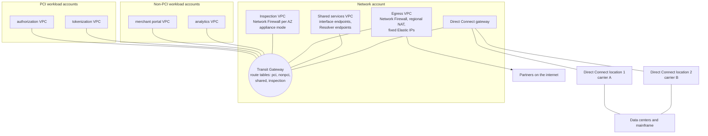

The diagram shows the result: every workload VPC has one attachment, and the Transit Gateway's route tables, not the attachments, decide reachability. PCI and non-PCI domains meet only through the inspection VPC. Internet egress has one exit with a fixed address set. Hybrid connectivity enters through one Direct Connect gateway backed by two locations and two carriers.

### 20.3 Validation evidence

The team did not accept the design on the strength of the diagram. Before the first production workload moved, it ran these tests:

- **Location failure.** BGP was shut down on the location 1 connection during business hours. With BFD, traffic moved to location 2 in about 1.2 seconds. The settlement job retried two TCP connections and completed. Without BFD, the same test in staging had taken 87 seconds.
- **Zonal failure.** A zonal shift moved the authorization API out of one AZ. Error rate peaked at 0.3 percent for 40 seconds. The regional NAT gateway kept egress in the remaining AZs. The service had been sized at five targets per AZ, following Section 9.6.
- **NAT port headroom.** A load test opened 80,000 concurrent connections to a partner sandbox endpoint. With two Elastic IPs in each AZ of the regional NAT gateway, `ErrorPortAllocation` stayed at zero. With one address per AZ, errors started at about 55,000 concurrent connections in the busiest AZ.
- **Segmentation.** Network Access Analyzer returned no internet-to-PCI-data paths. Reachability Analyzer showed that the merchant portal could reach the authorization API only through the inspection VPC.
- **Containment.** A red-team exercise with administrator access to a non-PCI workload account could not create an internet gateway or a peering, could not change Transit Gateway route tables, and could not reach PCI subnets except through inspected, logged flows.

### 20.4 Cost and quota notes

Each region has 44 Transit Gateway attachments (40 workloads plus inspection, egress, shared services, and the Direct Connect gateway). At the time of writing that is 44 × 730 × USD 0.05 ≈ USD 1,606 per month per region in attachment-hours, plus per-gigabyte processing. The team accepted this as the price of central segmentation and attributed it to workload accounts by attachment count and bytes processed, using Transit Gateway Flow Logs. The quota review checked attachments per transit gateway, routes per Transit Gateway route table, interface endpoints per VPC, and Elastic IPs per region, and filed increases six weeks before they were needed.

### 20.5 How the design would translate

On Azure, the same requirements lead to Virtual WAN with secured hubs and routing intent, or a customer-managed hub with Azure Firewall, with PCI and non-PCI spokes in separate subscriptions and Virtual Network Manager security admin rules as the guardrail. Egress SNAT moves to a StandardV2 NAT gateway on the firewall subnet, and ExpressRoute uses maximum resiliency across two peering locations. On Google Cloud, a Shared VPC host project per environment, with hierarchical firewall policies at the PCI folder, replaces most transit. NCC connects the hosts and hybrid spokes, and the Interconnect topology follows the 99.99 percent pattern across two metros. Centralized egress would need appliances or Secure Web Proxy, because Cloud NAT does not translate traffic from peered networks.

## 21. Common mistakes and anti-patterns

- **Copy-pasted CIDRs.** Cause: a VPC template with a hard-coded range. Consequence: overlap that blocks peering and hybrid routing, discovered when two teams need to connect, and fixed only by renumbering.
- **Treating NAT as a firewall.** Cause: assuming a private subnet is safe because inbound connections are blocked. Consequence: unrestricted outbound access to any internet destination, which is the path malware and exfiltration use.
- **Cross-AZ NAT dependency.** Cause: one zonal NAT gateway serving all AZs to save cost. Consequence: one AZ failure removes egress for all AZs, and inter-AZ charges on every byte.
- **Zonal NAT on a regional Azure subnet.** Cause: a Standard NAT gateway pinned to one zone serving a subnet that spans all zones. Consequence: a single-zone failure removes outbound connectivity for the whole subnet.
- **Missing return routes through inspection.** Cause: routing only the outbound direction to a firewall. Consequence: asymmetric flows that a stateful firewall drops, producing intermittent timeouts that are hard to reproduce.
- **Private endpoint without DNS.** Cause: creating the endpoint but not linking the private zone to the resolving network, or not forwarding the public zone from on-premises. Consequence: clients use the public path, which either fails or quietly bypasses the intended control.
- **Private endpoint with public access still on.** Cause: assuming the endpoint disables the public endpoint. Consequence: the resource remains reachable from the internet, contradicting the design.
- **Assuming peering is transitive.** Cause: drawing a hub with peered spokes and expecting spoke-to-spoke traffic to flow. Consequence: missing connectivity, followed by hurried peering meshes that bypass inspection.
- **Uncapped route advertisement.** Cause: no summarization and no customer-side maximum-prefix limit. Consequence: a route leak or growth step pushes a BGP session past the provider's prefix limit and takes the whole circuit down.
- **False hybrid redundancy.** Cause: two circuits from one carrier through one building entry, or two tunnels on one customer router. Consequence: one physical event removes both paths.
- **Broad Google Cloud network tags.** Cause: allow rules targeting a tag that anyone with instance-edit rights can add. Consequence: a developer or attacker can attach the tag and inherit access. Use service accounts or secure tags.
- **"VirtualNetwork" allow rules on Azure.** Cause: assuming the service tag means only the local VNet. Consequence: traffic is allowed from every peered network and from on-premises.
- **Testing from the wrong place.** Cause: checking connectivity from an administrator workstation or bastion. Consequence: the test passes while the workload's own path, with its own DNS, routes, and filters, fails.

## 22. Design-review checklist

Address plan and ownership:

- [ ] Every VPC, VNet, and subnet range is allocated from the enterprise registry and checked for overlap with on-premises, partners, and other providers.
- [ ] Subnet sizes include provider-reserved addresses, load balancer nodes, endpoints, failover interfaces, and container address consumption, with growth headroom.
- [ ] Network ownership (shared versus per-workload) is documented, with who may change routes, filters, DNS, and attachments.

Routing and edge:

- [ ] Each route table's intended next hops are documented, and same-prefix tie-breaks have been checked against the provider's priority rules.
- [ ] Inspection paths are symmetric, with return routes and appliance mode where needed.
- [ ] Exposure is reviewed as address plus route plus filter, for every subnet.
- [ ] NAT is zone-local or zone-redundant, sized for concurrent connections per destination, and monitored for allocation errors.

Filtering:

- [ ] Filter evaluation order is understood for each provider in use, including central override layers.
- [ ] Rules target identities (security group references, application security groups, service accounts, secure tags) where possible, not broad address ranges or editable tags.
- [ ] Default and implied rules are reviewed, and default networks with permissive rules are not used for production.

Private access and DNS:

- [ ] Each provider-service dependency uses a private path where policy requires it, with public access disabled separately.
- [ ] Endpoint policies, service endpoint policies, or service perimeters prevent exfiltration through private paths.
- [ ] Private zones are centrally owned, associated automatically with new networks, and reachable from on-premises through resolver endpoints in at least two zones.

Transit and hybrid:

- [ ] Peering versus transit is chosen from network count, segmentation, inspection, and cost, and route-domain propagation is reviewed.
- [ ] Hybrid paths are diverse across customer routers, carriers, conduits, provider locations, and devices, with the diversity confirmed in writing.
- [ ] Each surviving path combination carries the required load (N+1), and degraded-mode traffic shedding is documented.
- [ ] Advertised prefixes are summarized, received prefixes are filtered, and maximum-prefix limits sit below provider limits.
- [ ] BFD or tuned timers give failover times that meet the objective, and failover has been tested.

Operations:

- [ ] Flow logs, firewall logs, and NAT logs are enabled with known retention and cost.
- [ ] Path-analysis assertions run in the deployment pipeline for required and forbidden paths.
- [ ] Quotas for routes, rules, endpoints, attachments, addresses, and prefixes have recorded headroom and alert thresholds.
- [ ] Network cost drivers (NAT, endpoints, transit, cross-zone, egress) are modeled and attributed.

## 23. Exercises

### 23.1 Interview questions

1. Explain how a subnet's scope differs between AWS, Azure, and Google Cloud, and how that changes where you place a NAT gateway.
2. A route for `10.40.0.0/16` exists twice in an AWS route table, once static to a transit gateway and once propagated from Direct Connect. Which wins, and how would the answer differ on Azure with a UDR and a BGP route?
3. Why does a stateless network ACL need a rule for ephemeral ports when a security group does not?
4. A private endpoint for a storage account works from Azure but on-premises clients still reach the public address. What is the most likely cause, and how do you fix it?
5. Why is VPC peering non-transitive, and what are two ways to provide spoke-to-spoke connectivity in each provider?
6. Two Direct Connect connections are configured. List the failure domains they might still share.
7. How do you calculate whether a NAT gateway will run out of ports for a given workload?

### 23.2 Design exercises

1. **Address plan.** Produce an allocation for a GCP Shared VPC with subnets in three regions, GKE clusters needing 20,000 pods per region, and an on-premises network using `10.0.0.0/12` and `172.16.0.0/12`. Show the arithmetic, including reserved addresses and secondary ranges.
2. **Route priority simulator.** Extend the [route-table simulator](../code/python/networking-chapter/02_route_table_simulator.py) so that each route has a type (`static`, `prefix-list`, `dx-bgp`, `vpn-static`, `vpn-bgp`) and implement the AWS tie-break order for identical prefixes. Add test cases from Section 5.6.
3. **Egress review.** Run the [exposure audit](../code/python/networking-chapter/03_exposure_audit.py) on its sample rules, then rewrite the rules for a workload that needs only TLS to two partner prefixes and administrative access from a bastion subnet. Explain which findings remain and why.
4. **Hybrid capacity.** Use the [hybrid capacity planner](../code/python/networking-chapter/04_hybrid_capacity.py) to model the case-study topology: two 10 Gbps circuits and a 2.5 Gbps VPN, with 3.6 Gbps of demand of which 3 Gbps can be paused. Report which single and double failures meet the requirement.
5. **Azure hub review.** A proposal routes all spokes through one Azure Firewall in one region, with zonal Standard NAT gateways on the spoke subnets. Identify the zonal, regional, and SNAT risks and propose changes.
6. **Private service access.** Design private access for a workload on Google Cloud that calls Cloud Storage, BigQuery, and a third-party SaaS published through Private Service Connect, with VPC Service Controls. Show DNS zones, routes, and the on-premises resolution path.

## 24. Summary

Cloud networks are distributed policy enforced on every host, not devices you can inspect. The network object's scope sets the design: AWS has a regional VPC with zonal subnets, Azure a regional VNet with zone-spanning subnets, and Google Cloud a global VPC with regional subnets. Address planning comes first and is the hardest decision to reverse, so it must account for reserved addresses, container consumption, growth, and every network that will ever be routed to.

Routing uses longest-prefix match everywhere, with provider-specific tie-breaks that decide which of two identical routes wins. Exposure is the combination of address, route, and filter. NAT provides outbound connectivity with a finite per-destination port budget and no security policy. Filters differ in state, attachment, and evaluation order, and Azure and Google Cloud add central override layers above workload rules. Load balancers differ by layer, scope, proxy model, and cross-zone behavior, and zonal resilience requires capacity provisioned before the failure.

Private service access comes in two models. A service route keeps public DNS, and an endpoint in your network needs DNS changes that must work from every client location. Peering is non-transitive. Transit services provide central segmentation and inspection at the price of a shared dependency. Hybrid connectivity is only as redundant as its least diverse failure domain, and BGP prefix limits, preferences, and timers decide how failures play out. Flow logs, path-analysis tools, quota headroom, and cost models turn these designs into something you can operate and verify.

## 25. Code examples

The examples use Python's standard library and synthetic data. They make no cloud API calls, and provider semantics must still be checked against current documentation.

- [Address allocation overlap checker](../code/python/networking-chapter/01_address_allocation.py) uses `ipaddress` to compare every pair of allocations and reports the partner range that overlaps production, the check Section 4.5 recommends before creating any network.
- [Route-table simulator](../code/python/networking-chapter/02_route_table_simulator.py) selects the next hop by longest-prefix match for three sample destinations, as worked through in Section 5.6.
- [Exposure audit](../code/python/networking-chapter/03_exposure_audit.py) flags ingress open to every IPv4 source (rating administrative ports as high risk) and unrestricted egress, the address-plus-filter review from Sections 6.1 and 14.
- [Hybrid capacity planner](../code/python/networking-chapter/04_hybrid_capacity.py) computes remaining capacity after each single path failure and shows that two 400 Mbps tunnels miss a 500 Mbps requirement, the N+1 rule from Section 13.6.

Further reading: [AWS](CH01_AWS.md), [Azure](CH02_Azure.md), [GCP](CH03_GCP.md), [IAM](CH09_IAM.md), [Landing Zones](CH15_Landing_Zones.md), [Cloud Network and Connectivity Architectures](../10_Cloud_Architecture/CH03_Cloud_Network_and_Connectivity_Architectures.md), [TCP/IP](../05_Networking_and_OS/CH03_TCPIP.md), [NAT](../05_Networking_and_OS/CH12_NAT.md), [Firewalls](../05_Networking_and_OS/CH14_Firewalls.md), and [DNS](../05_Networking_and_OS/CH08_DNS.md).
