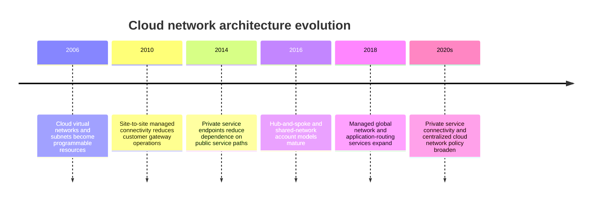
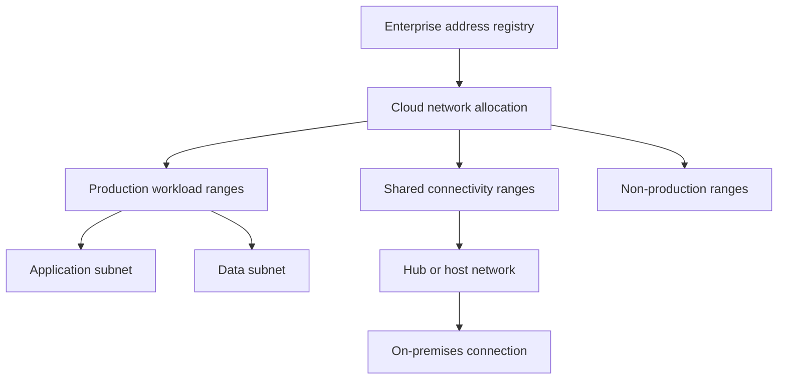
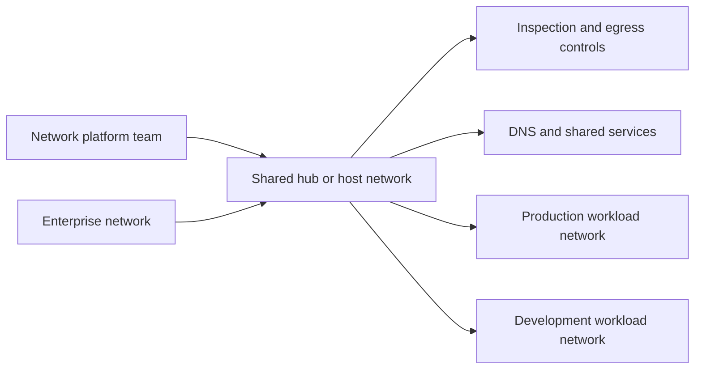
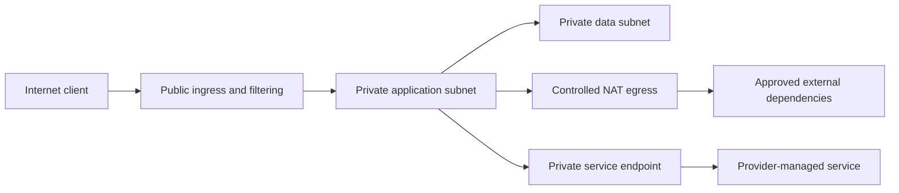
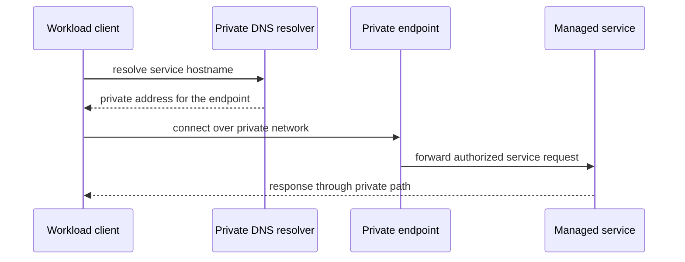
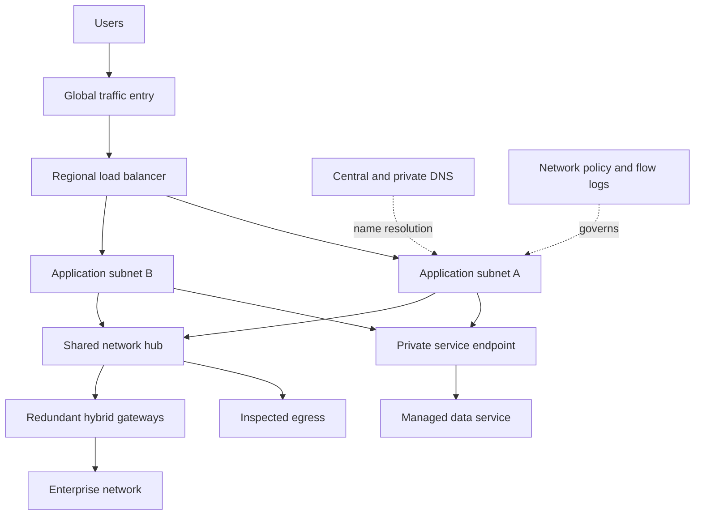

# Chapter: Cloud Networking Architecture

Part: [09 — Cloud Computing](PART_OVERVIEW.md) · Status: Drafted

## 1. Introduction

Cloud networking defines how workload components receive addresses, discover services, exchange traffic, cross trust boundaries, and connect to enterprise or public networks. Provider services replace some physical-network operations with APIs and policy objects, but not with automatic correctness. Address overlap, unintended egress, DNS failure, route propagation, quota limits, and ownership boundaries remain architectural concerns.

This chapter focuses on network topology and service boundaries across Amazon Web Services (AWS), Microsoft Azure, and Google Cloud Platform (GCP): virtual networks, subnets, routing, internet access, private service connectivity, hybrid links, and global traffic paths. Part 05 owns the first-principles mechanics of Internet Protocol (IP) addressing, Network Address Translation (NAT), Virtual Private Network (VPN), Domain Name System (DNS), load balancing, firewalls, and Transport Layer Security (TLS). Here those concepts are recapped only as needed to make cloud designs coherent.

## 2. Historical Evolution

Early cloud networking exposed virtual network segments, subnets, and route tables that mapped familiar data-center concepts into provider control planes. As services matured, private service endpoints, cross-account/project connectivity, managed firewalls, hub-and-spoke topologies, software-defined wide-area networks, and global load balancers became common building blocks. The shift is from operating every router and appliance to composing managed control points whose scope and policy must still be understood.

These capabilities do not make cloud networks equivalent to one another. Scope, route propagation, firewall state, endpoint DNS, and cross-project or cross-account policy differ among providers and services.

## 3. Why It Exists

Cloud networks provide isolation, reachability, service exposure, and hybrid connectivity for resources that may be created and replaced frequently. They let teams express traffic intent through network and policy resources rather than requesting every change from a physical-network operations queue. The same flexibility makes unreviewed network changes capable of exposing data or disconnecting large workloads.

A sound network architecture identifies who owns address space, shared connectivity, DNS, security policy, internet ingress, egress, and private service access. It also states which network failures affect one workload, one region, or many projects and accounts. These decisions shape deployment boundaries and must be settled before large-scale resource creation.

## 4. Core Concepts

### 4.1 Virtual networks, address planning, and subnet topology

**Definition.** A virtual network is a provider-defined private network boundary for supported cloud resources. AWS Virtual Private Cloud (VPC) and Azure Virtual Network (VNet) are regional network resources; Google Cloud VPC networks are global resources with regional subnets. A subnet assigns a range of addresses to a workload placement scope, although exact provider semantics differ.

**Mechanism.** Address ranges are allocated from private or public space and divided into subnets. Resources receive interfaces and addresses; routes and network policy determine which destinations are reachable. VPC/VNet boundaries do not make all resources mutually reachable by default, and network reachability does not grant application authorization. Address plans must account for growth, peering, hybrid networks, service endpoints, and provider-reserved addresses.

**Decision implications.** Reserve non-overlapping ranges before connecting cloud networks to one another or to enterprise sites. Choose whether workload teams receive dedicated networks or delegated subnets in a shared network based on ownership, policy, and isolation. Part 05's [TCP/IP chapter](../05_Networking_and_OS/CH03_TCPIP.md) owns Classless Inter-Domain Routing (CIDR) and IP-subnetting mechanics; this chapter applies that model to cloud address governance.

**Common failure mode.** Teams allocate ranges independently and later discover that overlapping networks cannot be cleanly routed or peered. Another error is assuming that a subnet itself enforces complete trust separation without route and firewall policy.

**Scenario.** A company plans hybrid connectivity across three providers. A central registry assigns ranges by environment and region, reserves future growth space, and blocks overlapping allocations in the provisioning pipeline before network peering or VPN configuration begins.

### 4.2 Shared networks and workload network ownership

**Definition.** A shared-network model centralizes some connectivity resources while allowing workload teams to own their compute and data. AWS commonly uses a network account with shared VPC attachments or transit routing; Azure uses hub-and-spoke, Virtual WAN, and subscription boundaries; Google Cloud uses a Shared VPC host project and service projects.

**Mechanism.** A central team owns route domains, shared gateways, inspection, and address allocation. Workload teams attach to approved segments or use delegated subnets. The attachment mechanism controls route visibility, policy inheritance, DNS integration, and which team can change shared resources. Centralization reduces duplication but creates a shared dependency and a platform-team change path.

**Decision implications.** Centralize capabilities that benefit from consistent policy, scarce expertise, or shared connectivity. Keep workload-specific routes and controls with workload owners when they can be governed safely. Establish service levels, change approvals, incident ownership, and capacity planning for the shared platform.

**Common failure mode.** A central hub becomes a bottleneck whose outage or change affects every workload. The opposite failure is unrestricted network sprawl, with duplicated gateways, inconsistent logging, and no accountable owner for cross-network connectivity.

**Scenario.** A regulated enterprise runs shared egress inspection and hybrid connectivity centrally, while product teams own separate application networks. The platform team defines a documented attachment contract, and each workload retains permission to manage only its own subnet-level resources.

### 4.3 Routes, ingress, egress, and network address translation

**Definition.** A route selects a next hop for traffic; ingress is traffic entering a workload boundary, and egress is traffic leaving it. NAT rewrites address information to enable selected connectivity patterns. Part 05 [NAT](../05_Networking_and_OS/CH12_NAT.md) owns translation mechanics; this chapter addresses cloud routing and egress architecture.

**Mechanism.** A route table combines provider system routes with customer routes and attached gateways. Public ingress may pass through a load balancer, web application firewall, or gateway; private workloads can use controlled outbound gateways or provider-managed egress. A subnet with a public IP or a route to an internet gateway has a different exposure posture from a subnet with no public path. Private subnets can still have internet egress through NAT.

**Decision implications.** Draw ingress, east-west traffic, service access, and egress as separate paths. Prefer explicit egress destinations and private service paths when requirements justify them. Ensure route tables, firewall policy, DNS, and application identity agree; a route alone is not a security policy.

**Common failure mode.** A “private” subnet has a default route through NAT that permits broad outbound internet access, or the team assumes NAT is a firewall. Another failure is exposing a workload directly while believing its private address or subnet name prevents public reachability.

**Scenario.** Application workers need package repositories and a managed object store but should not accept unsolicited internet traffic. The design uses a monitored egress path, a private service endpoint where supported, and explicit inbound exposure only through the public edge.

### 4.4 Network policy and trust boundaries

Cloud network policy is implemented through firewall rules, security groups, network security groups, subnet policies, route controls, and service-specific access settings. The primitives differ: some are stateful and attached to interfaces; others are stateless subnet filters or hierarchical rules. Part 05 [Firewalls](../05_Networking_and_OS/CH14_Firewalls.md) owns filtering mechanics and rule evaluation.

Model policy around allowed communication: source identity or segment, destination, protocol, port, and purpose. Start from deny where operationally feasible, keep rules narrow, and assign ownership and expiration to exceptions. Use network controls as one layer alongside service identity, resource policies, and application authorization; network location alone does not prove trust.

### 4.5 Private connectivity to managed services

**Definition.** Private service connectivity provides a network path to a managed provider service without requiring the workload to use a general public endpoint. AWS offers PrivateLink and VPC endpoints; Azure offers Private Link and private endpoints. Google Cloud offers Private Service Connect or private services access, depending on service and connection direction.

**Mechanism.** A provider creates a private interface, address, or service attachment; routing and DNS direct the client to that path. The service may still require IAM or resource-policy authorization. Private connectivity can reduce exposure and simplify egress controls, but it adds endpoint lifecycle, DNS, quota, and cross-network ownership concerns.

**Decision implications.** Use private endpoints when exposure policy, data paths, or compliance requires them and when DNS and endpoint costs are understood. Disable the public path separately if the service supports it and the threat model requires that. Verify name resolution and authorization from the actual workload network.

**Common failure mode.** A private endpoint exists but clients resolve the public address, or public access remains enabled despite the design claiming private-only access. Endpoints can also proliferate without ownership or quota tracking.

**Scenario.** A payment service reads from managed object storage. The team provisions an endpoint in the application network, configures the correct private DNS zone, restricts the bucket policy to the workload identity, disables public access, and tests both allowed and denied paths.

### 4.6 Hybrid connectivity: VPN and dedicated interconnect

**Definition.** Hybrid connectivity joins cloud networks to enterprise or colocation networks. Encrypted VPN tunnels use internet or provider paths; dedicated interconnect services provide private connectivity through a carrier or provider edge. Part 05 [VPN](../05_Networking_and_OS/CH13_VPN.md) owns Virtual Private Network (VPN) and Internet Protocol Security (IPsec) mechanics.

**Mechanism.** A cloud gateway exchanges routes with a customer gateway or router, often using Border Gateway Protocol (BGP) to advertise reachable prefixes and withdraw failed paths. Redundant tunnels or circuits improve availability only when they have independent failure paths, correct route preference, and operational monitoring. Encryption and dedicated transport are separate properties: a private circuit may still require application-layer encryption.

**Decision implications.** Choose VPN for flexible or lower-capacity connectivity and dedicated interconnect for predictable throughput, latency, or data volume when the cost and provisioning lead time are justified. Use redundant devices, locations, and providers where recovery objectives require them. Control route advertisement to prevent accidental default-route propagation or address leakage.

**Common failure mode.** Two tunnels terminate on one customer router or share a carrier path, creating false redundancy. Another failure is asymmetric routing or overlapping routes that make only some flows work.

**Scenario.** A company migrates gradually and needs private access to an on-premises directory and database. A pair of VPN tunnels provides initial connectivity; the team documents route filters and tests a tunnel failure before adding a dedicated circuit for sustained data transfer.

### 4.7 Load balancing and application entry points

Cloud load-balancing products implement regional or global distribution at different layers and with different health, proxy, and TLS behaviors. Part 05 [Load Balancer](../05_Networking_and_OS/CH10_Load_Balancer.md) owns algorithms, health-check theory, and connection draining. The cloud decision is which managed entry point fits the traffic protocol, geography, security controls, and backend topology.

Use DNS or global traffic services to direct users to regional entry points, then use regional balancing to select healthy backends. Understand whether a product is a proxy or a pass-through, where TLS terminates, which client address is preserved, how health checks are scoped, and whether failover waits for DNS caching. Avoid exposing backends in a way that bypasses the intended edge controls.

### 4.8 Cross-region networks and traffic flow

Cross-region connectivity can use provider backbones, peering, transit hubs, or service-specific global networks. The path's scope, latency, routing, and failure behavior vary. A global network object does not make regional services global, and inter-region reachability does not provide data replication or conflict resolution.

Use explicit regional boundaries for latency-sensitive or regulated workloads. Measure cross-region traffic cost and establish which teams own routes and failover. Coordinate network failover with application health, data consistency, identity, quotas, and recovery objectives.

### 4.9 Network security, DNS, and transport protection

Cloud network security composes segmentation, firewall policy, service identity, DNS, and encryption. DNS determines which endpoint clients reach; TLS protects transport and authenticates endpoints; network filters constrain paths. Their detailed mechanisms are owned by Part 05 [DNS](../05_Networking_and_OS/CH08_DNS.md), [TLS](../05_Networking_and_OS/CH06_TLS.md), [Firewalls](../05_Networking_and_OS/CH14_Firewalls.md), and [Reverse Proxy](../05_Networking_and_OS/CH11_Reverse_Proxy.md).

Define private and public DNS zones, resolver forwarding, certificate ownership, firewall rule lifecycle, and private endpoint naming in one design. A private address is not proof of a trusted caller, and encryption does not correct an overly permissive route. Log policy changes and test both expected and prohibited connections.

### 4.10 Cloud network service selection

Select topology from communication requirements: workload-to-workload, workload-to-provider-service, internet ingress, controlled egress, enterprise connectivity, and cross-region recovery. Compare centralized versus distributed ownership, endpoint support, route scale, quotas, operational skills, and the consequences of a shared network outage.

A decision record should include address-space assumptions, trust boundaries, connectivity owners, expected traffic volume, required failure behavior, and migration constraints. Avoid choosing a hub, transit service, or mesh because it is popular; select the least complex model that meets policy and scale requirements.

## 5. Internal Working

A cloud network request creates or updates provider control-plane resources: virtual networks, subnets, routes, gateways, endpoints, and policy attachments. The provider validates scope, address compatibility, permissions, and quota, then reconciles the configuration. Data-plane behavior may lag control-plane success; route propagation, DNS changes, and endpoint readiness should be checked from the workload path.

At runtime, a packet is matched to an interface and route, passes applicable network policy, and is delivered to a next hop or service endpoint. Stateful filters track flows; stateless filters evaluate packets independently. Managed services can add service-side authorization and firewall checks after network delivery. Diagnosing connectivity therefore requires tracing the whole path rather than inspecting only the source subnet.

## 6. Design Principles

- Allocate address space centrally and prevent overlap before deployment.
- Separate shared connectivity ownership from workload ownership deliberately.
- Document ingress, east-west traffic, private service access, and egress independently.
- Treat routes and firewalls as separate controls with separate owners.
- Use private endpoints only with correct DNS, service policy, and public-access settings.
- Build hybrid redundancy from independent devices and carrier paths.
- Make cross-region paths, costs, and failure behavior visible.
- Test connectivity from the actual workload identity and network location.
- Monitor route, DNS, gateway, endpoint, and policy changes as production changes.

## 7. Architecture Patterns

**Hub-and-spoke.** Shared egress, hybrid gateways, DNS, and inspection live in a hub; workload networks attach as spokes. This reduces duplicated shared services but creates a central dependency.

**Shared VPC or delegated subnet.** A network team owns address and route policy while application teams deploy resources into approved segments. This fits organizations that need centralized network controls and delegated workload delivery.

**Private service access.** Workloads reach supported managed services through private endpoints or service attachments, with private DNS and service-level authorization configured together.

**Regional isolation with controlled transit.** Workload networks remain regionally bounded and use explicit transit paths for shared services or enterprise connectivity. Cross-region traffic is allowed by design rather than by broad default routes.

## 8. Production Architecture

Production readiness includes address allocation, route ownership, firewall review, private DNS, endpoint inventory, hybrid failover, flow telemetry, and a tested path for emergency access. Network diagrams should show trust boundaries and direction, not just connected service icons.

## 9. Implementation

1. Inventory workload flows, data sensitivity, user locations, and hybrid dependencies.
2. Reserve non-overlapping address ranges and select network ownership boundaries.
3. Choose shared or workload-owned connectivity and define attachment contracts.
4. Specify ingress, egress, east-west, private service, DNS, and management paths.
5. Define route propagation, firewall controls, identity requirements, and private endpoint behavior.
6. Establish redundant hybrid connectivity and route filters if needed.
7. Automate network creation and policy review with versioned infrastructure definitions.
8. Test allowed and denied paths, route failure, DNS resolution, and telemetry before production.

## 10. Complete Code Examples

- [Cloud address allocation overlap checker](../code/python/networking-chapter/01_address_allocation.py)
- [Route-table reachability simulator](../code/python/networking-chapter/02_route_table_simulator.py)
- [Public ingress and egress exposure review](../code/python/networking-chapter/03_exposure_audit.py)
- [Hybrid connectivity redundancy planner](../code/python/networking-chapter/04_hybrid_capacity.py)

The examples use Python's standard library and synthetic networks. They do not provision cloud resources or make API calls; provider route and policy semantics must be verified against current service documentation.

## 11. Performance

Network performance depends on location, path length, bandwidth ceilings, packet processing, encryption, and service-tier limits. Measure latency and loss from the workload's actual source to each dependency. Cross-region or inspection paths can add tail latency even when average throughput appears adequate.

Use flow logs and distributed traces to identify whether delay comes from DNS, routing, firewall inspection, a gateway, or the destination service. Validate maximum packet size and connection behavior where relevant; Part 05 owns transport-level mechanics.

## 12. Scalability

Network scalability is constrained by address space, route count, gateway throughput, endpoint quotas, firewall rule scale, connection tracking, and operational change rate. A topology that works for five workloads may become difficult to route or govern at hundreds. Shared hubs reduce duplication but can saturate or slow team changes.

Plan address growth, route aggregation, gateway capacity, policy ownership, and endpoint count. Test failover with realistic traffic and ensure each region has sufficient quota and network capacity to accept shifted load.

## 13. Security

Use explicit segmentation and least-privilege flow policy, minimize public exposure, and require workload identity at service boundaries. Private connectivity reduces reliance on public paths but does not replace service authorization or transport encryption. Centralize policy only where ownership and incident response are clear.

Review internet egress, administrative access, peering trust, shared service access, DNS forwarding, and route propagation. Enable network flow telemetry and protect its storage. The Firewalls and Security parts own filtering and general security architecture in depth.

## 14. Observability

Collect flow logs, gateway health, route-change events, endpoint status, DNS query results, load-balancer health, and firewall decisions where supported. Correlate these signals with application traces and deployment events. Monitor address utilization, route counts, connection saturation, and hybrid tunnel state.

Alert on actionable symptoms: a route withdrawal, gateway failover, unusual egress, endpoint resolution change, or rapidly shrinking address pool. Assign alerts to the team that can remediate the relevant network resource.

## 15. Failure Scenarios

| Failure | Likely symptom | Architectural response |
|---|---|---|
| Address overlap | Peering or hybrid routes become ambiguous | Reject overlapping allocation and renumber before attachment |
| Route withdrawal | Subnet loses a destination path | Restore intended route and verify propagation at both ends |
| DNS misconfiguration | Private service resolves publicly or fails | Validate resolver path and private-zone associations |
| Gateway or circuit outage | Hybrid traffic drops or shifts | Fail over to independent path and verify route preference |
| Shared hub saturation | Multiple workloads see latency or packet loss | Scale or isolate traffic; preserve emergency access path |
| Firewall change error | Allowed flow blocked or prohibited flow admitted | Roll back versioned policy and test both positive/negative cases |
| Endpoint failure | Private service connection unavailable | Check endpoint health, DNS, service policy, and regional alternatives |
| Regional outage | Regional ingress or transit unavailable | Activate tested alternate region and coordinate application/data recovery |

Troubleshooting should trace the packet path end to end: name resolution, source route, policy, next hop, destination policy, and service authorization. A successful network ping does not prove application protocol health or data authorization.

## 16. Testing

Validate address plans and route intent before deployment. Integration tests should resolve private names and connect from representative workload subnets, while negative tests confirm prohibited paths fail. Review effective policy after inherited rules and attachments are applied.

Exercise gateway loss, route withdrawal, DNS failure, hub saturation, and a regional outage. Measure detection and recovery time, confirm failover does not create asymmetric routing, and verify logs remain available during the tested failure.

## 17. Common Mistakes

- Reusing address ranges without checking hybrid and peer networks.
- Treating a virtual network or subnet as a complete security boundary.
- Assuming private endpoints disable public service access automatically.
- Treating NAT as a firewall or assuming a private subnet has no egress.
- Centralizing all traffic without capacity or independent recovery paths.
- Assuming peering is transitive or route propagation behaves identically across providers.
- Forgetting DNS when introducing private endpoints or cross-network services.
- Measuring connectivity from an administrator workstation instead of the workload path.

## 18. Best Practices

- Maintain a versioned source of truth for address ranges and ownership.
- Use consistent network attachment patterns with explicit exception paths.
- Keep route and firewall changes reviewed, observable, and reversible.
- Prefer service-specific private access for sensitive managed dependencies where it fits.
- Disable unused public access and constrain outbound destinations.
- Configure hybrid connectivity with independent failure paths and route filters.
- Monitor address, route, gateway, and endpoint quotas.
- Test network behavior after policy and DNS changes, not only at initial setup.

## 19. Anti-Patterns

**Flat trusted network.** Placing every workload in one broadly reachable network reduces initial setup but increases lateral-movement risk and change coupling. Segment according to ownership and trust boundaries.

**Hub as an unbounded choke point.** Sending every flow through one shared firewall or gateway without capacity planning can make the hub a performance and availability bottleneck.

**Private endpoint by checkbox.** Creating an endpoint without private DNS, public-path controls, or application authorization creates the appearance of isolation without proving it.

**Hybrid connectivity without route ownership.** Multiple teams advertise overlapping or default routes with no clear authority, producing outages that are hard to diagnose and reverse.

## 20. Trade-off Analysis

| Decision | Benefits | Costs and risks | Choose when |
|---|---|---|---|
| Central hub | Shared controls and fewer duplicated gateways | Shared failure domain and platform-team dependency | Common connectivity and inspection need consistent ownership |
| Workload-owned networks | Independent changes and isolation | More duplicated controls and address governance | Workload teams need distinct lifecycles or trust boundaries |
| Private endpoints | Reduced public path exposure | Endpoint, DNS, and quota management | Private service access is required and support is mature |
| Dedicated interconnect | Predictable private transport | Cost, lead time, and provider/carrier dependency | Traffic volume or performance justifies it |
| Full-tunnel egress | Centralized inspection and policy | Added latency and gateway capacity requirement | Compliance requires centralized outbound control |
| Regional isolation | Reduced blast radius and locality | Replication and multi-region operations | Data and recovery objectives warrant boundaries |

## 21. Comparison Table

| Dimension | AWS | Azure | Google Cloud |
|---|---|---|---|
| Network resource scope | Regional VPC | Regional VNet | Global VPC with regional subnets |
| Shared ownership model | Network account, transit gateway, shared VPC options | Hub-and-spoke, Virtual WAN, subscription boundaries | Shared VPC host and service projects |
| Private service connectivity | VPC endpoints / PrivateLink | Private Link / private endpoints | Private Service Connect / private services access |
| Hybrid private connectivity | Site-to-Site VPN / Direct Connect | VPN Gateway / ExpressRoute | Cloud VPN / Cloud Interconnect |
| Network policy examples | Security groups, network ACLs, route tables | Network security groups, route tables, Azure Firewall | VPC firewall rules, routes, Cloud Firewall |

Names do not imply equivalent route propagation, policy evaluation, or failure scope. Compare the actual service contract and test the intended path in each target region.

## 22. Real-World Case Study

### A hub-and-spoke landing-zone reference architecture

Microsoft's [Azure landing-zone reference architectures](https://learn.microsoft.com/en-us/azure/cloud-adoption-framework/ready/landing-zone/) document hub-and-spoke and Virtual WAN patterns that separate a connectivity subscription from workload landing zones. The hub can contain shared gateways and security services, while workload subscriptions connect through controlled network attachments. This is a published reference pattern, not a claim about one customer's deployed topology.

The design makes network ownership explicit: the platform team manages shared connectivity; workload teams own their resources and application flows. This can reduce duplicated gateways and make central controls consistent. It also increases the blast radius of shared hub changes and makes the platform team part of each workload's network availability path.

The pattern is appropriate when common egress, hybrid access, and inspection are real organizational requirements. It should be adapted when regional autonomy, high throughput, or fault isolation outweighs centralization. A production adoption needs address governance, redundant gateway paths, capacity tests, change ownership, and an alternate recovery plan.

## 23. Interview Questions

1. How do AWS VPC, Azure VNet, and Google Cloud VPC scopes differ?
2. What must be planned before connecting a cloud network to an enterprise network?
3. Why does a private endpoint require DNS and service-policy validation?
4. How do shared-network and workload-owned models change team responsibilities?
5. What failure modes remain when two VPN tunnels are configured?
6. Why is NAT not equivalent to a firewall?
7. How should ingress, egress, and east-west traffic be represented in an architecture diagram?
8. What must be tested before calling a hub-and-spoke network highly available?

## 24. Hands-on Exercises

1. Run the address allocation checker with overlapping ranges and add an exception workflow.
2. Run the route simulator for a private subnet with a default route through NAT and explain its egress exposure.
3. Run the exposure audit with a public ingress rule and broad outbound destination; tighten the policy and compare findings.
4. Run the hybrid planner with one and two independent circuits and examine the remaining capacity after a failure.

## 25. Design Exercises

1. Design network ownership for 50 workloads across three providers, including address allocation, shared DNS, and private managed-service access.
2. Design a hybrid migration network with redundant VPN paths, an eventual dedicated circuit, route filters, and phased cutover.
3. Design private access for an internet-facing API that depends on a managed database, object store, and external payment provider.
4. Review a hub-and-spoke proposal that routes all traffic through one region and identify latency and regional-failure risks.

## 26. Architecture Review Questions

- Is address space non-overlapping across cloud, enterprise, and partner networks?
- Are route, DNS, firewall, and endpoint owners named?
- Are public ingress, private service paths, egress, and management access shown separately?
- Do private endpoints resolve privately from the workload and have public access constrained?
- Are shared gateways and inspection points sized and tested for failover load?
- Are VPN or interconnect paths independent enough to meet the availability objective?
- Are routing, policy, and DNS changes versioned, logged, and reversible?
- Can operators observe and recover network paths during the failure being planned for?

## 27. Summary

Cloud networking composes virtual networks, subnets, routes, policies, private endpoints, and hybrid links into explicit traffic paths. Provider scope differs: AWS VPC and Azure VNet are regional, while Google Cloud VPC is global with regional subnets. Plan address space and ownership first, separate routing from filtering and identity, validate private service DNS, and test hybrid and regional recovery under realistic failure conditions.

Further reading: [AWS Architecture](CH01_AWS.md), [Microsoft Azure Architecture](CH02_Azure.md), [Google Cloud Platform Architecture](CH03_GCP.md), [TCP/IP](../05_Networking_and_OS/CH03_TCPIP.md), [DNS](../05_Networking_and_OS/CH08_DNS.md), and [Load Balancer](../05_Networking_and_OS/CH10_Load_Balancer.md).
