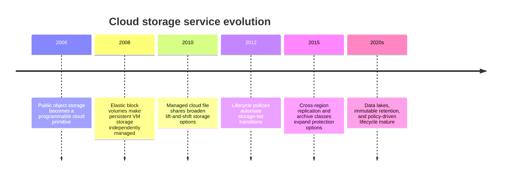
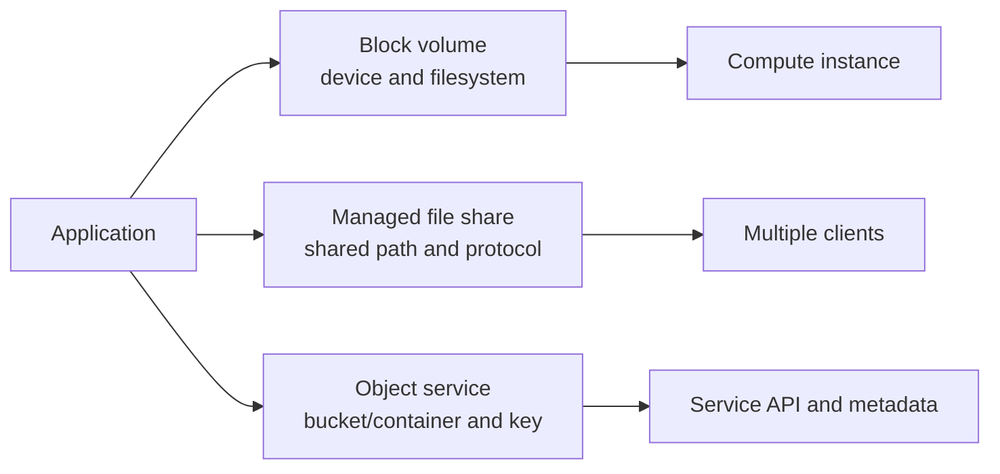
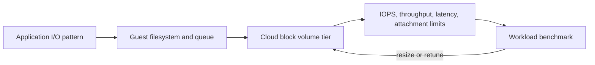
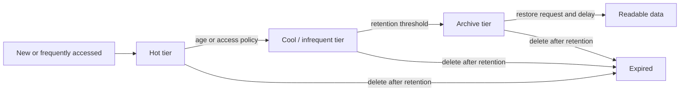
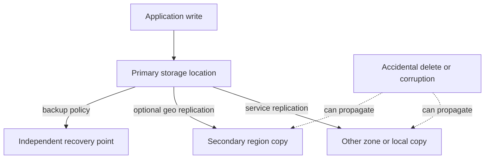
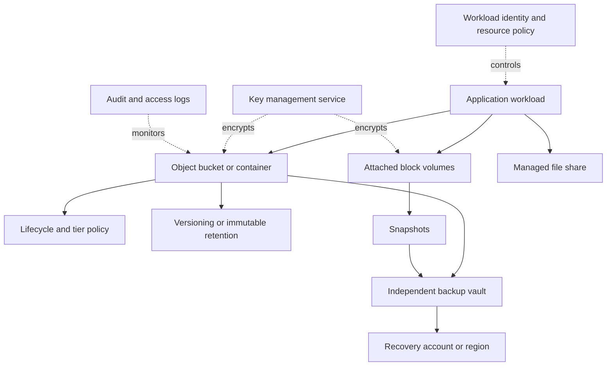

# Chapter: Cloud Storage Architecture

Part: [09 — Cloud Computing](PART_OVERVIEW.md) · Status: Drafted

## 1. Introduction

Cloud storage services provide durable data storage through object, block, and file interfaces, along with archival tiers, snapshots, backup, and replication options exposed through application programming interfaces (APIs). Their architectures differ in access semantics, latency, throughput, durability contracts, consistency, retention controls, and cost. Choosing a service is therefore a workload and recovery decision, not simply a capacity estimate.

This chapter focuses on provider storage services and the decisions that surround them: storage model, performance, lifecycle, redundancy, backups, encryption, access, and exit cost. Part 05's [File Systems](../05_Networking_and_OS/CH26_File_Systems.md) chapter owns filesystem semantics and the general differences between files and objects. Part 06 owns database persistence, transactions, and database replication. This chapter applies those concepts to cloud storage offerings without re-teaching database internals.

## 2. Historical Evolution

Cloud storage developed from remote block volumes and object stores into a portfolio of managed file systems, archival classes, replication options, and data-lake integrations. Object storage made large-scale, API-addressed data practical without requiring a hierarchical filesystem interface. Managed block and file services later abstracted hardware operations while exposing performance and access controls through cloud APIs.

The result is a layered portfolio: hot transactional access, shared files, large unstructured objects, backups, and long-term archives can use different services and protection policies while remaining part of one data lifecycle.

## 3. Why It Exists

Cloud storage separates data capacity from local server hardware and lets teams scale, protect, and share data through managed services. That flexibility introduces choices about access protocols, performance guarantees, location, redundancy, retention, encryption, and billing. Misunderstanding one of these can cause slow applications, unexpected retrieval charges, incomplete recovery, or irreversible deletion.

Storage decisions should begin with the data's role and lifecycle: authoritative state, transient work, shared files, derived analytics, backups, or records under retention. The access pattern and recovery objective determine the service and tier. A durable object is not automatically a backup, a replicated volume is not an independent recovery copy, and a snapshot is not necessarily immutable.

## 4. Core Concepts

### 4.1 Storage models: object, block, and file

**Definition.** Block storage presents addressable blocks to a guest or managed service, which formats and manages a filesystem or database layout. File storage exposes shared directories and file operations through a network protocol. Object storage stores named objects with metadata through an API and scales independently of a host filesystem. Cloud providers offer managed products in each category, with service-specific semantics.

**Mechanism.** A block volume is attached to a compute instance or service and accessed through a device interface; its performance depends on volume tier, size, provisioned throughput, and attachment limits. A file share serves operations over a network protocol and coordinates multiple clients. An object store accepts requests addressed by bucket/container and key; it can store large unstructured datasets, immutable artifacts, backups, and data-lake content without mounting a Portable Operating System Interface (POSIX) filesystem.

**Decision implications.** Use block storage when a workload requires a volume/device abstraction and controls its filesystem. Use managed file storage for shared file workflows and compatible protocols. Use object storage for large, independently addressable objects, durable artifacts, and analytics inputs. Part 05 owns detailed filesystem guarantees; test cloud-specific protocol and API behavior before migrating an application.

**Common failure mode.** Treating object storage as a drop-in mounted filesystem, or assuming a block volume can be shared concurrently like a managed file system. The interfaces and consistency contracts differ, so applications may fail under rename, locking, partial-update, or concurrent-writer assumptions.

**Scenario.** A document service stores mutable application state on a database, user-uploaded originals in object storage, and temporary conversion files on attached block storage. A shared media team uses a managed file share only for workflows that require concurrent directory access.

### 4.2 Object storage, namespace, and request semantics

An object store groups objects under buckets or containers and keys. The namespace often appears hierarchical to users, but separators in a key do not necessarily represent filesystem directories. Objects are retrieved and replaced through service APIs; metadata, versioning, conditional requests, and access controls are provider-specific. Part 05 owns the general object-versus-filesystem semantic distinction; this chapter focuses on the storage service contract.

Design keys for access patterns, lifecycle rules, tenancy, and listing behavior. Treat object updates, deletes, multipart uploads, and versioning according to the provider's documented consistency and recovery behavior. If multiple services update an object, define ownership and concurrency controls rather than assuming filesystem locks or atomic rename semantics.

### 4.3 Block volume performance and attachment

Block volume performance is described through capacity, I/O operations per second (IOPS), throughput, latency, queue depth, and attachment constraints. Some tiers scale performance with allocated size; others allow performance to be provisioned separately. Guest filesystem and application behavior still affect measured results.

Measure read/write mix, block size, burst duration, and latency percentiles. Verify whether performance is shared, burst-credit-based, or provisioned, and whether the volume is zonal or regional. A volume snapshot may be crash-consistent unless the application or service provides stronger coordination.

### 4.4 Managed file storage

Managed file services expose shared files using provider-supported protocols and access controls. They can simplify migration for applications expecting a mounted path, but protocol version, locking, throughput scaling, identity integration, and client caching vary. Multi-zone or regional availability characteristics must be verified per service tier.

Use managed file storage when shared file access semantics are required and application changes are constrained. Avoid using it as a default shared database or general data lake. Validate concurrent-client behavior, failover, permissions, path naming, and backup integration under realistic workloads.

### 4.5 Storage classes and lifecycle policies

Storage classes trade access cost, retrieval cost, minimum duration, latency, and availability for different data lifecycles. Hot data may justify higher storage price and low retrieval cost; cold or archive data may reduce storage expense while increasing restore delay and retrieval charges. Product names and transitions differ among providers.

Lifecycle rules should match access history, legal retention, and restore objectives. Model minimum storage durations, early deletion, retrieval, request, and egress charges before transitioning data. A policy that archives data too early can make a recovery event slow or expensive.

### 4.6 Redundancy, replication, and durability

Durability describes the probability of retaining data; availability describes the ability to access it when needed. Storage services offer local, zone-redundant, and geographic replication options, but names and guarantees vary. Replication may be synchronous or asynchronous, and some forms of redundancy protect against infrastructure failure without protecting against application deletion or corruption.

Choose redundancy from the failure scope and recovery point objective (RPO). Confirm whether replication is automatic, whether failover is customer-initiated, whether the secondary is readable, and how conflicts are resolved. A second copy in the same administrative or deletion domain is not necessarily an independent backup.

### 4.7 Backup, snapshots, versioning, and immutability

Backups preserve recovery points that can be restored after accidental deletion, corruption, ransomware, or service failure. Snapshots capture storage state, versioning preserves prior object versions, and immutable retention prevents modification or deletion for a defined period. These mechanisms are distinct from service replication and may have different consistency and administrative boundaries.

Define recovery scope, frequency, retention, encryption, restore authority, and deletion protection. Protect backup policies from the same credentials that administer production data. Test restores into an isolated environment and measure recovery time; a “backup succeeded” event does not prove the application can use the recovered data.

### 4.8 Encryption, key ownership, and data access

Cloud storage commonly encrypts data at rest, but architecture still decides key ownership, key rotation, access controls, and separation of duties. Provider-managed keys reduce operational overhead; customer-managed keys add control but create dependencies on key availability, permissions, rotation, and recovery. Data in transit requires appropriate transport protection and endpoint validation.

Apply least privilege to bucket/container policies, volume attachments, file shares, and backup vaults. Separate data-plane identities from administrators, audit access, and prevent public access unless explicitly required. A storage resource's network path, identity policy, and encryption key policy must all allow the intended request.

### 4.9 Data movement, locality, and egress

Storage location affects application latency, residency, replication, and data-transfer cost. Egress may be charged when data leaves a region, provider, or service boundary. Logs, backups, analytics copies, and replicas can contain the same regulated data as the primary dataset and need equivalent location governance.

Keep compute near frequently accessed data when permitted, and avoid unnecessary cross-region reads. Before introducing multi-cloud copies, model transfer volume, synchronization delay, ownership, and deletion propagation. Verify the actual service's data-location commitments rather than inferring them from a resource name.

### 4.10 Cloud storage service selection

Select a storage model from access semantics, object size, latency, throughput, concurrency, durability, recovery, security, residency, retention, and cost. Separate primary storage from backup and derived data. Compare provider services on their supported protocols, replication options, lifecycle rules, restore behavior, quotas, and exit mechanisms.

Use an architecture decision record that states workload access patterns, recovery time objective (RTO), recovery point objective (RPO), retention and deletion rules, key ownership, expected transfer, and restore evidence. Part 06 database chapters own database-specific storage engines and replication; use a database service when its query and transaction semantics are the requirement rather than assembling block volumes into an unreviewed database platform.

## 5. Internal Working

The control plane provisions a storage resource, sets location and redundancy, applies access policy, and configures lifecycle or protection rules. The data plane handles object requests, block I/O, file protocol operations, and snapshots. A successful resource deployment does not prove application authorization, network reachability, or restore readiness.

For an object request, the client resolves the service endpoint, authenticates, and submits an operation scoped to a bucket/container and key. The service evaluates identity and resource policies, checks encryption-key access, and performs the operation according to its consistency and versioning contract. For block storage, the control plane attaches a volume while the guest operating system and filesystem issue reads and writes. These paths have different failure and observability boundaries.

## 6. Design Principles

- Choose object, block, and file storage from access semantics, not familiarity.
- Measure throughput, IOPS, latency, object size, and concurrency with representative data.
- Separate replication, backup, versioning, and immutable retention in the recovery design.
- Align lifecycle tiers with retrieval objectives and total cost.
- Protect backups and keys from the production administrator boundary.
- Track all copies of sensitive data, including logs and analytics exports.
- Keep data near its consumers when residency and recovery requirements permit.
- Test restores, not only backup jobs.
- Document deletion, retention, and data-exit processes.

## 7. Architecture Patterns

**Object data lake.** Raw, curated, and derived objects use separate prefixes or containers, lifecycle policies, and access roles. Analytics services read through provider APIs rather than assuming a general filesystem.

**Persistent VM data.** Compute uses attached block volumes for workloads requiring device-level storage, while snapshots and independent backups protect recovery points. Instance replacement and volume attachment scope are documented.

**Shared file workspace.** A managed file service supports applications that require shared paths, with identity integration, network restrictions, backup, and protocol compatibility validated.

**Immutable backup copy.** Production data is copied to a separately administered vault or account with retention lock and restore testing, reducing the chance that one compromised credential can delete both primary and backup data.

## 8. Production Architecture

Production readiness includes service tier, location, redundancy, key dependencies, data-access policy, retention, lifecycle transitions, egress estimates, and restore ownership. The system diagram should distinguish primary data, replicas, and backup recovery points.

## 9. Implementation

1. Classify data as authoritative, transient, derived, backup, or archival.
2. Record access patterns, object sizes, latency, throughput, concurrency, and retention.
3. Choose object, block, file, or database storage based on required semantics.
4. Select location, redundancy, encryption-key model, and network access.
5. Define backup, snapshot, versioning, immutability, lifecycle, and deletion policies.
6. Estimate storage, requests, retrieval, replication, and egress cost.
7. Automate provisioning and least-privilege access; enable audit and telemetry.
8. Test restore into a clean environment and verify data integrity and application behavior.

## 10. Complete Code Examples

- [Storage lifecycle cost estimator](../code/python/storage-chapter/01_lifecycle_cost.py)
- [Backup retention policy checker](../code/python/storage-chapter/02_backup_retention.py)
- [Replication lag and recovery-point simulator](../code/python/storage-chapter/03_replication_rpo.py)
- [Block-storage throughput estimator](../code/python/storage-chapter/04_volume_performance.py)

The examples use synthetic values and Python's standard library. They do not call cloud APIs or encode current provider prices; use provider calculators and service documentation for production estimates.

## 11. Performance

Measure end-to-end latency, throughput, request rate, IOPS, queue depth, and retrieval delay using representative object sizes and access distributions. Include encryption, network paths, request parallelism, and service limits. Archive restore times and cold-start behavior are part of application performance when data must be retrieved during an incident.

For block storage, test the guest filesystem and workload together; volume benchmarks alone can misrepresent application behavior. For object storage, account for request count, listing patterns, multipart transfer, and egress. For file services, include concurrent clients and protocol-level latency.

## 12. Scalability

Object services scale differently from block volumes and shared file services. Object storage separates capacity from server count, while block volumes have per-volume and attachment limits, and file services may impose throughput or metadata ceilings. Data lake scaling also depends on partitioning and query-engine behavior, which belongs to the analytics or database owner.

Plan capacity and request quotas, account for hot prefixes or keys where relevant to the service, and test parallelism at expected scale. Keep lifecycle transitions and recovery copies within operational limits. A storage service that scales capacity can still bottleneck on client connection pools, rate limits, or data processing.

## 13. Security

Enforce private access where required, disable public access by default, use workload identity, and apply narrow resource policies. Encrypt at rest and in transit, and separate key administration from data access where risk warrants it. Protect snapshots, object versions, exports, and backup vaults with the same data classification as the primary copy.

Use immutable retention for records that must resist deletion, but understand the legal hold and expiration process before enabling it. Audit data access and administrative changes. Confirm that disaster recovery remains possible if a customer-managed key or identity control plane is unavailable.

## 14. Observability

Monitor capacity, request rate, latency, throttling, errors, replication status, lifecycle transitions, backup completion, restore tests, and data-transfer volume. Alert on policy changes that enable public access, reduce retention, disable versioning, or alter encryption keys. Route audit logs to a protected destination outside the storage administrator's normal permissions.

Track recovery evidence: last successful restore, restore duration, integrity validation, and whether the recovered application can start. Storage metrics alone cannot prove that a business workflow can recover.

## 15. Failure Scenarios

| Failure | Likely symptom | Architectural response |
|---|---|---|
| Object deletion or overwrite | Application data missing or changed | Restore a prior version or independent backup; investigate identity and policy |
| Volume or zone loss | VM cannot access its attached data | Restore or attach a replica according to volume scope and recovery plan |
| Replication lag | Secondary copy is behind the primary | Measure achieved RPO and select a consistent recovery point |
| Key unavailable | Encrypted data cannot be read | Restore key access through a controlled recovery process |
| Lifecycle misconfiguration | Data archived or deleted too early | Stop policy rollout, restore where possible, and review retention tests |
| Archive retrieval delay | Cold data unavailable during recovery | Start restore early and maintain a separate recovery-time strategy |
| Public access change | Data becomes externally reachable | Revoke access, preserve audit evidence, and assess exposure |
| Egress cost spike | Unexpected transfer charges | Trace destination and replication behavior; constrain or redesign transfer |

Failure planning must distinguish service durability from application recovery. A provider may retain bytes while the application lacks credentials, metadata, keys, or a compatible service path needed to use them.

## 16. Testing

Test uploads, reads, conditional updates, object version restoration, volume snapshots, file share concurrency, lifecycle transitions, and authorization from production-like identities. Simulate corrupted writes and accidental deletes where safe. Verify backup immutability and administrative separation.

Run restore exercises into an isolated location, measure RTO and RPO, validate checksums or application invariants, and record the operator steps. Test key recovery and data export as well as normal service access. Repeat after material policy or service-tier changes.

## 17. Common Mistakes

- Treating object storage as a filesystem without checking operation semantics.
- Confusing provider replication with an independent backup.
- Choosing archive tiers without pricing retrieval delay and early deletion.
- Assuming a snapshot is application-consistent or immutable.
- Storing backup copies under the same administrator and deletion policy as production.
- Ignoring key availability as a dependency for recovery.
- Estimating storage cost from bytes alone while ignoring requests and egress.
- Failing to restore-test after changing retention or redundancy settings.

## 18. Best Practices

- Match storage model to required access and consistency semantics.
- Use lifecycle rules based on measured access and approved retention.
- Version or immutably retain data when recovery or compliance requires it.
- Keep an independent backup boundary and test restores regularly.
- Scope data access by workload identity and disable public access by default.
- Track data copies, encryption keys, locations, and egress paths.
- Include retrieval and restore time in service objectives.
- Use provider calculators only after workload assumptions are explicit.

## 19. Anti-Patterns

**Backup equals replication.** Replication can copy deletion or corruption. Maintain an independent recovery point with separate controls.

**Archive everything automatically.** A lower per-gigabyte price can be outweighed by retrieval delay, retrieval fees, and minimum duration. Transition only after validating the access pattern and recovery requirement.

**One storage service for every data type.** Object, block, file, and database services have different semantics. Forcing one interface onto every workload creates compatibility and operational risks.

**Unbounded cross-region copies.** Replicating every dataset without ownership, residency, or cost review can create exposure and bills without improving recovery.

## 20. Trade-off Analysis

| Choice | Benefits | Costs and risks | Choose when |
|---|---|---|---|
| Object storage | Large scale, API access, lifecycle tiers | Not a filesystem; request and egress costs | Data is independently addressable and API-friendly |
| Block volume | Low-latency device abstraction | Attachment and per-volume limits | VM or service needs block semantics |
| Managed file share | Shared path and familiar protocols | Network latency and protocol constraints | Multiple clients need shared files |
| Geographic replication | Regional data copy and recovery option | Replication lag, cost, and deletion propagation | Recovery or locality objectives require it |
| Customer-managed key | More control and auditability | Key lifecycle becomes a storage dependency | Regulation or separation of duties justifies it |
| Archive class | Lower storage price | Restore delay, retrieval fee, minimum duration | Access is rare and delay is acceptable |

## 21. Comparison Table

| Dimension | AWS | Azure | Google Cloud |
|---|---|---|---|
| Object storage | Amazon Simple Storage Service (S3) | Azure Blob Storage | Cloud Storage |
| Block storage | Amazon Elastic Block Store (EBS) | Azure Managed Disks | Persistent Disk / Hyperdisk |
| Managed file storage | Amazon Elastic File System (EFS) / FSx family | Azure Files | Filestore |
| Common durability controls | Versioning, replication, lifecycle, backup services | Versioning, redundancy, lifecycle, vault backup | Object versioning, location choices, lifecycle, backup services |
| Archive options | S3 Glacier classes | Blob Archive tier | Cloud Storage Archive class |
| Access boundary examples | IAM and bucket policies, VPC endpoints | Azure RBAC, storage policies, private endpoints | IAM, uniform bucket access, Private Service Connect options |

Service names and guarantees evolve. Confirm location, durability, availability, consistency, retrieval, and deletion semantics in the current provider documentation before making a workload commitment.

## 22. Real-World Case Study

### Lifecycle-managed object archive

Major cloud providers document reference architectures in which object storage holds primary data, lifecycle rules transition older objects into lower-cost tiers, and versioning or a separate backup service preserves recovery points. This is a documented operating pattern rather than a claim about one named customer's deployment.

The design separates three concerns: active-data latency, long-term retention cost, and recoverability after deletion or corruption. Lifecycle transitions reduce ongoing storage cost only when retrieval frequency is low enough; independent backups address failure modes that replication and versioning may not cover. Retention policy, encryption keys, restore access, and data residency must remain consistent across tiers.

Before adopting the pattern, teams should replay a representative access history against provider pricing, simulate early retrieval, and execute a restore from the coldest tier. The architecture is successful when the total lifecycle cost and verified recovery time both meet the workload's requirements, not merely when the storage bill drops.

## 23. Interview Questions

1. How do object, block, and file storage differ architecturally?
2. Why is replication not equivalent to backup?
3. What costs can make an archive tier more expensive than expected?
4. How do durability and availability differ?
5. What makes a snapshot crash-consistent versus application-consistent?
6. How does customer-managed key ownership affect recovery?
7. Which metrics are needed to size block storage for an application?
8. What should be included in a storage restore test?

## 24. Hands-on Exercises

1. Run the lifecycle estimator with frequent and rare retrieval patterns; compare storage and retrieval cost.
2. Run the retention checker with conflicting backup and legal-retention settings and correct the policy.
3. Run the replication simulator with different lag values and calculate the achieved RPO after a primary failure.
4. Run the volume estimator with small random I/O and large sequential I/O assumptions and compare the bottleneck.

## 25. Design Exercises

1. Design storage for a media platform with original uploads, transcoded outputs, temporary processing, and long-term retention.
2. Design recoverable storage for a regulated record system with immutable retention and separate key administration.
3. Migrate an application that expects shared POSIX file operations to cloud services. Identify the semantics that require testing or code changes.
4. Compare regional replication with backup-and-restore for a data set with strict residency and a 30-minute RPO.

## 26. Architecture Review Questions

- Does each data class use a storage model that matches its access semantics?
- Are performance needs measured in IOPS, throughput, latency, request rate, and concurrency?
- Are replication, backup, versioning, snapshots, and immutability distinguished?
- Are lifecycle retrieval charges and restore delays included in the cost model?
- Are keys, backups, and data copies protected by independent administrative controls?
- Are data location, logs, exports, and replicas included in residency review?
- Is public access disabled unless justified and tested?
- Has the team restored representative data and verified application behavior?

## 27. Summary

Cloud storage architecture selects object, block, or file services and defines how data performs, moves, ages, is protected, and can be restored. Replication, backup, versioning, snapshots, and immutable retention address different risks. Choose tiers from measured access patterns, treat keys and network paths as recovery dependencies, and verify recovery with actual restores rather than relying on durability labels.

Further reading: [AWS Architecture](CH01_AWS.md), [Microsoft Azure Architecture](CH02_Azure.md), [Google Cloud Platform Architecture](CH03_GCP.md), [File Systems](../05_Networking_and_OS/CH26_File_Systems.md), and [Replication](../06_Databases_and_Storage/CH07_Replication.md).
