# Chapter: Cloud Storage Services

Part: [09 — Cloud Computing](PART_OVERVIEW.md) · Status: Revised (in-depth rewrite)

## 1. Introduction

Every cloud workload stores something, and almost every serious cloud incident eventually becomes a storage question. Can the data be read right now? Is the copy in the other region current? Did the snapshot capture a usable database? Can the person who deleted the bucket also delete the backup? Can the data be decrypted if a key is disabled? Is the volume slow because of the disk, the instance, or the application? The three large providers, Amazon Web Services (AWS), Microsoft Azure, and Google Cloud Platform (GCP), answer these questions differently, and the differences hide behind product names that sound alike.

This chapter teaches the provider storage services well enough to choose among them and to defend the choice in a design review. After reading it you should be able to:

- Explain the block, file, and object storage models and map them to Amazon Elastic Block Store (EBS), Azure Managed Disks, Google Persistent Disk and Hyperdisk; Amazon Elastic File System (EFS), the Amazon FSx family, Azure Files, Azure NetApp Files, and Filestore; and Amazon Simple Storage Service (S3), Azure Blob Storage, and Cloud Storage.
- State the consistency contract of each object service and design concurrent writers around conditional requests rather than assumed locks.
- Separate durability from availability, explain what "eleven nines" promises and what it does not, and choose a redundancy scope (zonal, zone-redundant, regional, dual-region, geo-replicated) from the failure you need to survive.
- Size a block volume from IOPS (input/output operations per second), throughput, latency, and the per-instance limits that often cap performance before the volume does.
- Design storage-class lifecycle policies that account for minimum storage durations, retrieval delays, per-request charges, and per-object overhead, and calculate whether tiering saves money.
- Distinguish snapshots, object versioning, soft delete, object lock, replication, and backup, and build an independent backup boundary that survives account compromise.
- Treat encryption keys, access policies, data location, and quotas as dependencies of recovery, not only of security or cost.
- Walk from a workload's I/O pattern to a defensible service choice.

### 1.1 Scope and ownership boundaries

This chapter owns provider storage service fit and guarantees: service-model selection, storage-tier lifecycle and retrieval economics, redundancy and recovery-point choices, snapshots, versioning, immutability, independent backup boundaries, and the key and data-location dependencies of storage. Adjacent material is owned elsewhere. This chapter recaps it in two or three sentences and links.

| Topic | Owner | What this chapter does |
|---|---|---|
| Filesystem semantics, journaling, `fsync`, Portable Operating System Interface (POSIX) versus object semantics, network file system consistency | [File Systems](../05_Networking_and_OS/CH26_File_Systems.md) | Recaps the semantic gap and shows which cloud services keep or relax it |
| Operating-system I/O stack, schedulers, queue depth | [I/O and Scheduling](../05_Networking_and_OS/CH27_IO_and_Scheduling.md) | Uses queue depth and latency in volume sizing |
| Database storage engines, write-ahead logs, database replication | [Databases and Storage](../06_Databases_and_Storage/PART_OVERVIEW.md), [Replication](../06_Databases_and_Storage/CH07_Replication.md) | Treats a database as a consumer of block storage and links for engine behavior |
| Durability as a non-functional requirement, recovery objectives | [Non-Functional Requirements](../07_System_Design_and_Distributed_Systems/CH02_Non_Functional_Requirements.md) | Applies recovery point objective (RPO) and recovery time objective (RTO) to provider features |
| Kubernetes PersistentVolumes, StorageClasses, Container Storage Interface (CSI) | [Kubernetes Storage](../12_Kubernetes/CH07_Storage.md) | Names the provider disks and file services those drivers provision |
| Workload data architecture across providers | [Cloud Storage and Data Architecture](../10_Cloud_Architecture/CH06_Cloud_Storage_and_Data_Architecture.md) | Supplies the provider facts that architecture composes |
| Disaster recovery architecture | [Resilience and Disaster Recovery](../10_Cloud_Architecture/CH09_Resilience_Availability_and_Disaster_Recovery_Architectures.md) | Supplies storage replication and backup mechanics |
| Key management, envelope encryption, key rotation mechanics | [Secrets Management](CH13_Secrets_Management.md), [Encryption](../15_Security/CH10_Encryption.md) | Explains how storage depends on keys for recovery |
| Identity and Access Management (IAM) policy evaluation | [IAM](CH09_IAM.md) | Covers storage-specific resource policies and public-access controls |
| Private endpoints and network paths | [Networking](CH05_Networking.md) | Names storage endpoints and their exposure effect |
| Billing tools and cost allocation | [Cost Optimization](CH14_Cost_Optimization.md) | Works storage-specific cost arithmetic |

Provider facts drift. Numbers in this chapter were checked against official documentation at the time of writing; treat every limit, price, and default as "verify current quotas and prices" before committing to a design. Where a number is illustrative rather than a provider figure, the text says so.

## 2. The foundational model

### 2.1 Three access models

Cloud providers sell three storage interfaces. They differ in what the client addresses, who owns the on-disk layout, how many clients can share the data, and what consistency the interface promises.

**Block storage** presents a numbered array of fixed-size blocks to one operating system (occasionally a small cluster). The guest formats it with a filesystem or hands it to a database, and the guest owns all layout, caching, and crash consistency. The provider sees only reads and writes of block ranges. It does not know which blocks are a file, which are free, or whether a write in progress leaves the filesystem consistent. In the cloud a block volume is almost always network-attached: the "disk" is a replicated service in the same zone, reached over the provider's storage network, and its performance is a provisioned contract rather than a property of one physical device.

**File storage** presents a shared hierarchy of directories and files over a network protocol, typically Network File System (NFS) or Server Message Block (SMB). The service owns the filesystem, so many clients can open the same files, take locks, and see each other's changes according to the protocol's consistency rules. File services are the compatibility answer for software that expects a mounted path shared across machines.

**Object storage** presents a flat namespace of immutable objects addressed by bucket (or container) and key over Hypertext Transfer Protocol (HTTP) application programming interfaces (APIs). A client writes a whole object, reads all or a byte range of it, and replaces it by writing a new one. There is no in-place partial update, no rename in the POSIX sense, and no file lock. In exchange, capacity, request throughput, and durability scale far beyond any single filesystem, and the service can offer lifecycle tiers, versioning, replication, and immutability per object.

The POSIX-versus-object distinction is owned by [File Systems](../05_Networking_and_OS/CH26_File_Systems.md). In short, object stores give up atomic rename, byte-range writes, and native locking to gain scale and simpler replication. This chapter concerns what each provider's service keeps and what it relaxes.

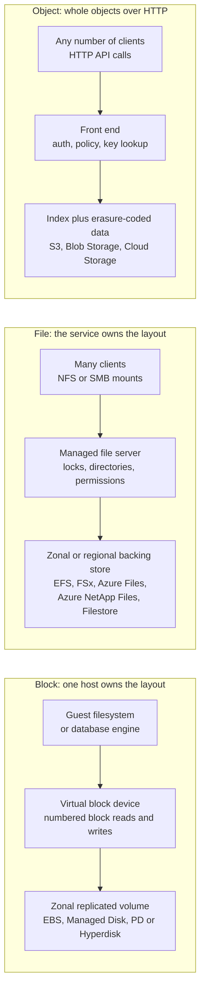

The diagram shows where the filesystem lives in each model, and that location drives most other properties. In block storage the filesystem sits in the guest, so only that guest can safely mount the volume read-write, and a snapshot captures blocks without knowing whether the filesystem was mid-update. In file storage the filesystem sits in the service, so sharing and locking work, but every metadata operation (open, stat, rename) is a network round trip and small-file workloads pay for it. In object storage there is no filesystem; the index maps keys to objects, and the front end enforces identity, policy, and encryption on every request, which is why object stores can apply per-request controls that block devices cannot.

### 2.2 Control plane, data plane, and scope

Every storage service has a control plane (create a volume, set a bucket policy, change a redundancy setting, start a snapshot) and a data plane (read and write bytes). The [AWS chapter](CH01_AWS.md) owns the general distinction. For storage it has three practical consequences:

1. **Data-plane survival when the control plane is impaired.** An attached EBS volume keeps serving I/O during an event that blocks new volume creation. A design whose recovery depends on creating volumes from snapshots in the failed zone, or anywhere during a regional control-plane event, depends on the plane least likely to be available.
2. **Different permissions.** Permission to call `s3:GetObject` is not permission to change the bucket policy. Azure separates management actions from data actions in role definitions ([Azure](CH02_Azure.md) covers this). Backup isolation, discussed in section 9, relies on the gap between these permission sets.
3. **Resource scope.** Each storage resource lives in a scope that defines its failure domain: a zone (EBS volume, zonal Persistent Disk, Azure locally redundant disk), a region (S3 bucket, EFS Regional file system, Azure zone-redundant storage account, regional Cloud Storage bucket), or a set of regions (Cloud Storage dual-region and multi-region buckets, Azure geo-redundant storage). Scope is the first thing to check when someone says a service is "highly available".

### 2.3 What storage decisions are really about

A storage choice answers six questions, and the rest of the chapter is organized around them:

| Question | Governing properties | Section |
|---|---|---|
| How does the workload address data? | Block, file, or object interface; protocol; consistency | 3, 4, 5 |
| How fast must it be? | IOPS, throughput, latency, per-instance caps, request rates | 3.5, 5.5 |
| What failures must it survive? | Durability, availability, redundancy scope, replication lag | 6 |
| How does data age? | Storage classes, lifecycle, retrieval delay, minimum duration | 7 |
| How is it recovered from mistakes and attacks? | Snapshots, versioning, immutability, backup boundaries, restore tests | 8, 9 |
| Who can read it, where does it live, and what can stop recovery? | Keys, access policy, location, quotas | 10, 11, 12, 13 |

Section 14 pulls these together into a selection procedure.

## 3. Block storage services

### 3.1 What a cloud volume is

A cloud block volume is not a disk in the server. EBS, Azure Managed Disks, and Persistent Disk or Hyperdisk are distributed storage services that replicate each volume's blocks across multiple servers within one zone (or, for specific regional variants, across two zones). The compute instance reaches the volume over a network path, on AWS through the Nitro card that presents the volume as an NVMe (Non-Volatile Memory Express) device. Three consequences follow.

First, a volume survives the loss of the instance. Stop or terminate the instance (with delete-on-termination disabled) and the volume remains, ready to attach elsewhere in the same zone.

Second, a volume does not survive the loss of its zone unless it is a regional or zone-redundant variant. An EBS volume lives in exactly one Availability Zone (AZ). If that zone fails, the volume is unavailable until the zone recovers, and the recovery path is a snapshot restored in another zone.

Third, latency includes a network round trip. Single-digit milliseconds for general-purpose SSD (solid-state drive) volumes and sub-millisecond for premium tiers are typical design targets. Local instance-store NVMe disks are faster, but they are ephemeral: their data disappears when the instance stops or its host fails. Use them only for caches, scratch space, or data that a replicated application layer can rebuild.

Block volumes also differ from disks in how they fail. A physical disk fails all at once. A cloud volume can degrade: I/O latency rises, throughput falls below the provisioned rate, or the provider marks the volume impaired and stops I/O to protect consistency. AWS publishes an annual failure rate (AFR) for each EBS type. For gp3, AWS documents 99.8 to 99.9 percent volume durability, which it translates to at most two volume failures per 1,000 volumes per year ([Amazon EBS General Purpose SSD volumes](https://docs.aws.amazon.com/ebs/latest/userguide/general-purpose.html)). That is very different from an object store's eleven nines. A fleet of 500 gp3 volumes can expect roughly one volume failure a year. Block durability is a reason to take snapshots, not a reason to skip them.

### 3.2 Amazon EBS

EBS offers SSD and HDD (hard disk drive) volume types. The ones that matter for most designs:

- **gp3 (General Purpose SSD).** The default choice. Performance is set independently of size. Every gp3 volume includes a baseline of 3,000 IOPS and 125 MiB/s at no extra charge. You can provision more IOPS at up to 500 IOPS per GiB, to a maximum of 80,000 IOPS, and more throughput at up to 0.25 MiB/s per provisioned IOPS, to a maximum of 2,000 MiB/s. Volumes range from 1 GiB to 64 TiB. gp3 does not use burst credits; it sustains its provisioned rate and is designed to deliver it 99 percent of the time ([AWS documentation](https://docs.aws.amazon.com/ebs/latest/userguide/general-purpose.html), at the time of writing; these limits rose in late 2025, so verify current values).
- **gp2 (previous General Purpose SSD).** Performance scales with size at 3 IOPS per GiB (minimum 100, maximum 16,000). Volumes under 1 TiB can burst to 3,000 IOPS using an I/O credit bucket. A new volume starts with 5.4 million credits and earns 3 credits per GiB per second. Burst duration is the credit balance divided by (burst IOPS minus baseline IOPS). A 100 GiB gp2 volume has a 300 IOPS baseline and can burst at 3,000 IOPS for 5,400,000 / 2,700 = 2,000 seconds, about 33 minutes, then falls back to 300 IOPS. That cliff is the classic gp2 incident. Migrate to gp3 with an Elastic Volumes modification, which does not require detaching the volume.
- **io2 Block Express (Provisioned IOPS SSD).** For latency-sensitive databases. AWS describes average latency under 500 microseconds for 16 KiB I/O, much better outlier latency than gp3, and higher durability (designed for 99.999 percent). It supports Multi-Attach to multiple Nitro instances in the same AZ, which is only safe with a cluster-aware filesystem or application.
- **st1 and sc1 (throughput-optimized and cold HDD).** Priced per GiB below SSD, with throughput that scales with size and burst buckets measured in MiB/s. They suit large sequential scans (log processing, data warehouses that stream). Random small I/O on HDD volumes performs poorly.

EBS volumes are zonal. EBS snapshots are stored by the service in a regional, multi-AZ store (S3-backed, but not visible as S3 objects in your account), which is why a snapshot can be restored into any AZ of the region and copied to other regions or accounts.

### 3.3 Azure Managed Disks

Azure Managed Disks come in five types: Standard HDD, Standard SSD, Premium SSD, Premium SSD v2, and Ultra Disk.

Every type attaches to an Azure virtual machine (VM), and the VM size sets its own disk limits (section 3.5).

- **Premium SSD (v1)** uses fixed size tiers (P1 to P80). Each tier has a set IOPS and throughput, so getting more performance means buying a larger disk. Small tiers (P20 and below) support credit-based bursting, and larger tiers support on-demand bursting for an extra fee. Premium SSD supports host caching (read-only or read/write cache on the VM host), which can lower read latency for read-heavy workloads but must be disabled for write-ahead logs that require write-through durability.
- **Premium SSD v2** separates performance from size, as gp3 does. Each disk includes a baseline of 3,000 IOPS and 125 MB/s, and you provision more IOPS and throughput independently, up to 80,000 IOPS and 1,200 MB/s on a single disk at the time of writing ([Azure Premium SSD v2 announcement](https://techcommunity.microsoft.com/blog/azurestorageblog/azure-premium-ssd-v2-disk-storage-general-availability/3649038)). It does not support host caching and, at the time of writing, has more regional and feature restrictions than Premium SSD (for example around redundancy options and use as an operating system disk). Check current support before standardizing on it.
- **Ultra Disk** offers the highest performance and sub-millisecond latency, with performance adjustable at runtime, for top-tier databases.
- **Standard SSD and Standard HDD** serve development, light production, and backup targets.

Azure disks use locally redundant storage (LRS) by default, which keeps three copies within one datacenter in one zone. Premium SSD and Standard SSD also offer zone-redundant storage (ZRS) disks, which replicate synchronously across three zones in the region. A ZRS disk can be force-detached from a VM in a failed zone and attached to a VM in a healthy zone. That is a materially different failure posture from an LRS disk, at the cost of higher write latency and a higher price. Azure also supports shared disks (`maxShares` greater than 1) for clustered applications such as Windows Server Failover Clustering, using SCSI (Small Computer System Interface) persistent reservations to arbitrate ownership.

### 3.4 Google Persistent Disk and Hyperdisk

Google Cloud has two block families.

- **Persistent Disk** types (Standard, Balanced, SSD, Extreme) scale performance with size and with the VM's vCPU count. Regional Persistent Disk replicates synchronously across two zones in a region, so a VM in the second zone can attach the disk if the first zone fails.
- **Hyperdisk** types (Balanced, Balanced High Availability, Extreme, Throughput, ML) are the current generation for newer machine series, and performance is provisioned separately from capacity. Hyperdisk Balanced includes 3,000 IOPS and 140 MiB/s of free baseline performance. Volumes range from 4 GiB to 64 TiB, and you can provision up to 160,000 IOPS (500 IOPS per GiB) and 2,400 MiB/s, with configurable throughput bounded between MAX(140, IOPS/256) and MIN(2,400, IOPS/4) MiB/s. Provisioned performance can be changed at most once every four hours ([Hyperdisk Balanced documentation](https://docs.cloud.google.com/compute/docs/disks/hd-types/hyperdisk-balanced), at the time of writing). **Hyperdisk Balanced High Availability** replicates synchronously across two zones and, at the time of writing, supports up to 100,000 IOPS per volume.
- **Hyperdisk Storage Pools** let a project buy aggregate capacity and performance and carve volumes from it, which reduces waste when many volumes are individually over-provisioned.

Google also enforces per-project regional quotas on Hyperdisk provisioned IOPS and throughput, separate from capacity quotas. The documentation notes that the free baseline does not count against the IOPS quota, but anything provisioned above it does. This matters during scale-out (section 13).

### 3.5 The block performance model

Block performance has four dimensions, and confusing them is the root of most sizing mistakes.

- **IOPS** counts operations per second regardless of size.
- **Throughput** counts bytes per second. Throughput equals IOPS times I/O size. A volume rated 3,000 IOPS and 125 MiB/s cannot do both at 256 KiB I/O, because 3,000 × 256 KiB = 750 MiB/s exceeds the throughput limit. Whichever limit is hit first is the ceiling.
- **Latency** is time per operation, and its tail (p99, p99.9) matters more than its mean for databases and synchronous request paths.
- **Queue depth** is the number of outstanding I/Os. By Little's law, outstanding I/Os = IOPS × latency. To sustain 16,000 IOPS at 1 ms latency, the application and guest must keep 16 I/Os in flight. A single-threaded application issuing one synchronous 4 KiB write at a time, at 1 ms per write, gets 1,000 IOPS no matter what the volume is provisioned for. The [I/O and Scheduling](../05_Networking_and_OS/CH27_IO_and_Scheduling.md) chapter owns the guest I/O stack; the point here is that provisioning cannot fix a workload that does not generate concurrency.

On top of the volume's own limits sits a second, often binding, limit: **the instance's storage bandwidth and IOPS cap.** Every Amazon Elastic Compute Cloud (EC2) instance type documents an EBS baseline bandwidth, baseline IOPS, and (for smaller sizes) a burst ceiling that can be sustained for a limited period, documented as at least 30 minutes once every 24 hours for many instance types. Every Azure VM size documents maximum uncached disk IOPS and throughput (plus burst values for some sizes). Every Google Compute Engine machine type documents Hyperdisk and Persistent Disk limits that depend on machine series and vCPU count. Attach four volumes each provisioned at 20,000 IOPS to an instance whose cap is 40,000 IOPS, and the instance delivers 40,000, not 80,000. Look these up from the provider API rather than from memory, for example:

```bash
aws ec2 describe-instance-types --instance-types m7i.2xlarge \
  --query "InstanceTypes[0].EbsInfo.EbsOptimizedInfo"
```

The response lists baseline and maximum bandwidth (in Mbps), throughput (in MB/s), and IOPS for that instance type. Note the units: providers quote instance bandwidth in megabits per second and volume throughput in mebibytes per second. 2,500 Mbps is 312.5 MB/s, which is about 298 MiB/s.

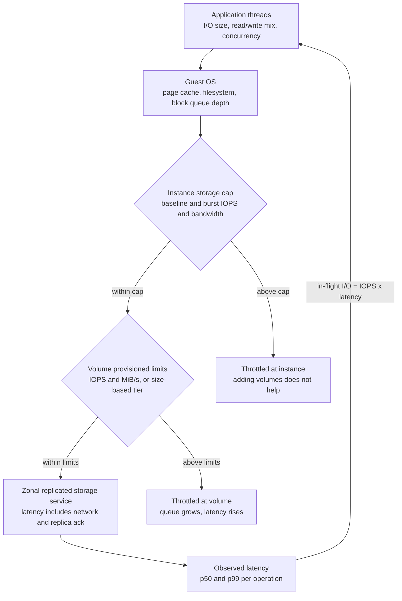

The diagram is a stack of ceilings, and the effective limit is the lowest one the workload hits. Throttling at the volume and at the instance look similar from inside the guest: latency rises and queue depth grows. They are distinguished by metrics. On AWS, `VolumeQueueLength` and the per-volume `VolumeIOPSExceededCheck` and `VolumeThroughputExceededCheck` metrics show volume throttling, while instance-level `EBSIOBalance%` and `EBSByteBalance%` show burst exhaustion at the instance. Azure exposes VM-level "VM Cached/Uncached IOPS Consumed Percentage" and disk-level "Data Disk IOPS Consumed Percentage". The feedback arrow at the bottom is the reason measured performance depends on the application: latency limits the throughput a fixed concurrency can drive.

### 3.6 Worked calculation: sizing a volume

A team runs a self-managed search engine on one VM per shard. Load tests give these per-shard requirements:

- Random reads and writes at 16 KiB, peaking at 12,000 IOPS during business hours.
- Background segment merges that stream 128 KiB writes at 300 MiB/s for up to 40 minutes, sometimes during peak.
- 2 TiB of data with 30 percent headroom, and a p99 latency target of 5 ms.

**Step 1: capacity.** 2 TiB × 1.3 = 2.6 TiB, so provision 2,662 GiB (round to 2,700 GiB).

**Step 2: combined peak.** Random I/O throughput is 12,000 × 16 KiB / 1,024 = 187.5 MiB/s. Merge I/O is 300 MiB/s, which at 128 KiB is 300 × 1,024 / 128 = 2,400 IOPS. When they overlap, the volume must sustain 12,000 + 2,400 = 14,400 IOPS and 187.5 + 300 = 487.5 MiB/s.

**Step 3: gp3 configuration.** Provision 15,000 IOPS (a small margin) and 500 MiB/s. Check the ratios: 15,000 IOPS ≤ 500 × 2,700 = 1,350,000, so size does not constrain IOPS; 500 MiB/s ≤ 0.25 × 15,000 = 3,750 MiB/s, so IOPS does not constrain throughput. Billable extras are 15,000 − 3,000 = 12,000 IOPS and 500 − 125 = 375 MiB/s above baseline.

**Step 4: instance cap.** Suppose the chosen instance type documents (from the API above) an EBS baseline of 10,000 IOPS and 2,500 Mbps, with burst to higher values for 30 minutes a day. These are hypothetical numbers for the arithmetic; look up the real ones for your type. 2,500 Mbps ≈ 298 MiB/s. Both the 14,400 IOPS and the 487.5 MiB/s exceed the baseline. A 40-minute merge outlasts a 30-minute burst allowance, so the instance would throttle partway through every long merge. The fix is an instance type whose baseline exceeds 14,400 IOPS and about 490 MiB/s (roughly 4,100 Mbps), not a bigger volume.

**Step 5: concurrency.** At a target of 1 ms average latency, 14,400 IOPS needs about 14 to 15 I/Os in flight. Confirm the engine's I/O thread pool and the guest's block queue settings allow at least that, preferably 32, so that latency spikes do not reduce throughput.

**Step 6: other providers.** On Azure Premium SSD v2 the same numbers fit within a single disk's limits (14,400 IOPS and about 511 MB/s, since 487.5 MiB/s × 1.048576 ≈ 511 MB/s), and the VM size's uncached limit becomes the check. On Hyperdisk Balanced, 15,000 IOPS allows throughput between MAX(140, 15,000/256 ≈ 59) = 140 and MIN(2,400, 15,000/4 = 3,750) = 2,400 MiB/s, so 500 MiB/s is valid, and the machine type's Hyperdisk limit is the check.

The [block-storage throughput estimator](../code/python/storage-chapter/04_volume_performance.py) shows the core of step 2: at 3,000 IOPS, 4 KiB I/O yields about 11.7 MiB/s and 16 KiB yields about 46.9 MiB/s, while 256 KiB I/O would yield 750 MiB/s but is clipped to its 250 MiB/s cap. The same IOPS figure means very different throughput depending on I/O size, and the lower of the two limits wins.

### 3.7 Block failure modes and a zonal-failure scenario

| Failure | What happens | Design response |
|---|---|---|
| Volume impaired or failed (AFR event) | I/O stalls or the provider disables I/O; the volume may be unrecoverable | Recent snapshots; application-level replication for databases ([Replication](../06_Databases_and_Storage/CH07_Replication.md)) |
| Zone outage | Zonal volumes are unreachable; regional variants can fail over | Snapshots restorable in other zones, or Regional PD / Hyperdisk Balanced HA / Azure ZRS disks |
| gp2 or Premium SSD v1 burst exhaustion | Sudden drop to baseline IOPS hours into a load | Use provisioned-performance types; alarm on burst balance |
| Instance cap reached | Latency rises although each volume is under its limit | Larger or storage-optimized instance; check instance metrics |
| First read after restore is slow | Blocks are fetched lazily from the snapshot store on first access | Pre-warm by reading all blocks, or use EBS Fast Snapshot Restore or provider equivalents |
| Multi-attach without cluster filesystem | Two hosts mount a normal filesystem read-write and corrupt it | Use Multi-Attach or shared disks only with cluster-aware software |

**Quality scenario: zonal failure of a single-zone volume.**

- *Stimulus:* the AZ hosting a reporting server's 1 TiB EBS gp3 volume becomes unavailable at 10:00.
- *Expected response:* operators (or automation) restore the most recent snapshot into a healthy AZ, launch a replacement instance from the same image, attach the new volume, and redirect clients.
- *Measurable success criterion:* RTO under 60 minutes and RPO under 4 hours, given snapshots every 4 hours.
- *Evidence that makes it credible:* the snapshot schedule is verified by AWS Backup job reports; a quarterly drill measures the restore. Restoring a snapshot creates the volume in minutes, but data is loaded lazily from the snapshot store, so a report query that scans the full 1 TiB on first touch runs much slower than normal. If the 60-minute RTO includes "reports run at normal speed", the drill must either enable Fast Snapshot Restore for that snapshot in the target AZ (an hourly-billed feature) or include a pre-warm read of the volume in the runbook and timing.

If the RPO must be near zero, snapshots are the wrong tool. Use a synchronously replicated two-zone volume (Regional Persistent Disk, Hyperdisk Balanced High Availability, Azure ZRS disk) or application-level replication between zones. Note that EBS has no cross-zone synchronous volume type. On AWS, zone-level RPO near zero for block data comes from the application or database layer, or from a managed file system with Multi-AZ deployment.

## 4. File storage services

### 4.1 The file model in the cloud

A managed file service runs the filesystem for you and exports it over NFS or SMB. That buys three things block storage cannot: concurrent access from many clients, a protocol-level locking and permission model, and capacity that grows without resizing a volume. It costs latency on every metadata operation, a consistency model weaker than a local filesystem, and a performance model tied to protocol, client count, and service tier.

The consistency rules come from the protocol. NFS clients cache attributes and data and typically give close-to-open consistency: a client that opens a file after another client closed it sees the writer's changes, but two clients with the file open simultaneously may not see each other's writes immediately. SMB uses opportunistic locks and leases to let a client cache safely until the server breaks the lease. The [File Systems](../05_Networking_and_OS/CH26_File_Systems.md) chapter owns these semantics. The design consequence is that applications built on a shared filesystem must coordinate through locks or through the protocol's guarantees, not through assumptions borrowed from a local disk.

### 4.2 AWS: EFS and the FSx family

**Amazon EFS** is a managed NFS (v4.0 and v4.1) file system for Linux clients. Regional EFS stores data across multiple AZs, and each AZ has a mount target, so clients in any AZ keep working if one AZ fails. EFS One Zone stores data in a single AZ at lower cost and is appropriate for data that can be re-created. EFS storage classes (Standard, Infrequent Access, Archive) with lifecycle management move cold files to cheaper storage, with per-GB access charges on the cold tiers. Throughput modes are Elastic (scales automatically, billed per byte transferred), Provisioned (fixed throughput independent of size), and Bursting (throughput tied to stored size with a credit model). Elastic is the usual default for spiky or unknown workloads; Provisioned suits steady high throughput on small file systems. EFS is a poor fit for workloads dominated by small-file metadata operations at high rates (for example, building source trees with tens of thousands of files), because each operation pays a network round trip.

The **Amazon FSx** family provides managed versions of specific file systems, chosen for protocol and feature compatibility:

- **FSx for Windows File Server**: SMB, Active Directory integration, Windows ACLs (access control lists), Distributed File System (DFS) namespaces, Single-AZ or Multi-AZ deployments. The lift-and-shift target for Windows file shares.
- **FSx for NetApp ONTAP**: NFS, SMB, and iSCSI (Internet Small Computer Systems Interface) from one system, with NetApp snapshots, SnapMirror replication, cloning, and tiering to a capacity pool. Chosen when teams already operate ONTAP or need multiprotocol access.
- **FSx for OpenZFS**: NFS with ZFS snapshots and clones, low latency, suited to Linux workloads migrated from ZFS or NAS (network-attached storage) appliances.
- **FSx for Lustre**: a parallel file system for high-performance computing and machine-learning training, with scratch (no replication, cheapest) and persistent deployment types, and the ability to link a file system to an S3 bucket so objects appear as files and results can be exported back.

The family members do not share guarantees. Multi-AZ is a deployment option on some, not a property of "FSx".

### 4.3 Azure: Azure Files and Azure NetApp Files

**Azure Files** offers SMB file shares (and NFS 4.1 shares on the SSD/premium tier) inside a storage account. Because it lives in a storage account, it inherits that account's redundancy options (LRS, ZRS, and for HDD/standard shares geo-redundant storage (GRS) and geo-zone-redundant storage (GZRS), explained in section 6.3), network rules, private endpoints, and encryption settings. Azure File Sync caches shares on Windows servers on premises with cloud tiering. Identity-based SMB access integrates with Active Directory Domain Services, Microsoft Entra Domain Services, or Microsoft Entra Kerberos for hybrid identities. Azure Files has moved toward a provisioned billing model in which you set storage, IOPS, and throughput per share; check the current model, because it changes the cost comparison with Azure NetApp Files.

**Azure NetApp Files (ANF)** is a first-party Azure service running NetApp ONTAP technology, with NFSv3, NFSv4.1, and SMB volumes carved from capacity pools. Performance is set by service level, historically expressed as throughput per provisioned TiB (Standard, Premium, Ultra), with a newer flexible level that decouples throughput from capacity. ANF targets low-latency enterprise workloads such as SAP HANA, Oracle on NFS, and high-performance computing. Cross-zone and cross-region replication are separate features that replicate volumes asynchronously.

### 4.4 Google Cloud: Filestore, NetApp Volumes, and Managed Lustre

**Filestore** is Google's managed NFS service with tiers that differ in performance and failure scope: Basic HDD and Basic SSD (single zone, simple file servers), Zonal (higher performance in one zone), and Regional (synchronously replicated across zones in a region). Capacity and performance scale together within tier-specific ranges. **Google Cloud NetApp Volumes** provides ONTAP-based NFS and SMB volumes, analogous to ANF and FSx for ONTAP. **Google Cloud Managed Lustre** serves the parallel-file-system niche for training and high-performance computing. As on AWS, the tier determines the guarantee: a Basic HDD instance and a Regional instance are different failure-domain choices behind the same product name.

### 4.5 Choosing a file service and a worked throughput check

Choose a file service by elimination:

1. **Protocol.** SMB with Windows ACLs points to FSx for Windows, Azure Files, or the NetApp services. NFS-only Linux points to EFS, Filestore, Azure Files NFS, or NetApp. Block (iSCSI) plus file from one system points to ONTAP-based services.
2. **Failure scope.** Is single-zone acceptable? If not, choose EFS Regional, FSx Multi-AZ, Azure Files ZRS, Filestore Regional, or the NetApp services' zone-redundant or replicated options.
3. **Performance shape.** Large sequential I/O across many clients favors parallel file systems (Lustre). Low-latency small I/O for databases favors NetApp-based services or provisioned high tiers. Bursty general use favors elastic models.
4. **Data management.** Snapshots, clones, cross-region replication, and on-premises caching (Azure File Sync) can be decisive.

**Worked check.** A rendering farm of 200 Linux nodes reads a shared 20 TiB asset library. Each node streams about 25 MiB/s while rendering, and peak concurrency is 80 percent of nodes. Aggregate demand is 200 × 0.8 × 25 = 4,000 MiB/s, about 3.9 GiB/s.

- A per-TiB service level fixes throughput by capacity. At a hypothetical 64 MiB/s per provisioned TiB, 20 TiB yields 1,280 MiB/s, a third of the need. Meeting 4,000 MiB/s would require 4,000 / 64 = 62.5 TiB provisioned, three times the data size, or a service level that decouples throughput.
- An elastic NFS service must be checked against its documented per-file-system and per-client throughput limits, and against per-byte throughput charges: 4,000 MiB/s for 8 hours a day is about 4,000 × 3,600 × 8 / 1,024 ≈ 112,500 GiB read per day, and the bill scales with that volume.
- A parallel file system linked to an object bucket (FSx for Lustre on AWS, Managed Lustre on Google Cloud) scales throughput with deployed capacity and is designed for this access pattern. The assets stay in object storage as the system of record, and the parallel file system is a performance tier.

The lesson is that file throughput pricing models differ in kind (per provisioned TiB, per provisioned MiB/s, per byte transferred), and the right model depends on the ratio between throughput and capacity. Calculate that ratio before comparing prices.

### 4.6 File storage failure modes

- **Metadata storms.** Listing a directory of a million files, or thousands of clients stat-ing the same tree, saturates metadata operations long before bandwidth. Restructure into hashed subdirectories, cache, or move the data to object storage.
- **Stale reads across clients.** Client attribute caching delays visibility of another client's writes. Tune cache settings only with an understanding of the cost, or coordinate through explicit locks or a separate signal (a queue message or a database row) that names a closed file.
- **Lock expiry on network interruption.** NFSv4 leases and SMB leases expire if a client is partitioned. The application must handle losing a lock it believed it held.
- **Zone loss on single-zone tiers.** EFS One Zone, Filestore Basic, FSx Single-AZ, and LRS Azure Files lose availability (and, for some, data) with the zone.
- **Shared file systems used as databases.** SQLite or other embedded databases on NFS are prone to corruption when locking semantics differ from what the database assumes. Use a database service ([Databases and Storage](../06_Databases_and_Storage/PART_OVERVIEW.md)).

## 5. Object storage services

### 5.1 Namespace and resource model

All three object services share a two-level model: a container-level resource and objects inside it. The names and the boundaries around them differ.

- **Amazon S3.** A *bucket* lives in one AWS Region and one account. General purpose buckets hold objects in any storage class except S3 Express One Zone, which uses *directory buckets* in a single AZ for single-digit-millisecond access. Bucket names are globally unique. At the time of writing, accounts start with a default quota of 10,000 general purpose buckets, raisable by request. Objects can be up to 50 TB (raised from 5 TB in December 2025). A single `PUT` is limited to 5 GB, and larger objects use multipart upload ([Amazon S3 documentation](https://docs.aws.amazon.com/AmazonS3/latest/userguide/UsingObjects.html)).
- **Azure Blob Storage.** A *storage account* is the unit of region, redundancy, network rules, encryption settings, and scalability targets. *Containers* sit inside the account, and *blobs* inside containers. Block blobs hold ordinary objects. Append blobs suit logs, and page blobs back older unmanaged disks. Enabling the hierarchical namespace turns the account into Azure Data Lake Storage, with real directories and atomic directory rename. That changes semantics and supported features, so it is a design decision, not a toggle to flip later.
- **Google Cloud Storage.** A *bucket* belongs to a project and has a *location* (a region, a dual-region, or a multi-region) fixed at creation, plus a default storage class. Objects have a *generation* number that changes on every overwrite and a *metageneration* that changes on every metadata update. Those two numbers are the basis of its concurrency control.

The "folders" users see in all three are key prefixes with a delimiter. Listing `logs/2025/` is a prefix query on a sorted index, not a directory read, which is why listing millions of keys is paginated and comparatively slow. Azure accounts with a hierarchical namespace, and Cloud Storage buckets with the hierarchical namespace feature enabled, are exceptions that add real folder resources.

### 5.2 The request path

Every object request goes through the same stages: endpoint resolution, authentication, authorization, encryption key access, and the storage operation.

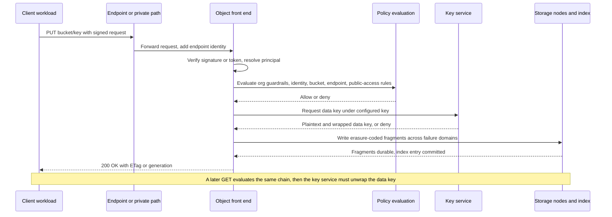

The sequence shows that a successful write needs four independent things to work: a network path to the endpoint (public, through a gateway or interface endpoint, or through a private endpoint), a valid identity, a policy decision that allows the action, and the key service's permission to generate or unwrap a data key. The write is acknowledged only after the data is durable across the service's failure domains. For S3 Standard that means multiple AZs, and for a regional Cloud Storage bucket at least two zones. The note at the end matters for recovery: every read repeats the chain, so a key disabled after the write turns stored, durable data into unreadable data. Section 10 develops this.

### 5.3 Consistency semantics

Consistency is where the providers once differed most and now differ least. Edge cases still matter.

**Amazon S3** has provided strong read-after-write consistency for all `PUT` and `DELETE` operations on objects in all Regions since December 2020. After a successful write, any subsequent read returns the new object or a later one, and list operations reflect the write. Two limits remain. First, there is no locking: concurrent writers to the same key both succeed, and the one S3 processes last wins. Second, bucket configuration (policies, lifecycle rules, versioning state, replication rules) propagates asynchronously, so a policy change can take effect a short time after the API call returns.

**Azure Blob Storage** is strongly consistent within the primary region: a successful write is immediately visible to subsequent reads and lists. With read-access geo-redundant storage (RA-GRS or RA-GZRS), the secondary endpoint is eventually consistent, and the account's `LastSyncTime` property tells you how far behind it is. A client that reads from the secondary to reduce latency or survive an outage must tolerate data older than `LastSyncTime`.

**Google Cloud Storage** is strongly consistent globally for object reads after writes, metadata updates, and deletes, and for object and bucket listing, including in dual-region and multi-region buckets. Two edge cases catch teams. Publicly readable objects may be cached by Google's network and by intermediaries according to their `Cache-Control` metadata, so a public object can be served stale after an overwrite unless `Cache-Control` is set to prevent it. IAM policy changes also take time to propagate.

Strong consistency removes the old "write then read returns 404" bug. It does not provide transactions across objects, atomic rename, or mutual exclusion. Those come from conditional requests.

### 5.4 Concurrency control with conditional requests

A conditional request performs a write only if the object is in an expected state, which gives optimistic concurrency without locks.

| Need | Amazon S3 | Azure Blob Storage | Cloud Storage |
|---|---|---|---|
| Create only if absent | `PutObject` with `If-None-Match: *` | `If-None-Match: *` | `ifGenerationMatch=0` |
| Replace only if unchanged since read | `If-Match: <ETag>` on `PutObject` and `CompleteMultipartUpload` | `If-Match: <ETag>` | `ifGenerationMatch=<generation>` |
| Exclusive writer for a period | Not provided; use a coordination service | Blob lease (fixed duration or infinite) | Not provided; use a coordination service |

S3 added conditional writes in 2024. Older designs used a database or a lock table to emulate them, and some still need one for multi-object atomicity. A typical use is a single-writer manifest. Each job writes data files under unique keys, then commits by replacing `manifest.json` only if its ETag matches the one the job read. A second job that read the same manifest gets HTTP 412 Precondition Failed, re-reads, and retries. Without the condition, the second job silently overwrites the first job's commit.

```bash
# Create-only write: fails with 412 if the key already exists.
aws s3api put-object --bucket orders-archive --key batches/2025-06-01.json \
  --body batch.json --if-none-match "*"
```

### 5.5 Object performance: request rates, prefixes, and parallelism

Object stores scale throughput by parallelism, not by faster single requests. A single stream to S3 or Cloud Storage commonly reaches tens to low hundreds of MiB/s. Aggregate throughput in the tens of GiB/s comes from many concurrent connections and from ranged `GET`s and multipart uploads that split one object across connections.

Request rates are partitioned by key:

- **S3** supports at least 3,500 `PUT`/`COPY`/`POST`/`DELETE` and 5,500 `GET`/`HEAD` requests per second per partitioned prefix, and it scales further by partitioning the key space as load grows. During the scale-up, clients see HTTP 503 Slow Down responses and must retry with exponential backoff. A workload that suddenly sends 50,000 writes per second to one new prefix will be throttled until S3 adapts. Spreading keys across prefixes (for example, beginning keys with a short hash) helps.
- **Cloud Storage** documents an initial rate of roughly 1,000 object writes and 5,000 reads per second per bucket, which auto-scales. It recommends ramping up gradually (doubling the request rate no faster than about every 20 minutes) and avoiding sequential key names such as timestamps at the start of the key, because they concentrate load on one index range.
- **Azure Blob Storage** publishes per-storage-account scalability targets for request rate, ingress, and egress, and much lower targets for a single blob. A hot single blob (for example, a configuration file read by every instance on startup) can throttle while the account is mostly idle. Beyond the account target, the fix is more accounts, which affects naming, policy, and private-endpoint design.

These figures are documented guidance at the time of writing; verify current values. The architectural rule is stable: design key names and client concurrency for the request rate, and treat throttling responses as a normal signal that clients handle with backoff and jitter.

### 5.6 Worked calculation: upload time and part sizing

A genomics pipeline uploads 2 TB result files to S3 from a VM with a 10 Gbps network interface.

- Multipart upload allows up to 10,000 parts. For 2 TB the minimum part size is 2,000,000 MB / 10,000 = 200 MB. Choose 256 MiB parts, giving about 7,451 parts.
- At a sustained 8 Gbps (80 percent of line rate), throughput is 1 GB/s, so 2 TB takes about 2,000 seconds, roughly 33 minutes, if enough parts are in flight. With 64 MiB/s per connection, saturating 1 GB/s needs about 1,000 / 67 ≈ 15 parallel part uploads. Plan for 16 to 32.
- A failed part is retried alone, so the retry cost of a network glitch is one 256 MiB part rather than the whole file. Incomplete multipart uploads keep their parts billed until aborted. Add a lifecycle rule that aborts incomplete uploads after a few days.

## 6. Durability, availability, and redundancy scope

### 6.1 Durability versus availability

**Durability** is the probability that stored data is not lost or corrupted over a period, usually a year. **Availability** is the fraction of time the data can be read or written. They are independent. A bucket in a region with a network outage has perfect durability and zero availability for the outage's duration. A volume on a single disk that is always online but has no copy has high availability until the moment it loses everything. [Non-Functional Requirements](../07_System_Design_and_Distributed_Systems/CH02_Non_Functional_Requirements.md) owns the general treatment of durability as compounding annual loss probability. This section applies it to provider claims.

Providers state durability as a design target and availability through a service level agreement (SLA). S3 Standard is designed for 99.999999999 percent durability and 99.99 percent availability, with an SLA lower than the design availability. Cloud Storage is designed for at least eleven nines of annual durability regardless of storage class or location type ([Cloud Storage availability and durability](https://docs.cloud.google.com/storage/docs/availability-durability)). Azure Storage documents durability of at least eleven nines for LRS, twelve nines for ZRS, and sixteen nines for GRS and GZRS over a year. No provider offers a financial SLA on durability. SLA credits are for availability and, in a few cases, replication time.

### 6.2 What "eleven nines" means and does not mean

Eleven nines of annual durability means an expected annual loss rate of 1 in 10^11 objects. For a bucket of 10 million objects, expected loss is 10^7 × 10^-11 = 10^-4 objects per year, about one object every 10,000 years. For an estate of 100 billion objects, it is about one object per year. The figure comes from erasure coding across failure domains, continuous checksum scrubbing, and repair that rebuilds lost fragments faster than further failures accumulate.

It does **not** cover any of these, which together cause almost all real object-data loss:

- An authorized principal deleting or overwriting objects, by mistake, through a buggy job, or through stolen credentials.
- A lifecycle rule that expires data earlier than intended.
- Ransomware that re-encrypts objects with an attacker's key using legitimate API calls.
- Deletion or disabling of the customer-managed key that protects the data.
- Closing or losing control of the account or project that owns the bucket.
- Corruption written by the application. The store faithfully keeps corrupt bytes durable.
- For single-zone classes (S3 One Zone-IA, S3 Express One Zone, zonal buckets), physical loss of the zone. These classes keep the eleven-nines figure against hardware failure but are not resilient to zone destruction.

Durability protects against the provider losing your bytes. Versioning, immutability, and independent backups (sections 8 and 9) protect against everyone else, including you.

Block volumes are a different scale. gp3's 99.8 to 99.9 percent annual volume durability means 1 to 2 failures per 1,000 volumes per year. That is eight orders of magnitude from an object store, and it is why databases on block storage need snapshots or replication even when nobody makes a mistake.

### 6.3 Redundancy scopes by provider

Redundancy scope says which failure domains a copy spans and whether replication is synchronous (part of the write acknowledgment) or asynchronous (after it).

| Scope | AWS | Azure | Google Cloud |
|---|---|---|---|
| Single zone or datacenter, synchronous within it | EBS volume; S3 One Zone-IA; S3 Express One Zone; EFS One Zone | LRS (three copies in one datacenter); LRS managed disks | Zonal Persistent Disk and Hyperdisk; zonal buckets where offered |
| Multiple zones in a region, synchronous | S3 Standard and most classes (three or more AZs); EFS Regional; FSx Multi-AZ | ZRS (three zones); ZRS managed disks | Regional bucket (at least two zones); Regional PD; Hyperdisk Balanced HA; Filestore Regional |
| Two regions, asynchronous, provider-chosen pairing | Not offered as a storage setting | GRS and GZRS to the paired region; RA- variants make the secondary readable | Multi-region bucket (data centers chosen within a geography) |
| Two regions, asynchronous, customer-chosen | S3 Cross-Region Replication (CRR), optionally with Replication Time Control (RTC) | Object replication between accounts | Dual-region bucket (you choose the two regions), optionally with turbo replication; cross-bucket replication |
| Single namespace across regions | S3 Multi-Region Access Points over replicated buckets | Not a single namespace; account failover swaps endpoints | Dual-region and multi-region buckets are one bucket |

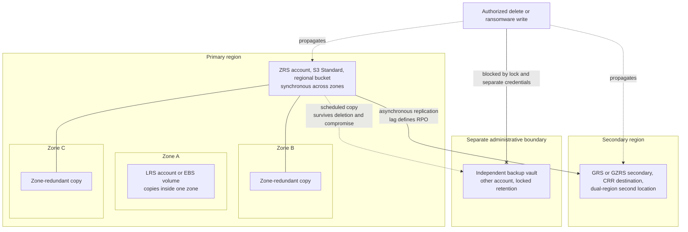

The map shows three kinds of protection. Copies inside one zone protect against disk and server failure. Synchronous copies across zones protect against zone failure with no data loss, because the write is acknowledged only after it reaches them. Asynchronous copies in another region protect against regional failure, with data loss bounded by replication lag. None of those three protects against a legitimate delete or a malicious overwrite, because replication faithfully copies the change, as the dashed "propagates" arrows show. Only a copy in a separate administrative boundary, with retention the production credentials cannot shorten, survives that class of event. Redundancy settings and backups are complementary controls, and neither replaces the other.

### 6.4 Cross-region replication mechanics

**S3 Cross-Region Replication.** CRR (and Same-Region Replication) copies new object versions from a source bucket to one or more destination buckets, possibly in other accounts. Both buckets must have versioning enabled. Mechanics that matter in design:

- Rules apply to objects written after the rule exists. Existing objects need S3 Batch Replication.
- Delete markers are replicated only if the rule enables delete marker replication. Deletion of a specific version is never replicated, which deliberately prevents a malicious version-delete from destroying the replica.
- Objects encrypted with server-side encryption under AWS Key Management Service (KMS) keys (SSE-KMS) replicate only if the rule names a destination key and the replication role can decrypt with the source key and encrypt with the destination key.
- Replicas are not themselves replicated onward unless you configure bidirectional replication with replica modification sync.
- Replication is asynchronous with no time bound by default. **S3 Replication Time Control** is designed to replicate 99.99 percent of new objects within 15 minutes, is backed by an SLA, and publishes replication latency and pending-bytes metrics.

**Azure geo-redundant storage.** GRS replicates asynchronously to the paired region that Azure assigns to the primary. You cannot choose the secondary. Regions without a pair cannot offer GRS (see [Azure](CH02_Azure.md) on region pairs). GZRS combines ZRS in the primary with GRS to the secondary. The secondary is read-only and reachable only with RA-GRS or RA-GZRS. The `LastSyncTime` property reports the point before which all writes are guaranteed to be on the secondary. Microsoft historically gave no SLA on replication lag. **Geo priority replication** now adds an SLA, for supported workloads, that block blob `LastSyncTime` stays within 15 minutes for 99.0 percent of the billing month ([Azure Storage geo priority replication](https://learn.microsoft.com/en-us/azure/storage/common/storage-redundancy-priority-replication)). Failover is customer-initiated. In an unplanned failover the secondary becomes primary, Domain Name System (DNS) endpoints are updated, and writes after `LastSyncTime` are lost. The new primary is LRS until you re-enable geo-redundancy, which triggers a full copy. A planned failover, where available, swaps regions without data loss and suits drills. **Object replication** separately copies block blobs asynchronously between accounts in any regions you choose, with an optional priority mode targeting 99 percent of objects within 15 minutes.

**Cloud Storage dual-region and multi-region buckets.** These are a single bucket stored in two or more regions. A write is acknowledged once it is redundant across two zones of the first region. Default replication then copies it to the other region, with a target of 99.9 percent of newly written objects within one hour and 100 percent within 12 hours. **Turbo replication**, available on dual-regions only, targets 100 percent of new objects within 15 minutes regardless of size ([Cloud Storage availability and durability](https://docs.cloud.google.com/storage/docs/availability-durability)). Because it is one bucket, there is no failover action: Google serves from an available region, and the design RTO is zero. Objects not yet replicated when a region fails are unavailable until it returns, and in the extreme case of physical destruction they are lost. Strong consistency means a stale copy is never served in their place.

The models differ in three ways that matter in a review. Who chooses the secondary region: you (S3 CRR, Azure object replication, Cloud Storage dual-region) or the provider (Azure GRS, Cloud Storage multi-region). Who fails over: the application (S3, unless you use Multi-Region Access Point failover controls), the operator (Azure account failover), or nobody (Cloud Storage dual-region). What is time-bounded: RTC, geo priority replication, and turbo replication add a 15-minute objective. Default modes do not.

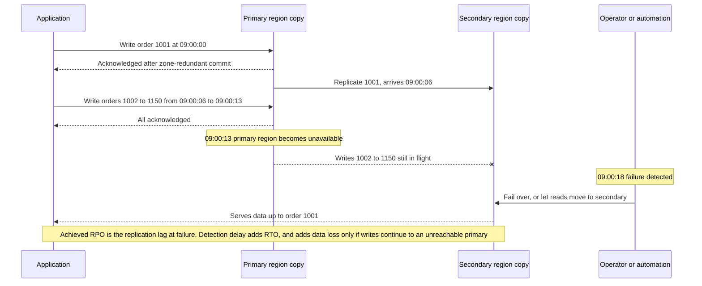

The sequence shows why RPO for asynchronous replication is a measured quantity, not a configured one. Every write acknowledged by the primary but not yet copied is at risk, and that window is the replication lag at the instant of failure. Detection delay mostly extends RTO, but if the application keeps accepting writes into a primary-side queue or cache during detection, those are at risk too.

### 6.5 Worked calculation: recovery point from replication lag

An order service writes 120 objects per second into a bucket replicated to another region. Monitoring shows a typical replication lag of 8 seconds and a failure-detection time of 5 seconds.

The [replication lag and recovery-point simulator](../code/python/storage-chapter/03_replication_rpo.py) models a conservative RPO as lag plus detection delay: 8 + 5 = 13 seconds, so about 120 × 13 = 1,560 objects might not exist in the secondary. Using lag alone gives 120 × 8 = 960. The conservative figure fits applications that keep writing while the failure is undetected.

Now apply the default bounds rather than typical lag. Without RTC, S3 offers no time bound. With Cloud Storage default replication, 0.1 percent of objects may take up to an hour. If the business tolerance is "lose at most 15 minutes of orders", only a time-bounded mode (RTC, geo priority replication, turbo replication) or application-level replication meets it with evidence. Even then, 15 minutes at 120 objects per second is 108,000 objects at risk in the worst case. The reconciliation process, such as replaying orders from the payment provider or from a message log, is part of the recovery design. [Resilience and Disaster Recovery](../10_Cloud_Architecture/CH09_Resilience_Availability_and_Disaster_Recovery_Architectures.md) owns the cross-service composition of that recovery.

## 7. Storage classes and lifecycle tiering

### 7.1 The pricing model behind storage classes

A storage class trades a lower per-GB storage price for higher charges and constraints elsewhere. Five levers recur across providers:

1. **Storage price per GB-month.** Falls by an order of magnitude or more from hot to archive.
2. **Retrieval price per GB.** Zero for hot classes. Charged for infrequent-access and archive classes.
3. **Request prices.** Writes, reads, and lifecycle transitions are charged per thousand requests, and colder classes charge more per request. Transition charges are per object, so they scale with object count, not bytes.
4. **Minimum storage duration.** Deleting, overwriting, or transitioning an object out early incurs a charge for the remaining days.
5. **Access latency and availability.** Most classes return the first byte in milliseconds. Offline archive classes require a restore that takes minutes to days before the object can be read. Colder classes also often have lower designed availability.

Some classes add a **minimum billable object size** (S3 Standard-IA, One Zone-IA, and Glacier Instant Retrieval bill objects under 128 KB as 128 KB). S3 Glacier Flexible Retrieval and Deep Archive add **per-object metadata overhead**: 40 KB per object, 32 KB billed at the archive rate and 8 KB at the Standard rate, to support listing and restore.

### 7.2 Classes by provider

| Provider | Class | Minimum duration | Access | Notes |
|---|---|---|---|---|
| AWS S3 | Standard | None | Milliseconds | Three or more AZs |
| | Intelligent-Tiering | None | Milliseconds; optional archive tiers need restore | Monitoring fee per object; no retrieval fees; objects under 128 KB stay in the frequent tier |
| | Standard-IA / One Zone-IA | 30 days | Milliseconds | Retrieval fee; 128 KB minimum billable size; One Zone-IA is single-AZ |
| | Glacier Instant Retrieval | 90 days | Milliseconds | Higher retrieval fee; 128 KB minimum |
| | Glacier Flexible Retrieval | 90 days | Restore: expedited minutes, standard 3 to 5 hours, bulk 5 to 12 hours | 40 KB per-object overhead |
| | Glacier Deep Archive | 180 days | Restore: standard within 12 hours, bulk within 48 hours | Lowest price; 40 KB overhead |
| Azure Blob | Hot | None | Milliseconds | Highest storage price, lowest access price |
| | Cool | 30 days | Milliseconds | Early-deletion charge |
| | Cold | 90 days | Milliseconds | Lower storage, higher access than cool |
| | Archive | 180 days | Offline; rehydrate, up to about 15 hours at standard priority, faster at high priority | Blob-level tier only; not supported in ZRS or GZRS accounts at the time of writing |
| Cloud Storage | Standard | None | Milliseconds | |
| | Nearline | 30 days | Milliseconds | Retrieval fee |
| | Coldline | 90 days | Milliseconds | Higher retrieval fee |
| | Archive | 365 days | Milliseconds | No restore step, but highest retrieval fee and longest minimum |

Durations and retrieval times come from provider documentation at the time of writing ([S3 storage classes](https://docs.aws.amazon.com/AmazonS3/latest/userguide/storage-class-intro.html), [S3 archive retrieval options](https://docs.aws.amazon.com/AmazonS3/latest/userguide/restoring-objects-retrieval-options.html), [Azure access tiers](https://learn.microsoft.com/en-us/azure/storage/blobs/access-tiers-overview)). Verify current values and prices.

Note one structural difference. Cloud Storage's coldest class is still online, with millisecond reads and a high retrieval fee, while S3 Glacier Flexible Retrieval, Deep Archive, and Azure Archive are offline and need a restore or rehydration step. An application that reads an offline-archived object directly gets an error (`InvalidObjectState` on S3) rather than slow data. Code paths that might touch archived data must handle the restore workflow: request the restore, wait (poll or subscribe to an event), then read the temporary copy, which is billed in addition to the archived object for the number of days requested.

### 7.3 Lifecycle engines

All three providers run a lifecycle engine that evaluates rules against object age, creation date, prefix or tags, object size, version state, and, on Azure and through Cloud Storage Autoclass, last-access time. Actions are transition to a colder class, delete current versions, delete noncurrent versions, and abort incomplete multipart uploads.

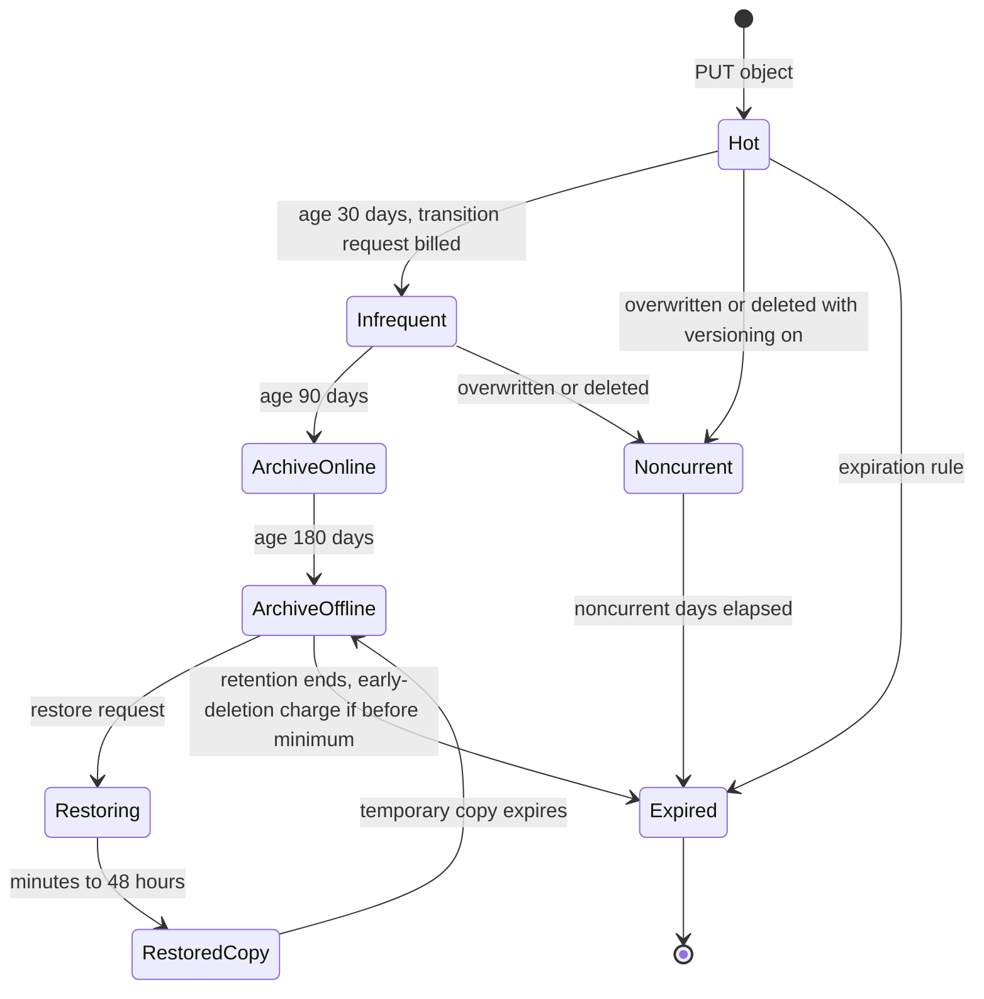

The state machine shows the paths an object can take and where costs and delays appear. Each forward transition is a billed request. Each move out of a class before its minimum duration triggers a pro-rated charge. The Restoring state is where RTO hides: an incident that needs archived data waits for it. The Noncurrent state shows that versioning (section 8.2) creates a second population of objects that lifecycle rules must manage separately. Otherwise overwritten versions accumulate at the class price indefinitely.

Lifecycle engine behaviors to design around:

- **Lifecycle is asynchronous.** S3 evaluates rules about once a day, and actions can lag eligibility. For expiration, billing stops at eligibility even if deletion happens later.
- **Transitions have floors.** S3 does not transition objects to Standard-IA or One Zone-IA until they are at least 30 days old. At the time of writing, S3 lifecycle by default does not transition objects smaller than 128 KB unless the rule specifies an object-size filter, because doing so usually costs more than it saves.
- **Azure last-access tracking** must be enabled on the account before rules can use `daysAfterLastAccessTimeGreaterThan`. Automatic tiering from cool back to hot on access is limited to once in 30 days.
- **Automatic classes.** S3 Intelligent-Tiering and Cloud Storage Autoclass move objects by observed access, which removes guesswork for unpredictable patterns. They charge a per-object monitoring or management fee, so they are poor value for billions of tiny objects.

### 7.4 Worked calculation: does lifecycle tiering pay?

A logging platform keeps one month's ingest as a cohort: 100 TB (100,000 GB) in 50 million objects averaging 2 MB. Retention is 12 months. During months 2 and 3, investigators read about 2 percent of the data. In month 9 an audit restores 5 percent.

The rates below are **illustrative**, shaped like AWS list prices in a US region at the time of writing. Replace them with current prices from the provider calculator before deciding anything.

| Item | Illustrative rate |
|---|---|
| Standard storage | $0.023 per GB-month |
| Standard-IA storage | $0.0125 per GB-month |
| Glacier Flexible Retrieval storage | $0.0036 per GB-month |
| Transition to Standard-IA | $0.01 per 1,000 objects |
| Transition to Glacier Flexible Retrieval | $0.03 per 1,000 objects |
| Standard-IA retrieval | $0.01 per GB |
| Glacier standard retrieval | $0.01 per GB plus $0.05 per 1,000 requests |

**Policy A: keep everything in Standard for 12 months.** 100,000 GB × $0.023 × 12 = **$27,600**.

**Policy B: Standard for month 1, Standard-IA for months 2 and 3, Glacier Flexible Retrieval for months 4 to 12.**

| Component | Arithmetic | Cost |
|---|---|---|
| Standard, month 1 | 100,000 × 0.023 × 1 | $2,300.00 |
| Standard-IA, months 2 and 3 | 100,000 × 0.0125 × 2 | $2,500.00 |
| Glacier, months 4 to 12 | 100,000 × 0.0036 × 9 | $3,240.00 |
| Archive overhead at Glacier rate | 50,000,000 × 32 KB = 1,600 GB; 1,600 × 0.0036 × 9 | $51.84 |
| Archive overhead at Standard rate | 50,000,000 × 8 KB = 400 GB; 400 × 0.023 × 9 | $82.80 |
| Transitions to Standard-IA | 50,000 thousand objects × $0.01 | $500.00 |
| Transitions to Glacier | 50,000 thousand objects × $0.03 | $1,500.00 |
| Investigator reads in Standard-IA | 2,000 GB × $0.01 | $20.00 |
| Audit restore | 5,000 GB × $0.01 + 2,500 thousand requests × $0.05 | $175.00 |
| Temporary restored copies, 7 days | 5,000 GB × $0.023 × 7 / 30 | $26.83 |
| **Total** | | **$10,396.47** |

Policy B saves about $17,200 per cohort, 62 percent. Note that $2,000 of the cost is transition requests and $135 is archive overhead: per-object charges are already a fifth of the cold-storage bill at a 2 MB average size.

**Now change one variable: average object size 20 KB.** The same 100 TB is 5 billion objects.

- Transitions to Standard-IA alone cost 5,000,000 thousand × $0.01 = $50,000, and each 20 KB object would be billed as 128 KB, multiplying the billable IA bytes by 6.4. (S3's default lifecycle behavior skips these objects for exactly this reason.)
- Transitions to Glacier cost $150,000, and 40 KB of overhead per object adds 200 TB of billed overhead, twice the data.
- Tiering now costs several times more than leaving everything in Standard.

The fix is to change the object size before tiering. Have the ingest pipeline compact small records into larger objects (for example, 256 MB columnar or compressed files) after a day or two. 100,000 GB / 0.256 GB is about 390,625 objects, and per-object charges become negligible again.

**Early deletion.** If a new retention rule deletes the cohort at day 120, each object has been in Glacier Flexible Retrieval for about 30 of its 90 minimum days. The provider bills the remaining 60 days: 100,000 GB × $0.0036 × 2 = $720. That is small here but grows quickly with Deep Archive's 180 days or Cloud Storage Archive's 365 days.

**Recovery time.** Policy B's audit restore at standard retrieval takes 3 to 5 hours before the first byte is readable, plus the time to read 5 TB. If an incident response requires month-6 logs within one hour, Policy B violates the requirement. Glacier Instant Retrieval or a cold online class (Azure Cold, Cloud Storage Coldline) keeps millisecond access at a higher storage price. RTO is a lifecycle input, not an afterthought.

The [storage lifecycle cost estimator](../code/python/storage-chapter/01_lifecycle_cost.py) runs a simplified version of this comparison with normalized rates. For 10,000 GB stored and 2,000 GB retrieved per month it prints 200 units for hot, 120 for cool, and 80 for archive. As its output warns, it omits request charges, minimum durations, per-object overhead, egress, and restore delay. The worked example above shows those omissions can reverse the answer.

## 8. Recovery controls: snapshots, versioning, and immutability

Replication protects against infrastructure failure. The controls in this section protect against changes that infrastructure faithfully preserves: deletions, overwrites, corruption, and encryption by an attacker. They work at different layers and are not interchangeable.

### 8.1 Block snapshots

**Mechanism.** A cloud block snapshot is a point-in-time copy of a volume's blocks, stored by the provider outside the volume. The first snapshot copies all written blocks. Later snapshots copy only blocks changed since the previous one and reference unchanged blocks from earlier snapshots. Each snapshot is logically complete: restoring any one produces the full volume, and deleting an intermediate snapshot removes only the blocks no other snapshot references. EBS snapshots, Azure incremental snapshots, and Compute Engine standard snapshots all work this way. You pay for unique changed blocks, so a 1 TiB volume that changes 20 GiB a day costs about 1 TiB plus 20 GiB per retained day, not 1 TiB per snapshot.

The snapshot point is the moment the snapshot is initiated. On EBS the volume stays fully usable while the snapshot status is `pending`. The service copies the point-in-time block state in the background and preserves blocks that change during the copy.

**Where snapshots live.** EBS snapshots are regional and restorable into any AZ in the region, and can be copied to other regions and shared or copied to other accounts. Azure incremental snapshots are regional resources and can be copied across regions. Compute Engine standard snapshots are stored by default in a multi-region or region near the source, with a configurable storage location. Google also offers *instant snapshots*, kept with the disk for fast restore, which are not a backup because they share the disk's location, and *archive snapshots* for long retention. EBS has a *snapshot archive tier* for long retention, with a 90-day minimum and a restore that takes 24 to 72 hours.

**Crash-consistent versus application-consistent.** A snapshot of a running volume is *crash-consistent*: it contains exactly what the disk held at one instant, as if power were cut. Journaling filesystems and databases with write-ahead logs are designed to recover from that state, replaying or discarding incomplete work. Data in the guest's page cache or the application's memory that had not reached the disk is not in the snapshot.

An *application-consistent* snapshot first brings the application to a clean point: it flushes buffers, completes or pauses in-flight transactions, and freezes the filesystem. Then it snapshots and thaws. On Windows, the Volume Shadow Copy Service (VSS) coordinates this, and AWS Backup, Azure Backup, and Compute Engine's guest-flush option can invoke it. On Linux the providers run pre- and post-scripts that call `fsfreeze` or put the database into backup mode.

Two failure modes recur:

- **Multi-volume inconsistency.** A database with data on one volume and logs on another needs both captured at the same instant. Snapshots taken seconds apart can produce a log that refers to data pages that are not in the data snapshot. Use multi-volume crash-consistent snapshots (EBS supports them for all volumes of an instance; Azure offers VM restore points) or application-consistent coordination.
- **Assuming crash-consistent is enough.** It is enough for software designed for power loss. It is not enough for applications that keep state in memory and flush irregularly, or for multi-system transactions. Test by restoring and starting the application, not by checking that the snapshot completed.

**Restore performance.** A volume restored from a snapshot is available within minutes, but blocks are fetched from the snapshot store on first access. The first full scan of a restored 2 TiB database can run far slower than steady state. EBS Fast Snapshot Restore pre-initializes snapshots in chosen AZs for an hourly fee. Other providers document their own initialization behavior. Include the warm-up time in RTO.

**Protection of snapshots themselves.** Snapshots in the production account can be deleted by anyone with production delete permissions. EBS Recycle Bin retention rules (which can be locked) recover snapshots and Amazon Machine Images (AMIs) deleted by mistake. Copying snapshots to a separate account or vault, as described in section 9, is what makes them independent.

### 8.2 Object versioning and soft delete

**Versioning** keeps every version of an object. An overwrite creates a new current version, and the previous one becomes noncurrent. A delete without a version ID adds a *delete marker* on S3 (Cloud Storage makes the live version noncurrent), and the data remains recoverable.

- **S3 versioning** has three bucket states: unversioned, enabled, and suspended. Once enabled, a bucket can never return to unversioned. Deleting a specific version ID permanently removes it, so restrict `s3:DeleteObjectVersion` tightly. MFA (multi-factor authentication) Delete can require a second factor for version deletion and versioning-state changes, though it is root-user-only and awkward to operate. Object Lock (section 8.3) is usually the better control.
- **Azure blob versioning** creates a version on every write. **Blob soft delete** (1 to 365 days) retains deleted blobs and snapshots, and **container soft delete** protects against container deletion. **Point-in-time restore** for block blobs, which requires versioning, change feed, and soft delete, can roll a range of blobs back to an earlier time.
- **Cloud Storage object versioning** keeps noncurrent versions. **Soft delete** is enabled by default on buckets that support it, with a seven-day retention that can be set between 7 and 90 days or disabled ([Cloud Storage soft delete](https://docs.cloud.google.com/storage/docs/soft-delete)). It retains deleted objects, including those deleted by overwrite, and covers soft-deleted buckets too.

Soft delete and versioning answer different questions. Soft delete answers "can I undo a deletion within N days?" Versioning answers "can I get back the content from before this overwrite?" Both are recovery controls inside the production boundary. A principal with enough permissions can disable them, purge versions, or delete the account. They defend against mistakes, not against a compromised administrator.

**Worked example: the cost of versioning.** A 10 TB bucket overwrites 5 percent of its content daily. With versioning and no noncurrent lifecycle rule, noncurrent data grows by 0.5 TB a day, 182.5 TB a year, eighteen times the live data. A rule expiring noncurrent versions after 30 days caps noncurrent data at about 0.5 × 30 = 15 TB, so total storage is about 25 TB, 2.5 times the live data. Choose the noncurrent retention from how long it takes to detect bad writes, then pay for that window deliberately. S3 rules can also keep a fixed number of newer noncurrent versions (`NewerNoncurrentVersions`) regardless of age.

### 8.3 Object lock, immutability, and WORM

Write once, read many (WORM) storage prevents modification or deletion of data until a retention period ends, even by administrators. Regulators require it for some records (broker-dealer communications, clinical trial data), and it is the core defense against ransomware that uses legitimate credentials.

**S3 Object Lock** applies to object versions in a versioned bucket. It can be enabled on existing buckets as well as at creation. Each version can carry:

- A **retention period** in **governance mode**, which principals with `s3:BypassGovernanceRetention` can shorten or remove. Use it to test policies and to protect against most users while keeping an administrative escape hatch.
- A **retention period** in **compliance mode**, which no principal, including the account root user, can shorten or remove until it expires. AWS documents closing the owning account as the only way to remove compliance-locked data early, which is why the account boundary itself must be protected (section 9).
- A **legal hold**, which has no expiry and blocks deletion until a principal with `s3:PutObjectLegalHold` removes it.

A delete request on a locked object still succeeds in the sense that it adds a delete marker. The locked version remains and can be restored. A bucket default retention applies a mode and period to new versions automatically.

```json
{
  "ObjectLockEnabled": "Enabled",
  "Rule": {
    "DefaultRetention": { "Mode": "COMPLIANCE", "Days": 35 }
  }
}
```

**Azure immutable storage for Blob Storage** supports time-based retention policies and legal holds at the container scope or, with versioning, at the version scope (version-level WORM). A time-based policy starts *unlocked*, so it can be tested, extended, shortened, or deleted, and becomes *locked* when you lock it. Once locked, the period can be extended but not shortened, and the policy cannot be deleted while it protects data. The "allow protected append writes" option permits append-blob writes for logs while blocking modification of existing data.

**Cloud Storage** offers a **bucket retention policy** that blocks deletion or overwrite of any object younger than the retention period. **Bucket Lock** makes that policy permanent: it can be increased but never removed or reduced, and the bucket cannot be deleted until every object has met it. **Object retention lock** sets per-object retention in unlocked or locked mode. **Event-based holds** and **temporary holds** block deletion until released, which suits "retain for seven years after account closure" rules.

**Design cautions.**

- Compliance mode, locked Azure policies, and Bucket Lock are irreversible by design. A 10-year compliance lock applied by mistake to 500 TB of temporary data is a 10-year bill that no support ticket can remove. Test in governance or unlocked mode, apply lifecycle rules for data outside the WORM scope, and require two-person approval for locking.
- Retention protects bytes, not readability. If the data's customer-managed key is deleted, locked data is permanently unreadable (section 10).
- WORM conflicts with erasure requests under privacy law. Keep personal data that may need erasure out of locked scopes, or encrypt each subject's data with a separate key so that destroying the key erases the data (crypto-shredding) while the locked ciphertext remains. Agree on this with legal counsel before locking.
- Lock is not isolation. A compromised administrator cannot delete locked versions but can still read them, change bucket policy to make them public, or stop new writes. Combine immutability with the separate boundaries in section 9.

## 9. Backup services and independent backup boundaries

### 9.1 What makes a copy a backup

A copy counts as a backup for a given threat only if that threat cannot destroy both the original and the copy. Apply that test and most "backups" turn out to be partial:

| Copy | Survives disk failure | Survives zone loss | Survives region loss | Survives mistaken delete | Survives compromised production admin |
|---|---|---|---|---|---|
| Synchronous zone-redundant replica | Yes | Yes | No | No | No |
| Asynchronous cross-region replica | Yes | Yes | Yes (minus lag) | No, deletes replicate unless filtered | No |
| Snapshot in the same account | Yes | Yes (regional store) | No, unless copied | Yes, until someone deletes the snapshot | No |
| Versioning or soft delete in the same bucket | Yes | As the bucket's scope | As the bucket's scope | Yes, within retention | No, versions can be purged and settings changed |
| Object Lock compliance mode in the same account | Yes | As the bucket's scope | As the bucket's scope | Yes | Mostly. Data survives, but the admin can read it, and closing the account removes it |
| Copy in a separate account with locked vault and separate keys | Yes | Yes | Yes, if in another region | Yes | Yes |

The last row describes an **independent backup boundary**: a copy whose deletion requires credentials, approvals, and keys that the production environment does not hold, and whose retention cannot be shortened even by the people who administer it.

### 9.2 Provider backup services

**AWS Backup** centralizes backup across EBS, EC2, EFS, FSx, S3, Amazon Relational Database Service (RDS), Amazon DynamoDB, and other services through *backup plans*: schedules, retention lifecycles (including transition to cold storage for supported resources), and *copy actions* that send recovery points to vaults in other Regions or accounts. Organization-wide backup policies in AWS Organizations apply plans to member accounts by tag.

- A **backup vault** holds recovery points and has its own access policy, which can deny deletion to everyone except a break-glass role.
- **AWS Backup Vault Lock** in *governance mode* restricts deletion and retention changes except by principals with specific permissions. In *compliance mode*, after a cooling-off grace period, the lock becomes immutable: nobody can delete recovery points before their retention ends or remove the lock.
- A **logically air-gapped vault** stores recovery points in an AWS Backup service-owned account, isolated from the customer's account. It is locked in compliance mode, can be shared through AWS Resource Access Manager (RAM) with a recovery account so that restores can run outside a compromised account, and supports AWS KMS (Key Management Service) customer-managed keys at the time of writing ([AWS Backup logically air-gapped vault](https://docs.aws.amazon.com/aws-backup/latest/devguide/logicallyairgappedvault.html)).
- **Restore testing** runs scheduled restores of selected recovery points, records the result and duration, and deletes the restored resource afterward, which produces repeatable RTO evidence.

**Azure Backup** uses two vault types. **Recovery Services vaults** protect Azure VMs, SQL Server and SAP HANA in VMs, and Azure Files. **Backup vaults** protect newer workloads such as blobs, managed disks, Azure Database for PostgreSQL, and Azure Kubernetes Service (AKS). Key controls:

- **Soft delete** retains deleted backup data for 14 days by default at no charge. *Enhanced soft delete* can be made always-on so that it cannot be disabled.
- **Immutable vaults** block operations that would lose recovery points before their retention ends. Once *locked*, immutability cannot be turned off.
- **Multi-user authorization (MUA)** with a **Resource Guard** requires approval from a separate principal, ideally in another subscription or tenant, before critical operations such as disabling soft delete or reducing retention.
- **Cross-region restore** and **cross-subscription restore** let recovery run in another region or subscription.
- For blobs, **operational backup** is in-account point-in-time restore built on versioning and soft delete, while **vaulted backup** copies data into a Backup vault outside the storage account. Only the vaulted form is independent of the account's administrators.

**Google Cloud Backup and DR Service** protects Compute Engine instances and disks, Cloud SQL, and other workloads through backup plans that write to **backup vaults**. Backup vaults live in Google-managed projects and enforce a minimum retention (from 1 day to 99 years at the time of writing) during which backups are immutable and indelible, even to the customer's administrators ([Backup and DR backup vaults](https://cloud.google.com/backup-disaster-recovery/docs/cloud-console/backup-vault-create)). For Cloud Storage data, an independent copy is usually built from cross-bucket replication or Storage Transfer Service into a bucket in a separate project with a locked retention policy.

The three designs converge on one idea: the provider holds the backup in a place the customer's own administrators cannot purge. The details still differ. AWS offers both customer-account vaults with Vault Lock and service-owned logically air-gapped vaults. Azure offers immutable vaults plus a separate approval principal. Google stores vaults in Google-managed projects with enforced retention. Compare them on who can shorten retention, where recovery can run, and which key protects the data.

### 9.3 Designing the boundary

An independent backup boundary separates five things from production:

1. **Credentials.** Production roles have no permission to delete recovery points or change vault policy. Backup administration uses different principals, ideally from a different identity source or with phishing-resistant multi-factor authentication and just-in-time elevation.
2. **Administrative scope.** The vault lives in a separate account, subscription, or project under its own organizational unit or management group, with guardrails that deny deletion and policy changes (Service Control Policies on AWS, Azure Policy and deny assignments on Azure, Organization Policy on Google Cloud), or in a provider-owned vault that customer administrators cannot reach. [Landing Zones](CH15_Landing_Zones.md) owns the account structure.
3. **Retention lock.** Retention cannot be shortened by anyone during the lock period.
4. **Keys.** Backup copies are encrypted with keys controlled in the backup boundary, so scheduling deletion of a production key does not make the backup unreadable.
5. **Location.** At least one copy lives in another region for region-scale events, subject to residency rules (section 12).

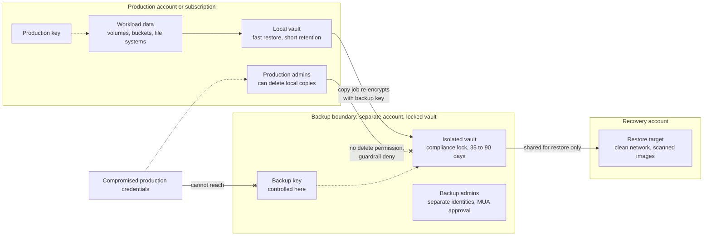

The trust-boundary diagram shows why each separation matters. An attacker who takes over production credentials can delete the workload data and the local vault, and can disable the production key. The isolated vault survives because its delete permission, its retention, and its key all live outside the production boundary. Restores run into a third, clean recovery account, so they do not depend on the compromised environment's network, roles, or images. The local vault still has a role: it provides fast, cheap restores for everyday mistakes, which is most restores. The isolated vault handles the rare catastrophic case.

### 9.4 The backup and restore flow

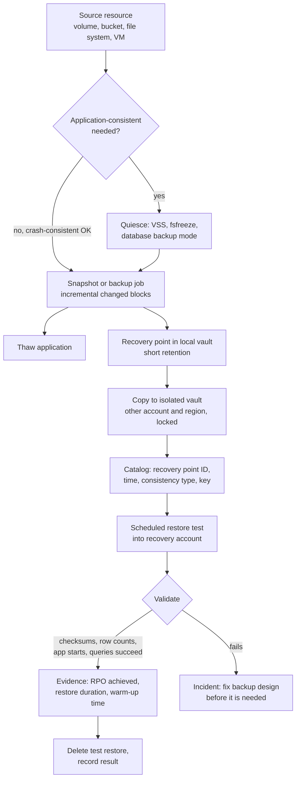

The flow separates producing a recovery point from proving it works. The left branch decides consistency at capture time, because no restore can add consistency that capture did not record. The middle path moves the point into the isolated vault and records what it is, including which key encrypts it, because a recovery point whose key nobody can find is not recoverable. The bottom section is the part most organizations skip. A job status of "Completed" says that bytes were copied, not that the application can start from them, that the restore fits the RTO, or that the data is uncorrupted. Only a restore and validation produce that evidence.

### 9.5 Restore testing and restore-time arithmetic

A restore test should measure:

- **Achieved RPO**: the timestamp of the newest recovery point usable at the moment of the simulated failure.
- **Restore duration**: from decision to restored resource, including any rehydration from cold or archive tiers.
- **Warm-up time**: until performance reaches normal (lazy-loaded volumes, cold caches).
- **Integrity**: checksums for files and objects, row counts and consistency checks for databases, and an application-level smoke test.
- **Dependencies**: keys, IAM roles, DNS names, network routes, and secrets required by the restored system.

**Worked example.** A data platform must restore 40 TB of block volumes after a ransomware event, with an RTO of 8 hours. A drill restoring a 4 TB volume took 12 minutes to create the volume but 2 hours 10 minutes to read every block (pre-warming), an effective rate of 4,000,000 MB / 7,800 s ≈ 513 MB/s per volume.

- Restoring 40 TB as one volume would take about 40,000,000 / 513 ≈ 78,000 s, about 21.7 hours, far beyond the RTO.
- Restoring ten 4 TB volumes in parallel takes about 2.4 hours if nothing else is shared. The drill must confirm that the restore service's concurrent-job limits, the account's volume and IOPS quotas in the recovery region, and the target instances' storage caps allow ten parallel warm-ups.
- If any data comes from an archive tier, add the retrieval delay (hours) before the first byte.

The [backup retention policy checker](../code/python/storage-chapter/02_backup_retention.py) applies one slice of this discipline to a list of sample recovery points with a 90-day threshold. It marks the 100-day immutable quarterly point as passing, marks the younger daily, weekly, and monthly points for review because they expire before the threshold, and would flag any point past the threshold that is still mutable. Extending it to flag mutable points of any age, and to check that each point has a copy outside the production boundary, makes it a useful pre-audit gate.

### 9.6 Quality scenario: account compromise contained by organizational boundaries

- *Stimulus:* an attacker obtains an administrator role in the production account at 02:00. Over 40 minutes they delete S3 object versions in three buckets, delete EBS snapshots and local-vault recovery points, schedule deletion of the production KMS key, and start encrypting EFS data.
- *Expected response:* deletes in the production account succeed where production permissions allow them. Organization guardrails deny any attempt on the backup account. The logically air-gapped or locked vault rejects deletion regardless of the caller. Security monitoring alerts on mass `DeleteObjectVersion`, `DeleteRecoveryPoint`, and `ScheduleKeyDeletion` calls. Responders cancel the key deletion during its waiting period (7 to 30 days on AWS KMS), revoke the role sessions, and restore tier-1 data into the recovery account from the isolated vault.
- *Measurable success criteria:* zero recovery points lost in the isolated vault; detection within 15 minutes of the first mass-delete call; tier-1 data restored and validated within 8 hours with an RPO of at most 24 hours; restore performed without using any production-account credential.
- *Evidence:* the last two quarterly drills restored from the isolated vault into the recovery account within target, and a tabletop test confirmed the production administrator role receives `AccessDenied` on the backup vault.

## 10. Encryption and the key dependency

Key management mechanics, envelope encryption, and rotation are owned by [Secrets Management](CH13_Secrets_Management.md) and [Encryption](../15_Security/CH10_Encryption.md). In brief, storage services encrypt each object or volume with a data key, and a key-management service wraps that data key under a key-encryption key. Reads need the key service to unwrap the data key. This section covers the storage-side choices and why they are recovery decisions.

### 10.1 Options by provider

| Option | AWS | Azure | Google Cloud |
|---|---|---|---|
| Provider-managed keys (default) | SSE-S3, applied to all new S3 objects by default since January 2023; EBS encryption by default is a per-Region account setting | Microsoft-managed keys, always on for Azure Storage and managed disks | Google default encryption, always on |
| Customer-managed keys in the provider key service | SSE-KMS (with S3 Bucket Keys to reduce KMS calls); DSSE-KMS for dual-layer; EBS volumes with a KMS key | Customer-managed keys in Azure Key Vault or Managed HSM, per storage account or encryption scope; disk encryption sets for managed disks | Customer-managed encryption keys (CMEK) in Cloud KMS for buckets and disks; Cloud External Key Manager for keys held outside Google |
| Customer-provided keys per request | SSE-C | Customer-provided keys on Blob requests | Customer-supplied encryption keys (CSEK) |

Provider-managed keys protect against physical media theft and satisfy many "encryption at rest" requirements with no operational burden. Customer-managed keys add separation of duties (key administrators differ from storage administrators), key-level audit, the ability to revoke access to all data by disabling one key, and compliance evidence. They also add a dependency that provider-managed keys do not have.

### 10.2 The recovery dependency

Every read of customer-managed-key data needs the key to exist, be enabled, and grant the storage service permission to use it. That creates failure modes outside the storage service:

- **Disabled key.** Reads fail immediately with access errors. Azure Storage loses access to account data when the customer-managed key is unavailable. S3 SSE-KMS `GET`s fail. Durability is unaffected, but availability goes to zero.
- **Deleted key.** Data becomes permanently unreadable. Providers insert delays to prevent accidents: AWS KMS requires a 7-to-30-day waiting period before deletion. Azure Key Vault soft delete and purge protection (required for storage customer-managed keys) keep deleted keys recoverable for the retention period. Cloud KMS schedules key-version destruction after a configurable delay (30 days by default at the time of writing). Alert on any scheduled deletion.
- **Cross-region and cross-account copies.** KMS keys are regional. Replicating SSE-KMS objects or copying snapshots to another region requires a key in the destination region. AWS-managed keys (such as `aws/ebs`) cannot be used by other accounts, so snapshots encrypted with them cannot be shared across accounts. A cross-account backup design must use customer-managed keys whose policies grant the backup account access, or let the copy re-encrypt under the backup account's key. Discover this during design, not during a restore.
- **Key-service quotas.** SSE-KMS calls the key service on writes and reads. High request rates can hit KMS request quotas shared across the account and region. S3 Bucket Keys cut KMS calls by caching a bucket-level key for a period.

### 10.3 Quality scenario: key rotation

- *Stimulus:* annual rotation of the customer-managed key protecting a 300 TB Azure storage account and an S3 bucket, plus an emergency rotation after a suspected key-policy misconfiguration.
- *Expected response:* on AWS, automatic KMS key rotation creates new key material under the same key ID and keeps old material for decryption, so existing objects remain readable and new writes use the new material. No data is re-encrypted. On Azure, the storage account's account encryption key is rewrapped with the new key version, which is a metadata operation and does not re-encrypt 300 TB. Switching to a *different* key (a new key ID) applies only to new writes on S3. Re-encrypting existing objects requires copying them, for example with S3 Batch Operations, which costs requests and time.
- *Measurable success criteria:* zero read errors during and after rotation; a restore test of the previous month's backup succeeds after rotation; the old key version remains available until every backup that depends on it has expired.

## 11. Access control and public exposure

Cloud IAM evaluation is owned by [IAM](CH09_IAM.md). Storage adds resource policies, public-access guardrails, delegated-access tokens, and network restrictions, and most storage breaches are failures in one of them.

### 11.1 Amazon S3

- **Identity policies and bucket policies** combine under standard AWS evaluation: an explicit deny anywhere wins, and cross-account access needs an allow on both sides. Service Control Policies (SCPs) and resource control policies (RCPs) at the organization level can impose ceilings, for example denying access to any principal outside the organization.
- **Block Public Access** at the account and bucket level overrides any policy or access control list (ACL) that would grant public access. It is enabled by default on new buckets, and new buckets disable ACLs by default (Object Ownership set to bucket owner enforced). Keep account-level Block Public Access on, and serve public content through a content delivery network origin with a narrowly scoped policy.
- **Access points** give each application its own named entry with its own policy and optional virtual private cloud (VPC) restriction, which keeps one bucket policy from growing into an unreviewable document.
- **VPC endpoint policies** and the `aws:SourceVpce` condition restrict which endpoints can reach the bucket ([Networking](CH05_Networking.md) owns endpoint mechanics).

```json
{
  "Version": "2012-10-17",
  "Statement": [
    {
      "Sid": "DenyInsecureTransport",
      "Effect": "Deny",
      "Principal": "*",
      "Action": "s3:*",
      "Resource": ["arn:aws:s3:::claims-docs", "arn:aws:s3:::claims-docs/*"],
      "Condition": { "Bool": { "aws:SecureTransport": "false" } }
    },
    {
      "Sid": "DenyOutsideOrgEndpoint",
      "Effect": "Deny",
      "Principal": "*",
      "Action": ["s3:GetObject", "s3:PutObject"],
      "Resource": "arn:aws:s3:::claims-docs/*",
      "Condition": {
        "StringNotEquals": { "aws:SourceVpce": "vpce-0a1b2c3d4e5f67890" },
        "Bool": { "aws:ViaAWSService": "false" }
      }
    }
  ]
}
```

The first statement rejects any request not using TLS (Transport Layer Security). The second rejects object reads and writes that do not arrive through the named endpoint, except requests that an AWS service makes on the caller's behalf using the caller's credentials (`aws:ViaAWSService`). Service roles that call S3 directly, such as an S3 replication role or a backup role, do not match that exception and need their own, typically an `aws:PrincipalArn` condition. Test the policy against every legitimate caller, including recovery paths, before applying it. Deny statements like these hold even if someone later attaches an overly broad allow.

### 11.2 Azure Blob Storage

- **Microsoft Entra ID with Azure RBAC data actions** (for example, Storage Blob Data Reader) is the preferred authorization path. Role assignments can be scoped to account or container, and with conditions to paths or tags.
- **Shared Key** authorization uses the storage account keys, which grant full access to all data. Set `AllowSharedKeyAccess` to false where the workload does not need it, which also disables shared access signature (SAS) tokens signed with account keys.
- **Shared access signatures (SAS)** come in three kinds. An *account SAS* and a *service SAS* are signed with an account key and can be revoked only by rotating that key, or, for a service SAS bound to a *stored access policy*, by changing the policy. A *user delegation SAS* is signed with a key obtained through Entra ID, is limited to at most seven days, and can be revoked by revoking user delegation keys. Prefer user delegation SAS, keep expiry short, and restrict permissions, Internet Protocol (IP) address ranges, and protocol.
- **Anonymous access** is disabled by default for new accounts (`AllowBlobPublicAccess` false). Azure Policy can deny accounts that enable it.
- **Network rules** (the storage firewall), private endpoints, and resource instance rules restrict where requests may come from.

### 11.3 Cloud Storage

- **IAM** grants roles at the organization, folder, project, bucket, and managed-folder levels.
- **Uniform bucket-level access** disables object ACLs so that IAM alone governs access, which makes permissions auditable and is required for features such as IAM Conditions and managed folders. Enforce it with the `storage.uniformBucketLevelAccess` organization policy constraint.
- **Public access prevention** blocks granting access to `allUsers` and `allAuthenticatedUsers`. Enforce it with the `storage.publicAccessPrevention` constraint.
- **Signed URLs** (V4, valid for up to seven days) grant time-limited access to a specific object and method.
- **VPC Service Controls** perimeters prevent data from being copied to buckets outside the perimeter even by an authorized identity, which addresses exfiltration through valid credentials.

### 11.4 The access decision path

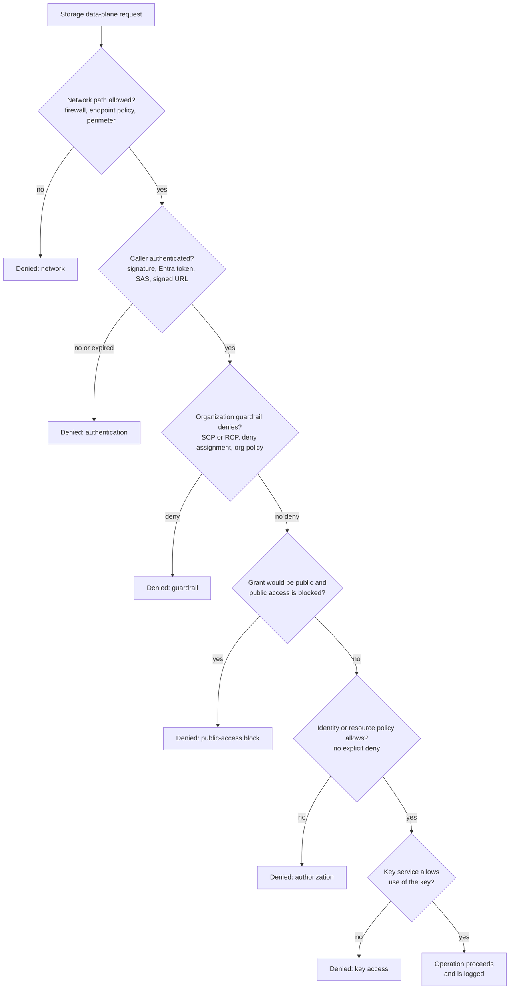

The decision path is a provider-neutral simplification. Each provider's exact order and combination rules are in [IAM](CH09_IAM.md). Its use in review is diagnostic: six independent gates must all pass, and an "access denied" error can come from any of them. A frequent incident pattern is a restore that fails at the key gate in a recovery account, or at the network gate because the recovery VPC has no endpoint, even though IAM looks correct. List every gate for the recovery path explicitly.

## 12. Data location, residency, and egress

### 12.1 Where data lives

The location of a storage resource is set at creation and usually cannot change. An S3 bucket's Region, an Azure storage account's region, and a Cloud Storage bucket's location are all fixed. Moving data means copying it to a new resource. Residency reviews often stop at the primary location and miss these copies:

- **Geo-redundant secondaries.** Azure GRS replicates to the paired region, chosen by Azure. Most pairs stay within one geography, but some do not; Brazil South, for example, pairs with a region in the United States. Cloud Storage multi-regions span a large geography (for example, `EU` or `US`) with provider-chosen data centers inside it, while dual-regions use the two regions you name.
- **Snapshots and backups.** Snapshot storage locations (Compute Engine snapshots default to a multi-region near the source), backup vault regions, and cross-region copy actions.
- **Logs and inventories.** Access logs, AWS CloudTrail data events, Azure Storage logs, Cloud Audit Logs, and S3 Inventory reports record object keys, and keys often contain personal data (`customers/jane.doe@example.com/passport.pdf`). Keep identifiers out of keys, or treat logs as regulated data.
- **Derived copies.** Analytics exports, search indexes, caches, and content delivery network edge caches.

### 12.2 Egress and replication cost

Data leaving a region or provider is billed per GB, and replication is a form of egress. At an **illustrative** inter-region rate of $0.02 per GB, replicating 50 TB of new data a month costs 50,000 × $0.02 = $1,000 a month in transfer, plus storage and request charges in the destination, plus any time-bounded replication premium. Serving the same 50 TB to the internet at an illustrative $0.05 to $0.09 per GB costs $2,500 to $4,500. Requester-pays buckets shift download costs to the reader for shared datasets. Model egress when deciding whether a multi-region bucket (no separate replication charge in some providers' pricing, but a higher storage price) is cheaper than a regional bucket plus replication. [Cost Optimization](CH14_Cost_Optimization.md) owns the broader billing model.

## 13. Quotas and limits

Storage quotas fall into three groups, and each fails differently:

- **Resource-count quotas**, such as S3 buckets per account (10,000 by default at the time of writing), Azure storage accounts per region per subscription (250 by default, raisable to 500 at the time of writing), snapshots per region, and data disks per VM size. These fail at creation time with a clear error.
- **Provisioned-performance and capacity quotas**, such as EBS per-Region quotas on total storage per volume type and on provisioned IOPS, Hyperdisk provisioned IOPS and throughput quotas per project and region, and Filestore capacity quotas. These fail at scale-out, often in the middle of an incident, when automation tries to create many volumes at once.
- **Rate limits**, such as object request rates per prefix or per account, KMS request quotas, and control-plane API rates for snapshot creation. These degrade gradually through throttling responses.

Check quotas through Service Quotas on AWS, the Quotas page and `az vm list-usage` / `az storage account` usage commands on Azure, and Cloud Quotas on Google Cloud, and alarm on usage before it reaches the limit. Values change; verify current quotas for your account rather than relying on defaults.

### 13.1 Quality scenario: quota limit during scale-out

- *Stimulus:* a seasonal event triples a search cluster on Compute Engine from 40 to 120 shards. Each shard uses a Hyperdisk Balanced volume provisioned at 15,000 IOPS.
- *Arithmetic:* each volume consumes 15,000 − 3,000 = 12,000 IOPS of quota above the free baseline. 120 shards need 120 × 12,000 = 1,440,000 provisioned IOPS of quota. Suppose the project's regional quota is a hypothetical 500,000. Then 40 shards already consume 480,000, and the scale-out fails at the second new shard (500,000 / 12,000 ≈ 41.7).
- *Expected response:* capacity planning raises the quota in advance with evidence of the peak. A pre-scale check compares projected consumption with quota and fails the deployment early rather than leaving half-built shards.
- *Measurable success criteria:* projected quota headroom of at least 20 percent above planned peak is confirmed 14 days before the event; the scale-out completes with zero quota errors; an alert fires when usage passes 80 percent of quota.

## 14. From workload I/O pattern to service selection

### 14.1 Characterize the workload first

Before naming a service, record these facts about each data set:

- **Interface the software requires**: block device, POSIX or SMB path, HTTP object API, or a database query interface.
- **Sharing**: one host, a small cluster with coordination, or many independent readers and writers.
- **I/O shape**: random or sequential; I/O or object size distribution; read/write ratio; peak IOPS, throughput, and request rate; latency percentile targets.
- **Lifecycle**: how access frequency changes with age, retention and deletion rules, and legal holds.
- **Failure requirements**: RPO and RTO for disk, zone, region, mistaken deletion, and compromise.
- **Location and control**: residency, key ownership, and network exposure.

### 14.2 The selection decision

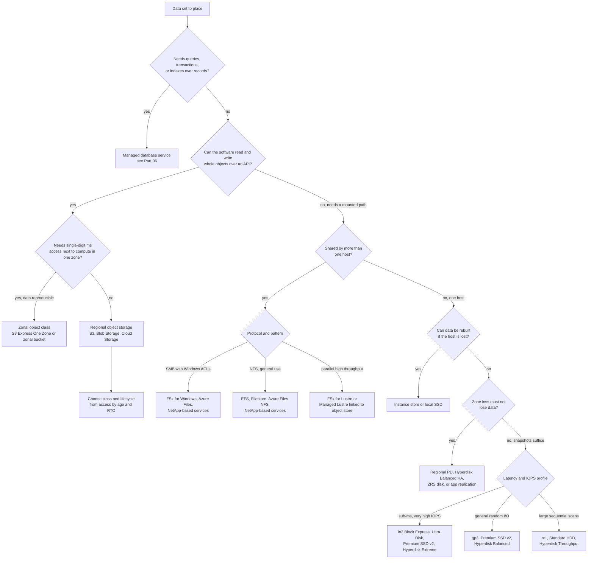

The tree puts the interface question first because it is the hardest to change. Software that requires a POSIX path cannot use object storage without rewriting, and software that issues SQL should not be given raw volumes to build an unreviewed database platform on. Within object storage, the remaining choice is mostly class and location. Within block storage, the failure-scope question comes before performance, because it determines whether a single-zone volume type is acceptable at all. The leaves name candidates, not answers: each still needs the sizing check of section 3.6, the instance-cap check, and a price comparison.

Two adjacent paths are owned elsewhere. Databases choose their own storage engine and replication ([Databases and Storage](../06_Databases_and_Storage/PART_OVERVIEW.md)). When a managed database is used, the provider manages the underlying volumes, and this chapter's concerns reduce to backup boundaries and keys. Kubernetes workloads request storage through PersistentVolumeClaims and StorageClasses, and provider CSI drivers provision the same EBS volumes, Azure Disks and Files, and Persistent Disks or Hyperdisks described here ([Kubernetes Storage](../12_Kubernetes/CH07_Storage.md)). A pod's volume therefore inherits the zonal scope of its disk, which constrains pod scheduling after a zone failure. [Managed Kubernetes](CH08_Kubernetes.md) covers the provider integration.

### 14.3 Worked selection

A media company describes four data sets:

1. **Uploaded originals**, 200 MB average, written once, read during transcoding in the first day, then rarely. Retention is indefinite. Software already uses a provider software development kit (SDK). The tree leads to regional object storage. Lifecycle goes Standard for 30 days, then an infrequent-access class, then an archive class after 180 days. Because a re-transcode request must start within an hour, choose an online archive class (Glacier Instant Retrieval, Azure Cold, Cloud Storage Coldline or Archive) rather than an offline one.
2. **Transcoding scratch**, 2 TB per worker, random reads and writes, rebuildable from originals. One host, rebuildable, so instance-store NVMe gives the lowest latency and no storage bill. Losing a worker loses only in-progress jobs, which are retried.
3. **Editorial project files** on macOS and Windows desktops through SMB, 30 TB, with file locking. Shared, SMB with ACLs: FSx for Windows File Server, Azure Files, or a NetApp-based service. Choose Multi-AZ or zone-redundant tiers, because editors cannot lose a day's work to a zone event.
4. **Asset metadata catalog**, 50 GB of records with search by tag and date. This needs queries, so it goes to a managed database, not files in a bucket.

## 15. Operations, observability, and change

### 15.1 What to measure

| Concern | Signals | Examples |
|---|---|---|
| Block performance | Volume IOPS, throughput, latency, queue length, throttling checks; instance burst balances | CloudWatch `VolumeQueueLength`, `VolumeIOPSExceededCheck`, `EBSIOBalance%`; Azure disk and VM "consumed percentage" metrics; Compute Engine disk throttling metrics |
| Object health | Request rates by operation, 4xx and 5xx rates, 503 throttling, first-byte latency | S3 request metrics, Azure Storage metrics and logs, Cloud Storage request metrics |
| Replication | Pending bytes and operations, replication latency, last-sync age | S3 RTC metrics and events; Azure `LastSyncTime`; Cloud Storage turbo replication metrics |
| Capacity and cost | Bytes by class, object counts, noncurrent bytes, incomplete multipart uploads | S3 Storage Lens, Azure Storage insights, Cloud Storage Insights |
| Protection | Backup job success, copies to isolated vault, recovery-point age, restore-test outcomes | AWS Backup reports and Audit Manager, Azure Backup reports, Backup and DR reports |
| Configuration drift | Public-access settings, policies, versioning, lifecycle, retention, key state | AWS Config rules, Azure Policy compliance, Security Command Center findings |

High-value alerts are the ones that precede data loss: public access enabled, versioning suspended, lifecycle rule created or changed (a typo in a prefix can expire production data), retention shortened, replication backlog growing, key disabled or scheduled for deletion, mass deletes, and backup copies missing from the isolated vault. Route audit logs for these events to a destination outside the storage administrators' control, as [Monitoring](CH10_Monitoring.md) describes.

### 15.2 Changing storage safely

Many storage settings are hard or impossible to reverse: Object Lock compliance mode, locked immutability policies, Bucket Lock, enabling S3 versioning, a resource's region, and an Azure account's hierarchical namespace. Treat changes to them like schema migrations. Apply them through infrastructure as code with review, test them in a non-production copy, and require approval from a second person for irreversible steps. Lifecycle rules deserve the same care. Deploy a new expiration rule first as a transition-only or tag-scoped rule, check S3 Inventory or equivalent reports to confirm which objects it matches, then add expiration.

### 15.3 Quality scenario: migration with reversible cutover

A team moves a 60 TB on-premises NFS share used by a batch platform to EFS. Equivalent tools exist elsewhere: Azure Storage Mover or AzCopy for Azure Files, and Storage Transfer Service for Filestore and Cloud Storage. [Cloud Migration](CH16_Cloud_Migration.md) owns the migration program.

- *Stimulus:* the cutover window opens on Saturday at 20:00 with a rollback deadline of Sunday 06:00.
- *Plan:* AWS DataSync performs an initial bulk copy during the preceding weeks, then nightly incremental syncs. At cutover, writes to the source stop, a final incremental sync copies the delta, a verification pass compares checksums and file counts, and clients remount to EFS through a DNS name the team controls.
- *Arithmetic:* if nightly deltas are about 400 GB and the measured DataSync rate is 300 MB/s, the final sync takes about 400,000 / 300 ≈ 1,333 s, about 22 minutes, plus file-scan time for 30 million files, which the rehearsal measured at 50 minutes. The freeze window is about 75 minutes.
- *Reversibility:* until the rollback deadline, the source share is kept read-only but intact, and a reverse DataSync task, rehearsed in advance, can copy any files written to EFS after cutover back to the source. Rollback means stop EFS writes, run the reverse task, and repoint DNS.
- *Measurable success criteria:* write freeze under 90 minutes; zero checksum mismatches; batch jobs complete within their normal duration on the first night; rollback rehearsed end to end at least once, with a measured duration under 2 hours.

## 16. Provider comparison: guarantees, scopes, and responsibilities

| Dimension | AWS | Azure | Google Cloud |
|---|---|---|---|
| Default block volume scope | One AZ (EBS) | LRS: one datacenter in one zone | One zone (Persistent Disk, Hyperdisk) |
| Synchronous cross-zone block | None for EBS; use application replication or Multi-AZ file services | ZRS disks (Premium SSD, Standard SSD), three zones | Regional PD and Hyperdisk Balanced HA, two zones |
| Block performance model | gp3 and io2 provisioned independently of size; gp2 credit bursts; instance EBS caps | Premium SSD v2 and Ultra provisioned; Premium SSD v1 size tiers with bursting; VM-size caps | Hyperdisk provisioned with free baseline; PD scales with size and vCPUs; machine-type caps; project IOPS quotas |
| Object consistency | Strong read-after-write and list; no locking; conditional writes | Strong in primary; RA secondary eventually consistent; ETags and leases | Strong global, including listing; generation preconditions; public caching caveat |
| Default object redundancy | Three or more AZs (except One Zone classes) | Chosen per account: LRS, ZRS, GRS, GZRS, RA- variants | Chosen per bucket: region (two or more zones), dual-region, multi-region |
| Cross-region object model | CRR to customer-chosen bucket; optional RTC with 15-minute target and SLA | GRS to fixed paired region with customer-initiated failover; object replication between accounts; geo priority replication SLA | Dual-region or multi-region single bucket with zero-RTO design; turbo replication with 15-minute target on dual-regions |
| Offline archive | Glacier Flexible Retrieval and Deep Archive (restore required) | Archive tier (rehydration required) | None; Archive class is online with high retrieval fees |
| WORM | Object Lock (governance, compliance, legal hold) | Immutable storage (time-based, legal hold, version-level), lockable | Retention policy with Bucket Lock; object retention lock; holds |
| Isolated backup vault | Vault Lock compliance; logically air-gapped vault in service-owned account | Immutable vault (lockable), always-on soft delete, Resource Guard MUA | Backup vault in Google-managed project with enforced minimum retention |
| Public-access guardrail | Block Public Access (account and bucket), ACLs disabled by default | Anonymous access disabled by default; Azure Policy | Public access prevention, uniform bucket-level access, Organization Policy |
| Delegated access token | Presigned URLs | SAS (prefer user delegation SAS, up to seven days) | Signed URLs (up to seven days) |
| Customer-managed keys | SSE-KMS, DSSE-KMS, SSE-C; regional KMS keys | Key Vault or Managed HSM keys per account or scope; customer-provided keys | Cloud KMS CMEK, External Key Manager, CSEK |
| Managed file services | EFS (Regional, One Zone); FSx for Windows, ONTAP, OpenZFS, Lustre | Azure Files (SMB, NFS); Azure NetApp Files | Filestore (Basic, Zonal, Regional); NetApp Volumes; Managed Lustre |
| Customer responsibility in all three | Choosing scope, configuring replication and backup, protecting keys and credentials, testing restores, managing lifecycle and access | Same | Same |

The last row is the important one. Every provider supplies durable infrastructure and recovery features. None of them decides the scope, configures the isolated copy, tests the restore, or protects the keys and credentials on the customer's behalf. Similar names (Archive, Regional, immutable) cover different guarantees, so compare the rows, not the product names.

## 17. Case study: Harbor Mutual moves claims storage to AWS

Harbor Mutual, a fictional regional insurer, is moving its claims platform from a colocation facility to AWS. The storage design had to satisfy the business, the regulator, and the security team.

**Requirements.**

- *Scanned claim documents:* 400 TB today, growing about 15 TB a month, median object 900 KB, about 3 percent of objects under 128 KB. Adjusters read documents heavily in the first 60 days. After that, appeals need any document within one minute, a few thousand times a month.
- *Retention:* regulators require seven years of unalterable retention. Legal confirmed that no erasure obligation applies to claim records during that period.
- *Residency:* all copies must stay in the United States.
- *Recovery:* RPO 15 minutes and RTO 4 hours for regional failure; recovery from ransomware within 24 hours with at most 24 hours of data loss.
- *Workloads:* 60 optical character recognition (OCR) workers with large temporary files, a 12 TB Windows SMB share for adjusters with Active Directory permissions, and a PostgreSQL claims database on Amazon RDS.

### 17.1 Architecture

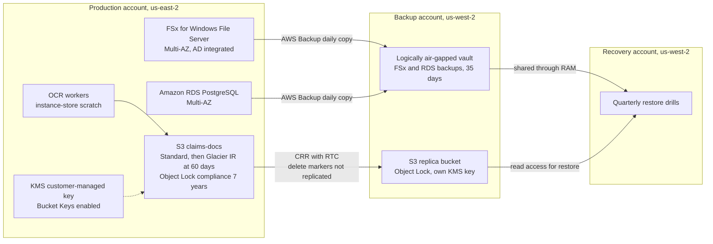

The diagram shows three accounts with distinct jobs. Production holds the live data and a customer-managed key. The backup account in a second US Region holds the replica bucket and the logically air-gapped vault, each protected by retention locks and its own keys. The recovery account exists only for drills and real restores, so a restore never depends on production credentials.

### 17.2 Decisions and rejected alternatives

1. **Documents in S3 with explicit lifecycle to Glacier Instant Retrieval at 60 days.** Appeals need one-minute access, which rules out Glacier Flexible Retrieval and Deep Archive (hours of restore time). Intelligent-Tiering was rejected because the access pattern is known and age-driven, and explicit rules give a predictable bill. Objects under 128 KB stay in Standard, which matches S3's default lifecycle behavior. At illustrative prices of $0.023 per GB-month for Standard and $0.004 for Glacier Instant Retrieval, about 30 TB in Standard and 370 TB in Glacier Instant Retrieval cost roughly $690 + $1,480 = $2,170 a month, against $9,200 a month for all 400 TB in Standard, before request and retrieval charges.
2. **Object Lock in compliance mode for seven years.** It was first deployed in governance mode for 30 days while the team verified that lifecycle, replication, and the application worked with locked versions, then switched to compliance mode by changing the bucket default. Rejected: relying on IAM deny policies alone, because a compromised administrator could change them.
3. **CRR with Replication Time Control to a bucket in the backup account in a second US Region.** This provides the 15-minute regional RPO with measurable evidence and puts the replica in a separate administrative boundary. Delete marker replication is off, and the replica bucket has its own Object Lock default. Rejected: S3 Multi-Region Access Points for active-active access, because the application tolerates a configuration-driven failover within the 4-hour RTO, and active-active would add conflict handling for no business gain.
4. **OCR scratch on instance-store NVMe.** Temporary files are rebuildable from the source documents, and a lost worker means a retried job. EFS was rejected because the workload creates and deletes hundreds of thousands of small files per hour, which is metadata-heavy and would cost more and run slower.
5. **Adjuster share on FSx for Windows File Server, Multi-AZ.** It preserves SMB semantics, file locking, and Active Directory ACLs. Rejected: Amazon S3 File Gateway, because adjusters rely on locking and in-place edits that object-backed gateways do not handle in the same way.
6. **AWS Backup to a logically air-gapped vault** for FSx and RDS, with daily backups and 35-day retention, plus local-vault backups for fast everyday restores.
7. **Customer-managed KMS keys.** The production bucket uses a production key with Bucket Keys enabled to reduce KMS request volume. The replica uses a key in the backup account, and the replication role is granted decrypt on the source key and encrypt on the destination key.
8. **Access.** Account-level Block Public Access, ACLs disabled, one S3 access point per application, a bucket policy that denies non-TLS requests and requests outside the production VPC endpoint (with explicit exceptions for the replication and backup roles), and Service Control Policies in the backup account's organizational unit that deny deletion of buckets, vaults, and keys.

### 17.3 Validation evidence

- **Lifecycle model** replayed one year of access logs against current prices, using the actual object-size histogram rather than the average. Small objects were excluded from transition, and the model's projected bill came within 4 percent of the first three months' actual bill.
- **Replication:** over 30 days, RTC metrics showed p99 replication latency of 4 minutes, with no objects missing the 15-minute threshold.
- **Restore drills:** the first quarterly drill restored the FSx share from the air-gapped vault into the recovery account in 2 hours 10 minutes, but the first drill restoring replica documents failed. The recovery account's role had not been granted decrypt on the backup-account key. The fix was a key policy change, and the gap would have been invisible without the drill.
- **Compromise game day:** a red-team exercise with production administrator credentials confirmed `AccessDenied` on the replica bucket, the vault, and the backup-account key, and a CloudTrail-based alert fired 6 minutes after the first mass-delete call.
- **Quota check:** the recovery Region's quotas for FSx capacity, EBS storage, and RDS instances were raised to cover a full restore, with evidence attached to the disaster recovery plan.

### 17.4 Translation to other providers

On Azure the same reasoning leads to Blob Storage with version-level immutability (locked), lifecycle to the Cold tier rather than offline Archive (to meet the one-minute requirement), object replication with priority replication to an account in a separate subscription, Azure Files or Azure NetApp Files for the SMB share, and Azure Backup to a locked immutable vault guarded by a Resource Guard in another subscription. On Google Cloud it leads to a dual-region bucket with turbo replication and Bucket Lock, a separate locked bucket in another project as the independent copy, NetApp Volumes for SMB, and Backup and DR backup vaults with enforced retention. In each case, check residency: Azure's fixed paired region and Cloud Storage's multi-region geography must both stay inside the United States.

## 18. Common mistakes and anti-patterns

- **Treating replication as backup.** *Cause:* redundancy settings are visible and easy. *Consequence:* a deletion or ransomware encryption replicates to every copy within minutes.
- **Single-zone storage for irreplaceable data.** *Cause:* EBS volumes, LRS accounts, One Zone classes, and Basic file tiers are cheaper and are often the defaults. *Consequence:* a zone event causes downtime and, for some services, data loss, with the only recovery being the last snapshot.
- **Sizing volumes but not instances.** *Cause:* volume limits are on the volume's page and instance limits are on another. *Consequence:* the provisioned IOPS is never reached, and the team pays for performance it cannot use.
- **Relying on burst credits for sustained load.** *Cause:* gp2 and small Premium SSD tiers perform well in short tests. *Consequence:* performance falls to baseline hours into a batch job or an incident.
- **Archiving without modeling requests, overhead, and minimum durations.** *Cause:* per-GB price comparisons. *Consequence:* transition and overhead charges exceed savings for small objects, and early deletions bill months that were never used.
- **Putting data needed for incident response in offline archive tiers.** *Cause:* lifecycle rules written for cost alone. *Consequence:* an investigation waits 12 to 48 hours for logs.
- **Versioning without noncurrent expiration.** *Cause:* versioning enabled for safety and then forgotten. *Consequence:* storage grows several times beyond live data.
- **Backups in the same account, under the same administrators and keys.** *Cause:* the default vault is in the production account. *Consequence:* one compromised role deletes production and backup together.
- **Untested restores.** *Cause:* "job succeeded" is treated as evidence. *Consequence:* missing key grants, inconsistent multi-volume snapshots, or a restore that takes 20 hours instead of 4 are discovered during the real incident.
- **Customer-managed keys without key-loss planning.** *Cause:* customer-managed keys are adopted for compliance. *Consequence:* a disabled key or a missing cross-region key makes durable data unreadable during recovery.
- **Irreversible locks applied without rehearsal.** *Cause:* compliance urgency. *Consequence:* years of billed storage for data that should have expired, or WORM-locked personal data that conflicts with erasure obligations.
- **Account-key SAS tokens with long expiry.** *Cause:* convenience in scripts. *Consequence:* a leaked token grants access that can be revoked only by rotating the account key, which breaks every other consumer.
- **Sequential or hot keys at high request rates.** *Cause:* timestamp-first key names or a single shared configuration object. *Consequence:* throttling while overall capacity is idle.
- **Shared file systems used as databases or queues.** *Cause:* easy for applications that already use files. *Consequence:* corruption under concurrent access, lock expiry bugs, and metadata bottlenecks.

## 19. Design-review checklist

### 19.1 Model and performance

- Does each data set use the interface its software requires, with databases on database services?
- Are IOPS, throughput, I/O size, request rates, and latency percentiles measured, and checked against both volume and instance (or VM, or machine-type) limits?
- Do sustained workloads avoid depending on burst credits?
- Are object keys and client concurrency designed for request-rate partitioning, with backoff on throttling?

### 19.2 Failure scope and recovery

- Is the redundancy scope (zone, region, multi-region) chosen from named failure scenarios, with RPO and RTO stated for each?
- For asynchronous replication, is lag measured, and is a time-bounded mode used where the RPO requires it?
- Is there an independent backup boundary with separate credentials, account, locked retention, keys, and location?
- Are snapshots application-consistent where needed, and multi-volume consistent for multi-volume applications?
- Has a restore been performed and validated within the last quarter, with duration and warm-up time recorded?

### 19.3 Lifecycle and cost

- Do lifecycle rules reflect measured access by age, object-size distribution, minimum durations, and RTO for archived data?
- Are noncurrent versions and incomplete multipart uploads expired?
- Are replication and egress costs modeled?

### 19.4 Security and location

- Are public-access guardrails enforced at the account, subscription, project, or organization level?
- Do delegated tokens (presigned URLs, SAS, signed URLs) have short expiry and a revocation path?
- For customer-managed keys, are deletion alerts, cross-region keys, and cross-account grants in place for every recovery path?
- Are all copies (replicas, snapshots, backups, logs, exports) inside the residency boundary?
- Are irreversible settings changed only through reviewed, two-person-approved infrastructure code?

### 19.5 Quotas and operations

- Do quotas cover peak scale-out and a full restore in the recovery region, with alerts at 80 percent?
- Are alerts in place for public-access changes, versioning suspension, lifecycle changes, retention reductions, key state changes, replication backlog, and missing backup copies?

## 20. Exercises

### 20.1 Interview questions

1. A colleague says a bucket with eleven nines of durability does not need backups. Explain what the figure covers, what it does not, and what you would add.
2. A database on a gp3 volume provisioned at 20,000 IOPS measures 9,000 IOPS under load. List the possible causes in the order you would investigate them, and the metric that confirms each.
3. Compare S3 Cross-Region Replication, Azure GRS, and a Cloud Storage dual-region bucket on who chooses the secondary, who fails over, and what bounds the RPO.
4. Why can moving small objects to an infrequent-access or archive class increase cost? Show the arithmetic for a 16 KB object.
5. What is the difference between a crash-consistent and an application-consistent snapshot, and when is crash-consistent sufficient?
6. Explain governance mode and compliance mode in S3 Object Lock and when you would use each.
7. Why is a user delegation SAS preferred over a service SAS, and how is each revoked?
8. A restore into a recovery account fails with access denied although the IAM role has full S3 permissions. What else do you check?

### 20.2 Design exercises

1. **Video surveillance archive.** 2,000 cameras each write 2 Mbps continuously. Footage is reviewed within 7 days in 1 percent of cases, must be retained 90 days, and must be tamper-evident. Calculate daily ingest (2,000 × 2 Mbps × 86,400 s / 8 ≈ 43.2 TB a day), choose services and classes on one provider, design immutability that expires exactly at 90 days, and explain why an archive class with a 180-day minimum is a poor fit.
2. **Zone-resilient self-managed database on each provider.** Design storage for a database with RPO zero for zone loss, using the cross-zone block options of section 16 or application replication. Explain why the AWS answer differs.
3. **Ransomware recovery plan.** For a 150 TB estate across volumes, buckets, and file shares, design the independent backup boundary, calculate restore time from measured throughput, and define the drill that proves the 24-hour RTO.
4. **Residency review.** A European customer requires all data to stay in the European Union. Review an Azure design using GRS and a Google Cloud design using a multi-region bucket, list every copy, and state what must change.

## 21. Summary

Cloud storage choices start with the interface. Block volumes give one host a device and leave the filesystem to the guest. File services run the filesystem and share it over NFS or SMB. Object stores trade POSIX semantics for scale, per-request policy, and lifecycle features. Within each family, the provider products differ in scope, performance model, and guarantees, and the names do not reveal the differences.

Durability and availability are separate properties. Eleven nines protects against the provider losing bytes, not against deletion, corruption, key loss, or compromise. Redundancy scope decides which infrastructure failures data survives, and asynchronous replication bounds data loss by measured lag unless a time-bounded mode provides an objective. Storage classes save money only when request charges, per-object overhead, minimum durations, and retrieval delays are modeled against the real object-size distribution and recovery time objective.

Recovery requires controls that infrastructure redundancy cannot provide: application-consistent snapshots, versioning and soft delete for mistakes, WORM retention for records and ransomware, and an independent backup boundary with separate credentials, accounts, locks, keys, and location. Keys, access policies, network paths, residency, and quotas are all dependencies of recovery. A restore test is the only evidence that the whole chain works.

## 22. Code examples

The examples use synthetic values and the Python standard library. They do not call cloud APIs or encode current provider prices.

- [Storage lifecycle cost estimator](../code/python/storage-chapter/01_lifecycle_cost.py) compares monthly storage plus retrieval cost across hot, cool, and archive tiers with normalized rates, showing how retrieval volume narrows the gap between tiers (section 7.4).
- [Backup retention policy checker](../code/python/storage-chapter/02_backup_retention.py) audits sample recovery points against a minimum retention age and flags retained points that are still mutable (section 9.5).
- [Replication lag and recovery-point simulator](../code/python/storage-chapter/03_replication_rpo.py) estimates a conservative RPO from replication lag plus detection delay, and the number of writes at risk at a given write rate (section 6.5).
- [Block-storage throughput estimator](../code/python/storage-chapter/04_volume_performance.py) computes the throughput ceiling implied by an IOPS figure and I/O size, clipped by a throughput cap (section 3.6).
