# Chapter: Cloud Container Services: Registries, Managed Runtimes, and Task Platforms

Part: [09 — Cloud Computing](PART_OVERVIEW.md) · Status: Revised (in-depth rewrite)

## 1. Introduction

A container image is a file format. A cloud container service is a set of contracts wrapped around that file: where it is stored, who may read it, how it travels to a host, how the provider starts it, what network address and cloud identity it receives, how many copies run, and what happens when a new version misbehaves. Most production incidents involving containers in the cloud are failures of these contracts, not of the container primitive. A task that cannot pull its image because a token expired, a revision that scales into a subnet with no free Internet Protocol (IP) addresses, or a lifecycle policy that deleted the only rollback image all happen to images that would run perfectly on a laptop.

This chapter teaches the provider side of that picture across Amazon Web Services (AWS), Microsoft Azure, and Google Cloud Platform (GCP). After working through it you should be able to:

- Explain how Amazon Elastic Container Registry (ECR), Azure Container Registry (ACR), and Google Cloud Artifact Registry store, protect, retain, replicate, and serve images, and design a registry layout that survives a regional outage and a bad deletion.
- Trace the build, push, and pull path, estimate how image size and layer reuse affect startup and scale-out time, and choose the optimization that addresses the actual bottleneck.
- Promote an immutable image digest from test to production with provenance evidence attached, and say where each provider can enforce that evidence at deploy time.
- Place a workload on the managed container execution spectrum (Amazon Elastic Container Service (ECS) on Amazon Elastic Compute Cloud (EC2), ECS on AWS Fargate, Azure Container Instances (ACI), Azure Container Apps, Google Cloud Run, and managed Kubernetes) using explicit criteria rather than habit.
- Configure task and revision networking, identity, and storage correctly for each service, including the distinction between an ECS task role and a task execution role.
- Design scaling, placement, health gates, and rollback using the provider's own mechanisms: ECS service auto scaling and the deployment circuit breaker, Kubernetes Event-driven Autoscaling (KEDA) rules in Container Apps, Cloud Run concurrency and minimum instances, and revision traffic splitting.
- State, for each service, which responsibilities the provider holds and which remain with the application team, and check the quotas and pricing dimensions that constrain the design.

### 1.1 Scope and ownership boundaries

The chapter owns cloud registry lifecycle, identity, retention, and replication; digest-based promotion and artifact-to-source provenance as a registry contract; selection among managed task, container application, and cluster services; provider deployment health gates and rollback; and registry availability as a workload recovery dependency. Several adjacent subjects belong to other chapters and are recapped here only as far as the provider decisions need them:

- **Container runtime and operating-system isolation.** Namespaces, control groups (cgroups), union filesystems, image layer construction, the Open Container Initiative (OCI) specifications, and the shared-kernel security limitation are taught in [Virtualization and Container Fundamentals](../05_Networking_and_OS/CH28_Virtualization_and_Container_Fundamentals.md). This chapter assumes you know that an image is a manifest plus content-addressed layers and that a container shares the host kernel unless the provider wraps it in a micro virtual machine (microVM) or sandbox.
- **Kubernetes APIs.** Pods, Deployments, Services, and the Horizontal Pod Autoscaler belong to [Part 12 Kubernetes](../12_Kubernetes/PART_OVERVIEW.md). Provider-managed Kubernetes (Amazon Elastic Kubernetes Service (EKS), Azure Kubernetes Service (AKS), Google Kubernetes Engine (GKE)) is the far end of the spectrum taught here; its control-plane and node responsibilities are in [Kubernetes (cloud-managed)](CH08_Kubernetes.md).
- **Deployment tooling.** Pipelines, GitOps controllers, and the general theory of canary and blue/green release are owned by Part 13, in particular [continuous integration and continuous delivery (CI/CD)](../13_DevOps/CH02_CI_CD.md), [Progressive Delivery](../13_DevOps/CH13_Progressive_Delivery.md), [Blue-Green Deployment](../13_DevOps/CH15_Blue_Green_Deployment.md), and [Canary Deployment](../13_DevOps/CH16_Canary_Deployment.md). This chapter teaches the provider mechanisms those tools drive.
- **Supply-chain threat model.** Attack classes against builds and dependencies, Software Bill of Materials (SBOM) practice, and container hardening are owned by [Supply Chain Security](../15_Security/CH15_Supply_Chain_Security.md), [SBOM](../15_Security/CH16_SBOM.md), and [Container Security](../15_Security/CH14_Container_Security.md). This chapter covers where provenance is stored, how registries and runtimes expose it, and where it can be enforced.
- **Function execution.** Event-triggered functions and the function-versus-container decision are in [Serverless](CH11_Serverless.md). Cloud Run appears here because it runs containers, and the serverless chapter links back for container-specific mechanics.
- **Generic autoscaling and identity.** The autoscaling feedback loop is owned by [Compute](CH04_Compute.md); workload identity federation and policy evaluation are owned by [Identity and Access Management (IAM)](CH09_IAM.md). This chapter applies both to containers.

### 1.2 A note on provider facts

Container services change faster than most cloud products. During the writing of this chapter AWS closed AWS App Runner to new customers and introduced Amazon ECS Express Mode, Amazon ECS gained native blue/green, linear, and canary deployments, and ACR announced the retirement of Docker Content Trust. Numbers quoted below are given "at the time of writing" with a link to the official page; verify current quotas and features before you commit a design to them. Where a mechanism matters more than a number, the chapter describes the mechanism and tells you where the limit is published.

## 2. The foundational model: four contracts around an image

Every managed container platform, from a single ACI container group to a 2,000-node GKE cluster, implements the same four contracts. Naming them separately is the most useful habit an architect can build, because each contract has a different owner, a different failure mode, and a different provider-specific shape.

1. **The artifact contract.** An image is identified by a digest, a Secure Hash Algorithm 256-bit (SHA-256) hash of its manifest. The digest never changes for the same content. Tags are names that point at digests and may move. The artifact contract says which digest is approved to run where, and what evidence (source revision, builder identity, scan result, signature) travels with it.
2. **The distribution contract.** A registry stores the manifest and layers and serves them to authorized callers over Hypertext Transfer Protocol Secure (HTTPS) using the OCI Distribution application programming interface (API). The distribution contract covers authentication, authorization, network path, regional placement, replication, caching, throttling, and retention.
3. **The execution contract.** A runtime service turns a declarative description (an ECS task definition, a Container Apps revision template, a Cloud Run revision) into running processes on capacity the provider or the customer owns. It covers central processing unit (CPU) and memory shape, network attachment, cloud identity, storage, secrets injection, logging, and health checks.
4. **The fleet contract.** A controller keeps the right number of healthy copies running, spreads them across failure domains, scales them with demand, and replaces them when a new version is deployed. It covers desired count, scaling rules, placement, deployment strategy, health gates, and rollback.

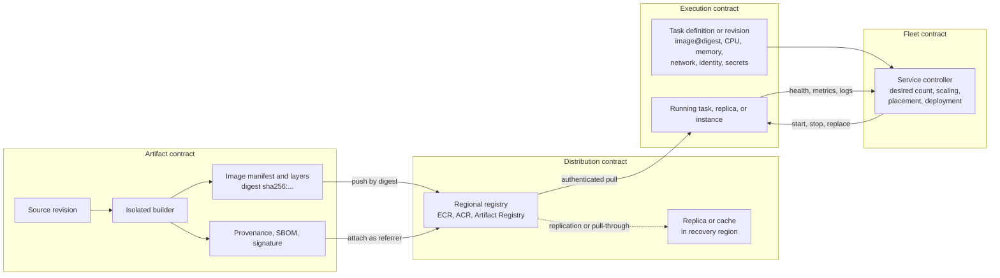

The diagram shows the image build-to-registry-to-runtime path as a chain of four ownership zones. Read it from left to right and ask, at every arrow, "who can break this, and how would we know?" The push arrow fails when the build identity lacks write permission or the tag is immutable and already used. The pull arrow fails on expired tokens, missing private endpoints, deleted images, throttling, or an outage in the registry's region. The controller arrows fail when quotas, IP addresses, or capacity run out, or when health checks report a broken release. Each later section of the chapter takes one of these zones and opens it up.

Two consequences follow immediately. First, "we use containers" says nothing about availability or security, because the artifact contract can be perfect while the distribution contract has a single regional dependency. Second, the boundary between provider and customer moves along this chain as you move along the execution spectrum. With ECS on EC2 you own the hosts that pull images; with Fargate AWS owns them; with Cloud Run Google even owns the copy of the image used at startup. Section 15 maps the boundary in detail.

### 2.1 What the container primitive does and does not give you

Recap from [Virtualization and Container Fundamentals](../05_Networking_and_OS/CH28_Virtualization_and_Container_Fundamentals.md): a container is a process tree confined by kernel namespaces and cgroups, with a root filesystem assembled from read-only image layers plus a writable layer. Because all containers on a host share one kernel, multi-tenant providers place each customer workload inside an additional boundary. Fargate runs each task in its own isolation boundary that does not share kernel, CPU, memory, or network interface with other tasks; Cloud Run's second-generation execution environment and ACI also wrap containers in virtual machine (VM)-grade sandboxes. The details differ by service and are documented as security properties of the service, not of the container format.

What the primitive does not give you is everything in the four contracts: no registry, no identity, no IP address on your virtual network, no autoscaling, no rollback. Those are provider features with provider-specific semantics, which is why the same image can be secure and resilient on one platform and fragile on another.

### 2.2 Control plane and data plane for containers

The control-plane and data-plane distinction (owned by [AWS](CH01_AWS.md) and recapped here) applies sharply to containers. Creating a repository, registering a task definition, updating a Container Apps revision, or deploying a Cloud Run service are control-plane calls to a regional management API. Pulling an image, serving a request through the service's ingress, and a task calling Amazon Simple Storage Service (S3) are data-plane operations.

The distinction matters for recovery. Most running containers keep serving if the control plane is impaired, but you cannot deploy a fix, scale out, or replace failed tasks until it returns. A design that relies on "we will redeploy in the other region" during an incident is betting on the other region's control plane, its registry data plane, and its quota all being ready at the same moment.

## 3. Container registries: object model and provider services

### 3.1 The registry object model

All three provider registries implement the OCI Distribution Specification, so they share an object model even though their resource hierarchies differ.

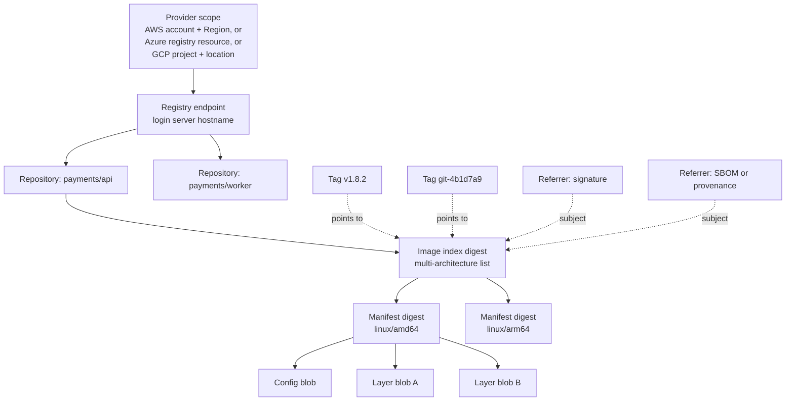

The hierarchy diagram shows the pieces you configure policy on. A **repository** is a named collection of manifests and the unit at which most permissions, scanning settings, tag mutability, and lifecycle rules apply. A **manifest** lists a config blob and an ordered set of layer blobs, each referenced by digest. An **image index** (sometimes called a manifest list) points at several manifests for different CPU architectures; the runtime picks the one that matches its platform. A **tag** is a mutable pointer from a human-readable name to a manifest or index digest. A **referrer** is an artifact, such as a signature, an SBOM, or a provenance attestation, whose manifest declares another manifest as its `subject`; registries that support the OCI referrers API let a client ask "what is attached to this digest?" without naming conventions.

Three properties of this model drive most registry design decisions:

- **Blobs are deduplicated by digest within a registry.** Two images that share a base layer store it once. Pushes of a layer that already exists are skipped. This is why a fleet of services built on one base image costs far less to store and pull than the sum of their reported sizes.
- **Deleting a tag is not deleting an image.** Untagging leaves an "untagged" or "dangling" manifest that still consumes storage and is still pullable by digest until a retention rule or an explicit delete removes it. Conversely, deleting a manifest by digest removes it for every tag that pointed to it.
- **The digest a deployment pins is the index digest or the platform manifest digest.** Pinning the index lets the runtime choose an architecture; pinning a platform manifest freezes it. Either is immutable, but retention rules must preserve whichever one deployments reference, plus the manifests and blobs it needs.

### 3.2 Provider registry services and their scopes

The three registries look alike at the API level. Their resource scopes, which decide blast radius, replication, and permission design, are different.

| Property | Amazon ECR (private) | Azure Container Registry | Google Artifact Registry |
| --- | --- | --- | --- |
| Top-level scope | One private registry per AWS account per Region, addressed as `<account>.dkr.ecr.<region>.amazonaws.com` | A registry is an Azure resource in a resource group with its own login server `<name>.azurecr.io`; one registry can serve many regions through geo-replication | Repositories are resources in a project and a location (a region or a multi-region such as `us` or `europe`), addressed as `<location>-docker.pkg.dev/<project>/<repo>` |
| Tiering | Single service tier; pay for storage and transfer, scanning priced separately | Basic, Standard, Premium stock-keeping units (SKUs); Premium is required for geo-replication, private endpoints, and untagged-manifest retention ([ACR SKUs](https://learn.microsoft.com/en-us/azure/container-registry/container-registry-skus)) | Single tier; repository mode chosen at creation: standard, remote (proxy), or virtual (aggregation) |
| Formats | OCI images and OCI artifacts (Helm charts, signatures) | OCI images and artifacts | Docker/OCI plus language packages (Maven, npm, Python, and others) in format-specific repositories |
| Zonal redundancy | Regional service | Zone redundancy enabled by default in supported regions for all SKUs (at the time of writing) | Regional or multi-regional location |
| Repository creation | Explicit, or automatic through repository creation templates for pull-through cache and replication | Repositories are created implicitly on first push | Repository is created explicitly; image names inside it are created on push |

The ACR model deserves a closer look because it differs most. An ACR registry is a single named resource whose login server is global; geo-replication adds regional replicas behind the same name, and the service routes each client to the nearest healthy replica. ECR and Artifact Registry give you separate regional endpoints instead, so a cross-region design must tell each runtime which endpoint to use. Neither approach is better in general. ACR's single name simplifies configuration but makes the replica topology an invisible dependency; ECR and Artifact Registry make the regional dependency explicit in every image reference, which is easier to audit and harder to forget during recovery.

### 3.3 Tags, digests, and immutability

A tag is a convenience for humans and pipelines. A digest is what you deploy. The difference is not academic: if a deployment references `orders-api:1.8` and someone pushes a different image with the same tag, two replicas started an hour apart can run different code, and rollback to "1.8" may not restore what was running.

Each provider offers a tag-mutability control at the repository level:

- **ECR** repositories default to `MUTABLE`. Setting `IMMUTABLE` makes ECR reject a push that would move an existing tag with `ImageTagAlreadyExistsException` ([ECR tag mutability](https://docs.aws.amazon.com/AmazonECR/latest/userguide/repository-edit.html)). Since 2025 ECR also supports exclusion filters, so a repository can make release tags immutable while letting a tag such as `latest` or `dev-*` move.
- **ACR** has no repository-wide immutable-tag mode in the same form; instead it lets you lock individual images or whole repositories by setting `write-enabled` to `false` (and `delete-enabled` to `false`) with `az acr repository update`. A locked tag cannot be overwritten or deleted. Pipelines typically lock each release tag immediately after push.
- **Artifact Registry** offers an "immutable image tags" setting on Docker repositories; once enabled, a tag that points to a digest cannot be moved or deleted ([Artifact Registry repository settings](https://docs.cloud.google.com/artifact-registry/docs/repositories/update-repo-settings)).

Tag immutability protects against accidental or malicious retagging. It does not make deployments reference digests, and a mutable deployment reference still undermines traceability. Two of the runtimes help here. ECS, since mid-2024, resolves the tag in a task definition to a digest when a service deployment starts and launches every task in that deployment with the same digest ([ECS software version consistency](https://aws.amazon.com/blogs/containers/announcing-software-version-consistency-for-amazon-ecs-services/)). Cloud Run resolves a tag to a digest at deploy time and each revision serves only that digest. Both behaviours give you consistency inside one deployment, but the audit record still needs the digest written down, because the task definition or deploy command may only show the tag. Container Apps creates a revision from the image reference you supply; pin by digest in the revision template so the revision is self-describing.

A practical tagging scheme that works on all three registries:

- `git-<short-sha>` for every build, immutable, created by the build identity.
- `v<semver>` for releases, immutable, created by the release step.
- Optional moving tags such as `main` or `staging-current` for humans and dashboards, excluded from immutability, never used by production deployments.
- Deployment manifests reference `repository@sha256:<digest>`; the tag is recorded as metadata.

The code example [01_digest_promotion.py](../code/python/containers-chapter/01_digest_promotion.py) encodes the two simplest rules from this list: a deployment reference must be a `sha256:` digest, and `latest` is never promotable.

### 3.4 Lifecycle and retention policies

Registries grow without bound if nothing removes images. Every build pushes a new manifest, and many builds push a new top layer. Retention rules exist to control storage cost and scanning noise, and they are the most common cause of self-inflicted image-pull outages. The design principle is simple to state: **a retention rule must never delete a digest that a running or rollback-eligible deployment references.** Making it true requires knowing how each provider's rules evaluate.

**ECR lifecycle policies** are JavaScript Object Notation (JSON) documents attached to a repository. Each rule has a priority, a selection (tag status `tagged`, `untagged`, or `any`, optional tag prefix or wildcard patterns, and a count type of `imageCountMoreThan` or `sinceImagePushed`), and an action of `expire`. Rules are evaluated in priority order, and an image is matched by at most one rule; lower-numbered rules claim images first. A typical policy:

```json
{
  "rules": [
    {
      "rulePriority": 1,
      "description": "Keep the 30 most recent release images",
      "selection": {
        "tagStatus": "tagged",
        "tagPatternList": ["v*"],
        "countType": "imageCountMoreThan",
        "countNumber": 30
      },
      "action": { "type": "expire" }
    },
    {
      "rulePriority": 2,
      "description": "Expire untagged images after 14 days",
      "selection": {
        "tagStatus": "untagged",
        "countType": "sinceImagePushed",
        "countUnit": "days",
        "countNumber": 14
      },
      "action": { "type": "expire" }
    }
  ]
}
```

The policy keeps release history by count and removes build leftovers by age. Its weakness is that "the 30 most recent" says nothing about what is deployed. If a hotfix branch produces 30 release tags in a week, an older digest still running in a low-traffic region falls off the end. ECR provides a lifecycle policy preview that shows which images a policy would expire; run it in the pipeline that changes the policy.

**ACR** offers a retention policy for untagged manifests (Premium only) that deletes untagged manifests after a configured number of days, and the `acr purge` command, usually run as a scheduled ACR Task, that deletes tags and manifests older than a duration and matching a filter. Locked images (write or delete disabled) are skipped by purge, which gives a direct way to protect release images: lock on release, purge everything else. ACR also offers soft delete in some configurations; check its current status before relying on it.

**Artifact Registry cleanup policies** are repository-level rules of two kinds: delete rules (by tag state, tag prefix, version name prefix, package prefix, or age) and keep rules (by the same conditions or "most recent N versions"). Keep rules take precedence over delete rules, which is the safer evaluation order: you express what must survive and let everything else age out. Policies can run in dry-run mode first, recording what would be deleted.

```json
[
  {
    "name": "keep-releases",
    "action": { "type": "Keep" },
    "condition": { "tagState": "tagged", "tagPrefixes": ["v"] }
  },
  {
    "name": "keep-recent-builds",
    "action": { "type": "Keep" },
    "mostRecentVersions": { "keepCount": 20 }
  },
  {
    "name": "delete-old-untagged",
    "action": { "type": "Delete" },
    "condition": { "tagState": "untagged", "olderThan": "1209600s" }
  }
]
```

None of the three providers knows what your deployments reference. The reliable pattern is to make "deployed" visible to the registry: when a release reaches an environment, the release controller adds a protected marker (an immutable tag such as `deployed-prod-2026-03-14`, an ACR lock, or an Artifact Registry keep-rule prefix) and removes it only when that digest has been out of every rollback window for a defined period.

#### Worked example: retention, storage, and rollback window

A platform team runs 40 services. Each service builds about 25 times per working day, 21 working days per month. A typical image is 380 MB compressed, but because all services share a 300 MB base layer stack, each build adds about 80 MB of new layer data. Release tags are cut about 3 times per service per week.

- Monthly new layer data before cleanup: 40 × 25 × 21 × 80 MB = 1,680,000 MB, about 1.68 TB.
- Without retention, after one year the registry holds about 20 TB of mostly unreachable build layers.
- With "untagged older than 14 days deleted" and "keep 30 releases": build data retained ≈ 40 × 25 × 10 working days × 80 MB = 800 GB; release data ≈ 40 × 30 × 80 MB = 96 GB; shared base layers a few GB. Total about 0.9 TB.

The rollback requirement is "any digest deployed to production in the last 30 days must remain pullable." At 3 releases per week, 30 days is about 13 releases per service, comfortably inside the 30-release window, so the count rule is safe under normal cadence. The risk case is a burst: if one service ships 20 releases during an incident week, its 30-release window shrinks to under three weeks. The deployed-marker pattern removes the dependency on cadence. Storage cost at a hypothetical USD 0.10 per GB-month drops from roughly USD 2,000 per month at the end of year one to about USD 90; the reason to do this carefully is not the money but the fact that the same rule that saves the money can delete a rollback target.

### 3.5 Vulnerability scanning

Each registry integrates an image scanner that inventories operating-system and language packages in image layers and matches them against vulnerability databases.

- **ECR** offers basic scanning (on push or manual, using an AWS-native database for operating-system packages) and enhanced scanning through Amazon Inspector, which scans operating-system and programming-language packages, rescans continuously as new vulnerabilities are published, and reports findings to Inspector and Amazon EventBridge. Enhanced scanning is configured at the registry level with repository filters and has a configurable rescan duration after which images that have not been pushed or pulled stop being rescanned.
- **ACR** relies on Microsoft Defender for Containers (part of Microsoft Defender for Cloud) for vulnerability assessment of registry images, including rescans of recently pulled images, with findings surfaced in Defender for Cloud.
- **Artifact Registry** integrates with Artifact Analysis. When the Container Scanning API is enabled, Artifact Analysis scans each new image pushed to the project and continues to analyse recently used images as new vulnerability data arrives ([container scanning overview](https://cloud.google.com/artifact-analysis/docs/container-scanning-overview)). Remote-repository cached images can also be scanned.

Two architectural points matter more than the product names. First, a scan result describes the image at a point in time against a database at a point in time. An image that passed yesterday can fail today without changing, which is why continuous rescanning exists and why "scan passed" in a provenance record must carry a timestamp and database version. Second, a scanner reports packages it can identify. A statically linked binary, a vendored dependency, or a package installed by `curl` in a build step may be invisible. Scanning is evidence to combine with base-image policy, rebuild cadence, and runtime controls, not proof of safety. The threat-model reasoning belongs to [Container Security](../15_Security/CH14_Container_Security.md).

Operationally, a scan finding has to go somewhere. A useful pattern routes critical findings on images that are currently deployed (not every image in the registry) to the owning team's queue, with a rebuild-and-redeploy expectation measured in days. Scanning every historical build and alerting on all of them produces noise that teams learn to ignore.

## 4. Registry access: authentication, authorization, and private paths

### 4.1 The two-hop token model

Container clients speak the OCI Distribution API, which uses Hypertext Transfer Protocol (HTTP) bearer tokens obtained through a registry-specific login. None of the three cloud registries accepts a cloud identity token directly on every layer request. Instead, the caller exchanges a cloud credential for a registry credential, and the registry credential is what the container runtime presents. The lifetimes of those registry credentials are short and differ by provider, which is why "authentication required" errors often appear hours after a job started successfully.

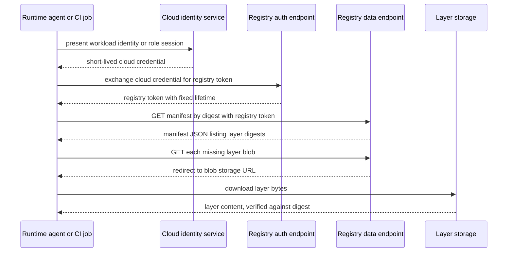

The sequence shows the pull path that every runtime follows, whether the runtime is a Fargate agent, the ECS agent on an EC2 instance, a Container Apps replica host, or a developer laptop. Three details explain most pull failures:

- **Token lifetime.** An ECR authorization token from `GetAuthorizationToken` is valid for 12 hours and grants access to any ECR registry the principal can reach ([ECR registry authentication](https://docs.aws.amazon.com/AmazonECR/latest/userguide/registry_auth.html)). An ACR login with a Microsoft Entra ID identity produces a registry refresh token that must be renewed every 3 hours ([ACR authentication](https://learn.microsoft.com/en-us/azure/container-registry/container-registry-authentication)). Artifact Registry accepts a Google OAuth 2.0 access token, which is valid for 60 minutes, or a credential helper that refreshes it. Managed runtimes refresh tokens for you. Self-managed hosts, CI runners, and long jobs that pull late in their run must use a credential helper (`docker-credential-ecr-login`, `az acr login` on a schedule, or `gcloud auth configure-docker`) rather than a one-time `docker login`.
- **The layer redirect.** ECR stores layers in Amazon S3 and redirects layer downloads there. A private subnet with interface endpoints for the ECR API and Docker endpoints but no S3 gateway endpoint can fetch manifests and then fail on every layer. ACR Premium can use dedicated data endpoints so firewall rules can allow a registry-specific hostname instead of a broad storage wildcard.
- **Verification is local.** The client verifies each blob against its digest. A corrupted or tampered layer fails verification on the client, not on the server, which is the property that makes digest pinning meaningful.

### 4.2 Authorization models

**ECR** combines identity-based policies (attached to the IAM role making the call) with optional repository policies (resource-based policies attached to a repository). Pulling requires `ecr:GetAuthorizationToken` on `*` plus `ecr:BatchGetImage` and `ecr:GetDownloadUrlForLayer` on the repository; pushing adds `ecr:InitiateLayerUpload`, `ecr:UploadLayerPart`, `ecr:CompleteLayerUpload`, `ecr:PutImage`, and `ecr:BatchCheckLayerAvailability`. Cross-account pulls need both sides: the repository policy must grant the other account's principal, and that principal's own policy must allow the actions. Organizational guardrails such as service control policies can additionally deny pulls from outside the organization using condition keys. Policy evaluation order is owned by [IAM](CH09_IAM.md).

A repository policy that lets a production account pull, and only pull, looks like this:

```json
{
  "Version": "2012-10-17",
  "Statement": [
    {
      "Sid": "ProdAccountPullOnly",
      "Effect": "Allow",
      "Principal": { "AWS": "arn:aws:iam::222222222222:root" },
      "Action": [
        "ecr:BatchGetImage",
        "ecr:GetDownloadUrlForLayer",
        "ecr:BatchCheckLayerAvailability"
      ]
    }
  ]
}
```

Granting the account root delegates the decision to the production account's own IAM policies. That is usually right for a shared artifact account, because the production account decides which of its roles (typically only ECS task execution roles) receive pull permission.

**ACR** authorization uses Azure role-based access control (RBAC) with built-in roles such as AcrPull, AcrPush, and AcrDelete at registry scope, and, for registries configured for it, repository-scoped permissions using Microsoft Entra role assignments with attribute-based conditions. Non-Entra tokens with scope maps give repository-level credentials for systems that cannot use Entra ID, with SKU-dependent limits on the number of tokens (for example 50,000 on Premium at the time of writing). The registry also has an optional admin user with two shared passwords; disable it in production because every caller using it shares one identity for both audit and throttling purposes.

**Artifact Registry** uses Google Cloud IAM with roles such as `roles/artifactregistry.reader`, `writer`, and `repoAdmin`, grantable at project or repository level. Repository-level grants are the norm for production: the Cloud Run service agent or the GKE node service account receives `reader` on exactly the repositories it deploys from. Virtual Private Cloud (VPC) Service Controls can place Artifact Registry inside a service perimeter so that images cannot be pulled from, or pushed to, outside approved networks and projects.

Across all three, the authorization design should separate four principals: the **build identity** (push to build repositories), the **promotion identity** (copy or tag into release repositories), the **runtime pull identity** (read release repositories), and **human administrators** (break-glass only). Runtime identities should never hold push or delete permissions. If a compromised container can push to the repository it was started from, it can replace the image that its own replacements will pull.

### 4.3 Private network paths

A registry is a public endpoint by default. Keeping image pulls off the internet is both a security control and an availability control, because it removes Network Address Translation (NAT) gateways and internet egress from the pull path.

- **ECR** supports AWS PrivateLink interface endpoints for the API (`com.amazonaws.<region>.ecr.api`) and the Docker registry (`com.amazonaws.<region>.ecr.dkr`), plus an S3 gateway endpoint for layer downloads ([ECR interface endpoints](https://docs.aws.amazon.com/AmazonECR/latest/userguide/vpc-endpoints.html)). Fargate tasks in private subnets also need endpoints for Amazon CloudWatch Logs if they use the `awslogs` driver and for AWS Secrets Manager or AWS Systems Manager if they inject secrets. Endpoint policies can restrict which repositories are reachable through the endpoint.
- **ACR** Premium supports Private Link with private endpoints (up to 200 per registry at the time of writing), public network access can be disabled, and dedicated data endpoints give each replica region a predictable hostname for firewall rules. Basic and Standard SKUs cannot use private endpoints, so a design that requires private pulls has already chosen Premium.
- **Artifact Registry** is reached through Private Google Access from subnets without external IP addresses, or through Private Service Connect endpoints for Google APIs. VPC Service Controls add the data-exfiltration perimeter described above. Cloud Run and other Google-managed runtimes pull through Google's network and are governed by the perimeter rather than by your subnet routes.

Private endpoints depend on the Domain Name System (DNS). The most common failure after enabling them is a resolver that still returns public addresses for the registry hostname, or a hub-and-spoke network where the private DNS zone is linked to the hub but not to the spoke that runs the workload. Endpoint and DNS design is owned by [Networking](CH05_Networking.md).

### 4.4 Throttling

Registries enforce request-rate limits. ACR publishes them per SKU: at the time of writing, Premium allows roughly 20,000 data-plane read requests per minute per registry and 10,000 per identity, while Basic and Standard allow half of that, with HTTP 429 and a `Retry-After` header on excess ([ACR SKUs](https://learn.microsoft.com/en-us/azure/container-registry/container-registry-skus)). Microsoft describes these as best-effort limits, not service-level agreement (SLA) commitments. ECR and Artifact Registry publish their own per-API quotas in Service Quotas and the Quotas page respectively.

Throttling shows up during mass restarts. Pulling one image costs one manifest request plus one request per missing layer, and an index adds another. A 1,000-replica scale-out of a 12-layer image from cold hosts is about 14,000 requests in a burst, close to a Basic or Standard ACR per-registry limit if all replicas start in the same minute. Mitigations include fewer and larger layers for stable content, pre-pulled or cached images on hosts, staggered rollouts, and higher SKUs.

## 5. Replication, caching, and the registry as a recovery dependency

### 5.1 When runtimes actually contact the registry

The registry is on a workload's critical path only at the moments the runtime pulls. Those moments differ sharply by service, and this single difference changes the disaster-recovery design more than any registry feature.

| Runtime | When the image is fetched | Consequence when the registry region is down |
| --- | --- | --- |
| ECS on Fargate | Every task start; Fargate does not reuse a host image cache across tasks | No new tasks: scale-out, replacement of failed tasks, and deployments all fail |
| ECS on EC2 | Task start, subject to the agent's pull behaviour (`ECS_IMAGE_PULL_BEHAVIOR` can prefer a cached image on the instance) | Tasks can start on instances that already cached the digest; new instances cannot |
| Azure Container Instances | Each container group creation | New container groups fail |
| Azure Container Apps | Replica creation from the revision's image reference | Scale-out and replica replacement fail; running replicas continue |
| Cloud Run | At deployment; Cloud Run imports the image and keeps its own copy while a serving revision uses it, and does not pull from the repository on instance start ([Cloud Run deploying](https://cloud.google.com/run/docs/deploying)) | Existing revisions keep scaling; new deployments from that repository fail |
| Managed Kubernetes nodes | Pod start on a node that lacks the image, per pull policy | New nodes and nodes without the cached image cannot start the pod |

The table is why "the registry is down" means different things to different teams. A Cloud Run service can absorb a traffic spike during an Artifact Registry regional outage; an ECS on Fargate service cannot add a single task. An architect choosing Fargate for a service with a strict recovery time objective (RTO) has to treat the registry as part of the serving path and replicate accordingly.

### 5.2 Replication models

**ECR replication** is configured once per registry (per account and Region) with rules that name destination Regions and, optionally, destination accounts, and filters by repository prefix. Images pushed after replication is configured are copied asynchronously to each destination; images that existed before are not copied retroactively, so enabling replication during an incident does not help. Destination repositories are created automatically using repository creation templates, which also decide their tag mutability, encryption, and lifecycle policy. Lifecycle rules are not synchronized across Regions: a policy in the destination can delete an image the source still holds, and vice versa. Cross-account replication requires a registry permissions policy in the destination account.

**ACR geo-replication** (Premium) turns one registry into a multi-primary set of regional replicas. A push to any replica is replicated to the others asynchronously; clients reach the nearest replica through the global login server. Webhooks can fire per region when an image becomes available in that replica, which matters for deploy pipelines that must not start a regional deployment before the image has arrived there. Because the login server is shared, regional routing and failover are handled by the service; but a replica that is not yet synchronized can return "manifest unknown" for a just-pushed tag, a classic race in multi-region deploys.

**Artifact Registry** achieves geographic redundancy primarily through location choice. A repository in a multi-region location (`us`, `europe`, `asia`) stores data redundantly across regions within that geography; a regional repository stays in one region. Copying images between repositories in different locations or projects is a pipeline responsibility, performed with tools that copy by digest (for example `gcrane cp` or `crane copy`) so that the digest is preserved. Because Cloud Run imports images at deploy time, the recovery question for a Cloud Run-only estate is mostly "can we deploy in the recovery region?" rather than "can running services scale?"

### 5.3 Pull-through caches and proxy repositories

A pull-through cache presents an upstream registry (Docker Hub, GitHub Container Registry, Quay, another cloud registry) under your own registry's name. The first pull fetches from upstream and stores a copy; later pulls are served locally.

- **ECR pull-through cache rules** map a repository prefix in your registry to an upstream such as ECR Public, Docker Hub, Quay, the Kubernetes registry, GitHub Container Registry, GitLab, ACR, or another private ECR registry (ECR-to-ECR, added in 2025 for cross-Region and cross-account synchronization) ([ECR pull through cache](https://docs.aws.amazon.com/AmazonECR/latest/userguide/pull-through-cache.html)). Credentials for authenticated upstreams are stored in Secrets Manager. ECR periodically refreshes cached tags from the upstream.
- **ACR artifact cache** (Standard and Premium at the time of writing) uses cache rules that map a local repository path to an upstream repository, with credentials held in Azure Key Vault or, for ACR upstreams, a user-assigned managed identity ([ACR artifact cache](https://learn.microsoft.com/en-us/azure/container-registry/artifact-cache-overview)).
- **Artifact Registry remote repositories** proxy an upstream for a given format and cache what is fetched; **virtual repositories** present a single endpoint over several standard and remote repositories with a priority order ([remote repositories](https://cloud.google.com/artifact-registry/docs/repositories/remote-overview)).

Pull-through caching solves three problems: public rate limits (Docker Hub limits anonymous and free-tier pulls), upstream outages, and network egress from private subnets. It introduces two risks. A mutable upstream tag can change between cache refreshes, so production images should still be built from base images pinned by digest. And the cache is not an archive: lifecycle rules, refresh behaviour, or upstream deletion can remove what you thought you had. For base images that production builds depend on, copy them into a curated repository you own, scan them, and treat the copy as the source of truth.

### 5.4 The registry as a failure domain

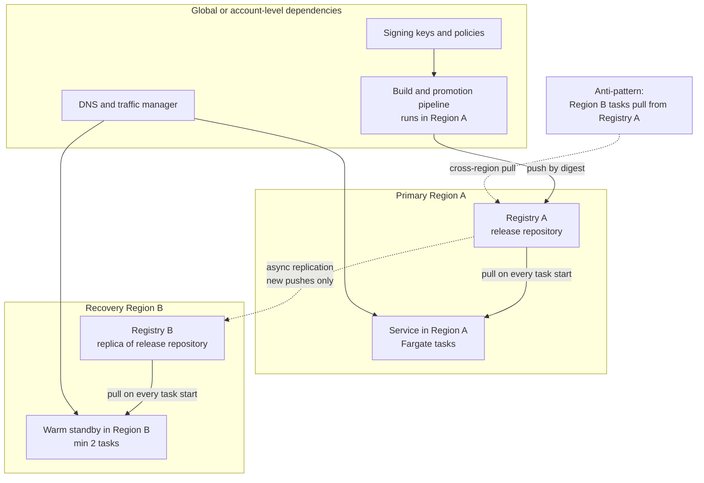

The failure-domain map shows what fails together. If Region A is lost, Registry A, Service A, and the pipeline that runs in Region A fail together. The recovery service in Region B survives only if it pulls from Registry B; the dashed anti-pattern line, a recovery task definition that still references the Region A registry hostname, is the most common hidden coupling in container disaster recovery. The map also shows that the build pipeline and signing infrastructure are recovery dependencies: if you cannot build or sign in Region B, you can run what was replicated but not ship a fix.

#### Worked scenario: regional registry outage during a traffic peak

An e-commerce checkout API runs on ECS on Fargate in two Regions, active-passive. Region A normally runs 24 tasks; Region B runs a warm standby of 4 tasks. The RTO is 15 minutes, the recovery point objective (RPO) for the image itself is zero (the deployed digest must be available in Region B), and Region B must reach 24 tasks within the RTO.

Inputs: image 410 MB compressed in 9 layers; Fargate task launch to healthy averages 75 seconds in the team's measurements, of which image pull is about 35 seconds; the service uses a target-tracking scaling policy on average CPU; Region B's Fargate On-Demand virtual CPU (vCPU) quota is 64 vCPU and each task uses 1 vCPU.

Timeline after Region A becomes unavailable at T0:

- T0 + 3 minutes: health checks fail, DNS failover shifts traffic to Region B (failover detection time is a property of the traffic manager, owned by [Networking](CH05_Networking.md)).
- T0 + 4 minutes: Region B's target-tracking policy sees CPU at 400 percent of target and requests 24 tasks. Application Auto Scaling raises desired count; ECS launches 20 new tasks.
- T0 + 5 to 6 minutes: tasks pull from Registry B, become healthy. Assuming no throttling, all 24 are serving by about T0 + 6 minutes.

The design meets the RTO only because of three preconditions, each of which should be a test:

1. The digest deployed in Region A is present in Registry B. Verify by having the promotion pipeline wait for replication and then call `DescribeImages` in Region B before marking a release complete.
2. Region B's quota covers the target. 24 tasks × 1 vCPU = 24 vCPU against a 64 vCPU quota leaves 40 vCPU of headroom for a deployment running at the same time (a rolling deployment at 200 percent maximum briefly needs 48 vCPU).
3. The task definition in Region B references Registry B. A scheduled check that parses every task definition and flags cross-region image hostnames catches drift.

The quality-attribute scenario, in testable form: **stimulus**, the primary registry Region becomes unreachable; **environment**, peak traffic, a release deployed 2 hours earlier; **response**, the recovery Region scales from 4 to 24 tasks using only local registry and quota; **measure**, 24 healthy tasks serving within 15 minutes, zero `CannotPullContainerError` events in Region B.

## 6. The build, push, and pull path

### 6.1 Building images on provider services

Building is owned by [Docker](../13_DevOps/CH03_Docker.md) and [CI/CD](../13_DevOps/CH02_CI_CD.md), and layer construction by Part 05. The provider-specific part is where the build runs and what evidence it emits. AWS CodeBuild, ACR Tasks (`az acr build`, multi-step tasks, and base-image-update triggers), and Google Cloud Build all run builds on provider-managed workers with a provider identity, push directly to the provider's registry, and can emit provenance. ACR Tasks can rebuild application images automatically when a base image in the registry changes, which shortens the path from a patched base image to a patched application. Cloud Build can generate Supply-chain Levels for Software Artifacts (SLSA) build provenance for images it pushes to Artifact Registry. Third-party CI systems can do the same through OpenID Connect (OIDC) federation into the cloud account, avoiding long-lived registry passwords; the federation mechanics are in [IAM](CH09_IAM.md).

### 6.2 What happens on push

A push is a sequence of idempotent, content-addressed uploads:

1. For each layer, the client asks the registry whether a blob with that digest exists (`HEAD`). If it does, the layer is skipped. If it exists in another repository of the same registry, the client can request a cross-repository mount instead of uploading.
2. Missing layers are uploaded, often in chunks, and the registry verifies the digest on completion.
3. The config blob is uploaded the same way.
4. The manifest is `PUT` under a tag or digest. Only at this step does the image become visible. If the tag is immutable and already exists, this step fails and nothing visible changes.
5. For multi-architecture builds, each platform manifest is pushed and then the index that references them.

Because the manifest put is the commit point, a push interrupted mid-layer leaves orphaned blobs that registries garbage-collect but no partial image. Registry-side events (EventBridge events for ECR, ACR webhooks, Pub/Sub notifications for Artifact Registry) fire on the manifest put and are the right trigger for scanning, signing, and promotion steps.

### 6.3 What happens on pull, and why image size matters

The runtime fetches the manifest, determines which layers it lacks locally, downloads them in parallel (typically a few at a time), decompresses each, and unpacks it into the snapshotter before the container process can start. Decompression and unpacking are CPU-bound and often take as long as the download. On services that start every task on a fresh host (Fargate, ACI), nothing is cached, so the whole image is fetched every time.

#### Worked example: image size and scale-out time

A Java service has a 1.1 GB compressed image: a full operating-system base, a Java Development Kit (JDK) rather than a runtime, build tools left in, and the application layer. The team builds a second version: a distroless Java runtime base, a layered application jar, no build tools, 210 MB compressed.

Assume an effective per-task pull throughput of 80 MB/s (download plus decompression on a 2 vCPU Fargate task; measure your own), container initialization of 9 seconds for the Java Virtual Machine (JVM) and framework, and a load-balancer health check requiring 2 consecutive successes 10 seconds apart.

- Large image: pull 1,100 / 80 ≈ 13.8 s, plus init 9 s, plus health 20 s, plus task provisioning (network interface attachment and scheduling, about 15 s) ≈ 58 s.
- Small image: pull 210 / 80 ≈ 2.6 s, plus 9 s, plus 20 s, plus 15 s ≈ 47 s.

The smaller image saves about 11 seconds per task, roughly 20 percent. That is real but smaller than intuition suggests, because health checks and initialization dominate. The same arithmetic shows the better levers: tightening the health check to 2 successes at 5-second intervals saves 10 seconds, and reducing framework startup with class-data sharing or ahead-of-time compilation can save more. For a workload that scales from 10 to 60 tasks during a sale, the dominant question is whether quota and scaling cooldowns allow 50 tasks to launch at once, not the 11 seconds.

Image size matters more in two cases. First, on hosts with slow links or high concurrency, such as 200 tasks starting simultaneously in one subnet behind a NAT gateway, where aggregate throughput rather than per-task throughput is the limit. Second, for very large images (machine-learning runtimes of 5 to 15 GB), where pull time dominates and lazy loading changes the picture.

### 6.4 Startup optimizations by provider

- **Smaller and better-ordered images.** Applies everywhere. Put stable content in lower layers so it is shared and cached; Part 05 explains the layer-ordering rule.
- **Seekable OCI (SOCI) on Fargate.** Fargate can lazily load images that have a SOCI index stored as a referrer in ECR, starting the container before the whole image is downloaded and fetching file ranges on demand ([Fargate and SOCI](https://aws.amazon.com/blogs/containers/under-the-hood-lazy-loading-container-images-with-seekable-oci-and-aws-fargate/)). The benefit is large for big images whose startup touches a small fraction of their files, and small for compact images.
- **ACR artifact streaming** (Premium) provides a similar lazy-loading capability for AKS node pools.
- **Cloud Run's deploy-time import and minimum instances.** Because Cloud Run imports the image at deploy, instance start does not pull from Artifact Registry. Minimum instances keep warm capacity so most requests never see a cold start; cold-start economics are owned by [Serverless](CH11_Serverless.md).
- **Image caching on EC2 hosts.** ECS on EC2 can be configured to prefer cached images; pre-baking frequently used base layers into the Amazon Machine Image (AMI) shortens first pulls on new instances.
- **Standby pools for ACI.** ACI standby pools keep pre-provisioned, initialized container groups ready to hand out, trading idle cost for startup latency ([ACI standby pools](https://learn.microsoft.com/en-us/azure/container-instances/container-instances-standby-pool-overview)).

Choose the optimization by measuring which phase dominates: provisioning, pull, initialization, or health gating. Teams frequently spend weeks shrinking images when the health-check grace period was the real delay.

## 7. Digest-based promotion and provenance

### 7.1 The promotion contract

Promotion is the act of declaring that a specific digest, already built and tested, is approved for the next environment. The contract has three rules:

1. **Build once.** The digest that ran in test is byte-for-byte the digest that runs in production. Rebuilding per environment produces a different digest even from the same commit, because timestamps, dependency resolution, and base-image tags drift.
2. **Configuration is injected, not baked.** Environment-specific values (endpoints, feature flags, scaling bounds, secrets references) live in the task definition, revision template, or service configuration, which are versioned separately from the image.
3. **Evidence travels with the digest.** Source revision, builder identity, test results, scan results, and approvals are recorded against the digest, ideally as signed attestations stored next to it in the registry.

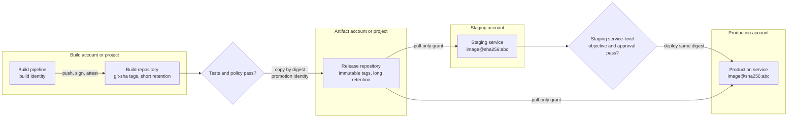

The trust-boundary diagram shows a common multi-account layout. The build identity can write only to the build repository. A separate promotion identity copies approved digests into a release repository in an artifact account, where tags are immutable and retention is long. Staging and production accounts receive pull-only grants on the release repository. A compromise of the build pipeline can publish a malicious image to the build repository, but cannot place it in the release repository without passing the promotion gate, and cannot affect production without the production deployment identity. This is the container-specific instance of the "account compromise contained by organizational boundaries" scenario from the part overview.

### 7.2 Promotion mechanics: retag, copy, or reference

There are three ways to promote, with different trade-offs:

- **Retag in place.** Add a tag such as `prod-approved` to the existing digest in one shared repository. Cheapest and fastest; weakest separation, because the same repository holds unapproved and approved images and the same permissions govern both.
- **Copy by digest to a release repository.** Use a tool that copies manifests and blobs without re-serializing (for example `crane copy`, `oras copy`, `gcrane cp`, `az acr import`, or ECR replication filtered by prefix). The digest is preserved, so deployments and signatures remain valid. This is the usual production choice because it allows a separate permission set, retention policy, and replication configuration for release images.
- **Cross-account reference.** Production pulls directly from the build account's repository using a repository policy. Simple, but it makes the build account part of production's runtime dependency chain and blast radius.

`az acr import` deserves a note because it is a server-side copy between registries, including from other clouds, that preserves the digest and does not require a local Docker client. ECR has no direct equivalent across arbitrary registries, but replication and ECR-to-ECR pull-through cache cover cross-Region and cross-account copies.

A copy that changes the digest is a red flag. Pulling and re-pushing with a Docker client that re-compresses layers or converts manifest media types (for example from Docker schema 2 to OCI) produces a new digest, which invalidates signatures and breaks the build-once rule silently.

### 7.3 Provenance: signatures and attestations

A digest proves integrity: the bytes you pulled are the bytes that were pushed. It does not prove origin. Provenance answers "who built this, from what source, with what process?" Two artifact types carry it, both stored as OCI referrers of the image digest:

- A **signature** is a cryptographic statement by a key holder that the digest is approved by them. The Notary Project (with the `notation` client) and Sigstore (with `cosign`) are the two common formats. AWS Signer integrates with Notation, and ECR managed signing (announced late 2025) can sign images automatically on push using AWS Signer, governed as a registry configuration ([ECR managed signing](https://docs.aws.amazon.com/AmazonECR/latest/userguide/managed-signing.html)). ACR supports Notary Project signatures with keys in Azure Key Vault and is retiring Docker Content Trust (DCT) on March 31, 2028 ([ACR DCT transition](https://learn.microsoft.com/en-us/azure/container-registry/container-registry-content-trust-deprecation)). Artifact Registry stores Sigstore and Notation signatures as artifacts, and Binary Authorization uses its own attestations signed with Cloud Key Management Service keys.
- An **attestation** is a signed statement about the image in a structured format, typically an in-toto statement. A SLSA provenance attestation records the builder, the source repository and revision, the build definition, and the resolved dependencies. An SBOM attestation lists packages. A vulnerability attestation records a scan result at a time.

SLSA describes increasing levels of assurance for build provenance, from "provenance exists" to "provenance is generated by a hardened, isolated build platform that the tenant cannot tamper with." The levels and the threats they address are owned by [Supply Chain Security](../15_Security/CH15_Supply_Chain_Security.md). The cloud architect's job is narrower: make sure the provenance exists, is stored as a referrer next to the digest so it survives copying and replication, and is checked before deployment.

The code example [02_provenance_policy.py](../code/python/containers-chapter/02_provenance_policy.py) models the minimum evidence check: deny promotion if the source revision, builder identity, scan result, dependency manifest, or image digest is missing, or if the vulnerability policy failed.

### 7.4 Where provenance can be enforced

Recording provenance is easy. Enforcing it at the moment of deployment is where providers differ most, and an architect should know exactly where the enforcement point is for each runtime.

| Runtime | Native deploy-time enforcement | Typical enforcement point otherwise |
| --- | --- | --- |
| Cloud Run | Binary Authorization policy on the service or project can require attestations from named attestors and block deployments that lack them | Not needed beyond Binary Authorization; add pipeline checks for richer policy |
| GKE | Binary Authorization; policy controllers | Admission control (Part 12) |
| AKS | Image integrity using Ratify and Azure Policy to verify Notary Project signatures | Admission control (Part 12) |
| EKS | No built-in verifier; Kyverno or Gatekeeper with Notation or cosign plugins | Admission control (Part 12) |
| ECS (EC2 or Fargate) | No native signature verification at task launch at the time of writing | Deployment pipeline gate that verifies signatures and attestations before registering the task definition, plus IAM that only lets the pipeline role deploy |
| Container Apps, ACI | No native signature verification at replica start at the time of writing | Pipeline gate plus Azure Policy restricting allowed registries |

The practical consequence is that on ECS and Container Apps, the deployment identity is the control. If any principal other than the gated pipeline can call `ecs:UpdateService` or update a Container Apps revision, the provenance check can be bypassed. Combine the pipeline gate with policies that restrict which registries an image may come from (for example, an Azure Policy that allows only your ACR login server in Container Apps, or a service control policy and IAM condition that limits ECS task definitions to approved repositories through review tooling) and with audit alerts on deployments by any other principal.

## 8. The managed container execution spectrum

### 8.1 The spectrum

Provider container services form a spectrum from "you operate the hosts and the scheduler is a service" to "you hand over an image and a few settings." Moving right trades control for less operating work and, usually, tighter limits.

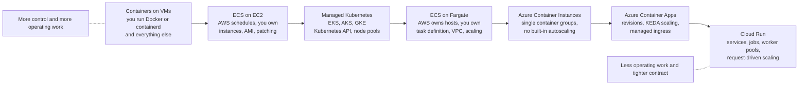

The spectrum diagram is a simplification with an important caveat: managed Kubernetes sits near the left in operating burden but offers the richest API, while EKS Auto Mode, GKE Autopilot, and AKS Automatic move node management toward the provider and shift Kubernetes rightward. Those modes are the subject of [Kubernetes (cloud-managed)](CH08_Kubernetes.md). Also, ACI and Container Apps are not strictly ordered: ACI is simpler in features but closer to raw capacity, while Container Apps adds application features. The diagram orders them by how much fleet behaviour the service provides.

### 8.2 Amazon ECS: one control plane, two capacity models

ECS is a regional, AWS-operated scheduler with a small object model:

- A **cluster** is a logical grouping and namespace for services and tasks; it has no cost by itself.
- A **task definition** is a versioned JSON document: containers, image references, CPU and memory, port mappings, network mode, volumes, the task role, the task execution role, logging configuration, and health checks. Each registration creates a new immutable revision (`family:revision`).
- A **task** is a running instantiation of a task definition revision.
- A **service** maintains a desired count of tasks from one task definition revision, registers them with load balancers, applies a deployment strategy, and integrates with Application Auto Scaling.
- A **capacity provider** tells ECS where tasks run: `FARGATE`, `FARGATE_SPOT`, or an Auto Scaling group capacity provider with managed scaling for EC2.

**ECS on EC2** means the tasks run on EC2 instances you own, registered to the cluster by the ECS agent. You choose instance types (including graphics processing unit (GPU) and Graviton instances), the AMI (usually the ECS-optimized AMI), patching cadence, and instance scaling; ECS bin-packs tasks onto instances using placement strategies and constraints. You get host-level image caching, daemon tasks, privileged containers where needed, and better unit cost at high utilization. You also own the patch and replacement cycle for hosts and the capacity math of keeping enough spare instance room for deployments.

**ECS on Fargate** means AWS provides an isolated compute environment per task. You specify task CPU and memory from the supported combinations, the subnets and security groups, and the platform version; AWS owns the host operating system, the container runtime, and capacity. Fargate requires the `awsvpc` network mode, does not support privileged containers or host volumes, and pulls the image for every task. Fargate Spot runs tasks on spare capacity at a discount with a two-minute interruption warning, suitable for interruptible batch and stateless workers.

**ECS Express Mode**, introduced in late 2025, is a simplified way to create a Fargate-based ECS service with a load balancer, Transport Layer Security (TLS) certificate, uniform resource locator (URL), auto scaling, and monitoring configured from defaults; the created resources remain ordinary ECS, Elastic Load Balancing, and Application Auto Scaling resources in your account ([ECS Express Mode](https://docs.aws.amazon.com/AmazonECS/latest/developerguide/express-service-overview.html)). It is a provisioning convenience over ECS, not a separate runtime.

**AWS App Runner** was a higher-level service that built or deployed a container and gave it an HTTPS endpoint with request-based scaling. AWS has closed App Runner to new customers; existing customers can continue using it and creating services, and AWS directs new customers to ECS Express Mode ([App Runner availability change](https://docs.aws.amazon.com/apprunner/latest/dg/apprunner-availability-change.html)). New designs should not select App Runner, and existing App Runner estates should have a documented exit path.

### 8.3 Azure Container Instances

ACI runs a **container group**: one or more containers scheduled together on the same host, sharing a lifecycle, local network, and optional volumes, similar to a Kubernetes pod. A container group is billed per second for its vCPU and memory, starts in seconds to tens of seconds, and runs in a Hyper-V isolated environment. It can have a public IP and DNS label or be deployed into a virtual network subnet. Container groups support restart policies (`Always`, `OnFailure`, `Never`), which makes ACI suitable for both long-running single instances and run-to-completion jobs.

ACI deliberately lacks fleet features. There is no built-in autoscaling, no rolling deployment, and no load balancer. **NGroups** (in preview at the time of writing) manages N identical container groups with rolling updates and zone spreading through one API, and **standby pools** keep pre-provisioned container groups ready. ACI is also the capacity behind AKS virtual nodes. Choose ACI when you need an isolated container quickly, without an environment to manage, for burst jobs, build agents, or simple sidecar-free tasks; choose Container Apps when you need a service.

### 8.4 Azure Container Apps

Container Apps is a managed application platform built on Kubernetes, KEDA, Envoy, and optionally Distributed Application Runtime (Dapr), but it does not expose the Kubernetes API. Its object model:

- An **environment** is the security and network boundary, a set of apps that share a virtual network, a Log Analytics destination, and Dapr configuration. Environments use workload profiles: a serverless Consumption profile billed per use, and Dedicated profiles that reserve specific VM sizes (including GPU) billed per instance.
- A **container app** has application-scope configuration (ingress, secrets, registries, revision mode, managed identities) and a **template** with revision-scope configuration (containers, images, resources, scale rules, volumes).
- A **revision** is an immutable snapshot of the template. Changing revision-scope settings creates a new revision; changing application-scope settings applies to all revisions without creating one.
- A **replica** is a running instance of a revision, comparable to a pod.
- A **job** runs containers to completion on a manual, scheduled, or event-driven (KEDA) trigger.

Container Apps provides managed HTTP and Transmission Control Protocol (TCP) ingress, internal or external visibility, revision traffic splitting, built-in authentication, and scaling from zero to a configured maximum (up to 1,000 replicas per revision at the time of writing) ([Container Apps scaling](https://learn.microsoft.com/en-us/azure/container-apps/scale-app)). The trade-off against AKS is the absence of Kubernetes extensibility: no custom resources, no arbitrary admission controllers, no DaemonSets, and a fixed set of networking options.

### 8.5 Google Cloud Run

Cloud Run is a regional, fully managed runtime for containers with three resource types:

- A **service** serves HTTP, gRPC, or WebSocket requests at a stable URL, scales instances by request load (including to zero), and routes traffic among **revisions**, each an immutable combination of a digest and configuration.
- A **job** runs one or more **tasks** to completion per **execution**, with parallelism, retries, and a task timeout of up to 168 hours (7 days) at the time of writing, 1 hour for tasks using GPUs ([Cloud Run task timeout](https://cloud.google.com/run/docs/configuring/task-timeout)).
- A **worker pool** runs always-on instances for pull-based workloads such as queue consumers, without an HTTP endpoint.

Cloud Run instances run in a gVisor-based (first generation) or microVM-based (second generation) sandbox; Google owns host, kernel, and sandbox. You own the image, CPU and memory size, concurrency, scaling bounds, network egress settings, service identity, and ingress policy. Cloud Run also has a [Kubernetes-like resource model](https://docs.cloud.google.com/kubernetes-engine/enterprise/knative-serving/docs/deploying) inherited from Knative, which is why its YAML Ain't Markup Language (YAML) definitions look familiar, but it is not a Kubernetes cluster you can extend.

### 8.6 Managed Kubernetes as the far end

When a workload needs the Kubernetes API itself (custom controllers and operators, service-mesh control, DaemonSets for node agents, fine-grained scheduling with affinities and taints, or a single platform for dozens of teams with uniform policy), managed Kubernetes is the right end of the spectrum. Its cost is operating responsibility for cluster versions, node pools, add-ons, and policy. The selection between managed Kubernetes and managed container services is owned jointly: this chapter owns the managed-container side and [Kubernetes (cloud-managed)](CH08_Kubernetes.md) owns the cluster side.

### 8.7 Choosing a point on the spectrum

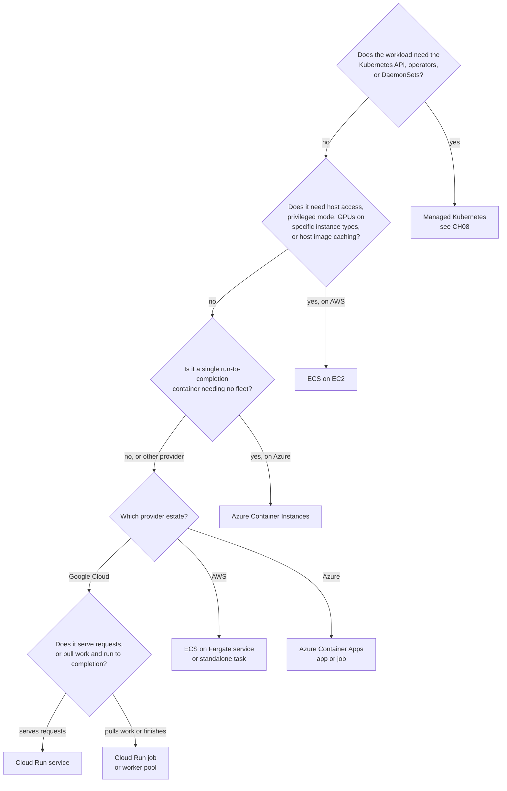

The decision tree encodes the questions in the order that eliminates options fastest. The first question removes everything except Kubernetes for workloads that genuinely need its API. The second identifies the narrow cases where you must own hosts. The rest is mostly a provider-estate decision, because within one provider the managed options overlap heavily. Run [03_service_fit.py](../code/python/containers-chapter/03_service_fit.py) to see the same reasoning as a weighted fit score across a managed task service, a managed container application, and managed Kubernetes; it caps each candidate's credit at the required level, so an over-capable option earns nothing for capability the workload does not need.

The tree omits several criteria that frequently override it, and a design review should ask about each:

- **Request timeout and connection model.** Cloud Run services have a configurable request timeout (up to 60 minutes at the time of writing); long-lived WebSockets count against it. ECS behind an Application Load Balancer has an idle timeout you set. Container Apps ingress has its own timeouts.
- **Network attachment.** Do tasks need an IP address in your virtual network that on-premises firewalls can allow? `awsvpc`, Container Apps environments with a custom virtual network, ACI in a subnet, and Cloud Run Direct VPC egress all provide this differently (section 10).
- **Startup behaviour.** Scale-to-zero services pay cold starts; minimum instances or replicas remove most of them at a fixed cost.
- **Team skills and existing platform.** A team already running a well-operated EKS platform may put a simple service there at lower marginal cost than standing up a new ECS estate.
- **Exit cost.** All services run OCI images, but task definitions, revision templates, and identity bindings are provider-specific. Portability lives in the image and in keeping configuration generated from a neutral source, not in the runtime.

## 9. The task and revision model

Every service on the spectrum separates an immutable description of what to run from a mutable controller that decides how many copies run and which description receives traffic. Understanding exactly what is immutable, and what change creates a new version, prevents a class of "we changed a setting and nothing happened" and "we changed a setting and it redeployed everything" surprises.

### 9.1 ECS task definition revisions and service deployments

A task definition revision is immutable. Changing anything (image, environment variable, CPU, role) means registering a new revision and updating the service to use it. The service update creates a **deployment**, and ECS tracks the old (`ACTIVE`) and new (`PRIMARY`) deployments until the new one reaches steady state. The deployment is the unit that the circuit breaker and CloudWatch alarm rollback act on (section 13). Some service-level settings, such as desired count and auto scaling, change without a new task definition; network configuration and load balancer settings are service properties that can trigger a new deployment.

A minimal Fargate task definition shows where the contracts meet:

```json
{
  "family": "orders-api",
  "requiresCompatibilities": ["FARGATE"],
  "networkMode": "awsvpc",
  "cpu": "1024",
  "memory": "2048",
  "runtimePlatform": { "cpuArchitecture": "ARM64", "operatingSystemFamily": "LINUX" },
  "executionRoleArn": "arn:aws:iam::222222222222:role/orders-api-execution",
  "taskRoleArn": "arn:aws:iam::222222222222:role/orders-api-task",
  "ephemeralStorage": { "sizeInGiB": 30 },
  "containerDefinitions": [
    {
      "name": "app",
      "image": "111111111111.dkr.ecr.eu-west-1.amazonaws.com/release/orders-api@sha256:8c9f3e...",
      "portMappings": [{ "containerPort": 8080, "protocol": "tcp" }],
      "secrets": [
        { "name": "DB_PASSWORD", "valueFrom": "arn:aws:secretsmanager:eu-west-1:222222222222:secret:orders-db" }
      ],
      "healthCheck": {
        "command": ["CMD-SHELL", "curl -fsS http://localhost:8080/ready || exit 1"],
        "interval": 10, "timeout": 3, "retries": 3, "startPeriod": 30
      },
      "logConfiguration": {
        "logDriver": "awslogs",
        "options": {
          "awslogs-group": "/ecs/orders-api",
          "awslogs-region": "eu-west-1",
          "awslogs-stream-prefix": "app"
        }
      }
    }
  ]
}
```

The image reference is a digest in the artifact account's release repository. The execution role is used by the ECS agent and Fargate to pull that image, fetch the secret, and write logs; the task role is used by the application. Ephemeral storage is raised above the 20 GiB default. The container health check uses a readiness endpoint rather than a process check.

### 9.2 Container Apps revisions

A Container Apps revision is created whenever revision-scope configuration changes: container image, environment variables, resources, scale rules, probes, or volumes. Application-scope changes such as ingress settings, secret values, registry credentials, or revision mode apply to the app immediately without a new revision; notably, changing a secret's value does not restart replicas or create a revision, so applications that read secrets at startup keep the old value until a new revision or restart.

The **revision mode** decides traffic behaviour. In single revision mode, a new revision replaces the old one once it is ready, giving zero-downtime replacement with no traffic split. In multiple revision mode, several revisions can be active, and ingress traffic weights determine how requests are divided; revision labels give stable URLs to specific revisions for testing. A newer label-based mode extends this with deployment labels such as `stage` or `prod` that are reassigned between revisions ([deployment labels](https://learn.microsoft.com/en-us/azure/container-apps/deployment-labels)). Inactive revisions can be reactivated for rollback, subject to a retention limit on how many inactive revisions are kept.

### 9.3 Cloud Run revisions

Every deployment to a Cloud Run service, including a configuration-only change, creates a new immutable revision that combines the resolved digest with all configuration: environment variables, CPU, memory, concurrency, scaling bounds, service account, VPC settings, and secrets. Traffic is assigned to revisions by percentage or to the latest revision. A revision can be deployed with no traffic and a **tag** that gives it a dedicated URL. Because configuration is part of the revision, rolling back a bad environment variable is the same operation as rolling back a bad image: move traffic to the previous revision.

### 9.4 Comparing what creates a new version

| Change | ECS | Container Apps | Cloud Run |
| --- | --- | --- | --- |
| New image digest | New task definition revision and service deployment | New revision | New revision |
| Environment variable | New task definition revision | New revision | New revision |
| Secret value rotated in secret store | Picked up by new tasks only; force a new deployment to refresh running tasks | Secret value change applies at app scope; replicas need restart or new revision to reread | Picked up by new instances if the secret is referenced as `latest`; pinned versions require a new revision |
| Scaling bounds | Application Auto Scaling target; no new deployment | New revision (scale rules are revision-scope) | New revision |
| Ingress or load balancer | Service update; may create deployment | Application scope, no new revision | Service-level setting, no new revision |

The secret row connects to the identity and key rotation scenario. Rotation is safe only if the rotation process knows how each runtime picks up new values. The rotation state machine and overlapping versions are owned by [Secrets Management](CH13_Secrets_Management.md); the container-specific point is that "the secret was rotated" and "the running replicas use the new secret" are separate events with a gap whose length depends on the runtime.

## 10. Networking and identity for tasks and revisions

Networking and identity are where provider container services differ most from one another and from Kubernetes. Both answer the same two questions for each running copy: "what address does it have, and what may it call?" Kubernetes networking and RBAC are owned by [Part 12 Networking](../12_Kubernetes/CH06_Networking.md) and [Part 12 Security](../12_Kubernetes/CH13_Security.md); general workload identity federation is owned by [IAM](CH09_IAM.md).

### 10.1 ECS task networking

ECS supports several network modes on EC2 (`bridge`, `host`, `none`, `awsvpc`) and only `awsvpc` on Fargate. In `awsvpc` mode, ECS creates an elastic network interface (ENI) for each task in a subnet you choose, attaches it to the task's isolation boundary, and gives the task its own private IP address and security groups. All containers in the task share that interface and communicate over `localhost`.

The consequences of one ENI per task are concrete:

- **Security groups apply per task.** A database security group can allow only the orders service's tasks, not every container on a host. This is the main reason to prefer `awsvpc` even on EC2.
- **Each task consumes a subnet IP address.** A /24 subnet has 251 usable addresses after AWS reserves 5. A service that runs 120 tasks and deploys with a maximum of 200 percent needs 240 addresses at peak deployment, before counting other services, load balancer nodes, and interface endpoints in the same subnet.
- **On EC2, instances have a per-type ENI limit.** Without ENI trunking, a `c6i.large` can attach only a few ENIs, which caps `awsvpc` tasks per instance well below what CPU and memory would allow. ECS ENI trunking, enabled with the `awsvpcTrunking` account setting on supported instance types, raises the per-instance task density by multiplexing task interfaces over a trunk interface.
- **Load balancers register task IPs.** Target groups use the `ip` target type, and health checks hit the task directly.

#### Worked example: subnet sizing for a Fargate service

A payments service runs a baseline of 60 tasks spread across three Availability Zones (AZs), scales to 180 at peak, and deploys with minimum healthy 100 percent and maximum 200 percent. Each AZ has one private subnet shared with two other services that together peak at 90 tasks, plus about 10 addresses for interface endpoints and load balancer nodes.

- Payments peak per AZ during a deployment at peak load: 180 × 2 / 3 = 120 addresses.
- Other services per AZ, assuming they do not deploy at the same moment: 90 / 3 = 30.
- Fixed consumers per AZ: 10.
- Total per AZ: 160 addresses. A /24 (251 usable) leaves 91 spare, or 36 percent headroom.

Now apply the zonal failure scenario. If one AZ fails, ECS rebalances tasks into the remaining two. Payments at peak needs 180 / 2 = 90 tasks per AZ, and 180 per AZ during a deployment; other services need 45; fixed 10. Total 235 of 251 addresses, which leaves 16 spare. That is close enough to exhaustion that a simultaneous deployment by another service would fail with "insufficient free addresses in subnet." The fix is cheap at design time and expensive later: use /22 subnets for container workloads (1,019 usable addresses), or separate subnets per high-scale service.

### 10.2 ECS identities: task role versus task execution role

ECS uses two different IAM roles for every task, and confusing them is one of the most common container security and availability mistakes on AWS.

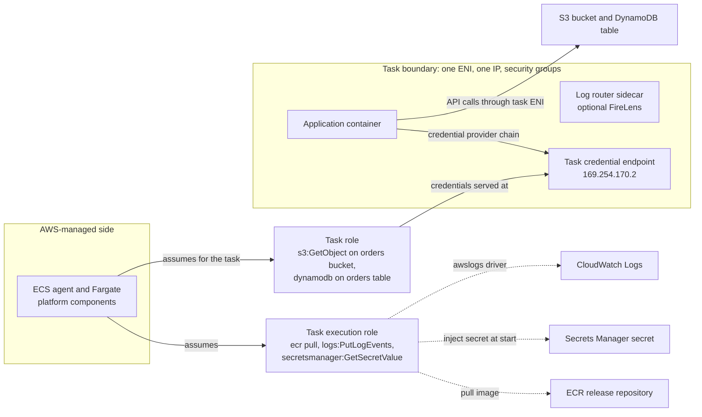

The identity diagram shows two principals with disjoint jobs:

- The **task execution role** is assumed by ECS and Fargate infrastructure to prepare the task: pull the image from ECR, fetch secrets referenced in `secrets`, and send logs with the `awslogs` driver. The application never sees these credentials.
- The **task role** is assumed on behalf of the application. Its temporary credentials are served from a task-local credential endpoint, and AWS software development kits (SDKs) find them automatically through the container credential provider. It holds the permissions the application code needs and nothing else.

Failure modes map directly onto the split. A task stuck in `PROVISIONING` or `STOPPED` with `CannotPullContainerError` or `ResourceInitializationError` is an execution role, network path, or registry problem; the application has not started. An application that starts and then logs `AccessDenied` on S3 is a task role problem. Granting the application's permissions to the execution role "to make it work" gives every future task definition that uses that execution role access to production data during startup, and still does not give the application any credentials.

A trust policy for both roles names `ecs-tasks.amazonaws.com` as the principal. Add `aws:SourceAccount` and `aws:SourceArn` conditions to prevent the confused-deputy case, where another account's ECS tasks could be configured to assume your role.

### 10.3 Container Apps networking and identity

A Container Apps environment is either created with a platform-managed network or integrated into a subnet of your virtual network. With a custom virtual network, the environment can be internal (ingress has only a private IP in the subnet) or external, and app egress leaves through the subnet, where user-defined routes can force it through Azure Firewall or a NAT gateway. Workload profiles environments use a delegated subnet; size it for the maximum replicas and nodes the environment can create, using the subnet sizing guidance in the Container Apps documentation, because the environment allocates addresses for infrastructure as well as replicas.

Within an environment, apps reach each other by app name through the environment's internal DNS and Envoy-based ingress. Ingress can be HTTP (with traffic splitting, session affinity, and IP restrictions) or TCP.

Identity uses Microsoft Entra managed identities. A container app can have a system-assigned identity (lifecycle tied to the app) and any number of user-assigned identities (independent resources). Two uses matter:

- **Registry pull.** Configure the app's registry with a managed identity that has AcrPull on the registry. A user-assigned identity is preferable for pulls, because it can be created and granted AcrPull before the app exists; a system-assigned identity only exists after the app is created, which produces a first-deployment chicken-and-egg failure.
- **Application access.** The application obtains tokens for Azure resources (Key Vault, Storage, Service Bus) through the managed identity endpoint exposed in the container. Key Vault references in app secrets let the platform fetch secret values with a managed identity.

### 10.4 Cloud Run networking and identity

Cloud Run separates ingress from egress:

- **Ingress settings** control who can reach the service: all traffic, internal only (from VPC networks in the project or a Shared VPC, from certain Google services, and from internal load balancers), or internal plus traffic through an external Application Load Balancer. Combined with IAM-based invocation (`roles/run.invoker`), they decide whether a service is public, private, or reachable only through a load balancer with Cloud Armor.
- **Egress** goes to the internet by default. To reach private IP addresses in a VPC, use Direct VPC egress (instances get addresses directly in a subnet you name) or a Serverless VPC Access connector (a managed set of VMs that proxies traffic). Direct VPC egress avoids connector capacity limits and cost, but each instance consumes subnet addresses, so subnet sizing applies just as with `awsvpc`. Egress can be set to route all traffic or only private ranges through the VPC.

Each Cloud Run service or job runs as a **service identity**, a service account whose credentials the instance obtains from the metadata server. If you do not specify one, Cloud Run uses the Compute Engine default service account, which in many projects holds broad Editor-level access. Google recommends a dedicated, user-managed service account per service with minimal roles ([Cloud Run service identity](https://cloud.google.com/run/docs/securing/service-identity)). Deploying a service with a given service account requires the deployer to have `iam.serviceAccounts.actAs` on that account, which is the control that stops a developer from deploying code that runs as a more privileged identity.

The image pull for Cloud Run is performed by the Cloud Run service agent (a Google-managed service account), not by the service identity. Cross-project pulls require granting the service agent of the deploying project `artifactregistry.reader` on the source repository.

### 10.5 ACI networking and identity

ACI container groups are either public (with an IP and optional DNS label) or deployed into a delegated virtual network subnet with private IPs. Container groups can use system- or user-assigned managed identities for application access and, for supported scenarios, for pulling from ACR. Because ACI has no ingress layer, TLS termination and routing are your responsibility, typically with Application Gateway in front.

### 10.6 Network and identity failure modes

| Symptom | Most likely cause | Check |
| --- | --- | --- |
| ECS task fails with `CannotPullContainerError` in a private subnet | Missing `ecr.dkr`, `ecr.api`, or S3 gateway endpoint, or execution role missing ECR permissions | Endpoint list, route table for S3 prefix list, execution role policy |
| ECS task fails with `ResourceInitializationError` retrieving secrets | Execution role lacks `secretsmanager:GetSecretValue` or the key's decrypt permission, or no endpoint | Execution role, key policy, endpoint |
| Container Apps first revision fails to pull | System-assigned identity used for ACR pull before it existed or before AcrPull propagated | Switch to user-assigned identity granted in advance |
| Cloud Run service can call any API in the project | Default compute service account with Editor role | Service identity setting; organization policy that disables automatic role grants to default service accounts |
| Scale-out stalls with IP errors | Subnet exhausted by `awsvpc` tasks, Direct VPC egress instances, or Container Apps infrastructure | Free IP metrics per subnet |
| Calls to on-premises fail only from new instances | Egress path differs between old and new revisions (egress setting changed) | Revision configuration diff |

## 11. Storage and ephemeral disk

Containers are replaceable, so the default storage is ephemeral and durable state lives in managed data services. Every service nevertheless has a writable scratch area with a size limit, and several offer attached persistent volumes. The limits are easy to hit with log files, temporary uploads, model weights, or build caches. Storage service mechanics are owned by [Storage](CH06_Storage.md); Kubernetes volumes by [Part 12 Storage](../12_Kubernetes/CH07_Storage.md).

| Service | Ephemeral storage | Persistent options |
| --- | --- | --- |
| ECS on Fargate | 20 GiB by default per task on Linux platform version 1.4.0 and later, configurable up to 200 GiB, shared by the image and writable layers ([Fargate task storage](https://docs.aws.amazon.com/AmazonECS/latest/developerguide/fargate-task-storage.html)) | Amazon Elastic File System (EFS) volumes; one Amazon Elastic Block Store (EBS) volume per task configured at launch, new or from a snapshot ([ECS and EBS](https://docs.aws.amazon.com/AmazonECS/latest/developerguide/ebs-volumes.html)) |
| ECS on EC2 | Instance storage and the Docker volume on the instance | Bind mounts to host paths, EFS, EBS per task, Docker volume plugins |
| Container Apps | Per replica, sized by allocated vCPU: 1 GiB at 0.25 vCPU or lower up to 8 GiB above 1 vCPU, shared between container-scoped and replica-scoped (EmptyDir) storage, at the time of writing ([Container Apps storage](https://learn.microsoft.com/en-us/azure/container-apps/storage-mounts)) | Azure Files over Server Message Block (SMB) or Network File System (NFS) |
| ACI | Container filesystem within the group | Azure Files, secret volumes, emptyDir |
| Cloud Run | The writable filesystem is in memory and counts against the instance memory limit | In-memory volumes, Cloud Storage volume mounts using Cloud Storage FUSE, NFS mounts such as Filestore |

Three design consequences follow from the table.

First, on Cloud Run, writing files consumes memory. A service with 512 MiB memory that writes 300 MiB of temporary files during a request is out of memory under modest concurrency. Stream to Cloud Storage instead, or mount a bucket.

Second, on Fargate, the image counts against ephemeral storage. A 6 GB machine-learning image on a default 20 GiB task leaves 14 GiB for writes, and the decompressed image is larger than its compressed size, so the real remainder is smaller. Size `ephemeralStorage` from the unpacked image size plus peak scratch use plus margin.

Third, attached block storage is zonal. An EBS volume attached to an ECS task lives in one AZ; a replacement task in another AZ cannot attach it. ECS's EBS integration creates volumes per task (optionally from a snapshot) and is intended for task-scoped data such as large scratch datasets, not as a way to make a stateful replicated database portable. For shared or durable state, use EFS, Azure Files, Filestore, or a managed database.

## 12. Scaling and placement

### 12.1 The control loop applied to containers

Autoscaling as a feedback controller (signal, target, bounds, cooldown, warm-up) is owned by [Compute](CH04_Compute.md). For containers the loop has more stages between "the controller decided" and "capacity is serving," and each stage can stall.

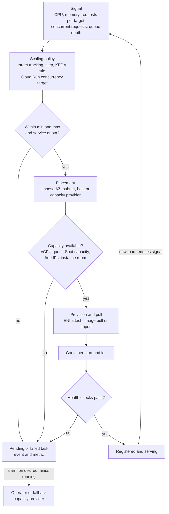

The flow diagram shows why the most important container scaling metric is not CPU but the gap between desired and running copies. A scaling policy can request 50 tasks and receive 12, because the Fargate vCPU quota is exhausted, a subnet has no addresses, Fargate Spot has no capacity in that AZ, or the image pull is throttled. The controller has done its job; the fleet has not. Alarm on `desired - running` sustained for more than a few minutes, and on task or replica placement failure events.

### 12.2 ECS scaling and placement

ECS service auto scaling uses Application Auto Scaling with target tracking (for example average CPU at 60 percent, or `ALBRequestCountPerTarget` at a value derived from load tests), step scaling, scheduled scaling, and predictive scaling. Request count per target is usually a better signal than CPU for web services, because it scales before latency degrades rather than after CPU saturates.

Placement differs by capacity type:

- **Fargate** spreads tasks across the subnets (and therefore AZs) in the service's network configuration on a best-effort basis. You control the spread by which subnets you list.
- **EC2** uses placement strategies (`spread` by attribute such as `attribute:ecs.availability-zone`, `binpack` on CPU or memory, `random`) and constraints (`distinctInstance`, or a cluster query language expression on instance attributes). A common combination is spread across AZs, then binpack on memory within each AZ, which balances resilience with instance utilization.
- **Capacity provider strategies** split tasks between providers with a `base` (tasks that always go to the first provider) and `weight`. For example, base 4 on `FARGATE` and weight 1:3 between `FARGATE` and `FARGATE_SPOT` keeps 4 tasks on On-Demand capacity and places three of every four additional tasks on Spot.
- **ASG capacity providers with managed scaling** make ECS scale the EC2 Auto Scaling group to fit pending tasks, using a target capacity percentage; at 100 percent ECS keeps instances full, at 80 percent it holds spare room for faster task placement during deployments.

### 12.3 Container Apps scaling

Container Apps scales each revision between `minReplicas` (default 0) and `maxReplicas` (default 10, up to 1,000 at the time of writing) using rules of three kinds: HTTP (concurrent requests), TCP (concurrent connections), and custom KEDA scalers for CPU, memory, Azure Service Bus, Event Hubs, Kafka, Redis, and other event sources. If several rules are defined, the revision scales out when any rule's condition is met. For HTTP rules, concurrency is computed every 15 seconds as requests in the last 15 seconds divided by 15 ([Container Apps scaling](https://learn.microsoft.com/en-us/azure/container-apps/scale-app)).

```yaml
template:
  containers:
    - name: worker
      image: contosoprod.azurecr.io/orders/worker@sha256:5d1c...
      resources:
        cpu: 1.0
        memory: 2Gi
  scale:
    minReplicas: 1
    maxReplicas: 40
    rules:
      - name: orders-queue
        custom:
          type: azure-servicebus
          metadata:
            queueName: orders
            namespace: contoso-prod-sb
            messageCount: "50"
          identity: /subscriptions/.../userAssignedIdentities/orders-worker
```

The rule targets 50 messages per replica, so a backlog of 1,000 messages drives toward 20 replicas. The `identity` field lets the KEDA scaler authenticate to Service Bus with a managed identity rather than a connection string. `minReplicas: 1` avoids a cold start on the first message; scale-to-zero is cheaper but the first message after an idle period waits for a replica to start.

Placement across zones is an environment property: a zone-redundant environment spreads replicas across AZs in regions that support it. Zone redundancy is chosen when the environment is created, along with a virtual network, so it is a day-one decision.

### 12.4 Cloud Run scaling

Cloud Run's scaling unit is the instance, and its principal knob is **maximum concurrency**: how many requests one instance may process at once. At the time of writing, the maximum is 1,000, and services created with the Google Cloud command-line interface (CLI) or Terraform default to 80 times the number of vCPUs ([Cloud Run concurrency](https://cloud.google.com/run/docs/about-concurrency)). The autoscaler targets 60 percent utilization of both CPU and concurrency by default and adds instances to keep within that target ([scaling controls](https://docs.cloud.google.com/run/docs/configuring/scaling-controls)). **Minimum instances** keep warm capacity; **maximum instances** (default 100 per revision, raisable within regional quota) caps cost and protects downstream systems.

#### Worked example: Cloud Run instance count and downstream protection

An API handles a peak of 1,200 requests per second with a mean latency of 150 ms. By Little's law, in-flight requests = 1,200 × 0.15 = 180. With concurrency 80 and a 60 percent target, each instance is expected to carry about 48 requests, so the service needs 180 / 48 ≈ 3.75, rounded to 4 instances, plus headroom; the autoscaler might run 5 to 6.

Now the downstream database allows 200 connections, and each instance holds a pool of 20. Six instances use 120 connections. If latency degrades to 1.5 seconds because the database is slow, in-flight requests become 1,800, the autoscaler wants about 38 instances, and 38 × 20 = 760 connections overwhelm the database further. Setting maximum instances to 10 caps connections at 200 and turns a cascading failure into bounded queuing and 429 responses. The same reasoning applies to ECS maximum tasks and Container Apps `maxReplicas`; the general admission-control theory is owned by [Serverless](CH11_Serverless.md) and Part 07.

### 12.5 Quota or capacity limit during scale-out

Container scale-out is bounded by quotas that are invisible until they bite. The relevant ones, which you look up in AWS Service Quotas, the Azure portal's Quotas page or the Container Apps quota documentation, and the Google Cloud Quotas page:

- AWS: Fargate On-Demand vCPU and Fargate Spot vCPU resource counts per Region; tasks per service; services per cluster; ECR API rates.
- Azure: Container Apps cores per environment and per subscription per region, environments per region, replicas per revision; ACI cores per subscription per region; ACR request rates by SKU.
- Google Cloud: Cloud Run maximum instances per region (which depends on CPU and memory configuration), CPU and memory allocation quotas per region, and Artifact Analysis and Artifact Registry API quotas.

Quality-attribute scenario: **stimulus**, a marketing campaign drives traffic to 4 times normal in 10 minutes; **environment**, the Fargate On-Demand vCPU quota is 400 vCPU and the account already runs 260 vCPU of other services; **response**, the service scales from 40 to 160 tasks of 1 vCPU, needing 120 more vCPU while only 140 remain; **measure**, all 160 tasks running within 8 minutes, no placement failures. Here the scenario passes with only 20 vCPU spare, and a concurrent deployment of another service at 200 percent would fail it. The design response is a quota increase requested ahead of the campaign to at least the sum of every service's peak plus the largest service's deployment surge, plus an alarm when account-wide vCPU use crosses 70 percent of quota.

### 12.6 Zonal failure

Quality-attribute scenario: **stimulus**, one of three AZs becomes unavailable; **environment**, steady peak load; **response**, the service keeps serving from two AZs and replaces lost capacity there; **measure**, error rate under 1 percent and p99 latency under 400 ms within 5 minutes of the event.

Each service handles this differently. ECS on Fargate re-places tasks in the remaining subnets when tasks stop, subject to quota and subnet addresses (section 10.1). ECS on EC2 needs spare instance capacity or managed scaling in the remaining AZs, and a `spread` strategy so the loss is one-third rather than one-half of tasks. Container Apps relies on a zone-redundant environment, chosen at creation. Cloud Run is a regional service whose instances Google spreads across zones automatically. To pass the measure without waiting for replacement, run N+1 capacity: with three AZs, provision 150 percent of the capacity needed at peak so that two AZs alone carry peak load.

## 13. Deployment health gates and rollback

Release strategy theory (rolling, blue/green, canary, progressive delivery) is owned by Part 13: see [Progressive Delivery](../13_DevOps/CH13_Progressive_Delivery.md), [Blue-Green Deployment](../13_DevOps/CH15_Blue_Green_Deployment.md), and [Canary Deployment](../13_DevOps/CH16_Canary_Deployment.md). This section teaches what each provider's runtime actually does during a deployment, what health signals it consults, and how it rolls back.

### 13.1 Layers of health signal

A container platform can observe health at four layers, and a deployment gate is only as good as the layer it watches:

1. **Launch health.** Did the task, replica, or instance start at all? Failures here are image pull, secret retrieval, out-of-memory at start, or a crashing entrypoint.
2. **Container health.** Does a health command or probe inside the container succeed? ECS container health checks, Container Apps startup, liveness, and readiness probes, and Cloud Run startup and liveness probes operate here.
3. **Load balancer health.** Does the target answer the load balancer's health check? ECS target group health checks operate here; Container Apps and Cloud Run ingress use probe results.
4. **Service-level health.** Are real users getting good responses? Error rate, latency, and business metrics from CloudWatch, Azure Monitor, or Cloud Monitoring.

Launch and container health catch broken releases. Only service-level health catches a release that starts, passes its readiness endpoint, and then returns wrong answers or slow responses under real traffic. A deployment that completes is not evidence of a healthy release. The code example [04_rollout_health_gate.py](../code/python/containers-chapter/04_rollout_health_gate.py) evaluates the fourth layer: it halts a canary whose error rate exceeds 1 percent or whose latency exceeds 220 ms, and continues one that stays inside both limits.

### 13.2 ECS: rolling updates, the circuit breaker, and native blue/green

**Rolling updates** replace tasks within bounds set by `minimumHealthyPercent` and `maximumPercent`. With desired count 10, minimum 100 and maximum 200, ECS starts up to 10 new tasks before stopping old ones, which needs double capacity briefly; with minimum 50 and maximum 100, it stops half the old tasks first, which needs no extra capacity but halves serving capacity during the deployment.

The **deployment circuit breaker** watches launch, container, and load balancer health during a rolling update. It counts tasks that fail to reach `RUNNING` or fail health checks; when the count reaches a threshold, it marks the deployment `FAILED` and, if rollback is enabled, starts a deployment back to the last `COMPLETED` service revision. The threshold is half the desired count, with a minimum of 3 and a maximum of 200 ([ECS circuit breaker API](https://docs.aws.amazon.com/AmazonECS/latest/APIReference/API_ServiceDeploymentCircuitBreaker.html)). For a service with 4 desired tasks, 3 failures trip it; for 60 tasks, 30 failures.

**CloudWatch alarm-based rollback** lets you attach alarms (for example on 5xx rate or p99 latency from the load balancer) to the deployment configuration; if an alarm enters `ALARM` during the deployment, ECS rolls back. This adds service-level health to the gate.

```json
"deploymentConfiguration": {
  "minimumHealthyPercent": 100,
  "maximumPercent": 200,
  "deploymentCircuitBreaker": { "enable": true, "rollback": true },
  "alarms": {
    "alarmNames": ["orders-api-5xx-rate", "orders-api-p99-latency"],
    "enable": true,
    "rollback": true
  }
}
```

**Native blue/green, linear, and canary deployments**, added to ECS in 2025, provision the new service revision (green) alongside the current one (blue), register green tasks with a separate target group, optionally route test traffic to green through listener rules, then shift production traffic all at once (blue/green), in equal increments (linear), or as a small percentage followed by the rest (canary). A **bake time** keeps blue running after traffic has shifted so that rollback is a traffic switch rather than a redeploy, and **lifecycle hooks** can invoke AWS Lambda functions at stages such as post-test-traffic-shift to run validation ([ECS blue/green workflow](https://docs.aws.amazon.com/AmazonECS/latest/developerguide/blue-green-deployment-how-it-works.html)). Before this feature, blue/green on ECS required AWS CodeDeploy; CodeDeploy remains supported, and existing pipelines need not migrate.

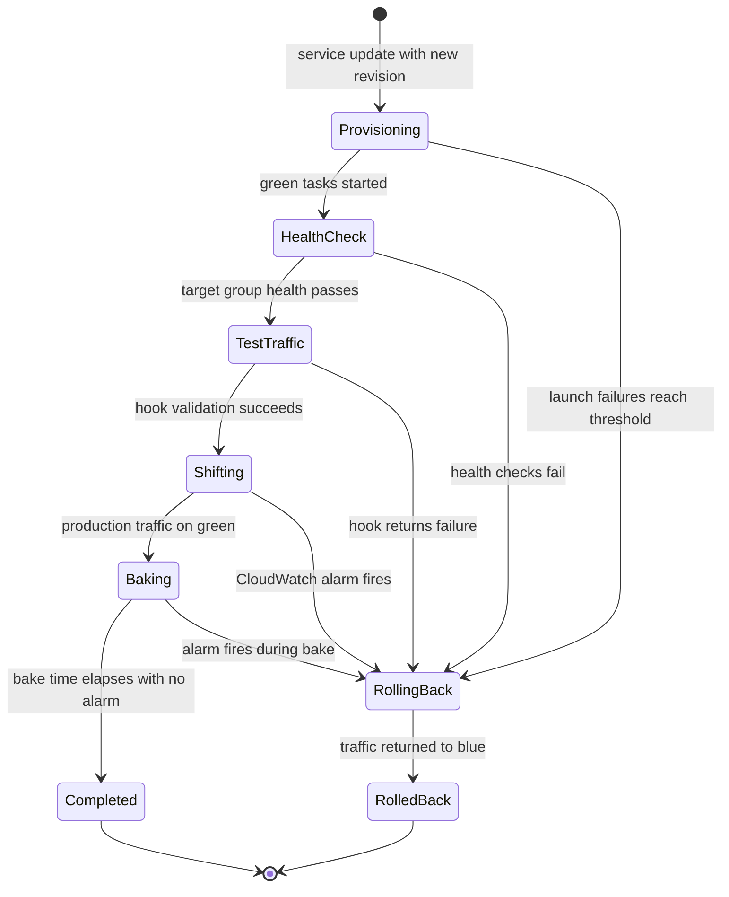

The state machine shows the gates a deployment must pass and where each failure goes. Every failure path ends in a traffic return to the previous revision, and in blue/green and canary modes that return is fast because blue is still running during the bake. In rolling mode the equivalent of `RollingBack` is a new deployment of the previous task definition, which takes as long as a forward deployment and needs the previous image to still be pullable. This is the concrete reason that retention policies (section 3.4) are part of deployment safety.

### 13.3 Container Apps: revisions and traffic splitting

In single revision mode, Container Apps starts the new revision's replicas, waits for readiness probes, shifts all traffic, and deprovisions the old revision. If the new revision never becomes ready, traffic stays on the old revision and the new one is marked failed: a launch-health gate with automatic protection but no service-level gate.

In multiple revision mode, you control traffic weights. A canary sequence with labels:

```bash
# Deploy a new revision with no traffic and a stable test URL
az containerapp update -n orders-api -g prod-rg \
  --image contosoprod.azurecr.io/orders/api@sha256:9f2e... \
  --revision-suffix v185
az containerapp revision label add -n orders-api -g prod-rg \
  --label canary --revision orders-api--v185

# Shift 10 percent, observe, then promote
az containerapp ingress traffic set -n orders-api -g prod-rg \
  --revision-weight orders-api--v184=90 orders-api--v185=10
az containerapp ingress traffic set -n orders-api -g prod-rg \
  --revision-weight orders-api--v185=100
```

When a new revision is created in multiple revision mode, traffic does not move to it automatically if weights are pinned to named revisions; if weights reference "latest revision," new revisions receive traffic immediately. That default bites teams who switch modes without updating their pipeline. The platform does not evaluate service-level metrics during the shift; the pipeline or Azure Monitor alerts must decide whether to continue, and rollback is setting weights back to the previous revision, which stays active until deactivated.

### 13.4 Cloud Run: no-traffic revisions, tags, and gradual migration

Cloud Run's equivalent workflow uses tags and traffic percentages:

```bash
# Deploy without traffic; the tag gives the revision its own canary--- prefixed URL
gcloud run deploy orders-api \
  --image europe-docker.pkg.dev/acme-prod/release/orders-api@sha256:9f2e... \
  --no-traffic --tag canary --region europe-west1

# Send 5 percent, then all traffic, to the tagged revision
gcloud run services update-traffic orders-api --region europe-west1 --to-tags canary=5
gcloud run services update-traffic orders-api --region europe-west1 --to-latest
```

The tagged URL lets the pipeline run smoke tests against the new revision before any user traffic reaches it. Cloud Run checks startup probes before an instance receives traffic and will not route to a revision whose instances cannot start, so a broken image fails the deployment rather than the users. Service-level gates are again the pipeline's job; Cloud Deploy offers canary orchestration for Cloud Run if you prefer a managed controller. Rollback is a traffic update to the previous revision, which is immediate because Cloud Run keeps its own copy of every serving revision's image.

### 13.5 Rollback compatibility

Switching traffic back is only half of rollback. The previous revision must still work with the current data and dependencies:

- **Schema changes** must be backward compatible for at least one release (expand, migrate, contract), or rollback restores old code against a new schema.
- **Configuration and secrets** referenced by the old revision must still exist; deleting the old secret version during rotation breaks rollback.
- **Images** referenced by the old revision must still be pullable on platforms that pull at start (ECS, Container Apps, ACI).
- **Message formats** consumed by workers must be readable by both versions while both are running.

Quality-attribute scenario for identity or key rotation during deployment: **stimulus**, a database credential is rotated while a canary of a new revision is at 10 percent; **response**, both old and new revisions continue authenticating, because the rotation keeps the previous credential valid until all replicas have restarted; **measure**, zero authentication errors in either revision, and rollback to the old revision still succeeds within 2 minutes.

## 14. Logging, quotas, and pricing

### 14.1 Logging and telemetry

Container output written to standard output and standard error is collected differently by each service. Provider monitoring services are owned by [Monitoring](CH10_Monitoring.md); the container-specific points are where logs go by default and what metadata identifies the release.

- **ECS** uses a log driver in the task definition. The `awslogs` driver sends to CloudWatch Logs using the execution role; FireLens runs a Fluent Bit or Fluentd sidecar that routes logs to CloudWatch, Amazon Data Firehose, Amazon OpenSearch Service, or third-party destinations. CloudWatch Container Insights adds task- and service-level metrics. ECS emits service events (task placement failures, deployment state changes) to the console and EventBridge, which should feed alerting.
- **Container Apps** sends console and system logs to a Log Analytics workspace configured on the environment, or to Azure Monitor diagnostic settings destinations. System logs include revision provisioning, scaling events, and image pull failures. Metrics are in Azure Monitor.
- **ACI** can send container logs and events to Log Analytics.
- **Cloud Run** sends standard output and error to Cloud Logging automatically, with structured JSON parsed into fields, plus request logs for services. Metrics (request count, latency, instance count, CPU and memory utilization) are in Cloud Monitoring.

Include the image digest, revision or task definition revision, and source commit in every log record or as resource labels. When an error rate rises, the first question is "which version is producing it?" and the answer should be a log query, not a deployment-history investigation. Route logs to a store whose lifetime is independent of the container; a replaced task should never take the only copy of its incident evidence with it.

### 14.2 Quotas and limits worth tracking

Container quotas fall into three classes, and each needs a different handling:

- **Hard per-object limits** that shape the design: Fargate task CPU and memory combinations, Container Apps replica and vCPU sizes, Cloud Run instance CPU and memory maximums, request timeouts, ephemeral storage maximums. These cannot be raised; the design must fit.
- **Adjustable account or regional quotas** that cap fleet size: Fargate vCPU counts, Container Apps cores, Cloud Run instance and CPU quotas, ACI cores. These should be tracked as a percentage of use with alarms and raised before planned peaks.
- **Rate limits** on control-plane and registry APIs: ECS API rates, ECR, ACR, and Artifact Registry request rates. These surface during mass deployments and restarts and are handled with backoff, staggered rollouts, and caching.

### 14.3 Pricing models

| Service | Billing unit | Idle cost | Notes |
| --- | --- | --- | --- |
| ECS on EC2 | EC2 instance hours (plus EBS) | Full instance cost whether tasks run or not | Cheapest at high, steady utilization; Savings Plans and Spot apply |
| ECS on Fargate | vCPU-seconds and GB-seconds per task, ephemeral storage above 20 GiB | Paid while the task runs | Compute Savings Plans and Fargate Spot apply; Graviton (ARM64) is cheaper per vCPU |
| ACI | vCPU-seconds and GB-seconds per container group | Paid while the group runs | Spot container groups for interruptible work |
| Container Apps Consumption | vCPU-seconds, GiB-seconds, and HTTP requests, with a monthly free grant | Scale-to-zero has no usage charge; idle replicas kept by `minReplicas` are billed at a reduced idle rate | Dedicated workload profiles bill per instance instead |
| Cloud Run services | Request-based billing (charged only while processing requests, starting, or stopping) or instance-based billing (charged for the whole instance lifetime) | Request-based: none for idle instances; minimum instances billed at a reduced rate | Committed use discounts apply ([billing settings](https://cloud.google.com/run/docs/configuring/cpu-allocation)) |
| Registries | GB-month of storage, data transfer out of region or to the internet, plus scanning | Storage persists | ACR adds a daily SKU charge; replication multiplies storage |

#### Worked example: Fargate versus Cloud Run for a bursty internal API

An internal API receives 2 million requests per month, 200 ms each, concentrated in business hours, with long idle nights and weekends. Use hypothetical round prices (verify current rates): Fargate at USD 0.04 per vCPU-hour and USD 0.0045 per GB-hour; Cloud Run request-based at USD 0.000024 per vCPU-second and USD 0.0000025 per GiB-second, plus USD 0.40 per million requests.

- **Fargate**, 2 tasks of 0.5 vCPU and 1 GB running all month (730 hours) for availability: vCPU 2 × 0.5 × 730 × 0.04 = USD 29.20; memory 2 × 1 × 730 × 0.0045 = USD 6.57; total about USD 36 per month, independent of traffic.
- **Cloud Run**, 1 vCPU and 512 MiB instances with concurrency 20. Billable instance time is roughly the time during which at least one request is in flight on an instance. At an average of 5 concurrent requests during 10 business hours on 21 days, one instance covers the load: 10 × 21 × 3,600 = 756,000 instance-seconds. vCPU 756,000 × 0.000024 = USD 18.14; memory 756,000 × 0.5 × 0.0000025 = USD 0.95; requests 2 × 0.40 = USD 0.80; total about USD 20. Adding 1 minimum instance at a reduced idle rate for the other 520 hours of the month adds cost but removes cold starts.

The numbers are close at this scale, and the difference is less important than the shape: Fargate cost is flat and capacity is always warm; Cloud Run cost follows traffic and idle time is nearly free. At 50 million requests per month with steady traffic the comparison flips toward provisioned capacity. Cost allocation and commitment decisions are owned by [Cost Optimization](CH14_Cost_Optimization.md).

## 15. Responsibility boundaries between provider and application team

Shared responsibility for containers moves with the service. The table and diagram below show who owns each layer for each service type. "Customer" means the application or platform team.

| Layer | ECS on EC2 | ECS on Fargate | ACI | Container Apps | Cloud Run | Managed Kubernetes |
| --- | --- | --- | --- | --- | --- | --- |
| Physical hosts, hypervisor | Provider | Provider | Provider | Provider | Provider | Provider |
| Host operating system and patching | Customer (ECS-optimized AMI helps) | Provider | Provider | Provider | Provider | Customer, or provider in automated modes |
| Container runtime and agent | Customer updates agent | Provider | Provider | Provider | Provider | Customer or provider by mode |
| Scheduler and control plane | Provider | Provider | Provider | Provider | Provider | Provider control plane, customer add-ons |
| Capacity and instance scaling | Customer (capacity providers help) | Provider within quota | Provider within quota | Provider within quota | Provider within quota | Customer node pools, or provider in automated modes |
| Image contents, base image patching | Customer | Customer | Customer | Customer | Customer | Customer |
| Task or revision configuration | Customer | Customer | Customer | Customer | Customer | Customer |
| Network attachment and policy | Customer | Customer | Customer | Shared: customer subnet, provider ingress | Shared: customer ingress and egress settings, provider network | Customer Container Network Interface (CNI) configuration and policy |
| Workload identity and permissions | Customer | Customer | Customer | Customer | Customer | Customer |
| Scaling rules and bounds | Customer | Customer | Customer (no autoscaling) | Customer | Customer | Customer |
| Deployment strategy and rollback | Customer configures ECS mechanisms | Customer configures ECS mechanisms | Customer | Customer configures revisions | Customer configures traffic | Customer |
| Application logs, metrics, service-level objectives (SLOs) | Customer | Customer | Customer | Customer | Customer | Customer |

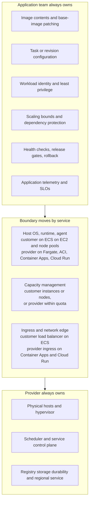

The responsibility diagram makes one point that the table can hide: the application team's column never empties. Moving from ECS on EC2 to Cloud Run removes host patching, runtime upgrades, and capacity planning from the team, but image patching, identity, configuration, scaling bounds, release gates, and telemetry remain. A team that adopts a more managed service and stops patching base images because "the provider handles security" has misread the boundary; the provider patches its host, not your image's OpenSSL.

Two shared areas need explicit agreement inside the organization, not just between customer and provider:

- **Platform team versus application team.** In most organizations a platform team owns registries, base images, landing-zone networking, and service templates, while application teams own images built on those bases and their task or revision configuration. Write down who rebuilds images when a base image is patched, and who is paged for a placement failure caused by a shared subnet.
- **Provider support boundary.** Provider support covers the service behaving as documented. It does not cover a task stuck in a crash loop because of application configuration, or a pull failure because a lifecycle rule deleted the image.

## 16. Security across the container path

Security foundations are owned by Part 15; this section collects the provider-specific controls from earlier sections into one review path so nothing is missed.

- **Registry.** Private repositories only, admin users disabled, tag immutability or locks on release tags, separate build and release repositories, runtime principals with pull-only rights, private endpoints or service perimeters, and audit logs of push and delete events (AWS CloudTrail, Azure activity and resource logs, Cloud Audit Logs).
- **Artifact.** Base images copied into a curated repository and pinned by digest, continuous scanning with findings routed by deployed digest, signatures and SLSA provenance stored as referrers, and verification at the deployment gate or by Binary Authorization.
- **Execution.** Non-root users in images where compatible, read-only root filesystems where the service supports them (ECS `readonlyRootFilesystem`), no privileged containers on Fargate (not possible) and none on EC2 without a written justification, secrets injected from a secret store rather than baked or passed as plain environment variables in templates.
- **Identity.** One identity per workload; ECS task role and execution role separated; Container Apps user-assigned identities for registry pull; Cloud Run user-managed service accounts with `actAs` restricted; no shared identity across services.
- **Network.** Private ingress by default, explicit egress paths through NAT or firewall for internet calls, per-task security groups on ECS, ingress restrictions and IAM invocation on Cloud Run, and internal environments on Container Apps for back-end services.
- **Isolation.** The isolation boundary is a property of the service. Fargate, ACI, and Cloud Run isolate each task, container group, or instance in a VM-grade sandbox; ECS on EC2 and Kubernetes node pools share a kernel among containers on a host unless you choose sandboxed runtimes. The shared-kernel limitation and its mitigations are taught in [Virtualization and Container Fundamentals](../05_Networking_and_OS/CH28_Virtualization_and_Container_Fundamentals.md) and [Container Security](../15_Security/CH14_Container_Security.md).

## 17. Failure scenarios and quality-attribute scenarios

### 17.1 Failure catalogue

| Failure | Where it appears | Detection | Architectural response |
| --- | --- | --- | --- |
| Registry region unavailable | Pull on task or replica start (not Cloud Run instance start) | `CannotPullContainerError`, Container Apps system logs, deploy failures | Regional registry replicas, recovery task definitions referencing the local registry, warm capacity |
| Lifecycle rule deleted a deployed digest | Next scale-out or replacement | Pull errors for a specific digest | Deployed-marker tags or locks; preview or dry-run policies in CI |
| Registry token expired mid-job | Long CI jobs or self-managed hosts | 401 on pull after hours | Credential helpers, managed runtime pulls |
| Missing S3 gateway endpoint | Private ECR pulls | Manifest succeeds, layers time out | Endpoint checklist in subnet templates |
| Registry throttling | Mass restart or large rollout | HTTP 429, slow pulls | Staggered rollout, caching, higher SKU, fewer layers |
| Execution role misconfigured | ECS task launch | `ResourceInitializationError` | Role templates, pre-deployment policy simulation |
| Subnet IP exhaustion | Scale-out or deployment surge | Placement failure events | /22 or larger subnets, alarms on free IPs |
| Quota exhausted | Scale-out | Desired minus running gap | Quota tracking at 70 percent, pre-peak increases |
| Bad release passes health checks | After traffic shift | Error-rate or latency alarm | Alarm-based rollback, canary, bake time |
| Cold-start storm after scale-to-zero | First requests after idle | p99 latency spikes | Minimum instances or replicas, smaller startup path |
| Ephemeral storage full | Long-running task writing scratch files | Task stopped, disk errors | Size ephemeral storage; stream to object storage |
| Secret rotated, old version deleted | Rollback or new replicas | Authentication failures in one revision | Overlapping versions until all revisions roll over |

### 17.2 Account compromise contained by organizational boundaries

**Stimulus**: credentials for the build pipeline in the build account are stolen and used to push a malicious image. **Environment**: multi-account layout from section 7.1. **Response**: the malicious digest lands only in the build repository; the promotion gate refuses it because its provenance does not come from the trusted builder; production cannot pull from the build repository at all. **Measure**: zero production tasks run a digest that lacks a valid signature from the release key, verified by a daily query comparing running digests (ECS `DescribeTasks`, Container Apps revisions, Cloud Run revisions) against signed release digests.

### 17.3 Migration with reversible cutover

**Stimulus**: a service moves from ECS on EC2 to ECS on Fargate (or from a VM to Container Apps). **Environment**: production traffic, a shared database. **Response**: the new service runs the same digest behind a separate target group; weighted DNS or load balancer listener rules shift 5, 25, 50, then 100 percent of traffic; the old service stays at full capacity until the bake period ends. **Measure**: the cutover can be reversed at any step within 2 minutes by changing weights, with no data reconciliation needed, because both services use the same database and the same image. The point after which reversal requires data work (for example, after the old instances are terminated and their local caches lost, or after a schema contract step) is the migration rollback boundary owned by [Cloud Migration](CH16_Cloud_Migration.md).

## 18. Provider comparison: guarantees, scopes, and responsibilities

The table compares what the services commit to and what they leave to you. Similar names do not imply similar guarantees; check the linked documentation for current terms and SLAs.

| Dimension | AWS | Azure | Google Cloud |
| --- | --- | --- | --- |
| Registry scope | ECR registry per account per Region; separate endpoints per Region | ACR registry resource; one global login server, regional replicas on Premium | Artifact Registry repository per project per region or multi-region |
| Registry geographic redundancy | Replication rules, new pushes only, lifecycle not synchronized | Geo-replication, multi-primary, asynchronous (Premium) | Multi-region locations; cross-location copies via pipeline |
| Registry credential lifetime | 12-hour authorization token | Entra-based refresh token renewed every 3 hours | 60-minute OAuth access token |
| Tag protection | Repository `IMMUTABLE` with exclusion filters | Per-image or per-repository locks | Repository immutable-tag setting |
| Pull-through cache | Pull-through cache rules including ECR-to-ECR | Artifact cache rules (Standard and Premium) | Remote and virtual repositories |
| Private access | PrivateLink endpoints for `ecr.api` and `ecr.dkr` plus S3 gateway | Private Link endpoints (Premium) and dedicated data endpoints | Private Google Access, Private Service Connect, VPC Service Controls |
| Signing integration | AWS Signer with Notation; ECR managed signing | Notary Project with Key Vault; DCT retiring 2028 | Sigstore or Notation artifacts; Binary Authorization attestations |
| Deploy-time signature enforcement | Not native on ECS; native options on EKS through policy engines | Image integrity on AKS; not native on Container Apps | Binary Authorization on Cloud Run and GKE |
| Task or service platform | ECS on EC2, ECS on Fargate, ECS Express Mode; App Runner closed to new customers | ACI (container groups), Container Apps (environments, apps, revisions, jobs) | Cloud Run services, jobs, worker pools |
| When the image is fetched | Each task start (Fargate); cached on EC2 hosts when configured | Each container group or replica start | Imported at deploy time; not pulled on instance start |
| Per-copy network identity | ENI per task in `awsvpc` with security groups | Environment subnet; ACI subnet delegation | Direct VPC egress addresses or connector; ingress settings |
| Workload identity | Task role (application) and task execution role (platform) | System- or user-assigned managed identities | User-managed service account as service identity; service agent for pulls |
| Scaling mechanism | Application Auto Scaling target tracking, step, scheduled, predictive | KEDA-based HTTP, TCP, and custom scalers, 0 to 1,000 replicas | Request concurrency and CPU targets, min and max instances |
| Deployment safety built in | Circuit breaker, alarm rollback, native blue/green, linear, canary with bake time | Revision readiness gating; traffic weights and labels | Startup-probe gating; no-traffic tagged revisions; traffic percentages |
| Ephemeral storage | 20 GiB default, up to 200 GiB on Fargate | 1 to 8 GiB per replica by vCPU | In-memory, counted against memory |
| Customer owns host patching | On ECS on EC2 only | No | No |

## 19. Case study: consolidating container platforms at a payments company

### 19.1 Context

A European payments company, here called Northwind Pay, runs about 70 services. It grew through acquisition, so its estate spans AWS (the core ledger and APIs, on ECS on EC2), Azure (a merchant portal acquired with a smaller company, on ACI container groups started by scripts), and Google Cloud (a fraud-scoring team using Cloud Run). Three incidents in six months triggered a platform review:

1. A lifecycle policy in the AWS shared ECR repository expired an image still used by a low-traffic settlement service. When an EC2 instance was replaced, the task could not start; settlement files were delayed by 5 hours.
2. During an AZ impairment, the ECS on EC2 cluster lacked spare instance room in the remaining AZs; the capacity provider launched instances, but the API was degraded for 22 minutes.
3. A merchant portal container group on ACI was redeployed by a developer from a laptop with a mutable `latest` tag, shipping an untested build to production.

Requirements agreed with stakeholders:

- Every production container runs a digest that is signed by the release pipeline, with SLSA provenance and a scan result less than 7 days old.
- Core APIs: 99.95 percent availability, survive the loss of one AZ with no more than 2 minutes of degradation, and recover in a second Region within 30 minutes.
- No team patches hosts.
- Infrastructure cost for compute must not rise by more than 10 percent.

### 19.2 Decisions

**Registry layout.** Each provider gets one artifact account, subscription, or project owned by the platform team, with build repositories (short retention, writable by CI) and release repositories (immutable tags, long retention, writable only by the promotion identity). On AWS, ECR replication copies the `release/` prefix to the recovery Region; on Azure, the release ACR is Premium with geo-replication to the paired recovery region and private endpoints; on Google Cloud, release repositories use the `europe` multi-region location. The promotion pipeline adds a `deployed-<env>-<date>` immutable tag (ECR, Artifact Registry) or a lock (ACR) to every digest it deploys, and lifecycle and cleanup rules exclude those tags. **Rejected alternative:** a single cross-cloud registry. It would simplify promotion but put one provider's registry on the start path of every other provider's workloads, adding cross-cloud egress cost and a cross-provider failure dependency.

**Core APIs on AWS: ECS on Fargate.** The team compared ECS on EC2 with better capacity management, ECS on Fargate, and moving to EKS. Fargate removes host patching (a requirement) and the instance-room problem from incident 2. EKS was rejected because no service needs Kubernetes APIs, and the team has no Kubernetes operators; adopting it would add cluster upgrades and policy to the platform team's work without a matching requirement. Two ledger batch jobs that use specialised instance storage stay on ECS on EC2 with a capacity provider.

**Merchant portal on Azure: Container Apps.** ACI was rejected for the portal because it lacks autoscaling, rolling updates, and an ingress layer; the scripts that started container groups were the root cause of incident 3. Container Apps gives revisions, traffic splitting, managed identity pulls, and a zone-redundant internal environment in the existing virtual network, fronted by Application Gateway with web application firewall rules. ACI remains for nightly reconciliation jobs that run one container for 20 minutes; Container Apps jobs were considered and are a likely future move.

**Fraud scoring on Google Cloud: stay on Cloud Run,** add Binary Authorization requiring the release attestor, replace the default compute service account with a per-service account, and set minimum instances to keep scoring latency under its 80 ms p99 target.

**Provenance enforcement.** On Cloud Run, Binary Authorization enforces at deploy. On ECS and Container Apps, which lack native enforcement, the deployment pipeline verifies Notation signatures and the SLSA provenance before registering a task definition or creating a revision, and only the pipeline's role can call `ecs:UpdateService` or modify Container Apps. A daily reconciliation job lists running digests across all three providers and alerts on any digest not in the signed release set.

### 19.3 Capacity and quota arithmetic for the core API

The core payments API peaks at 3,000 requests per second. Load tests show one 1 vCPU, 2 GB Fargate task handles 120 requests per second at the latency target with CPU at 60 percent.

- Peak tasks needed: 3,000 / 120 = 25.
- Survive loss of one of three AZs without waiting for replacement: 25 × 3 / 2 = 37.5, so 38 tasks at peak, about 13 per AZ.
- Deployment surge at 200 percent maximum: 76 tasks briefly, so 76 vCPU for this service during a peak-time deployment. The team instead deploys with minimum healthy 100 percent and maximum 150 percent, needing 57 vCPU.
- Account-wide Fargate vCPU at peak, all services: 290 vCPU, plus the largest single surge (19) = 309. Quota requested: 450 vCPU, keeping use under 70 percent.
- Subnets: /22 per AZ (1,019 usable). Peak per AZ after an AZ loss including all services: about 260 addresses.
- Recovery Region: warm standby of 8 tasks, scaling to 38 within the RTO; quota of 200 vCPU there, verified by a quarterly game day.

Cost check: the EC2 estate ran at about 45 percent average utilization because spare room was kept for deployments. Fargate tasks at their actual size, with Compute Savings Plans covering the baseline and Graviton ARM64 images, came within 6 percent of the previous EC2 cost, inside the 10 percent requirement.

### 19.4 Validation evidence

- **AZ failure game day.** Using AWS Fault Injection Service to stop tasks in one AZ at simulated peak load, the service held error rate at 0.2 percent and p99 at 310 ms; replacement tasks reached healthy in 82 seconds.
- **Registry outage drill.** The recovery Region was started with the primary Region's ECR endpoint blocked by a network access control list (ACL). All 38 tasks started from the replicated registry within 9 minutes; a static check found two task definitions in a non-critical service still referencing the primary Region's hostname, which were fixed.
- **Retention test.** A dry-run of the new cleanup rules against a copy of production metadata showed zero deployed digests selected for deletion, including the settlement image from incident 1.
- **Provenance bypass test.** A developer role attempted `ecs:UpdateService` with an unsigned digest; IAM denied it. A pipeline run with an unsigned digest failed at the verification step. Container Apps showed the same behaviour.
- **Rollback timing.** With native blue/green and a 10-minute bake, a deliberately broken release (returning 5 percent errors) triggered the 5xx alarm and returned all traffic to blue in 48 seconds.

### 19.5 What remained open

Cross-cloud promotion still uses three pipelines with a shared policy library rather than one controller. The ACI reconciliation jobs have no signature enforcement beyond the pipeline. App Runner was not in use, so its closure required no action, but the team added a quarterly review of service lifecycle announcements for every runtime it depends on.

## 20. Common mistakes and anti-patterns

**Deploying by mutable tag.** Cause: convenience and old habits. Consequence: different replicas can run different code, rollback targets are ambiguous, and audit cannot say what ran. Even where the runtime resolves digests per deployment (ECS, Cloud Run), the deployment record should state the digest.

**Retention by count without deployed markers.** Cause: lifecycle rules written for storage cost. Consequence: a burst of releases or a quiet service turns the next scale-out into an outage, as in the case study's first incident.

**Recovery task definitions that reference the primary registry.** Cause: copying infrastructure code between Regions without parameterizing the registry hostname. Consequence: the recovery Region cannot start tasks during the outage it exists for.

**Putting application permissions on the ECS execution role.** Cause: confusion between the two roles. Consequence: the application still has no credentials, and every task definition that shares the execution role gains broad access during launch.

**Running Cloud Run services as the default compute service account.** Cause: accepting defaults. Consequence: any code-execution vulnerability in the container yields project-wide permissions.

**Using a system-assigned identity for the first ACR pull in Container Apps.** Cause: following the simplest example. Consequence: first deployment fails or races role propagation; user-assigned identities granted in advance avoid it.

**Undersized subnets for per-task or per-instance addressing.** Cause: sizing subnets for VMs. Consequence: deployments and scale-out fail at the worst moment, typically during an AZ loss.

**Treating "deployment complete" as "release healthy."** Cause: relying on launch and container health only. Consequence: bad releases reach all users. Attach service-level alarms to the deployment or use canary with bake time.

**Kubernetes by default.** Cause: assuming every container estate needs a cluster. Consequence: cluster upgrades, add-ons, and policy work with no matching requirement. The opposite mistake, forcing a workload that needs operators or DaemonSets onto a managed container service, produces workarounds that cost more than the cluster.

**Writing large files on Cloud Run or filling Fargate ephemeral storage.** Cause: VM assumptions about local disk. Consequence: out-of-memory kills on Cloud Run, task stops on Fargate.

**Scale-to-zero for latency-sensitive services.** Cause: optimizing cost alone. Consequence: cold-start latency on the first requests after idle periods. Set minimum instances or replicas where the latency objective requires it.

**Assuming the provider patches your image.** Cause: misreading shared responsibility. Consequence: known-vulnerable libraries run indefinitely on a fully managed platform.

## 21. Design-review checklist

Artifact and registry:

- Does every production deployment reference an image digest, and is the digest recorded with the release?
- Are release tags immutable or locked, and are build and release repositories separated with different write identities?
- Do retention rules provably exclude every digest deployed within the rollback window, with dry-run evidence?
- Is scanning continuous, and are findings routed by currently deployed digest to an owner with a remediation target?
- Are signatures and provenance stored as referrers, and where exactly is each verified before deployment?

Distribution and recovery:

- For each runtime, when does it fetch the image, and what happens to scale-out if the registry Region is down?
- Is the release repository replicated or multi-regional, and does the pipeline wait for replication before marking a release complete?
- Do recovery-Region task definitions and revisions reference the recovery-Region registry?
- Are private endpoints, DNS zones, and the ECR S3 gateway endpoint present in every subnet that pulls?
- Are base images pulled through a cache or copied into a curated repository?

Execution, identity, and networking:

- Is the chosen service justified against the decision criteria, with the rejected alternatives recorded?
- Are ECS task and execution roles separate and minimal, Container Apps registry pulls using a pre-granted user-assigned identity, and Cloud Run services using dedicated service accounts?
- Are subnets sized for peak tasks or instances during a deployment after the loss of one AZ?
- Is ephemeral storage sized from unpacked image size plus scratch use, and is no durable state on it?

Fleet and release:

- Are scaling signals, bounds, and maximums set to protect downstream dependencies?
- Is quota headroom tracked, alarmed at 70 percent, and raised before planned peaks?
- Is there an alarm on desired minus running copies?
- Does the deployment gate include service-level health, and has rollback been timed in a test?
- Is the previous revision compatible with current schema, secrets, and message formats?

Operations and ownership:

- Do logs carry the digest and revision, and do they outlive the container?
- Is the provider-versus-team and platform-versus-application responsibility split written down, including who rebuilds on base-image patches?
- Is there a review cadence for service lifecycle announcements such as App Runner's closure?

## 22. Exercises

### 22.1 Interview questions

1. Explain the difference between an ECS task role and a task execution role. Describe a symptom that points to each being misconfigured.
2. Why does a registry outage affect an ECS on Fargate service and a Cloud Run service differently during a traffic spike?
3. A lifecycle policy keeps the 20 most recent images. Describe two situations in which it deletes an image that production still needs, and how you would prevent both.
4. What does an image signature prove that a digest does not? What does neither prove?
5. Where can you enforce "only signed images run" on Cloud Run, AKS, ECS, and Container Apps?
6. A Cloud Run service at 1,000 requests per second suddenly sees latency rise from 100 ms to 1 second. What happens to instance count, and which setting prevents a downstream database from being overwhelmed?
7. When would you choose ACI over Container Apps, and when Container Apps over AKS?

### 22.2 Design exercises

1. **Multi-account promotion.** Design the AWS account, repository, and IAM layout for a company with build, staging, and production accounts in two Regions. Specify which principals can push, promote, pull, and delete, and how a digest moves from build to production. State how you would prove a compromised build role cannot reach production.
2. **Registry recovery.** For an Azure Container Apps estate with an RTO of 20 minutes in a second region, design the ACR topology, the deployment pipeline's replication checks, and the game-day test. Calculate the Container Apps core quota needed in the recovery region for 30 replicas of 1 vCPU each, including a deployment surge.
3. **Startup budget.** A Java service must scale from 10 to 100 tasks within 3 minutes on Fargate. Its image is 1.4 GB and startup is 25 seconds. Build a startup-time budget by phase, identify the dominant phase, and propose two changes with estimated savings.
4. **Migration with reversible cutover.** Plan the move of a VM-hosted API to Cloud Run with the same database. Define traffic-shift steps, the measurements at each step, the rollback action and its time, and the point after which rollback needs data work.

### 22.3 Hands-on exercises with the chapter code

1. Run [01_digest_promotion.py](../code/python/containers-chapter/01_digest_promotion.py), then change the artifact's tag to `latest` and its digest to a tag-style value; observe which rule fires first and why both rules are needed.
2. Run [02_provenance_policy.py](../code/python/containers-chapter/02_provenance_policy.py) and add a third attestation that has every field but a builder identity of `laptop`. Extend your reasoning (not the file) to describe the rule that should reject it.
3. Run [03_service_fit.py](../code/python/containers-chapter/03_service_fit.py) with requirements for a queue worker (`batch_fit` 5, `http_service_fit` 1) and for a multi-team platform needing custom controllers (`orchestration_control` 5). Compare the rankings with the decision tree in section 8.7.
4. Run [04_rollout_health_gate.py](../code/python/containers-chapter/04_rollout_health_gate.py) and map each threshold to the provider mechanism that would enforce it: an ECS CloudWatch alarm, a Container Apps pipeline check, or a Cloud Run traffic-step gate.

## 23. Summary

Cloud container services are four contracts around an image. The artifact contract is kept by building once, deploying by digest, protecting release tags, and attaching signed provenance next to the digest. The distribution contract depends on registry scope, short-lived tokens, private network paths, throttling limits, and above all on when each runtime fetches the image: Fargate, ACI, and Container Apps pull at every start, ECS on EC2 can use host caches, and Cloud Run imports at deploy time. That difference decides whether the registry is on your scale-out path during an outage and therefore how you replicate it. Retention rules must know what is deployed, or they become outage generators.

The execution and fleet contracts are where providers differ most. ECS gives two capacity models under one scheduler, per-task network interfaces, and a clean split between task and execution roles. Container Apps gives revisions, KEDA scaling, managed ingress, and managed identities without the Kubernetes API. Cloud Run gives request-driven scaling with explicit concurrency, deploy-time image import, tagged no-traffic revisions, and Binary Authorization. ACI gives isolated container groups with no fleet features. App Runner is closed to new customers. Managed Kubernetes is the far end, chosen when its API is a requirement. Whatever the choice, the application team still owns image patching, identity, configuration, scaling bounds, release gates, and telemetry, and should verify quotas, subnet capacity, and rollback behaviour with tests rather than assumptions.

## 24. Code examples

The examples use only the Python standard library and synthetic metadata. They do not contact a registry or cloud API and are teaching aids, not replacements for provider policy engines or scanners.

- [01_digest_promotion.py](../code/python/containers-chapter/01_digest_promotion.py) builds `repository@digest` deployment references for staging and production, rejecting non-digest references and the mutable `latest` tag.
- [02_provenance_policy.py](../code/python/containers-chapter/02_provenance_policy.py) checks an attestation for required evidence (source revision, builder identity, scan result, dependency manifest, digest) and denies promotion when evidence is missing or the scan failed.
- [03_service_fit.py](../code/python/containers-chapter/03_service_fit.py) ranks a managed task service, a managed container application, and managed Kubernetes against weighted workload requirements, crediting each only up to the required level.
- [04_rollout_health_gate.py](../code/python/containers-chapter/04_rollout_health_gate.py) evaluates canary observations against error-rate and latency thresholds and reports whether the rollout should continue or halt.
