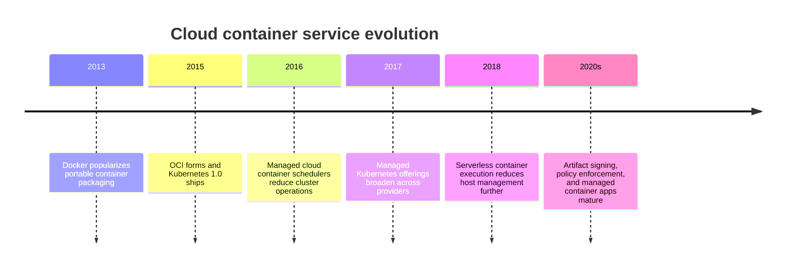
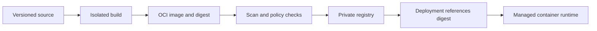
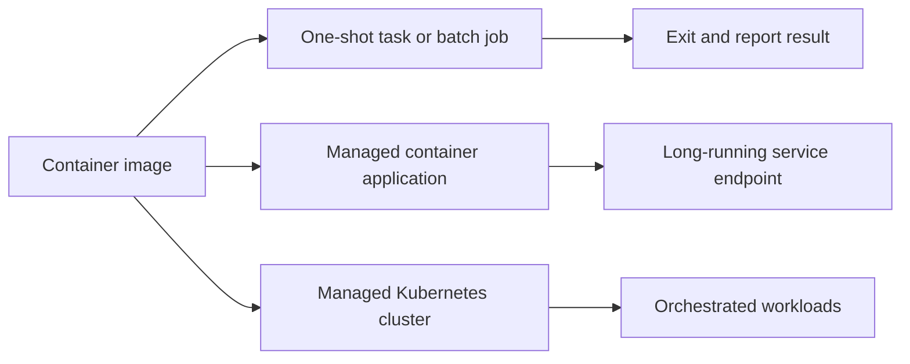
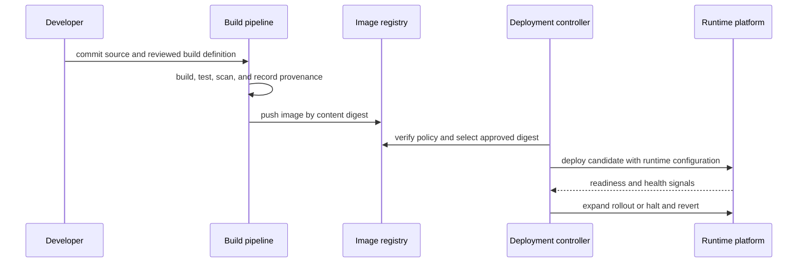
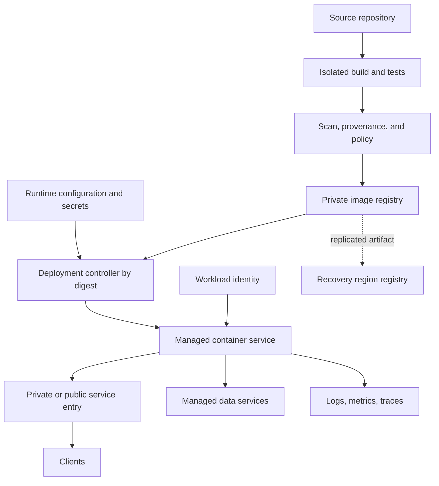

# Chapter: Cloud Container Platforms

Part: [09 — Cloud Computing](PART_OVERVIEW.md) · Status: Drafted

## 1. Introduction

Cloud container services provide managed image registries, task execution, application platforms, and orchestration integrations for packaged workloads. A container makes the application artifact more reproducible across environments, but it does not remove decisions about image provenance, runtime configuration, network access, persistent state, capacity, rollout, or isolation.

This chapter focuses on cloud container delivery and managed execution: registries, image promotion, service models, deployment, scaling, networking, persistence, and supply chain controls. Part 05's [Virtualization and Container Fundamentals](../05_Networking_and_OS/CH28_Virtualization_and_Container_Fundamentals.md) owns image layers, the Open Container Initiative (OCI) formats, and runtime internals. The next Part 09 chapter owns Kubernetes orchestration; Serverless owns function execution and serverless-specific event models.

## 2. Historical Evolution

Containers began as operating-system-level isolation and became a portable packaging unit as image formats and runtimes converged. Cloud providers first offered container execution through virtual-machine clusters and managed schedulers; later, managed task, application, and serverless-container services reduced the need to operate worker nodes. Hosted registries and build services made artifact publication and deployment part of one delivery path.

The evolution created several operating models rather than one replacement path. Some workloads need cluster-level control; others need only a container image and a managed endpoint. The architect chooses the simplest model that meets runtime, networking, scale, and recovery requirements.

## 3. Why It Exists

Containers package application code and dependencies into a consistent deployment unit. Cloud services can store, scan, replicate, and run those images while abstracting some host lifecycle work. This reduces environment drift but shifts attention to provenance, configuration, runtime permissions, and deployment reliability.

An image is not a complete production workload. It must be fetched from a registry, configured without embedding secrets, assigned a runtime identity, connected to dependencies, observed, scaled, and replaced safely. These boundaries determine whether the same artifact can move from test to production without rebuilding or silently changing its contents.

## 4. Core Concepts

### 4.1 Container registries and artifact identity

**Definition.** A container registry stores and distributes image manifests and layers. A repository groups related images; a tag is a human-readable reference that may be mutable; a digest identifies content by cryptographic hash and is immutable for that content. Registries may be private, public, regional, or globally replicated depending on the provider.

**Mechanism.** A build system creates an OCI-compatible image and pushes its manifest and layers to a registry. A deployment refers to a repository and tag or digest. At runtime, the platform authenticates to the registry, retrieves image content, verifies available metadata, and starts the container. Registry replication and caching can reduce pull latency, but they do not change the image's identity or guarantee that a deployment used the intended version.

**Decision implications.** Promote the same image digest from test to production; avoid rebuilding separately for each environment. Choose a registry based on access integration, availability, replication, retention, scanning, and cross-account/project sharing. Part 05 owns OCI image format and layer mechanics; this section focuses on cloud registry lifecycle.

**Common failure mode.** Deploying a mutable `latest` tag makes it unclear which artifact is running and can cause different replicas to use different content. Another failure is depending on a registry in one region without testing image-pull behavior during that region's outage.

**Scenario.** A team builds an image once, scans it, records its digest, and promotes that exact digest through staging and production. The deployment audit stores source commit, build identity, scan result, and runtime digest together.

### 4.2 Registry identity, authorization, and retention

Registry access has two separate paths: administrators and build systems push images; runtime identities pull images. Use narrowly scoped roles and short-lived credentials or workload identity where supported. Avoid placing registry passwords in container definitions or source repositories.

Set retention rules for untagged manifests and old tags, but preserve images required for rollback or compliance. Cross-project or cross-account pulls need explicit authorization and network reachability. Registry deletion and lifecycle policies are production changes because a running workload may need to pull the artifact again during rescheduling or recovery.

### 4.3 Managed container execution models

Cloud providers offer several ways to run containers: a task or job on managed compute; a managed application container platform; a container runtime embedded in a broader service; or a cluster orchestrator such as Kubernetes. Examples include Amazon Elastic Container Service (ECS) with Fargate, Azure Container Apps, and Google Cloud Run; managed Kubernetes offerings are covered by the next chapter. Product boundaries change, so verify which service owns scheduling, host patching, scaling, network configuration, and runtime limits.

**Decision implications.** Choose one-shot tasks for bounded work, managed container applications for services with supported networking and scaling needs, and Kubernetes when its orchestration surface is required. The Serverless chapter owns function triggers and scale-to-zero behavior; this chapter focuses on container artifact and platform decisions.

**Common failure mode.** Selecting Kubernetes as the default container runtime when a managed application platform already meets the workload's needs. This adds cluster lifecycle and policy work without an orchestration requirement. The opposite failure is choosing a simplified task service that cannot support needed network or scheduling controls.

**Scenario.** A small internal API runs as a managed container application with a private endpoint and a minimum replica count. A separate scheduled report task uses a one-shot container job and exits after writing its result to object storage.

### 4.4 Image build, promotion, and deployment contract

A continuous integration (CI) pipeline and continuous delivery (CD) controller should bind source, build environment, image digest, scan evidence, configuration, and deployment identity. Build once in a controlled environment; promote by digest; inject environment configuration at deployment; and keep credentials outside the image. The release controller verifies policy and health before expanding rollout.

Separate build and deployment permissions. The build identity can publish artifacts; the deployment identity can select and run approved artifacts. Record who promoted an image and which configuration accompanied it.

### 4.5 Supply-chain security and image provenance

Supply chain controls establish where an image came from, how it was built, what dependencies it contains, and whether it meets policy. A useful pipeline combines source review, isolated build, vulnerability scanning, secret detection, provenance metadata, signing or attestation, and deployment-time verification. Scanning does not prove safety; it provides evidence to combine with base-image policy, patch cadence, and runtime controls.

Use minimal trusted base images, pin dependencies, remove build tools from runtime images where practical, and rebuild after security fixes. Preserve provenance and scan records with the deployed digest. The Security part owns general threat modeling and cryptographic foundations; this section applies them to container artifact delivery.

### 4.6 Runtime configuration, identity, and secrets

Images should contain executable code and non-sensitive defaults, not environment-specific secrets. Runtime configuration supplies endpoints, feature switches, and resource limits; a workload identity grants access to cloud services; a secret manager supplies credentials when unavoidable. Separate configuration changes from image builds when they do not alter the artifact, but version and review both.

Give each workload a distinct runtime identity and scope access to required resources. Registry pull identity and application identity may be different. Rotate credentials without rebuilding an image, and ensure startup fails safely if required configuration is absent rather than logging secret values.

### 4.7 Networking, storage, and state

Container placement does not determine network security automatically. The platform may provide a service endpoint, virtual network attachment, ingress controller, or cluster network; each has distinct egress and identity behavior. Use the Part 09 Networking chapter for cloud routes and private connectivity, and Kubernetes for pod/service networking.

Containers are replaceable execution units, so durable state should usually live in separately managed databases, object stores, or file services. If a workload needs attached persistent volumes, check attachment scope, rescheduling behavior, backup integration, and whether a replacement instance can mount the data. Part 05 owns the underlying container filesystem and mount semantics.

### 4.8 Scaling, placement, and availability

Container platforms scale from replica counts, requests, queue signals, or service-specific concurrency. The platform must pull images, schedule capacity, start containers, pass health checks, and connect dependencies before replicas can serve traffic. Cold starts, quota, registry availability, and regional supply constrain reaction time.

Set minimum and maximum capacity, startup/readiness checks, termination grace, and dependency limits. Spread replicas across failure domains where supported, and test whether the service retains capacity during a zone loss. Kubernetes scheduling details belong to the next chapter; the concern here is verifying the managed container service contract.

### 4.9 Observability and rollout safety

Observe image pull errors, startup latency, readiness failures, restarts, resource throttling, request latency, and deployment revision. Correlate runtime events with image digest, source commit, and configuration version. Health probes should reflect whether the container can serve the intended request, not merely whether its process exists.

Use canary or staged rollout when the platform supports it. Halt on user-facing error or latency regression; keep rollback artifacts available in the registry and ensure the previous version remains compatible with current data. A deployment status of “complete” is not evidence of healthy application behavior.

### 4.10 Cloud container service selection

Select a container service from workload duration, request pattern, orchestration needs, network model, security boundary, state, scaling, and operator capability. Compare managed tasks, application platforms, and Kubernetes based on the work the team must own and the controls the service exposes. Avoid using “containers are portable” as a substitute for examining identity, network, storage, and deployment dependencies.

Record image provenance, execution model, scaling triggers, restart behavior, service limits, data dependencies, and exit path. Keep a standard OCI image when portability is valuable, but recognize that cloud service configuration and managed identities may still be provider-specific.

## 5. Internal Working

A typical deployment begins with a source revision and build definition. A controlled builder resolves dependencies, creates an OCI image, runs tests and scans, and pushes a content-addressed artifact to a registry. A deployment controller selects an approved digest and supplies runtime configuration, identity, network attachment, resource limits, and health checks.

The cloud runtime retrieves the image, allocates capacity, starts the container, and waits for readiness before routing traffic. During a rollout, the platform replaces or adds replicas according to policy. Failure can occur at source/build, registry, authorization, scheduling, startup, readiness, or dependency access; each stage needs distinct telemetry and rollback handling.

## 6. Design Principles

- Build once and promote by immutable image digest.
- Separate build, registry-push, deployment, and runtime identities.
- Keep secrets out of images and deployment logs.
- Verify image provenance, vulnerabilities, and policy before production.
- Select a managed execution model from explicit workload needs.
- Keep durable state outside replaceable container instances unless a volume is required.
- Define health, readiness, graceful termination, and rollback behavior.
- Keep previous approved artifacts available for recovery.
- Measure startup time, pull behavior, quotas, and scale response.

## 7. Architecture Patterns

**Build once, promote by digest.** A CI pipeline pushes a content-addressed artifact; deployment environments add configuration without rebuilding the image.

**Managed container application.** A provider service handles host capacity and endpoint integration while the team owns image, runtime identity, health, and scaling configuration.

**One-shot container job.** A scheduler starts a bounded container for a batch task, captures status, and terminates it. Durable input/output remains in managed storage or messaging.

**Kubernetes platform.** A managed control plane orchestrates workloads that need the Kubernetes API and ecosystem. The dedicated Part 09 Kubernetes chapter owns cluster architecture and operations.

## 8. Production Architecture

Production readiness includes registry access during recovery, image retention, runtime identity, secret retrieval, network and data paths, capacity limits, health gates, and a documented rollback target.

## 9. Implementation

1. Classify the workload as a service, job, batch worker, or orchestrated application.
2. Build a minimal, reproducible OCI image with pinned dependencies.
3. Select a private registry and configure retention, replication, and pull identities.
4. Add testing, vulnerability scanning, provenance, and approval gates.
5. Promote an immutable digest and inject environment configuration at runtime.
6. Select managed task, application platform, or Kubernetes based on requirements.
7. Define runtime identity, network access, storage, health probes, and resource limits.
8. Deploy progressively and verify user-facing behavior and rollback readiness.

## 10. Complete Code Examples

- [Container image digest promotion policy](../code/python/containers-chapter/01_digest_promotion.py)
- [Container build provenance checker](../code/python/containers-chapter/02_provenance_policy.py)
- [Managed container service fit matrix](../code/python/containers-chapter/03_service_fit.py)
- [Container rollout and health-gate simulator](../code/python/containers-chapter/04_rollout_health_gate.py)

The examples use the standard library and synthetic metadata. They do not contact a registry or cloud API and are teaching aids, not substitutes for provider policy or image-scanning tools.

## 11. Performance

Container performance depends on the machine shape, runtime limits, image size, registry distance, startup work, network, and downstream services. Measure image pull time, cold start, readiness delay, CPU throttling, memory pressure, and request latency. A small image can improve deployment speed, but performance decisions should be based on the running workload.

Cache layers and images in appropriate regions where the service supports it. Avoid excessive image rebuilds and startup-time package downloads. Set resource requests and limits from measurement; Part 05 owns cgroup mechanics, while Kubernetes owns pod resource scheduling behavior.

## 12. Scalability

Managed container services scale through task count, replica count, request concurrency, or event backlog. Scale response includes scheduling and image-pull time, so it may lag demand. Quotas, regional capacity, registry availability, and downstream limits can prevent a desired replica count from becoming serving capacity.

Set autoscaling bounds and a minimum baseline appropriate to latency objectives. Use queues to buffer batch work and cap concurrency to protect dependencies. Test scale-in and graceful termination so in-flight requests or jobs are not abandoned.

## 13. Security

Use trusted base images, scan artifacts, verify provenance, and run with a non-root identity when compatible. Limit registry push rights, use workload identity for runtime access, and isolate build credentials from deployment credentials. Restrict ingress and egress, configure secrets at runtime, and audit image changes.

Container packaging does not create a stronger isolation boundary than the runtime provides. Part 05 owns shared-kernel container isolation; select managed sandbox or virtual machine (VM)-backed execution when the threat model requires stronger isolation and the service offers it. Security mechanics and key handling remain with Security and Secrets Management.

## 14. Observability

Track image pull failures, startup and readiness time, restarts, exit codes, resource throttling, replica count, deployment revision, and application service-level objective (SLO) signals. Include image digest and source revision in logs or deployment metadata. Alert on repeated restarts, stuck rollout, unavailable registry, or a growing gap between desired and healthy capacity.

Route logs and traces to a durable service outside the container lifecycle. A container replacement should not erase the only copy of an incident record.

## 15. Failure Scenarios

| Failure | Likely symptom | Architectural response |
|---|---|---|
| Registry unavailable | New tasks cannot pull image | Keep recovery registry path and known-good cached capacity |
| Image pull denied | Tasks fail before startup | Verify pull identity, repository scope, and network path |
| Bad image | Startup or readiness fails | Halt rollout and redeploy previous digest |
| Vulnerable dependency | Scan or runtime alert | Block promotion, rebuild from trusted base, rotate affected credentials |
| Secret service unavailable | Application cannot initialize | Preserve controlled recovery access and avoid logging secret values |
| Quota or capacity shortage | Desired replicas remain pending | Maintain capacity headroom and test alternate zones/regions |
| Crash loop | Repeated container restarts | Inspect exit status, limits, configuration, and dependency readiness |
| Bad configuration rollout | New revision fails despite valid image | Version configuration separately and restore known-good revision |

Recovery should work even when the primary registry, build service, or region is impaired. Retain deployable artifacts and configuration versions in a recovery location consistent with data-residency and access policy.

## 16. Testing

Test image build reproducibility, vulnerability policy, registry pull from target networks, runtime identity, secret retrieval, health probes, termination behavior, and rollout rollback. Deploy the same digest to staging and production-like environments. Verify that configuration changes are attributable and reversible.

Simulate registry denial, image startup failure, dependency outage, quota exhaustion, and region loss. Confirm that the platform reports desired versus serving capacity and that logs remain available after containers restart. Test the previous image digest as a real rollback target.

## 17. Common Mistakes

- Deploying mutable tags without recording the resolved digest.
- Rebuilding separately for each environment and losing artifact equivalence.
- Storing credentials in image layers, environment dumps, or logs.
- Giving runtime identities registry-push or broad project permissions.
- Treating a registry scan as proof the image is safe.
- Assuming containers provide VM-grade isolation.
- Depending on one regional registry during disaster recovery.
- Ignoring startup delay, image pull latency, and graceful termination.

## 18. Best Practices

- Pin base images and dependencies; rebuild regularly for security updates.
- Promote images by digest and preserve provenance with deployment records.
- Use private registries and separate push/pull permissions.
- Keep images minimal and avoid build-time secrets.
- Configure runtime identity and secrets separately from artifact contents.
- Make health and readiness probes reflect real service readiness.
- Retain approved rollback images and replicate artifacts when recovery requires it.
- Select task, managed app, or Kubernetes service according to operational need.

## 19. Anti-Patterns

**`latest` in production.** A mutable tag makes the deployed artifact ambiguous and complicates rollback. Resolve and record a digest instead.

**Build in production.** Fetching packages or building images during startup makes deployment nondeterministic and expands production credentials. Build and scan before promotion.

**Kubernetes by default.** A cluster adds control-plane, upgrade, networking, and policy responsibilities. Adopt it when its API and scheduling model are requirements, not merely because the application uses containers.

**One shared runtime identity.** A compromised container can affect every workload granted to a shared identity. Assign workload-scoped identities and separate service accounts.

## 20. Trade-off Analysis

| Choice | Benefits | Costs and risks | Choose when |
|---|---|---|---|
| Managed container app | Less host and scheduler operation | Service-specific runtime and network limits | Workload fits supported application model |
| One-shot task service | Simple bounded job execution | Limited orchestration and scheduling controls | Job is independent and finite |
| Managed Kubernetes | Flexible orchestration and ecosystem | Cluster operations, policy, and skills required | Kubernetes APIs or scheduling features are needed |
| Private registry | Access control and artifact governance | Replication, availability, and retention operations | Images are proprietary or production-critical |
| Digest-pinned deployment | Reproducibility and auditability | Requires explicit promotion workflow | Production traceability matters |
| Registry replication | Faster regional pulls and recovery | Cost and policy synchronization | Regional recovery or global deployment requires it |

## 21. Comparison Table

| Dimension | AWS | Azure | Google Cloud |
|---|---|---|---|
| Managed registry | Amazon Elastic Container Registry (ECR) | Azure Container Registry (ACR) | Artifact Registry |
| Managed container application | ECS/Fargate and App Runner | Container Apps and Container Instances | Cloud Run |
| Managed Kubernetes | Amazon Elastic Kubernetes Service (EKS) | Azure Kubernetes Service (AKS) | Google Kubernetes Engine (GKE) |
| Image access | Identity and Access Management (IAM) and registry policies | Microsoft Entra and registry roles | Identity and Access Management (IAM) and Artifact Registry roles |
| Runtime boundary | Service-specific; verify task, app, and cluster model | Service-specific; verify app, instance, and cluster model | Service-specific; verify job, service, and cluster model |

The table is an entry point, not an equivalence claim. Compare deployment model, networking, identity, scaling, startup, isolation, and recovery for the workload and region.

## 22. Real-World Case Study

### Shopify's containerized production environment

In a [2014 Shopify Engineering article](https://shopify.engineering/docker-at-shopify-how-we-built-containers-that-power-over-100-000-online-shops), the company described its effort to containerize production workloads. The article reports a preference for thin, single-purpose containers, host-shared logging and monitoring services, commit-SHA image tags, and a central registry behind caching proxies to reduce repeated pulls and registry dependency. It is a historical account of Shopify's design at that time, not a description of its current platform.

The architecture illustrates several durable decisions: keep containers focused, move expensive build work out of startup, preserve artifact-to-source traceability, and treat the registry as a production dependency that needs caching and recovery. Shopify also describes changing application and host integration to fit container lifecycle and operational tooling rather than expecting a packaging format to solve those concerns automatically.

The transferable lesson is not Shopify's exact topology or 2014 tooling. Teams should measure image-pull and startup behavior, assign ownership for shared host services, and preserve immutable artifact identity. Modern deployments should apply current OCI formats and security practices while validating their own isolation, rollout, and regional recovery requirements.

## 23. Interview Questions

1. Why should production deployments reference image digests rather than mutable tags?
2. What belongs in a container image, and what should be supplied at runtime?
3. How do registry push identity and workload identity differ?
4. When is a managed container application preferable to Kubernetes?
5. What does vulnerability scanning prove, and what does it not prove?
6. How do registry availability and replication affect regional recovery?
7. What should readiness and liveness checks test?
8. How can a deployment retain reproducibility while changing environment configuration?

## 24. Hands-on Exercises

1. Run the digest promotion policy with a mutable tag and a pinned digest; compare findings.
2. Run the provenance checker with missing source revision or scan evidence and block promotion.
3. Run the service-fit matrix for a one-shot report job and a public API; justify the selected service.
4. Run the rollout simulator with an unhealthy canary and ensure the release halts before full deployment.

## 25. Design Exercises

1. Design a secure build-to-deploy pipeline for a public API with separate build, registry, and runtime identities.
2. Design regional recovery when the primary container registry is unavailable.
3. Migrate a VM-based application to a managed container platform while preserving access to persistent data and secrets.
4. Compare a managed container app with Kubernetes for a multi-team platform requiring custom networking and policy.

## 26. Architecture Review Questions

- Is every running container traceable to source, build, scan, and immutable image digest?
- Are registry push, deployment, and runtime identities separate and least-privileged?
- Are secrets excluded from images and logs?
- Is the selected service model justified by workload needs rather than familiarity?
- Are network, storage, and identity dependencies documented for each runtime?
- Are readiness, graceful termination, rollout halt, and rollback tested?
- Can production or recovery environments pull known-good images during regional failure?
- Is container isolation appropriate for the workload's trust model?

## 27. Summary

Cloud container architecture connects image creation, registry identity, runtime configuration, managed execution, and rollout safety. Build once, promote by digest, keep secrets and workload identity outside the image, and choose managed tasks, application platforms, or Kubernetes from explicit requirements. Container packaging improves artifact consistency, but registry availability, network and data paths, security provenance, and recovery remain architecture responsibilities.

Further reading: [AWS Architecture](CH01_AWS.md), [Microsoft Azure Architecture](CH02_Azure.md), [Google Cloud Platform Architecture](CH03_GCP.md), [Virtualization and Container Fundamentals](../05_Networking_and_OS/CH28_Virtualization_and_Container_Fundamentals.md), and [Kubernetes](PART_OVERVIEW.md).
