# Chapter: Managed Kubernetes on AWS, Azure, and Google Cloud

Part: [09 — Cloud Computing](PART_OVERVIEW.md) · Status: Revised (in-depth rewrite)

## 1. Introduction

A managed Kubernetes service runs the Kubernetes control plane for you and connects the cluster to the provider's networks, identity system, load balancers, and disks. Amazon Elastic Kubernetes Service (EKS), Azure Kubernetes Service (AKS), and Google Kubernetes Engine (GKE) all expose the same upstream Kubernetes Application Programming Interface (API). They do not give the same guarantees. They differ in which components the provider operates, how long a version is supported, what the uptime commitment covers, how Pods get Internet Protocol (IP) addresses, how a Pod obtains cloud credentials, and how much of the worker fleet the provider runs on your behalf.

After working through this chapter you should be able to:

- Draw the responsibility boundary between the provider-run control plane and customer-run nodes for each provider and each operating mode, and use it to assign on-call ownership.
- Choose among EKS (with managed node groups, Karpenter, AWS Fargate profiles, or EKS Auto Mode), AKS Standard or AKS Automatic, and GKE Standard or GKE Autopilot from workload constraints rather than habit.
- Plan cluster bootstrap and identity: human access through EKS access entries, Microsoft Entra ID, or Google Cloud Identity and Access Management (IAM); workload access through EKS Pod Identity, IAM Roles for Service Accounts (IRSA), Microsoft Entra Workload ID, or Workload Identity Federation for GKE.
- Size Pod, node, and Service address ranges with real arithmetic for the Amazon Virtual Private Cloud (VPC) Container Network Interface (CNI), Azure CNI Overlay, and GKE VPC-native clusters.
- Sequence a version upgrade (control plane, add-ons, then nodes) under version-skew rules and PodDisruptionBudgets (PDBs), and estimate how long it takes and how much spare capacity it needs.
- Compare control-plane tiers, Service Level Agreements (SLAs), support windows, and the full cost model, and decide when a managed container service is a better fit than any Kubernetes cluster.

### 1.1 Scope and ownership boundaries

This chapter owns provider-managed Kubernetes service selection and integration. Several neighboring topics are owned elsewhere, and this chapter only recaps them:

- **Kubernetes-native objects and workload mechanics** belong to Part 12. Pods, Deployments, Services, Ingress, networking, storage, autoscaling, security, observability, and multi-cluster semantics are taught in [Pods](../12_Kubernetes/CH01_Pods.md), [Deployments](../12_Kubernetes/CH02_Deployments.md), [Services](../12_Kubernetes/CH04_Services.md), [Ingress](../12_Kubernetes/CH05_Ingress.md), [Kubernetes Networking](../12_Kubernetes/CH06_Networking.md), [Kubernetes Storage](../12_Kubernetes/CH07_Storage.md), [Autoscaling](../12_Kubernetes/CH09_Autoscaling.md), [Kubernetes Security](../12_Kubernetes/CH13_Security.md), [Kubernetes Observability](../12_Kubernetes/CH14_Observability.md), and [Multi-Cluster Kubernetes](../12_Kubernetes/CH15_Multi_Cluster.md). When this chapter says "PDB" or "Gateway," it assumes the Part 12 meaning and explains only what the provider adds or changes.
- **Container runtime and operating-system isolation** (namespaces, cgroups, container images) belong to [Virtualization and Container Fundamentals](../05_Networking_and_OS/CH28_Virtualization_and_Container_Fundamentals.md).
- **Registries and non-Kubernetes container services** (Amazon Elastic Container Service, Azure Container Apps, Cloud Run) belong to [Containers](CH07_Containers.md). Section 19 of this chapter owns the selection boundary between managed Kubernetes and those services.
- **Provider network, storage, identity, and monitoring mechanics** belong to [Networking](CH05_Networking.md), [Storage](CH06_Storage.md), [IAM](CH09_IAM.md), and [Monitoring](CH10_Monitoring.md). This chapter explains how a cluster plugs into them.
- **Cross-provider workload composition** belongs to [Compute Placement and Runtime Architecture](../10_Cloud_Architecture/CH05_Compute_Placement_and_Runtime_Architecture.md) and [Resilience, Availability, and Disaster Recovery Architectures](../10_Cloud_Architecture/CH09_Resilience_Availability_and_Disaster_Recovery_Architectures.md).

Provider facts in this chapter were checked against official documentation at the time of writing. Prices, quotas, version numbers, and support dates change several times a year. Treat every number as "at the time of writing; verify current quotas and prices" and follow the inline links to the source.

## 2. The managed Kubernetes model

### 2.1 What a Kubernetes control plane does

A Kubernetes cluster has two halves. The control plane stores desired state and drives the system toward it. The data plane (the worker nodes) runs containers. Part 12 teaches the object model; here we need only the components a provider takes over:

- **kube-apiserver** is the single front door. Every client (kubectl, a continuous integration (CI) pipeline, a controller, a kubelet on a node) authenticates to it, is authorized, passes admission control, and reads or writes objects.
- **etcd** is the strongly consistent key-value store behind the API server. It holds every object, including Secrets. Losing etcd quorum stops all writes; losing etcd data loses the cluster's desired state.
- **kube-scheduler** binds pending Pods to nodes.
- **kube-controller-manager** runs the reconciliation loops for built-in objects (ReplicaSets, Jobs, endpoints, node lifecycle).
- **cloud-controller-manager** is the bridge to the provider. It labels nodes with zone and instance type, removes Node objects whose virtual machines are gone, and (in some providers) creates load balancers for `Service` objects of type `LoadBalancer`.

The data plane runs the **kubelet** (the node agent that starts containers and reports status), a container runtime such as containerd, **kube-proxy** or an extended Berkeley Packet Filter (eBPF) data plane that implements Service routing, a **CNI plugin** that gives each Pod an address, **Container Storage Interface (CSI)** node plugins that mount volumes, and cluster add-ons such as CoreDNS.

In a managed service, the provider runs the control-plane components on infrastructure in a provider-owned account, subscription, or project that you cannot log in to. You see an API endpoint, a version number, configuration knobs, and (if you enable them) control-plane logs. You never see the etcd machines. This is the main difference from a self-managed cluster built with kubeadm or a distribution on your own virtual machines: you cannot tune etcd, patch the API server binary, or restore etcd from your own snapshot. You trade that control for the provider's operational work and its SLA.

### 2.2 The provider control plane and customer node boundary

The diagram below shows the boundary for the most common configuration: a provider-managed control plane with customer-managed worker nodes (EKS with managed node groups, AKS Standard, GKE Standard).

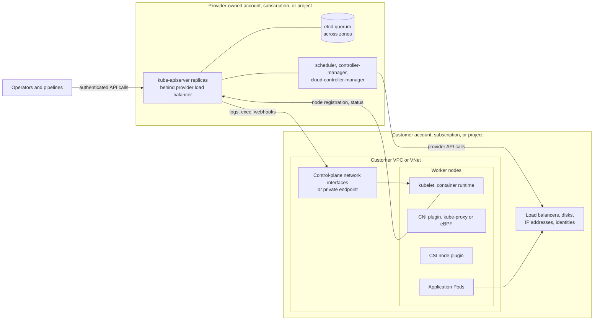

Three things cross the boundary, and each one is a frequent source of incidents:

1. **Node-to-API traffic.** Kubelets watch the API server and post status. If network rules, Domain Name System (DNS) resolution, or a private endpoint break this path, nodes go `NotReady` even though both halves are individually healthy.
2. **API-to-node traffic.** `kubectl logs`, `kubectl exec`, metrics scraping, and admission webhooks hosted in the cluster require the control plane to reach into the customer network. EKS does this through elastic network interfaces it places in your subnets; AKS uses a tunnel or API Server Virtual Network (VNet) Integration; GKE uses peering or Private Service Connect depending on cluster type. A firewall rule that blocks this direction makes `kubectl exec` hang and can make every write time out if a webhook has `failurePolicy: Fail`.
3. **Controller-to-cloud traffic.** The cloud-controller-manager and add-on controllers (load-balancer controllers, CSI controllers, autoscalers) call provider APIs using an identity. If that identity loses a permission, Services stop getting load balancers and volumes stop attaching, but running Pods keep working. This failure is silent until the next change.

The boundary implies a monitoring rule: measure control-plane health, node health, and workload health as three separate signals with three separate owners. A green provider status page tells you nothing about whether your nodes can pull images.

### 2.3 The responsibility matrix

The matrix below is the chapter's core reference. "Provider" means the provider operates and patches the item. "Customer" means you choose, configure, patch, and are paged for it. "Shared" means the provider supplies the mechanism and you configure or trigger it.

| Responsibility | Self-managed on virtual machines | EKS + managed node groups | EKS Auto Mode | EKS + Fargate profiles | AKS Standard | AKS Automatic | GKE Standard | GKE Autopilot |
|---|---|---|---|---|---|---|---|---|
| API server, etcd, scheduler availability | Customer | Provider | Provider | Provider | Provider | Provider | Provider | Provider |
| etcd backup and restore | Customer | Provider (no customer restore) | Provider | Provider | Provider | Provider | Provider | Provider |
| Control-plane version upgrade | Customer | Customer triggers; forced at end of extended support | Customer triggers | Customer triggers | Customer or auto-upgrade channel | Provider (auto-upgrade, maintenance window) | Provider via release channel; customer can trigger | Provider via release channel |
| Node operating-system image and patching | Customer | Shared: provider publishes images, customer rolls node group | Provider (nodes replaced at most every 21 days) | Provider | Shared: node image channel or customer | Provider | Shared: auto-upgrade on by default | Provider |
| Node instance type and pool sizing | Customer | Customer | Provider from NodePool constraints | Provider per Pod | Customer | Provider via node auto-provisioning | Customer (or node auto-provisioning) | Provider |
| Node autoscaling component | Customer | Customer installs Cluster Autoscaler or Karpenter | Provider (managed Karpenter) | Not needed | Shared: managed cluster autoscaler or node auto-provisioning | Provider | Shared: managed cluster autoscaler | Provider |
| CNI, DNS, kube-proxy | Customer | Shared: EKS add-ons, customer upgrades | Provider | Provider | Shared: managed components | Provider | Provider | Provider |
| Load-balancer and storage controllers | Customer | Customer installs add-ons | Provider (built in) | Customer | Provider (built-in cloud provider and CSI) | Provider | Provider | Provider |
| Kubernetes Role-Based Access Control (RBAC), namespaces, admission policy | Customer | Customer | Customer | Customer | Customer | Customer (hardened defaults) | Customer | Customer (hardened defaults) |
| Workload manifests, requests, PDBs | Customer | Customer | Customer | Customer | Customer | Customer | Customer | Customer |
| Application data and backup | Customer | Customer | Customer | Customer | Customer | Customer | Customer | Customer |
| Cost of idle node capacity | Customer | Customer | Customer (provider consolidates) | None (billed per Pod) | Customer | Customer (provider consolidates) | Customer | None for general-purpose Pods (billed per Pod request) |

Read the matrix by columns when choosing a mode and by rows when assigning owners. Two rows never move to the provider in any mode: Kubernetes authorization and the workload itself. Every mode leaves you responsible for resource requests, disruption budgets, data, and who may run `kubectl delete`. The rows that move are node lifecycle and the integration add-ons, and those are where most of the operational hours go in a self-managed cluster.

### 2.4 Managed versus self-managed: the operating-mode spectrum

The modes form a spectrum of how far up the stack the provider's operations reach. The following diagram shows each mode as a layered stack and marks where the boundary falls.

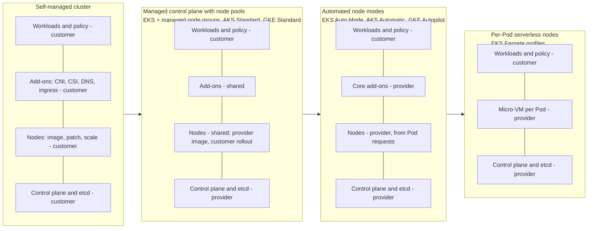

Moving right reduces the work you do and also reduces what you can change. In a self-managed cluster you can run any kernel, any CNI, and any API server flag. In a managed control plane you lose API-server flags and etcd access but keep the node operating system and add-on choice. In the automated modes you lose direct node access and, in varying degrees, the ability to run privileged DaemonSets, custom images, or unusual kernel settings. Fargate goes furthest: each Pod runs in its own isolated environment, so DaemonSets, host networking, and privileged containers do not apply.

The architectural question is which mode is the most managed one in which all of your hard constraints still fit. Section 4 walks through each provider's modes and their constraints; Section 19 compares the whole spectrum against non-Kubernetes container services.

### 2.5 Control-plane availability is not workload availability

A provider SLA on the API server covers the API server. It does not cover your nodes, your Pods, the load balancer in front of them, or the disks under them. When the control plane is unavailable, already-running Pods normally keep running and keep serving traffic, because kubelets and the data plane do not need the API server to forward packets. What stops is change: no new Pods are scheduled, no autoscaling happens, no failed Pod is replaced, no Service endpoints update, and no deployment can roll out. The reverse is also true. The control plane can be perfectly healthy while a zone outage takes half your nodes, a quota limit blocks scale-out, or an expired identity breaks image pulls.

The practical consequence is that your availability design has two parts. The first is choosing a control-plane tier whose SLA and failure-domain layout match how long you can tolerate "no changes." The second, which matters more for user-facing availability, is spreading nodes and replicas across zones, keeping spare capacity, and making the data plane self-sufficient for the duration of a control-plane outage (for example, by avoiding designs where every request depends on a call to the Kubernetes API).

## 3. Control-plane tiers, SLAs, and pricing

### 3.1 Why tiers exist

All three providers sell the control plane at a flat hourly fee per cluster. Over the last few years they have added tiers on two dimensions: how long a Kubernetes minor version stays supported, and how much control-plane capacity or financial backing you get. The tiers matter architecturally because they change two numbers you design around: the allowed downtime of the API, and the latest date by which you must upgrade.

### 3.2 Amazon EKS

EKS charges $0.10 per cluster-hour while the cluster's Kubernetes version is in standard support and $0.60 per cluster-hour while it is in extended support, at the time of writing ([EKS pricing](https://aws.amazon.com/eks/pricing/)). A minor version receives 14 months of standard support after its EKS release and then 12 months of extended support, 26 months in total ([EKS version lifecycle](https://docs.aws.amazon.com/eks/latest/userguide/kubernetes-versions.html)). Extended support is enabled by default through the cluster's upgrade policy. If you set the policy to standard, EKS upgrades the control plane automatically at the end of standard support. At the end of extended support EKS upgrades the control plane automatically with no advance notice of the exact time, and it upgrades only the control plane: managed node groups and self-managed nodes stay on the old version until you move them.

EKS also offers a 7-day window to roll back an in-place control-plane upgrade to the previous minor version, which is a change from earlier years when control-plane upgrades were strictly one-way. Clusters that were auto-upgraded at the end of extended support cannot be rolled back.

The default control plane scales automatically with load. For clusters that need predictable API capacity (large batch platforms, clusters with thousands of controllers), EKS Provisioned Control Plane lets you pre-select a scaling tier billed hourly on top of the standard or extended support fee ([EKS Provisioned Control Plane](https://docs.aws.amazon.com/eks/latest/userguide/eks-provisioned-control-plane.html)). AWS's best-practice guidance states that Provisioned mode carries a 99.99% SLA measured in one-minute intervals ([EKS control-plane scaling](https://docs.aws.amazon.com/eks/latest/best-practices/scale-control-plane.html)); the standard EKS SLA is 99.95% for the API endpoint. Verify the tier names and hourly rates on the pricing page before budgeting.

### 3.3 Azure Kubernetes Service

AKS separates the **SKU** (stock-keeping unit, either Base or Automatic) from the **pricing tier** (Free, Standard, Premium) ([AKS pricing tiers](https://learn.microsoft.com/en-us/azure/aks/free-standard-pricing-tiers)):

- **Free** has no cluster-management fee and no financially backed SLA. It supports up to 1,000 nodes but Microsoft recommends it for clusters under 10 nodes, which makes it a development tier.
- **Standard** adds a financially backed uptime SLA: 99.95% availability of the API server when the cluster uses availability zones, 99.9% without them. It supports up to 5,000 nodes and scales the control plane further. It is billed per cluster-hour (about $73 per cluster per month at the time of writing).
- **Premium** includes everything in Standard plus Long Term Support (LTS), which extends support for an LTS-capable minor version to 24 months. It is billed at a higher per-cluster rate; check the [AKS pricing page](https://azure.microsoft.com/en-us/pricing/details/kubernetes-service).
- **AKS Automatic** clusters always use the Standard tier and add a pod readiness SLA: 99.9% of qualifying pod readiness operations complete within five minutes, covering scheduling and any node provisioning needed ([AKS Automatic](https://learn.microsoft.com/en-us/azure/aks/intro-aks-automatic)).

In a region with availability zones, AKS spreads the control plane across zones automatically, regardless of whether your node pools use zones. The 99.95% figure, however, depends on the cluster being zone-enabled per the SLA terms.

### 3.4 Google Kubernetes Engine

GKE charges a flat $0.10 per cluster-hour for every cluster regardless of mode, size, or topology, and gives each billing account $74.40 of monthly credit that covers one zonal Standard or Autopilot cluster ([GKE pricing](https://cloud.google.com/kubernetes-engine/pricing)). The financially backed SLA is:

- 99.95% for the control plane of Autopilot clusters and regional Standard clusters.
- 99.5% for the control plane of zonal Standard clusters.
- 99.9% for Autopilot Pods deployed across multiple zones.

The Autopilot Pod SLA is unusual: it is a commitment about the data plane, not just the API. AKS Automatic's pod readiness SLA is a different promise (how fast Pods become ready, not how long they stay up). Do not treat the two as equivalent.

A GKE minor version gets 14 months of standard support. Clusters enrolled in the **Extended** release channel can stay on a minor version for up to 24 months total, and pay an extra $0.50 per cluster-hour (total $0.60) only for the time spent past standard support ([GKE versioning](https://docs.cloud.google.com/kubernetes-engine/versioning)). GKE previously sold fleet, policy, and multi-cluster features in a separate GKE Enterprise edition. The current pricing page states that fleets, teams, Config Management, Policy Controller, and the fleet dashboard are included in GKE at no extra cost, while Multi Cluster Gateway and Multi Cluster Ingress are billed per backend Pod.

### 3.5 Worked example: what an SLA tier actually buys

An SLA percentage converts to an allowed-downtime budget. For a 30-day month of 43,200 minutes:

| SLA | Allowed unavailability per month | Example |
|---|---|---|
| 99.99% | 43,200 × 0.0001 = 4.3 minutes | EKS Provisioned Control Plane |
| 99.95% | 43,200 × 0.0005 = 21.6 minutes | EKS standard, AKS Standard with zones, GKE regional and Autopilot |
| 99.9% | 43,200 × 0.001 = 43.2 minutes | AKS Standard without zones, GKE Autopilot Pods (multi-zone) |
| 99.5% | 43,200 × 0.005 = 216 minutes | GKE zonal Standard |
| None | Unbounded | AKS Free |

Two cautions apply. First, an SLA is a refund contract, not an engineering guarantee. A 99.95% SLA returns service credits if the provider misses it; it does not prevent a 40-minute outage. Second, the right question is how long your platform can go without control-plane changes. A platform whose autoscaling absorbs a daily traffic spike within 10 minutes is hurt by a 21-minute control-plane outage at the wrong time, even though the SLA was met. If that risk is unacceptable, the mitigation is architectural: run enough steady-state headroom that the spike can be absorbed without scaling, or spread traffic across two clusters (Section 18).

### 3.6 Worked example: the cost of falling behind on upgrades

A platform team runs 12 EKS clusters continuously (730 hours per month). On standard support the control-plane fee is 12 × $0.10 × 730 = $876 per month. Suppose four clusters slip into extended support for six months because the team lacks upgrade capacity. Each slipped cluster pays an extra $0.50 per hour: 4 × $0.50 × 730 × 6 = $8,760 over the six months. On GKE the Extended channel premium is the same $0.50 per cluster-hour. On AKS, staying on an older version requires the Premium tier and an LTS-capable version; otherwise the version falls into platform support (N-3) and, after a 60-day grace period, AKS performs a platform-initiated upgrade (Section 11).

The fee itself is small relative to node spend. The real cost is the risk it represents: a cluster in extended support is one forced upgrade away from running untested versions in production. Budget the upgrade engineering time, not the fee.

## 4. Cluster operating modes by provider

The responsibility matrix in Section 2.3 gives the summary. This section explains how each mode works, what it constrains, and why you would choose it.

### 4.1 Amazon EKS

An EKS cluster always has an AWS-managed control plane. The choice is how worker capacity arrives, and EKS lets you mix several compute types in one cluster.

**Managed node groups.** A managed node group is an Amazon Elastic Compute Cloud (EC2) Auto Scaling group in your account that EKS creates and lifecycle-manages. You pick instance types, a launch template (optional), an Amazon Machine Image (AMI) family such as Amazon Linux 2023 or Bottlerocket, and scaling bounds. EKS registers the nodes, labels them, and performs rolling updates when you ask it to move the group to a new Kubernetes version or AMI release. EKS does not update the node group automatically when the control plane is upgraded ([EKS version FAQ](https://docs.aws.amazon.com/eks/latest/userguide/kubernetes-versions.html)). Scaling is still the job of a separate component that you install, usually the Kubernetes Cluster Autoscaler, which changes the Auto Scaling group's desired count. Choose managed node groups when you need a stable, predictable set of instance shapes, custom launch templates, or tooling that expects Auto Scaling groups.

**Self-managed nodes.** You build the Auto Scaling group or instances yourself and join them to the cluster. This is the escape hatch for custom operating systems, unusual bootstrap logic, or hardware not supported elsewhere. You own every patch.

**Karpenter.** Karpenter is an open-source node provisioner that AWS created and donated to the Kubernetes autoscaling special interest group. It watches unschedulable Pods, computes the cheapest set of instances that satisfy their combined requests and constraints, and calls the EC2 Fleet API directly, without Auto Scaling groups. You describe what it may launch with two custom resources: a `NodePool` (allowed instance categories, capacity types such as On-Demand or Spot, zones, taints, limits, and disruption rules) and an `EC2NodeClass` (AMI, subnets, security groups, instance profile). Karpenter also removes or replaces nodes: it consolidates underused nodes, replaces nodes whose configuration has drifted from the NodePool, and expires nodes after a configured lifetime. In a standard EKS cluster you install and operate Karpenter yourself, typically on a small managed node group or on Fargate so that the provisioner does not run on capacity it manages.

**AWS Fargate profiles.** A Fargate profile selects Pods by namespace and labels and runs each matching Pod in its own isolated compute environment. There are no nodes to patch and no idle node capacity, because billing is per Pod for the virtual central processing units (vCPUs) and memory configured. The constraints are significant: DaemonSets do not run on Fargate, privileged containers and host networking are not supported, graphics processing units (GPUs) are not available, and persistent storage is limited to file systems such as Amazon Elastic File System (EFS) rather than Amazon Elastic Block Store (EBS) volumes. Each Pod also takes noticeably longer to start than on a warm node, because compute is provisioned per Pod. Fargate also does not upgrade running Pods when the control plane moves; you redeploy them to pick up the new kubelet version. Use Fargate for small, bursty, or isolation-sensitive workloads and for running cluster controllers, not as the default for a large platform.

**EKS Auto Mode.** Auto Mode extends AWS management to the data plane ([EKS Auto Mode](https://docs.aws.amazon.com/eks/latest/userguide/automode.html)). AWS runs a managed Karpenter-based provisioner outside your cluster and also runs, as managed capabilities, the components you would otherwise install as add-ons: Pod networking through the VPC CNI, block storage through an EBS CSI driver, load balancing through an AWS load-balancer controller, DNS, and the Pod Identity agent. Nodes are EC2 managed instances with a locked-down, AWS-maintained operating system image; you cannot log in to them or bring a custom AMI. AWS enforces a maximum node lifetime of 21 days, after which nodes are replaced with the latest image ([Auto Mode security](https://docs.aws.amazon.com/eks/latest/userguide/auto-security.html)). You still shape capacity through `NodePool` and `NodeClass` resources, so you can restrict instance families, require Spot, or isolate GPU workloads. Pricing is the normal EC2 price plus a per-instance management fee that depends on instance type; the fee is not reduced by Savings Plans, Reserved Instances, or Spot discounts, which apply only to the EC2 part ([EKS Auto Mode best practices](https://docs.aws.amazon.com/eks/latest/best-practices/automode.html)). Auto Mode nodes can coexist with managed node groups in the same cluster, which makes it a practical migration path.

**EKS Hybrid Nodes** let on-premises machines join an EKS control plane. They follow the upstream skew policy and are entirely customer-upgraded. They are relevant for edge and data-residency cases but out of scope for most cloud designs.

### 4.2 Azure Kubernetes Service

**AKS Standard (Base SKU).** Every AKS Standard cluster has at least one **system node pool**, which hosts critical components such as CoreDNS and metrics-server, plus any number of **user node pools** for applications. Node pools are backed by Virtual Machine Scale Sets in a separate, AKS-managed node resource group (named `MC_<resource-group>_<cluster>_<region>` by default). You choose the virtual machine size, operating system (Ubuntu, Azure Linux, or Windows Server), zones, maximum Pods per node, and whether the pool uses Spot capacity. AKS manages the node image, and you choose how it is updated through a node operating-system upgrade channel (for example, applying only security patches in place or replacing nodes with a new node image weekly). Cluster autoscaler is a managed AKS feature that you enable per pool with minimum and maximum counts.

The system/user split exists because a cluster whose CoreDNS Pods are evicted by an application's memory spike loses DNS for every workload. Microsoft recommends tainting system pools with `CriticalAddonsOnly=true:NoSchedule` so that only system components land there, and sizing them for at least three nodes across zones in production.

**Node auto-provisioning (NAP).** NAP is AKS's managed deployment of Karpenter, built on the open-source Karpenter project and the AKS Karpenter provider ([AKS node auto-provisioning](https://learn.microsoft.com/en-us/azure/aks/node-auto-provisioning)). Instead of fixed node pools with fixed sizes, NAP reads pending Pods' requirements and selects virtual machine sizes. You constrain it with Karpenter `NodePool` resources and an Azure-specific `AKSNodeClass` that sets the image family, operating-system disk size, and maximum Pods per node. NAP is optional on AKS Standard and is how AKS Automatic manages capacity.

**AKS Automatic.** Automatic is a preconfigured cluster SKU ([AKS Automatic](https://learn.microsoft.com/en-us/azure/aks/intro-aks-automatic)). AKS hosts and manages the system node pools and system components in AKS-owned subscriptions, uses NAP for application capacity, enables automatic cluster upgrades and node repair, enables Horizontal Pod Autoscaler (HPA), Kubernetes Event-Driven Autoscaling (KEDA), and Vertical Pod Autoscaler (VPA), and applies hardened security and networking defaults. "Preconfigured" features cannot be disabled; "default" features can be changed. Automatic includes the Standard tier, the uptime SLA, and the pod readiness SLA. Choose Automatic when your workloads fit its defaults; choose Standard when you need a feature Automatic does not allow, such as a networking mode it does not support or full control of system pools.

### 4.3 Google Kubernetes Engine

**GKE Standard.** You create node pools, each a set of Compute Engine managed instance groups (one per zone for regional pools) sharing a machine type, image (Container-Optimized OS by default), and upgrade settings. The managed cluster autoscaler resizes pools, with profiles that trade scale-down aggressiveness for stability. GKE Standard also has its own **node auto-provisioning**, which creates and deletes whole node pools automatically when no existing pool fits pending Pods. Note that this GKE feature shares a name with AKS NAP but works differently: GKE's version creates node pools, while AKS NAP is Karpenter and provisions individual virtual machines. **ComputeClasses** let you declare a prioritized list of machine families and capacity types (for example, try Spot N2D first, fall back to On-Demand N2) that the autoscaler follows.

**GKE Autopilot.** Autopilot manages nodes, node pools, scaling, security hardening, and upgrades. For general-purpose workloads, billing is per Pod for the central processing unit (CPU), memory, and ephemeral storage that each running Pod requests, with no charge for system DaemonSets, operating-system overhead, or unallocated node capacity ([GKE pricing](https://cloud.google.com/kubernetes-engine/pricing)). Autopilot raises requests that fall below its minimums or required CPU-to-memory ratios, and sets defaults when requests are missing. Pods that select specific hardware such as GPUs or a particular machine series use node-based billing (Compute Engine price plus an Autopilot premium for the whole node), so poorly packed accelerator workloads cost the full node. Autopilot restricts privileged workloads and node access; partner security agents run through an allowlist.

GKE also allows Autopilot-mode compute classes inside Standard clusters, so a Standard cluster can run some workloads with Autopilot management and billing. This narrows the gap between the two modes: the decision becomes per workload rather than per cluster.

### 4.4 Choosing a mode

Use these criteria in order. The first one that rules a mode out decides.

1. **Hard technical constraints.** Does the workload need privileged DaemonSets (some security or networking agents), a custom kernel or AMI, host networking, specific GPUs, Windows nodes, or a CNI the automated mode does not support? Each of these may rule out Fargate and constrain or rule out the automated modes. Check the provider's current feature table rather than relying on memory, because these lists change every quarter.
2. **Staffing.** Can the team staff node-image patching, autoscaler upgrades, add-on compatibility testing, and node-pool upgrades every few months? If not, choose the automated mode and accept its constraints, or choose a managed container service instead (Section 19).
3. **Cost shape.** Per-Pod billing (Autopilot general-purpose, Fargate) removes the cost of idle node capacity but charges a premium per unit of CPU and memory. Node billing (everything else) is cheaper per unit but you pay for fragmentation. Section 17 works the arithmetic.
4. **Blast radius of provider automation.** Automated modes replace nodes on the provider's schedule (Auto Mode every 21 days at most; Autopilot and Automatic on their upgrade cadence). Workloads that cannot tolerate eviction, such as long-running single-replica jobs, need maintenance windows, disruption budgets, or a different mode.

The repository's [cluster-mode matrix](../code/python/kubernetes-chapter/01_cluster_mode_matrix.py) turns these criteria into a weighted score. Each mode has a capability rating (1 to 5) per criterion, and the score is the weighted sum of `min(requirement, capability)`, so a mode gets no credit for capability beyond what you need. For the sample requirements (node control 2, custom networking 2, operational simplicity 5, specialized hardware 1) the automated mode scores 2×1 + 2×2 + 3×5 + 2×1 = 23 and standard node pools score 2×2 + 2×2 + 3×2 + 2×1 = 16. The numbers are discussion aids. The real decision is binary on hard constraints (step 1) and only then a weighing of the remaining factors.

## 5. Cluster bootstrap and identity integration

Identity is where managed Kubernetes differs most between providers, and where the most dangerous misconfigurations live. A cluster has four kinds of principals, and each needs its own path:

1. **The cluster's own service identity**, used by the control plane to manage provider resources (for example, the EKS cluster IAM role, the AKS cluster managed identity, the GKE service agent).
2. **Node identities**, used by kubelets to join the cluster and by the node to pull images and attach disks.
3. **Human and pipeline identities**, which call the Kubernetes API.
4. **Workload identities**, which let a Pod call provider APIs (object storage, queues, secret stores) without static keys.

Kubernetes RBAC itself, and the general model of service accounts and projected tokens, is taught in [Kubernetes Security](../12_Kubernetes/CH13_Security.md). Provider federation and role assumption are taught in [IAM](CH09_IAM.md). This section explains how each provider wires these principals into a cluster.

### 5.1 The bootstrap sequence

The sequence below shows cluster creation through the first workload calling a cloud API. The steps are the same in shape for all three providers; the names differ.

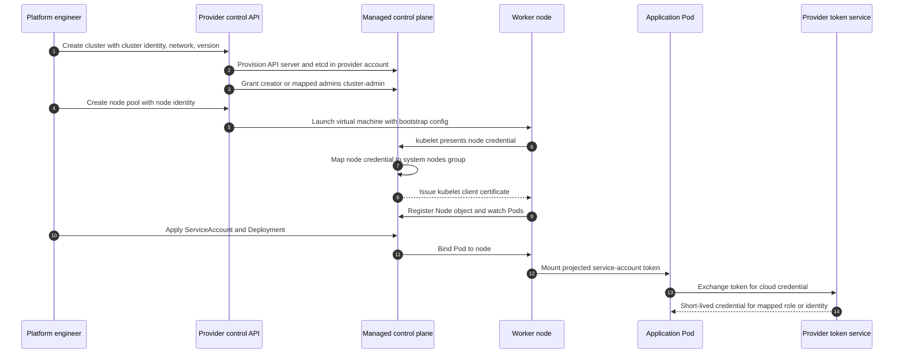

Steps 3 and 7 are the provider-specific mappings that decide who is an administrator and what is a legitimate node. Step 13 is workload identity. The following subsections cover each.

**Node join by provider.** On EKS the node's IAM role must be mapped to the `system:nodes` group, either through an access entry of type `EC2_LINUX` or `EC2_WINDOWS` or through the legacy `aws-auth` ConfigMap. Managed node groups and Auto Mode create this mapping for you; self-managed nodes and Karpenter-launched nodes need it explicitly, and a missing mapping is the most common reason a new node never becomes `Ready`. On AKS, nodes join through secure Transport Layer Security (TLS) bootstrapping, and the **kubelet identity** (a user-assigned managed identity) is what the node uses to pull from Azure Container Registry. On GKE, nodes join using kubelet TLS bootstrapping with credentials tied to the node's Compute Engine identity, and each node runs as a Google service account. GKE's default is the Compute Engine default service account, which historically carried broad project Editor permissions; production clusters should use a dedicated, minimally privileged node service account.

### 5.2 Human access to the Kubernetes API

**EKS access entries versus aws-auth.** Originally, EKS mapped IAM principals to Kubernetes users and groups through the `aws-auth` ConfigMap in `kube-system`. That design had three weaknesses. The mapping lived inside the cluster, so a bad edit could lock out every administrator, including the people who would fix it. The cluster creator received invisible, irrevocable `system:masters` access. And the mapping could not be managed through AWS APIs or audited in AWS CloudTrail.

**Access entries** replace this with EKS API objects. Each entry links an IAM principal to the cluster, and you attach either EKS **access policies** (managed permission sets such as `AmazonEKSClusterAdminPolicy`, `AmazonEKSAdminPolicy`, `AmazonEKSEditPolicy`, `AmazonEKSViewPolicy`, scoped to the cluster or to namespaces) or Kubernetes group names that your own RBAC bindings reference. The cluster's **authentication mode** controls which sources are read: `CONFIG_MAP`, `API_AND_CONFIG_MAP`, or `API`. Migration is one-way in that order, which lets you run both during a transition and then remove `aws-auth`. Creator admin access becomes an ordinary, removable access entry.

```bash
aws eks create-access-entry --cluster-name prod \
  --principal-arn arn:aws:iam::111122223333:role/platform-admins
aws eks associate-access-policy --cluster-name prod \
  --principal-arn arn:aws:iam::111122223333:role/platform-admins \
  --policy-arn arn:aws:eks::aws:cluster-access-policy/AmazonEKSClusterAdminPolicy \
  --access-scope type=cluster
```

Prefer access entries for every new cluster and set the mode to `API` once migration is complete. The design benefit is that recovering access no longer requires access: an account administrator can always add an access entry through the AWS API even if every in-cluster binding has been deleted.

**AKS with Microsoft Entra ID.** AKS-managed Microsoft Entra integration makes the API server validate Entra ID tokens; users authenticate with the `kubelogin` plugin. Authorization then follows one of two models. With Kubernetes RBAC, Entra users and groups appear as subjects in RoleBindings. With **Azure RBAC for Kubernetes authorization**, Azure role assignments (for example, "Azure Kubernetes Service RBAC Reader" at a namespace scope) are evaluated by an AKS authorization webhook, so cluster access is governed and audited with the rest of the Azure estate. Clusters also have a static local administrator credential by default; disabling local accounts (`--disable-local-accounts`) closes that path so that every API call is tied to an Entra identity. AKS Automatic enables Entra integration with Azure RBAC and disables local accounts by default.

**GKE with Google Cloud IAM.** GKE authenticates Google identities natively. Authorization is the union of Cloud IAM permissions (for example, `roles/container.developer` grants broad read/write on Kubernetes objects across the cluster) and Kubernetes RBAC. Because a request is allowed if either system allows it, grant only `roles/container.clusterViewer` or similar minimal IAM roles project-wide and use RBAC for namespace-level authority. **Google Groups for RBAC** lets RoleBindings reference Google Groups that are nested under a designated security group, so membership changes in your directory propagate without editing cluster objects.

### 5.3 Workload identity

The goal in all three providers is the same: a Pod presents a short-lived, audience-bound Kubernetes service-account token, and the provider's token service exchanges it for a short-lived cloud credential tied to a specific role or identity. No long-lived keys are stored in Secrets. The mechanisms differ in where the trust is configured and how it scales.

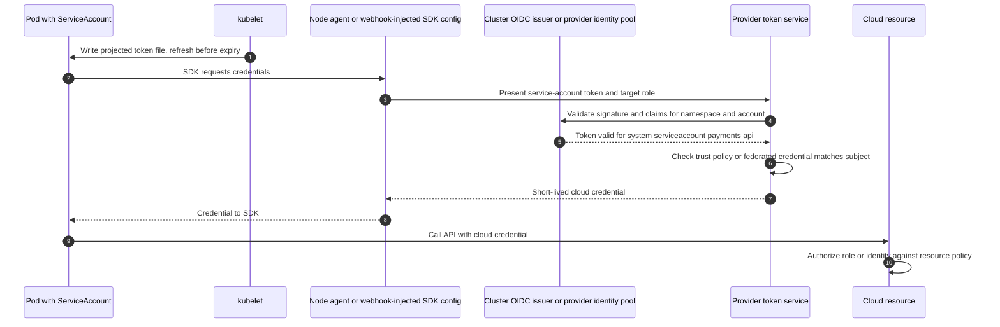

**IRSA (EKS, older).** Each cluster exposes an OpenID Connect (OIDC) issuer. You register that issuer as an IAM OIDC identity provider in each account that hosts target roles, and write a trust policy on each role that allows `sts:AssumeRoleWithWebIdentity` when the token's `sub` claim equals `system:serviceaccount:<namespace>:<name>`. The service account carries an `eks.amazonaws.com/role-arn` annotation, and the AWS software development kit (SDK) performs the exchange directly with AWS Security Token Service (STS). IRSA works on Fargate and everywhere else, but it scales poorly: every new cluster means a new OIDC provider registration and edits to every role's trust policy, and IAM limits both the number of OIDC providers per account and the size of a trust policy.

**EKS Pod Identity (EKS, current).** Pod Identity moves the mapping into the EKS API. You create a **pod identity association** that links cluster, namespace, service account, and IAM role. The role's trust policy trusts a single service principal, `pods.eks.amazonaws.com`, for `sts:AssumeRole` and `sts:TagSession`, so the same role can be reused across clusters without trust-policy edits. A node DaemonSet (the EKS Pod Identity Agent add-on, built into Auto Mode) serves credentials to SDKs on a link-local address. AWS attaches session tags such as the cluster name, namespace, and service account, which lets one IAM policy use attribute-based conditions instead of one role per workload.

```bash
aws eks create-pod-identity-association --cluster-name prod \
  --namespace payments --service-account payments-api \
  --role-arn arn:aws:iam::111122223333:role/payments-api
```

Choose Pod Identity for new EKS work. Keep IRSA where Pod Identity is not supported (check current support for Fargate and for cross-account patterns in the EKS documentation) or where existing tooling depends on it.

**Microsoft Entra Workload ID (AKS).** You enable the cluster's OIDC issuer and the workload identity add-on. For each workload, you create a **federated identity credential** on a user-assigned managed identity (or an Entra application) whose issuer is the cluster's OIDC issuer address and whose subject is `system:serviceaccount:<namespace>:<name>`. The service account is annotated with the identity's client ID, and Pods opt in with the label `azure.workload.identity/use: "true"`. A mutating webhook then injects the environment variables and projected token that Azure Identity SDKs use to call Entra ID's token endpoint. Each managed identity supports a bounded number of federated credentials (documented as 20 at the time of writing), which matters if one identity serves many clusters; verify the current limit. This mechanism replaced the earlier, deprecated AKS pod-managed identity, which intercepted the instance metadata endpoint.

```yaml
apiVersion: v1
kind: ServiceAccount
metadata:
  name: payments-api
  namespace: payments
  annotations:
    azure.workload.identity/client-id: "00000000-0000-0000-0000-000000000000"
```

**Workload Identity Federation for GKE.** You enable a workload identity pool on the cluster (`PROJECT_ID.svc.id.goog`) and run node pools with the GKE metadata server. The metadata server on each node intercepts credential requests from Pods and exchanges the Pod's Kubernetes token through Google's Security Token Service. You can grant IAM roles directly to the Kubernetes service account using a principal identifier of the form `principal://iam.googleapis.com/projects/PROJECT_NUMBER/locations/global/workloadIdentityPools/PROJECT_ID.svc.id.goog/subject/ns/NAMESPACE/sa/KSA_NAME`, or have the service account impersonate a Google service account. One property is easy to miss: the identity is defined by project pool, namespace, and service-account name, not by cluster. Every cluster in the same project (or fleet sharing the pool) that has a `payments/payments-api` service account receives the same permissions. This "identity sameness" is useful for multi-cluster deployments and dangerous if a lower-trust cluster shares a project with a production cluster.

### 5.4 Comparing the identity integrations

| Aspect | EKS | AKS | GKE |
|---|---|---|---|
| Human authentication | IAM principals | Microsoft Entra ID tokens via `kubelogin` | Google identities |
| Where human mapping lives | Access entries in the EKS API (legacy `aws-auth` ConfigMap) | Entra groups in RBAC, or Azure role assignments with Azure RBAC | Cloud IAM roles plus RBAC; Google Groups for RBAC |
| Static break-glass credential | None with access entries | Local admin account unless disabled | None by default |
| Workload identity mechanism | Pod Identity association (or IRSA trust policy) | Federated identity credential on managed identity | Workload identity pool, IAM grant to principal |
| Trust configured on | EKS API (Pod Identity) or each IAM role (IRSA) | Each managed identity | IAM policy on each resource or project |
| Cross-cluster reuse | Same role reusable with Pod Identity | One federated credential per cluster issuer | Automatic within project pool (identity sameness) |

### 5.5 Quality scenario: identity rotation without downtime

**Stimulus.** The security team requires rotating the IAM role used by a payments workload to a new role with narrower permissions, and the provider rotates the cluster's service-account signing keys during the same week.

**Expected response.** Projected service-account tokens are short-lived and refreshed by the kubelet before expiry; provider SDKs reread the token file. Signing-key rotation is handled by the provider, which publishes old and new keys in the issuer's key set during an overlap period, so tokens signed by either key validate. The role change is performed by creating a new association (or federated credential) pointing to the new role, rolling the Deployment, verifying, and then deleting the old association.

**Measurable success criteria.** Zero `AccessDenied` or token-validation errors in workload logs during the change; no static credentials present in any Secret (checked by a policy scan); the old role shows no `AssumeRole` events in CloudTrail (or the equivalent Azure or Google audit log) 24 hours after cutover.

**Common failure.** On EKS with IRSA, the new role's trust policy is missing the cluster's OIDC provider or uses the wrong `sub` string, so new Pods crash-loop while old ones keep working until they restart. Rolling the Deployment with a `maxUnavailable` of zero and checking readiness of the first new Pod limits the blast radius to one replica.

## 6. Networking integrations and IP planning

[Kubernetes Networking](../12_Kubernetes/CH06_Networking.md) owns the Kubernetes network model: every Pod gets its own IP, Pods reach each other without Network Address Translation (NAT), and Services provide stable virtual IPs. This section covers the provider decision that model leaves open: **where Pod IP addresses come from**. That choice decides how many Pods fit in your address plan, whether other networks can reach Pods directly, and which failures you will see at scale. Provider VPC and VNet mechanics are in [Networking](CH05_Networking.md).

### 6.1 Two addressing models

There are two basic models, and every provider offers at least one of each.

- **Routable (flat) Pod addressing.** Pods receive addresses from the VPC or VNet itself. The provider network knows every Pod IP, so traffic from a database, a peered VPC, or on-premises can reach a Pod directly, and load balancers can target Pods without a node hop. The cost is address consumption: every Pod, and often every pre-allocated spare address, uses an IP from ranges that the enterprise network team must route and keep unique. Examples: Amazon VPC CNI (default), Azure CNI with a Pod subnet, and GKE VPC-native clusters (where Pod ranges are alias IP ranges in the VPC).
- **Overlay Pod addressing.** Pods receive addresses from a private range that exists only inside the cluster. Traffic between Pods is routed or encapsulated by the CNI; traffic leaving the cluster is source-NATed to the node's IP. The VPC sees only node addresses, so the overlay range can be large and can even be reused across clusters. The cost is reachability: nothing outside the cluster can initiate a connection to a Pod IP, so inbound traffic must come through a load balancer or Service. Examples: Azure CNI Overlay and, on EKS, third-party CNIs in overlay mode.

GKE sits in an unusual place: its Pod ranges are VPC secondary ranges (routable within the VPC and across peering), but they are allocated as fixed per-node blocks, so they consume address space in large, predictable chunks.

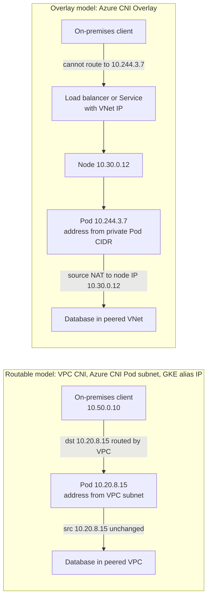

The implications follow directly from the diagram. In the routable model, firewall rules at a database can allow a specific Pod range, and security tools can attribute flows to Pods. In the overlay model, the database sees only node IPs, so per-workload firewalling must happen inside the cluster with network policy, and egress identity must come from workload identity rather than source IP. If a partner requires an allowlist of fixed source IPs, both models typically need an egress gateway or NAT gateway with static addresses.

### 6.2 Amazon VPC CNI: secondary IPs, warm pools, and exhaustion

The Amazon VPC CNI attaches elastic network interfaces (ENIs) to each node and assigns their secondary private IPs to Pods. Every instance type has a fixed maximum number of ENIs and IPv4 addresses per ENI, so in the default **secondary IP mode** the maximum Pods per node is:

```text
max_pods = ENIs x (IPv4 addresses per ENI - 1) + 2
```

The `- 1` removes each ENI's own primary address; the `+ 2` accounts for host-network Pods (such as kube-proxy and the CNI itself) that use the node's IP. For an `m5.large` (3 ENIs, 10 addresses each) that is 3 × 9 + 2 = 29 Pods. For an `m5.xlarge` (4 ENIs, 15 addresses each) it is 4 × 14 + 2 = 58.

The CNI also keeps a **warm pool** of unassigned addresses so that new Pods start without waiting for an EC2 API call. The default `WARM_ENI_TARGET=1` keeps one entire spare ENI attached. That is why VPC CNI clusters run out of addresses sooner than the Pod count suggests. An `m5.xlarge` running 30 Pods needs 30 secondary addresses, which takes three ENIs (14 secondary addresses each, 42 total); the warm target adds a fourth ENI, so the node holds 4 × 15 = 60 addresses from the subnet while using 30 of them for Pods.

Three tools address exhaustion, in increasing order of change:

1. **Tune the warm pool.** `WARM_IP_TARGET` and `MINIMUM_IP_TARGET` replace whole-ENI warming with a small number of spare IPs. Setting `MINIMUM_IP_TARGET=30` and `WARM_IP_TARGET=5` brings the 30-Pod node to roughly 36 addresses. The trade-off is more EC2 API calls under churn, which can hit EC2 API rate limits in large clusters.
2. **Prefix delegation.** With `ENABLE_PREFIX_DELEGATION=true`, each ENI slot holds a `/28` prefix (16 addresses) instead of one address ([EKS prefix mode](https://docs.aws.amazon.com/eks/latest/best-practices/prefix-mode-linux.html)). This raises the Pods-per-node limit (EKS recommends a maximum of 110 Pods for instance types with fewer than 30 vCPUs and 250 otherwise) and cuts EC2 API calls. It needs free, contiguous, aligned `/28` blocks in the subnet. A subnet fragmented by other ENIs can report free addresses yet fail to allocate a prefix. Reserving prefix space with a VPC subnet Classless Inter-Domain Routing (CIDR) reservation prevents this. Under prefix delegation, the warm setting is `WARM_PREFIX_TARGET` and the unit of waste is 16 addresses.
3. **Custom networking or IPv6.** Custom networking places Pod ENIs in different subnets, typically carved from a secondary VPC CIDR such as a block within `100.64.0.0/10`, so Pods stop consuming enterprise-routable space. The node's primary ENI no longer hosts Pods, which reduces max Pods per node. An **IPv6 cluster** assigns each node a large IPv6 prefix and removes Pod exhaustion as a concern, but the address family is fixed at cluster creation and every dependency must handle IPv6 or the provided egress translation.

The VPC CNI also supports **security groups for Pods** (branch ENIs that carry a dedicated security group per Pod, available on supported Nitro instance types) and enforces Kubernetes NetworkPolicy through an eBPF-based network policy agent. Both features have per-instance limits and interactions with prefix mode; check the EKS documentation before combining them.

### 6.3 Azure CNI options

AKS offers several Azure CNI variants, plus kubenet, which retires on 31 March 2028 ([AKS network policies](https://learn.microsoft.com/en-us/azure/aks/use-network-policies)). New clusters should not use kubenet.

- **Azure CNI Overlay** gives nodes VNet addresses and gives Pods addresses from a private Pod CIDR (default `10.244.0.0/16`). Each node receives a `/24` from that CIDR and supports up to 250 Pods. Pod egress is source-NATed to the node IP. The Pod CIDR does not consume VNet space and can be reused across clusters, but it must not overlap the cluster's VNet or other ranges the Pods need to reach.
- **Azure CNI with a Pod subnet (dynamic IP allocation)** gives Pods real VNet addresses from a dedicated Pod subnet, allocated to nodes in batches as needed. This is the routable model, used when other networks must reach Pods directly. Address planning works as for the VPC CNI.
- **Azure CNI node subnet (legacy)** pre-allocates `max_pods + 1` VNet addresses per node at node creation, so a pool of 50 nodes with `max_pods=30` reserves 50 × 31 = 1,550 addresses before a single Pod runs, plus more for upgrade surge nodes.
- **Azure CNI powered by Cilium** replaces the data plane with Cilium's eBPF implementation on top of either Overlay or Pod-subnet addressing. It provides high-performance Service routing and enforces NetworkPolicy with Cilium. It is the default networking in AKS Automatic.

Network policy enforcement on AKS is a choice of engine (Cilium, Calico, or the older Azure Network Policy Manager). Creating a NetworkPolicy object on a cluster with no enforcement engine has no effect, which is a classic audit finding.

### 6.4 GKE VPC-native clusters and Dataplane V2

A GKE VPC-native cluster uses three ranges: node IPs from the subnet's primary range, Pod IPs from a secondary range, and Service IPs from another secondary range or, in recent versions, a GKE-managed range. GKE assigns every node a fixed Pod block sized at **twice the maximum Pods per node, rounded up to a power of two**, so addresses can be reused safely as Pods churn ([GKE maximum Pods per node](https://cloud.google.com/kubernetes-engine/docs/how-to/flexible-pod-cidr)). With the Standard default of 110 Pods per node, each node takes a `/24` (256 addresses). Lowering max Pods to 64 gives a `/25`; to 32 gives a `/26`. Autopilot uses a lower default density (32 Pods per node at the time of writing).

The per-node block is the planning trap: the Pod range divided by the block size is a hard ceiling on node count. A `/16` Pod range with the default 110 Pods per node holds exactly 65,536 / 256 = 256 nodes. When the cluster autoscaler tries to add the 257th node, it fails with an IP exhaustion error even though the range has many unused addresses inside existing node blocks. The remedies are to add more Pod ranges with **discontiguous multi-Pod CIDR** (new node pools can draw from additional secondary ranges), to lower max Pods per node for new pools, or to plan larger ranges at creation.

**GKE Dataplane V2** is GKE's eBPF data plane, based on Cilium. It implements Service routing without kube-proxy, enforces NetworkPolicy natively, and can log allowed and denied flows. It is enabled by default in Autopilot. Choosing Dataplane V2 at creation avoids a later migration, because changing the data plane of an existing cluster is not an in-place toggle.

### 6.5 Worked example: IP plan for a 300-node cluster

A platform will run up to 300 nodes in three zones, averaging 30 Pods per node (9,000 Pods). Upgrades and scale bursts add 10% surge nodes, so plan for 330 nodes. The enterprise can spare at most a `/18` (16,384 addresses) of routable space per cluster.

**EKS with the VPC CNI in secondary IP mode on `m5.xlarge`.** With the default warm ENI, each node holds about 60 addresses: 330 × 60 = 19,800, which exceeds the `/18`. With `MINIMUM_IP_TARGET=30` and `WARM_IP_TARGET=5`, each node holds about 36 addresses: 330 × 36 = 11,880. Split across three zones, that is 3,960 per zone, which fits a `/20` per zone (4,096 minus 5 AWS-reserved addresses = 4,091). Three `/20` subnets use 12,288 addresses, within the `/18`. The alternative is prefix delegation: 30 Pods need two `/28` prefixes plus one warm prefix, 48 addresses, plus the node's primary address, 49 per node, or 16,170 total. That fits the `/18` only with no room left for load balancers or endpoints, so it is not the better choice here. The most scalable option is custom networking: nodes in three small routable `/23` subnets and Pods in a `100.64.0.0/16` secondary CIDR that the enterprise never routes.

**AKS with Azure CNI Overlay.** The VNet needs only node addresses: 330 nodes plus 5 Azure-reserved addresses fits a `/23` (512). The Pod CIDR needs one `/24` per node: 330 × 256 = 84,480 addresses. The default `/16` holds only 256 node blocks, so the cluster would stop scaling at 256 nodes. Choose a `/15` (512 blocks) or larger. Because the overlay range is not routed outside the cluster, using a large range costs nothing in enterprise address space.

**GKE VPC-native.** Node subnet: a `/23`. Pod secondary range at the default 110 Pods per node: 330 × 256 = 84,480 addresses, so a `/15`. Since the workload averages 30 Pods per node, set max Pods per node to 64: each node takes a `/25` (128), so 330 × 128 = 42,240 addresses, and a `/16` (65,536, room for 512 nodes) is enough. Service range: for an expected 1,500 Services, a `/21` (2,048) leaves headroom.

| Range | EKS (VPC CNI, tuned warm IPs) | AKS (Azure CNI Overlay) | GKE (VPC-native, 64 max Pods) |
|---|---|---|---|
| Routable node space | Included in Pod subnets | `/23` | `/23` |
| Pod space | 3 × `/20` routable | `/15` overlay, not routed | `/16` secondary range, routable in VPC |
| Hard ceiling to watch | Subnet free addresses per zone | Pod CIDR / 256 = node count | Pod range / 128 = node count |
| Failure symptom | Pods stuck `ContainerCreating` with IP assignment errors | New nodes fail to get a Pod block | Autoscaler cannot add nodes; IP exhaustion event |

### 6.6 Quality scenario: address exhaustion during scale-out

**Stimulus.** A marketing event triples traffic; HPA requests 2,500 new Pods within 10 minutes.

**Expected response.** The node autoscaler adds nodes; each node obtains Pod addresses; Pods become ready.

**Success criterion.** 95% of new Pods ready within 5 minutes; zero Pods failing with address-assignment errors; IP utilization per subnet or Pod range stays below 80%, which is the alerting threshold.

**Design evidence.** The IP plan above with an exhaustion alert on per-subnet free addresses (EKS), Pod CIDR block usage (AKS), or Pod range utilization (GKE). Without the alert, exhaustion is discovered when Pods fail.

## 7. Private clusters and API endpoint access

A cluster has two network exposures: the Kubernetes API endpoint and the nodes. "Private cluster" means different things in each provider, so specify which of the two you mean.

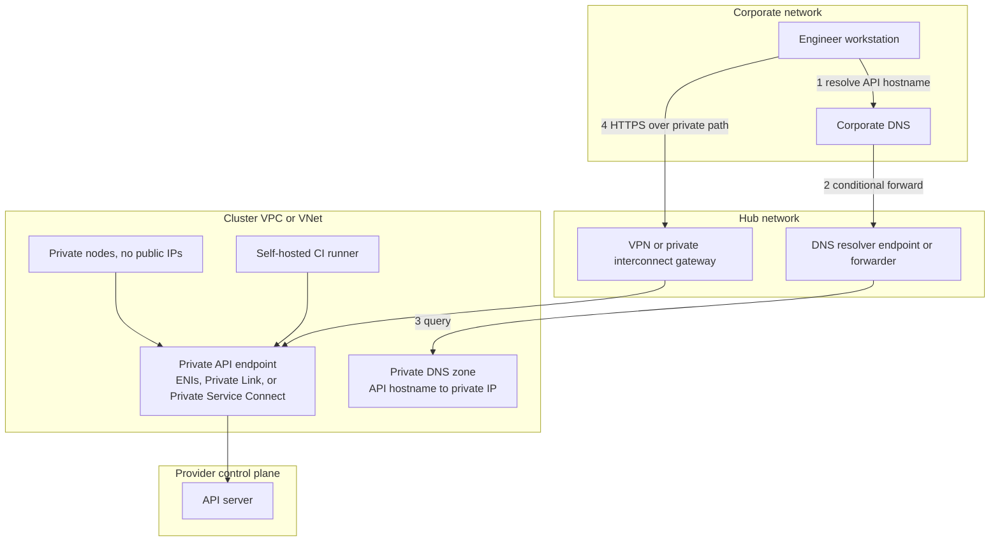

The diagram shows the two things that private clusters require and that teams usually discover late. The first is **DNS**: the API hostname must resolve to the private IP from every client network, which means conditional forwarding from corporate DNS to a resolver that can see the private zone. The second is **a network path for every client**, including CI runners and GitOps controllers. A hosted CI service on the internet cannot reach a private-only endpoint; you need self-hosted runners inside the network or a provider-specific proxy path.

**EKS.** The API endpoint can be public, public and private, or private only. The public endpoint can be restricted to CIDR allowlists. With the private endpoint enabled, EKS places cross-account ENIs in your subnets and creates a Route 53 private hosted zone associated with the VPC, so resolution from on-premises requires a Route 53 Resolver inbound endpoint. Nodes in private subnets also need private paths to Amazon Elastic Container Registry (ECR), Amazon Simple Storage Service (S3) for image layers, AWS STS, and Amazon EC2 APIs, either through VPC interface and gateway endpoints or through a NAT gateway.

**AKS.** A private AKS cluster exposes the API server through an Azure Private Link private endpoint in your VNet and a private DNS zone (`privatelink.<region>.azmk8s.io`). The zone can be system-managed, bring-your-own (common in hub-and-spoke designs where a central team owns DNS), or none (a public DNS name that resolves to the private IP). **API Server VNet Integration** is the newer option: it projects the API server into a delegated subnet in your VNet, removing the tunnel between control plane and nodes and letting you switch public access on or off without recreating the cluster. For public clusters, **authorized IP ranges** restrict who can reach the endpoint. For emergencies, `az aks command invoke` runs `kubectl` commands through the Azure API without network access to the endpoint.

**GKE.** **Private nodes** have only internal IPs. Control-plane access has three options: a private endpoint (internal IP in your network), a public endpoint restricted by **authorized networks**, and a **DNS-based endpoint**, where clients reach the API through a Google-managed hostname and are authorized by IAM before traffic reaches the cluster. The DNS-based endpoint removes the need for a network path from CI systems and engineers, which makes it a strong default for organizations that would otherwise build bastion hosts.

**Failure mode.** The most common private-cluster outage is not the cluster at all. A DNS zone link is removed during a hub network change, or a firewall rule blocks the control plane's path to admission webhooks in the cluster, and every `kubectl apply` times out. Keep a documented break-glass path (EKS public endpoint toggle with a narrow allowlist, AKS `command invoke`, GKE DNS-based endpoint) and test it quarterly.

## 8. Load balancers, ingress, and Gateway controllers

[Services](../12_Kubernetes/CH04_Services.md) and [Ingress](../12_Kubernetes/CH05_Ingress.md) own the Kubernetes objects: `Service` of type `LoadBalancer`, `Ingress`, and the Gateway API's `GatewayClass`, `Gateway`, and `HTTPRoute`. Each object is only a request; a provider controller turns it into a real load balancer. The controller you choose decides the packet path, the health-check behavior, and which provider features you can use.

### 8.1 Two target modes

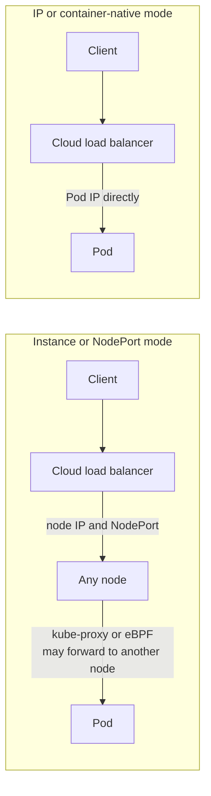

In **instance mode**, the load balancer sends traffic to a port on every node, and the node's Service routing forwards it to a Pod, possibly on another node. That adds a hop, may lose the client source IP (unless `externalTrafficPolicy: Local` is set), and makes load-balancer health checks reflect node health rather than Pod health. In **IP mode** (AWS Load Balancer Controller IP targets, GKE container-native load balancing with Network Endpoint Groups), the load balancer targets Pod IPs directly. Health checks reflect actual Pod readiness, and draining works per Pod. IP mode requires routable Pod addresses, which ties this choice back to Section 6: an overlay network cannot use direct Pod targets from an external load balancer.

### 8.2 Provider controllers

**EKS.** The in-tree cloud provider still creates load balancers for `LoadBalancer` Services, but AWS directs new designs to the **AWS Load Balancer Controller**, which provisions Network Load Balancers for Services and Application Load Balancers for Ingress, supports IP targets, and lets several Ingress objects share one Application Load Balancer through group annotations. You install and upgrade the controller yourself and give it an IAM role with load-balancer permissions. In Auto Mode, AWS runs equivalent load-balancing capability as part of the managed data plane, selected through an `IngressClass` or Service annotations specific to Auto Mode; verify that the annotations you rely on are supported before migrating.

**AKS.** The built-in Azure cloud provider creates Azure Standard Load Balancer frontends for `LoadBalancer` Services (internal ones with the `service.beta.kubernetes.io/azure-load-balancer-internal: "true"` annotation). For Layer 7 traffic, **Application Gateway for Containers** is Microsoft's current managed option, supporting both Gateway API and Ingress; the older Application Gateway Ingress Controller remains for existing deployments. The **application routing add-on** provides a managed NGINX-based ingress controller with Azure DNS and Azure Key Vault certificate integration.

**GKE.** A `LoadBalancer` Service creates a passthrough Network Load Balancer. The built-in **GKE Ingress** controller creates Application Load Balancers, and the **GKE Gateway controller** implements Gateway API with provider `GatewayClass` names for regional and global, internal and external load balancers. GKE uses container-native load balancing with Network Endpoint Groups by default for VPC-native clusters. **Multi Cluster Gateway** extends this to route across clusters in a fleet (Section 18), billed per backend Pod.

### 8.3 Choosing an ingress path

Prefer the provider's managed Layer 7 controller (Application Load Balancer through the AWS Load Balancer Controller or Auto Mode, Application Gateway for Containers, GKE Gateway) when you need web application firewall integration, managed certificates, and per-Pod health checks with no in-cluster proxy to run. Prefer an in-cluster proxy (Envoy Gateway, a service mesh gateway, or a commercial controller) behind a Layer 4 load balancer when you need portable configuration across providers or features the managed controller lacks. Note that the community `ingress-nginx` project, one of the most widely deployed in-cluster controllers, announced its retirement in late 2025 with best-effort maintenance ending in early 2026. Plan new designs on Gateway API and check how your provider's NGINX-based add-ons are affected.

Each load balancer also counts against provider quotas and incurs hourly and per-traffic charges. A platform that creates one load balancer per Service can hit the regional load-balancer quota and spend more on load balancers than on nodes. Sharing load balancers across routes (Application Load Balancer ingress groups, a shared Gateway) is both a cost and a quota decision.

## 9. Storage through CSI drivers

[Kubernetes Storage](../12_Kubernetes/CH07_Storage.md) owns PersistentVolumes, PersistentVolumeClaims, StorageClasses, and access modes. [Storage](CH06_Storage.md) owns the provider disk and file services. Here the questions are which CSI driver is installed and managed by whom, and what failure domain each volume type has.

| Provider | Block (ReadWriteOnce) | Zone-redundant block | Shared file (ReadWriteMany) | Object-backed | Driver management |
|---|---|---|---|---|---|
| EKS | EBS CSI driver (zonal) | None for EBS; use application replication | EFS CSI driver (regional), FSx CSI drivers | Mountpoint for Amazon S3 CSI driver | EKS add-ons you enable and upgrade; built into Auto Mode for block storage |
| AKS | Azure Disk CSI driver (locally redundant disks are zonal) | Zone-redundant storage (ZRS) disks replicate synchronously across zones | Azure Files CSI driver (Server Message Block or Network File System protocol) | Azure Blob CSI driver | Installed and managed by AKS by default |
| GKE | Compute Engine Persistent Disk CSI driver and Hyperdisk | Regional persistent disk replicates synchronously across two zones | Filestore CSI driver | Cloud Storage FUSE CSI driver | Managed by GKE |

**The zonal-volume trap.** An EBS volume, an Azure locally redundant disk, and a zonal persistent disk live in one zone. A Pod using such a volume can only run in that zone. StorageClasses should use `volumeBindingMode: WaitForFirstConsumer` so that the volume is created in the zone where the scheduler places the Pod. Without it, the volume may be created in a zone with no capacity and the Pod stays pending.

**Worked scenario: zonal failure with a stateful workload.** A PostgreSQL StatefulSet with one primary uses a 500 GiB zonal block volume in zone A, with snapshots every hour. Zone A fails.

- With a zonal volume, the Pod cannot reschedule to zones B or C because the volume's node affinity pins it to A. Recovery means restoring the last snapshot into a new volume in zone B. Recovery Point Objective (RPO) is up to 60 minutes of lost writes; Recovery Time Objective (RTO) is snapshot restore time plus database recovery, often 15 to 45 minutes for this size.
- With an Azure ZRS disk or GKE regional persistent disk, the volume can be attached in a surviving zone after the failed node is removed. RPO is near zero because replication is synchronous; RTO is detection plus forced detach and attach, typically minutes, at the cost of higher price and write latency.
- With application-level replication (a primary in zone A and a synchronous standby in zone B, each on zonal disks), failover is handled by the database or an operator and does not depend on the cloud's volume semantics. This is the most portable option and the usual choice on EKS, where EBS has no zone-redundant variant.

Backups of persistent data and of Kubernetes objects are separate. GKE offers Backup for GKE as a priced service; on EKS and AKS, AWS Backup, Azure Backup for AKS, or Velero fill the role. Test restores into a fresh cluster, because restoring objects into a cluster that still has conflicting resources does not prove recovery.

## 10. Node pools and autoscaling

Kubernetes scales at three layers. HPA and VPA change Pod replicas and requests, as taught in [Autoscaling](../12_Kubernetes/CH09_Autoscaling.md). A node provisioner changes the number and shape of nodes. A platform team changes the number of clusters. The general feedback-controller view of cloud autoscaling (signals, bounds, cooldown, warm-up) is owned by [Compute](CH04_Compute.md). This section covers the provider node provisioners, which differ in mechanism more than their names suggest.

### 10.1 Cluster Autoscaler: group-based scaling

The Kubernetes Cluster Autoscaler works with **node groups**: an EC2 Auto Scaling group or managed node group, an AKS Virtual Machine Scale Set node pool, or a GKE managed instance group. Each group is assumed to be homogeneous, so the autoscaler can build a template node for it. Its loop runs every few seconds (10 seconds by default):

1. Find Pods that the scheduler marked unschedulable.
2. For each node group, simulate whether one more template node would let those Pods schedule, honoring requests, selectors, taints, affinity, and volume topology.
3. Pick a group using an **expander** strategy (for example, least waste, priority, or random) and raise its desired size.
4. For scale-down, find nodes whose requested utilization has been below a threshold (50% by default) for a period (10 minutes by default) and whose Pods can all move elsewhere without violating PDBs, then drain and remove them.

The design has predictable consequences. Because each group is one shape, you need several groups to offer several shapes, and the autoscaler can only choose among the groups you defined. Because it scales the group and lets the cloud pick the zone, zonal volumes need one group per zone with balancing enabled. Scale-up time is the sum of autoscaler reaction, virtual machine launch, node bootstrap, image pull, and Pod readiness, commonly two to five minutes. On AKS and GKE Standard the Cluster Autoscaler is a managed feature you configure per pool; on EKS without Auto Mode you install and upgrade it yourself and keep its version matched to the cluster's minor version.

### 10.2 Karpenter and AKS node auto-provisioning: groupless provisioning

Karpenter (self-managed on EKS, managed inside EKS Auto Mode, and managed as AKS NAP) does not use node groups. It batches pending Pods for a short window, then solves a bin-packing problem: which instance types, from the set allowed by the `NodePool`, can host these Pods at the lowest price. It launches instances directly through the provider's fleet API, using price-and-capacity-optimized allocation for Spot. Because it can pick from dozens of instance types, it rarely fails for lack of one specific shape, and it does not need one group per zone.

Karpenter also owns **disruption**, which the Cluster Autoscaler handles only as scale-down:

- **Consolidation** replaces or removes nodes when their Pods could fit on fewer or cheaper nodes (`WhenEmpty` or `WhenEmptyOrUnderutilized`).
- **Drift** replaces nodes whose configuration no longer matches the NodePool or node class, for example after an AMI or Kubernetes version change. This is how Karpenter-managed nodes get upgraded.
- **Expiration** replaces nodes after `expireAfter` elapses (Auto Mode enforces at most 21 days).
- **NodePool disruption budgets** cap how many nodes may be voluntarily disrupted at once (for example, `nodes: "10%"`) and can restrict disruption to scheduled windows. Karpenter also respects PDBs and the `karpenter.sh/do-not-disrupt` annotation.

```yaml
apiVersion: karpenter.sh/v1
kind: NodePool
metadata:
  name: general
spec:
  template:
    spec:
      requirements:
        - key: karpenter.sh/capacity-type
          operator: In
          values: ["spot", "on-demand"]
        - key: kubernetes.io/arch
          operator: In
          values: ["amd64", "arm64"]
      expireAfter: 336h
  disruption:
    consolidationPolicy: WhenEmptyOrUnderutilized
    budgets:
      - nodes: "10%"
  limits:
    cpu: "2000"
```

The `limits.cpu` field is an important guardrail: without it, a runaway Deployment can provision capacity until provider quotas stop it.

### 10.3 GKE autoscaling options

GKE Standard uses the managed Cluster Autoscaler per node pool, with an `optimize-utilization` profile that scales down more aggressively than the default `balanced` profile. **GKE node auto-provisioning** adds and removes whole node pools when no existing pool fits, choosing a machine type from Pod requests within cluster-wide resource limits. **ComputeClasses** give a priority list of machine families and capacity types that the autoscaler tries in order, which addresses Spot unavailability and capacity stock-outs declaratively. In Autopilot, all of this is provider-run: you express needs through Pod requests, node selectors, and compute classes.

### 10.4 Which provisioner when

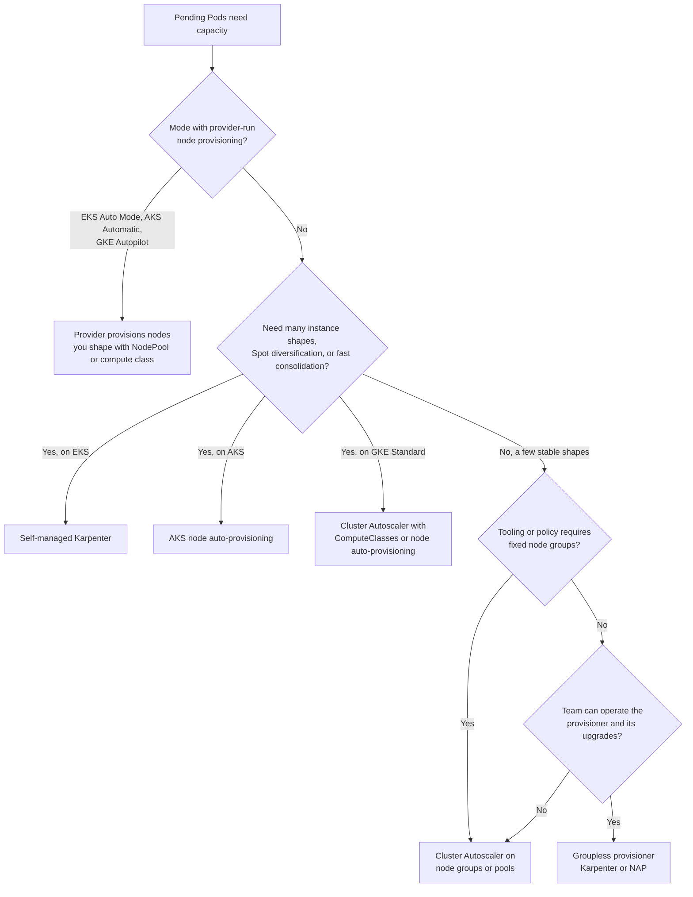

The decision tree starts from the mode, because in the automated modes the provisioner is not your choice. Outside them, the main reason to prefer a groupless provisioner is shape diversity: a platform with mixed CPU, memory, Arm, and Spot needs would require dozens of node groups under the Cluster Autoscaler. The main reasons to keep node groups are predictability (exactly these instance types, these reservations) and existing tooling. Regulated environments that must pre-approve every instance type often choose node groups for auditability, or constrain Karpenter's NodePool to an approved list.

### 10.5 Worked example: sizing a node pool with headroom

The repository's [capacity planner](../code/python/kubernetes-chapter/02_capacity_planner.py) computes the minimum node count from total requests and per-node allocatable capacity. Its sample input models a `checkout` service with 12 replicas, each requesting 1,500 millicores of CPU and 4,000 MiB of memory, for totals of 18,000 millicores and 48,000 MiB. Nodes have 8 vCPU (8,000 millicores) and 32 GiB (32,768 MiB), and the system reserves 700 millicores and 2,048 MiB for the kubelet, operating system, and DaemonSets.

```text
allocatable CPU    = 8,000 - 700     = 7,300 m
allocatable memory = 32,768 - 2,048  = 30,720 MiB
nodes for CPU      = ceil(18,000 / 7,300)  = 3
nodes for memory   = ceil(48,000 / 30,720) = 2
minimum nodes      = max(3, 2) = 3
```

Three nodes is the floor, not the answer. The program's own output says to add zone-loss and upgrade headroom. Assume the replicas are spread across three zones and the service must keep all 12 replicas through the loss of a zone. The two surviving zones must then hold capacity equal to three nodes, so each zone needs ceil(3 / 2) = 2 nodes, for 6 nodes total. Each node runs two replicas and sits at 3,000 / 7,300 = 41% of allocatable CPU in steady state.

That is 100% headroom, which is expensive. The alternative is to accept degraded capacity during a zone loss: if 8 replicas can carry the peak load, then 3 nodes (one per zone, four replicas each) suffice for steady state, a zone loss leaves 8 replicas, and the node autoscaler adds capacity in the surviving zones within minutes, assuming quota and capacity exist. The choice is between paying for headroom continuously and depending on scale-out during an incident, which is exactly when capacity in the surviving zones is most contested. For a revenue-critical checkout path, the first option is usually correct; for an internal tool, the second.

In Autopilot and Fargate, this arithmetic changes. You pay for Pod requests rather than nodes, so headroom costs exactly the extra replicas you run, not the node fragmentation. In EKS Auto Mode and AKS Automatic, the provider picks node sizes, but you still pay for nodes and should still reason about zone spread through topology constraints.

### 10.6 Quality scenario: quota or capacity limit during scale-out

**Stimulus.** During a regional traffic surge, the provisioner requests 60 additional 8-vCPU nodes. The account's regional On-Demand vCPU quota is 1,000 vCPUs and the cluster already uses 600. The new nodes would bring usage to 600 + 480 = 1,080.

**Expected response.** The first 50 nodes launch (400 vCPU, reaching the 1,000 limit); the remaining requests fail with a quota error (`VcpuLimitExceeded` on EC2, a quota-exceeded error on the Azure family vCPU quota, `QUOTA_EXCEEDED` on Compute Engine). Separately, even under quota, a zone may lack capacity for a specific instance type (`InsufficientInstanceCapacity` on EC2, `ZonalAllocationFailed` or `SkuNotAvailable` on Azure, `ZONE_RESOURCE_POOL_EXHAUSTED` on Compute Engine).

**Success criterion.** Quota headroom alarms fire before usage passes 70% of quota; the provisioner falls back to alternative instance types or zones within 2 minutes; no user-facing error budget is consumed.

**Design evidence.** Request quota for the worst case you will run, not the average: steady-state peak plus upgrade surge plus a full blue-green cluster migration if you use that pattern. For a cluster that peaks at 330 nodes of 4 vCPU (1,320 vCPU), with 10% upgrade surge (132 vCPU) and a possible parallel cluster during migration (another 1,452 vCPU), the quota request is roughly 2,900 vCPU. Diversify instance types (Karpenter NodePools, ComputeClasses, multiple node pools) so that a stock-out of one type does not block scaling. For capacity that must exist, use provider reservations: EC2 On-Demand Capacity Reservations, Azure capacity reservation groups, or Compute Engine reservations.

## 11. Version lifecycle and support windows

### 11.1 The upstream rhythm

The Kubernetes project releases a minor version roughly every four months, about three per year, and maintains patch releases for the three most recent minor versions, roughly a year each plus a short upgrade overlap. Providers build on that rhythm with their own qualification lag and support windows. The consequence for architects is that **an upgrade every four to six months is a recurring operating cost**, not a project. A team that plans upgrades as occasional events will spend most of its time in extended support or in forced upgrades.

### 11.2 Provider policies compared

| Policy | Amazon EKS | AKS | GKE |
|---|---|---|---|
| Standard support per minor version | 14 months from EKS release | About 12 months; three GA minors supported (N, N-1, N-2) | 14 months |
| Extended or long-term support | 12 more months (26 total), extra fee, enabled by default | Premium tier LTS, 24 months for LTS-capable versions | Extended channel, up to 24 months total, extra fee only during extended period |
| After support ends | Control plane auto-upgraded at end of extended support (or end of standard if extended disabled); nodes not upgraded | N-3 enters platform support (platform issues only); after a 60-day grace period AKS performs a platform-initiated upgrade | Control plane and nodes auto-upgraded to the next supported minor |
| Automatic upgrade controls | Customer-triggered by default; Auto Mode nodes follow control plane | Auto-upgrade channels (none, patch, stable, rapid, node-image) plus planned maintenance windows | Release channels (Rapid, Regular, Stable, Extended), maintenance windows and exclusions, rollout sequencing |
| Skipping minor versions on control plane | Not allowed | Not allowed for community versions (some LTS paths differ) | Not allowed |
| Control-plane rollback | To previous minor within 7 days of in-place upgrade | Not supported | Patch downgrades in specific cases; minor downgrades generally not |
| Patch cadence enforcement | Provider patches control plane | Patches via auto-upgrade channel | Control plane must move to a new patch at least every 90 days |

Sources: [EKS version lifecycle](https://docs.aws.amazon.com/eks/latest/userguide/kubernetes-versions.html), [AKS supported versions](https://learn.microsoft.com/en-us/azure/aks/supported-kubernetes-versions), [GKE versioning](https://docs.cloud.google.com/kubernetes-engine/versioning).

AKS's platform-initiated upgrades deserve attention. Microsoft's documentation states that, starting 1 June 2027, AKS automatically upgrades clusters that remain on an unsupported version after the 60-day platform-support grace period, and that such an upgrade does not follow your maintenance window, does not stop for deprecated API usage, and can override a PDB that blocks a node drain. A cluster left behind on AKS will be upgraded on Microsoft's schedule with fewer safety checks than a planned upgrade.

### 11.3 Lifecycle of one minor version

The chart below shows the support periods for a single hypothetical minor version released by all three providers in the same month (month 0). It uses each provider's policy, not actual dates, because each provider's release lags upstream differently.

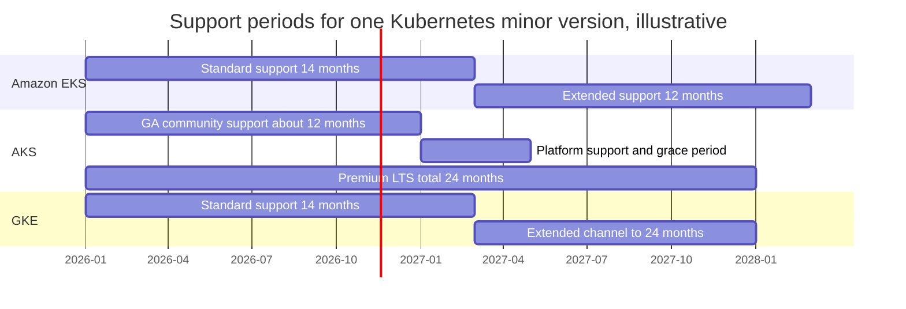

The chart makes one planning rule visible: if you want to upgrade once a year, on every provider you will spend part of each year on a version that is either in a paid extended period or near its end. Upgrading every four to six months keeps all clusters in standard support. Extended support is valuable as insurance for the one cluster whose upgrade is blocked by a vendor dependency, not as a default cadence.

### 11.4 Version skew rules

The upstream [version skew policy](https://kubernetes.io/releases/version-skew-policy/) allows the kubelet to be up to three minor versions older than the API server (for kubelets at 1.25 or later) and never newer. Providers are stricter or more cautious:

- **GKE** allows nodes up to two minor versions older than the control plane and never newer.
- **AKS** enforces its own skew policy and rejects node-pool operations that violate it (for example, a node pool more than the allowed number of minors behind, or newer than the control plane). Check the current rule in the AKS upgrade documentation before planning a multi-version catch-up.
- **EKS** notes that the project tests compatibility for up to three minor versions but recommends keeping nodes and control plane on the same version and warns against persistent three-version skew.

The repository's [version skew checker](../code/python/kubernetes-chapter/04_version_skew_checker.py) models a two-minor rule (matching GKE and conservative elsewhere). With a 1.31.4 control plane it reports: 1.31.2 nodes, skew 0, acceptable for review; 1.29.8 nodes, skew 2, acceptable for review; 1.27.9 nodes, skew 4, rejected; 1.32.0 nodes, rejected because nodes may not be newer than the control plane. Skew matters during catch-up: a cluster whose nodes are two minors behind cannot take another control-plane upgrade until the nodes move, because the next control-plane step would push skew to three.

## 12. Upgrade sequencing

### 12.1 The order and why it is fixed

Kubernetes upgrades follow one order: **control plane, then managed add-ons, then node pools, then self-managed controllers that depend on new APIs**. The order is forced by the skew rule: nodes may lag the control plane but never lead it. Within the control plane, providers upgrade one minor version at a time. So moving from 1.33 to 1.35 is two complete cycles, each with its own testing, unless you build a new cluster at 1.35 and migrate workloads to it.

Before any upgrade, run the preflight checks, because the control-plane step is the hardest to reverse:

1. **Removed APIs.** A minor version can remove deprecated API versions. Manifests, Helm charts, and controllers that still use them will fail after the upgrade. EKS surfaces upgrade insights for deprecated API usage; AKS by default checks deprecated API usage in the 12 hours before an upgrade and blocks the operation if it finds any; GKE pauses automatic minor upgrades for clusters using APIs removed in the target version.
2. **Add-on compatibility.** Each CNI, CSI driver, CoreDNS, autoscaler, ingress controller, service mesh, and policy engine has a supported Kubernetes range. Build the matrix before you start.
3. **Admission webhooks.** A webhook whose backend is unavailable and whose `failurePolicy` is `Fail` can block the API server's own operations during an upgrade. GKE documents upgrade failures caused by webhooks that block the API server's RBAC objects.
4. **PDB audit.** Find PDBs that allow zero disruptions (Section 12.4).
5. **Capacity and quota for surge.** Confirm that surge nodes fit within quota and zone capacity.
6. **Backups.** Back up cluster objects and persistent data. Provider control-plane state is not restorable by you, so your object backup is your recovery path from a bad change.

### 12.2 How a node is replaced

Node upgrades replace nodes rather than patching them in place (with the exception of in-place security patch channels on some providers). The state machine below shows one node's lifecycle during a surge upgrade.

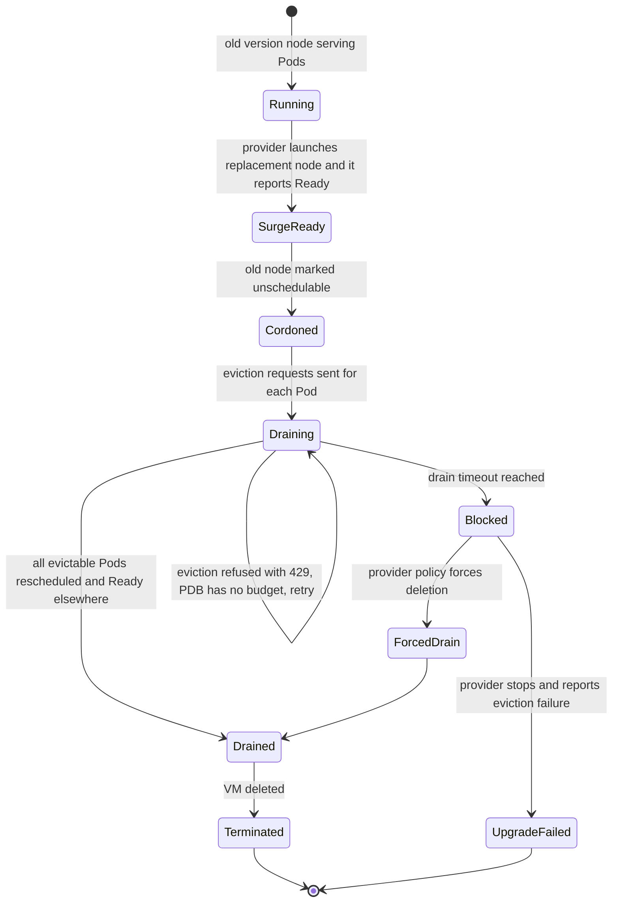

The `Draining` self-loop is where upgrades spend their time. Each eviction request goes through the Eviction API, which checks every PDB that selects the Pod; if evicting would leave fewer Pods available than the budget requires, the API refuses with Hypertext Transfer Protocol (HTTP) status 429 and the drainer retries. Draining can therefore take as long as it takes for replacement Pods to become Ready, which depends on image pull time, startup time, and readiness probes.

What happens at `Blocked` is provider-specific:

- **EKS managed node groups** fail the update with a `PodEvictionFailure` error unless you choose the force update strategy, which ignores PDBs.
- **GKE** respects PDBs during node upgrades for a bounded time (up to one hour at the time of writing) and then proceeds with deletion. A PDB therefore delays a GKE upgrade but does not stop it.
- **AKS** respects PDBs during a planned upgrade, with a configurable drain timeout. Its undrainable-node behavior setting chooses between failing the operation and cordoning the blocking node so the rest of the upgrade can continue. A platform-initiated upgrade (Section 11.2) can override the PDB.
- **Karpenter and EKS Auto Mode** never force-evict past a PDB for voluntary disruption such as drift or consolidation, but expiration has a configurable termination grace period, and Auto Mode's 21-day maximum lifetime means a node cannot be protected forever.

### 12.3 Node upgrade strategies

**Surge (rolling).** Launch extra nodes at the new version, drain old nodes onto them, delete the old ones, repeat. Parameters: `maxSurge` (how many extra nodes at once) and `maxUnavailable` (how many old nodes may be drained without replacement). EKS managed node groups expose `maxUnavailable` or a percentage; AKS exposes max surge (count or percentage) and related drain settings; GKE exposes `maxSurge` and `maxUnavailable` for surge upgrades. More surge means faster upgrades and more temporary cost and quota.

**Blue-green node pool.** Create a complete new pool at the new version, cordon the whole old pool, drain it in batches, soak, then delete it. GKE offers this as a built-in strategy with a soak period and rollback during the soak. On AKS and EKS, you implement it by creating a second node pool or node group and moving workloads with taints or labels. Blue-green costs a full second pool for the duration but gives a fast rollback: uncordon the old pool.

**Drift-based replacement.** With Karpenter, NAP, or Auto Mode, changing the node class or upgrading the control plane makes existing nodes drift, and the provisioner replaces them under NodePool disruption budgets. The rate is controlled by the budget, not by surge parameters.

**Cluster blue-green.** Build a new cluster at the target version, deploy the workloads, shift traffic with DNS weights or a global load balancer, and delete the old cluster. This is the only strategy that allows skipping minor versions and is the most reversible, at the cost of two clusters' capacity and the need for workloads and data to tolerate running in two places.

### 12.4 PodDisruptionBudgets as the upgrade contract

A PDB is the contract between workload owners and the platform: "you may voluntarily disrupt my Pods, but never below this level." Three PDB patterns break upgrades:

- `minAvailable` equal to the replica count (or `maxUnavailable: 0`), which allows zero voluntary disruptions. The drain can never complete.
- A PDB on a single-replica Deployment with `minAvailable: 1`, which is the same problem in a smaller package.
- A PDB whose selector matches Pods that are already unhealthy, so the disruption budget is already exhausted by failures.

The platform response is policy: an admission rule that rejects PDBs allowing zero disruptions unless they carry an approved exception label, plus a pre-upgrade report of every PDB's current `disruptionsAllowed` value.

### 12.5 Worked example: upgrade disruption for the checkout service

Continue the Section 10.5 example: 6 nodes (2 per zone), 12 `checkout` replicas spread evenly (2 per node), a PDB with `maxUnavailable: 2`, and a requirement that at least 10 replicas stay Ready because each handles 100 requests per second and peak load is 900 requests per second. The node pool uses surge upgrades with `maxSurge` of 3 (one per zone) and `maxUnavailable` of 0. Replacement Pods take about 60 seconds to become Ready on a new node (30 seconds of image pull and 30 seconds until the readiness probe passes). New nodes take about 4 minutes to launch and register.

The repository's [upgrade disruption planner](../code/python/kubernetes-chapter/03_upgrade_disruption.py) checks a planned number of simultaneous evictions against the budget. For 12 replicas and `maxUnavailable: 2` it reports that 1 eviction leaves 11 replicas (within budget), 2 evictions leave 10 (within budget), and 4 evictions would leave 8 (outside budget). The last case is what happens if the platform tries to drain two nodes at once without regard for the PDB: the Eviction API refuses the excess requests, so the drain slows down instead of breaking availability. That protection only holds if every workload has a correct PDB.

**Wave timing.**

```text
Wave 1: launch 3 surge nodes                         about 4 min
        drain 3 old nodes = 6 Pods
        PDB allows 2 at a time, each round about 60 s
        6 / 2 = 3 rounds x 60 s                       about 3 min
        terminate 3 old nodes                         about 1 min
Wave 2: launch 3 more new nodes                      about 4 min
        drain last 3 old nodes = 6 Pods               about 3 min
        terminate and verify                          about 3 min
Node phase total                                     about 18 min
```

Add a preflight of about 10 minutes, a control-plane upgrade of about 15 minutes, and managed add-on updates of about 5 minutes, and the cluster needs a maintenance window of roughly 50 minutes. The surge cost is three extra nodes for about 18 minutes, which is negligible.

```mermaid
gantt
    title Worked upgrade timeline for the checkout cluster
    dateFormat HH:mm
    axisFormat %H:%M
    section Control plane
    Preflight checks and backup        :a1, 00:00, 10m
    Control plane minor upgrade        :a2, after a1, 15m
    section Add-ons
    CNI CoreDNS and kube-proxy         :b1, after a2, 5m
    section Node wave 1
    Launch 3 surge nodes               :c1, after b1, 4m
    Drain 3 old nodes under PDB        :c2, after c1, 3m
    Terminate old nodes                :c3, after c2, 1m
    section Node wave 2
    Launch 3 replacement nodes         :d1, after c3, 4m
    Drain last 3 old nodes             :d2, after d1, 3m
    Terminate and verify               :d3, after d2, 3m
```

**What the numbers show.**

- The PDB, not the surge setting, sets the drain rate. Raising `maxSurge` to 6 would launch all new nodes at once and save one 4-minute launch period, but draining 12 Pods still takes 6 rounds.
- Availability never drops below 10 Ready replicas, which carries 1,000 requests per second against a 900 request-per-second peak. If the PDB were `maxUnavailable: 4`, the drain would be twice as fast but capacity could fall to 8 replicas (800 requests per second), below peak. The PDB value should come from the capacity arithmetic, not from a template.
- Without surge (`maxSurge: 0`, `maxUnavailable: 1`), each old node is drained onto the remaining five. CPU fits (5 × 7,300 = 36,500 millicores against 18,000 needed), and even the zone with one remaining node can host its four replicas (6,000 millicores of 7,300). So this upgrade could run without surge. With replicas requesting 2,000 millicores, that zone would need 8,000 millicores on a 7,300-millicore node, the topology spread constraint would leave Pods pending, the PDB would run out of budget, and the drain would stall. Surge is the cheap insurance against that case.

### 12.6 Rollback options

Plan rollback before the upgrade, because the options shrink once the control plane moves:

- **Control plane.** EKS allows rolling back to the previous minor version within 7 days of an in-place upgrade. AKS does not support control-plane downgrades. GKE allows patch downgrades in specific cases but not general minor downgrades. In practice, the control-plane upgrade is the step you validate in a lower environment first.
- **Nodes.** Blue-green node pools give an immediate rollback by uncordoning the old pool. With surge upgrades, roll back by creating a pool at the previous version (within skew rules) and moving workloads to it.
- **Cluster.** Cluster blue-green keeps the old cluster serving until the new one is proven, and shifting traffic back is the rollback. This is the migration-with-reversible-cutover pattern; Section 22 applies it.

## 13. Add-on management

An add-on is any cluster component that is not part of the Kubernetes core but that the cluster cannot work without (CNI, CoreDNS, kube-proxy, CSI drivers) or that the platform relies on (autoscalers, ingress controllers, policy engines, observability agents, service mesh, GitOps). The question for each one is the same: **who builds it, who chooses the version, who triggers the upgrade, and who is paged when it breaks?**

**EKS.** EKS add-ons are AWS-packaged versions of components such as the VPC CNI, CoreDNS, kube-proxy, the EBS and EFS CSI drivers, and the Pod Identity Agent, plus a catalog of AWS and partner add-ons. EKS publishes which add-on versions are compatible with each Kubernetes version, but in a standard cluster you choose when to update them, and updates do not happen automatically when the control plane moves. When you update an add-on whose configuration you changed, the conflict-resolution setting decides whether EKS overwrites your changes or preserves them. In Auto Mode, the core networking, storage, load-balancing, and identity components run as AWS-managed capabilities and are upgraded by AWS. **EKS Capabilities** extend this to platform tools: AWS runs managed Argo CD, AWS Controllers for Kubernetes (ACK), and Kube Resource Orchestrator (kro) outside your worker nodes, with a capability IAM role that grants them permissions ([EKS Capabilities](https://docs.aws.amazon.com/eks/latest/userguide/capabilities.html)).

**AKS.** Core components (CNI, CoreDNS, kube-proxy or Cilium, CSI drivers, cloud provider) are managed and versioned with the cluster; the AKS release notes list the exact component versions per Kubernetes version. **Add-ons** (such as monitoring, the Key Vault secrets provider, Azure Policy, KEDA, the application routing add-on, and the Istio-based service mesh add-on) are Microsoft-supported features you enable. **Cluster extensions** (such as Flux GitOps and Dapr) use a separate extension mechanism with their own versioning and auto-upgrade settings. The service mesh add-on uses revision-based upgrades, so a mesh upgrade is a separate change from a cluster upgrade.

**GKE.** GKE treats more components as part of the managed cluster: Dataplane V2, DNS, CSI drivers, Managed Service for Prometheus collection, Config Sync, and Policy Controller are enabled as features and upgraded by GKE. Cloud Service Mesh offers managed control-plane options with their own release channels.

The common pattern is an **add-on inventory** per cluster: name, version, source (provider-managed, provider-packaged but customer-triggered, or self-managed through Helm or GitOps), compatible Kubernetes range, upgrade owner, and on-call owner. The inventory is what makes the Section 12.1 compatibility check fast.

## 14. Quotas and limits

Managed Kubernetes hits limits at four levels, and the failures look different at each.

1. **Service quotas on the managed service.** Clusters per region, node pools or node groups per cluster, nodes per node group, Fargate profiles per cluster, access entries or associations per cluster. These are visible in the provider quota consoles (AWS Service Quotas, Azure quotas, Google Cloud quotas) and many are adjustable. AKS documents up to 5,000 nodes per cluster on Standard and Premium and up to 1,000 on Free ([AKS pricing tiers](https://learn.microsoft.com/en-us/azure/aks/free-standard-pricing-tiers)); check EKS and GKE service quota pages for current per-cluster values.
2. **Underlying infrastructure quotas.** vCPUs per instance family per region, public IP addresses, load balancers, security-group rules, disks per virtual machine, and NAT gateway ports. A cluster that is well under its node limit can still be unable to add nodes because of a vCPU quota (Section 10.6) or unable to attach more volumes to a node because of the instance's attachment limit.
3. **Address space.** Subnet free addresses, Pod CIDR blocks, and Service ranges (Section 6). These are not "quotas" in a console and are rarely alarmed by default.
4. **API server capacity.** The Kubernetes API server protects itself with API Priority and Fairness, which queues and rejects requests per priority level. Heavy `LIST` calls from badly written controllers, thousands of CronJobs, or many operators watching large object sets cause throttling (HTTP 429) and slow everyone's `kubectl`. Managed control planes scale, but not instantly and not without limit. EKS Provisioned Control Plane and the AKS Standard tier exist partly to raise this ceiling.

Make quota a design artifact: for each cluster, a table of the relevant quotas, current usage, worst-case planned usage (peak plus surge plus migration), and the alarm threshold. Review it in the same meeting as the capacity plan.

## 15. Security integration points

[Kubernetes Security](../12_Kubernetes/CH13_Security.md) owns RBAC design, Pod Security Standards, network policy design, and supply-chain controls inside the cluster. Security foundations are owned by Part 15. This section lists what the provider adds or decides for you.

**Node operating system.** Each provider offers a minimal, container-focused node image: Bottlerocket (EKS, and the basis of Auto Mode nodes), Azure Linux (AKS), and Container-Optimized OS (GKE). They reduce attack surface, use read-only or verified root file systems, and are patched by replacing nodes. General-purpose images (Amazon Linux 2023, Ubuntu) remain available when you need packages or agents the minimal images do not support. In the automated modes the provider chooses the image and blocks interactive access.

**Secrets at rest.** All three providers encrypt control-plane storage at rest. Envelope encryption of Kubernetes Secrets with a customer-controlled key is configured differently: EKS supports envelope encryption with AWS Key Management Service (KMS) keys and, for recent Kubernetes versions, applies envelope encryption to Kubernetes API data by default; AKS supports KMS etcd encryption with Azure Key Vault; GKE supports application-layer Secrets encryption with Cloud KMS. Using a customer-managed key adds a dependency: if the key is disabled or its permissions removed, the API server cannot decrypt Secrets. The full treatment of key hierarchy and rotation is in [Secrets Management](CH13_Secrets_Management.md).

**Node credentials and instance metadata.** On a compromised node, the most valuable target is the node's cloud identity, reached through the instance metadata service, whose protections are taught in [Compute](CH04_Compute.md). EKS nodes should require Instance Metadata Service Version 2 (IMDSv2) with a hop limit of 1 so that Pods without host networking cannot reach it; Auto Mode configures this. GKE's metadata server hides node credentials from Pods when Workload Identity Federation is enabled. On AKS, workload identity removes the need for Pods to use the node's managed identity. In every provider, the node identity should hold only what nodes need (image pull, disk attach, log shipping), never application permissions.

**Admission and policy.** The managed admission options are Azure Policy for AKS (built on Open Policy Agent Gatekeeper), GKE Policy Controller (also Gatekeeper-based), and AKS Automatic's deployment safeguards; on EKS you install Gatekeeper or Kyverno yourself. Pod Security Admission is built into Kubernetes on all three.

**Quality scenario: account compromise contained by boundaries.** *Stimulus:* an attacker obtains the credentials of a CI pipeline role that can deploy to the `catalog` namespace of a non-production cluster. *Expected response:* the role's access entry (or Azure role assignment, or IAM grant) is scoped to that namespace in that cluster; the cluster lives in a non-production account, subscription, or project with no trust path to production; organization guardrails (service control policies, Azure Policy, organization policies) prevent the role from disabling audit logging. *Success criterion:* audit logs show every action by the compromised role; no production resource is reachable from it; the role is revoked and the namespace restored from GitOps within 30 minutes. The design lesson is that cluster boundaries and account boundaries do the containment. Namespaces inside one shared cluster cannot provide the same guarantee, because a single cluster-scoped mistake (an over-broad ClusterRoleBinding, a privileged DaemonSet) crosses every namespace.

## 16. Observability and operations

[Kubernetes Observability](../12_Kubernetes/CH14_Observability.md) owns in-cluster telemetry design, and [Monitoring](CH10_Monitoring.md) owns provider monitoring services. The managed-service-specific question is what you can see of a control plane you do not run.

| Signal | EKS | AKS | GKE |
|---|---|---|---|
| API server, audit, authenticator, scheduler, controller-manager logs | Opt-in control-plane logging to Amazon CloudWatch Logs, per log type, billed as log ingestion | Resource logs through diagnostic settings (for example `kube-apiserver`, `kube-audit`, `kube-audit-admin`) to Log Analytics, storage, or Event Hubs | Cloud Audit Logs (Admin Activity always on), system and control-plane component logs in Cloud Logging |
| Control-plane metrics | API server metrics endpoint plus CloudWatch metrics | Azure Monitor platform metrics, managed Prometheus control-plane metrics | Control-plane metrics in Cloud Monitoring |
| Managed Prometheus | Amazon Managed Service for Prometheus | Azure Monitor managed service for Prometheus | Google Cloud Managed Service for Prometheus |
| Upgrade and version notices | AWS Health events, cluster insights | AKS release tracker, Azure Resource Health, upgrade notifications | Recommender insights, upgrade notifications to Pub/Sub |

You will not see etcd internals, control-plane host metrics, or provider-side load balancers in front of the API server. That is the **managed-control-plane visibility boundary**: you can observe the API's behavior (latency, errors, throttling, audit events) but not its causes. Design alerts around what you can observe:

- API server request latency and HTTP 429 or 5xx rates, which show control-plane distress or your own noisy clients.
- Nodes `NotReady` per pool and zone, and Pods pending longer than a threshold with their scheduling reason.
- IP utilization per subnet or Pod range, and quota utilization (Section 14).
- PDBs with `disruptionsAllowed: 0` for more than a day, which predicts a stuck upgrade.
- Days remaining until end of standard support for each cluster's version.
- Admission webhook latency and failure rate, because a slow webhook makes every write slow.

Control-plane audit logs at full verbosity are expensive. A busy cluster can generate tens of gigabytes per day. Keep audit logs for write operations and authentication events at full fidelity, and sample or exclude high-volume read events from system components.

## 17. Cost model

### 17.1 The bill of a managed cluster

A managed Kubernetes bill has more lines than the control-plane fee suggests:

| Cost component | What drives it | Typical design lever |
|---|---|---|
| Control-plane fee | Number of clusters, support period, tier | Fewer clusters; stay in standard support; pick tier by SLA need |
| Worker compute | Node hours (node billing) or Pod request hours (Autopilot general-purpose, Fargate) | Rightsize requests; consolidation; Spot; commitments |
| Mode management premium | EKS Auto Mode per-instance fee; Autopilot pricing and node premiums; AKS Automatic hosted components | Use automated modes where they replace staff time |
| Idle and fragmented capacity | Headroom, poor bin packing, system reservations | Groupless provisioning; fewer, larger pools; correct requests |
| Load balancers | Count and hours plus processed traffic | Share load balancers via Gateway or Ingress groups |
| Data transfer | Cross-zone Pod traffic, NAT gateway processing, internet egress | Topology-aware routing; VPC endpoints instead of NAT |
| Public IPv4 addresses | Provider charges for public IPv4 (AWS bills each public IPv4 hourly) | Private nodes; IPv6 |
| Storage and backups | Volume size and type, snapshots, backup service fees | Lifecycle and retention |
| Observability | Log ingestion (control-plane and container logs), metrics samples | Audit log filtering; metric cardinality control |

The control-plane fee for a single cluster is about $73 per month on all three providers at the time of writing. Worker compute, data transfer, and logs are usually one to two orders of magnitude larger. Allocation of these costs to teams, and commitment planning, belong to [Cost Optimization](CH14_Cost_Optimization.md).

### 17.2 Worked example: per-Pod billing versus node billing

A service runs 40 replicas, each requesting 0.5 vCPU and 2 GiB of memory, 24 hours a day. On GKE Autopilot's general-purpose platform in `us-central1`, list prices at the time of writing are $0.0445 per vCPU-hour and $0.0049225 per GiB-hour of requested resources ([GKE pricing](https://cloud.google.com/kubernetes-engine/pricing)):

```text
per Pod per hour = 0.5 x 0.0445 + 2 x 0.0049225 = 0.022250 + 0.009845 = 0.032095 USD
per month        = 40 Pods x 0.032095 x 730 hours = 937.17 USD
```

On GKE Standard (or any node-billed mode) you pay for whole nodes. Let `p` be the Standard node price per unit of resource as a fraction of the Autopilot price for the same unit, and `e` the packing efficiency: the fraction of each node's capacity that ends up covered by Pod requests after system reservations, DaemonSets, fragmentation, and headroom. Node billing is cheaper when:

```text
p / e < 1, which means e > p
```

If Standard's effective per-unit price is 60% of Autopilot's (`p = 0.6`, an illustrative figure; compute your own from current Compute Engine prices and discounts), Standard wins only if more than 60% of node capacity is covered by requests. Many clusters run at 30% to 50% request coverage because of headroom and fragmentation, in which case per-Pod billing is cheaper despite the higher unit price. Clusters with steady, well-packed workloads and committed-use discounts often exceed 70%, where node billing wins. The same reasoning applies to EKS Fargate versus EC2 nodes, and to the management premium of EKS Auto Mode versus self-managed Karpenter (where `p` includes the fee and the comparison is against your staff time for running Karpenter).

The important point is that requests drive cost in both models. Over-requesting by 2x doubles the Autopilot bill directly and halves node packing efficiency. Rightsizing requests with VPA recommendations is the first cost lever in every mode.

## 18. Multi-cluster and fleet interfaces

### 18.1 Why fleets exist

Organizations end up with many clusters for good reasons: separate environments, separate trust zones (Section 15), regional placement, failure isolation, and per-team upgrade cadence. Each cluster multiplies upgrade work, policy configuration, identity setup, and cost. A **fleet** interface lets you treat a group of clusters as one unit for some purposes: applying configuration and policy to all of them, sequencing upgrades across them, routing traffic among them, and sharing identity. [Multi-Cluster Kubernetes](../12_Kubernetes/CH15_Multi_Cluster.md) owns multi-cluster patterns in the abstract (federation, service discovery across clusters, failover models). This section covers what each provider offers natively.

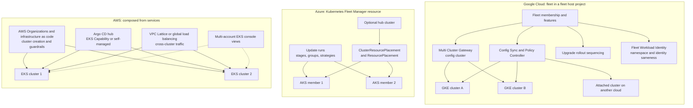

### 18.2 GKE fleets

A GKE fleet is a grouping of clusters registered to a fleet host project. Clusters can be GKE clusters in several projects, GKE clusters on other clouds, or attached conformant clusters. Fleet features operate on all members: Config Sync applies configuration from Git, Policy Controller enforces constraints, Multi Cluster Ingress and Multi Cluster Gateway program a Google Cloud load balancer from a designated config cluster to backends in several clusters, multi-cluster Services export Services across members, and **rollout sequencing** lets GKE upgrade clusters in a defined order (for example, all development clusters, then a soak period, then production). Fleets assume **sameness**: a namespace with the same name in two member clusters is treated as the same namespace, and a service account with the same namespace and name has the same Workload Identity. That assumption makes multi-cluster deployment simple and makes fleet membership a security decision: never put a low-trust cluster in the same fleet as production unless team scopes separate them. Fleet management features are included in GKE pricing at the time of writing; Multi Cluster Gateway and Ingress are billed per backend Pod.

### 18.3 Azure Kubernetes Fleet Manager

Azure Kubernetes Fleet Manager is an Azure resource that groups AKS member clusters. It has two main functions. **Update orchestration** runs Kubernetes and node-image upgrades across members using update runs made of stages and groups, with waits and approvals between stages, and auto-upgrade profiles for ongoing upgrades; update runs honor each member's maintenance window ([Fleet update orchestration](https://learn.microsoft.com/en-us/azure/kubernetes-fleet/update-orchestration)). **Resource placement** uses an optional hub cluster: you apply manifests to the hub, and `ClusterResourcePlacement` (for cluster-scoped resources and whole namespaces) or `ResourcePlacement` (for individual namespace-scoped resources) objects select member clusters by policy and propagate the resources, optionally with staged rollouts. Fleet Manager without a hub cluster provides only update orchestration.

### 18.4 Amazon EKS

EKS has no fleet object comparable to GKE fleets or Fleet Manager. AWS customers compose the same functions from other services: AWS Organizations and infrastructure as code for consistent cluster creation and guardrails; the managed Argo CD capability of EKS Capabilities (or self-managed Argo CD or Flux) in a hub-and-spoke model for configuration and application rollout; multi-account, multi-Region cluster views in the EKS console; Amazon VPC Lattice, Route 53, or AWS Global Accelerator for cross-cluster traffic; and staged upgrades scripted in pipelines. The EKS Connector can register non-EKS clusters for console visibility. The absence of a native fleet API means upgrade sequencing and policy distribution are your pipeline's job, and you should build them before you have twenty clusters, not after.

### 18.5 Comparing fleet interfaces

| Capability | GKE fleets | Azure Kubernetes Fleet Manager | EKS |
|---|---|---|---|
| Cluster grouping object | Fleet in a host project | Fleet resource | None native; Organizations and tags |
| Cross-cluster upgrade sequencing | Rollout sequencing | Update runs with stages and approvals | Customer pipelines |
| Configuration and policy distribution | Config Sync, Policy Controller | Hub cluster resource placement | Argo CD capability or self-managed GitOps |
| Cross-cluster traffic | Multi Cluster Gateway and Ingress, multi-cluster Services | Not the primary focus; use Azure Front Door or Traffic Manager | VPC Lattice, Route 53, Global Accelerator |
| Shared workload identity | Fleet Workload Identity with sameness | Per-cluster federated credentials | Pod Identity roles reusable across clusters |
| Non-native clusters | Attached clusters, other clouds | AKS members (check current support for others) | EKS Connector (view only) |

## 19. Managed Kubernetes versus managed containers

### 19.1 The selection boundary

[Containers](CH07_Containers.md) owns the mechanics of the provider's managed container services: Amazon Elastic Container Service (ECS) with Fargate or EC2, Azure Container Apps, and Cloud Run. This chapter owns the decision of when a Kubernetes cluster, even a fully managed one, is the right operating model instead.

A managed Kubernetes cluster gives you the Kubernetes API: custom resources and operators, Helm and GitOps tooling, fine-grained scheduling (affinity, taints, topology spread, DaemonSets), network policy, and a portable deployment contract. It also gives you a platform to run: namespaces, RBAC, admission policy, add-ons, upgrades every few months, and capacity planning. Managed container services hide the cluster. You give them an image, resource settings, scaling rules, and networking, and they run it, with fewer extension points and much less to operate.

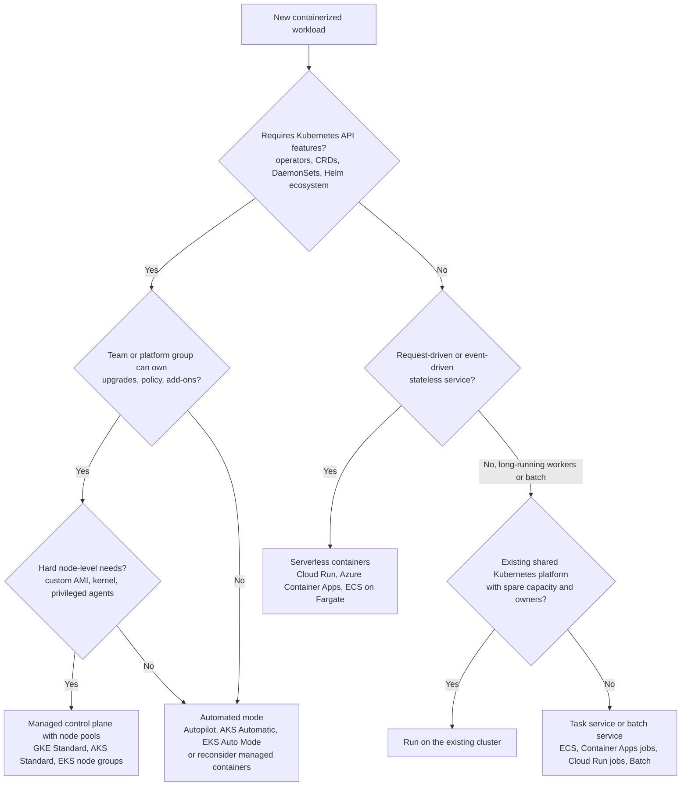

### 19.2 Decision criteria

The decision tree encodes three reasons that justify Kubernetes, and a fourth that is often mistaken for one:

1. **You need the API's extension model.** Operators for databases or message brokers, custom controllers, policy engines, and service meshes are Kubernetes-native. If the workload depends on them, a managed container service cannot host it.
2. **You are building a shared platform.** Many teams deploying through one consistent contract (namespaces, GitOps, policy) is where a cluster's operating cost is spread widely enough to pay off.
3. **You need scheduling control.** GPUs with specific topologies, node-local agents, mixed Spot and On-Demand strategies, or tight bin packing across many workloads.
4. **Portability (often overstated).** The Kubernetes API is portable; the integrations in Sections 5 to 9 are not. Identity, load balancers, storage classes, and IP planning all change between providers. Kubernetes reduces the cost of moving workloads, but it does not make moving free.

A single team with three stateless HTTP services and no operator needs will usually spend less, ship faster, and have fewer incidents on Cloud Run, Azure Container Apps, or ECS on Fargate. The same company, a year later, with fifteen teams and a need for shared policy, may be right to move to a managed Kubernetes platform. Revisit the choice when the facts change, and remember that the managed container services have their own limits on request duration, concurrency, networking, and sidecars, documented in the Containers chapter.

## 20. Provider comparison

The table compares guarantees, scopes, and responsibilities rather than product names. Similar names hide different promises; for example, "node auto-provisioning" means Karpenter on AKS and node-pool creation on GKE, and the Autopilot Pod SLA and the AKS Automatic pod readiness SLA measure different things.

| Dimension | Amazon EKS | Azure Kubernetes Service | Google Kubernetes Engine |
|---|---|---|---|
| Control-plane fee | $0.10 per cluster-hour; $0.60 in extended support | Free tier none; Standard and Premium per cluster-hour | $0.10 per cluster-hour; $74.40 monthly credit per billing account |
| API uptime SLA | 99.95%; 99.99% with Provisioned Control Plane | Standard and Premium 99.95% with zones, 99.9% without; Free none | 99.95% regional and Autopilot; 99.5% zonal |
| Data-plane commitments | None for nodes or Pods | Automatic: 99.9% of pod readiness operations within 5 minutes | Autopilot: 99.9% for multi-zone Pods |
| Control-plane failure domain | Spread across zones in the region | Spread across zones where the region supports them | Regional clusters across zones; zonal clusters in one zone |
| Standard version support | 14 months | About 12 months (N to N-2) | 14 months |
| Extended support | 12 months more, extra fee, default on | Premium LTS, 24 months | Extended channel, up to 24 months, extra fee |
| Forced upgrade at end of support | Control plane only | Platform-initiated, can override PDBs | Control plane and nodes |
| Most automated mode | EKS Auto Mode: managed Karpenter, managed core add-ons, 21-day node lifetime, per-instance fee | AKS Automatic: managed system pools, NAP, hardened defaults, Standard tier | GKE Autopilot: provider-run nodes, per-Pod billing for general-purpose Pods |
| Node provisioners available | Cluster Autoscaler, Karpenter, Auto Mode, Fargate | Cluster Autoscaler, NAP (Karpenter) | Cluster Autoscaler, node auto-provisioning, ComputeClasses, Autopilot |
| Human access control plane | IAM plus access entries and access policies | Microsoft Entra ID plus Kubernetes RBAC or Azure RBAC | Cloud IAM plus Kubernetes RBAC, Google Groups for RBAC |
| Workload identity | EKS Pod Identity or IRSA | Microsoft Entra Workload ID | Workload Identity Federation for GKE |
| Default Pod addressing | Routable VPC addresses (VPC CNI) | Azure CNI Overlay recommended; Pod subnet for routable | VPC-native alias IP ranges |
| Data plane option with eBPF | VPC CNI network policy agent; third-party Cilium | Azure CNI powered by Cilium | Dataplane V2 |
| Private API options | Private endpoint ENIs, public allowlists | Private Link cluster, API Server VNet Integration, authorized IP ranges | Private endpoint, authorized networks, DNS-based endpoint |
| Native fleet interface | None; composed from Organizations, Argo CD capability, console views | Azure Kubernetes Fleet Manager | GKE fleets |

## 21. Failure scenarios and quality-attribute scenarios

### 21.1 Failure catalog

| Failure | Symptom | Owner | Architectural response |
|---|---|---|---|
| Control-plane API unavailable | Deploys and scaling stop; running Pods keep serving | Provider; customer for impact | Steady-state headroom; avoid request-path dependence on the API; regional or zone-redundant control plane |
| Zone outage | Nodes in one zone `NotReady`; zonal volumes unavailable | Customer | Zone spread for replicas, zone-loss capacity headroom, zone-redundant or application-replicated storage |
| Node provisioner cannot add capacity | Pods pending with quota or capacity errors | Customer | Quota headroom, instance diversity, reservations |
| IP exhaustion | Pods stuck creating; nodes cannot get Pod blocks | Customer | IP plan with alerts; prefix delegation, custom networking, larger overlay or secondary ranges |
| Upgrade blocked by PDB | Upgrade fails, stalls, or is forced | Customer | PDB policy, pre-upgrade report, surge capacity |
| Removed API after upgrade | Deploys fail with unknown kind or version | Customer | Deprecated API scans in CI; provider upgrade insights |
| Admission webhook down | Every write times out or fails | Customer | Webhook high availability, `failurePolicy` review, namespace exclusions for system namespaces |
| Private endpoint DNS broken | `kubectl` and CI cannot resolve or reach API | Customer network team | DNS forwarding tests, break-glass access path |
| Workload identity misconfigured | Cloud API `AccessDenied` from new Pods | Customer | Staged rollout with readiness gates; identity tests in CI |
| Provider forced upgrade | Unplanned version change, possible PDB override | Customer prevented it by staying current | Upgrade cadence within standard support |
| Registry unreachable | New Pods cannot pull images | Customer | Private registry endpoints, regional replication; see [Containers](CH07_Containers.md) |
| Customer-managed key disabled | API server cannot read Secrets | Customer key owner | Key protection policies, alerting on key state changes |

### 21.2 Quality scenario: zonal failure

**Stimulus.** One of three zones in the region becomes unavailable at peak traffic, taking 2 of 6 nodes and 4 of 12 `checkout` replicas.

**Expected response.** The load balancer stops sending to unhealthy Pods within its health-check interval. The remaining 8 replicas carry traffic while the scheduler places 4 replacement replicas on the spare capacity in the surviving zones (Section 10.5 sized each zone at 2 nodes, so the 4 surviving nodes can host all 12 replicas). The node provisioner does not need to scale, so quota and zone capacity do not matter for the first response.

**Success criterion.** Error rate below 1% for no more than 2 minutes; all 12 replicas Ready within 5 minutes; no data loss for stateful services using zone-redundant or replicated storage.

**Evidence.** A zone-impairment game day (for example, using AWS Fault Injection Service, Azure Chaos Studio, or by cordoning and draining one zone's nodes in GKE), with measured recovery times.

### 21.3 Quality scenario: migration with reversible cutover

**Stimulus.** Workloads move from an old cluster (self-managed, or an old version) to a new managed cluster.

**Expected response.** Both clusters run the same release from GitOps. Traffic shifts by weighted DNS or a global load balancer in steps of 5%, 25%, 50%, and 100%, with a soak at each step. Any step can be reversed by setting the new cluster's weight to zero.

**Success criterion.** At each step, error rate and 99th percentile latency stay within 10% of the old cluster's baseline for 30 minutes; rollback restores 100% of traffic to the old cluster within 5 minutes (60-second DNS time-to-live plus client caching margin); the old cluster is kept for 14 days after 100% cutover.

**Constraint.** Stateful services cannot simply run in both clusters. Keep the database outside both clusters (a managed database service) or migrate it separately with its own replication and cutover plan; see [Cloud Migration](CH16_Cloud_Migration.md).

## 22. Case study: moving a retail platform to managed Kubernetes

### 22.1 Context

A mid-sized online retailer runs about 40 services for 6 product teams on a self-managed Kubernetes 1.33 cluster on Amazon EC2, built years ago with a provisioning tool and operated by a platform team of four engineers. The cluster is shared by all environments through namespaces. The payment service is in scope for the Payment Card Industry Data Security Standard (PCI DSS). Traffic peaks at about 8x the daily average during seasonal sales. An enterprise resource planning (ERP) system in the company's data center is reached over AWS Direct Connect. The enterprise network team can allocate only a `/19` of routable address space per environment.

Problems reported by the teams: the cluster is two minor versions behind the oldest version in EKS standard support; each upgrade has taken a full sprint; etcd backups are manual; a namespace-scoped mistake once deleted a shared ConfigMap in production; and the security team wants payment workloads isolated from everything else.

### 22.2 Requirements and constraints

- Reduce platform toil enough that four engineers can run the platform and still build features for product teams.
- Keep the Kubernetes API: teams use Helm charts, Argo CD, and two operators (a Kafka operator and a PostgreSQL operator for non-PCI data).
- Isolate the PCI workload in a separate trust boundary.
- Private API access only, with on-premises engineers and in-VPC CI runners as clients.
- Survive the loss of a zone at peak with no more than 2 minutes of elevated errors.
- Stay in standard support, with upgrades taking no more than a day of platform time per cluster.
- Migrate with a reversible cutover.

### 22.3 Decisions

**Provider and service: Amazon EKS.** The company's data, Direct Connect circuits, and AWS Organizations structure are already on AWS. GKE Autopilot was evaluated because its per-Pod model fit the bursty traffic, but moving data gravity and hybrid connectivity outweighed the benefit. The decision is recorded with that rationale so it can be revisited.

**Cluster topology: three clusters in three accounts.** One non-production cluster (development and staging namespaces), one production cluster for general services, and one production cluster for the payment service in a separate PCI account. A single shared production cluster was rejected because PCI scope would extend to every node and every cluster administrator, and because the namespace-scoped incident showed that a shared cluster couples all teams' blast radius. More clusters were rejected because each adds an upgrade cycle; three is the number the team can upgrade within the time budget.

**Compute mode: EKS Auto Mode for general clusters; managed node groups for payments.** Auto Mode removes Karpenter, CNI, CSI, and load-balancer controller upgrades from the team's backlog and replaces nodes at most every 21 days, which closes the patching gap. The payment cluster requires a file-integrity monitoring agent from a PCI-approved vendor that ships as a kernel module for a specific AMI, which Auto Mode's locked-down image does not allow. That cluster uses managed node groups with a hardened custom AMI, the Cluster Autoscaler, and a monthly AMI rollout. The team accepts the extra work for one cluster in exchange for a clear audit story.

**Networking: VPC CNI with custom networking.** The `/19` (8,192 addresses) per environment cannot hold the Pods at peak. Production peaks at about 180 nodes and 4,500 Pods. Nodes go in three routable `/22` subnets (3,072 addresses in total, 1,019 usable per zone after AWS reservations, room for ENIs, endpoints, and load balancers). Pods go in a `100.64.0.0/16` secondary CIDR split into three `/18` subnets, which the enterprise never routes. The ERP system sees Pod traffic as coming from node addresses through source NAT, which matches the ERP firewall's node-subnet allowlist.

**API access: private endpoint only.** A Route 53 Resolver inbound endpoint in the shared network account answers queries forwarded from corporate DNS. CI runners run in the VPC. The break-glass path is a documented procedure to enable the public endpoint with a single `/32` allowlist, audited and time-limited.

**Identity: access entries in API mode and EKS Pod Identity.** Platform engineers get cluster-admin through an IAM Identity Center permission set mapped to an access entry. Product teams get namespace-scoped `AmazonEKSEditPolicy` access entries. Every workload that calls AWS uses a Pod Identity association; a policy check in CI rejects Secrets that contain AWS access keys.

**Ingress: Application Load Balancers through Auto Mode's load balancing, one shared load balancer per environment** using ingress groups. This keeps load-balancer count (and cost and quota) flat as services grow.

**Upgrades: quarterly cadence with standard support only.** Non-production upgrades first; production clusters a week later. Extended support remains enabled as insurance for the payment cluster, whose vendor agent may lag a new Kubernetes version.

**Fleet: Argo CD hub in the platform account** (using the EKS Capabilities managed Argo CD) deploys to all three clusters, with ApplicationSets per environment. Upgrade sequencing is a pipeline: non-production, then a 7-day soak, then general production, then payments.

### 22.4 Migration plan

The migration uses cluster blue-green, which also solves the version gap: the new clusters start at a current version, so no in-place catch-up through two minors is needed. Argo CD deploys every service to the new general production cluster. Stateful data already lives in Amazon Relational Database Service (RDS) and Amazon Managed Streaming for Apache Kafka (MSK), outside the cluster, so services can run in both clusters at once. Kafka consumers are scaled to zero in the new cluster until cutover to avoid double processing. Traffic moves by Route 53 weighted records per hostname: 5%, 25%, 50%, 100%, each held for at least 30 minutes against the Section 21.3 criteria. The old cluster stays for 14 days.

### 22.5 Validation evidence

| Check | Target | Result in rehearsal |
|---|---|---|
| Zone impairment game day (one zone's subnets blocked by network access control lists) | Errors below 1% for at most 2 minutes | 0.6% errors for 70 seconds; all replicas Ready in 3 minutes 40 seconds |
| Upgrade rehearsal on non-production | One working day | Control plane 14 minutes; Auto Mode node drift replacement 52 minutes under NodePool budget of 10% |
| Peak load test at 8x average | p99 latency under 400 ms | 310 ms; Auto Mode provisioned 41 nodes in 6 minutes |
| IP utilization at peak | Below 70% of each Pod subnet | 34% of each `/18` |
| Rollback drill at 25% weight | Traffic back to old cluster in under 5 minutes | 2 minutes 50 seconds |
| Access review | No `system:masters` or static keys | Creator admin entry removed; zero AWS keys in Secrets |

One finding changed the design: the first upgrade rehearsal stalled because a team's PDB had `minAvailable` equal to its replica count. An admission policy now rejects such PDBs without an approved exception label, and the pre-upgrade report lists every PDB with no disruption budget.

### 22.6 Outcome and residual risks

After six months, the platform team spends about two days per quarter on upgrades across all three clusters, compared with a sprint per upgrade before. Compute cost rose by about the Auto Mode management fee on the general clusters, offset by consolidation that reduced average node count by about a fifth. Residual risks: the payment cluster's dependency on the vendor agent may block upgrades (mitigated by extended support as insurance and a contractual commitment from the vendor); the private-only API depends on the shared DNS path (mitigated by the break-glass procedure, tested quarterly); and Auto Mode's 21-day node replacement means every workload must tolerate eviction, which is enforced through PDB and replica-count policies.

## 23. Common mistakes and anti-patterns

**Treating "managed" as "operated."** *Cause:* reading the product name instead of the responsibility matrix. *Consequence:* nobody owns node patching, add-on upgrades, or capacity, and the first sign is a forced upgrade or a published Common Vulnerabilities and Exposures (CVE) entry against a year-old node image.

**Planning upgrades as projects.** *Cause:* upgrading once a year or only when forced. *Consequence:* clusters sit in paid extended support, skip-version catch-ups require multiple cycles, and AKS or GKE eventually upgrade them on the provider's schedule.

**Sizing Pod ranges for today's node count.** *Cause:* copying a default `/16` without dividing by per-node block size. *Consequence:* on AKS Overlay or GKE, the cluster cannot add the 257th node at the default density, typically discovered during a traffic peak.

**Leaving the VPC CNI warm pool at defaults in tight subnets.** *Cause:* not knowing that each node holds a spare ENI's worth of addresses. *Consequence:* subnets exhaust at half the expected Pod count.

**PDBs that allow zero disruptions.** *Cause:* setting `minAvailable` to the replica count "for safety." *Consequence:* drains never complete; EKS node group updates fail, GKE forces deletion after its timeout, and AKS platform-initiated upgrades override the budget anyway.

**Keeping `aws-auth` or local AKS accounts as the only admin path.** *Cause:* legacy setup. *Consequence:* one bad edit locks out every administrator, or a leaked static credential grants cluster-admin outside the identity provider's controls.

**Granting application permissions to node identities.** *Cause:* it is quicker than setting up workload identity. *Consequence:* any Pod on the node, including a compromised one, inherits those permissions.

**Assuming GKE workload identities are per cluster.** *Cause:* not knowing about identity sameness. *Consequence:* a service account in a test cluster in the same project has production permissions.

**One load balancer per Service.** *Cause:* using `type: LoadBalancer` for every HTTP service. *Consequence:* regional load-balancer quotas are hit and load-balancer cost exceeds node cost.

**Choosing a fully automated mode without checking hard constraints.** *Cause:* selecting the most managed mode by default. *Consequence:* a required security agent, kernel setting, or networking feature is unsupported, forcing a mode change after go-live. The reverse mistake, choosing Standard node pools without a requirement for them, leaves a small team running node lifecycles it did not need to run.

**One giant shared cluster across trust levels.** *Cause:* optimizing for density and control-plane fee. *Consequence:* compliance scope, upgrade coupling, and incident blast radius extend to every tenant.

## 24. Design-review checklist

- Is there a written responsibility matrix for the chosen mode, with a named owner for nodes, add-ons, upgrades, capacity, and identity?
- Does the selected mode support every hard constraint (privileged agents, kernel, GPUs, Windows, CNI features), checked against current provider documentation?
- Do the control-plane tier and SLA match the tolerated duration of "no changes," and does the design avoid request-path dependence on the API server?
- Is the IP plan written down with arithmetic for node, Pod, and Service ranges at peak plus surge, and is there an alert at 70% to 80% utilization?
- Are the API endpoint exposure, DNS resolution path, CI runner path, and break-glass access documented and tested?
- Are human access mappings in provider APIs (access entries, Entra ID with local accounts disabled, Cloud IAM) rather than in-cluster ConfigMaps or static credentials?
- Does every workload that calls cloud APIs use workload identity, with no long-lived keys in Secrets, and are node identities free of application permissions?
- Are load balancers shared where possible, and is the controller (and its target mode) chosen deliberately?
- Do StorageClasses use `WaitForFirstConsumer`, and does each stateful workload have a zone-failure plan with stated RPO and RTO?
- Is the node provisioner chosen deliberately, with limits that cap runaway scaling, and are quotas sized for peak plus surge plus migration?
- Is there an upgrade cadence that keeps every cluster in standard support, a pre-upgrade checklist (removed APIs, add-on matrix, webhooks, PDBs, surge capacity, backups), and a rollback plan for each step?
- Is there an add-on inventory with version source and upgrade owner for every component?
- Are control-plane audit logs enabled with a retention and cost plan?
- If there are multiple clusters, is fleet membership a deliberate trust decision, and is upgrade sequencing automated?
- Has the team confirmed that a managed container service would not meet the requirements with less operating work?

## 25. Interview and design exercises

1. **Responsibility boundary.** For GKE Standard, EKS with managed node groups, and AKS Automatic, list who patches the node operating system, who upgrades the CNI, and who is paged when nodes in one zone go `NotReady`. Explain why the answer for the last question is the same in all three.
2. **IP planning.** Design address ranges for a 500-node AKS cluster using Azure CNI Overlay and a 500-node GKE cluster with 48 Pods per node. Show the arithmetic and identify the hard ceiling for each.
3. **Upgrade plan.** A cluster runs control plane 1.35 and node pools at 1.33 and 1.35. The target is 1.37. Write the sequence of steps under GKE's skew rule and estimate the number of maintenance windows. Then propose a cluster blue-green alternative and compare the risk.
4. **PDB arithmetic.** A Deployment has 9 replicas spread across 3 zones; each replica handles 150 requests per second; peak is 1,000 requests per second. Choose a PDB value and justify it. What happens to the upgrade time if you choose a stricter value?
5. **Identity design.** Two EKS clusters in different accounts must let the `orders` workload read the same Amazon S3 bucket. Compare IRSA and Pod Identity for this design, including trust-policy changes when a third cluster is added.
6. **Mode selection.** A startup with two engineers runs five stateless APIs and one nightly batch job. Argue for and against GKE Autopilot versus Cloud Run, and state the conditions under which you would switch.
7. **Run the code examples.** Run the capacity planner with system reservations of 1,500 millicores and 4,096 MiB and explain how the node count changes. Run the upgrade disruption planner with a budget of 1 and describe the effect on upgrade duration.

## 26. Summary

Managed Kubernetes moves the control plane, and optionally the nodes and core add-ons, to the provider. It never moves the workload, Kubernetes authorization, disruption budgets, or data. The responsibility matrix in Section 2.3 is the starting point for every decision in this chapter.

The three providers expose the same API with different guarantees. EKS offers the widest choice of compute types, a control plane priced by support period and optional provisioned capacity, and builds multi-cluster management from other AWS services. AKS separates SKU from tier, ties its SLA to zones, adds Premium LTS, and will upgrade clusters left on unsupported versions. GKE prices every cluster the same, makes regional control planes and Autopilot the 99.95% options, offers a data-plane SLA for Autopilot Pods, and has the most integrated fleet model.

The integrations decide most outcomes. Identity should be provider-API-based for humans and token-exchange-based for workloads. Pod addressing must be planned with per-node arithmetic, not defaults. Private API access is mostly a DNS and client-path problem. Load-balancer controllers decide packet paths and quota use. Storage classes decide what survives a zone failure. Upgrades are a recurring operation every four to six months, ordered control plane, add-ons, nodes, and paced by PDBs and surge capacity. When none of the Kubernetes-specific benefits apply, a managed container service is usually the better operating model.

## 27. Code examples

The examples use synthetic values and Python's standard library. They do not call Kubernetes or cloud APIs and do not replace provider-specific compatibility checks.

- [Managed cluster operating-mode decision matrix](../code/python/kubernetes-chapter/01_cluster_mode_matrix.py) scores an automated mode against standard node pools with weighted requirements, crediting each mode only up to the level required (Section 4.4).
- [Pod requests and node-pool capacity planner](../code/python/kubernetes-chapter/02_capacity_planner.py) computes the minimum node count from total CPU and memory requests after system reservations, the starting point for the zone-loss headroom in Section 10.5.
- [Upgrade disruption and Pod budget planner](../code/python/kubernetes-chapter/03_upgrade_disruption.py) checks a number of simultaneous evictions against a PDB's `maxUnavailable` and reports remaining replicas, as used in the worked upgrade in Section 12.5.
- [Version-support and upgrade-window checker](../code/python/kubernetes-chapter/04_version_skew_checker.py) applies a simplified two-minor-version node skew rule and rejects nodes newer than the control plane (Section 11.4).
