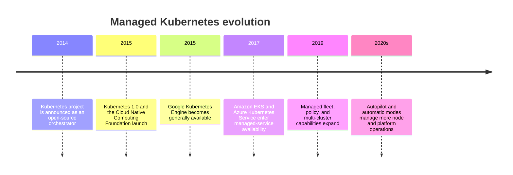
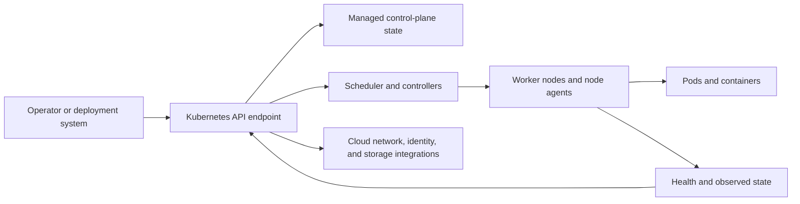
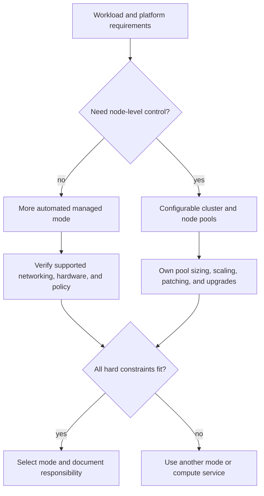
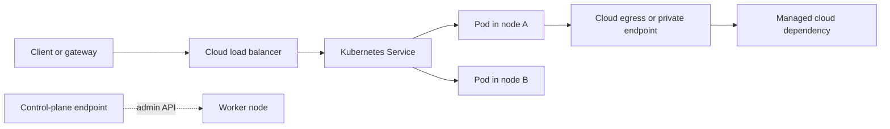
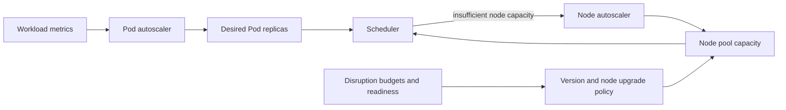
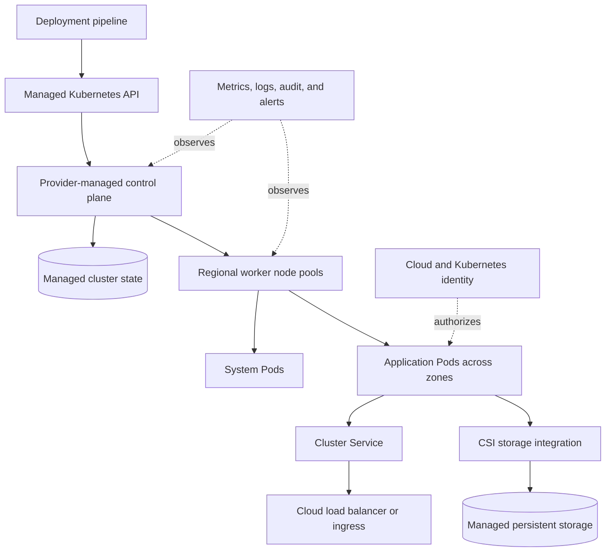

# Chapter: Managed Kubernetes Architecture

Part: [09 — Cloud Computing](PART_OVERVIEW.md) · Status: Drafted

## 1. Introduction

Managed Kubernetes services provide a hosted control plane and varying levels of node, networking, upgrade, identity, and observability management. They retain the Kubernetes API and workload model while transferring selected cluster operations to the cloud provider. “Managed” does not mean the provider operates the application, workload policies, data, or every node-level choice.

This chapter focuses on managed Kubernetes architecture across Amazon Elastic Kubernetes Service (EKS), Azure Kubernetes Service (AKS), and Google Kubernetes Engine (GKE): control-plane responsibility, cluster modes, node pools, networking, storage integrations, upgrades, scaling, and operational boundaries. Part 05 owns container runtime internals; the preceding Part 09 Containers chapter owns image registries and cloud container-execution alternatives. This chapter teaches Kubernetes cluster operations only to the depth needed to choose and operate a managed cluster.

## 2. Historical Evolution

Kubernetes emerged as an open-source orchestration platform informed by Google's cluster-management experience. Managed offerings followed, allowing customers to use the Kubernetes API without building a control plane from raw virtual machines. Over time, providers added automatic node management, fleet governance, managed add-ons, upgrade channels, and policy integrations.

Managed offerings have not converged to identical responsibility boundaries. Some expose worker virtual machines and node pools; others manage much of that infrastructure. Version support, regional design, network integration, upgrade behavior, and pricing remain provider-specific.

## 3. Why It Exists

Kubernetes offers a common API for declaring workloads, scheduling containers, and reconciling desired state. Operating a highly available control plane, integrating cloud networks and storage, patching nodes, and maintaining supported versions are significant responsibilities. A managed service can reduce this operational burden while preserving access to the Kubernetes ecosystem.

The service choice is still architectural. The team decides cluster boundaries, workload placement, identity, network policy, persistent data, upgrade windows, recovery, and how much node-level control it needs. A managed control plane that is healthy does not guarantee that worker nodes, load balancers, storage, or applications are healthy.

## 4. Core Concepts

### 4.1 Control plane, nodes, and responsibility boundary

**Definition.** A Kubernetes cluster consists of a control plane that exposes the Kubernetes API and maintains cluster state, and worker nodes that run Pods. A Pod is the scheduling unit for one or more related containers. In a managed service, the provider operates some control-plane components; node ownership depends on the selected mode.

**Mechanism.** The API server accepts desired-state objects. Controllers reconcile actual state toward that intent; the scheduler assigns pending Pods to eligible nodes; node agents start containers and report health. Cluster state is stored in a distributed key-value database such as etcd, managed by the provider in typical hosted offerings. Provider integrations connect cluster resources to cloud networking, identity, storage, and load-balancing services.

**Decision implications.** Identify which control-plane and node operations the provider owns, which remain customer-owned, and what changes across cluster modes. Confirm control-plane availability guarantees separately from node and workload availability. Keep a tested access path for cluster administration and provider control-plane incidents.

**Common failure mode.** Treating a managed control plane as a fully managed application platform. The cluster API can remain available while workloads fail because node capacity, network paths, storage, or application dependencies are unavailable.

**Scenario.** A cluster's control plane is healthy, but a node-pool upgrade exhausts capacity and pending Pods cannot schedule. The team sees separate control-plane, node, and workload signals and restores capacity rather than assuming the provider fixes an application-level resource shortage.

### 4.2 Cluster modes and node pools

**Definition.** A node pool is a group of worker nodes with shared configuration such as machine type, operating system, scaling bounds, labels, and upgrade behavior. Managed Kubernetes services vary in how much they configure and operate these pools. GKE offers Autopilot and Standard; AKS offers Automatic and Standard; EKS offers managed control-plane clusters, managed node groups, Fargate options, and Auto Mode.

**Mechanism.** A more managed mode may provision nodes from workload resource requests, apply security defaults, and automate upgrades. A standard mode typically exposes more node-pool configuration and operational choices. Amazon EKS's managed control plane is distinct from worker management; customers can use managed node groups, self-managed nodes, Fargate, or Auto Mode where available. Exact features and limits change, so choose based on current service documentation.

**Decision implications.** Prefer the most managed mode that satisfies hardware, networking, compliance, Windows, workload isolation, and platform requirements. Use multiple node pools to separate materially different hardware or trust profiles; avoid fragmenting pools without a scheduling or ownership reason.

**Common failure mode.** Teams select a fully automated mode before checking if it supports required network policy or accelerator features. Conversely, they run standard clusters and manually operate node images and upgrades without a requirement for that control.

**Scenario.** A team runs general web services in an automated mode but places a GPU workload in a separate pool or cluster with explicit hardware and upgrade controls. Pod labels and scheduling rules prevent ordinary workloads from consuming the reserved accelerator capacity.

### 4.3 Scheduling, requests, and capacity

The scheduler places Pods onto nodes that satisfy resource requests, selectors, affinity rules, taints, topology constraints, and available capacity. Resource requests guide placement and capacity accounting; limits constrain runtime consumption according to resource-specific behavior. Part 05 owns cgroup and host resource mechanics, while Kubernetes scheduling decisions are the managed Kubernetes concern here.

**Decision implications.** Base requests on observed workload behavior and include system-reserved capacity. Model capacity by node pool and failure domain, not only cluster-wide totals. Autoscaling can add nodes only if quota, regional supply, and node-pool configuration permit it.

**Common failure mode.** Overstated requests strand capacity; understated requests create contention and eviction. A cluster autoscaler cannot fix an unschedulable Pod whose node selector, taint, or storage constraint has no matching pool.

### 4.4 Cluster topology and failure domains

A zonal cluster places its control plane or nodes in a narrower failure domain than a regional cluster, depending on provider design. Regional clusters usually replicate control-plane components across zones, but worker placement and application replicas still require explicit design. Multiple clusters add independent boundaries but require fleet governance, deployment coordination, and cross-cluster traffic design.

Spread critical workloads across zones with topology spread or anti-affinity rules where supported, and keep sufficient spare capacity for the loss of a zone. Verify what the provider's cluster availability guarantee covers: API endpoint uptime, control-plane components, nodes, and application Pods are not the same service-level boundary.

### 4.5 Cluster networking and cloud integration

Managed Kubernetes connects Pods, nodes, services, and external endpoints through a Container Network Interface (CNI) plugin and provider network services. Modes differ in whether Pod addresses are drawn from virtual-network ranges, encapsulated, or translated. Ingress and service types can provision cloud load balancers; private clusters restrict control-plane or node access; network policy enforcement requires supported components.

Address planning, routes, private endpoints, and hybrid connectivity belong to Part 09 Networking. Verify the cluster's CNI mode, address consumption, DNS path, outbound behavior, private-control-plane access, and network-policy support together. A cluster created successfully does not prove that all Pods can reach their dependencies.

### 4.6 Storage, persistent volumes, and backup

Kubernetes persistent volumes connect Pods to storage provisioned through cloud storage interfaces. A persistent volume claim requests storage; a storage class selects provisioning behavior and performance. The Container Storage Interface (CSI) driver connects Kubernetes to provider storage. The underlying disk or file service has its own location, attachment, performance, backup, and recovery limits, owned in detail by Part 09 Storage.

Choose storage classes based on access mode, latency, throughput, topology, and restore requirements. A zonal volume may constrain rescheduling to another zone; a regional volume or managed file share has different trade-offs. Back up both persistent data and Kubernetes resource definitions, and test restoring them into a clean cluster.

### 4.7 Identity, authorization, and secrets

Cluster access combines cloud Identity and Access Management (IAM) for provider resources with Kubernetes Role-Based Access Control (RBAC) for Kubernetes API objects. Workload identity lets Pods obtain scoped cloud access without static credentials. The mapping and trust configuration differ by provider. Kubernetes Secrets are API objects and should not be treated as a complete secret-management solution without encryption, access controls, rotation, and auditing.

Separate human cluster administrators, deployment identities, node identities, and workload identities. Restrict cluster-admin bindings, namespace access, admission policy, and cloud service permissions. Part 09 IAM and Secrets Management own their detailed mechanisms; this chapter focuses on how managed clusters integrate them.

### 4.8 Autoscaling, upgrades, and maintenance

Horizontal Pod Autoscaler (HPA) adjusts replica counts from metrics; node autoscaling adds or removes worker capacity when Pods cannot be scheduled or nodes are underused. Vertical Pod Autoscaler (VPA) can recommend or adjust requests in supported configurations. Managed modes may automate node creation, repairs, and upgrades, while standard modes expose more customer controls.

Plan Kubernetes version support, node-image updates, maintenance windows, disruption budgets, surge capacity, and rollback. An upgrade may change APIs, admission behavior, networking, or node compatibility; test workloads against the target version before production.

### 4.9 Observability, fleet operations, and cost

Monitor control-plane health, node readiness, pending Pods, resource pressure, API errors, upgrade status, network flows, persistent-volume health, and application signals. Managed telemetry add-ons differ by provider and mode. Keep cluster identity, region, version, node-pool configuration, and application deployment version attached to operational events.

Cost includes control-plane fees where applicable, worker capacity, idle reservations, storage, load balancers, IP addresses, network transfer, observability, and add-ons. A managed mode may bill requested Pod resources or underlying nodes differently. Compare total workload cost, not only the cluster-management fee.

### 4.10 Managed Kubernetes fit and alternatives

Use managed Kubernetes when the Kubernetes API, ecosystem, scheduling model, or portability is required and the organization can operate its workload platform responsibilities. Compare it with managed container applications, batch services, and serverless containers when cluster-level control is not necessary. Kubernetes adds a platform contract even when the provider manages the control plane.

Document which team owns cluster version, node pools, policy, ingress, service mesh, storage classes, workload identity, observability, and on-call response. If those ownership roles cannot be staffed, select a more managed compute service or buy a platform capability that closes the gap.

## 5. Internal Working

A user or deployment system authenticates to the managed cluster endpoint and submits desired Kubernetes objects. The API server validates requests, applies authorization and admission policy, and persists accepted state. Controllers observe the API and reconcile resources; the scheduler binds eligible Pods to nodes; node agents pull images and start containers. Cloud controllers and CSI plugins create or attach provider resources such as load balancers and volumes.

The provider operates some control-plane and node components according to the selected mode. The customer still defines workload manifests, resource requests, namespace and access policy, image provenance, application health, and data recovery. A failure in one integration layer can block operations even if the API endpoint is reachable; separate telemetry and ownership for the API, nodes, networking, and storage.

## 6. Design Principles

- Choose cluster mode from required control and available platform skills.
- Separate clusters only when trust, lifecycle, version, or failure boundaries justify it.
- Use node pools for distinct resource and operating-system profiles, not arbitrary teams.
- Set requests, limits, topology spread, and disruption budgets from workload needs.
- Plan Pod, node, service, and hybrid address space with networking owners.
- Keep cloud and Kubernetes identities separate and least-privileged.
- Treat upgrades as production changes with compatibility and capacity tests.
- Protect persistent data independently from cluster configuration.
- Monitor cluster and application health as separate service boundaries.

## 7. Architecture Patterns

**Managed control plane with standard node pools.** The provider operates the API and control-plane lifecycle; the platform team owns node pools, workload scheduling, and cluster add-ons.

**Automated workload-focused cluster.** A fully managed mode provisions nodes from workload requests and applies platform defaults. Teams retain responsibility for application resources, identity, data, and namespace access.

**System and workload node pools.** Critical cluster services run on a reserved system pool; application pools separate hardware or trust needs with explicit scheduling constraints.

**Regional cluster with zonal workers.** The control plane spans regional infrastructure where supported; worker pools distribute across zones, and applications maintain replica capacity during zone loss.

## 8. Production Architecture

Production design includes cluster ownership, endpoint access, node lifecycle, upgrade policy, image source, workload identity, network controls, backup, quotas, cost, and on-call boundaries. A cluster with no named platform owner is an unmanaged dependency even if the provider operates the control plane.

## 9. Implementation

1. Confirm Kubernetes-specific requirements and compare managed container alternatives.
2. Select provider, region, cluster mode, control-plane tier, and failure-domain design.
3. Plan virtual network, Pod/service ranges, private API access, DNS, and egress.
4. Define node pools or automated node provisioning, including system capacity and quotas.
5. Integrate IAM, Kubernetes RBAC, workload identity, secrets, and admission controls.
6. Configure storage classes, backups, ingress, and telemetry.
7. Define supported-version policy, maintenance windows, upgrade and rollback tests.
8. Run workload load, disruption, restore, and regional recovery tests before launch.

## 10. Complete Code Examples

- [Managed cluster operating-mode decision matrix](../code/python/kubernetes-chapter/01_cluster_mode_matrix.py)
- [Pod requests and node-pool capacity planner](../code/python/kubernetes-chapter/02_capacity_planner.py)
- [Upgrade disruption and Pod budget planner](../code/python/kubernetes-chapter/03_upgrade_disruption.py)
- [Version-support and upgrade-window checker](../code/python/kubernetes-chapter/04_version_skew_checker.py)

The examples use synthetic values and Python's standard library. They do not call Kubernetes or cloud APIs and do not replace provider-specific compatibility checks.

## 11. Performance

Kubernetes performance depends on node shape, Pod requests, container limits, network data plane, storage class, control-plane rate limits, and workload behavior. Measure scheduling delay, CPU throttling, memory pressure, network latency, volume throughput, and API-server errors. A healthy cluster can still host an overloaded application or saturated dependency.

Use realistic workloads when comparing cluster modes and node shapes. Include system reservations, daemon workloads, image-pull time, and autoscaler delay. Avoid interpreting low average node utilization as proof of spare schedulable capacity; fragmentation and affinity constraints can leave resources unusable.

## 12. Scalability

Kubernetes scale has several dimensions: Pods, nodes, API objects, clusters, and teams. Horizontal Pod scaling changes replicas; node autoscaling changes worker capacity; fleet management scales governance across clusters. Each layer has quotas, latency, and operational limits.

Define maximum replicas, node pools, address ranges, API request rates, and failure-domain headroom. Test burst response and scale-in behavior. Avoid a cluster so large that ownership, upgrades, or noisy-neighbor isolation become difficult to manage.

## 13. Security

Restrict Kubernetes API access, apply namespace and admission boundaries, run trusted images, use workload identity, and minimize node privileges. Encrypt persistent data and secure control-plane endpoint access. Network policy requires an enforced data plane; creating policy objects alone may not block traffic if the CNI does not implement them.

Separate cloud IAM, Kubernetes RBAC, node identity, and workload identity. Patch supported control-plane and node versions, restrict privileged Pods, and audit cluster-admin access. The Security and IAM chapters own general authorization and threat-model mechanics.

## 14. Observability

Collect control-plane audit events, API errors, node conditions, Pod restarts, pending workload reasons, scheduler latency, resource utilization, network flow logs, storage errors, and application telemetry. Distinguish provider health from customer workload health and attach cluster, namespace, node pool, version, and deployment identity to events.

Alert on upgrade failures, expiring version support, unavailable nodes, unschedulable critical Pods, storage attachment errors, and control-plane reachability. Define whether the provider, platform team, or application team owns each alert and recovery action.

## 15. Failure Scenarios

| Failure | Likely symptom | Architectural response |
|---|---|---|
| Control-plane endpoint outage | Deployments and cluster operations fail | Preserve running workloads where possible; use provider incident procedures |
| Node-pool failure | Pods become unavailable or pending | Reschedule to healthy zones and verify quota and spare capacity |
| Upgrade incompatibility | Workloads fail after control-plane or node update | Halt rollout, restore supported configuration, and correct deprecated APIs |
| Address exhaustion | New Pods or services cannot receive addresses | Expand planned ranges or reduce allocation; prevent overlap with enterprise networks |
| Registry outage | New Pods cannot pull images | Keep approved artifacts available in a recovery registry or region |
| CSI or storage outage | Pods cannot mount persistent volumes | Follow storage recovery path and verify attachment topology |
| Identity integration failure | API or workload calls are denied | Use controlled break-glass access and restore identity federation |
| Cluster-wide noisy neighbor | Latency and scheduling pressure across workloads | Isolate node pools, enforce requests, and review cluster boundaries |

The recovery plan must distinguish control-plane recovery, node replacement, workload rescheduling, and data restoration. Recreating a cluster does not recover persistent data or identity configuration by itself.

## 16. Testing

Test cluster creation, workload identity, admission policy, image pulls, network paths, storage, autoscaling, upgrade, and rollback in a representative environment. Exercise node drain and zone loss while validating disruption budgets and application availability. Verify that backups restore both persistent data and required Kubernetes resources.

Run version skew and deprecation checks before upgrades. Test managed mode defaults and limits against actual workloads, not just a sample deployment. Capture upgrade duration and capacity cost to ensure maintenance windows are realistic.

## 17. Common Mistakes

- Assuming managed control plane means managed nodes and workloads.
- Selecting a cluster mode before checking networking, hardware, and policy constraints.
- Running one cluster for unrelated teams without namespace, identity, or workload boundaries.
- Setting resource requests too low or too high for the actual workload.
- Upgrading control plane and nodes without testing version compatibility.
- Treating a Pod disruption budget as a guarantee against every outage.
- Forgetting node, Pod, and service IP capacity during network planning.
- Backing up cluster objects but not persistent data, or the reverse.

## 18. Best Practices

- Start with a more managed mode and add control only for a documented requirement.
- Separate system and workload capacity where the provider supports it.
- Pin and regularly update images; verify registries are available during recovery.
- Configure least-privilege human and workload identities.
- Establish upgrade channels, maintenance windows, and tested rollback procedures.
- Use resource requests, limits, topology spread, and disruption budgets deliberately.
- Back up persistent data and cluster configuration independently.
- Review cluster and workload costs, including idle node capacity and add-ons.

## 19. Anti-Patterns

**Kubernetes for every container.** A managed container application or task service may satisfy the workload with less operational responsibility. Kubernetes should earn its complexity through a concrete requirement.

**One giant shared cluster.** A shared cluster can reduce infrastructure cost but increases coupling in upgrades, capacity, policy, and incident impact. Enforce strong boundaries or split clusters when risk and ownership differ.

**Unmanaged version drift.** Delaying upgrades indefinitely accumulates API deprecations and security exposure. Define a supported-version cadence and test workload compatibility continuously.

**Treating namespaces as hard security boundaries.** Namespaces organize API objects, but isolation also depends on RBAC, network policy, admission, runtime configuration, and node trust.

## 20. Trade-off Analysis

| Decision | Benefits | Costs and risks | Choose when |
|---|---|---|---|
| More managed mode | Less node lifecycle and patch work | Less hardware and node-level control | Workloads fit supported defaults |
| Standard node pools | Control of hardware, labels, and upgrades | More capacity and patch operations | Specific runtime, network, or hardware needs exist |
| One cluster per team | Isolation and independent lifecycle | More control planes and fleet operations | Trust or version boundaries differ materially |
| Shared cluster | Better density and centralized policy | Noisy neighbors and change coupling | Teams share platform governance and strong controls |
| Regional cluster | Better control-plane availability and zonal distribution | Higher baseline and operational cost | Availability objective requires it |
| Self-managed add-ons | Choice and customization | Patch and compatibility burden | Managed add-ons do not meet requirements |

## 21. Comparison Table

| Dimension | Amazon EKS | Azure Kubernetes Service | Google Kubernetes Engine |
|---|---|---|---|
| Managed control plane | AWS-managed API and state | Azure-managed API and state | Google-managed API and state |
| More automated node mode | EKS Auto Mode | AKS Automatic | GKE Autopilot |
| Configurable node model | Managed node groups, self-managed nodes, and other modes | AKS Standard node pools | GKE Standard node pools |
| Cloud identity integration | AWS IAM and Kubernetes access mapping | Microsoft Entra ID and Azure RBAC options | Google Cloud IAM and workload identity |
| Network integration | VPC and selected CNI models | VNet and Azure CNI options | Global VPC with cluster networking modes |
| Storage integration | CSI drivers for AWS storage | CSI drivers for Azure storage | CSI drivers for Google Cloud storage |

Product modes evolve. Confirm current availability, upgrade responsibility, networking, identity, and pricing for the selected region before committing to a design.

## 22. Real-World Case Study

### GKE Autopilot and Standard as documented operating models

Google's [GKE architecture documentation](https://docs.cloud.google.com/kubernetes-engine/docs/concepts/cluster-architecture) describes two responsibility boundaries: Autopilot manages control plane, nodes, and system components, while Standard manages the control plane and leaves customers responsible for node pools. The same documentation notes that nodes run workloads and platform agents, while the managed control plane handles API, scheduling, and reconciliation components. This is a documented product architecture, not a named customer deployment.

The comparison makes the main design trade-off concrete. Autopilot reduces node lifecycle work and charges around workload resource requests, while Standard permits direct machine and node-pool configuration and requires the customer to plan and operate that capacity. Neither removes responsibility for application resources, identity, data protection, or incident response.

A team should test whether its workload fits the managed mode's networking, hardware, security, and scheduling constraints. If it does, delegated node operations can reduce undifferentiated work. If it does not, Standard mode is justified only when the organization can own the additional node, upgrade, and capacity responsibilities.

## 23. Interview Questions

1. Which components are usually managed by a hosted Kubernetes control plane?
2. How do EKS, AKS, and GKE differ in node-management modes?
3. What is a node pool, and when should workloads use separate pools?
4. How do Pod resource requests affect scheduling and cluster cost?
5. Why do managed control-plane availability and application availability differ?
6. What should be tested before a Kubernetes version upgrade?
7. How do cloud IAM and Kubernetes RBAC interact?
8. When is managed Kubernetes a worse choice than a managed container service?

## 24. Hands-on Exercises

1. Run the cluster-mode matrix for a standard web service and a workload requiring specialized hardware.
2. Run the capacity planner with system reservations and a zone-loss scenario.
3. Run the upgrade disruption planner with different Pod disruption budget settings.
4. Run the version checker against a workload and control-plane version-skew policy.

## 25. Design Exercises

1. Design a regional cluster for a stateless API with strict availability objectives and private control-plane access.
2. Design separate system and workload node pools for a platform running general web services and GPU inference.
3. Plan an upgrade from an older Kubernetes version while maintaining application availability and API compatibility.
4. Compare Autopilot/Automatic modes with Standard node pools for a multi-team service platform.

## 26. Architecture Review Questions

- Is Kubernetes required, or would a managed container service satisfy the workload?
- Is the selected mode explicit about who owns nodes, upgrades, networking, and add-ons?
- Are control-plane, node, Pod, storage, and application failure domains documented?
- Are address ranges, CNI behavior, private API access, and egress tested?
- Are node-pool requests, quotas, zone capacity, and upgrade surge sufficient?
- Are human, deployment, node, and workload identities separated?
- Are persistent data and cluster configuration backed up and restore-tested?
- Are version support, maintenance windows, and rollback responsibilities assigned?

## 27. Summary

Managed Kubernetes transfers selected control-plane and node operations to a cloud provider, but the exact boundary varies by mode and provider. Cluster architecture still requires explicit decisions about node pools, scheduling, networking, identity, persistent data, upgrades, observability, and recovery. Choose the most managed mode that meets workload constraints, keep operational ownership visible, and test cluster and application availability separately.

Further reading: [Cloud Containers](CH07_Containers.md), [Cloud Networking](CH05_Networking.md), [Cloud Storage](CH06_Storage.md), [Compute](CH04_Compute.md), and [Google Kubernetes Engine architecture](https://docs.cloud.google.com/kubernetes-engine/docs/concepts/cluster-architecture).
