# Chapter: Cloud Identity and Access Management

Part: [09 — Cloud Computing](PART_OVERVIEW.md) · Status: Revised (in-depth rewrite)

## 1. Introduction

Every request to a cloud provider, whether it creates a virtual network, reads an object, or decrypts a key, carries a claim about who is asking and is checked against rules about what that caller may do. Identity and Access Management (IAM) is the name for that system of claims and rules. In a single cloud account it already involves people, deployment pipelines, running workloads, and the provider's own services acting on your behalf. In an organization with hundreds of accounts, subscriptions, or projects across Amazon Web Services (AWS), Microsoft Azure, and Google Cloud Platform (GCP, now branded Google Cloud), IAM becomes the main control that decides how far a mistake or a compromise can spread.

The three providers expose the same underlying idea, a principal asking to perform an action on a resource under some conditions, through very different machinery. AWS evaluates JavaScript Object Notation (JSON) policy documents attached to identities, resources, sessions, and organizational units, and combines them with a mix of union and intersection. Azure evaluates role assignments and deny assignments stored by Azure Resource Manager (ARM), using tokens issued by Microsoft Entra ID. Google Cloud evaluates allow policies inherited down a resource tree, deny policies, and principal access boundary policies. A design that is safe in one provider can be unsafe in another if it is translated by product name.

After working through this chapter, you should be able to:

- Decompose any cloud authorization decision into principal, action, resource, and condition, and say which policy types in each provider can grant, cap, or deny that request.
- Evaluate an AWS request by hand through explicit denies, resource control policies (RCPs), service control policies (SCPs), resource-based policies, identity-based policies, permissions boundaries, and session policies, including the differences between same-account and cross-account requests.
- Read Azure role-based access control (RBAC) role definitions and assignments with conditions, explain where deny assignments and Privileged Identity Management (PIM) change the result, and compare them with Google Cloud predefined and custom roles, allow, deny, and principal access boundary policies.
- Separate control-plane authorization from data-plane authorization and find the side doors, such as shared keys and signed uniform resource locators (URLs), that bypass identity-based data access.
- Design human access through federation (AWS IAM Identity Center permission sets, Microsoft Entra ID with Conditional Access, Google Cloud Workforce Identity Federation) and workload access through attached identities and OpenID Connect (OIDC) federation with exact subject-claim pinning.
- Build cross-account, cross-subscription, and cross-project trust that resists the confused-deputy problem.
- Run least privilege as a measured workflow, eliminate long-lived keys, and predict the real revocation window after a compromise, including token lifetimes and propagation delays.
- Design break-glass access and the audit evidence that proves the whole system behaved as intended.

### 1.1 Scope and ownership boundaries

This chapter owns the cross-provider, comparative treatment of cloud IAM: policy composition across identity, resource, boundary, session, and organization scopes; control-plane versus data-plane authorization; workload identity federation and managed cloud identities; organization guardrails versus permission grants; and cross-account, cross-subscription, and cross-project trust. Several neighbors own adjacent material. This chapter recaps them in a few sentences and links rather than re-teaching them.

| Topic | Owner | What this chapter does |
|---|---|---|
| Authorization theory, role-based access control (RBAC), attribute-based access control (ABAC), Zero Trust | Part 15: [Authorization](../15_Security/CH03_Authorization.md), [RBAC](../15_Security/CH04_RBAC.md), [ABAC](../15_Security/CH05_ABAC.md), [Zero Trust](../15_Security/CH08_Zero_Trust.md) | Applies the models to provider policy engines |
| OAuth 2.0, OIDC, JSON Web Token (JWT), and Security Assertion Markup Language (SAML) protocol mechanics | Part 05: [OAuth](../05_Networking_and_OS/CH19_OAuth.md), [OIDC](../05_Networking_and_OS/CH20_OIDC.md), [JWT](../05_Networking_and_OS/CH21_JWT.md), [SAML](../05_Networking_and_OS/CH22_SAML.md) | Uses the protocols to explain token exchange; does not re-teach claims validation |
| AWS accounts, Organizations, SCP and RCP basics, the role-assumption path | [AWS](CH01_AWS.md), sections 5 and 9 | Teaches the full evaluation algorithm and cross-account cases |
| Azure tenant, ARM request path, RBAC evaluation, Azure Policy versus RBAC, managed-identity token caching | [Azure](CH02_Azure.md), sections 3 to 6 and 10 | Adds ABAC conditions, PIM lifecycle, cross-tenant trust, and comparison |
| Google Cloud hierarchy, allow inheritance, deny and principal access boundary (PAB) policies, Organization Policy | [GCP](CH03_GCP.md), sections 7 to 9 | Adds roles, impersonation, federation, cross-project trust, and comparison |
| Instance metadata service (IMDS) protections | [Compute](CH04_Compute.md), section 5.5 | Recaps; owns the workload-identity design that depends on it |
| Kubernetes RBAC and Pod-level workload identity mechanics | Part 12 [Kubernetes Security](../12_Kubernetes/CH13_Security.md); provider integration in [Kubernetes](CH08_Kubernetes.md), section 5 | Recaps and places Pod identity among workload identities |
| Secret storage, key management, rotation of secret values | [Secrets Management](CH13_Secrets_Management.md) | Covers credential rotation only where it is an IAM concern |
| Application object and tenant authorization | Part 08 [API Security](../08_API_Architecture/CH09_API_Security.md) | Out of scope: a cloud role never replaces application authorization |
| Cross-provider identity architecture composition | Part 10 [Cloud Identity and Access Architecture](../10_Cloud_Architecture/CH04_Cloud_Identity_and_Access_Architecture.md) | Supplies the provider mechanics that Part 10 composes |
| Telemetry pipelines and retention | [Monitoring](CH10_Monitoring.md) | Lists IAM audit sources and the fields to keep |

Provider facts drift. Quotas, defaults, and product names below were checked against provider documentation at the time of writing and are marked "at the time of writing; verify current quotas" where they are likely to change. Where a number could not be confirmed, the chapter describes the mechanism and where to find the limit.

## 2. The common model: principal, action, resource, condition

### 2.1 The request tuple

Every authorization decision in all three providers can be written as a function of four inputs:

- **Principal.** The authenticated identity making the request: a human user, a group member, an assumed role session, a service account, a managed identity, a federated external identity, or a provider service.
- **Action.** The operation requested, such as `s3:GetObject`, `Microsoft.Compute/virtualMachines/write`, or `storage.objects.get`.
- **Resource.** The object the action targets, named by an AWS Amazon Resource Name (ARN), an Azure resource identifier (ID), or a Google Cloud full resource name.
- **Condition context.** Everything else the engine knows about the request: source network, time, tags on the principal and the resource, whether multi-factor authentication (MFA) was used, the organization the caller belongs to, the service that forwarded the call, and attributes of the session.

The output is allow or deny. All three providers are **default deny**: with no applicable grant, the answer is no. The differences lie in where grants and restrictions can be attached, how multiple policies combine, and which inputs the conditions can read.

| Element | AWS | Azure | Google Cloud |
|---|---|---|---|
| Principal identifier | ARN, for example `arn:aws:sts::111122223333:assumed-role/deploy/run-42` | Entra object ID (user, group, service principal, managed identity) | `user:`, `group:`, `serviceAccount:`, `principal://` and `principalSet://` identifiers |
| Action identifier | `service:Action`, wildcards allowed | `{provider}/{type}/{operation}`, split into `Actions` and `DataActions` | `service.resource.verb` permission; deny policies use `service.googleapis.com/resource.verb` |
| Resource identifier | ARN, wildcards allowed in policies | Hierarchical resource ID; scope of an assignment | Full resource name in the hierarchy |
| Condition language | `Condition` block with typed operators over global and service keys | Role-assignment conditions in an ABAC expression language | Common Expression Language (CEL) expressions on bindings |
| Grant unit | Policy statement with `Effect: Allow` | Role assignment of a role definition at a scope | Role binding in an allow policy on a resource |

### 2.2 Where policies attach

The second idea that unlocks all three providers is that a policy is attached to *something*, and what it is attached to decides whom it constrains.

- **Identity-attached policies** travel with the principal. AWS identity-based policies attach to users, groups, and roles. Google Cloud principal access boundary policies bind to sets of principals. In Azure, a role assignment names a principal, but it is stored at a scope, so it is a hybrid.
- **Resource-attached policies** travel with the resource. AWS resource-based policies (bucket policies, key policies, role trust policies, queue policies), Google Cloud allow and deny policies, and Azure role and deny assignments at resource scope all live on the target.
- **Scope-attached policies** sit on a container and flow to everything beneath it. AWS SCPs and RCPs attach to the organization root, organizational units (OUs), and accounts. Azure assignments at management group, subscription, or resource group scope inherit downward. Google Cloud allow and deny policies on organizations, folders, and projects inherit downward.
- **Session-attached policies** exist only for one session. AWS session policies narrow a single `AssumeRole` session. Google Cloud credential access boundaries narrow a single downscoped token. Azure has no direct equivalent: an Entra access token carries an audience and group claims, but the permissions behind it are always read from current RBAC data.

### 2.3 Three kinds of policy effect

Once attachment is clear, every policy type falls into one of three classes. Mixing them up is the root cause of most IAM design errors.

1. **Grants** add permissions. AWS identity-based and resource-based policy `Allow` statements, Azure role assignments, and Google Cloud allow-policy bindings are grants.
2. **Ceilings** never add anything. They define the maximum that grants can reach. AWS SCPs, RCPs, permissions boundaries, and session policies are ceilings. Google Cloud principal access boundary policies are ceilings on which resources a principal is eligible for. An action outside a ceiling is denied even if a grant exists. An action inside a ceiling is still denied if no grant exists.
3. **Explicit denies** remove permissions regardless of grants. AWS `Effect: Deny` in any policy type, Azure deny assignments, and Google Cloud deny policies are explicit denies.

A fourth control family looks similar but answers a different question: **configuration governance**. Azure Policy, Google Cloud Organization Policy, and AWS declarative policies decide whether a resource *configuration* may exist, such as "no public Internet Protocol (IP) address on this network interface." They do not evaluate who the caller is. Section 7 separates the two families.

### 2.4 The authorization request path

The diagram below is the first of this chapter's required views: the path from a principal to a resource, common to all three providers. Provider-specific details follow in sections 3 to 5.

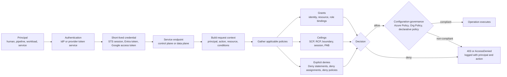

Four facts in the diagram drive design.

First, authentication and authorization are separate systems with separate failure modes. The identity provider (IdP) or token service can be healthy while authorization denies the request, and authorization can be correctly configured while sign-in fails. Telemetry and runbooks should distinguish them. The theory of the separation is covered in Part 15 [Authentication](../15_Security/CH02_Authentication.md) and [Authorization](../15_Security/CH03_Authorization.md).

Second, the token service issues credentials but does not decide what they can do. AWS Security Token Service (STS), Microsoft Entra ID, and Google's Security Token Service and IAM Credentials application programming interface (API) produce a credential bound to a principal. The decision is made at the service endpoint, against current policy, every time.

Third, the decision is local to the service, which is why a working credential can still be denied by a resource policy you did not know existed. The AWS chapter shows this with SCPs and RCPs ([AWS](CH01_AWS.md), section 5.5); this chapter generalizes it.

Fourth, configuration governance runs after authorization for write operations. A denied request may therefore come from IAM or from a policy engine that never looked at the principal. The error codes differ, and a team that treats every 403 as "missing permission" will widen grants when the real fix is a compliant configuration.

### 2.5 Control-plane versus data-plane authorization

Every cloud service has a **control plane** that creates and configures resources and a **data plane** that serves the resource's function. The provider chapters establish the distinction for availability ([AWS](CH01_AWS.md), section 6, and [Azure](CH02_Azure.md), section 2.1). For IAM the distinction matters because the two planes are often authorized by different permissions, sometimes by different engines, and occasionally by mechanisms that bypass identity altogether.

| Service example | Control-plane action | Data-plane action | How data access is authorized |
|---|---|---|---|
| Amazon Simple Storage Service (S3) | `s3:CreateBucket`, `s3:PutBucketPolicy` | `s3:GetObject`, `s3:PutObject` | Same IAM engine and policy language; bucket policy plus identity policy |
| Azure Blob Storage | `Microsoft.Storage/storageAccounts/write` | `Microsoft.Storage/storageAccounts/blobServices/containers/blobs/read` | Azure RBAC `DataActions` with optional conditions, or shared key and shared access signature (SAS) tokens |
| Google Cloud Storage | `storage.buckets.create`, `storage.buckets.setIamPolicy` | `storage.objects.get`, `storage.objects.create` | IAM allow policy on bucket or ancestors, or signed URLs and hash-based message authentication code (HMAC) keys |
| Azure Key Vault | `Microsoft.KeyVault/vaults/write` | `Microsoft.KeyVault/vaults/secrets/getSecret/action` | Azure RBAC data actions, or legacy vault access policies |
| Managed relational databases (Amazon Relational Database Service (RDS), Azure SQL, Cloud SQL) | Create instance, change parameters | Structured Query Language (SQL) `SELECT`, `INSERT` | Mostly the database's own users and grants, optionally mapped to cloud identities |

Three design rules follow.

**Separate the deploying identity from the running identity.** A pipeline that creates a storage account needs control-plane rights. The application that reads blobs needs only data-plane rights on one container. Azure makes this split visible: Contributor grants `*` actions but no data actions, so it cannot read a blob through RBAC ([Azure](CH02_Azure.md), section 5.1). AWS and Google Cloud express both planes in the same permission namespace, so the split exists only if you write it.

**Close the side doors.** Several data planes accept credentials that are not identities: Azure storage account shared keys and SAS tokens, S3 presigned URLs (which carry the signer's permissions), Google Cloud HMAC keys and signed URLs, and database passwords. A control-plane permission can mint these. Azure's `listKeys` action, held by Contributor, returns the storage key that reads everything. Disable shared-key authorization on Azure storage accounts where the workload supports Entra authentication, cap presigned URL lifetimes with conditions such as `s3:signatureAge`, and use Organization Policy to restrict HMAC key and service account key creation in Google Cloud.

**Know which engine answers the data-plane question.** For S3, the IAM engine answers. For Azure SQL or Cloud SQL, the database engine answers after it maps the cloud identity to a database user. A cloud role that "allows database login" does not grant table access. Reviews that read only cloud policies miss database grants, and reviews that read only database grants miss the control-plane right to reset the administrator password.

**Worked example.** An analytics team in Azure holds Contributor on the resource group that contains `stanalyticsprod`. The intention is "can manage the account, cannot read data." A reviewer checks three things. Contributor has no `DataActions`, so blob reads through RBAC fail. Contributor includes `Microsoft.Storage/storageAccounts/listKeys/action`, so any member can fetch the account key and read every blob through shared-key authorization. The account has `allowSharedKeyAccess` set to true. The effective access is therefore "full data access," not "no data access." The fix is to set `allowSharedKeyAccess` to false (after confirming that no workload depends on keys), enforce it with an Azure Policy `deny` effect on that property, and grant Storage Blob Data Reader on specific containers to the identities that need data.

## 3. AWS policy evaluation in depth

The [AWS](CH01_AWS.md) chapter gives the order of the gates and the rule that an explicit deny ends evaluation. This section teaches the whole algorithm, because AWS is the provider where the combination rules are the least obvious: some policy types combine by union, some by intersection, and one, the resource-based policy, changes behavior depending on whether the caller is in the same account and on exactly which principal ARN the policy names.

### 3.1 The policy types and what each can do

| Policy type | Attached to | Grants? | Constrains whom | Notes |
|---|---|---|---|---|
| Identity-based (managed or inline) | User, group, role | Yes | That identity | The normal grant for principals in your account |
| Resource-based | Resource (bucket, key, queue, role trust policy, secret, function) | Yes | Any principal it names, including other accounts | Has a `Principal` element; the only way to grant to another account without a role |
| Permissions boundary | User or role | No | That identity | Ceiling on identity-based grants; used to delegate role creation safely |
| Session policy | One STS session | No | That session | Passed on `AssumeRole`, `AssumeRoleWithSAML`, `AssumeRoleWithWebIdentity`, `GetFederationToken` |
| SCP | Organization root, OU, account | No | Principals in member accounts | Not the management account; not service-linked roles |
| RCP | Organization root, OU, account | No | Resources in member accounts, whoever calls | Supported services only; see [AWS](CH01_AWS.md), section 5.4 |
| Virtual private cloud (VPC) endpoint policy | Interface or gateway endpoint | No | Requests through that endpoint | A network-path ceiling, often used for data perimeters |
| Access control lists (ACLs) | S3 buckets and objects, some legacy services | Yes | Named accounts | Legacy; disable on S3 with Object Ownership set to bucket owner enforced |

The table explains a common surprise. An engineer adds an `Allow` to a role's identity policy and the request still fails. Six other policy types might be involved, and four of them can only subtract.

### 3.2 The policy language in brief

An AWS policy is a JSON document with a `Version` (always `2012-10-17` for current features) and one or more statements. Each statement has an `Effect` (`Allow` or `Deny`), an `Action` or `NotAction`, a `Resource` or `NotResource` (identity-based policies) or a `Principal` or `NotPrincipal` (resource-based policies), and an optional `Condition`.

Four details cause most mistakes.

- **`NotAction` with `Allow` is broad.** `"Effect": "Allow", "NotAction": "iam:*"` grants every action in every service except IAM, including services launched next year. `NotAction` belongs almost exclusively in `Deny` statements, such as the Region-restriction SCP in the AWS chapter.
- **Conditions are typed and multi-valued.** `StringEquals` on a key that has several values in the request needs a set operator. `ForAllValues:StringEquals` returns true when the request has *no* values for the key, so `ForAllValues` on `aws:TagKeys` with an empty tag set passes. Pair it with a `Null` check or use `ForAnyValue` where the intent is "at least one."
- **`IfExists` changes the default.** `StringNotEqualsIfExists` on `aws:PrincipalOrgID` treats a missing key as a match, which is what you want for AWS service principals that carry no organization ID, and exactly what you do not want if the key is your only check.
- **Wildcards in `Principal` are not the same as wildcards in conditions.** `"Principal": "*"` in a bucket policy means anyone, including anonymous callers, unless a condition narrows it. `"Principal": {"AWS": "*"}` means any authenticated AWS principal in any account. Both need conditions such as `aws:PrincipalOrgID` before they are safe.

Global condition keys do most of the architectural work. The ones this chapter uses are `aws:PrincipalOrgID`, `aws:PrincipalArn`, `aws:PrincipalTag/*`, `aws:ResourceTag/*`, `aws:RequestTag/*`, `aws:SourceArn`, `aws:SourceAccount`, `aws:SourceOrgID`, `aws:SourceVpce`, `aws:ViaAWSService`, `aws:CalledVia`, `aws:MultiFactorAuthPresent`, `aws:SecureTransport`, `aws:TokenIssueTime`, `aws:SourceIdentity`, and `aws:RequestedRegion`. Check the [global condition keys reference](https://docs.aws.amazon.com/IAM/latest/UserGuide/reference_policies_condition-keys.html) for which keys are present in which request types; a key that is absent from a request type silently changes the meaning of the condition.

### 3.3 The evaluation algorithm

AWS documents the enforcement logic as a sequence of checks ([policy evaluation logic](https://docs.aws.amazon.com/IAM/latest/UserGuide/reference_policies_evaluation-logic_policy-eval-denyallow.html)). By default every request is implicitly denied, except for the account root user, whose requests are limited only by explicit denies and organization policies. The checks are:

1. **Explicit deny.** Every applicable policy of every type is scanned for a matching `Deny`. One match ends evaluation with deny.
2. **RCPs.** If the resource is in a member account and no RCP on the path allows the action, deny. The AWS-managed `RCPFullAWSAccess` policy is attached everywhere when RCPs are enabled and cannot be detached, so in practice RCPs act through their `Deny` statements.
3. **SCPs.** If the principal is in a member account and the SCPs at every level of its path do not allow the action, deny.
4. **Resource-based policies.** Within one account, an `Allow` in a resource-based policy can produce a final allow even when identity-based policies do not grant the action, subject to the principal-type rules below.
5. **Identity-based policies.** If no identity-based policy allows the action (and step 4 did not already allow it), deny.
6. **Permissions boundary.** If the identity has a boundary that does not allow the action, deny.
7. **Session policy.** If the principal is a session with a session policy that does not allow the action, deny. Otherwise allow.

Step 4 hides the subtlest rule in AWS IAM. In the same account, a resource-based policy that names the **role session ARN** (`arn:aws:sts::111122223333:assumed-role/report-reader/alice`) or an **IAM user ARN** grants directly to that caller, and an implicit deny in its identity-based policy, permissions boundary, or session policy does not reduce it. A resource-based policy that names the **role ARN** (`arn:aws:iam::111122223333:role/report-reader`) is still limited by an implicit deny in a permissions boundary or session policy, although it does not need an identity-based grant. Most bucket policies name role ARNs, so most same-account resource grants are still capped by boundaries and session policies. Two resource types are exceptions to the union rule altogether: an IAM role trust policy and an AWS Key Management Service (KMS) key policy must explicitly allow the caller, so an identity-based grant alone is never enough to assume a role or use a key.

**Cross-account requests** change the combination from union to intersection. When a principal in account A calls a resource in account B, account A's side must allow the request (A's identity-based policies, A's SCPs, the principal's boundary and session policy), **and** account B's side must allow it (B's resource-based policy, B's RCPs). A bucket policy in B that names A's role is necessary but not sufficient: if A's role has no identity-based allow for `s3:GetObject`, the request fails with `AccessDenied` even though B's owner sees nothing wrong in B's policies. Cross-account role assumption follows the same rule: A's identity policy must allow `sts:AssumeRole` on B's role ARN, and B's role trust policy must name A's principal.

The flowchart below is the second required view of principal-to-resource evaluation, specialized for AWS. It adds the same-account and cross-account branches that the AWS chapter's gate diagram omits.

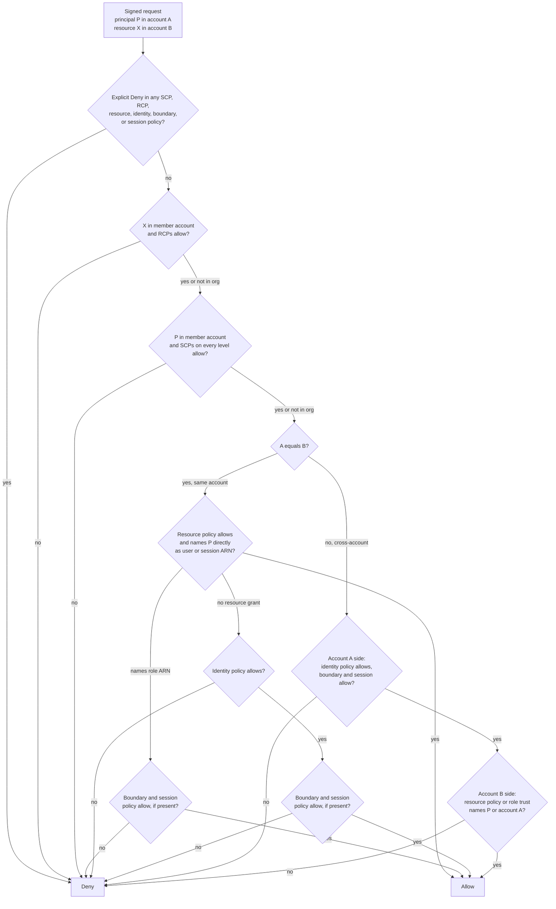

Read the diagram as two different combination rules joined at the `A equals B` node. Above that node, every request goes through the same filters, and any of them can end the evaluation. Below it, the same-account branch is a union of grants (resource policy *or* identity policy) followed by ceilings, while the cross-account branch is an intersection of the two accounts' decisions. This is why moving a resource into a different account can break access that "used to work": a same-account bucket policy grant that compensated for a missing identity grant stops being sufficient the moment the bucket lives elsewhere. The diagram simplifies two cases that need their own checks: KMS key policies and role trust policies always require an explicit allow on the resource side, even in one account.

### 3.4 Worked evaluation

The scenario uses one organization, `o-a1b2c3`, with an analytics account `222222222222` and a data-lake account `444444444444`, both in member OUs.

**Principal.** A batch job runs as role session `arn:aws:sts::222222222222:assumed-role/etl-runner/job-7781`.

**Account A side.**

- Identity policy on `etl-runner`: allows `s3:GetObject` and `s3:PutObject` on `arn:aws:s3:::lake-raw-444/*` and `arn:aws:s3:::lake-curated-444/*`, and `kms:Decrypt` on the data-lake key.
- Permissions boundary on `etl-runner`: allows `s3:Get*`, `s3:Put*`, `s3:List*`, `kms:Decrypt`, and `kms:GenerateDataKey` on `*`.
- Session policy passed by the scheduler on `AssumeRole` for this job, which only extracts: allows `s3:GetObject` on `arn:aws:s3:::lake-raw-444/*` and `kms:Decrypt` on `*`.
- SCPs: `FullAWSAccess` plus a Region restriction that does not affect these calls.

**Account B side.**

- Bucket policy on `lake-raw-444`: allows `s3:GetObject` to principal `arn:aws:iam::222222222222:role/etl-runner`.
- Bucket policy on `lake-curated-444`: allows `s3:GetObject` and `s3:PutObject` to the same role.
- RCP on the data-lake account: denies `s3:*` when `aws:SecureTransport` is false, and denies `s3:*` when `aws:PrincipalOrgID` is not `o-a1b2c3` (with the service-principal exemption shown in the AWS chapter).
- Objects are encrypted with a customer managed KMS key in account B whose key policy allows `kms:Decrypt` to the `etl-runner` role.

| Request | Explicit deny | RCP | SCP | A side: identity, boundary, session | B side: resource policy | Result |
|---|---|---|---|---|---|---|
| R1: `GetObject lake-raw-444/2026/06/01/a.parquet` over Hypertext Transfer Protocol Secure (HTTPS) | None | Allow | Allow | Allow, allow, allow | Allow | **Allow** (S3 then calls KMS; key policy and identity policy both allow `kms:Decrypt`) |
| R2: `PutObject lake-curated-444/out/a.parquet` over HTTPS | None | Allow | Allow | Allow, allow, **implicit deny** (not in session policy) | Allow | **Deny** |
| R3: `GetObject lake-raw-444/...` over unencrypted Hypertext Transfer Protocol (HTTP) | **RCP deny** (`aws:SecureTransport` false) | not reached | not reached | not reached | not reached | **Deny** |
| R4: `GetObject lake-raw-444/...` from a contractor role in another organization that the bucket policy also names | **RCP deny** (`aws:PrincipalOrgID` differs) | not reached | not reached | Allow in its own account | Allow | **Deny** |

The RCP's restrictions are written as `Deny` statements, so they are caught in the first step as explicit denies; the `RCP` column records only the allow check that `RCPFullAWSAccess` always passes. Three lessons come out of the table. R2 shows that a session policy narrows a role even when both the role and the bucket permit the action; a scheduler can hand out one role per job type without creating a role per job. R3 and R4 show why an RCP is a resource owner's control: account B enforces transport and organization membership for every caller, including callers whose own account has no SCPs. R1 shows that one data-plane request can involve two authorization decisions. S3 decides whether the caller may read the object, and KMS separately decides whether the caller may decrypt with the key. A team that grants S3 access but forgets the key policy sees `AccessDenied` from KMS, recorded in CloudTrail under the KMS event source.

**Same-account contrast.** In account B, role `report-reader` has no identity-based policies. Bucket `reports-444` has a policy allowing `s3:GetObject` to `arn:aws:iam::444444444444:role/report-reader`. A `GetObject` request from a session of that role is **allowed**, because in the same account a resource-based grant suffices. If the platform team later attaches a permissions boundary to `report-reader` that allows only `cloudwatch:*`, the same request is **denied**: the bucket policy names the role ARN, so the boundary's implicit deny applies. Had the bucket policy named the session ARN `arn:aws:sts::444444444444:assumed-role/report-reader/alice`, the request would still be allowed. Session-ARN grants are rare and brittle, because session names change, but the rule explains otherwise puzzling test results.

### 3.5 Permissions boundaries for safe delegation

Platform teams often want application teams to create their own roles, for example for new Lambda functions, without being able to create a role more powerful than themselves. A permissions boundary does this. The platform team writes a boundary policy, and grants developers `iam:CreateRole` and `iam:PutRolePolicy` only when the new role carries that boundary:

```json
{
  "Version": "2012-10-17",
  "Statement": [
    {
      "Sid": "CreateRolesOnlyWithBoundary",
      "Effect": "Allow",
      "Action": ["iam:CreateRole", "iam:PutRolePolicy", "iam:AttachRolePolicy"],
      "Resource": "arn:aws:iam::222222222222:role/app/*",
      "Condition": {
        "StringEquals": {"iam:PermissionsBoundary": "arn:aws:iam::222222222222:policy/AppBoundary"}
      }
    },
    {
      "Sid": "ProtectBoundary",
      "Effect": "Deny",
      "Action": ["iam:DeleteRolePermissionsBoundary", "iam:CreatePolicyVersion", "iam:DeletePolicy", "iam:SetDefaultPolicyVersion"],
      "Resource": ["arn:aws:iam::222222222222:role/app/*", "arn:aws:iam::222222222222:policy/AppBoundary"]
    }
  ]
}
```

The pattern only works if three escape routes are closed: developers must not be able to remove the boundary from a role, change the boundary policy itself, or pass a role without the boundary to a service (`iam:PassRole` scoped to the `app/` path). It also does not protect resources outside IAM. A developer who can create a role with the boundary and full S3 inside it can still read every bucket the boundary allows. Boundaries cap privilege escalation; they do not define least privilege.

**Why boundaries rather than SCPs for this?** An SCP applies to every principal in the account, including the platform team's own roles. A boundary applies to the roles that developers create and to no one else. The two compose: the SCP sets the account ceiling, and the boundary sets a lower ceiling for delegated roles.

### 3.6 Session policies, session tags, and source identity

A session carries more than permissions. `AssumeRole` and its federated variants accept up to 50 **session tags** and an optional **source identity**, and the resulting session can be referenced in conditions through `aws:PrincipalTag/*` and `aws:SourceIdentity` ([IAM and STS quotas](https://docs.aws.amazon.com/IAM/latest/UserGuide/reference_iam-quotas.html), at the time of writing; verify current quotas).

- **Session tags enable ABAC.** An IdP can pass `team=payments` as a SAML or OIDC attribute, Identity Center can map user attributes to session tags, and a policy can then allow `s3:GetObject` when `aws:ResourceTag/team` equals `${aws:PrincipalTag/team}`. One role then serves many teams, and new resources are covered by tagging rather than by policy edits. The general ABAC trade-offs (attribute integrity, tag governance, auditability) are covered in Part 15 [ABAC](../15_Security/CH05_ABAC.md). The AWS-specific risk is that whoever can tag a resource or a session can change access, so `aws:RequestTag` and `aws:TagKeys` conditions must restrict who sets the tags that policies depend on.
- **Source identity is set once.** When a federated user assumes a role with `SourceIdentity=alice@example.com`, that value persists through role chaining and appears in every CloudTrail event of every downstream session. It cannot be changed by the session holder. It is the most reliable way to answer "which human was behind this role session three hops later."
- **Session policies narrow, never widen.** A session policy can only reduce what the role allows. The passed JSON and managed policy ARNs together are limited to 2,048 characters, with at most 10 managed policy ARNs, and they consume space in the session token ([IAM and STS quotas](https://docs.aws.amazon.com/IAM/latest/UserGuide/reference_iam-quotas.html), at the time of writing).

Role session durations range from 15 minutes up to the role's maximum session duration, which can be set from 1 to 12 hours; the default when a caller does not ask is one hour. Role chaining, where a role session assumes another role, caps the new session at one hour regardless of the target's setting ([AWS](CH01_AWS.md), section 9.1). Those numbers feed directly into the revocation timeline in section 13.

## 4. Azure RBAC and Microsoft Entra authorization

### 4.1 Recap of the Azure model

Azure separates the identity plane (Microsoft Entra ID, which authenticates and issues tokens) from authorization (Azure RBAC, evaluated by ARM for control-plane actions and by integrated services for data actions). A role definition lists `Actions`, `NotActions`, `DataActions`, and `NotDataActions`; a role assignment binds a principal, a role definition, and a scope; assignments inherit to child scopes and combine by union; deny assignments are checked first and win. `NotActions` subtracts from one role's wildcard and is not a deny. The [Azure](CH02_Azure.md) chapter, section 5, teaches this evaluation algorithm, the 5,000-assignments-per-subscription limit, and the propagation behavior. This section builds on it with the parts that matter for cross-provider design.

### 4.2 Two role systems and several data-plane models

Two authorization systems coexist in every Azure tenant, and reviews must cover both.

- **Microsoft Entra roles** (Global Administrator, Privileged Role Administrator, Application Administrator, and others) govern directory objects: users, groups, applications, service principals, and Conditional Access policies. They are scoped to the tenant or to administrative units.
- **Azure roles** (Owner, Contributor, Reader, User Access Administrator, Role Based Access Control Administrator, and service-specific roles) govern Azure resources at management group, subscription, resource group, or resource scope.

The systems meet at two dangerous points. A Global Administrator can elevate to User Access Administrator at the root management group and then grant any Azure role anywhere ([Azure](CH02_Azure.md), section 3.1). An Application Administrator can add a credential, including a federated identity credential, to any application registration, and so act as that application's service principal with all of its Azure role assignments. Both paths mean that Entra role holders must be treated as holders of the Azure permissions they can reach.

Several data planes do not use Azure RBAC, or use it only optionally:

| Data plane | RBAC model available | Alternative model | Design implication |
|---|---|---|---|
| Blob, Queue, Table storage | `DataActions` with conditions | Shared key, account SAS, service SAS | Disable shared key where possible; prefer user delegation SAS, which is signed with Entra credentials and bounded by the signer's RBAC |
| Key Vault | RBAC permission model | Vault access policies | Choose RBAC for new vaults so that PIM, conditions, and deny assignments apply |
| Azure SQL, Azure Database for PostgreSQL | Entra authentication | Database users and SQL logins | Database grants still decide table access; Entra only authenticates |
| Cosmos DB | Data-plane RBAC (separate role definitions) | Account keys and resource tokens | Data-plane role definitions are managed through Cosmos DB, not the standard role-assignment API |
| Service Bus, Event Hubs | `DataActions` | Shared access policies (connection strings) | Disable local authentication to force Entra |

### 4.3 Conditions on role assignments

Azure ABAC adds a condition to a role assignment. The condition is evaluated per request and can read attributes of the request, the resource, the principal (custom security attributes in Entra), and the environment. At the time of writing, conditions are most widely supported for storage data actions and for constraining role-assignment delegation; check service support before relying on them ([Azure ABAC overview](https://learn.microsoft.com/en-us/azure/role-based-access-control/conditions-overview)). A condition can be up to 8 KB ([Azure RBAC limits](https://learn.microsoft.com/en-us/azure/azure-resource-manager/management/azure-subscription-service-limits), at the time of writing).

A condition that limits Storage Blob Data Reader to containers whose names start with `invoices-` reads like this:

```text
(
  (
    !(ActionMatches{'Microsoft.Storage/storageAccounts/blobServices/containers/blobs/read'})
  )
  OR
  (
    @Resource[Microsoft.Storage/storageAccounts/blobServices/containers:name]
      StringStartsWith 'invoices-'
  )
)
```

The structure is "if the action is not the one I am constraining, the condition is true; otherwise the attribute must match." Writing it the other way round blocks every action the role grants that is not mentioned, which is a common first-attempt bug.

Conditions also make delegation safe. A team lead receives Role Based Access Control Administrator on a resource group with a condition that allows creating role assignments only for Storage Blob Data Reader and only for service principals:

```text
(
  (
    !(ActionMatches{'Microsoft.Authorization/roleAssignments/write'})
  )
  OR
  (
    @Request[Microsoft.Authorization/roleAssignments:RoleDefinitionId]
      ForAnyOfAnyValues:GuidEquals {2a2b9908-6ea1-4ae2-8e65-a410df84e7d1}
    AND
    @Request[Microsoft.Authorization/roleAssignments:PrincipalType]
      ForAnyOfAllValues:StringEqualsIgnoreCase {'ServicePrincipal'}
  )
)
```

The globally unique identifier (GUID) is that of the built-in Storage Blob Data Reader role. This is the Azure counterpart of the AWS permissions-boundary delegation pattern in section 3.5: in both, the delegate may grant access, but only within a shape the platform team has fixed in advance. The Azure version constrains *which role can be assigned*; the AWS version constrains *the maximum any created role can do*. The Azure form is easier to read, but it does not cap the permissions of roles that already exist.

### 4.4 Deny assignments and where they come from

Deny assignments block specific actions for principals at a scope and override all role assignments. At the time of writing, customers cannot create them directly except in private preview; they come from deployment stacks with deny settings, from managed applications, and from some platform-managed resources ([Azure](CH02_Azure.md), section 5.4). Architecturally, the Azure toolset for "nobody may delete this, even Owners" is therefore deployment-stack deny settings, management locks, and Azure Policy `denyAction`, each with different bypass rules that the Azure chapter compares. There is no Azure equivalent of an organization-wide action deny such as an AWS SCP that denies `cloudtrail:StopLogging` to every principal in every account; the nearest controls are Azure Policy for configurations and PIM plus monitoring for the people who hold dangerous roles.

### 4.5 Privileged Identity Management

PIM turns a standing role assignment into an **eligible** assignment that a user must **activate** for a bounded time. It works for Entra roles, Azure roles, and membership or ownership of groups (PIM for Groups), which lets one activation unlock a set of role assignments granted to a group. Activation can require MFA, a justification, a ticket number, and approval by named approvers, and it produces an audit record. The activation duration is configured per role, up to 24 hours, with a shorter default (verify current role-setting limits in the PIM documentation).

The lifecycle of a privileged assignment is a small state machine, and modeling it explicitly is what turns "we use PIM" into a reviewable control.

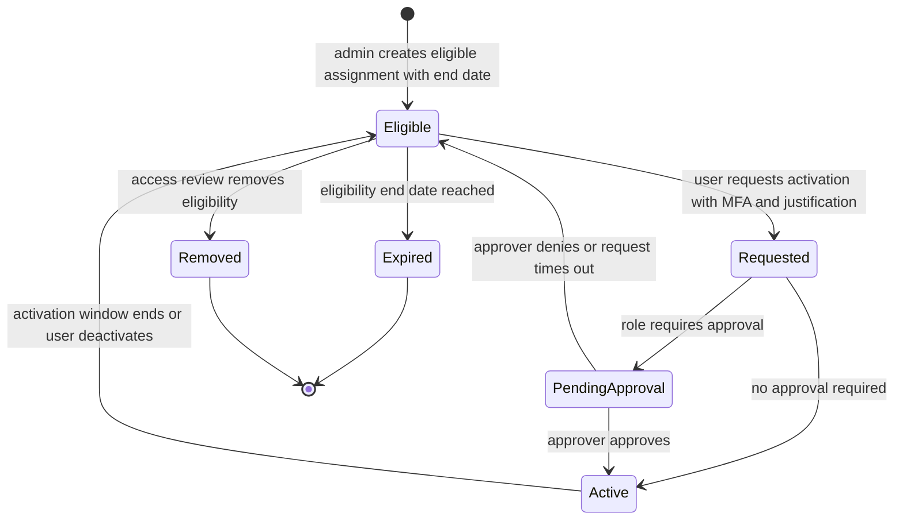

Three properties of the state machine matter in review. First, the only path into `Active` passes through `Requested`, so every privileged session leaves an activation record that can be correlated with Activity Log entries. Second, `Eligible` itself expires: an eligible assignment without an end date is standing privilege with an extra click. Third, access reviews act on `Eligible`, not on `Active`, so a review cadence that is longer than the eligibility period is meaningless. A reasonable baseline is eligible assignments of 6 to 12 months, activations of 1 to 4 hours for Owner and User Access Administrator, approval for production management-group scope, and an access review every quarter.

Google Cloud offers a comparable just-in-time (JIT) service, Privileged Access Manager, in which entitlements define the roles, scope, maximum duration, and approvers for a temporary grant. AWS has no built-in JIT elevation for IAM Identity Center at the time of writing; organizations implement it with an approval workflow that creates and later deletes an account assignment, with third-party tools, or with AWS's open-source temporary elevated access solutions. In all three, the elevated session still obeys every ceiling and deny; JIT reduces standing privilege, not the maximum privilege that exists.

### 4.6 Custom roles

Azure custom roles are defined at management group or subscription scope with a list of assignable scopes. At the time of writing a tenant can hold up to 5,000 custom roles, a custom role can list up to 2,000 assignable scopes, and only one management group can be an assignable scope ([Azure RBAC limits](https://learn.microsoft.com/en-us/azure/azure-resource-manager/management/azure-subscription-service-limits); verify current quotas). The single-management-group restriction pushes teams to define shared custom roles at the intermediate root management group. Wildcards in custom-role actions (`Microsoft.Storage/*`) automatically include new operations that Microsoft adds later. That is convenient for operator roles and risky for roles meant to be narrow.

## 5. Google Cloud IAM: roles, policies, and conditions

### 5.1 Recap of the Google Cloud model

Google Cloud IAM authorizes a principal when some allow policy on the resource or an ancestor grants a role containing the permission, no deny policy on the resource or an ancestor denies it, and, if the principal is subject to principal access boundary policies, the resource is in its eligible set. Allow policies inherit as a pure union with no subtraction; deny policies are the only way to remove an inherited permission; PAB policies are bound to principal sets and never grant. Organization Policy constrains configuration, not callers. The [GCP](CH03_GCP.md) chapter, sections 7 to 9, teaches these policy types, their evaluation order, propagation, and a worked effective-access scenario. This section adds roles, conditions in comparison, service accounts, and cross-project patterns.

### 5.2 Basic, predefined, and custom roles

Google Cloud has three kinds of role, and the choice among them is a maintenance decision as much as a security decision.

- **Basic roles** (`roles/owner`, `roles/editor`, `roles/viewer`) predate fine-grained IAM. Editor contains thousands of permissions across nearly every service, including the ability to change most resources and, through service account permissions in some projects, to act as service accounts. Viewer reads configuration across services, which can include sensitive metadata. Basic roles should not be granted in production projects.
- **Predefined roles** are curated by Google per service (`roles/storage.objectViewer`, `roles/run.developer`). Google adds permissions to them as services evolve, so a predefined role granted today may allow more next year. That is usually what you want for operator roles and what auditors need to know about.
- **Custom roles** list exact permissions. At the time of writing an organization and each project can hold up to 300 custom roles, and a custom role can hold up to 3,000 permissions ([IAM quotas and limits](https://docs.cloud.google.com/iam/quotas); verify current quotas). A project-level custom role can be granted only in that project. Each permission has a support level for custom roles (supported, testing, or not supported); permissions in testing can change behavior, and unsupported permissions cannot be used. Custom roles do not receive new permissions automatically, so a custom deploy role breaks when a service introduces a new permission that its API calls now require.

**Decision.** Use predefined roles for human operator access and most workload access, because they track service changes. Use custom roles where a predefined role is materially broader than the job and the job is stable, such as a deployer that only updates Cloud Run revisions. Budget for maintaining them: subscribe to the IAM permissions change log, and test custom roles in a staging project when services announce new permissions.

### 5.3 Conditions compared across policy types

Google Cloud uses CEL in three places with three different attribute sets, and confusing them leads to policies that save successfully but never match.

| Where | Can read | Typical use |
|---|---|---|
| Allow-policy binding condition | `request.time`, `resource.name`, `resource.type`, `resource.service`, tags through `resource.matchTag`, some service-specific attributes | Time-bound grants, prefix-scoped grants, tag-scoped grants |
| Deny-rule `denialCondition` | Tags only | Scope a deny to resources tagged `env=prod` |
| PAB policy binding condition | `principal.type`, `principal.subject` | Apply a boundary only to service accounts |

An allow binding can carry at most 12 logical operators in its condition, and the same principal and role can appear in at most 20 bindings that differ only by condition ([IAM quotas and limits](https://docs.cloud.google.com/iam/quotas), at the time of writing). Not every service supplies every attribute; a condition on `resource.name` for a service that does not populate it evaluates against an empty value.

The cross-provider comparison is instructive. AWS conditions are attached to statements and can read principal, resource, request, and network attributes in one place. Azure conditions are attached to assignments and are rich only for supported data actions. Google Cloud conditions are rich on allow bindings, minimal on denies, and principal-only on PAB. In practice that means AWS can express "deny unless from this VPC endpoint" in a single policy; Google Cloud expresses the same intent with VPC Service Controls ([GCP](CH03_GCP.md), section 10), and Azure with private endpoints and service firewalls rather than with RBAC.

### 5.4 Service accounts as principals and resources

A Google Cloud service account is both a principal (it receives roles on other resources) and a resource (it has an allow policy that controls who can use it). Three roles on the service account itself decide who can act as it:

- `roles/iam.serviceAccountUser` grants `iam.serviceAccounts.actAs`, which is needed to attach the service account to a resource such as a Compute Engine virtual machine (VM), a Cloud Run service, or a Cloud Build trigger. Anyone who can deploy code to that resource then runs as the service account.
- `roles/iam.serviceAccountTokenCreator` grants permission to call the IAM Credentials API to mint OAuth 2.0 access tokens, OIDC ID tokens, and signed JWTs as the service account. This is **impersonation**, the closest analogue of AWS `AssumeRole`.
- `roles/iam.workloadIdentityUser` lets a federated principal from a workload identity pool impersonate the service account.

Impersonation can be chained: principal A impersonates service account B, which is authorized to impersonate C. The `delegates` parameter of the IAM Credentials API names the chain, and Cloud Audit Logs record it in `serviceAccountDelegationInfo`, so each hop is attributable. Every hop needs Token Creator on the next service account.

Access tokens minted for service accounts last one hour by default. They can be extended to at most 12 hours for service accounts listed in the `constraints/iam.allowServiceAccountCredentialLifetimeExtension` organization policy constraint ([IAM quotas and limits](https://docs.cloud.google.com/iam/quotas), at the time of writing). For Cloud Storage, **credential access boundaries** let a token holder mint a downscoped token limited to specific buckets or object prefixes, the Google Cloud counterpart of an AWS session policy.

Service account keys, the long-lived JSON private keys that let anything anywhere act as the account, are the main risk. At the time of writing a service account can have up to 10 keys, and organizations created on or after May 3, 2024 enforce the constraint that disables key creation by default ([GCP](CH03_GCP.md), section 3.2). Older organizations should enforce the key-creation and key-upload constraints (`iam.disableServiceAccountKeyCreation` and `iam.disableServiceAccountKeyUpload`, or their managed-constraint equivalents such as `iam.managed.disableServiceAccountKeyCreation`) and grant exceptions per project with an expiry.

### 5.5 Cross-project grants

Within one organization, cross-project access in Google Cloud is not a trust relationship in the AWS sense. It is simply a binding: grant `serviceAccount:etl@analytics-prod.iam.gserviceaccount.com` the role `roles/storage.objectViewer` on a bucket in `lake-prod`, and the service account can read it. No assume step occurs and the principal's identity does not change. Two controls bound this freedom:

- **Domain-restricted sharing** (`constraints/iam.allowedPolicyMemberDomains`) limits which customer IDs' principals can appear in allow policies. It stops a project owner from granting access to an outside Gmail account or another company's identities.
- **Cross-project service account usage** (`constraints/iam.disableCrossProjectServiceAccountUsage`), when enforced, prevents a service account from being attached to resources in other projects. Check whether your organization's baseline enforces it before designing a central "identity project" that hosts service accounts for workloads elsewhere.

Because cross-project access is just bindings, it is easy to create and hard to see. The effective-access review must query bindings on every resource that a service account can reach, which is what Policy Analyzer does (section 12).

## 6. The same request in three providers

The preceding sections can be condensed into a comparison of evaluation semantics. The table compares how each engine combines policies, not what products are called.

| Property | AWS | Azure | Google Cloud |
|---|---|---|---|
| Default | Implicit deny (root user excepted, still subject to SCPs, RCPs, and explicit denies) | Implicit deny | Implicit deny |
| How grants combine | Union of identity-based and resource-based grants in one account; intersection across accounts | Union of all role assignments at scope and ancestors, across direct and group membership | Union of allow bindings on resource and ancestors |
| Explicit deny | `Deny` statements in any policy type | Deny assignments (customer creation limited) | Deny policies at organization, folder, project |
| Ceilings that never grant | SCP, RCP, permissions boundary, session policy, VPC endpoint policy | None in RBAC; Azure Policy governs configuration | PAB policy; credential access boundary on tokens |
| Where conditions live | In each statement; rich global and service keys | On role assignments; rich for supported data actions | On allow bindings (rich), deny rules (tags), PAB bindings (principal) |
| Cross-boundary access | Role assumption or resource policy naming the other account | Same tenant: assignment; other tenant: Lighthouse or guest | Same organization: binding; other organization: binding allowed by domain-restricted sharing |
| Identity change on cross-boundary access | Yes with `AssumeRole` (new session principal); no with resource policy | No; same Entra object everywhere | No with binding; yes with impersonation |
| Propagation of changes | Eventually consistent; usually seconds, plan for minutes | Up to about 10 minutes for assignments; group claims refresh with tokens | Usually minutes; group changes can take longer |
| Policy simulator or troubleshooter | IAM policy simulator, Access Analyzer checks | "Check access" in portal, what-if for deployments | Policy Troubleshooter, Policy Simulator |

The row on identity change is the one most often missed in multi-cloud designs. In AWS, cross-account access usually means the caller *becomes* a different principal, a session of a role owned by the target account, so the target account's policies and logs refer to its own role. In Azure and in Google Cloud bindings, the caller remains the same principal everywhere, so revoking or compromising that one principal affects every scope it holds roles in. Neither model is better; they move the blast radius to different places. In AWS the dangerous object is the trust policy; in Azure and Google Cloud it is the principal's full set of assignments or bindings.

## 7. Organization guardrails versus permission grants

### 7.1 The rule

A guardrail sets the outer limit of what is possible in a scope. A grant gives a specific principal a specific capability inside that limit. The two answer different questions and fail differently. A missing grant produces a narrow denial for one principal. A wrong guardrail produces a broad denial for everyone beneath it, or, if it is too loose, no protection for anyone beneath it. Treating guardrails as grants ("the SCP allows S3, so the team can use S3") and treating grants as guardrails ("nobody has been granted delete, so delete is impossible") are the two errors this section exists to prevent.

| Purpose | AWS | Azure | Google Cloud |
|---|---|---|---|
| Cap what principals in a scope can do | SCP | No RBAC ceiling; PIM limits who holds roles | PAB policy (which resources principals are eligible for) |
| Cap what anyone can do to resources in a scope | RCP | None as an action ceiling | VPC Service Controls (API-level perimeter); deny policy with `principalSet://goog/public:all` |
| Explicitly deny an action to principals in a scope | `Deny` in an SCP or RCP | Deny assignment (from stacks or managed apps) | Deny policy |
| Forbid a configuration regardless of caller | Declarative policies for supported services; AWS Control Tower proactive controls | Azure Policy `deny`, `denyAction`, `modify` | Organization Policy constraints, including custom constraints |
| Detect drift after the fact | AWS Config rules, Control Tower detective controls | Azure Policy `audit`, `auditIfNotExists` | Organization Policy dry-run, Security Command Center |

### 7.2 Action guardrails and configuration guardrails

The table separates two kinds of guardrail that are often confused. **Action guardrails** (SCPs, RCPs, deny policies, PAB) evaluate the *request*: who is calling, what action, which resource. **Configuration guardrails** (Azure Policy, Organization Policy, AWS declarative policies) evaluate the *resulting resource*: is this disk encrypted, is this IP public, is this region allowed. The [Azure](CH02_Azure.md) chapter (section 3.7) shows the difference with `ec2:RunInstances` versus virtual machine size. Use action guardrails to protect the security machinery itself (audit logs, guardrail policies, break-glass roles, organization membership) and to build data perimeters. Use configuration guardrails for resource hygiene (encryption, network exposure, locations, approved images). An action guardrail that tries to express hygiene ends up as a long condition block that breaks when the service adds a parameter; a configuration guardrail that tries to protect audit logs can be removed by whoever administers policy.

### 7.3 Who is not bound

Every guardrail has documented exceptions, and each exception is a principal that must be protected by other means.

- **AWS.** SCPs and RCPs do not apply to the management account, do not restrict service-linked roles, and RCPs do not apply to AWS managed KMS keys ([AWS](CH01_AWS.md), sections 5.3 and 5.4). SCPs do not restrict principals outside the organization; RCPs do.
- **Azure.** A Global Administrator can elevate to root-scope User Access Administrator. Policy exemptions and `notScopes` remove resources from assignments. Anyone with `Microsoft.Authorization/locks/delete` can remove a lock. Deny assignments from deployment stacks exclude up to five named principals.
- **Google Cloud.** Organization Policy administrators can change constraints. Deny policies list exception principals. PAB enforcement versions determine which permissions are covered, so a permission outside the policy's enforcement version is not blocked ([GCP](CH03_GCP.md), section 8.2).

The design response is the same everywhere: keep the exempt principals few, give them no standing access, require phishing-resistant MFA, and alert on every use.

### 7.4 Rolling out a guardrail without causing an outage

Guardrails have the largest blast radius of any IAM change, so they need a release process.

1. **Write the guardrail against evidence.** Query 90 days of audit logs for the actions it will deny and list every principal that used them. Each is either an exception to add or a workload to change first.
2. **Stage it.** Attach SCPs and RCPs to a policy-staging OU containing representative accounts ([AWS](CH01_AWS.md), section 5.2). Assign Azure Policy with `enforcementMode` `DoNotEnforce` or effect `audit`. Use Organization Policy dry-run and Policy Simulator for Google Cloud. Deny policies and PAB policies have no general dry-run mode at the time of writing, so stage them on a test folder.
3. **Watch the denials.** Every `AccessDenied` or `PERMISSION_DENIED` that names the new policy during staging is a defect or an exception.
4. **Promote by scope.** Move from staging to non-production OUs, folders, or management groups, then to production, with a soak period at each level.
5. **Keep a rollback path that does not depend on the guardrail.** The principal that can detach the guardrail must not be denied by it.

### 7.5 Quality scenario: account compromise contained by organizational boundaries

This is the part-wide scenario applied to IAM. The provider chapters cover the hierarchy side ([AWS](CH01_AWS.md), section 4.4; [Azure](CH02_Azure.md), section 3.6; [GCP](CH03_GCP.md), section 5.5).

- **Stimulus.** An attacker obtains an administrator role session in a development AWS account through a phished engineer's browser session.
- **Expected response.** The attacker cannot (a) assume any production role, because no production trust policy names development principals; (b) stop or delete the organization trail, because an SCP denies `cloudtrail:StopLogging`, `cloudtrail:DeleteTrail`, and `cloudtrail:UpdateTrail` to all principals except the break-glass role; (c) create IAM users or access keys, because an SCP denies `iam:CreateUser` and `iam:CreateAccessKey`; (d) read production data from the development account, because production bucket and key policies plus an RCP require `aws:PrincipalOrgID` and production-account principals; (e) copy development data to an outside account, because an SCP denies `s3:PutObject` to buckets whose `aws:ResourceOrgID` is not the organization's (on services that support the key).
- **Measurable success criterion.** Zero successful API calls by the compromised session outside the development account in CloudTrail; a detection on the first denied guardrail action within 5 minutes; the engineer's sessions revoked within 15 minutes of detection (section 13); a post-incident query showing no new IAM principals or keys created in the account.
- **Evidence to collect beforehand.** An Access Analyzer finding list showing no production role trusts development principals; the SCP and RCP documents with their attachment points; a quarterly game day that runs these five attempts from a sandbox account and records the denials.

## 8. Human access through federation

### 8.1 The model

Humans should have one identity, held in one workforce identity provider, and receive cloud access by federation. The cloud providers then hold no passwords, offboarding happens in one place, and MFA and device policy are enforced once. Each provider supports three integration styles, and the choice decides where group membership lives and how fast changes take effect.

| Style | AWS | Azure | Google Cloud |
|---|---|---|---|
| Provider's own directory is the IdP | IAM Identity Center directory (small estates) | Microsoft Entra ID is native | Cloud Identity or Google Workspace with Google sign-in |
| External IdP, users synchronized | Identity Center with SAML 2.0 sign-in and System for Cross-domain Identity Management (SCIM) provisioning | Entra ID federated to an external IdP, or business-to-business (B2B) guests | Cloud Identity synchronized from the external directory with single sign-on |
| External IdP, no synchronization | IAM SAML or OIDC identity providers per account (legacy pattern) | Not applicable for Azure resources | Workforce Identity Federation |

The SAML and OIDC protocol mechanics are owned by Part 05 ([SAML](../05_Networking_and_OS/CH22_SAML.md), [OIDC](../05_Networking_and_OS/CH20_OIDC.md)). For this chapter, what matters is what each provider does with the assertion.

### 8.2 AWS IAM Identity Center and permission sets

Identity Center is an organization-level service, run from the management account or a delegated administrator account, in one home Region. Its objects are:

- **Users and groups**, provisioned from the external IdP through SCIM or created locally.
- **Permission sets**, templates that contain AWS managed policies, references to customer managed policies by name, an inline policy, an optional permissions boundary, and a session duration from 1 to 12 hours (default 1 hour).
- **Account assignments**, triples of principal (user or group), permission set, and account.

When a permission set is assigned to an account, Identity Center creates an IAM role in that account named `AWSReservedSSO_<PermissionSetName>_<suffix>`, trusting Identity Center's SAML provider, with the permission set's policies attached. A user who picks that account and permission set in the access portal receives an STS session of that role. Customer managed policy references require a policy of the same name and path to exist in every account where the set is assigned, which lets each account tailor resource ARNs while the permission set stays shared.

Identity Center can pass user attributes as session tags (**attributes for access control**), which is how ABAC policies in section 3.6 receive `team` or `cost-center` values from the IdP. Delegated administrators cannot manage permission sets that are provisioned into the management account, which is one more reason to keep humans out of the management account.

### 8.3 Microsoft Entra ID and Conditional Access

Azure needs no federation step for its own resources, because Entra ID is the identity plane that ARM trusts. Control comes from **Conditional Access**, Entra's policy engine for sign-in. A Conditional Access policy targets users or groups, target resources (for Azure management, the resource "Windows Azure Service Management API," which covers the portal, the Azure command-line interface (CLI), Azure PowerShell, and ARM calls), and conditions such as location, device platform, sign-in risk, and client app, and then grants with controls such as MFA, an authentication strength (for example phishing-resistant MFA), a compliant device, or block.

Microsoft has also made MFA mandatory for Azure management. Enforcement for portal sign-ins completed in 2025, and enforcement at the ARM layer for create, update, and delete operations from the Azure CLI, Azure PowerShell, software development kits (SDKs), infrastructure-as-code tools, and Representational State Transfer (REST) API calls began on October 1, 2025, for user accounts ([mandatory MFA plan](https://learn.microsoft.com/en-us/entra/identity/authentication/concept-mandatory-multifactor-authentication); verify current rollout status for your tenant). Workload identities are not in scope, which is one more reason pipelines must use service principals or managed identities rather than human accounts.

Conditional Access covers workload identities only partially. Conditional Access for workload identities requires Workload Identities Premium licenses and applies to single-tenant service principals registered in your tenant; it does not cover managed identities or multitenant applications, and its only grant control is block, for example from outside known IP ranges or on high service-principal risk ([Conditional Access for workload identities](https://learn.microsoft.com/en-us/entra/identity/conditional-access/workload-identity), at the time of writing).

**Entra as the IdP for the other clouds.** Many organizations make Entra ID the workforce IdP for all three providers: SAML sign-in plus SCIM provisioning into AWS IAM Identity Center, and either Cloud Identity with single sign-on and provisioning or Workforce Identity Federation for Google Cloud. Conditional Access then applies to the enterprise applications representing AWS and Google Cloud, so one MFA and device policy covers all three.

### 8.4 Google Cloud workforce access

Google Cloud offers synchronized Cloud Identity accounts or Workforce Identity Federation, whose trade-offs the [GCP](CH03_GCP.md) chapter (section 3.4) compares. With Workforce Identity Federation, roles are granted to principal identifiers such as `principalSet://iam.googleapis.com/locations/global/workforcePools/corp-pool/group/gcp-pay-operators`, group membership arrives as a claim at every sign-in, and nothing is stored in Google's directory. The session duration is configured per pool. At the time of writing an organization can have up to 100 workforce identity pools ([IAM quotas and limits](https://docs.cloud.google.com/iam/quotas); verify current quotas). Privileged Access Manager adds JIT grants on top of either style (section 4.5).

### 8.5 Federation and role-assumption sequence

The sequence below is the topic map's federation and role-assumption view. It follows an operator from a JIT request to an AWS API call, using Entra ID as the workforce IdP and IAM Identity Center as the AWS entry point. The [AWS](CH01_AWS.md) chapter's sequence (section 9.3) shows the basic portal path; this one adds the controls that decide *whether* and *for how long* the operator holds the permission, and marks where revocation can act.

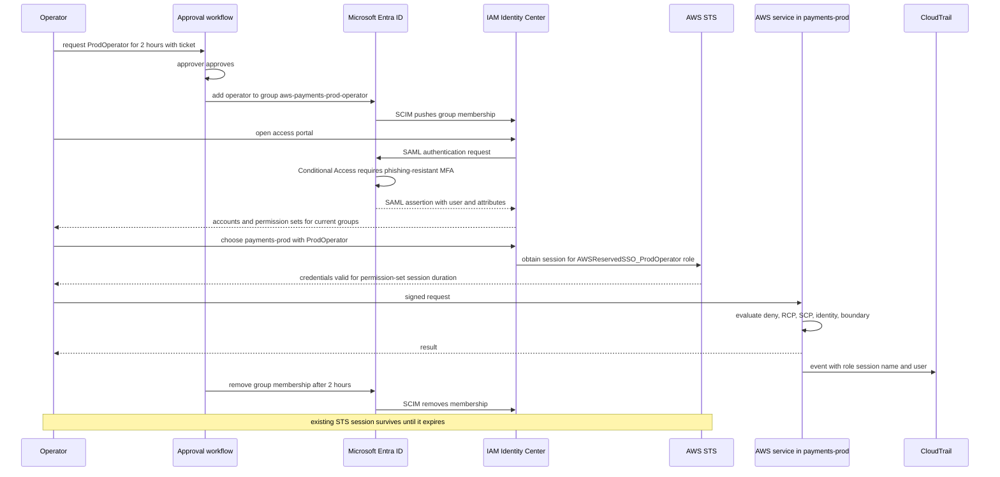

Four timings in the diagram determine how long access really lasts.

1. **The JIT window** controls new access. After the workflow removes the group membership and SCIM propagates it, the operator cannot start new sessions.
2. **SCIM propagation** depends on the IdP's provisioning cycle. Entra's provisioning service runs on an interval (typically tens of minutes for incremental cycles; check your configuration), so "removed from the group" in Entra is not yet "removed" in Identity Center. Identity Center evaluates the membership it holds in real time ([Identity Center sessions](https://docs.aws.amazon.com/singlesignon/latest/userguide/authconcept.html)).
3. **The Identity Center sign-in session** can last up to 90 days by configuration. Ending it stops new application sessions within about 30 minutes.
4. **The STS role session** is independent once issued. It lasts for the permission set's session duration, up to 12 hours, regardless of what happens upstream, unless it is explicitly revoked (section 13.3).

The design rule that follows is to set the permission-set session duration no longer than the JIT window. A 2-hour JIT window with a 12-hour session duration grants 12 hours of access.

**How Azure and Google Cloud differ.** In Azure the operator activates a PIM eligible assignment, and ARM evaluates the now-active assignment on the next call; there is no separate session to outlive the assignment, but Entra access tokens (about 60 to 90 minutes by default) and cached group claims set the residual window. In Google Cloud with Workforce Identity Federation, the operator's group claims are read at sign-in, and a Privileged Access Manager grant adds a time-bound binding that IAM removes at expiry, subject to normal propagation.

### 8.6 Decisions for human access

- **One workforce IdP.** Separate directories per cloud double offboarding and MFA policy. The cost of one IdP is a dependency: if it fails, nobody signs in, which is what break-glass (section 14) covers.
- **Groups map to roles, never users.** Assign permission sets, Azure roles, and Google Cloud roles to groups. Direct user assignments survive reorganizations and are invisible to group-based reviews.
- **No IAM users and no long-lived keys for humans.** Developers who need CLI access use Identity Center (`aws sso login`), Entra device-code or browser sign-in, or `gcloud auth login` with federated identities. All three produce short-lived credentials on the developer's machine.
- **Separate read and write roles.** A read-only operator role that is held standing and a write role that is activated JIT cover most operational work without standing write privilege.

## 9. Workload identities

### 9.1 The model

A workload identity is a principal that represents running code rather than a person. The secure pattern is the same in every provider: the **runtime attests** which workload is running, a **token service issues a short-lived credential** bound to a cloud principal, the **SDK refreshes** it before expiry, and the code never sees a long-lived secret. The differences are in how attestation happens and where the binding between workload and principal is configured.

| Runtime | AWS | Azure | Google Cloud |
|---|---|---|---|
| Virtual machine | Amazon Elastic Compute Cloud (EC2) instance profile containing an IAM role; credentials from IMDS | System- or user-assigned managed identity; token from IMDS | Attached service account; token from the metadata server |
| Functions | Lambda execution role; credentials injected as environment variables | Managed identity on the Function App | Service account on the Cloud Run function |
| Containers (non-Kubernetes) | Amazon Elastic Container Service (ECS) task role; credentials from the task metadata endpoint | Managed identity on Container Apps or Container Instances | Service account on the Cloud Run service or job |
| Kubernetes Pods | Amazon Elastic Kubernetes Service (EKS) Pod Identity or IAM Roles for Service Accounts (IRSA) | Microsoft Entra Workload ID on Azure Kubernetes Service (AKS) | Workload Identity Federation for Google Kubernetes Engine (GKE) |
| Outside the provider | OIDC or SAML federation; IAM Roles Anywhere with X.509 certificates | Federated identity credentials on an application or user-assigned managed identity | Workload Identity Federation pools and providers |

Three neighbors own parts of this table. The metadata endpoint and its protections, including AWS IMDSv2 session tokens and hop limits and the required headers on Azure and Google Cloud, are taught in [Compute](CH04_Compute.md), section 5.5. Kubernetes service-account token projection and the per-provider Pod identity mechanisms are taught in [Kubernetes](CH08_Kubernetes.md), section 5.3, with Kubernetes RBAC itself in Part 12 [Kubernetes Security](../12_Kubernetes/CH13_Security.md). Azure managed-identity token caching, which can delay group-based revocation for up to about 24 hours, is taught in [Azure](CH02_Azure.md), section 10.3.

### 9.2 Workload identity to provider API

The diagram is the topic map's workload-identity view. It shows the three provider paths side by side so that the common structure and the differences are visible together.

```mermaid
flowchart TB
    subgraph AWSP["AWS"]
        A1["Code on EC2, Lambda, ECS, or EKS Pod"] --> A2["Local credential source<br/>IMDSv2, Lambda env vars,<br/>task endpoint, Pod Identity agent"]
        A2 --> A3["Role session credentials<br/>from STS, 15 minutes to 12 hours"]
        A3 --> A4["SigV4-signed call to service API"]
        A4 --> A5["Policy evaluation at the service"]
    end
    subgraph AZP["Azure"]
        Z1["Code on VM, App Service,<br/>Container Apps, AKS Pod"] --> Z2["Local token endpoint<br/>IMDS or IDENTITY_ENDPOINT"]
        Z2 --> Z3["Entra access token<br/>audience for one resource"]
        Z3 --> Z4["Bearer token to ARM or data plane"]
        Z4 --> Z5["RBAC evaluation, actions or dataActions"]
    end
    subgraph GCPP["Google Cloud"]
        G1["Code on Compute Engine,<br/>Cloud Run, GKE Pod"] --> G2["Metadata server<br/>or GKE metadata server"]
        G2 --> G3["OAuth 2.0 access token<br/>for attached service account, 1 hour"]
        G3 --> G4["Bearer token to Google API"]
        G4 --> G5["PAB, deny, allow evaluation"]
    end
```

The structural difference is in the credential's shape. AWS issues **signing keys** (an access key ID, secret access key, and session token) and every request is signed with Signature Version 4 (SigV4), so a captured request cannot be replayed with a changed body. Azure and Google Cloud issue **bearer tokens**: anyone who holds the token can use it until it expires. Azure tokens are additionally bound to one audience (Key Vault, Storage, ARM), so a stolen Key Vault token cannot call ARM. Google Cloud access tokens are scoped by OAuth scopes and by the service account's IAM permissions, and the default `cloud-platform` scope leaves IAM as the only limit. In all three, the credential carries the identity, and the permissions are decided at the service from current policy.

### 9.3 Who can become the workload

The most important workload-identity question is not "what can this identity do?" but "who can cause code to run as this identity?" Each provider has a permission that attaches an identity to a compute resource, and holding it is equivalent to holding the identity's permissions.

| Provider | Attach permission | Escalation if unconstrained |
|---|---|---|
| AWS | `iam:PassRole` on the role, plus the service's create or update permission (for example `lambda:CreateFunction`, `ec2:RunInstances`) | A developer passes an administrator role to a new Lambda function and invokes it |
| Azure | `Microsoft.ManagedIdentity/userAssignedIdentities/*/assign/action` (Managed Identity Operator), or write access to a resource with a system-assigned identity | A user attaches a privileged user-assigned identity to a VM they control |
| Google Cloud | `iam.serviceAccounts.actAs` (Service Account User) on the service account, plus the service's deploy permission | A developer deploys a Cloud Run service that runs as a project-wide administrator service account |

**Worked example.** A developer role in AWS has `lambda:CreateFunction`, `lambda:InvokeFunction`, and `iam:PassRole` on `Resource: "*"`. The account contains a role `platform-admin` trusted by `lambda.amazonaws.com` for a legacy automation. The developer creates a function with `platform-admin` as its execution role and invokes it with code that calls `iam:AttachRolePolicy` on the developer's own role. The developer is now an administrator, and CloudTrail shows the change made by `platform-admin`, not by the developer. The fix has three parts: scope `iam:PassRole` to `arn:aws:iam::*:role/app/*` with the condition `iam:PassedToService` equal to `lambda.amazonaws.com`; remove the `lambda.amazonaws.com` trust from `platform-admin`; and add the IAM Access Analyzer custom policy check for `iam:PassRole` on `*` to the policy pipeline (section 12).

The Azure and Google Cloud versions of this escalation are equally direct. The [Azure](CH02_Azure.md) chapter (section 10.3) states the rule as "anyone who can run code on the resource can use its identity." In Google Cloud, grant `roles/iam.serviceAccountUser` on individual service accounts, never at project level, because a project-level grant lets the holder act as every service account in the project, including those created later.

### 9.4 Workload identity federation from outside the provider

Code that runs outside a provider, such as a continuous integration and continuous delivery (CI/CD) system, another cloud, or an on-premises cluster, can obtain cloud credentials without stored keys if its platform issues signed OIDC tokens. The provider is configured to trust that issuer and to accept tokens whose claims match exact conditions. GitHub Actions is the most common case.

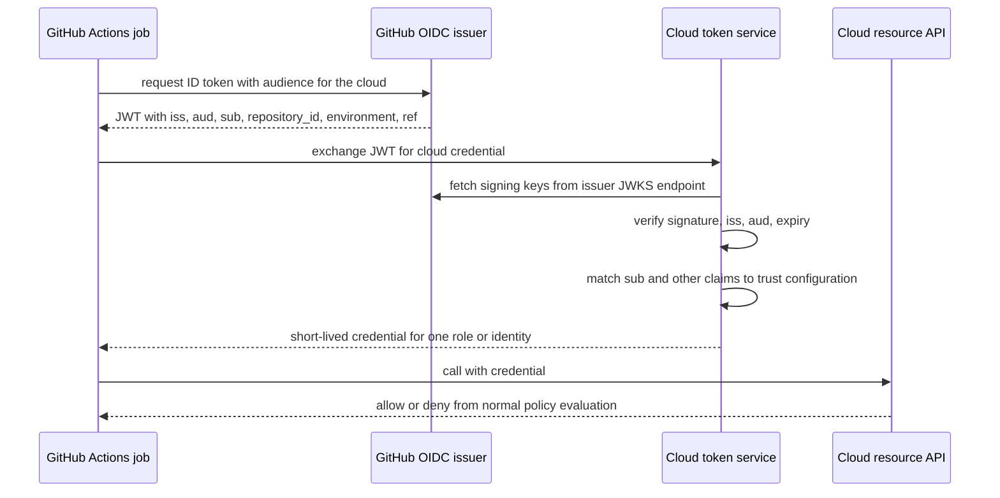

The cloud token service is AWS STS (`AssumeRoleWithWebIdentity`), the Microsoft identity platform token endpoint (client credentials with the GitHub token as a client assertion), or Google's Security Token Service (token exchange, optionally followed by service account impersonation). The token service fetches the issuer's JSON Web Key Set (JWKS) to verify the signature. Signature and standard-claim validation follow the OIDC rules owned by Part 05 ([OIDC](../05_Networking_and_OS/CH20_OIDC.md)). The security of the whole arrangement rests on the claim-matching step, because every GitHub repository in the world receives tokens from the same issuer, `https://token.actions.githubusercontent.com`.

**The subject claim.** GitHub's default `sub` claim encodes the repository and the trigger context, for example `repo:octo-org/payments-api:ref:refs/heads/main`, `repo:octo-org/payments-api:environment:production`, or `repo:octo-org/payments-api:pull_request`. GitHub changed the default format to resist name reuse: repositories created after July 15, 2026, and repositories renamed or transferred after that date, receive an immutable form that appends owner and repository IDs, such as `repo:octo-org@123456/payments-api@456789:environment:production`, and existing repositories can opt in ([GitHub changelog](https://github.blog/changelog/2026-04-23-immutable-subject-claims-for-github-actions-oidc-tokens/)). Trust policies written as `repo:octo-org/*` stop matching new repositories, and trust policies that name a repository by mutable name alone could previously be satisfied by whoever re-registered a deleted organization or repository name.

The three trust configurations for a production deployment from one repository's `production` environment look like this.

AWS role trust policy:

```json
{
  "Version": "2012-10-17",
  "Statement": [{
    "Effect": "Allow",
    "Principal": {"Federated": "arn:aws:iam::333333333333:oidc-provider/token.actions.githubusercontent.com"},
    "Action": "sts:AssumeRoleWithWebIdentity",
    "Condition": {
      "StringEquals": {
        "token.actions.githubusercontent.com:aud": "sts.amazonaws.com",
        "token.actions.githubusercontent.com:sub": "repo:octo-org@123456/payments-api@456789:environment:production"
      }
    }
  }]
}
```

Microsoft Entra federated identity credential on a user-assigned managed identity:

```json
{
  "name": "payments-api-production",
  "issuer": "https://token.actions.githubusercontent.com",
  "subject": "repo:octo-org@123456/payments-api@456789:environment:production",
  "audiences": ["api://AzureADTokenExchange"]
}
```

Google Cloud workload identity pool provider attribute condition, plus a binding:

```bash
gcloud iam workload-identity-pools providers create-oidc github \
  --location=global --workload-identity-pool=ci-pool \
  --issuer-uri="https://token.actions.githubusercontent.com" \
  --attribute-mapping="google.subject=assertion.sub,attribute.repository_id=assertion.repository_id,attribute.environment=assertion.environment" \
  --attribute-condition="assertion.repository_owner_id=='123456' && assertion.repository_id=='456789'"

gcloud iam service-accounts add-iam-policy-binding deploy-payments@pay-prod.iam.gserviceaccount.com \
  --role=roles/iam.workloadIdentityUser \
  --member="principalSet://iam.googleapis.com/projects/PROJECT_NUMBER/locations/global/workloadIdentityPools/ci-pool/attribute.environment/production"
```

Several provider differences show up in these snippets.

- **AWS** matches with condition operators, so `StringLike` with wildcards is possible and dangerous. AWS recommends evaluating the `sub` key in every role that trusts GitHub ([GitHub OIDC in AWS](https://docs.github.com/en/actions/how-tos/secure-your-work/security-harden-deployments/oidc-in-aws)). Use `StringEquals` with the exact subject.
- **Azure** federated identity credentials match `issuer` and `subject` exactly; wildcards are not supported, a single audience is allowed, and an application or user-assigned managed identity can hold at most 20 federated identity credentials ([federation considerations](https://learn.microsoft.com/en-us/entra/workload-id/workload-identity-federation-considerations), at the time of writing). A misconfigured subject saves without error and fails only at token exchange. Flexible federated identity credentials with a claims-matching expression language are in preview for applications at the time of writing.
- **Google Cloud** separates *which tokens the pool accepts* (the attribute condition on the provider) from *which identities may use which service account* (bindings on `principal://` or `principalSet://` identifiers). Google's guidance is to restrict the provider by organization at minimum ([deployment pipelines guide](https://docs.cloud.google.com/iam/docs/workload-identity-federation-with-deployment-pipelines)). Conditioning on `repository_owner_id` and `repository_id` uses immutable numeric IDs rather than names. The mapped `google.subject` is limited to 127 bytes ([IAM quotas and limits](https://docs.cloud.google.com/iam/quotas)).

### 9.5 What to pin in the subject

| Pin | Example `sub` | What it proves | Weakness |
|---|---|---|---|
| Repository only (wildcard rest) | `repo:octo-org/payments-api:*` | Code from this repository | Any branch, any pull request from a collaborator, any workflow file |
| Branch | `...:ref:refs/heads/main` | Workflow ran on `main` | Only as strong as branch protection; a workflow that runs on `push` to `main` runs whatever was merged |
| Environment | `...:environment:production` | The job targeted the `production` environment | Only as strong as the environment's protection rules (required reviewers, allowed branches) |
| Reusable workflow (custom claim) | `job_workflow_ref` included in a customized `sub` | A specific, centrally owned workflow file at a specific ref ran | Requires customizing the subject template at organization or repository level |
| Pull request | `...:pull_request` | Triggered by a pull request | Untrusted code; never trust for deploy roles |

The strongest common configuration for production is an environment pin, with the environment restricted to protected branches and required reviewers, plus immutable IDs in the subject. Reusable-workflow pinning is stronger again for platform teams that want "only our deploy workflow, at a tagged version, can assume the deploy role." The runnable example [03_federation_trust.py](../code/python/iam-chapter/03_federation_trust.py) models issuer, audience, and subject checks. Its trust prefix, `repo:org/orders-api:ref:refs/heads/`, rejects the pull-request token but accepts *any* branch; changing the check to an exact environment subject is the first design exercise in section 21.2.

### 9.6 Cross-cloud workload federation

The same mechanism connects the providers to each other without keys.

- **AWS workload to Google Cloud.** A workload identity pool can have an AWS provider. The workload signs a `GetCallerIdentity` request with its role credentials, Google's STS verifies it with AWS, and attribute mappings expose the role ARN (for example `attribute.aws_role`) for conditions and bindings.
- **AWS workload to Azure or any OIDC relying party.** AWS IAM outbound identity federation, announced in November 2025, lets an IAM principal call STS `GetWebIdentityToken` to receive a short-lived JWT, signed by an account-specific issuer, that external services such as an Entra federated identity credential can trust ([outbound identity federation](https://docs.aws.amazon.com/IAM/latest/UserGuide/id_roles_providers_outbound.html)). The feature must be enabled per account.
- **Azure or Google Cloud workload to AWS.** Register the Entra tenant issuer or Google's `accounts.google.com` issuer as an IAM OIDC identity provider and trust it in a role with conditions on the audience and on the subject (a managed identity's object ID or a Google service account's unique numeric ID). Pin the subject to an immutable ID, never to an email address alone.
- **On-premises workloads.** IAM Roles Anywhere exchanges an X.509 certificate from a registered certificate authority for role credentials; Azure Arc gives connected servers a managed identity; Google Cloud workload identity pools accept OIDC and SAML issuers from on-premises platforms. The public key infrastructure (PKI) design behind certificate-based identity belongs to Part 15 [PKI](../15_Security/CH11_PKI.md).

In each case the trust configuration is a resource in the *target* cloud, so the target's owner controls who gets in. The issuer's signing keys become a dependency: if the issuer is unavailable or rotates keys incorrectly, every exchange fails.

### 9.7 Failure modes of workload identity

| Failure | Symptom | Cause | Response |
|---|---|---|---|
| Token exchange denied after a repository rename or a new repository | `Not authorized to perform sts:AssumeRoleWithWebIdentity`, `AADSTS70021`, or `PERMISSION_DENIED` from Google STS | Subject format changed (immutable IDs) or pattern too narrow | Compare the decoded token's `sub` with the trust configuration; prefer immutable-ID subjects |
| Overbroad trust | Unexpected repositories or branches deploy | Wildcard subject, missing audience check, or `pull_request` accepted | Pin environment or workflow; add a negative test that a feature branch is refused |
| Credentials leak from a container | Calls from unexpected IPs using the node's role | Pod reached node IMDS with hop limit 2, or no Pod identity | Use Pod-level identity; keep the hop limit at 1 ([Compute](CH04_Compute.md), section 5.5) |
| New federated credential fails for minutes | `AADSTS70021: No matching federated identity record` | Replication delay after creation | Retry with backoff; create credentials before the pipeline needs them |
| Stale permission after removal | Workload keeps access for hours | Azure group-based grant with cached token | Grant directly to the identity when fast revocation matters ([Azure](CH02_Azure.md), section 10.3) |
| Throttling during a large deployment | STS throttling errors | Many parallel `AssumeRole` calls; 600 requests per second per account per Region by default for STS calls made with AWS credentials | Reuse sessions within their lifetime; spread across accounts; request an increase ([IAM and STS quotas](https://docs.aws.amazon.com/IAM/latest/UserGuide/reference_iam-quotas.html), at the time of writing) |

## 10. Cross-account, cross-subscription, and cross-project trust

### 10.1 Two-sided trust

Any access that crosses an ownership boundary involves two decisions made by two owners. The **caller's side** decides whether its principal may reach out. The **resource's side** decides whether it lets that principal in. A design is complete only when both sides are written down, both are as narrow as the use case allows, and both owners know the relationship exists.

The trust-boundary diagram below is the topic map's cross-account and cross-project view. It shows the three providers' mechanisms for one relationship: a shared logging service in a security boundary that a workload in another boundary writes to, and that an external auditor reads.

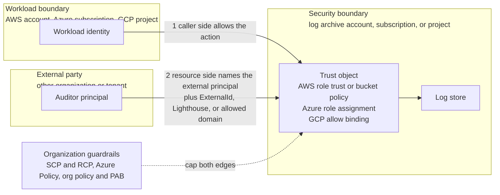

Each arrow into the trust object is an edge in the organization's **trust graph**. The containment scenario in section 7.5 is, in graph terms, the statement that no path exists from a development node to a production node. Every new trust object adds an edge, which is why trust objects deserve the same review as network connections. Guardrails cap both edges but grant neither.

### 10.2 AWS: roles versus resource policies

AWS offers two ways to cross an account boundary, and they have different consequences.

- **Role assumption.** The caller calls `sts:AssumeRole` on a role in the target account. The target role's trust policy names the caller; the caller's identity policy allows the assume. The caller then *becomes* a session of the target role, the target account's policies and SCPs apply to it, and the target's CloudTrail records the actions under the target role. Use this when the caller needs many actions in the target, or when the target owner wants all access to flow through roles it controls.
- **Resource-based policy.** The target resource's policy (bucket, queue, key, secret) names the caller directly. The caller keeps its own identity, its own account's SCPs apply, and no session is created. Use this for narrow data access to one resource, especially when the caller's existing session must also act in its own account in the same operation, such as copying an object from a shared bucket into a local one.

Trust policies should name specific role ARNs rather than `arn:aws:iam::ACCOUNT:root`. Naming the account root delegates the decision to the other account's administrators: any principal there that their own policies allow to call `sts:AssumeRole` can enter. Adding `aws:PrincipalOrgID` or `aws:PrincipalOrgPaths` conditions further limits callers to the organization or to a specific OU path. The [AWS](CH01_AWS.md) chapter (section 9.2) shows the narrow trust policy.

### 10.3 The confused-deputy problem

A **confused deputy** is a privileged intermediary that is tricked into using its authority on behalf of a party that should not have it. The protocol form of the problem, using a bare OAuth access token as proof of identity, is covered in [OIDC](../05_Networking_and_OS/CH20_OIDC.md). In cloud authorization it appears in two further forms.

**Form 1: a third-party service assuming customer roles.** A monitoring vendor's AWS account assumes a role in each customer's account. If customer A's role trusts only the vendor's account, then customer B, who also uses the vendor, can enter A's role ARN in the vendor's console, and the vendor's system will assume A's role on B's behalf. The defense is an **external ID**: the vendor generates a unique value per customer, stores it with that customer's configuration, and always passes it in `AssumeRole`; the customer's trust policy requires it with `sts:ExternalId`. Customer B cannot make the vendor send A's external ID, because the vendor chooses it, not the customer. External IDs must be 2 to 1,224 characters at the time of writing ([IAM and STS quotas](https://docs.aws.amazon.com/IAM/latest/UserGuide/reference_iam-quotas.html)).

**Form 2: an AWS service acting across customers.** When S3 sends event notifications to an Amazon Simple Notification Service (SNS) topic, or CloudTrail writes to a bucket, the caller is a service principal such as `s3.amazonaws.com`, shared by every customer. A resource policy that allows `s3.amazonaws.com` to publish to your topic, without further conditions, lets *anyone's* bucket publish to it. The defense is `aws:SourceArn` and `aws:SourceAccount` (and, for organization-wide resources, `aws:SourceOrgID`), which carry the ARN and account of the resource on whose behalf the service is acting.

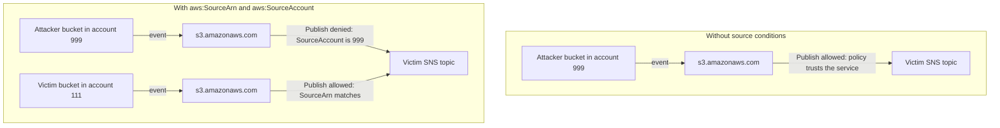

The diagram shows why trusting a service principal alone is a grant to every customer of that service. The condition turns "this service" into "this service, acting for this resource of mine." A topic policy for the defended case looks like this:

```json
{
  "Effect": "Allow",
  "Principal": {"Service": "s3.amazonaws.com"},
  "Action": "sns:Publish",
  "Resource": "arn:aws:sns:eu-west-1:111111111111:uploads",
  "Condition": {
    "ArnLike": {"aws:SourceArn": "arn:aws:s3:::uploads-111"},
    "StringEquals": {"aws:SourceAccount": "111111111111"}
  }
}
```

Azure and Google Cloud have fewer cross-customer service principals in resource policies, because their services usually act with an identity that belongs to the customer: an Azure resource's managed identity or a Google Cloud service agent in the customer's project. The confused-deputy risk in those providers moves to the attach permissions of section 9.3: whoever can point a service at your identity controls what the service does with it.

### 10.4 Azure: same tenant, other tenants, and Lighthouse

Inside one tenant, cross-subscription access is not a trust relationship at all. A principal receives a role assignment on the other subscription and uses the same token. The design questions are scope (assign at resource group, not subscription) and visibility (assignments on many subscriptions are easy to lose track of).

Across tenants there are three mechanisms.

- **Azure Lighthouse** projects delegated resources from a customer tenant into a managing tenant. The customer onboards a subscription or resource groups with authorizations, each pairing a principal in the managing tenant with a built-in role. At the time of writing Lighthouse does not support custom roles, the Owner role, roles with `DataActions`, or roles that include role-assignment, lock, or deny-assignment write actions; User Access Administrator is supported only to assign roles to managed identities ([Lighthouse roles](https://learn.microsoft.com/en-us/azure/lighthouse/concepts/tenants-users-roles)). Eligible authorizations integrate with PIM so the managing party works JIT. The customer can always remove the delegation. Microsoft's guidance includes giving the managing tenant the Managed Services Registration Assignment Delete Role so that it can also remove its own access.
- **B2B guest users** are accounts from another tenant invited into yours. They are subject to your Conditional Access and your role assignments, but their authentication happens in their home tenant.
- **Multitenant applications** are service principals instantiated in your tenant from an application registered elsewhere. Granting them Azure roles gives the vendor's code access. Review what the vendor can do with its own application's credentials.

Lighthouse is the closest Azure analogue of an AWS cross-account role with an external ID: the resource owner defines the scope and roles, the managing party's principals act in their own tenant's sign-in context, and the relationship is a visible object that the resource owner can delete.

### 10.5 Google Cloud: bindings, service agents, and other organizations

Cross-project access within an organization is a binding (section 5.5). Across organizations it is also a binding, permitted only if domain-restricted sharing allows the other organization's customer ID. Two patterns need care.

- **Service agents acting across projects.** When a Cloud Storage bucket in project A uses a customer-managed encryption key in project B, the Cloud Storage service agent of project A (`service-PROJECT_A_NUMBER@gs-project-accounts.iam.gserviceaccount.com`) needs `roles/cloudkms.cryptoKeyEncrypterDecrypter` on the key in project B. That binding is a cross-project trust edge created for a Google-managed identity.
- **Vendor access.** A vendor's service account from its own organization receives a role in your project. Domain-restricted sharing must allow the vendor's customer ID, which then permits *any* of the vendor's principals to be granted roles. Limit the exception to one folder through constraint inheritance, and pair it with a PAB policy on your own principals so that the relationship does not become a path for your identities into the vendor's organization.

### 10.6 Worked scenario: vendor read access to an audit bucket

An external auditor needs read access to 13 months of CloudTrail logs in the log-archive account `555555555555`. The logs are encrypted with a customer managed KMS key.

**Option A: bucket policy naming the auditor's account root.** Rejected. It delegates the decision to the auditor's administrators and does not protect against a confused deputy if the auditor uses a shared tool.

**Option B: a role in the log-archive account, assumable by one auditor role, with an external ID.** Chosen. The trust policy names `arn:aws:iam::777777777777:role/audit-reader`, and requires `sts:ExternalId` equal to a value the security team generates. The auditor uses the CLI or an SDK, because console role switching cannot pass an external ID. The role's identity policy allows `s3:GetObject` and `s3:ListBucket` on the trail prefix and `kms:Decrypt` on the trail key, with a `kms:ViaService` condition limiting decryption to S3. The key policy allows the role to decrypt. The organization's RCP must permit this external principal, so the RCP's `aws:PrincipalOrgID` condition gets an exception for this one role ARN.

**Validation evidence.** IAM Access Analyzer reports exactly one external-access finding for the role, marked as archived with the contract reference. A test from the auditor's account without the external ID fails. A `PutObject` attempt fails. CloudTrail in the log-archive account shows the auditor's `AssumeRole` events and the `audit-reader` session's `GetObject` calls. The exception expires with the contract, enforced by a scheduled review that deletes the role and the RCP exception.

## 11. Service-linked roles and service agents

Cloud services act on your resources. Each provider gives them identities, and those identities are often exempt from controls that apply to everything else.

**AWS service-linked roles (SLRs)** are IAM roles that a service creates in your account, with a trust policy naming that service's principal, a permissions policy the service defines, and a path of `/aws-service-role/`. You cannot edit their permissions, and you usually cannot delete them while resources use them. Examples include roles for Elastic Load Balancing, Auto Scaling, AWS Organizations, and IAM Access Analyzer. SLRs are not restricted by SCPs or RCPs ([AWS](CH01_AWS.md), section 5.3), which is necessary for services to keep functioning under restrictive guardrails and is a reason to control `iam:CreateServiceLinkedRole` and to monitor what SLRs do.

AWS **service roles** are different: they are ordinary roles that you create and that a service assumes, such as a Lambda execution role or an AWS CodeBuild project role. You own their permissions, they are subject to SCPs, and they are the target of the `iam:PassRole` escalation in section 9.3.

**Azure** has no direct equivalent of SLRs. Microsoft's first-party services act through first-party service principals in your tenant, and some resource providers create identities and resources on your behalf, for example AKS's node resource group and kubelet identity, or a managed application's locked resource group with a deny assignment ([Azure](CH02_Azure.md), section 12.1). Where an Azure service needs access to another of your resources, it normally uses the managed identity you assign to it, which keeps the permission under your RBAC.

**Google Cloud service agents** are Google-managed service accounts, named like `service-PROJECT_NUMBER@gcp-sa-SERVICE.iam.gserviceaccount.com`, that Google services use to act in your project. Google grants them predefined service-agent roles automatically when an API is enabled. They differ from **default service accounts**, such as the Compute Engine default service account, which are ordinary user-managed service accounts that Google creates for convenience and that historically received the Editor role. Service agents should be left with their service-agent roles; default service accounts should be replaced by dedicated, minimally privileged service accounts. Organizations created after May 3, 2024 prevent the automatic Editor grant to default service accounts by default ([GCP](CH03_GCP.md), section 3.2).

**Design rules for provider-managed identities.**

1. Inventory them. They appear in access reviews as principals nobody on the team created.
2. Do not remove their roles to "tighten" access. Doing so breaks the service, often silently until a scale or repair event.
3. Do grant them access to *your* resources deliberately, for example a KMS key or a cross-project bucket, and record those grants as trust edges.
4. Monitor their actions in audit logs, especially for SLRs that bypass SCPs.

## 12. Least privilege as a workflow

### 12.1 Why least privilege is a process, not a policy

Least privilege means each principal holds only the actions, on only the resources, under only the conditions its job needs. No one writes that policy correctly on the first attempt, for three reasons. Developers do not know every API call their SDK makes. Services add actions and change which permissions an operation requires. Jobs change. Least privilege is therefore a loop that starts broad enough to work, measures what is used, narrows, and repeats, with guardrails preventing the dangerous cases throughout.

```mermaid
flowchart LR
    START["New principal<br/>purpose, owner, expiry"] --> BASE["Start from predefined or<br/>managed role at narrow scope"]
    BASE --> GUARD["Guardrails already block<br/>dangerous actions"]
    GUARD --> RUN["Run in non-production<br/>with audit logging"]
    RUN --> MEASURE["Measure used actions<br/>last-accessed data, logs"]
    MEASURE --> GEN["Generate or recommend<br/>narrower policy"]
    GEN --> TEST["Positive and negative tests<br/>including rare paths"]
    TEST -->|"pass"| DEPLOY["Deploy narrowed policy"]
    TEST -->|"fail"| GEN
    DEPLOY --> MONITOR["Monitor denials and<br/>unused-access findings"]
    MONITOR -->|"job changed or unused access"| MEASURE
    MONITOR -->|"owner gone or expiry reached"| REMOVE["Remove principal"]
```

The loop has two exits that matter as much as the narrowing step. A principal whose owner has left or whose expiry has passed is removed rather than narrowed. And the **negative tests** in the test step are not optional: a narrowed policy that has never been tested against a denied action may still allow it through a wildcard elsewhere.

### 12.2 The tools in each provider

| Capability | AWS | Azure | Google Cloud |
|---|---|---|---|
| Which permissions were used | Last-accessed information per service and, for some services, per action | Activity Log and Entra sign-in logs; no built-in per-permission usage report for Azure RBAC at the time of writing | Activity Analyzer, IAM Recommender usage insights |
| Generate a policy from activity | IAM Access Analyzer policy generation from up to 90 days of CloudTrail | Not built in | IAM Recommender role recommendations (based on 90 days of usage) |
| Find unused principals and permissions | Access Analyzer unused access analyzer | Entra access reviews; PIM alerts on unused roles; Microsoft Defender for Cloud recommendations | IAM Recommender, unused service account insights |
| Find external or broad access | Access Analyzer external access and internal access analyzers | Defender for Cloud; Azure Resource Graph queries over role assignments | Policy Analyzer; Security Command Center |
| Validate a policy before deploy | Access Analyzer policy validation and custom policy checks | What-if for deployments; Azure Policy for role-assignment shape | Policy Simulator, Policy Troubleshooter |

Microsoft retired Microsoft Entra Permissions Management, its multicloud entitlement tool, on October 1, 2025 ([retirement announcement](https://techcommunity.microsoft.com/t5/microsoft-entra-blog/important-change-announcement-microsoft-entra-permissions/ba-p/4399382)), so Azure least-privilege work relies on access reviews, PIM, Defender for Cloud, and custom analysis of activity logs. AWS IAM Access Analyzer's external access analysis is free; unused access and custom policy checks are charged features at the time of writing ([Access Analyzer](https://docs.aws.amazon.com/IAM/latest/UserGuide/what-is-access-analyzer.html); verify current pricing).

### 12.3 Worked example: narrowing a deploy role

A deployment role for an order service was created two years ago with the AWS managed policy `PowerUserAccess`, which allows every action except most of IAM and Organizations. The team wants it least-privileged without breaking quarterly disaster-recovery drills.

1. **Measure.** Last-accessed data shows the role used 14 services in the past 90 days. Access Analyzer policy generation over the same 90 days of CloudTrail produces a policy with 61 actions across those 14 services, with resource ARNs where CloudTrail recorded them.
2. **Account for rare paths.** The disaster-recovery runbook, run once a quarter, restores an Amazon RDS snapshot in a second Region and updates a Route 53 record. The last drill was 97 days ago, outside the 90-day window, so its 9 actions are missing. The team adds them from the runbook, tagged with a statement ID `DrRestore`.
3. **Constrain resources.** Generated policies often contain `Resource: "*"` for actions whose CloudTrail events lack resource ARNs. The team replaces them with account-scoped ARNs and adds `aws:RequestedRegion` conditions for the two Regions in use.
4. **Test.** The pipeline runs a full deployment in staging with the new policy (positive test), then a negative test suite that attempts `iam:CreateUser`, `s3:DeleteBucket` on a data bucket, and `ec2:RunInstances` in a third Region, all of which must fail.
5. **Deploy and monitor.** For two weeks, an alarm fires on any `AccessDenied` from the role. Two denials appear, both from a CloudFormation stack that the generated policy missed because it had not been updated in 90 days; the team adds those actions and records why.

Result: from roughly the full AWS action catalog minus IAM to 72 actions, with the residual risk documented as "disaster-recovery actions present but unused between drills." The runnable example [01_policy_analyzer.py](../code/python/iam-chapter/01_policy_analyzer.py) flags the wildcard statements that step 3 removes, and [04_access_review.py](../code/python/iam-chapter/04_access_review.py) produces the kind of review trigger list (missing owner, no recent use, privileged access) that drives the removal exit of the loop.

The general lesson is that usage-based tools can only see what happened in their observation window. Permissions for rare but critical operations, such as disaster recovery, key rotation, and incident response, must come from runbooks and tests, not from logs.

### 12.4 Least-privilege heuristics that hold across providers

- **Narrow the scope before narrowing the role.** A Reader-class role at organization root reveals more than a Contributor-class role on one resource group. Scope is the cheapest reduction.
- **Split deploy from run.** Deploy identities need control-plane rights; runtime identities need data-plane rights on specific resources (section 2.5).
- **Prefer groups and shared workload identities for fan-out.** They keep role-assignment and binding counts within quotas (section 16) and make reviews tractable.
- **Use conditions for the dimension that varies.** Tags, prefixes, and environments vary more than actions do; conditions on them replace hundreds of near-duplicate roles.
- **Remove before you narrow.** Unused principals carry all of their risk and none of their value. A principal with no activity in 90 days and no documented rare use should be disabled, then deleted after a further grace period.

## 13. Credential rotation and revocation

### 13.1 Credential types and their lifetimes

Every credential has a lifetime, and the lifetime is the minimum exposure window if it is stolen and nobody notices. The table collects the lifetimes that determine revocation timing. Values are from provider documentation at the time of writing; verify current values.

| Credential | Default lifetime | Maximum | Revocable before expiry? |
|---|---|---|---|
| AWS IAM user access key | Until deleted | Indefinite | Yes: deactivate or delete; immediate for new requests after propagation |
| AWS STS role session | 1 hour | 12 hours (1 hour when chained) | Indirectly: deny sessions issued before a time (section 13.3) |
| AWS IAM Identity Center role session | Permission-set session duration | 12 hours | Indirectly, as for any role session |
| Entra access token (user) | About 60 to 90 minutes | Longer for resources enabled for continuous access evaluation (CAE) (up to 28 hours, with real-time revocation events) | Yes for CAE-enabled resources; otherwise valid until expiry |
| Entra refresh token and sign-in session | Long-lived, sliding | Until revoked or policy-limited | Yes: revoke sign-in sessions |
| Azure managed-identity token | Cached up to about 24 hours by the platform | Not forcibly refreshable | Permissions changes apply at the resource; group changes wait for the cache ([Azure](CH02_Azure.md), section 10.3) |
| Entra application client secret | Set at creation | Policy-limited | Yes: delete the credential |
| Google Cloud service account access token | 1 hour | 12 hours with lifetime-extension constraint | Disable the service account; remove bindings |
| Google Cloud service account key | Until deleted, or as set by key-expiry policy | Indefinite unless constrained | Yes: disable or delete the key |
| Federated token from GitHub Actions | Minutes | Set by issuer | Expires on its own; revoke the trust configuration to stop new exchanges |

### 13.2 Eliminating long-lived keys

Long-lived keys are the credentials most often found in source repositories, container images, build logs, and laptops. Eliminating them is the single most effective rotation strategy, because a key that does not exist needs no rotation.

1. **Inventory.** AWS credential reports list every IAM user's access keys with age and last use. Microsoft Graph lists application client secrets and certificates with expiry. Google Cloud lists user-managed service account keys per project, and Policy Intelligence reports key usage.
2. **Replace by category.** Human CLI access moves to federation (section 8.6). Workloads on the provider move to attached identities (section 9.1). External automation moves to OIDC federation (section 9.4). On-premises servers move to IAM Roles Anywhere, Azure Arc, or Google Cloud workload identity federation (section 9.6).
3. **Block new keys.** An SCP denies `iam:CreateUser` and `iam:CreateAccessKey` except to a break-glass role. Entra application-management policies restrict or forbid password credentials and limit credential lifetimes. Google Cloud's key-creation constraint blocks new service account keys organization-wide.
4. **Handle residual exceptions.** For the few third-party products that accept only static keys, issue a key per integration, scope it narrowly, restrict its source IPs with `aws:SourceIp` or equivalent where possible, record an owner and expiry, and rotate it on a schedule.

### 13.3 How revocation works in each provider

Revocation is harder than rotation because issued credentials are, by design, usable without contacting the issuer. Each provider offers a different handle.

- **AWS role sessions.** STS credentials cannot be recalled. The IAM console's "revoke active sessions" action attaches an inline policy to the role that denies all actions when `aws:TokenIssueTime` is earlier than the current time. Every session issued before that moment fails on its next request, after IAM propagation, while new sessions work. For a compromised role that must keep running, this is the correct tool. For a compromised human, also disable the user in the IdP and, for Identity Center, end the user's sessions; Identity Center's documentation states that existing role sessions otherwise continue until their configured duration expires, up to 12 hours ([Identity Center sessions](https://docs.aws.amazon.com/singlesignon/latest/userguide/authconcept.html)).
- **AWS access keys.** Deactivate first (reversible), then delete after confirming no legitimate use. Rotation uses the two-key slot: create key 2, deploy it, verify that key 1's last-used timestamp stops advancing, deactivate key 1, then delete it.
- **Azure users.** Revoking sign-in sessions invalidates refresh tokens, so no new access tokens are issued. Already-issued access tokens remain valid until expiry unless the resource supports CAE, in which case critical events such as account disablement or password reset are delivered to the resource in near real time. Removing a direct role assignment takes effect within the RBAC propagation window of up to about 10 minutes.
- **Azure workloads.** Remove direct role assignments for fast effect; delete the federated identity credential or client secret to stop new tokens; delete the managed identity, and give the clean deployment a new one, when the identity must stop working everywhere at once regardless of cached group claims.
- **Google Cloud service accounts.** Disabling a service account stops it from accessing resources and is reversible. Deleting keys stops their use. Removing bindings is eventually consistent, usually within minutes. Disabling is the fastest broad containment step, at the cost of stopping every workload that uses the account.

### 13.4 Rotation and revocation timeline

The timeline below is the topic map's credential rotation and revocation view. It follows a leaked AWS access key belonging to a legacy integration user, found in a public repository at 10:00, through containment, rotation, and verification. The same phases apply to the other providers with the handles described above.

```mermaid
gantt
    title Leaked access key from detection to verified containment
    dateFormat HH:mm
    axisFormat %H:%M
    section Exposure
    Key public in repository            :crit, e1, 09:40, 20m
    Attacker can use key                :crit, e2, 09:40, 32m
    section Detection
    Secret scanning alert               :milestone, d1, 10:00, 0m
    Triage and owner identified         :d2, 10:00, 8m
    section Containment
    Deactivate key 1                    :c1, 10:08, 2m
    IAM propagation                     :c2, 10:10, 2m
    Revoke sessions created with key    :c3, 10:10, 3m
    section Rotation
    Create key 2 and store in vault     :r1, 10:13, 7m
    Deploy integration with key 2       :r2, 10:20, 15m
    section Verification
    Key 1 last used stops advancing     :v1, 10:35, 15m
    CloudTrail review of key 1 activity :v2, 10:35, 40m
    Delete key 1                        :milestone, v3, 11:15, 0m
```

Read the chart as overlapping windows. The exposure window began when the key was pushed at 09:40 and ended when deactivation propagated at about 10:12, for 32 minutes of possible misuse. Two additional windows are easy to forget. Any STS session the attacker created with the key (`GetSessionToken` or `AssumeRole`) can survive the key's deactivation, so the session-revocation step is part of containment, not cleanup: attach a deny-all policy conditioned on `aws:TokenIssueTime` to the IAM user itself, and revoke active sessions on every role the user could assume. And the integration is broken between 10:08 and 10:35, because containment comes before rotation; for a leaked credential that is the right order, because availability can be restored and data cannot be un-exfiltrated.

**Worked calculation of the residual window.** Exposure after detection equals triage time plus the revocation action plus propagation plus the longest-lived derived credential that the action does not cover. For the key above: 8 minutes triage + 2 minutes action + about 2 minutes propagation = 12 minutes, plus derived STS sessions, which last up to 12 hours (36 hours for `GetSessionToken` with an IAM user's long-term credentials, at the time of writing; verify) unless sessions are revoked. With session revocation, the residual window is about 15 minutes. Without it, the window is bounded by session lifetime. The same arithmetic for an Azure user removed from a group but not session-revoked gives the access-token lifetime, up to about 90 minutes, or longer with group-claim caching. For a Google Cloud service account key, it is the key's remaining validity plus the one-hour access tokens already minted from it, unless the service account is disabled.

### 13.5 Quality scenario: identity or key rotation

This is the part-wide rotation scenario, applied to a planned rather than an emergency change.

- **Stimulus.** The security team requires rotation of every remaining long-lived credential older than 90 days. The estate has 37 AWS access keys, 12 Entra application client secrets, and 4 Google Cloud service account keys.
- **Expected response.** Each credential is either eliminated (replaced by federation or an attached identity) or rotated using overlap: issue the new credential, deploy it, observe the old credential's last-used timestamp stop, disable the old credential, delete it after a grace period. No integration loses access for more than its documented tolerance.
- **Measurable success criterion.** Within 30 days, at least 80% of the 53 credentials are eliminated, the remainder are rotated with zero unplanned outages, every remaining credential has an owner and an expiry no longer than 90 days, and a guardrail prevents new keys outside the exception list. Evidence: before and after credential reports, the guardrail policies, and change records for each rotation.

The [Secrets Management](CH13_Secrets_Management.md) chapter owns versioned secret storage and automated rotation of secret values; the IAM concern is whether the credential should exist and how its revocation is proven.

## 14. Break-glass access

Break-glass access is the emergency path used when normal access fails: the IdP is down, Conditional Access or an SCP is misconfigured and locks out administrators, or the people with normal access are unavailable during an incident. It is also the path an attacker most wants, so its design is a balance between availability and exposure.

### 14.1 Design requirements

- **Independent of the failure it covers.** Break-glass identities must not authenticate through the workforce IdP they back up. In Azure, Microsoft recommends at least two cloud-only emergency access accounts excluded from Conditional Access policies that could lock them out, and protected by phishing-resistant authentication such as Fast Identity Online 2 (FIDO2) security keys. In AWS, a small number of IAM roles in a security account, assumable only by IAM users with hardware MFA, or the root user of the management account, serve this purpose. In Google Cloud, a super administrator account that signs in directly with Google, not through federation, is the root of recovery ([GCP](CH03_GCP.md), section 3.5).
- **Exempt from guardrails it may need to change, by name.** SCPs, deny policies, and deployment-stack deny settings carry explicit exceptions for the break-glass principal (as in the SCP in [AWS](CH01_AWS.md), section 5.3), and nobody else.
- **No standing use.** The credentials are stored in a sealed form (hardware keys in a safe, split knowledge for passwords), and their use triggers a high-priority alert.
- **Tested.** An untested break-glass path is a belief, not a control. Test quarterly, in a way that exercises the real credentials and alerting without changing production.

### 14.2 Lifecycle

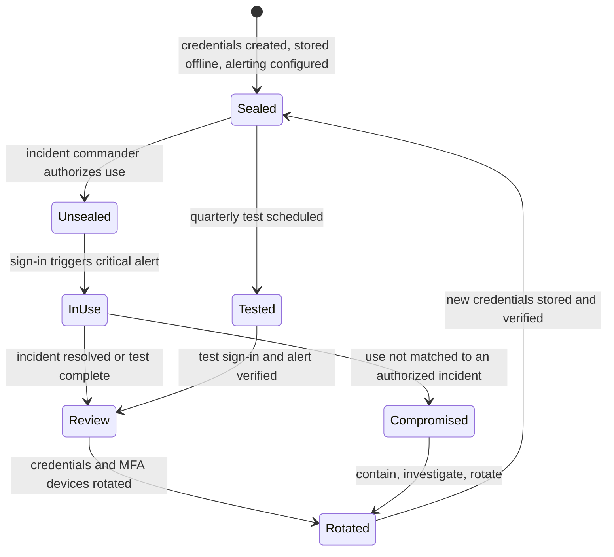

The state machine makes two rules explicit. Every exit from `InUse` passes through `Review` and `Rotated`, so a credential that has been used is never sealed again unchanged. And the `Compromised` transition is triggered by a mismatch between an alert and an authorization record, which only works if authorizations are recorded somewhere the alert handler can check, such as the incident ticket.

### 14.3 Failure scenarios

| Scenario | Break-glass role |
|---|---|
| Entra ID or the external IdP is unavailable | Cloud-only emergency accounts in Azure, IAM users or root in AWS, direct-sign-in super administrator in Google Cloud |
| A Conditional Access policy blocks all administrators | Emergency accounts excluded from that policy fix it |
| An SCP denies a required action at the root | The management account, which SCPs do not affect, detaches or edits it |
| A deny policy blocks project recovery | The exception principal group named in the deny policy |
| The identity team is compromised | Break-glass held by a separate security function with separate storage |

## 15. Audit and detection

### 15.1 The audit sources

| Source | What it records | Default retention and cost notes (at the time of writing; verify) |
|---|---|---|
| AWS CloudTrail | Management events by default; data events (S3 object, Lambda invoke, and others) only when configured | Event history of management events for 90 days; trails and CloudTrail Lake for longer retention |
| Azure Activity Log | Control-plane operations through ARM, including role-assignment changes | 90 days; export with diagnostic settings for longer retention |
| Azure resource logs | Data-plane operations for services such as Key Vault and Storage | Only when diagnostic settings are enabled |
| Microsoft Entra sign-in and audit logs | Interactive, non-interactive, service-principal, and managed-identity sign-ins; directory changes, PIM activations | 7 days on free tiers and 30 days with Entra ID P1 or P2; export for longer |
| Google Cloud Audit Logs | Admin Activity (always on), Data Access (off by default except BigQuery), System Event, Policy Denied | Admin Activity in the `_Required` bucket for 400 days; Data Access in `_Default` for 30 days |

Two gaps appear in every first review. Data-plane access is not logged by default in any of the three providers, so "who read this object" is unanswerable unless data events, resource logs, or Data Access logs were enabled beforehand. And default retention is shorter than most investigations, so organization-wide export to a protected log store, in a security account, subscription, or project that workload administrators cannot change, is a baseline control. The [Monitoring](CH10_Monitoring.md) chapter owns collection, routing, and cost.

### 15.2 The fields that make attribution possible

| Question | AWS CloudTrail | Azure | Google Cloud Audit Logs |
|---|---|---|---|
| Which principal acted | `userIdentity.arn`, `userIdentity.sessionContext.sessionIssuer` | `caller`, `claims.oid` in Activity Log | `protoPayload.authenticationInfo.principalEmail` or `principalSubject` |
| Which human was behind a role | `userIdentity.sessionContext.sourceIdentity`, session name from Identity Center | Same object ID everywhere; PIM activation record | `serviceAccountDelegationInfo` chain for impersonation |
| From where | `sourceIPAddress`, `vpcEndpointId` | `callerIpAddress`, sign-in log location | `requestMetadata.callerIp` |
| What was decided | `errorCode` such as `AccessDenied`, with policy type in many messages | `status`, `AuthorizationFailed` | `status.code` 7 (`PERMISSION_DENIED`), Policy Denied logs for Organization Policy and VPC Service Controls |

### 15.3 Detections worth building first

1. Use of any break-glass identity (section 14).
2. Creation of IAM users, access keys, service account keys, or application client secrets.
3. Changes to trust objects: role trust policies, federated identity credentials, workload identity pool providers, Lighthouse delegations, and bindings that grant `roles/iam.serviceAccountTokenCreator` or `roles/iam.serviceAccountUser`.
4. Grants of Owner, User Access Administrator, AdministratorAccess, Organization Administrator, or basic roles in production.
5. Changes to guardrails: SCP or RCP attachment or edit, Azure Policy assignment deletion or exemption, Organization Policy or deny policy changes.
6. Audit configuration changes: trail stopped, diagnostic setting deleted, log sink changed.
7. Spikes of authorization denials from one principal, which often mark reconnaissance with a stolen credential.

## 16. Quotas and limits

IAM quotas rarely matter in a single account and often matter at platform scale. The table lists limits that shape designs; all are from provider documentation at the time of writing ([AWS IAM and STS quotas](https://docs.aws.amazon.com/IAM/latest/UserGuide/reference_iam-quotas.html), [Azure RBAC limits](https://learn.microsoft.com/en-us/azure/azure-resource-manager/management/azure-subscription-service-limits), [Google Cloud IAM quotas](https://docs.cloud.google.com/iam/quotas)). Verify current quotas.

| Limit | Value | Design effect |
|---|---|---|
| AWS roles per account | 1,000 default, adjustable to 10,000 | One role per microservice per environment in a shared account reaches the default quickly |
| AWS managed policies per role | 20 default, adjustable to 25 | Composing many small managed policies has a ceiling |
| AWS customer managed policy size | 6,144 characters, not counting white space | Large generated policies must be split |
| AWS inline policy size per role (aggregate) | 10,240 characters | Larger than one managed policy, but inline policies cannot be reused or versioned |
| AWS role trust policy length | 2,048 characters default, adjustable to 8,192 | Trust policies listing many repositories or accounts hit this first |
| AWS session policy plus managed policy ARNs | 2,048 characters, at most 10 ARNs | Session policies must stay short |
| AWS session tags | 50 per session | Bounds ABAC attributes per session |
| AWS STS requests with AWS credentials | 600 per second per account per Region | Mass parallel `AssumeRole` needs credential reuse |
| AWS OIDC providers per account | 100 default, adjustable to 700 | One provider per Kubernetes cluster with IRSA adds up |
| Azure role assignments per subscription | 5,000, not increasable | See the worked calculation in [Azure](CH02_Azure.md), section 5.5 |
| Azure role assignments per management group | 500 | Keep management-group assignments to group principals |
| Azure custom roles per tenant | 5,000 | Rarely binding; governance of many roles is the real cost |
| Azure federated identity credentials per app or user-assigned identity | 20 | One identity cannot trust more than 20 repository-environment pairs |
| Google Cloud principals in one allow policy | 1,500 (each appearance counted) | Grant to groups; large projects that grant individuals hit this |
| Google Cloud domains and groups in one allow policy | 250 unique | Bounds group-based design per resource |
| Google Cloud custom roles | 300 per organization, 300 per project | Shared custom roles belong at organization level |
| Google Cloud keys per service account | 10 | Rotation with overlap needs free slots |
| Google Cloud deny rules per resource | 500 | Deny is for guardrails, not everyday control |
| Google Cloud PAB policies bound per resource | 10 | Bounds layered boundaries |

**Worked calculation: AWS roles in a shared account.** A platform account hosts 180 microservices, each with a Lambda execution role and a deployment role in each of three environments that share the account: 180 × 2 × 3 = 1,080 roles, above the default 1,000. Adding 42 Identity Center permission-set roles and 25 service-linked roles gives 1,147. Raising the quota to 10,000 is automatic up to the maximum, so the quota is not the binding constraint. The real problem is that three environments share one account, so a deploy role mistake in development can touch production resources. Splitting environments into separate accounts reduces each account to about 360 workload roles and removes the cross-environment blast radius. The quota was the signal; the account design was the fix.

**Worked calculation: GCP allow policy size.** A data project grants `roles/bigquery.dataViewer` and `roles/bigquery.jobUser` to 700 analysts individually. Each analyst appears in two bindings, which counts as 1,400 principal appearances toward the 1,500 limit, leaving 100. Replacing individual grants with three Google Groups uses 6 appearances and 3 of the 250 unique group slots, and moves membership management into the directory where joiners and leavers are already handled.

## 17. Provider comparison

The table compares guarantees, scopes, and responsibilities. Similar names do not imply identical behavior; check each row against current documentation before relying on it.

| Dimension | AWS | Azure | Google Cloud |
|---|---|---|---|
| Identity boundary | Account for IAM principals; organization for Identity Center | Entra tenant, spanning all subscriptions that trust it | Cloud Identity or Workspace account, mapped to one organization |
| Authorization boundary for workloads | Account; crossing requires assume or resource policy | Any scope where the principal holds an assignment | Any resource where the principal holds a binding |
| Inheritance of grants | None between accounts; SCPs and RCPs inherit as ceilings | Assignments inherit from management group to resource | Allow bindings inherit from organization to resource |
| Explicit deny available to customers | Yes, in every policy type | Limited (deployment stacks, managed apps) | Yes, deny policies |
| Permission ceiling on principals | SCP, permissions boundary, session policy | None in RBAC | PAB policy |
| Permission ceiling on resources | RCP (supported services) | None as action ceiling | VPC Service Controls; deny policies |
| Human federation entry | IAM Identity Center permission sets | Native Entra ID with Conditional Access | Cloud Identity with single sign-on or Workforce Identity Federation |
| JIT privileged access | Not built in for Identity Center at the time of writing | PIM for Entra roles, Azure roles, and groups | Privileged Access Manager |
| Workload credential shape | SigV4 signing keys with session token | Audience-bound bearer token | OAuth 2.0 bearer token |
| External workload federation trust object | IAM OIDC or SAML provider plus role trust policy | Federated identity credential on app or user-assigned identity (exact match, 20 per identity) | Workload identity pool, provider with attribute condition, and bindings |
| Provider-managed identities | Service-linked roles, exempt from SCPs and RCPs | First-party service principals, resource-provider identities | Service agents with automatic service-agent roles |
| Fast session revocation | Deny by `aws:TokenIssueTime` on the role | Revoke sign-in sessions; CAE where supported | Disable service account; remove bindings |
| Usage-based least-privilege tooling | Access Analyzer (unused access, policy generation) | Access reviews, PIM alerts; no built-in policy generation | IAM Recommender, Activity Analyzer |
| Default audit of control-plane changes | CloudTrail management events, 90-day event history | Activity Log, 90 days | Admin Activity logs, 400 days |

Three rows change designs most. The **authorization boundary** row means that in Azure and Google Cloud a single over-granted principal reaches every scope it holds roles in, while in AWS a single over-trusting trust policy is the comparable risk. The **explicit deny** row means that an AWS-style "nobody may disable audit, anywhere" control is a one-statement SCP in AWS, a deny policy in Google Cloud, and in Azure a combination of PIM, alerting, and resource locks or stack deny settings. The **credential shape** row means that bearer-token providers depend more on short lifetimes and audience binding, because a captured token is directly reusable until it expires.

## 18. Case study: Larkspur Payments unifies identity across three clouds

This case study is a composite built to apply the chapter's reasoning end to end. The organization and numbers are illustrative.

### 18.1 Context

Larkspur Payments runs its card-processing platform on AWS in 46 accounts, its data warehouse on Google Cloud in 18 projects, and its corporate estate on Microsoft 365 with a small Azure footprint of 6 subscriptions for internal tools. Staff number 900, of whom 220 are engineers. An audit found:

- 3 separate workforce directories (Entra ID, an AWS Identity Center local directory, and synchronized Cloud Identity accounts with their own passwords for 60 contractors).
- 41 IAM users with access keys, 19 of them used by CI pipelines, the oldest key 4 years old.
- 7 Google Cloud service account keys in GitHub Actions secrets.
- An AWS role trusted by `repo:larkspur/*` for GitHub deployments into all production accounts.
- 64 engineers with standing AdministratorAccess in production AWS accounts.
- No organization-wide data-access logging.

### 18.2 Requirements and quality scenarios

- **Containment.** A compromised engineer laptop or CI job must not reach production data outside its own service, and must not disable audit.
- **Revocation.** A departing employee loses all production write access within 15 minutes of offboarding in the human resources (HR) system, and all cloud access within 60 minutes.
- **Rotation.** No long-lived cloud credentials for humans or CI within one quarter.
- **Operability.** On-call engineers obtain production write access within 5 minutes during an incident, without a standing grant.
- **Evidence.** Every production change is attributable to a human or to a specific pipeline run.

### 18.3 Decisions

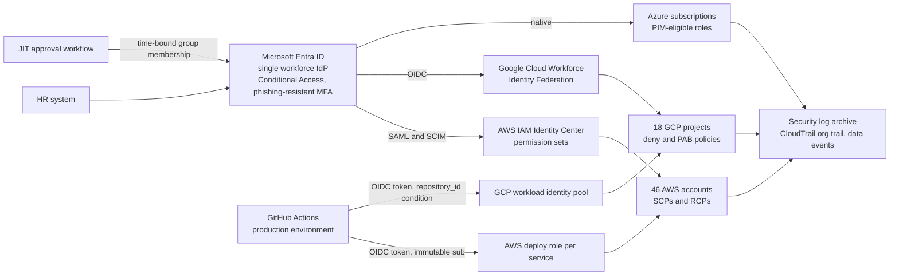

**D1: Entra ID as the single workforce IdP.** All three clouds federate to Entra. Identity Center switches its identity source from the local directory to Entra with SCIM; Google Cloud moves contractors and then employees from synchronized passwords to Workforce Identity Federation for the products the team uses, after checking product support. *Rejected alternative:* keep Cloud Identity as a second directory for Google Cloud. It would have kept two offboarding paths and two MFA policies, which the revocation requirement rules out.

**D2: JIT write access through group membership.** Permission sets `ProdRead` (standing for on-call engineers) and `ProdOperator` (write) exist; `ProdOperator` is assigned to a group whose membership is granted by an approval workflow for 2 hours. The permission set's session duration is set to 2 hours to match the JIT window (section 8.5). Azure uses PIM directly. Google Cloud uses Privileged Access Manager entitlements. *Rejected alternative:* standing write access with alerting. It met operability but failed containment, because a stolen laptop session would carry production write access.

**D3: GitHub OIDC per service, pinned to the production environment and immutable IDs.** The single `repo:larkspur/*` role is replaced by one deploy role per service per production account, each trusting exactly `repo:larkspur@<owner-id>/<service>@<repo-id>:environment:production`. GitHub environments require reviewers and allow only the `main` branch. Google Cloud uses one pool with an organization-level attribute condition on `repository_owner_id` and per-service bindings on `attribute.repository_id`. *Rejected alternative:* one shared deploy role with a list of subjects. It would have grown past the 2,048-character trust policy default and given every repository the union of all services' permissions.

**D4: Guardrails before narrowing.** SCPs deny audit tampering, IAM user and access-key creation, and leaving the organization; an RCP requires organization principals and Transport Layer Security (TLS) on S3, KMS, Secrets Manager, and Amazon Simple Queue Service (SQS); Google Cloud deny policies protect production projects from deletion and block key creation; a PAB policy binds Larkspur's principal set to its own organization. *Rejected alternative:* narrow every role first, then add guardrails. Narrowing 46 accounts' worth of roles takes months, while guardrails close the most damaging paths in weeks.

**D5: Least privilege by measurement.** Access Analyzer unused-access findings and policy generation drive narrowing of the 64 AdministratorAccess users' replacement permission sets and the CI roles; IAM Recommender drives Google Cloud. Disaster-recovery permissions come from runbooks, not logs (section 12.3).

**D6: Data-access logging in scope.** CloudTrail S3 data events for buckets tagged `data-class=card`, Key Vault and Storage diagnostic logs for the Azure tools, and BigQuery and Cloud Storage Data Access logs for Google Cloud, exported to the security log archive.

### 18.4 Revocation design and its arithmetic

HR offboarding disables the Entra user and revokes sign-in sessions. The chain then runs:

- **Entra and Azure.** No new tokens are issued. The automation removes any active PIM activations, so ARM denies write calls within the RBAC propagation window of about 10 minutes. Existing access tokens for read-only internal tools can live up to about 90 minutes, or less on CAE-enabled resources.
- **AWS.** The SCIM cycle removes the user from Identity Center groups. To avoid waiting for the cycle and for up to 2 hours of role session, the automation also ends the user's Identity Center sessions and, if the user held an active `ProdOperator` elevation, attaches an `aws:TokenIssueTime` deny to that role.
- **Google Cloud.** Workforce Identity Federation sign-ins come from Entra, so new sign-ins fail. The automation revokes the user's Privileged Access Manager grants. Existing Google sessions expire at the pool's configured session duration, which Larkspur sets to 1 hour.

Without the automation, the worst case is the longest residual credential, a 2-hour STS session. With it, the measured time to the last successful *write* call in testing was 11 minutes, inside the 15-minute requirement, and the last successful read in any cloud came at 58 minutes, from a Google Cloud console session, inside the 60-minute requirement. The team chose a 1-hour pool session over a shorter one because analysts' long queries were being interrupted at 15 minutes.

### 18.5 Validation evidence

- A quarterly game day from a sandbox account repeats the five containment attempts of section 7.5 and records zero successes.
- A test workflow on a feature branch attempts to assume each production deploy role and is refused by STS and by Google's STS; the refusals appear in CloudTrail and Cloud Audit Logs.
- Credential reports show 0 IAM users with access keys outside the 3-key exception list (two payment-network integrations and one legacy reporting tool, each with an owner and a 90-day expiry), and 0 Google Cloud service account keys.
- Offboarding tests with a synthetic user measure time to last successful call in each cloud; results are retained as evidence.
- The break-glass path is tested quarterly with the alert reaching the security on-call within 2 minutes.

### 18.6 Residual risks

Entra ID is now a single dependency for all human access; break-glass accounts in each cloud cover its failure. JIT approval adds up to 5 minutes to incident response; on-call engineers hold `ProdRead` standing so diagnosis does not wait. Service-linked roles remain exempt from SCPs; detections on their unusual actions are the compensating control.

## 19. Common mistakes and anti-patterns

**Treating a guardrail as a grant.** Cause: the SCP or Organization Policy "allows" a service, so the team expects access. Consequence: confusing denials and pressure to loosen guardrails, when a grant is missing (section 7.1).

**Trusting an issuer instead of a subject.** Cause: a federation trust copied from a tutorial with `StringLike` and `repo:org/*`, or a Google pool without an attribute condition. Consequence: any repository, branch, or pull request in the organization, and in the worst case any GitHub user, can obtain the role (section 9.5).

**Wildcard `iam:PassRole` or project-level Service Account User.** Cause: the deploy pipeline needed to pass "some role." Consequence: anyone with deploy rights can run code as the most privileged role or service account in the account or project (section 9.3).

**Account-root trust in cross-account roles.** Cause: naming `arn:aws:iam::ACCOUNT:root` is shorter. Consequence: the other account's administrators, not you, decide who enters (section 10.2).

**Trusting a service principal without source conditions.** Cause: the service's documentation example omitted `aws:SourceArn`. Consequence: any customer's resource of that service can act on your resource (section 10.3).

**Reviewing control-plane roles only.** Cause: access reviews read role assignments. Consequence: shared keys, SAS tokens, HMAC keys, presigned URLs, and database users give data access that no review sees (section 2.5).

**Session duration longer than the JIT window.** Cause: defaults of 8 or 12 hours chosen for convenience. Consequence: a 2-hour elevation becomes a 12-hour credential (section 8.5).

**Group-based grants for workloads that need fast revocation.** Cause: group grants simplify administration. Consequence: in Azure, cached tokens keep group-derived access for hours after removal (section 13.1).

**Narrowing from logs alone.** Cause: policy generation is convenient. Consequence: the disaster-recovery runbook fails the first time it runs after narrowing (section 12.3).

**Break-glass through the primary IdP.** Cause: emergency accounts were created in the federated directory. Consequence: the emergency path fails exactly when the IdP does (section 14.1).

**Basic roles in Google Cloud production.** Cause: Editor makes everything work. Consequence: thousands of permissions, inherited by every resource below the grant, which no deny list can tame.

**Leaving data-plane audit off.** Cause: cost of data events and Data Access logs. Consequence: after an incident, "which objects were read" has no answer (section 15.1).

## 20. Design-review checklist

Each item should have evidence, not just an answer.

- **Principals.** Is every human federated from one IdP, with no IAM users, local passwords, or long-lived keys for people?
- **Workloads.** Does every workload use an attached or federated identity? Is there a list of remaining long-lived credentials with owners and expiry dates?
- **Attach rights.** Are `iam:PassRole`, Managed Identity Operator, and Service Account User scoped to specific identities and services?
- **Federation.** Does every OIDC trust pin audience and an exact subject using immutable IDs where available? Is there a negative test proving a non-production branch is refused?
- **Evaluation.** For each critical action, can the team name every policy layer that applies (grant, ceiling, deny, configuration) and its owner?
- **Planes.** Are deploy and runtime identities separate? Are shared-key and signed-URL paths disabled or bounded?
- **Cross-boundary trust.** Is there a current trust graph? Do all trust policies name specific principals, use `sts:ExternalId` for third parties, and use `aws:SourceArn` or `aws:SourceAccount` for service principals? Are Lighthouse delegations and cross-organization bindings listed?
- **Guardrails.** Do guardrails protect audit, guardrail administration, organization membership, and key creation? Were they staged with denial monitoring?
- **Privileged access.** Is write access to production JIT, with session duration no longer than the elevation window?
- **Least privilege.** Are unused-access findings reviewed on a schedule? Do rare-path permissions come from runbooks and tests?
- **Revocation.** Has offboarding been measured end to end in every cloud, including residual sessions?
- **Break-glass.** Are emergency identities independent of the IdP, excluded by name from the guardrails they may need to change, alerted on use, and tested quarterly?
- **Audit.** Are control-plane and data-plane logs exported to a store that workload administrators cannot alter, with retention that covers the investigation window?
- **Quotas.** Is there headroom on roles per account, role assignments per subscription, and principals per allow policy for the next year's growth?

## 21. Exercises

### 21.1 Interview questions

1. Explain why a cross-account S3 request can fail even though the bucket policy names the caller's role. What must be true in the caller's account?
2. A same-account bucket policy grants a role ARN. The role has no identity policy. Is `GetObject` allowed? What changes if a permissions boundary that does not include S3 is attached?
3. What is the difference between `NotActions` in an Azure role definition and a deny assignment?
4. Why is a Google Cloud allow-policy grant at folder level riskier than an AWS SCP attached to an OU?
5. What does an external ID protect against, and why must the vendor, not the customer, choose it?
6. A GitHub Actions trust policy uses `StringLike` on `repo:acme/*`. List three ways it can be abused.
7. An Azure managed identity was removed from a group that grants Key Vault access, but it still reads secrets an hour later. Why, and what should have been done instead?
8. How would you prove to an auditor that a departed employee had no production write access 15 minutes after offboarding, in all three clouds?

### 21.2 Design exercises

1. **Federation checker.** Run [03_federation_trust.py](../code/python/iam-chapter/03_federation_trust.py). Add an assertion for `repo:org/orders-api:ref:refs/heads/feature-x` and observe that it passes. Change the trust model to require the exact subject `repo:org/orders-api:environment:production`, and add an immutable-ID variant. Which assertions now fail, and why is that correct?
2. **Inheritance and deny.** Run [02_policy_inheritance.py](../code/python/iam-chapter/02_policy_inheritance.py). Extend it with a ceiling set (modeling an SCP or PAB policy) that must contain the action for an allow to succeed, and show a case where a grant exists but the ceiling denies.
3. **Evaluation by hand.** Redo the table in section 3.4 for a request from `etl-runner` with no session policy, calling `s3:PutObject` on `lake-curated-444` over HTTPS. Then repeat with the bucket moved into account `222222222222` and the identity policy's `PutObject` statement removed.
4. **Vendor access.** Design read access for a security vendor to Azure Activity Logs in 30 subscriptions and to Google Cloud audit logs in 18 projects, with the same evidence quality as section 10.6.
5. **Revocation timeline.** Draw the section 13.4 timeline for a compromised Google Cloud service account key used by a CI job, with detection 40 minutes after the leak. State the residual window with and without disabling the service account.

## 22. Summary

Cloud IAM in all three providers decides whether a principal may perform an action on a resource under some conditions, by default denies, and combines grants, ceilings, and explicit denies attached at identities, resources, sessions, and scopes. AWS combines identity and resource grants by union within an account and by intersection across accounts, filtered by SCPs, RCPs, boundaries, and session policies. Azure combines role assignments by union across scopes, checks deny assignments first, and relies on Entra ID, Conditional Access, and PIM for the human side. Google Cloud combines inherited allow bindings by union and restricts them with deny and principal access boundary policies.

Designs that hold up share a short list of properties. Humans federate from one IdP and elevate just in time. Workloads use attached or federated identities with exact subject pinning, and the right to attach an identity is guarded like the identity itself. Cross-boundary trust is two-sided, narrow, and protected against confused deputies. Guardrails protect the security machinery and never pretend to grant. Least privilege is a measured loop that respects rare paths. Revocation is designed and timed, including the sessions that outlive the credential that created them. Break-glass is independent and tested, and audit evidence lives where the people it records cannot change it.

## 23. Code examples

The examples use synthetic policy objects and Python's standard library. They are teaching models, not implementations of AWS, Azure, or Google Cloud authorization semantics.

- [01_policy_analyzer.py](../code/python/iam-chapter/01_policy_analyzer.py) flags allow statements with wildcard actions, wildcard resources, or both, the statements that section 12.3 removes when narrowing a role.
- [02_policy_inheritance.py](../code/python/iam-chapter/02_policy_inheritance.py) evaluates an action against inherited allows and explicit denies and shows that an explicit deny wins and that a missing allow is an implicit deny.
- [03_federation_trust.py](../code/python/iam-chapter/03_federation_trust.py) checks issuer, audience, and subject-prefix claims before modeled role assumption, and rejects a pull-request subject while accepting any branch, which section 9.5 and the first design exercise in section 21.2 tighten.
- [04_access_review.py](../code/python/iam-chapter/04_access_review.py) reports principals that need review because they lack an owner, have not been used within a threshold, or hold privileged access.
