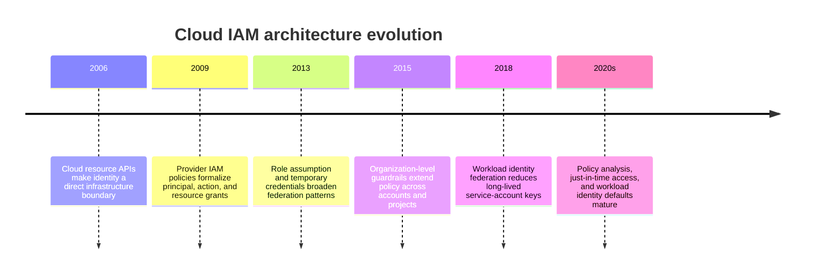
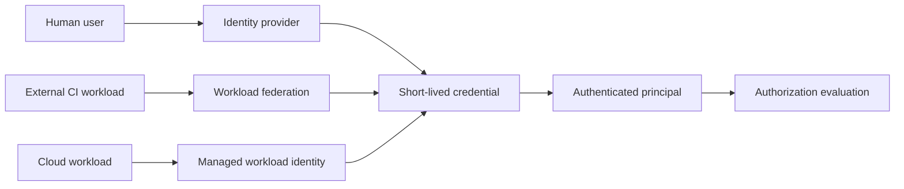
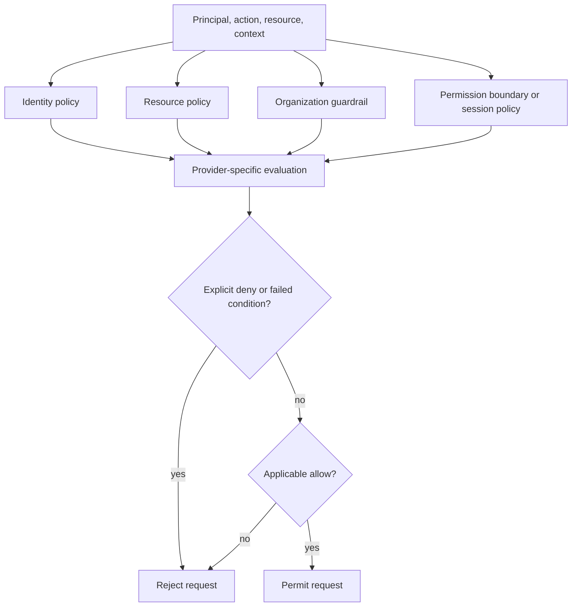
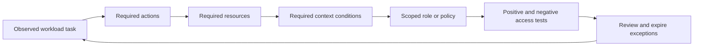
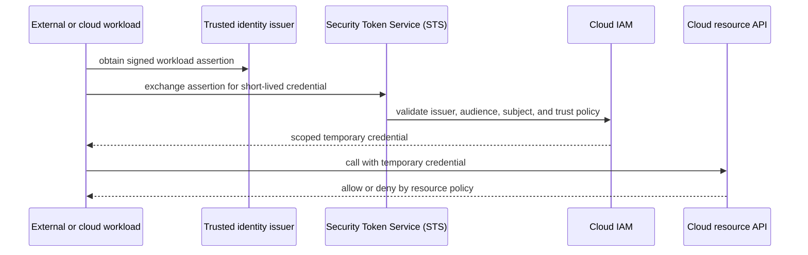
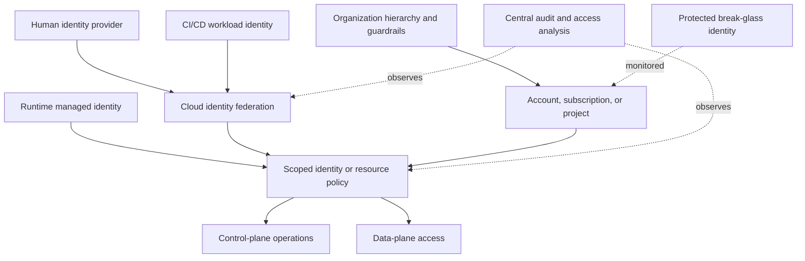

# Chapter: Cloud Identity and Access Management

Part: [09 — Cloud Computing](PART_OVERVIEW.md) · Status: Drafted

## 1. Introduction

Cloud Identity and Access Management (IAM) controls which human or workload principals can perform which actions on cloud resources. A cloud account, subscription, or project can host thousands of resources and automated actors; a broad permission mistake can therefore become a production outage, data exposure, or persistent compromise.

This chapter teaches cloud IAM architecture: principals, authentication and authorization boundaries, policy evaluation, role assignment, resource scope, federation, workload identities, cross-account/project access, guardrails, and access review. It does not re-teach OAuth, OpenID Connect (OIDC), Security Assertion Markup Language (SAML), or Transport Layer Security (TLS) protocol mechanics owned by Part 05. Part 08 Application Programming Interface (API) Security owns authorization of application resources and tenant data; this chapter governs access to cloud control planes and service data planes.

## 2. Historical Evolution

Early infrastructure environments often relied on shared administrator credentials and static secrets. Cloud control planes made every resource operation available through application programming interfaces (APIs), so identity and policy became a central part of infrastructure architecture. Providers added role-based access, resource policies, federation, temporary credentials, workload identities, organization-level guardrails, and automated policy analysis to reduce dependence on long-lived keys and individual users.

The architecture has shifted from “who knows the password?” to “which principal receives which scoped capability, under what conditions, for how long, and with what evidence?” A policy document alone is not the full authorization system; provider-specific evaluation and service behavior matter.

## 3. Why It Exists

Cloud resources are created, changed, and consumed by people, pipelines, managed services, and applications through application programming interfaces (APIs). IAM establishes identities for these actors and constrains their actions. Without explicit IAM design, teams tend to accumulate user keys, broad administrator roles, undocumented cross-account access, and permissions that outlive the workload that needed them.

IAM is both a security boundary and an operational dependency. A restrictive policy can prevent a deployment or incident response; an overly broad policy can expose data or allow destructive changes. The architecture must balance least privilege with operability, define emergency access, and provide a reliable method to review and revoke permissions.

## 4. Core Concepts

### 4.1 Principals, identities, and credentials

**Definition.** A principal is an identity to which a provider can grant permissions. Principals include human users, groups, roles, service accounts, managed identities, and federated identities. A credential proves control of an identity during authentication; it may be a password, key, certificate, signed assertion, or short-lived token. Identity and credential are related but not identical.

**Mechanism.** A human signs in through an identity provider; a pipeline may federate an external workload identity; a workload may receive a managed identity from its runtime; and a service may use a provider-managed service principal. Authentication establishes the principal for a request. The service then evaluates whether that principal may perform the requested action. Temporary credentials reduce the time window in which a stolen credential can be reused, but they do not make an overprivileged role safe.

**Decision implications.** Use groups for human access, role assumption or federation for external automation, and managed workload identities where available. Avoid creating a unique long-lived key per application when the platform can issue a short-lived identity. Maintain a controlled break-glass identity that is monitored and rarely used.

**Common failure mode.** A credential is treated as a durable identity and copied into a repository, image, or build log. Another failure is disabling a human account without revoking its long-lived keys or tokens elsewhere.

**Scenario.** A Git-based build pipeline needs to publish an image. It exchanges a repository-issued identity assertion for short-lived cloud credentials scoped to one registry. Production runtime identities can pull approved images but cannot publish new ones.

### 4.2 Authentication, authorization, and policy evaluation

Authentication answers “who is making the request?” Authorization answers “may this principal perform this action on this resource?” A policy is an input to authorization, but providers can combine identity policies, resource policies, organization guardrails, permission boundaries, session policies, conditions, and service-specific checks.

**Mechanism.** A request identifies a principal, action, resource, and context such as network, time, tags, or session attributes. The provider gathers applicable policies from the principal and resource scopes, evaluates conditions and explicit denies, and applies service-specific rules. Many providers use an allow-by-default-deny model: an action must be allowed and not explicitly denied. Exact evaluation differs by provider and policy type; validate behavior with policy simulators or controlled tests.

**Decision implications.** Separate authentication failures from authorization failures in telemetry and incident response. Document which policy layers constrain each critical action. Use provider simulators for policy changes, but also test real requests because service policies, resource state, and data-plane authorization can add conditions.

**Common failure mode.** A team sees an identity policy allow and assumes access must succeed, even though an organization deny or resource policy may still block the request. The opposite error is removing a guardrail to fix a deployment without identifying the narrower conflicting permission.

**Scenario.** A deployment principal has project-level create permission, but an organization policy blocks public IP configuration. The resource operation is denied despite the principal's role. The team changes the resource design rather than weakening the organization-wide control.

### 4.3 Resource hierarchy and policy inheritance

Cloud IAM attaches policies at scopes such as organization, folder, account, subscription, project, resource group, or individual resource. Broader assignments reduce repetitive administration but increase blast radius. Amazon Web Services (AWS) Organizations accounts and organizational units, Azure tenants/management groups/subscriptions, and Google Cloud Platform (GCP) organizations/folders/projects provide different inheritance hierarchies.

Map stable ownership boundaries to policy scopes. Use high-level grants for central platform functions only when all descendants need them. Keep workload access at the narrowest practical scope and periodically inspect inherited bindings. Provider-specific resource hierarchy mechanics are introduced in the AWS, Azure, and GCP chapters; this section focuses on IAM inheritance.

### 4.4 Roles, permissions, and scope

A permission represents an operation such as reading an object, creating a virtual machine, or changing a network route. Role-Based Access Control (RBAC) groups permissions into roles for assignment to a principal at a scope. Provider predefined roles simplify common tasks; custom roles offer finer control but create maintenance responsibilities as services evolve.

Choose roles by job function and resource scope, not by title alone. Separate read, deploy, operate, and administer capabilities. Use resource-level permissions for data access when supported, and test both control-plane and data-plane actions. A deployment role that creates storage does not necessarily grant the application permission to read objects stored there.

### 4.5 Least privilege and policy composition

Least privilege grants the minimum actions, resources, and conditions needed for a task. It is not achieved by choosing a role with “read-only” in the name if the role spans every project or includes sensitive metadata. Use permission analysis, narrow resource identifiers, conditions, and separation of duties to constrain effective access.

Start with an intended capability, then add only permissions proven necessary by tests and telemetry. Avoid wildcard actions and resources for convenience, especially for destructive or credential-management operations. Re-run permission analysis when code, services, or team ownership changes.

### 4.6 Workload identity and federation

Workloads need credentials to call cloud APIs, but static keys create rotation, leakage, and attribution risks. Workload identity binds a runtime or external identity to a cloud principal and issues short-lived credentials. Federation exchanges a trusted external token for cloud credentials after validating issuer, audience, subject, and other claims.

Constrain federation to exact repositories, branches, service accounts, or runtime identities. Do not trust a broad issuer when a narrower subject or audience can be enforced. Rotate trust configuration and test revocation; token expiry limits duration but does not fix excessive role permissions.

### 4.7 Control-plane and data-plane authorization

Control-plane permissions create or configure resources; data-plane permissions use the service's contents or workload path. A provider may expose separate role types, endpoints, and policy systems for these operations. For example, permission to create an object store does not automatically grant permission to read objects within it.

Give deployment automation control-plane rights only where needed, then assign runtime identities narrowly scoped data-plane permissions. Monitor both authorization paths. This distinction appears in AWS, Azure, and GCP, but each service defines its own actions and policy semantics.

### 4.8 Organization guardrails and policy constraints

Organizations, service control policies, Azure Policy, Google Cloud Organization Policy, and similar controls restrict what child scopes may do. A guardrail is not necessarily a grant: it can cap or deny the actions available to principals while leaving identity authorization to another policy layer. Some governance systems evaluate configuration rather than each runtime API request.

Use guardrails for durable organization constraints such as approved locations, public exposure restrictions, or required audit settings. Stage policies in audit or report-only mode where available, define exception authority and expiry, and protect the policy-administration path. Avoid broad exclusions that silently remove controls from production workloads.

### 4.9 Cross-account, cross-subscription, and cross-project access

Cloud organizations often separate network, security, production, and development scopes. A workload may need controlled access to shared services in another account, subscription, or project. Providers implement this through role assumption, resource policies, delegated subnet use, service identities, or organization-level relationships.

Make both sides explicit: the caller's identity policy must permit the operation, and the target resource must trust or allow that principal. Restrict trust to expected identities and actions, avoid wildcard principals, and log the assumed role or delegated access. Include revocation and ownership transfer in the design.

### 4.10 Cloud IAM design and review workflow

Build the IAM design from actors and operations: list humans, pipelines, workloads, and provider-managed services; identify resources and actions; choose authentication methods; attach roles at appropriate scopes; add guardrails and conditions; and test positive and negative cases. Reconcile effective permissions rather than reviewing policy documents in isolation.

An access review should capture owner, purpose, scope, last-used evidence, expiry, and break-glass implications. Automate removal of stale temporary access and alert on privilege expansion. Keep an emergency path available without leaving standing administrator credentials on routine workloads.

## 5. Internal Working

A cloud API request carries an identity credential and names an action against a resource. The identity system validates the credential and produces a principal context. The authorization engine gathers applicable identity, resource, organization, boundary, session, and condition policies; it then returns an authorization result to the service. The service may perform additional checks on its data plane or resource state before completing the request.

Federated workloads add a trust exchange: an external issuer signs a token; a cloud security token service validates configured claims; a role or service account is selected; and temporary credentials are returned. The workload presents those credentials to provider APIs until expiry. Trust policy, token audience, source identity, and issued permissions determine the actual security boundary.

## 6. Design Principles

- Give every human, pipeline, workload, and service a distinct identity purpose.
- Prefer temporary credentials, managed identities, and federation over long-lived keys.
- Scope actions and resources narrowly; use conditions where supported.
- Separate control-plane administration from data-plane workload access.
- Treat organization guardrails as constraints, not permission grants.
- Review inherited access across every hierarchy level.
- Separate identity administration, policy administration, and workload deployment where risk warrants it.
- Test allowed and denied requests, including cross-account/project access.
- Log access changes and periodically remove stale grants.

## 7. Architecture Patterns

**Human federation.** Workforce identities federate from a central identity provider into cloud roles or groups. Sessions are short-lived, and offboarding is centralized.

**Workload federation.** Continuous integration/continuous delivery (CI/CD) or external workloads exchange short-lived assertions for narrowly scoped provider credentials without storing cloud keys.

**Managed workload identity.** A cloud runtime supplies a principal to the application; resource policies grant the minimum data-plane actions needed.

**Privileged break-glass access.** A protected emergency identity uses strong authentication, limited availability, monitored activation, and post-use review.

## 8. Production Architecture

Production readiness includes ownership for federation trust, role creation, exception review, credential revocation, audit retention, and emergency access. Resource policies and identity policies should be reviewed together for sensitive data.

## 9. Implementation

1. Inventory actors, resources, operations, and data sensitivity.
2. Map organizational scopes and identify inherited policies.
3. Select authentication for humans, automation, runtime workloads, and services.
4. Define roles from required actions and resources, then assign at narrow scopes.
5. Add federation trust conditions and organization guardrails.
6. Separate control-plane and data-plane permissions.
7. Test allowed and denied access, including break-glass and revocation.
8. Log permission changes, review stale access, and automate expiry where possible.

## 10. Complete Code Examples

- [Least-privilege role policy analyzer](../code/python/iam-chapter/01_policy_analyzer.py)
- [Inherited allow/deny evaluation simulator](../code/python/iam-chapter/02_policy_inheritance.py)
- [Workload federation trust-condition checker](../code/python/iam-chapter/03_federation_trust.py)
- [Stale identity access-review report](../code/python/iam-chapter/04_access_review.py)

The examples use synthetic policy objects and Python's standard library. They are teaching models, not complete implementations of AWS, Azure, or Google Cloud authorization semantics.

## 11. Performance

IAM evaluation is usually not the dominant workload latency, but authentication exchanges, token refresh, policy lookups, and cross-region identity dependencies can affect startup and control paths. Cache credentials only within their validity and revocation model. Avoid making every application request synchronously call an identity provider when signed tokens or managed identities support safe local validation.

Measure identity failures, token issuance latency, permission-denied rates, and policy propagation time. Large policy documents and deeply inherited scopes can increase operational complexity even when request evaluation remains provider-managed.

## 12. Scalability

Identity systems must scale with users, workloads, resources, policies, and organizational boundaries. Group-based access reduces repeated bindings; workload federation avoids one static key per service; policy templates standardize new accounts and projects. These patterns still require quotas, naming, ownership, and exception management.

Automate role assignment and project bootstrap, but keep policy review and change control. Avoid creating a separate cloud principal for every short-lived job if federation can provide scoped identity dynamically. Review blast radius as service count and team count grow.

## 13. Security

Protect credentials, restrict privilege escalation, enforce multifactor authentication for human administrators, and minimize standing privilege. Use short-lived credentials, scoped trust, resource policies, organization guardrails, audit logs, and periodic access reviews. Treat identity tokens and signing keys as sensitive material.

General OAuth/OIDC and TLS mechanics remain with Part 05; cloud IAM configures how provider principals and workload claims map to cloud permissions. Application-level object and tenant authorization remains with Part 08 API Security. A cloud role does not replace application authorization.

## 14. Observability

Collect authentication failures, authorization denials, role assumptions, policy changes, service-account key creation, federation changes, and privilege escalation events. Include principal, source identity, resource, action, scope, and result in audit records where available. Protect logs from the same administrators whose actions they record.

Alert on unexpected administrator grants, new long-lived keys, broad trust policies, public resource policies, disabled audit logging, and break-glass activation. Use last-used data cautiously; infrequent disaster-recovery permissions may still be necessary.

## 15. Failure Scenarios

| Failure | Likely symptom | Architectural response |
|---|---|---|
| Identity provider outage | Human or workload sign-in fails | Preserve controlled emergency access and document recovery dependencies |
| Expired or invalid assertion | Federation token exchange denied | Check issuer, audience, subject, clock, and trust policy |
| Overly restrictive guardrail | Deployment or recovery action denied | Identify the enforcing scope and use reviewed exception or compliant design |
| Excessively broad role | Unexpected data or infrastructure access | Revoke or narrow binding, preserve evidence, and assess exposure |
| Resource policy mismatch | Identity appears allowed but service denies request | Evaluate both identity and target-resource policies |
| Leaked long-lived key | Unusual API calls or resource changes | Revoke key, rotate dependent secrets, and review audit history |
| Cross-scope trust failure | Shared service access is denied | Validate caller permission and target trust independently |
| Break-glass used without evidence | Emergency change lacks accountability | Correlate audit events and require post-incident review |

IAM incidents can block the recovery actions intended to fix an outage. Test operator identity, key access, policy administration, and cross-scope dependencies as part of disaster recovery.

## 16. Testing

Use provider policy simulators where available, unit-test policy templates, and integration-test actual access from representative principals. Verify positive and negative cases: intended actions succeed; adjacent resources, destructive operations, and untrusted identities fail. Test federation claim validation, token expiry, role assumption, and revocation.

Run access reviews against deployed policy, not only source templates. Simulate an administrator compromise and confirm that organization guardrails, protected logs, and break-glass procedures limit and expose impact. Re-test after service additions and hierarchy changes.

## 17. Common Mistakes

- Using long-lived keys for workloads when federation or managed identity is available.
- Granting broad administrator roles to pipelines for deployment convenience.
- Confusing organization guardrails with permission grants.
- Reviewing identity policies without resource policies or inherited scope.
- Treating authentication as authorization or cloud IAM as application-level data authorization.
- Leaving former employees' keys, sessions, or cross-account trusts active.
- Making emergency recovery depend on the same failed identity path.
- Assuming a “read-only” role cannot expose sensitive metadata or data.

## 18. Best Practices

- Use roles and groups aligned with responsibilities and resource ownership.
- Prefer short-lived credentials, managed identities, and workload federation.
- Separate deployment and runtime permissions.
- Restrict resource policies to known principals and required actions.
- Apply organization-wide guardrails with a tested exception process.
- Protect policy administration and audit logs with separate roles.
- Automate access expiry and review stale principals.
- Test revocation, break-glass, and disaster-recovery identity paths.

## 19. Anti-Patterns

**Shared administrator identity.** Teams lose attribution and cannot revoke one actor without disrupting all users. Use individual identities and controlled role activation.

**Static key in a container or repository.** The key can be copied and reused outside the intended runtime. Use a managed or federated workload identity.

**Wildcard grants as a troubleshooting fix.** Broad actions and resources can hide the actual missing permission and persist after the incident. Diagnose the evaluated request and add the narrow permission.

**Trust every token from an issuer.** Federation without strict audience and subject conditions can let unrelated workloads assume a cloud role. Bind trust to the exact workload identity.

## 20. Trade-off Analysis

| Decision | Benefits | Costs and risks | Choose when |
|---|---|---|---|
| Predefined roles | Faster setup and provider maintenance | May include more permissions than needed | Role scope matches job function |
| Custom roles | Fine-grained permissions | Maintenance as APIs evolve | Security requires narrower actions |
| Long-lived key | Works with simple legacy clients | Leakage, rotation, and attribution risk | Only when no short-lived alternative exists |
| Workload federation | Short-lived credentials and source identity | Trust setup and issuer dependency | External automation or multi-cloud workload needs access |
| Broad inherited grants | Simple centralized administration | Large descendant blast radius | Rarely; only for tightly bounded platform duties |
| Just-in-time elevation | Reduces standing privilege | Activation and approval dependency | Human administrative actions are sensitive |

## 21. Comparison Table

| Dimension | AWS | Azure | Google Cloud |
|---|---|---|---|
| Human/workload identity | IAM users, roles, and federated principals | Microsoft Entra identities and managed identities | IAM principals and service accounts |
| Resource hierarchy | Organizations, organizational units, accounts | Tenant, management groups, subscriptions, resource groups | Organization, folders, projects |
| Workload federation | Role assumption and identity providers | Workload identity federation and managed identity | Workload Identity Federation and service accounts |
| Organization guardrail | Service Control Policies and related controls | Azure Policy and management-group controls | Organization Policy and IAM hierarchy |
| Resource-level data access | Resource policies and service data actions | Azure RBAC and service data roles | IAM roles and resource policies |

These mechanisms have different evaluation semantics. Do not translate a role name or policy document mechanically across providers; test the effective permissions and resource behavior in each environment.

## 22. Real-World Case Study

### Workload federation for deployment automation

Cloud providers document workload federation as an alternative to distributing long-lived credentials to external automation. A representative architecture trusts a specific CI identity issuer and binds the repository, branch, or workload subject to a narrowly scoped deployment role. The pipeline exchanges its signed assertion for temporary credentials, publishes an approved artifact, and records the source identity in its audit trail.

This pattern reduces the lifetime and portability of a leaked cloud credential, but shifts security importance to issuer trust and claim conditions. A broad trust rule that accepts every repository from an issuer can be nearly as dangerous as a static key. The target role must also be least-privileged, and the deployment pipeline must not receive runtime data access unless required.

Before production use, test expected and unexpected issuers, branches, audiences, token expiry, repository transfer, and role revocation. Keep a documented recovery identity for when the external identity provider is unavailable. This is a reference architecture based on documented provider federation features, not a claim about one named company's implementation.

## 23. Interview Questions

1. How do authentication and authorization differ in cloud IAM?
2. Why is an organization policy not necessarily a permission grant?
3. How do identity and resource policies combine?
4. How can a workload access cloud APIs without a static key?
5. What should a federation trust policy constrain?
6. How do control-plane and data-plane permissions differ?
7. Why can a broad inherited role be risky even if granted to a trusted group?
8. What identity dependencies should be included in disaster recovery?

## 24. Hands-on Exercises

1. Run the policy analyzer with a wildcard action and replace it with a narrow resource/action pair.
2. Run the inheritance simulator with an explicit deny at an ancestor scope.
3. Run the federation checker with an unexpected audience or branch claim and verify denial.
4. Run the access-review report and expire a principal with no owner or recent use.

## 25. Design Exercises

1. Design identities for engineers, CI, production workloads, shared networking, and emergency recovery across multiple accounts or projects.
2. Replace long-lived deployment keys with federation. Define exact issuer, audience, subject, role scope, audit, and revocation behavior.
3. Design access to an object store where one workload can read one prefix, a pipeline can deploy infrastructure, and auditors can review access logs without changing data.
4. Review an organization with inherited administrator roles and propose a staged least-privilege migration that does not block incident response.

## 26. Architecture Review Questions

- Are human, pipeline, runtime, and provider-service principals distinct?
- Are credentials short-lived, scoped, attributable, and revocable?
- Are identity, resource, organization, session, and boundary policies reviewed together?
- Are control-plane and data-plane permissions separated?
- Are federation issuer, audience, subject, and trust conditions exact?
- Are cross-account, subscription, and project permissions explicitly trusted on both sides?
- Are guardrail exceptions owned, time-bounded, and auditable?
- Can operators recover access if the primary identity provider is unavailable?

## 27. Summary

Cloud IAM maps authenticated principals to scoped capabilities across resource hierarchies and service data planes. Secure designs use distinct identities, short-lived credentials, narrow roles, explicit trust, tested policy composition, and protected audit evidence. Federation and managed workload identities reduce static-key risk, but only when claims and role permissions are constrained. Keep cloud-resource authorization distinct from protocol authentication and application-level data authorization.

Further reading: [AWS Architecture](CH01_AWS.md), [Microsoft Azure Architecture](CH02_Azure.md), [Google Cloud Platform Architecture](CH03_GCP.md), [OAuth](../05_Networking_and_OS/CH19_OAuth.md), [OIDC](../05_Networking_and_OS/CH20_OIDC.md), and [API Security](../08_API_Architecture/CH09_API_Security.md). Repeat access reviews after material changes to identities, ownership, or service boundaries.
