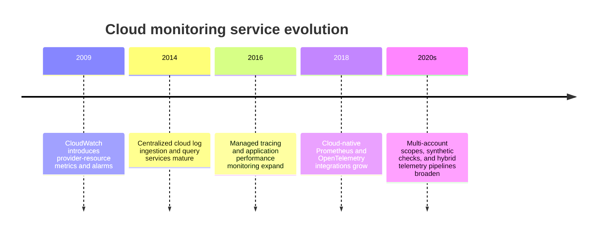
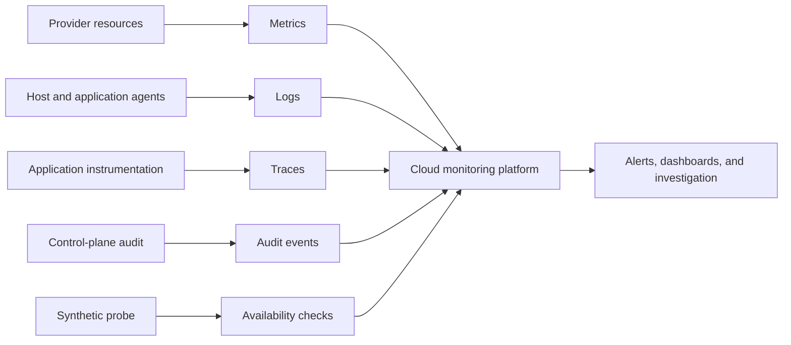
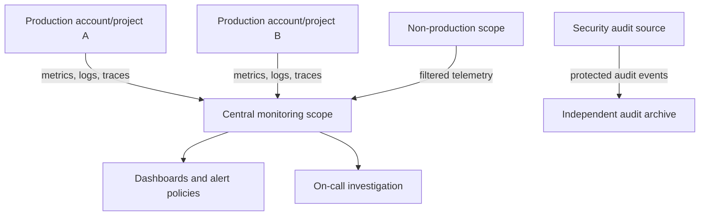
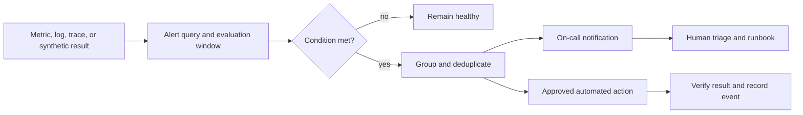
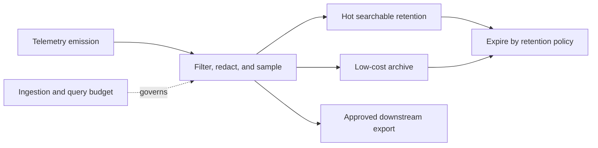
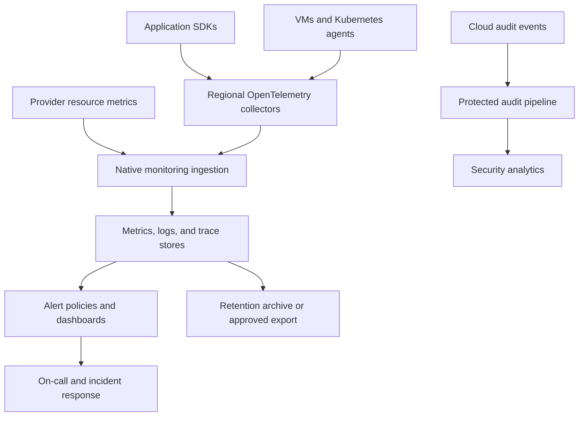

# Chapter: Cloud Monitoring Architecture

Part: [09 — Cloud Computing](PART_OVERVIEW.md) · Status: Drafted

## 1. Introduction

Cloud monitoring services collect, store, query, visualize, and alert on telemetry from provider resources and applications. They bridge workload instrumentation and operational response, but service boundaries differ: metrics, logs, traces, audit events, synthetic checks, and dashboards may use separate ingestion paths, stores, retention policies, and billing dimensions.

This chapter focuses on cloud monitoring platforms and their architecture: collection agents, telemetry routing, account/project/workspace scopes, alerting, synthetic monitoring, retention, cost controls, and hybrid integrations. Part 02 Metrics owns generic instrumentation architecture; Part 07 Non-Functional Requirements owns service-level indicator (SLI), service-level objective (SLO), service-level agreement (SLA), and error-budget foundations. Part 14 Observability owns cross-cutting operational practice. Here the emphasis is provider-specific monitoring services and data boundaries.

## 2. Historical Evolution

Cloud platforms began by exposing basic infrastructure metrics and service health. Providers added centralized log services, alerting, dashboards, distributed tracing, application performance monitoring, synthetic probes, and managed open-source integrations. The monitoring surface expanded from “is the VM running?” to correlating application, infrastructure, deployment, and dependency signals across accounts and regions.

Monitoring products increasingly support common instrumentation standards, but storage models, metric dimensions, query languages, retention defaults, and costs remain provider-specific. Architecture must account for both portability and service-native telemetry.

## 3. Why It Exists

Cloud resources emit telemetry across separate services and administrative scopes. A team needs to distinguish workload symptoms from provider-resource conditions, investigate failures, identify deployment regressions, and receive actionable alerts. A collection service alone does not provide operational visibility; data needs ownership, context, retention, access control, and a response path.

Cloud monitoring also creates a data platform of its own. High-volume logs, metric cardinality, traces, and long retention can create substantial cost and privacy exposure. Centralizing telemetry improves cross-workload analysis but can enlarge the blast radius of access and configuration mistakes.

## 4. Core Concepts

### 4.1 Monitoring data types and service boundaries

**Definition.** Cloud monitoring platforms ingest signals from provider resources and applications. Metrics are numeric time series; logs are timestamped event records; traces connect spans from a transaction across services; audit events describe administrative or access actions; synthetic checks actively probe a user-visible path. Provider services may combine these data types in one product experience while storing and querying them separately.

**Mechanism.** A provider emits platform metrics automatically; agents or software development kits (SDKs) collect host and application signals; exporters send standards-based telemetry; audit systems record control-plane activity; and probes generate synthetic results. Labels and resource metadata associate observations with projects, accounts, regions, services, versions, or tenants. Correlation requires consistent identity and deployment context across the signal sources.

**Decision implications.** Decide which signals are required to detect, diagnose, audit, and recover each workload. Provider-native telemetry reduces setup for provider resources; OpenTelemetry can improve application signal portability. Neither alone guarantees a complete view if resource labels, trace context, or deployment metadata are inconsistent.

**Common failure mode.** A team has dashboards and logs but cannot correlate a spike with the deployment or identify which workload owns the resource. Another failure is using audit logs as a substitute for application telemetry; audit events record control actions, not user-visible behavior.

**Scenario.** A latency alert fires after a release. A trace identifies a slow dependency, a metric shows connection saturation, logs identify repeated retries, and deployment metadata maps the change to a new image digest. The team can distinguish a release regression from a provider-resource incident.

### 4.2 Provider-native metrics and resource dimensions

Provider metrics are often collected automatically for managed services and carry resource labels such as account, project, resource name, region, and service tier. Metric type, resolution, aggregation, dimensions, and retention differ by service. Application metrics require instrumentation or agent collection and should align with workload health rather than merely mirror infrastructure counters.

Use a small set of stable labels: service, environment, region, version, and bounded business dimensions. Avoid identifiers that create a new time series per user, request, or object unless the diagnostic value justifies it. Metric cardinality affects query performance, retention, and cost.

### 4.3 Application telemetry and OpenTelemetry

OpenTelemetry (OTel) provides vendor-neutral application instrumentation and collection for traces, metrics, and logs. Applications can emit through software development kits (SDKs) to an OpenTelemetry Protocol (OTLP) endpoint or collector, which enriches, batches, samples, filters, and exports telemetry. Provider agents can also collect host metrics and logs. Provider-native services can ingest OpenTelemetry while adding service-specific labels and alert integrations.

**Decision implications.** Use OpenTelemetry when portability, consistent context propagation, or multiple backends matter. Use provider-native instrumentation when it materially simplifies managed-service visibility. A collector becomes a production dependency: size it, secure it, monitor its own queues, and decide whether it buffers or drops telemetry during outages.

**Common failure mode.** The collector is treated as infallible, and its own queue saturation silently drops telemetry during the incident when that telemetry is most valuable. Another failure is propagating trace context across only some service boundaries, producing disconnected traces.

### 4.4 Central monitoring scopes across accounts and projects

Cloud platforms provide ways to view telemetry across multiple accounts, subscriptions, or projects. AWS CloudWatch cross-account observability, Azure Monitor workspaces and data collection rules, and Google Cloud Monitoring metrics scopes use different models for source onboarding, workspace ownership, querying, and access control.

**Decision implications.** Centralize views when operators need cross-workload correlation, but preserve source ownership and separate security audit archives. Define who can read raw logs, change alerts, configure ingestion, and administer the central scope. Consider network, residency, and cross-account export costs.

**Common failure mode.** A central workspace provides broad read access to sensitive application logs, or a monitoring-account outage removes both operational dashboards and the only audit copy. Centralization should not collapse all access and retention boundaries.

### 4.5 Logs, traces, and telemetry routing

Log services organize records into provider-specific groups, tables, buckets, or workspaces and provide query languages. Trace systems store spans and dependency relationships, often with sampling. Routing rules can filter, redact, enrich, or export data to a security information and event management (SIEM) system, data lake, or another provider. The route is part of the data-governance architecture.

Classify fields before ingestion. Remove credentials, personal data, and secrets at source where possible; apply redaction before cross-boundary export; and retain security audit events under stricter controls than debug logs. Query-language differences affect operational portability, so keep high-value alerts understandable and documented.

### 4.6 Alert policies, notifications, and action

An alert policy evaluates signals against conditions and routes incidents to responders or automation. Thresholds can be static, dynamic, anomaly based, or query-derived. The policy needs a meaningful window, evaluation frequency, missing-data behavior, grouping, deduplication, notification target, and response owner. Alert thresholds are not service-level objectives by themselves; generic SLI/SLO mechanics are owned by Part 07.

Prefer symptom-based alerts that indicate user or business impact. Keep paging policies limited to conditions requiring timely action, route lower-priority signals to tickets or dashboards, and test notifications and runbooks. Automated actions should be idempotent, bounded, and observable.

### 4.7 Synthetic monitoring and external perspective

Synthetic checks actively test endpoints, protocols, or workflows from configured locations. They can detect DNS, certificate, routing, and availability problems before real users report them. They do not replace real-user telemetry: probes may not match client geography, authentication state, or application behavior.

Select probe locations and frequency from user distribution and response objectives. Protect synthetic credentials, avoid destructive test actions, and monitor the probe service itself. Use multi-step checks for critical journeys, but keep the execution path safe and deterministic.

### 4.8 Retention, cardinality, and cost governance

Monitoring data cost depends on ingestion volume, metric time-series cardinality, trace sampling, query scans, retention, export, and alert evaluation. Hot searchable data and long-term archive have different cost and latency. Provider pricing units differ, so estimate from actual data profiles and validate with billing reports.

Set retention by data class and diagnostic value. Sample high-volume traces while preserving error and tail-latency evidence; use metric labels with bounded cardinality; and exclude low-value debug logs from long-term retention. Monitor ingestion and query cost as first-class operational signals.

### 4.9 Access, residency, and audit boundaries

Monitoring data can reveal user behavior, credentials, infrastructure topology, and incident details. Apply read and query permissions by role, restrict dashboard sharing, audit policy changes, and separate security logs from application operators where required. Provider workspaces and metrics scopes may have geographic and access-control boundaries of their own.

Confirm where telemetry is stored and processed, who can export it, how long it is retained, and what deletion obligations apply. A centralized system can be a cross-region data transfer path; treat it as part of privacy and residency review.

### 4.10 Cloud monitoring service selection

Select a provider monitoring service by source coverage, query model, retention, cross-account visibility, hybrid collection, alert routing, access controls, and cost. Use native features for provider resources while standardizing application instrumentation where portability matters. Avoid a “single pane” goal that requires copying every signal into multiple costly stores without a clear operational need.

Record service ownership, workspace/project scope, required agents, collector dependencies, retention policies, alert owners, and export destinations. Ensure the monitoring platform can still provide enough information during the failure it is intended to diagnose.

## 5. Internal Working

A cloud monitoring pipeline starts at signal production. Provider services emit metrics and audit events; agents or SDKs collect workload data; collectors batch and enrich it; ingestion endpoints validate identity, schema, and quota; storage partitions the data; and query/alert systems evaluate it for dashboards or incidents. Export rules may send subsets to external systems.

Each stage can fail independently. An application may continue serving while telemetry collection is impaired; ingestion may accept data but delay indexing; a dashboard may fail even though raw records exist. Monitor collector health, ingestion errors, dropped samples, query latency, and alert delivery as part of the monitoring service itself.

## 6. Design Principles

- Define telemetry from operational questions, not from product availability.
- Correlate signals with stable workload, region, version, and ownership metadata.
- Use provider-native metrics for managed resources and portable instrumentation where useful.
- Protect collectors and alert paths as production dependencies.
- Separate operational logs from protected security audit records.
- Bound metric cardinality and control log/trace ingestion cost.
- Make alert ownership, notification, and runbook explicit.
- Test synthetic monitors and alert delivery end to end.
- Review residency, retention, export, and data access for telemetry.

## 7. Architecture Patterns

**Central monitoring project/account.** A platform team owns dashboards and cross-scope alerting, while source scopes retain telemetry ownership and access boundaries.

**OpenTelemetry collector tier.** Workloads export to regional collectors that enrich, filter, sample, and route data to provider-native or third-party backends.

**Protected audit archive.** Security events flow to an independently administered destination with retention and access controls separate from application log workspaces.

**Hybrid monitoring.** Cloud and on-premises agents feed a central observability path, with buffering and local monitoring for sites that may lose connectivity.

## 8. Production Architecture

Production design should include collector scaling, private endpoints or egress paths, credential scope, ingestion quotas, redaction, retention, backup/export, alert fallback, and a named owner for each data path.

## 9. Implementation

1. List critical workloads, operational questions, audit needs, and responder roles.
2. Inventory provider metrics, logs, traces, audit events, and existing agents.
3. Define project/account/workspace scopes and access boundaries.
4. Standardize resource labels and application context propagation.
5. Deploy collectors or agents with least-privilege identities and health telemetry.
6. Set ingestion filters, redaction, sampling, retention, and export policies.
7. Create actionable alerts with owners, notification routes, and runbooks.
8. Test outage visibility, alert delivery, data access, residency, and cost controls.

## 10. Complete Code Examples

- [Telemetry ingestion cost estimator](../code/python/monitoring-chapter/01_ingestion_cost.py)
- [Alert policy noise and actionability checker](../code/python/monitoring-chapter/02_alert_quality.py)
- [Metrics-cardinality budget analyzer](../code/python/monitoring-chapter/03_cardinality_budget.py)
- [Cross-scope monitoring coverage checker](../code/python/monitoring-chapter/04_scope_coverage.py)

The examples use synthetic telemetry and Python's standard library. They do not call provider APIs or represent current monitoring prices.

## 11. Performance

Monitoring performance includes collection overhead, ingestion delay, query latency, alert evaluation delay, and notification delivery. High-cardinality metrics, broad log scans, oversized traces, and collector backpressure can degrade the monitoring path. Measure telemetry freshness and dropped data, not only dashboard load time.

Use regional collectors near workloads when network and resilience requirements favor it. Batch and compress appropriately, set bounded queues, and choose sampling before exporting large trace volumes. Keep critical alerts independent of an overloaded analytics query where the provider supports direct service alarms.

## 12. Scalability

Telemetry scales with workload count, request rate, labels, log size, trace sampling, and retention. More workloads create more resource identities and alert policies; more labels can multiply time series. Multi-account and multi-project aggregation adds authorization, query, and quota boundaries.

Set budgets for ingestion and cardinality, use sampling and filtering, and monitor collector utilization. Test peak event volume during failures, since error logs and traces often rise exactly when systems are degraded. Plan separate hot and archive paths for data with different access patterns.

## 13. Security

Telemetry may contain personal data, credentials, payload fragments, topology, and security events. Redact sensitive fields before ingestion where possible, restrict query and export access, encrypt data, and prevent untrusted workloads from writing misleading audit records. Give agents only the permissions required to publish signals.

Treat observability exports as data transfers across provider and regional boundaries. Preserve immutable or separately administered audit evidence where required. General security and cryptographic mechanics remain with the Security and Secrets Management chapters.

## 14. Observability of the monitoring platform

Monitor collectors, agent health, ingestion error rate, queue depth, dropped telemetry, indexing delay, query failures, alert evaluation, and notification delivery. Use independent health checks for critical monitoring endpoints. A platform that silently loses telemetry can create a false impression that the workload is healthy.

Test the full path: emit a known signal, ingest it, query it, trigger a test alert, notify the expected responder, and verify the audit record. Maintain a fallback contact path for monitoring-provider outages.

## 15. Failure Scenarios

| Failure | Likely symptom | Architectural response |
|---|---|---|
| Collector unavailable | Missing application or host signals | Use redundant collectors, bounded local buffering, and agent-health alerts |
| Ingestion quota exceeded | Telemetry drops or delays | Apply filtering/sampling, request quota, and preserve high-value signals |
| Cardinality explosion | Query cost and latency increase | Identify unbounded labels and remove or aggregate them |
| Alert route broken | Conditions fire without responder notification | Test notification channels and maintain a fallback route |
| Central scope access failure | Operators cannot see cross-project data | Preserve source-local access and a documented break-glass path |
| Region outage | Dashboards or telemetry export unavailable | Keep regional health signals and recovery routing independent where required |
| Sensitive data ingested | Logs expose secrets or personal data | Restrict access, redact/delete under policy, and investigate source emission |
| Retention misconfiguration | Evidence expires too early or cost grows | Restore policy, assess recoverability, and review retention ownership |

Distinguish a telemetry outage from a workload outage. Missing metrics are not zero load; alert systems should detect stale or absent data for critical signals.

## 16. Testing

Test agent installation, identity, data collection rules, labels, redaction, and collector failover. Generate synthetic load to validate ingestion quotas, query behavior, cardinality controls, and retention. Validate alerts with test conditions and confirm actual notification delivery and on-call ownership.

Run data-access tests for operators, developers, and security responders. Verify audit logs are retained independently and cannot be deleted by ordinary workload administrators. Simulate a monitoring backend outage and confirm the application can continue while responders retain a fallback signal.

## 17. Common Mistakes

- Enabling every metric and log source without an operational question or cost budget.
- Using high-cardinality labels such as user IDs or request IDs as metric dimensions.
- Treating absence of telemetry as evidence of health.
- Routing security audit records into a broadly accessible application workspace.
- Building alerts without an owner, response action, or tested notification path.
- Duplicating all telemetry across multiple providers without a use case.
- Assuming an agent or collector cannot affect workload performance.
- Keeping data longer than needed or shorter than audit/recovery requirements.

## 18. Best Practices

- Standardize resource labels and trace context across services.
- Use OpenTelemetry for portable application instrumentation where appropriate.
- Keep audit, application, and debug telemetry under distinct access and retention rules.
- Bound labels, ingestion volume, sampling, and query scans.
- Alert on user-impacting symptoms and stale critical telemetry.
- Monitor collector queues and notification delivery.
- Test runbooks and alert routes during game days.
- Review workspace/project access and export destinations regularly.

## 19. Anti-Patterns

**Dashboard as an observability strategy.** Dashboards without alert ownership, runbooks, and investigation context do not create operational response.

**Alert on every threshold.** Noisy alerts train responders to ignore signals. Page only when timely action is required; route the rest to lower-priority channels.

**One giant telemetry bucket.** Combining all data and permissions simplifies initial setup but can violate access boundaries, residency, retention, and cost objectives.

**Unbounded telemetry labels.** Unique dimensions multiply time series and can make costs or query behavior unpredictable.

## 20. Trade-off Analysis

| Decision | Benefits | Costs and risks | Choose when |
|---|---|---|---|
| Provider-native collection | Fast onboarding and resource context | Provider-specific configuration and queries | Most workloads use one provider and native signals matter |
| OpenTelemetry collectors | Portable instrumentation and routing | Collector operations and backend mapping | Multiple backends or portability justify the layer |
| Central workspace | Cross-workload investigation | Larger access, residency, and blast-radius scope | Central operators need shared visibility |
| Local workspace per workload | Stronger ownership and isolation | Harder global correlation | Regulatory or team boundaries dominate |
| Long hot retention | Fast investigations over history | Higher storage and query cost | Audit or operational use justifies it |
| Trace sampling | Lower ingestion and cost | Some events are not retained | High traffic requires sampling with tail/error preservation |

## 21. Comparison Table

| Dimension | AWS CloudWatch | Azure Monitor | Google Cloud Monitoring |
|---|---|---|---|
| Resource metrics | Native service metrics and custom metrics | Azure resource metrics and custom metrics | Google Cloud service metrics and user-defined metrics |
| Logs | CloudWatch Logs | Log Analytics workspaces | Cloud Logging |
| Traces/Application Performance Monitoring (APM) | Application Signals and X-Ray integrations | Application Insights and Azure Monitor | Cloud Trace and service integrations |
| Cross-scope visibility | Cross-account observability | Workspaces and cross-subscription views | Metrics scopes across projects/accounts |
| Query options | Metrics math and Logs Insights | Kusto Query Language (KQL), PromQL | Monitoring filters, Prometheus Query Language (PromQL) |
| Hybrid collection | CloudWatch agent and OpenTelemetry | Azure Monitor Agent and OpenTelemetry | Ops Agent and OpenTelemetry/Prometheus integrations |

Product features and retention pricing change frequently. Validate current data scope, query language, and service limits for the regions and account structure in use.

## 22. Real-World Case Study

### Central monitoring across cloud accounts

AWS's [CloudWatch cross-account observability documentation](https://docs.aws.amazon.com/AmazonCloudWatch/latest/monitoring/CloudWatch-Cross-Account-Methods.html) describes linking source accounts to a central monitoring account so operators can view metrics, logs, and traces across account boundaries. This is a documented provider pattern rather than a named customer deployment.

The central account can support shared dashboards, alarms, and investigation while source accounts remain separate workload and billing boundaries. The pattern makes central access and data selection explicit: operators need sufficient read permissions, source accounts must opt in, and telemetry exports or links create security and cost implications.

The architecture is appropriate when a platform or operations team owns cross-workload response. It should not replace source-local access or independent audit retention. A production implementation needs least-privilege links, data classification, regional review, source onboarding automation, and a tested fallback if the central account is unavailable.

## 23. Interview Questions

1. How do metrics, logs, traces, audit events, and synthetic checks differ?
2. When should application telemetry use OpenTelemetry versus provider-native instrumentation?
3. What risks arise from centralizing monitoring across accounts or projects?
4. How does metric cardinality affect cost and query behavior?
5. How do you distinguish no traffic from missing telemetry?
6. What makes an alert actionable and owned?
7. What access and retention controls apply to audit logs?
8. How do you verify that an alert reaches the expected responder?

## 24. Hands-on Exercises

1. Run the ingestion estimator and compare high-volume logs with sampled traces.
2. Run the alert-quality checker with a noisy threshold and revise its actionability fields.
3. Run the cardinality analyzer with request IDs and remove unbounded metric labels.
4. Run the scope-coverage checker with a project missing audit or application telemetry.

## 25. Design Exercises

1. Design monitoring for a multi-account service with separate application, platform, and security teams.
2. Design a hybrid telemetry pipeline that buffers during on-premises network loss and redacts sensitive fields.
3. Design alerts for an application programming interface (API) with an availability objective, a latency objective, and a multi-region dependency.
4. Compare native CloudWatch/Azure Monitor/Google Cloud Monitoring with an OpenTelemetry collector and external backend.

## 26. Architecture Review Questions

- Are every critical workload and its owner represented in telemetry scope?
- Can metrics, logs, traces, and deployments be correlated by stable resource and version labels?
- Are ingestion, retention, query, and export costs measured and bounded?
- Are sensitive logs and audit records separated by access and retention requirements?
- Does every paging alert have an owner, action, and tested notification route?
- Can responders access source-local signals if a central monitoring scope fails?
- Are collector health, data freshness, and dropped telemetry monitored?
- Are residency and cross-provider transfers reviewed for all telemetry paths?

## 27. Summary

Cloud monitoring architecture connects provider metrics, application logs and traces, audit events, synthetic checks, alert policies, and responders. Choose central or local scopes deliberately, bound telemetry cardinality and retention cost, protect sensitive records, and monitor the monitoring pipeline itself. Provider-native tooling offers deep resource integration; portable instrumentation can reduce application coupling, but both require clear ownership and actionable response.

Further reading: [AWS Architecture](CH01_AWS.md), [Microsoft Azure Architecture](CH02_Azure.md), [Google Cloud Platform Architecture](CH03_GCP.md), [Metrics](../02_Design_Thinking_and_Product_Management/CH24_Metrics.md), and [Non-Functional Requirements](../07_System_Design_and_Distributed_Systems/CH02_Non_Functional_Requirements.md).
