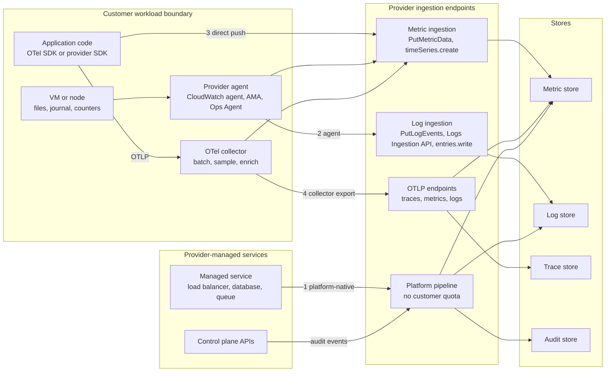
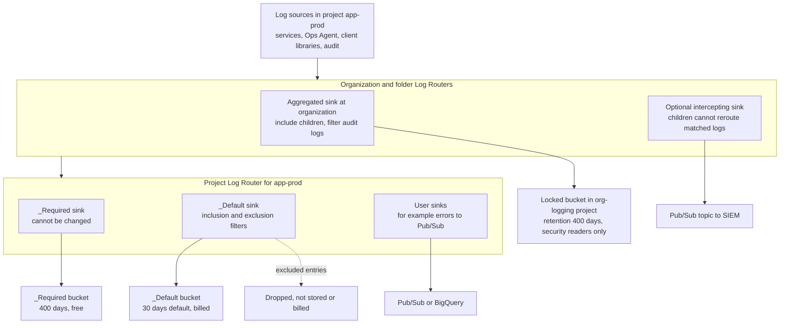
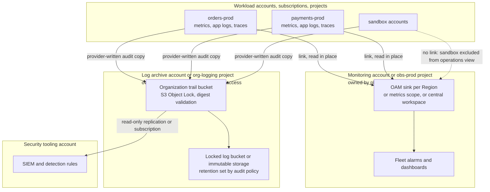
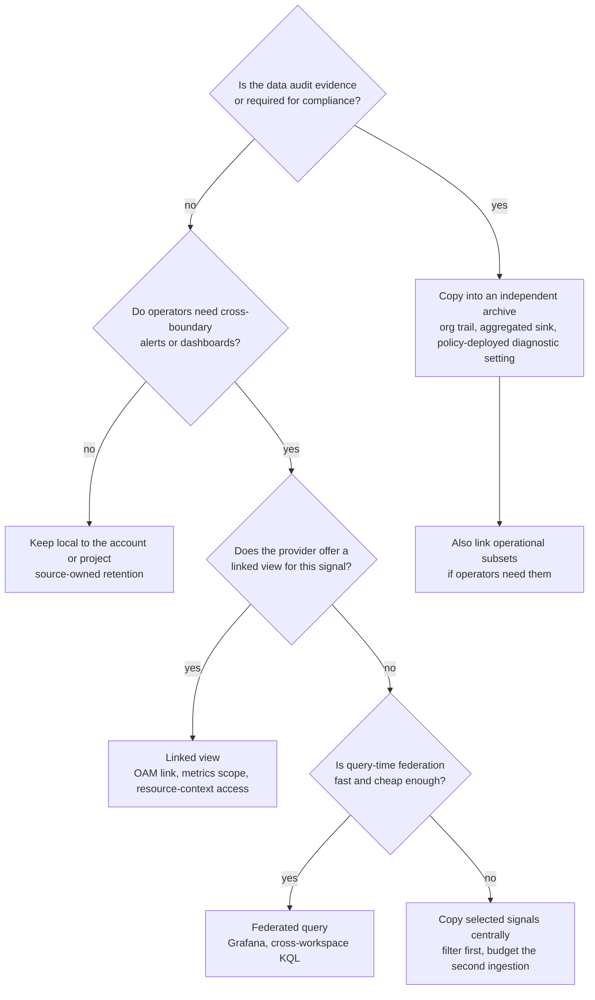
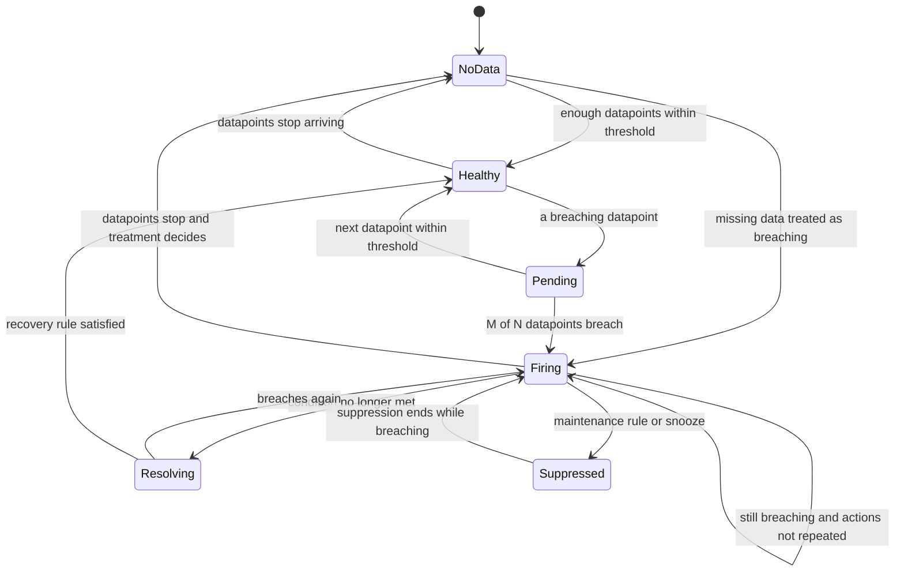
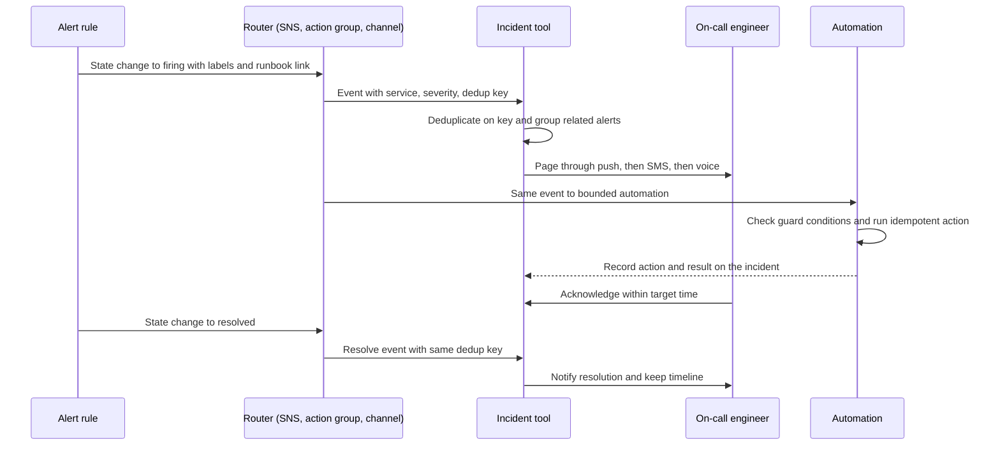
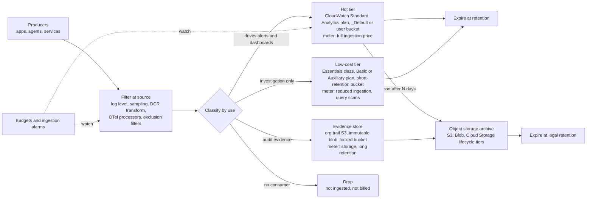
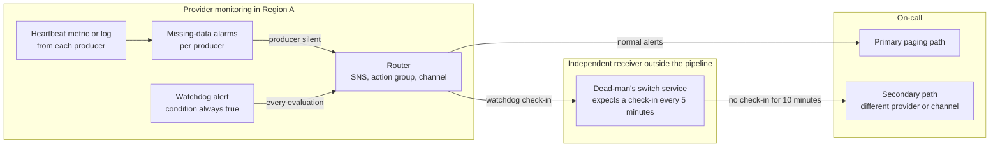
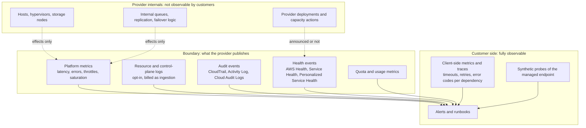

# Chapter: Cloud Monitoring Services on AWS, Azure, and Google Cloud

Part: [09 — Cloud Computing](PART_OVERVIEW.md) · Status: Revised (in-depth rewrite)

## 1. Introduction

Every cloud provider ships a monitoring service, and each one looks complete in a product demonstration: charts appear, logs scroll, and an alert arrives on a phone. The architectural work starts when you ask harder questions. Which signals arrive without any configuration, and which ones never arrive until someone installs an agent or writes code? How long after a failure does the alert actually fire? Who can read a production log that contains a customer's address? What happens to telemetry when the account that produced it is compromised? What does it cost when the error rate spikes and every service logs a stack trace per request? Amazon Web Services (AWS), Microsoft Azure, and Google Cloud answer these questions differently, and similar product names hide real differences in scope, retention, evaluation semantics, and price.

This chapter teaches the provider monitoring services as systems with internal mechanics. After working through it you should be able to:

- Trace each signal (metric, log, trace, audit event, health event) from the resource or application that produces it to the store that holds it, and name the ingestion path, identity, quota, and failure behavior at each hop.
- Configure the core services correctly: Amazon CloudWatch metrics, logs, alarms, and cross-account observability; AWS CloudTrail; Azure Monitor metrics, Log Analytics workspaces, diagnostic settings, Data Collection Rules (DCRs), and alert rules; Google Cloud Monitoring, Cloud Logging, and Cloud Audit Logs.
- Design a cross-account, cross-subscription, or cross-project monitoring topology that gives operators a central view while keeping audit evidence out of reach of the workloads it records.
- Predict alert detection delay from period, evaluation, datapoint, and ingestion-latency settings, and tune the trade-off between delay and false alarms with arithmetic.
- Estimate ingestion, retention, and cardinality cost, find the quotas that throttle telemetry during scale-out, and choose controls that keep spend bounded without losing the signals you need during an incident.
- Detect loss of telemetry itself, using heartbeats, dead-man's switches, and missing-data alarms, and state precisely what you can and cannot see of a provider-managed control plane.

### 1.1 Scope and ownership boundaries

This chapter owns provider monitoring services and their operating boundaries. It owns five cross-cutting concepts in the handbook's concept registry: provider monitoring scopes across accounts, subscriptions, and projects; cloud telemetry collection, routing, retention, and cost controls; cloud-native alert-policy evaluation and notification integration; monitoring-pipeline self-observability and telemetry-loss detection; and cross-account monitoring with protected audit-data separation. Neighboring material is recapped and linked:

- **Generic observability theory** belongs to Part 14. What a log, metric, or trace is in the abstract, how to design structured logs, how to choose Service Level Indicators (SLIs) and Service Level Objectives (SLOs), and how burn-rate alerting works are taught in [Logs](../14_Observability/CH01_Logs.md), [Metrics](../14_Observability/CH02_Metrics.md), [Tracing](../14_Observability/CH03_Tracing.md), [Alerting](../14_Observability/CH10_Alerting.md), [SLO](../14_Observability/CH11_SLO.md), [SLI](../14_Observability/CH12_SLI.md), and [Error Budgets](../14_Observability/CH13_Error_Budgets.md). The Service Level Agreement (SLA), SLO, and SLI vocabulary itself is owned by [Non-Functional Requirements](../07_System_Design_and_Distributed_Systems/CH02_Non_Functional_Requirements.md).
- **OpenTelemetry (OTel)** as a specification, its Software Development Kits (SDKs), the OpenTelemetry Protocol (OTLP), and collector pipeline design belong to [OpenTelemetry](../14_Observability/CH04_OpenTelemetry.md). Prometheus and Grafana as open-source systems belong to [Prometheus](../14_Observability/CH05_Prometheus.md) and [Grafana](../14_Observability/CH06_Grafana.md). This chapter covers what each provider's managed offering adds or changes.
- **Kubernetes telemetry** (kube-state-metrics, cAdvisor, Pod log collection, cluster dashboards) belongs to [Kubernetes Observability](../12_Kubernetes/CH14_Observability.md). The managed-cluster control-plane signals are in [Kubernetes (cloud-managed)](CH08_Kubernetes.md#16-observability-and-operations).
- **Security audit policy** (what must be audited, for how long, and who reviews it) belongs to Part 15, starting with [Authorization](../15_Security/CH03_Authorization.md), and to [Cloud Security, Governance, and Compliance Architecture](../10_Cloud_Architecture/CH12_Cloud_Security_Governance_and_Compliance_Architecture.md). This chapter covers how provider audit services capture and protect the evidence.
- **Provider health channels** are introduced in the provider chapters: [AWS Health](CH01_AWS.md#152-aws-health), [Azure Service Health and Resource Health](CH02_Azure.md#142-service-health-and-resource-health), and [Cloud Audit Logs as governance evidence](CH03_GCP.md#171-audit-logs-as-governance-evidence). This chapter integrates them into alerting.
- **Product telemetry** (event schemas for business analytics) belongs to [Metrics](../02_Design_Thinking_and_Product_Management/CH24_Metrics.md) in Part 02. **Billing allocation** of monitoring spend belongs to [Cost Optimization](CH14_Cost_Optimization.md), and the logging accounts of a landing zone belong to [Landing Zones](CH15_Landing_Zones.md).

### 1.2 How to read provider facts in this chapter

Monitoring services change quickly. During the writing of this chapter AWS closed CloudTrail Lake to new customers, put the X-Ray SDKs into maintenance mode, and renamed a CloudWatch Logs log class; Google announced a start date for alerting charges; and Azure removed retention settings from diagnostic settings. Every quota, default, and price below was checked against official documentation at the time of writing and is marked where it drifts. Treat numbers as inputs to worked examples, not as constants: verify current quotas and prices before designing to them.

## 2. The provider monitoring model

### 2.1 Signal families and where each provider stores them

Provider monitoring services handle five families of signal. They differ in shape, volume, and who produces them, and every provider stores them in different back ends with different retention, query languages, and prices. A design that treats "monitoring" as one bucket ends up with the wrong retention for audit data and the wrong price for debug logs.

- **Metrics** are numeric samples attached to a name and a set of labels (dimensions), aggregated into time series. They are cheap per sample, fast to query, and the normal input to alerts. Their cost driver is the number of distinct time series, called cardinality.
- **Logs** are timestamped records, structured or not. They carry detail that metrics cannot, and they are expensive per byte. Their cost driver is ingestion volume and retention.
- **Traces** are trees of spans that follow one request across services. They are high volume and usually sampled. Their cost driver is span count.
- **Audit events** record who did what to which resource through the provider's management interfaces, and sometimes data access. They are evidence, so their requirements are integrity, completeness, and long retention rather than query speed.
- **Health events** are the provider telling you about its own problems or planned work: an AWS Health event, an Azure Service Health incident, a Google Cloud Personalized Service Health event. They are low volume and often the first explanation of a symptom.

| Signal | AWS | Azure | Google Cloud |
|---|---|---|---|
| Metrics | CloudWatch metrics (namespaces, dimensions); Amazon Managed Service for Prometheus | Azure Monitor Metrics (platform and custom); Azure Monitor workspace for Prometheus | Cloud Monitoring time series; Google Cloud Managed Service for Prometheus (same store) |
| Logs | CloudWatch Logs log groups | Log Analytics workspace tables | Cloud Logging log buckets |
| Traces | AWS X-Ray, CloudWatch Application Signals | Application Insights (stored in Log Analytics tables) | Cloud Trace |
| Audit | AWS CloudTrail | Activity Log (control plane), resource logs, Microsoft Entra audit logs | Cloud Audit Logs (Admin Activity, Data Access, System Event, Policy Denied) |
| Provider health | AWS Health | Service Health, Resource Health | Personalized Service Health |
| Query language | Metric math, Metrics Insights (Structured Query Language (SQL)-like), Logs Insights query language, OpenSearch Piped Processing Language (PPL) and SQL | Kusto Query Language (KQL), Prometheus Query Language (PromQL) | Monitoring filters, PromQL, Logging query language, SQL in Log Analytics |

Two structural differences matter from the start. On Azure, logs, traces, and many audit records all land in the same Log Analytics workspace as tables, so one access model and one query language (KQL) cover them; on AWS and Google Cloud they live in separate services with separate access policies. On Google Cloud, Managed Service for Prometheus writes into the same time-series database as Cloud Monitoring, so a Prometheus metric and a Compute Engine metric can be queried and alerted on together; on AWS, Amazon Managed Service for Prometheus is a separate store from CloudWatch metrics, and on Azure the Azure Monitor workspace is a separate store from Azure Monitor Metrics.

### 2.2 Four ingestion paths

A signal reaches a provider store by one of four paths. Each path has a different producer, identity, failure mode, and set of quotas, and most real workloads use all four at once.

1. **Platform-native emission.** The provider's own service emits the signal with no customer code. Amazon Elastic Compute Cloud (EC2) publishes central processing unit (CPU) utilization to the `AWS/EC2` namespace; Azure resources publish platform metrics to Azure Monitor Metrics; Google Cloud services write metrics such as `compute.googleapis.com/instance/cpu/utilization` and Admin Activity audit logs. You pay little or nothing, you cannot change the sampling rate, and you cannot see inside the emitter. Some platform-native signals are opt-in: Azure resource logs need a diagnostic setting, Amazon Elastic Kubernetes Service (EKS) control-plane logs need to be enabled per log type, and Google Cloud Data Access audit logs are off by default for most services.
2. **Agent collection.** A process on the host reads local sources (files, the system journal, Windows event logs, a Prometheus endpoint, operating-system counters) and ships them. The provider agents are the Amazon CloudWatch agent, the Azure Monitor Agent (AMA), and the Google Cloud Ops Agent. Agents run with a machine identity (an EC2 instance profile, an Azure managed identity, a Compute Engine service account), buffer locally, and fail independently of the workload: a full disk, an expired credential, or a bad configuration file stops collection while the application keeps serving.
3. **Direct Application Programming Interface (API) push.** Application code or a script calls an ingestion API: CloudWatch `PutMetricData` and `PutLogEvents`, the Azure Monitor Logs Ingestion API through a DCR, or the Cloud Monitoring `timeSeries.create` and Cloud Logging `entries.write` methods. Push is simple and fine-grained, but every call consumes an API quota in the caller's account and Region, and the application now holds a dependency on the monitoring endpoint.
4. **OpenTelemetry collector.** Applications emit OTLP to a collector (the AWS Distro for OpenTelemetry (ADOT) collector, the Azure Monitor OpenTelemetry Distro and exporters, the Google-built OpenTelemetry Collector, or upstream OpenTelemetry Collector Contrib) that batches, samples, enriches, and exports to one or more back ends. All three providers now accept OTLP directly at managed endpoints for at least some signals: Google Cloud's Telemetry API accepts OTLP traces and metrics, and AWS documents OTLP endpoints for CloudWatch and X-Ray. The collector decouples instrumentation from back end, at the price of running another production service.



The diagram shows why an outage of one path does not look like an outage of the others. Platform-native signals (path 1) flow through the provider's internal pipeline, which consumes no customer API quota and keeps working when your agents fail. Agent, push, and collector paths cross the workload boundary through public or private ingestion endpoints, so they share failure causes with the workload: network egress, Domain Name System (DNS) resolution, credentials, and Region health. The audit store receives only platform-emitted records, which is a property you want: a workload cannot forge a CloudTrail or Admin Activity record, only its own application logs.

The practical consequence is that an alerting design should include at least one signal from the platform-native path for every critical symptom. If a load balancer's 5xx count comes from the platform and the application's error log comes from an agent, then a broken agent makes the log go quiet while the platform metric still shows the errors. Section 11 builds on this to detect telemetry loss.

### 2.3 What each path guarantees

| Property | Platform-native | Agent | Direct push | OTel collector |
|---|---|---|---|---|
| Who configures | Provider; sometimes opt-in per resource | Platform team, per host or node pool | Application team, in code | Platform team, per cluster or Region |
| Identity used | Provider internal | Host identity | Workload identity | Collector identity |
| Customer quota consumed | No (but storage is billed for opt-in logs) | Yes, ingestion API quota | Yes, per call | Yes, ingestion API quota |
| Buffering on failure | Provider-managed | Local disk or memory, bounded | None unless coded | Memory or persistent queue, bounded |
| Typical latency to queryable | Minutes for many platform metrics | Seconds to minutes | Seconds | Batch interval plus export |
| Portability | None | Low | Low | High |
| Failure that silences it | Provider incident | Agent crash, credential, disk | Throttling, code path | Collector overload, export errors |

Read the "buffering on failure" row carefully. An OTel collector with a memory queue loses its queue when the Pod restarts, and a collector with a persistent queue needs a volume. The CloudWatch agent and AMA buffer to local disk for bounded periods. A direct `PutMetricData` call that is throttled returns an error that application code often ignores, so the datapoint is simply gone.

### 2.4 Data ownership

Monitoring data has several owners, and confusing them causes most governance failures. A useful split:

| Data | Producer | Owner of content and quality | Owner of storage, access, retention |
|---|---|---|---|
| Platform metrics | Provider | Provider | Account, subscription, or project owner |
| Application logs, metrics, traces | Application team | Application team (schema, labels, redaction) | Platform or observability team |
| Agent and collector configuration | Platform team | Platform team | Platform team |
| Audit events | Provider | Provider | Security team, in an account the workload cannot administer |
| Alert rules and routes | Application team for service alerts, platform team for shared alerts | Same | Same, versioned in code |
| Health events | Provider | Provider | Platform team routes them |

Three rules follow. First, the team that writes the log line owns what is in it, including personal data; a central platform cannot redact what it does not know is sensitive, although it can provide tools (Section 13). Second, the team that owns the store owns retention and access, and that team must be able to say who can read what. Third, audit evidence is owned by a party independent of the workload, which in practice means a separate account, subscription, or project (Section 6.5). Record these owners per data class in the same place you record service owners. The scope checker in [04_scope_coverage.py](../code/python/monitoring-chapter/04_scope_coverage.py) shows a minimal version of this: it flags any workload that lacks metrics, logs, audit coverage, or a named owner.

## 3. AWS: CloudWatch, X-Ray, CloudTrail, and managed open source

### 3.1 CloudWatch metrics: namespaces, dimensions, and resolution

A CloudWatch metric is identified by three things: a **namespace** (`AWS/ApplicationELB`, `AWS/Lambda`, or a custom one such as `Orders`), a **metric name** (`HTTPCode_Target_5XX_Count`), and a set of up to 30 **dimensions**, which are name-value pairs such as `LoadBalancer=app/orders/50dc6c495c0c9188`. CloudWatch treats every unique combination of namespace, name, and dimension set as a separate metric. Publishing `Latency` with `Service=orders` and with `Service=orders, Operation=PlaceOrder` creates two metrics, not one metric with an optional label. CloudWatch does not aggregate across dimension combinations for you unless you query with a `SEARCH` expression or Metrics Insights, and custom-metric billing counts each combination.

Datapoints carry a timestamp, a value or a statistic set (sum, count, minimum, maximum), a unit, and a **storage resolution**. Standard resolution stores one-minute granularity; high resolution stores one-second granularity and allows alarms with 10-second or 30-second periods. AWS services publish at their own cadence: EC2 basic monitoring publishes every five minutes, detailed monitoring every minute, and many managed services every minute.

CloudWatch keeps metric data on a fixed roll-up schedule ([CloudWatch concepts](https://docs.aws.amazon.com/AmazonCloudWatch/latest/monitoring/cloudwatch_concepts.html)):

| Datapoint period | Available for |
|---|---|
| Less than 60 seconds (high resolution) | 3 hours |
| 60 seconds | 15 days |
| 300 seconds | 63 days |
| 3,600 seconds | 455 days (15 months) |

Data published at one-second resolution is still there after three hours, but only as one-minute aggregates; after 15 days it is five-minute aggregates, and after 63 days one-hour aggregates. A metric that receives no new data for 15 months expires, and metrics cannot be deleted before then. Two design consequences follow. You cannot answer "what was the p99 latency per minute during last quarter's incident" from CloudWatch metrics alone after 15 days; if postmortems need that, export with a metric stream or keep the evidence in logs. And because the 15-month horizon is fixed, CloudWatch metrics are not a long-term capacity-planning archive.

**Metric math** evaluates expressions over one or more metrics at query time, for example an error rate:

```text
m1 = SUM of HTTPCode_Target_5XX_Count, period 60
m2 = SUM of RequestCount, period 60
e1 = IF(m2 > 0, 100 * m1 / m2, 0)
```

Alarms can evaluate `e1` directly, which avoids publishing a derived custom metric. **Metrics Insights** adds a SQL-like query (`SELECT AVG(CPUUtilization) FROM SCHEMA("AWS/EC2", InstanceId) GROUP BY InstanceId ORDER BY AVG() DESC LIMIT 10`) that can feed alarms across a fleet whose members change, which removes the need for one alarm per instance.

### 3.2 Embedded Metric Format

The **Embedded Metric Format (EMF)** lets an application write a structured JavaScript Object Notation (JSON) log event that CloudWatch Logs turns into metrics asynchronously. The application does not call `PutMetricData` at all; it writes to standard output (Lambda, Amazon Elastic Container Service (ECS), EKS) or to the CloudWatch agent, and the log ingestion pipeline extracts the metrics.

```json
{
  "_aws": {
    "Timestamp": 1767225600000,
    "CloudWatchMetrics": [{
      "Namespace": "Orders",
      "Dimensions": [["Service", "Operation"]],
      "Metrics": [{ "Name": "Latency", "Unit": "Milliseconds" }]
    }]
  },
  "Service": "orders-api",
  "Operation": "PlaceOrder",
  "Latency": 182,
  "RequestId": "7f3c2a9e-1b44-4d0e-9c1a-5e2d8b6f0a11",
  "CustomerTier": "gold"
}
```

The event produces one metric, `Orders/Latency` with dimensions `Service` and `Operation`. `RequestId` and `CustomerTier` are ordinary log fields: searchable with Logs Insights, linked to the metric by time, and free of metric cardinality cost. This split is the main reason to choose EMF: high-cardinality context stays in the log, bounded dimensions become metrics, and the hot path does a local write instead of a network call. The cost is that you pay for log ingestion of every EMF event plus custom metrics for each dimension combination, and metric extraction depends on the log group being in the Standard log class (Section 3.3). EMF also moves the quota from `PutMetricData` to log ingestion, which Section 10 uses in a scale-out scenario.

### 3.3 CloudWatch Logs: log groups, classes, retention, and queries

CloudWatch Logs stores events in **log streams** (one per source, such as a Lambda execution environment or a container) inside **log groups** (one per application component, such as `/aws/lambda/orders-api`). Retention, encryption with an AWS Key Management Service (KMS) key, log class, data protection policy, metric filters, and subscription filters are all configured on the log group. Access control is by Identity and Access Management (IAM) policy on log-group Amazon Resource Names (ARNs), so the log group is the unit of access as well as retention.

**Retention defaults to "never expire."** A log group created implicitly by Lambda or by an agent keeps data forever unless someone sets a retention policy, and storage is billed for every gigabyte kept. Setting retention on creation, through infrastructure as code or an AWS Config rule that remediates log groups without it, is the first cost control on AWS.

CloudWatch Logs offers two **log classes**, chosen when the log group is created and not changeable afterward:

- **Standard** supports every feature, including metric filters, subscription filters, Live Tail, and EMF metric extraction.
- **Infrequent Access**, renamed **Essentials** in 2026 with no change to function or price ([log classes](https://docs.aws.amazon.com/AmazonCloudWatch/latest/logs/CloudWatch_Logs_Log_Classes.html)), costs about half as much per gigabyte ingested and supports a subset: managed ingestion, storage, Logs Insights queries, cross-account analytics, and encryption. Metric filters are documented as Standard-only ([metric filters](https://docs.aws.amazon.com/AmazonCloudWatch/latest/logs/MonitoringLogData.html)). AWS has added features to the class over time, such as data protection and OpenSearch PPL and SQL queries in March 2026, so check the current feature comparison before you place a log group.

The class decision is therefore a decision about whether the log group will ever drive real-time detection. Debug and audit-copy logs that are queried during investigations belong in Essentials; access logs whose 5xx lines feed a metric filter alarm belong in Standard. Because the class cannot change, create the group explicitly with the right class before the producer creates it implicitly as Standard.

**Logs Insights** queries one or more log groups with a pipe-based language and bills per gigabyte scanned:

```text
fields @timestamp, @message, status, latency_ms
| filter service = "orders-api" and status >= 500
| stats count(*) as errors, pct(latency_ms, 99) as p99 by bin(1m)
| sort @timestamp desc
```

Because the price is per byte scanned, the time range and the number of log groups in the query dominate cost. A dashboard widget that runs a 30-day query across 40 log groups every time someone opens it can cost more than the ingestion of those logs.

**Subscription filters** stream matching events in near real time (AWS documents usually under three minutes) to Amazon Kinesis Data Streams, Amazon Data Firehose, AWS Lambda, or Amazon OpenSearch Service, gzip-compressed and base64-encoded ([subscriptions](https://docs.aws.amazon.com/AmazonCloudWatch/latest/logs/Subscriptions.html)). A log group can have two subscription filters, and an account-level subscription filter policy can cover many log groups. When the destination returns a non-retryable error such as `AccessDeniedException`, CloudWatch Logs disables delivery for up to 10 minutes before retrying, which is a telemetry-loss window you must detect (Section 11). **Metric filters** turn matching log events into CloudWatch metrics (up to 100 per log group at the time of writing), which is how log content becomes alarmable without EMF.

**Data protection policies** detect and mask sensitive data types (credentials, financial identifiers, personal data) at every egress point, including Logs Insights, metric filters, and subscription filters; only principals with `logs:Unmask` see the original. This is a second line of defense. It does not remove the obligation to keep secrets out of log lines in the first place.

### 3.4 Traces: X-Ray, Application Signals, and ADOT

AWS X-Ray stores traces as segments and subsegments and builds a service map from them. Until recently the standard way to produce them was the X-Ray SDK plus the X-Ray daemon. AWS has moved to OpenTelemetry as its primary instrumentation standard: the X-Ray SDKs and daemon entered maintenance mode on 25 February 2026, receiving security fixes only, and AWS recommends migrating to OpenTelemetry-based instrumentation ([X-Ray SDK and daemon timeline](https://docs.aws.amazon.com/xray/latest/devguide/xray-sdk-daemon-timeline.html)). New designs should instrument with OpenTelemetry SDKs or zero-code agents and export through ADOT or the CloudWatch agent.

**CloudWatch Application Signals** sits on top of this telemetry. Given OpenTelemetry-instrumented services, it computes standard request, error, and latency metrics per service and operation, builds dependency maps, and lets you define SLOs whose attainment and burn rate it tracks. It is the AWS-native answer to "show me service health without hand-building dashboards." Its limits are the usual ones of a managed application performance monitoring product: it covers the runtimes and platforms AWS supports, its metrics are priced by signals and SLO evaluations, and its SLO semantics are AWS's. SLO design itself is Part 14 material ([SLO](../14_Observability/CH11_SLO.md)).

Sampling decides trace cost. X-Ray's default sampling rule records the first request each second plus a percentage of additional requests; OpenTelemetry samplers (head-based in the SDK, tail-based in the collector) give more control. Tail sampling, which keeps all error and slow traces and a small fraction of the rest, needs a collector tier that sees every span of a trace, which in practice means load-balancing spans by trace ID to a stateful collector layer.

### 3.5 CloudTrail: management events, data events, and organization trails

AWS CloudTrail records API activity in an account. It distinguishes three kinds of events:

- **Management events** are control-plane operations: `CreateBucket`, `RunInstances`, `PutBucketPolicy`, `AssumeRole`, console sign-ins. They are recorded by default.
- **Data events** are data-plane operations on resources, such as Amazon Simple Storage Service (S3) `GetObject` and `PutObject`, Lambda `Invoke`, and Amazon DynamoDB item operations. They are not recorded unless you configure a trail or event data store to capture them, because their volume can exceed management events by orders of magnitude.
- **Network activity events** record API calls that pass through Virtual Private Cloud (VPC) endpoints, including calls denied by an endpoint policy, which helps detect data exfiltration attempts through private paths.

**Event history** shows the last 90 days of management events per Region in each account at no charge. It cannot be configured, extended, or protected, so it is a convenience, not evidence. For evidence you create a **trail** that delivers log files to an S3 bucket (and optionally to CloudWatch Logs for alerting). The first copy of management events in each Region is free; additional copies and all data events are billed per event.

An **organization trail** is created in the management account or a delegated administrator account and applies to every member account, including accounts that join later. Member accounts can see it but cannot stop, modify, or delete it. Combined with a destination bucket in a separate log archive account, S3 Object Lock, a bucket policy that only allows the CloudTrail service principal to write, and **log file integrity validation** (hourly signed digest files that let you prove a log file was not altered or deleted), it gives audit data a custody chain that a compromised member account cannot break. CloudTrail delivers log files to S3 typically within about five minutes of the API call, so it is not a sub-minute detection source; EventBridge receives management events faster and is the usual trigger for real-time security automation.

**CloudTrail Lake** offered a managed, SQL-queryable event data store with multi-year retention. AWS closed it to new customers from 31 May 2026; existing customers keep it, and AWS recommends Amazon CloudWatch for similar capabilities, including normalized ingestion in the Open Cybersecurity Schema Framework (OCSF) format ([CloudTrail Lake availability change](https://docs.aws.amazon.com/awscloudtrail/latest/userguide/cloudtrail-lake-service-availability-change.html)). A new design should not plan on CloudTrail Lake. The robust baseline remains an organization trail to an immutable S3 bucket, with a CloudWatch Logs or security-tool copy for querying and alerting.

### 3.6 Amazon Managed Service for Prometheus and Amazon Managed Grafana

Amazon Managed Service for Prometheus is a Prometheus-compatible store organized in **workspaces**. Collectors (the managed scraper for EKS, ADOT, or a Prometheus server in agent mode) remote-write samples; queries use PromQL; recording and alerting rules run in the workspace, and alerts go to an Alertmanager-compatible router that sends to Amazon Simple Notification Service (SNS). Data is kept 150 days by default and can be configured up to 1,095 days ([ingest metrics](https://docs.aws.amazon.com/prometheus/latest/userguide/AMP-onboard-ingest-metrics.html)). Billing is per sample ingested, per sample queried, and per gigabyte stored, which makes scrape interval and series count the cost levers (Section 9.4).

Amazon Managed Grafana runs Grafana workspaces authenticated through AWS IAM Identity Center or Security Assertion Markup Language (SAML), with data-source plug-ins for CloudWatch, the Prometheus service, X-Ray, and others. It is a visualization layer, not a store, so its availability affects dashboards but not alert evaluation done in CloudWatch or the Prometheus workspace.

Choose CloudWatch metrics for AWS service metrics and low-cardinality application metrics that need CloudWatch alarms, composite alarms, and the cross-account features of Section 6. Choose the Prometheus service for Kubernetes and Prometheus-instrumented workloads with many series, where PromQL and per-sample pricing fit better than per-metric pricing. Many EKS estates use both: AWS service metrics in CloudWatch, cluster and application metrics in Prometheus, and Grafana over both.

## 4. Azure Monitor

### 4.1 The data platform: three stores

Azure Monitor is an umbrella over three separate stores, and confusing them is the most common Azure monitoring mistake.

- **Azure Monitor Metrics** holds platform metrics that every Azure resource emits automatically, plus custom metrics. Platform metrics are collected at one-minute granularity in most cases and kept for 93 days at no charge. Metrics Explorer charts at most 30 days in one view. Metric alerts evaluate this store with low latency.
- **Azure Monitor Logs** stores everything else in **Log Analytics workspaces**: resource logs, the Activity Log copy, agent-collected data, Application Insights telemetry, Microsoft Sentinel data, and custom tables. It is queried with KQL.
- **Azure Monitor workspaces** hold Prometheus metrics for Azure Monitor managed service for Prometheus, queried with PromQL and kept for 18 months ([Prometheus technical details](https://learn.microsoft.com/en-us/azure/azure-monitor/metrics/prometheus-metrics-details)).

"Workspace" therefore means two different resources in Azure. A Log Analytics workspace is a regional log store with tables, plans, and KQL. An Azure Monitor workspace is a regional Prometheus metrics store. Both are Azure Resource Manager (ARM) resources in a resource group and a region, so both are data-residency decisions.

### 4.2 Log Analytics workspaces, tables, and table plans

A Log Analytics workspace contains **tables**. Azure-defined tables have fixed schemas (`AzureActivity`, `AppRequests`, `ContainerLogV2`, `Syslog`, `AzureDiagnostics`, resource-specific tables such as `AKSAudit`), and you can create custom tables whose names end in `_CL`. Retention, plan, and access can be set per table, which makes the table, not the workspace, the main unit of cost control.

Each table has a **table plan** ([table overview](https://learn.microsoft.com/en-us/azure/azure-monitor/logs/logs-table-overview), [pricing](https://azure.microsoft.com/pricing/details/monitor/)):

| Plan | Interactive query period | Total retention | Query capability | Alerting | Relative ingestion price |
|---|---|---|---|---|---|
| Analytics | 30 days to 2 years (some tables default to 90 days) | Up to 12 years | Full KQL, joins, dashboards, workbooks | Yes, all log search alert features | Highest |
| Basic | Fixed 30 days | Up to 12 years | KQL on one table with lookups to Analytics tables, charged per gigabyte scanned | Limited | Much lower |
| Auxiliary | 30 days included, queryable over total retention through slower queries | Up to 12 years | KQL on one table, search jobs, summary rules | No real-time alerting | Lowest |

Data older than the interactive period stays in the table for the rest of the total retention (the "long-term retention" state, formerly called archive) and is reached through search jobs or restore, both billed separately. For Analytics tables, the first 31 days of retention are included in the ingestion price and longer interactive retention is billed per gigabyte per month.

A worked placement: an Azure Kubernetes Service (AKS) estate produces 60 GB per day of `ContainerLogV2` debug output, 4 GB per day of `AKSAudit`, and 1 GB per day of application request telemetry. The request telemetry drives alerts and dashboards and stays on Analytics. The audit table needs one-year retention and occasional investigation; it goes to Analytics for the first 90 days of interactive retention with total retention of 365 days, or to Basic if investigations can live with single-table queries. The debug output is queried only during incidents and only for the last few days; Basic or Auxiliary with 30-day retention cuts its ingestion bill by most of the difference between the plan prices. The table plan is an architectural decision because it changes which alerts are possible: an alert that needs a join across `ContainerLogV2` and `KubePodInventory` cannot run against a Basic or Auxiliary table.

A KQL log search query for a 5xx rate looks like this:

```text
AppRequests
| where TimeGenerated > ago(10m)
| summarize total = count(), failed = countif(toint(ResultCode) >= 500) by bin(TimeGenerated, 1m), AppRoleName
| extend failure_pct = 100.0 * failed / total
| where failure_pct > 2
```

**Access control** has two modes. *Workspace-context* access grants rights on the whole workspace. *Resource-context* access lets a user who has read on an Azure resource read that resource's rows in any workspace, without workspace rights. Combined with table-level Azure role-based access control (RBAC), this lets one central workspace serve many teams while each team sees only its own resources, which removes much of the pressure to create one workspace per team.

**Daily cap.** A workspace can have a daily ingestion cap. When it is reached, collection of billable data for Analytics and Basic tables stops for the rest of the 24-hour period, some overshoot is still billed, and an entry is written to the `Operation` table ([daily cap](https://learn.microsoft.com/en-us/azure/azure-monitor/logs/daily-cap)). A daily cap is a cost backstop, not a cost control: when it triggers, you lose telemetry exactly when something is generating abnormal volume, which is often an incident. If you use one, alert at 80% of the cap and keep security and alert-driving tables in a separate workspace that has no cap.

### 4.3 Diagnostic settings and the Activity Log

Platform metrics flow automatically, but **resource logs** (for example Azure Key Vault `AuditEvent`, Azure SQL Database query store data, Application Gateway access logs, AKS `kube-audit`) are not collected until you create a **diagnostic setting** on the resource. A diagnostic setting chooses log categories (or category groups such as `allLogs` and `audit`) and up to one destination of each type: a Log Analytics workspace, a storage account, an Azure Event Hubs namespace, or a partner solution. Each resource can have at most five diagnostic settings ([diagnostic settings](https://learn.microsoft.com/en-us/azure/azure-monitor/essentials/diagnostic-settings)). Retention used to be configurable inside diagnostic settings for storage destinations; that feature stopped applying on 30 September 2025, and retention in storage is now managed with Azure Storage lifecycle management.

Because each resource needs its own setting, Azure estates deploy them with **Azure Policy** `DeployIfNotExists` definitions assigned at a management group. The built-in initiatives that enable resource logs by category group send every new resource's logs to the designated workspace without relying on each team. The failure mode is quiet: a resource type without a policy definition, or a policy assignment whose managed identity lacks rights on the destination, produces no logs and no error in the workload.

The **Activity Log** is the subscription-level record of control-plane operations through ARM (create, update, delete, role assignments, policy evaluations) plus Service Health and Resource Health events. Azure keeps it for 90 days at no charge ([Activity Log](https://learn.microsoft.com/en-us/azure/azure-monitor/platform/activity-log)). For longer retention or cross-subscription queries, a subscription-level diagnostic setting sends it to a workspace (`AzureActivity` table), storage, or Event Hubs. Tenant-level identity events (Microsoft Entra ID sign-in and audit logs) are a separate source with their own diagnostic settings at the tenant; a complete Azure audit design needs both.

### 4.4 Azure Monitor Agent and Data Collection Rules

The **Azure Monitor Agent (AMA)** collects from virtual machines (VMs), scale sets, and Azure Arc-enabled servers. It replaced the legacy Log Analytics agent, which was retired on 31 August 2024. AMA is configured entirely by **Data Collection Rules (DCRs)**: ARM resources that declare what to collect, how to transform it, and where to send it. A DCR is associated with machines through **data collection rule associations**, so one DCR can apply to thousands of machines and one machine can have several DCRs, typically one from the platform team (security events, heartbeat) and one from the application team.

```json
{
  "properties": {
    "dataSources": {
      "syslog": [{
        "name": "syslogBase",
        "streams": ["Microsoft-Syslog"],
        "facilityNames": ["auth", "authpriv", "daemon"],
        "logLevels": ["Warning", "Error", "Critical", "Alert", "Emergency"]
      }]
    },
    "destinations": {
      "logAnalytics": [{ "name": "central", "workspaceResourceId": "/subscriptions/.../workspaces/law-prod-weu" }]
    },
    "dataFlows": [{
      "streams": ["Microsoft-Syslog"],
      "destinations": ["central"],
      "transformKql": "source | where SyslogMessage !has 'healthcheck' | project-away HostIP"
    }]
  }
}
```

The `transformKql` line is an **ingestion-time transformation**. It runs in the Azure Monitor pipeline before data is stored, so it can drop rows (health-check noise), drop columns (an Internet Protocol (IP) address you should not keep), or parse fields. Dropped data is not billed as ingestion in most cases, which makes transformations both a privacy control and a cost control. Workspace transformation DCRs apply the same idea to sources that do not use a DCR, such as diagnostic settings into supported tables.

The **Logs Ingestion API** uses the same DCR model for custom sources: an application or collector sends JSON to a Data Collection Endpoint with a Microsoft Entra token, and the DCR maps it to a table. The API has documented request-size and rate limits; check them in the Azure Monitor service limits page before sizing a high-volume sender.

### 4.5 Application Insights

Application Insights is Azure's application performance monitoring service. Classic Application Insights resources were retired on 29 February 2024; every Application Insights resource is now **workspace-based**, storing its telemetry in Log Analytics tables (`AppRequests`, `AppDependencies`, `AppExceptions`, `AppTraces`, `AppMetrics`). That puts application telemetry under the same retention, access, and KQL model as everything else, and it means Application Insights cost is Log Analytics ingestion cost.

Microsoft's recommended instrumentation is the **Azure Monitor OpenTelemetry Distro**, an OpenTelemetry SDK distribution with an Azure Monitor exporter, available for .NET, Java, Node.js, and Python. It supports sampling (fixed-rate and rate-limited), and its sampling decision is consistent across services so that sampled traces stay whole. Application Insights also provides availability tests (synthetic probes from Azure points of presence), live metrics, and an application map.

### 4.6 Managed Prometheus and Azure Managed Grafana

Azure Monitor managed service for Prometheus scrapes AKS and Arc-enabled clusters with a managed add-on (or accepts remote-write from self-managed Prometheus) into an Azure Monitor workspace. Recording rules and Prometheus alert rules run as **Prometheus rule groups**, ARM resources that fire through the same action groups as other Azure alerts. Pricing is per sample ingested and per sample processed by queries, with the 18-month retention included. Azure Managed Grafana provides Grafana with Microsoft Entra ID sign-in and managed identity access to Azure Monitor data sources.

## 5. Google Cloud Observability

### 5.1 Cloud Monitoring: metric types, monitored resources, and retention

A Cloud Monitoring time series is identified by a **metric type** (`run.googleapis.com/request_count`, `custom.googleapis.com/orders/latency`, `prometheus.googleapis.com/http_requests_total/counter`), its **metric labels**, and a **monitored resource** with its own labels (`cloud_run_revision` with `service_name`, `revision_name`, `location`). The monitored-resource model is the main difference from CloudWatch: every series is attached to a typed resource, which gives consistent filtering and grouping across metrics from different sources, and limits are often stated per monitored resource.

Retention depends on the metric category ([Cloud Monitoring quotas and limits](https://docs.cloud.google.com/monitoring/quotas)):

| Metric category | Retention | Resolution over time |
|---|---|---|
| Custom, agent, external, workload, Prometheus, and OTLP metrics | 24 months | Original resolution for 6 weeks, then 10-minute intervals (Prometheus and OTLP: 1 week original, 1-minute for 5 weeks, then 10-minute) |
| Many Google Cloud service metrics (Compute Engine, Google Kubernetes Engine (GKE), Cloud Storage, BigQuery, Cloud SQL, load balancing) | 24 months | Original for 6 weeks, then 10-minute |
| All other Google Cloud metrics, log-based metrics, AWS metrics | 6 weeks | Original |

Google documents ingestion latency per metric. Many Google Cloud metrics state "sampled every 60 seconds; after sampling, data is not visible for up to 240 seconds," while user-defined metrics are typically queryable within 3 to 7 seconds ([retention and latency](https://docs.cloud.google.com/monitoring/api/v3/latency-n-retention)). That four-minute visibility delay is the largest term in many Google Cloud detection-delay calculations (Section 7.6).

Writes have hard limits. A single time series accepts at most one point every 5 seconds; a `timeSeries.create` request carries at most 200 time series, one point each; custom metric descriptors are capped at 10,000 per project; and a single monitored resource can have at most 200,000 active custom-metric time series (1,000,000 for Prometheus), where active means written within 24 hours. The OTLP Telemetry API has its own limits, including 60,000 metric-ingestion requests per minute per region at the time of writing.

Cloud Monitoring bills chargeable metrics by bytes ingested (8 bytes per scalar point, 80 per distribution point) and Prometheus and most OTLP metrics by samples. Google Cloud platform metrics at up to one point per minute are free. Read API calls outside the console are billed per time series returned since October 2025, which affects third-party tools and Grafana dashboards that query the Monitoring API ([Observability pricing](https://cloud.google.com/products/observability/pricing)).

### 5.2 Metrics scopes

A **metrics scope** is the set of projects whose time series a **scoping project** can chart and alert on. By default a project's metrics scope contains only itself. Adding monitored projects to a scoping project's metrics scope lets dashboards and alerting policies in the scoping project read their metrics. Google officially supports up to 375 projects per metrics scope, with up to 3,500 allowed outside the supported range, and a project can be monitored by several scopes. For app-enabled folders, Google maintains the scope automatically as long as the project count stays within quota.

Metrics scopes are a *view*, not a copy. Metrics are stored and billed in the project that received them; the scoping project only reads them. This has three consequences: there is no duplicated ingestion cost; deleting a monitored project deletes its metrics regardless of the scope; and someone with Monitoring Viewer on the scoping project can read every monitored project's metrics, so the scoping project's IAM is a cross-project read grant.

### 5.3 Cloud Logging: the Log Router, sinks, and buckets

Every log entry written to Cloud Logging, whether from a Google Cloud service, the Ops Agent, a client library, or the `entries.write` API, passes through the **Log Router** for the project, folder, or organization that owns the source. The router evaluates **sinks**. Each sink has an inclusion filter, optional exclusion filters, and a destination: a **log bucket** (in the same or another project), a BigQuery dataset, a Cloud Storage bucket, a Pub/Sub topic, or another Google Cloud project.

Each project starts with two buckets and two matching sinks:

- **`_Required`** receives Admin Activity audit logs, System Event audit logs, Access Transparency logs, and some Google Workspace and identity audit logs. Its retention is fixed at 400 days, it is not charged, and neither the bucket nor its sink can be deleted or modified.
- **`_Default`** receives everything else that is not excluded, including Data Access and Policy Denied audit logs and all application logs. Its retention is 30 days by default and configurable; the sink can be disabled or filtered.

User-defined buckets have configurable retention and regions, can be **locked** so retention cannot be shortened and the bucket cannot be deleted before its data expires, and can be **upgraded to Log Analytics**, which lets you query them with SQL and link them to a BigQuery dataset at no added charge. Cloud Logging bills $0.50 per GiB streamed into buckets other than `_Required` (first 50 GiB per project per month free) with 30 days of storage included, and $0.01 per GiB per month for retention beyond 30 days, at the time of writing. A log entry routed to three buckets is billed three times; routing itself is free.



The diagram shows the order of decisions for one log entry. Aggregated sinks at the organization or folder see the entry first and route a copy; an intercepting aggregated sink additionally prevents sinks lower in the hierarchy from routing what it matched, apart from `_Required`. The project router then sends the entry to `_Required` if it is one of the required types, through `_Default` unless excluded, and through any user sinks. Exclusion filters are the main cost lever, and they can match by severity, log name, resource, or sampled fraction (`sample(insertId, 0.9)` excludes 90% of matching entries). The implication for security is that the project's own `_Default` bucket is not evidence: the project owner can delete its data by shortening retention or excluding entries. Evidence comes from the organization-level aggregated sink into a locked bucket in a separate project, as the [GCP chapter](CH03_GCP.md#171-audit-logs-as-governance-evidence) introduced.

### 5.4 Cloud Audit Logs

Cloud Audit Logs has four types. The GCP chapter introduces them; the monitoring-relevant details are where each lands and what it costs.

| Type | Records | Default | Lands in | Charged |
|---|---|---|---|---|
| Admin Activity | Configuration and metadata changes, IAM policy changes | Always on, cannot be disabled | `_Required` | No |
| System Event | Google-initiated changes such as live migration | Always on | `_Required` | No |
| Data Access | Reads of configuration or metadata, reads and writes of user data | Off for most services (BigQuery on) | `_Default` | Yes |
| Policy Denied | Requests refused by a security policy, such as VPC Service Controls | Generated by default, can be excluded from storage | `_Default` | Yes |

Data Access logs are enabled through an audit configuration on the organization, folder, or project, per service and per log type (`ADMIN_READ`, `DATA_READ`, `DATA_WRITE`), with optional exempted principals:

```yaml
auditConfigs:
- service: storage.googleapis.com
  auditLogConfigs:
  - logType: DATA_READ
  - logType: DATA_WRITE
    exemptedMembers:
    - serviceAccount:etl-batch@data-prod.iam.gserviceaccount.com
```

Enable Data Access logs where the data is sensitive and budget for them: a busy Cloud Storage bucket can produce more Data Access log volume than all application logs in the project. Exempting a high-volume, well-understood batch identity is a common compromise, but it creates a blind spot that the audit policy owner must accept explicitly.

### 5.5 Cloud Trace, the Telemetry API, and Managed Service for Prometheus

Cloud Trace stores spans and provides latency distributions and trace views. Google recommends OpenTelemetry instrumentation exporting OTLP to the **Telemetry API** (`telemetry.googleapis.com`), either directly or through the Google-built OpenTelemetry Collector. Spans auto-generated by Cloud Run and Cloud Run functions are not charged; other spans cost $0.20 per million beyond a free allotment of 2.5 million per billing account per month, at the time of writing.

Google Cloud Managed Service for Prometheus collects with managed collection on GKE (a `PodMonitoring` custom resource tells the managed collectors what to scrape), self-deployed collection (a drop-in Prometheus binary), or the OpenTelemetry Collector. Samples land in the Cloud Monitoring store (Monarch), so PromQL queries, Cloud Monitoring alerting policies, and SLOs work across Prometheus and Google Cloud metrics, with 24-month retention. Pricing is per million samples, with tiers that fall from $0.06 per million at the time of writing.

## 6. Cross-account and cross-project topology

### 6.1 Three ways to see across boundaries

An organization with dozens of accounts, subscriptions, or projects needs operators to see across them, and each provider offers more than one mechanism. They fall into three models with different cost, latency, and security properties.

- **Linked view.** The source keeps the data; a central scope gets read access to it. AWS CloudWatch cross-account observability (Observability Access Manager (OAM) sinks and links), Google Cloud metrics scopes and log scopes, and Azure resource-context and cross-workspace queries work this way. There is no second copy and no second ingestion bill. The central view fails if the source data is deleted, and access is only as narrow as the link permits.
- **Copy.** The source routes a copy into a central store. CloudWatch Logs subscription filters to a central account, CloudTrail organization trails, Azure diagnostic settings that target a central workspace, and Google Cloud aggregated sinks work this way. Copies cost ingestion and storage again (except where the provider makes the central copy the only copy), but the central copy survives deletion in the source, which is exactly the property audit evidence needs.
- **Federated query.** A query layer reaches into several stores at read time: Grafana with several data sources, Azure Monitor cross-workspace KQL (`workspace("law-b").AppRequests`), CloudWatch Logs Insights across linked accounts. Nothing is copied, and query latency and failure depend on every store involved.

The design rule that falls out of this is simple to state: **use linked views for operations, and copies for evidence**. Operators need breadth and freshness; evidence needs independence from the account that produced it.

### 6.2 AWS: OAM sinks and links

CloudWatch cross-account observability uses two resources from the Observability Access Manager service ([cross-account observability](https://docs.aws.amazon.com/AmazonCloudWatch/latest/monitoring/CloudWatch-Unified-Cross-Account.html)):

- A **sink** in the monitoring account, one per Region, with a sink policy stating which accounts may link and which resource types they may share.
- A **link** in each source account, pointing at the sink and listing the shared resource types: CloudWatch metrics, CloudWatch Logs log groups, X-Ray traces, Application Signals services and SLOs, Application Insights applications, and Internet Monitor monitors.

```json
{
  "Version": "2012-10-17",
  "Statement": [{
    "Effect": "Allow",
    "Principal": "*",
    "Action": ["oam:CreateLink", "oam:UpdateLink"],
    "Resource": "*",
    "Condition": {
      "ForAllValues:StringEquals": {
        "oam:ResourceTypes": ["AWS::CloudWatch::Metric", "AWS::Logs::LogGroup", "AWS::XRay::Trace"]
      },
      "ForAnyValue:StringEquals": { "aws:PrincipalOrgID": "o-a1b2c3d4e5" }
    }
  }]
}
```

The policy allows any account in the organization to link and share metrics, log groups, and traces, and nothing else. A link can also carry filters that limit which log groups or metric namespaces are shared, for example sharing only log groups whose names start with `/app/` so that a source account never exposes a log group holding sensitive data. Each monitoring account can have up to 100,000 linked source accounts and each source account can link to up to five monitoring accounts ([manage accounts](https://docs.aws.amazon.com/AmazonCloudWatch/latest/monitoring/Unified-Cross-Account-Manage.html)). Links are created at scale with AWS CloudFormation StackSets or the organization-wide setup option, so that new accounts link automatically.

Three properties shape the design. Links are **Regional**: a monitoring account in `eu-west-1` sees only source data in `eu-west-1`, so a multi-Region estate needs a sink per Region and dashboards that combine them. The data stays and is billed in the source account; queries from the monitoring account read it there. And alarms in the monitoring account can evaluate source-account metrics, which is how a platform team runs fleet-wide alarms without copying metrics.

### 6.3 Azure: workspace topology and Azure Lighthouse

Azure does not need a link resource because the Log Analytics workspace is already an independent resource that any subscription in the tenant can send to. The topology question is how many workspaces to run. Microsoft's guidance starts from one workspace per region per tenant (data residency and egress), and splits only for a concrete reason: a different data owner (a regulated business unit), a different billing owner, a different retention or daily cap, or Microsoft Sentinel requirements. Resource-context RBAC and table-level RBAC (Section 4.2) handle most "teams must see only their own logs" requirements inside one workspace.

Metrics need no topology work: Azure Monitor Metrics and metric alerts work at subscription scope and can target many resources of one type in a region with one rule. Cross-tenant visibility, for managed service providers or for organizations with several Microsoft Entra tenants, uses **Azure Lighthouse** delegated resource management, which projects role assignments from the managing tenant into customer subscriptions so that operators query customer workspaces without guest accounts.

### 6.4 Google Cloud: metrics scopes, log scopes, and aggregated sinks

Google Cloud combines a linked view for metrics (the metrics scope of Section 5.2), log scopes and log views for reading logs stored in other projects' buckets, and aggregated sinks for copies. A typical layout has an `obs-prod` scoping project whose metrics scope contains every production project and holds the shared dashboards and alerting policies; application projects keep their own `_Default` buckets for operational logs with short retention; and an organization-level aggregated sink copies audit logs and selected security logs into a locked bucket in `org-logging`. **Log views** on a bucket grant `roles/logging.viewAccessor` on a filtered subset (for example, only entries whose resource is in one project), which is Google Cloud's equivalent of resource-context access for logs.

### 6.5 Protected audit-data separation

The topology diagram below shows a design that applies the "linked views for operations, copies for evidence" rule. It is drawn for AWS with the Azure and Google Cloud equivalents labeled, because the trust boundaries are the same.



The diagram encodes four decisions. Operational telemetry is linked, so the monitoring account holds read access but no copy, and losing it loses dashboards but not data. Audit events are written by the provider service (CloudTrail's service principal, the Azure diagnostic pipeline, the Google Log Router) into an account the workload teams cannot administer, so a workload administrator who wants to hide an action cannot reach the evidence. Sandbox accounts are excluded from the operations view, which keeps noise and cost out of fleet dashboards, but they are not excluded from audit. And the security team reads audit data into a security information and event management (SIEM) system in its own tooling account through a read-only path, so the archive account has almost no human access at all.

The mechanisms that enforce the boundary on each provider:

- **AWS:** an organization trail created by the management account or delegated administrator; a destination bucket in the log archive account with a bucket policy that grants `s3:PutObject` only to `cloudtrail.amazonaws.com` with the `aws:SourceOrgID` condition; S3 Object Lock in compliance mode; a service control policy (SCP) that denies `cloudtrail:StopLogging`, `cloudtrail:DeleteTrail`, and `cloudtrail:PutEventSelectors` to everyone except a break-glass role.
- **Azure:** subscription diagnostic settings for the Activity Log deployed by Azure Policy into a workspace or immutable storage account in a dedicated security subscription; Azure Policy and a deny assignment or RBAC that prevent workload owners from deleting the diagnostic setting; immutable blob storage with a time-based retention policy for evidence.
- **Google Cloud:** an organization-level aggregated sink (optionally intercepting) to a locked bucket in `org-logging`; an organization policy or IAM deny policy that prevents changes to that sink; Admin Activity logs that are additionally kept for 400 days in each project's `_Required` bucket regardless.

```text
gcloud logging buckets create audit-locked --project=org-logging \
    --location=europe-west1 --retention-days=400
gcloud logging buckets update audit-locked --project=org-logging \
    --location=europe-west1 --locked
gcloud logging sinks create org-audit \
    logging.googleapis.com/projects/org-logging/locations/europe-west1/buckets/audit-locked \
    --organization=123456789012 --include-children \
    --log-filter='logName:"cloudaudit.googleapis.com"'
```

After creating the sink, grant its writer identity `roles/logging.bucketWriter` on the destination. A locked bucket cannot have its retention reduced or be deleted until its data expires, so lock only after testing.

### 6.6 Quality scenario: account compromise contained by organizational boundaries

- **Stimulus:** an attacker obtains administrator credentials for the `payments-prod` account and attempts to hide activity by deleting the account's CloudWatch log groups, stopping CloudTrail, and editing alarms.
- **Expected response:** the SCP denies `StopLogging` and trail changes; the organization trail keeps recording every call, including the denied ones; deleted log groups remove only the local operational copy; the security tooling account's detection rule fires on `DeleteLogGroup` and on the denied `StopLogging` attempts; the monitoring account's heartbeat alarm for `payments-prod` (Section 11) fires when the deleted log groups stop producing metrics.
- **Success criterion:** 100% of the attacker's management API calls are present in the archive bucket with valid digests; the security team is paged within 10 minutes of the first denied call; no human in `payments-prod` can delete or alter archive objects.

The scenario passes only if the archive account, not the workload account, holds the evidence, and only if detection runs from a third account. A design where the workload account's own CloudWatch Logs holds the only CloudTrail copy fails it in the first minute.

### 6.7 Choosing a topology



The decision tree starts with the evidence question because it overrides everything else: audit data is copied regardless of cost. For operational data it prefers no movement, then linked views, then federation, and copies only as a last resort, because each step to the right adds a second bill or a second dependency. A multi-cloud estate typically ends at the federated-query or selective-copy leaves for the cross-provider view, since no provider links another provider's native stores.

## 7. Alert evaluation

### 7.1 The common model

Every provider's metric alert does the same five things, with different names and defaults:

1. **Query** a signal over a scope: one metric, a metric expression, a log query, or a PromQL expression.
2. **Align** raw samples into regular buckets (the *period* on AWS, the *aggregation granularity* or *window* on Azure, the *alignment period* on Google Cloud) using an aggregation function such as sum, average, maximum, or a percentile.
3. **Compare** each aligned value with a threshold: static, dynamic (learned band), or forecast.
4. **Debounce** by requiring several breaching values before changing state: *M of N datapoints* on AWS, *number of violations* on Azure log alerts, a *retest window* on Google Cloud.
5. **Transition state and act**: open an alert, run actions once per transition, and resolve when the condition clears.

Two settings that look similar have opposite effects. A longer **aggregation window** smooths noise inside the statistic but delays the moment the statistic crosses the threshold. A larger **M** in M-of-N rejects isolated spikes but delays detection by whole periods. Section 7.6 makes both delays concrete.

### 7.2 The alert lifecycle as a state machine



The generic state machine maps onto each provider differently. CloudWatch alarms have exactly three visible states, `OK`, `ALARM`, and `INSUFFICIENT_DATA`; the Pending and Resolving states are implicit in the M-of-N evaluation, and actions run on every state transition. Azure stateful alerts have a monitor condition of *Fired* or *Resolved* plus a human-set user response (*New*, *Acknowledged*, *Closed*); a stateful metric alert resolves after the condition is not met for three consecutive evaluations. Google Cloud alerts (formerly called incidents) are *Open* or *Closed*; a metric alert with no new data closes automatically after the auto-close duration, 7 days by default. The NoData transitions are where most silent failures hide: a broken exporter moves a CloudWatch alarm to `INSUFFICIENT_DATA` or, with `notBreaching` treatment, to `OK`, and neither pages anyone unless you design for it (Section 11).

Suppression appears as its own state because it is a different decision from resolution. A suppressed alert is still breaching, and the system should still record it; it just does not notify. Azure alert processing rules, Google Cloud snoozes, and CloudWatch composite-alarm action suppressors and alarm mute rules implement it.

### 7.3 CloudWatch alarms

A **metric alarm** watches one metric or one metric-math expression. Its key settings:

- **Period**: the aggregation bucket, 10, 30, or any multiple of 60 seconds. Periods under 60 seconds need high-resolution data and cost more per alarm.
- **Evaluation periods (N)** and **datapoints to alarm (M)**: the alarm goes to `ALARM` when at least M of the most recent N datapoints breach. M = N gives "N consecutive"; M less than N tolerates gaps.
- **Treat missing data**: `missing` (the default; missing points are ignored and, if all are missing, the alarm goes to `INSUFFICIENT_DATA`), `notBreaching` (missing counts as good), `breaching` (missing counts as bad), or `ignore` (keep the current state).
- **Statistic**: `Sum`, `Average`, `Maximum`, `Minimum`, `SampleCount`, or a percentile such as `p99`. Percentile alarms on low-traffic metrics can use `evaluateLowSampleCountPercentile` to avoid alarming on two samples.

```text
aws cloudwatch put-metric-alarm \
  --alarm-name orders-alb-5xx \
  --namespace AWS/ApplicationELB --metric-name HTTPCode_Target_5XX_Count \
  --dimensions Name=LoadBalancer,Value=app/orders/50dc6c495c0c9188 \
  --statistic Sum --period 60 --threshold 25 \
  --comparison-operator GreaterThanThreshold \
  --evaluation-periods 5 --datapoints-to-alarm 3 \
  --treat-missing-data notBreaching \
  --alarm-actions arn:aws:sns:eu-west-1:111122223333:orders-page
```

`notBreaching` is correct here because a load balancer with no traffic publishes no 5xx datapoints, and zero traffic is not an error. The same setting on a heartbeat metric would be a serious mistake, because it turns "the producer died" into "everything is fine."

**Composite alarms** combine other alarms with a rule expression such as `ALARM(orders-alb-5xx) AND ALARM(orders-p99-latency) AND NOT ALARM(region-maintenance)`. They reduce pages (the component alarms have no actions; only the composite pages) and support an **actions suppressor**: an alarm that, while in `ALARM`, suppresses the composite's actions, with wait and extension periods to absorb ordering effects. A common pattern is a per-service composite that pages only when user-facing symptoms coincide, with component alarms routed to a ticket queue.

**Anomaly detection** trains a model on the metric's history (up to two weeks) and produces a band; an alarm fires when the value leaves the band for M of N periods. It suits metrics with strong daily or weekly seasonality, such as request rate, where a static threshold either pages every night or misses daytime drops. It suits poorly the metrics with step changes after each deployment, and it needs exclusion windows for known events so that a sale day does not become the new normal.

### 7.4 Azure alert rules

Azure has three main rule types, all of which send to **action groups** (Section 8):

- **Metric alert rules** evaluate Azure Monitor Metrics. You set the aggregation type, the **aggregation granularity** (the window over which the aggregation is computed, such as 5 minutes), and the **frequency of evaluation** (such as every 1 minute). The rule fires when the aggregated value crosses a static threshold or a **dynamic threshold**, which learns seasonality and lets you set sensitivity and "number of violations out of the last N evaluations." Multi-resource metric rules monitor every VM in a subscription and region with one rule and fire per resource. Metric alerts are stateful by default: one alert per time series until resolution.
- **Log search alert rules** run a KQL query on a schedule against a workspace or Application Insights. You set the **frequency** (1 minute to 1 day), the **lookback** (query time range), how to measure (row count or a numeric column), optional dimension splitting, and **number of violations to trigger** out of a number of evaluation periods, which is Azure's M of N for logs. Because logs arrive with ingestion delay, a one-minute log alert over a one-minute lookback can miss late records; use a lookback larger than the frequency.
- **Activity log alert rules** match Activity Log events (an administrative operation, a policy event, a Service Health or Resource Health event) as they arrive. They have no threshold or window and no cost. They are the right tool for "page when someone deletes a production key vault" and for routing Service Health incidents.

Prometheus rule groups (Section 4.6) and smart detection in Application Insights are additional sources that use the same alert and action-group plumbing.

### 7.5 Google Cloud alerting policies

An **alerting policy** has up to six **conditions** combined with AND or OR, notification channels (up to 16 per policy), documentation (Markdown that is included in the notification, the natural home for a runbook link), and severity. Condition types include metric-threshold, metric-absence, forecast, PromQL, log-match (log-based alerting), and SQL conditions on Log Analytics.

A metric-threshold condition first **aligns** each time series with a per-series aligner over the **alignment period** (in the console, the *rolling window* and *rolling window function*), optionally reduces across series (for example, sum of request count by service), and then requires every aligned value in the **retest window** (the `duration` field) to breach. Any non-breaching value resets the retest window. Conditions execute every 30 seconds for most condition types ([behavior of metric-based alerting policies](https://docs.cloud.google.com/monitoring/alerts/concepts-indepth)). A **metric-absence** condition opens an alert when no data arrives for a time series during its duration, with a maximum evaluated period of one day.

Log-based alerting policies match log entries with a filter and have tight limits: at most 20 new alerts and 20 notifications per policy per day, at most 2 new alerts per minute, and at least 5 minutes between notifications for an open alert ([quotas](https://docs.cloud.google.com/monitoring/quotas)). They suit rare, high-value events ("a service account key was created in production"), not error-rate monitoring, which should use a log-based metric with a metric-threshold condition instead.

Alerting has been free on Google Cloud. Google has announced charges starting no sooner than 1 September 2027: $0.35 per month per metric reference in a policy condition and $0.50 per million points returned by metric condition queries, with billing, quota, and uptime metric alerts exempt ([pricing for alerting](https://cloud.google.com/products/observability/pricing)). Policies that monitor many resources through one condition will cost less than one policy per resource, which is also the better operational design.

### 7.6 Worked example: detection delay

Detection delay is the time from the onset of a problem to the moment a responder is notified. It is the sum of terms that come from the signal, the pipeline, the alert rule, and the notification path:

```text
detection delay = time to fill the breaching datapoints the rule needs
                + publication or ingestion latency of the last needed datapoint
                + wait until the next evaluation
                + notification delivery
```

**AWS.** An Application Load Balancer (ALB) begins returning 5xx errors at 10:00:00 at a rate well above the threshold. The alarm uses a 60-second period, `Sum`, M = 3, N = 3. Assume the load balancer's per-minute datapoints become available to alarm evaluation about two minutes after their period ends; this is an assumption for the example, so measure your own metrics.

```text
breaching datapoints needed:    3 periods x 60 s          = 180 s  (10:00:00 to 10:03:00)
publication latency:            last datapoint visible     = 120 s  (about 10:05:00)
wait for next evaluation:       up to one minute           =   0 to 60 s
SNS and pager delivery:         assumed                    =  30 s
detection delay                                            = 330 to 390 s, about 5.5 to 6.5 minutes
```



```mermaid
gantt
    title CloudWatch alarm with 60 s period and 3 of 3 datapoints
    dateFormat HH:mm:ss
    axisFormat %H:%M
    section Workload
    Errors begin                :milestone, onset, 10:00:00, 0d
    Breaching period 1          :p1, 10:00:00, 60s
    Breaching period 2          :p2, after p1, 60s
    Breaching period 3          :p3, after p2, 60s
    section Pipeline
    Publication latency         :lat, after p3, 120s
    Wait for evaluation         :ev, after lat, 60s
    section Response
    SNS and pager delivery      :n1, after ev, 30s
    Responder acknowledges      :ack, after n1, 300s
```

The timeline shows that the rule's own debounce (three periods) and the pipeline's latency (two minutes) contribute similar amounts, and both are larger than notification delivery. Changing to M = 2, N = 3 removes 60 seconds. Moving to 10-second high-resolution datapoints with M = 3 cuts the debounce from 180 to 30 seconds, but only helps if the metric is actually published at high resolution; AWS service metrics such as the ALB's are one-minute metrics, so high resolution applies to custom metrics you publish yourself.

**Azure.** A metric alert on an App Service's `Http5xx` percentage uses `Average` over a 5-minute aggregation granularity, evaluated every minute, with a static threshold of 2%. The baseline failure rate is 0.2%; at 10:00 it jumps to 5%. After k minutes of elevated data, the 5-minute average is:

```text
average(k) = (5 x k + 0.2 x (5 - k)) / 5 = 0.2 + 0.96 k
crosses 2% when 0.2 + 0.96 k > 2, so k > 1.875, so after 2 full minutes
```

The window delays detection by about two minutes, not five, because a 25-fold jump moves the average quickly. A smaller jump, to 2.5%, needs `0.2 + 0.46 k > 2`, so k > 3.9, nearly four minutes. Window length costs most when the problem is subtle, which is when it is hardest to see anyway. Add platform-metric latency (often a minute or two) and the evaluation interval, and detection lands around four to five minutes for the large jump.

**Google Cloud.** A metric-threshold condition on `loadbalancing.googleapis.com/https/request_count` filtered to 5xx, with a 60-second alignment period and a 180-second retest window. The metric's documentation states that it is sampled every 60 seconds and may not be visible for up to 240 seconds.

```text
alignment period fills:         60 s
retest window (all must breach): 180 s
visibility latency:             up to 240 s
condition execution period:     up to 30 s
notification delivery:          assumed 30 s
worst case                      = 60 + 180 + 240 + 30 + 30 = 540 s, about 9 minutes
```

Nine minutes surprises teams who configured "three minutes." The documented visibility latency, not the retest window, is the largest term. If the service needs faster detection, alert on a signal with lower latency: a user-defined metric from the application (typically visible in seconds), a Managed Service for Prometheus metric, or an uptime check.

The general lesson for all three providers is to compute the delay from the documented latency of the specific metric, then confirm it with a game day that injects a fault and measures onset-to-page time. If the measured detection delay plus the expected repair time exceeds the error budget for a typical incident, the alert design, not the responder, is the bottleneck. Error-budget arithmetic belongs to [Error Budgets](../14_Observability/CH13_Error_Budgets.md).

### 7.7 Worked example: the cost of debouncing

Debouncing trades detection delay for fewer false alarms. Suppose a healthy service's per-minute error-rate datapoint exceeds the threshold with probability p = 0.02 because of normal variation, and assume, optimistically, that minutes are independent. With one evaluation per minute there are 1,440 evaluations per day.

| Rule | Probability an evaluation fires spuriously | Expected false alarms per day | Added delay |
|---|---|---|---|
| 1 of 1 | p = 0.02 | 1,440 x 0.02 = 28.8 | 0 |
| 2 of 3 | 3p²(1 - p) + p³ = 0.001176 + 0.000008 = 0.001184 | 1,440 x 0.001184 = 1.7 | 1 period |
| 3 of 3 | p³ = 0.000008 | 1,440 x 0.000008 = 0.0115 (about one every 87 days) | 2 periods |

The upper bound counts every firing evaluation; actual pages are fewer because consecutive firing evaluations belong to one alert. The pattern is still clear: going from 1 of 1 to 3 of 3 removes almost all noise for two minutes of extra delay. Real metrics are autocorrelated (a bad minute is often followed by another), so the true gain is smaller than the independence assumption suggests. Replay a month of history against candidate rules before you choose, which is what the alert-quality checker in [02_alert_quality.py](../code/python/monitoring-chapter/02_alert_quality.py) starts to model: an alert that pages must have an owner, a runbook, and real user impact, and a noisy rule fails that test regardless of its threshold.

## 8. Notification and incident integration

### 8.1 Routing on each provider

An alert becomes useful only when it reaches a person or an automation that can act. The routing layer differs by provider:

- **AWS.** Alarm actions publish to an SNS topic (email, Short Message Service (SMS), Hypertext Transfer Protocol Secure (HTTPS) endpoints, Lambda, Amazon Simple Queue Service (SQS)), call Systems Manager for OpsItems, or run Auto Scaling and EC2 actions. Every alarm state change is also an Amazon EventBridge event (`CloudWatch Alarm State Change`), which rules can route to an incident-management tool, a Lambda function, or a chat channel through Amazon Q Developer in chat applications (formerly AWS Chatbot). EventBridge is the more flexible path because one rule can enrich, filter, and fan out events from every alarm in the account, and it can forward events to a central event bus in another account.
- **Azure.** Every rule references one or more **action groups**. An action group holds notification receivers (email, SMS, voice, the Azure mobile app push, with documented rate limits per receiver) and actions (webhook, secure webhook with Microsoft Entra authentication, Azure Functions, Logic Apps, Automation runbooks, Event Hubs, and IT service management (ITSM) connectors). **Alert processing rules** apply at subscription, resource group, or resource scope after alerts fire, either to add action groups (route every Sev0 alert in production to the major-incident group) or to suppress notifications on a schedule (maintenance windows). Separating "what fires" (alert rules owned by application teams) from "who is told" (processing rules owned by operations) keeps routing changes out of hundreds of rules.
- **Google Cloud.** Policies send to **notification channels**: email, SMS, the Cloud console mobile app, Slack, Google Chat, PagerDuty, webhooks, and Pub/Sub. Pub/Sub is the integration channel: a Cloud Run subscriber can enrich and forward alerts anywhere. **Snoozes** suppress notifications for selected policies over a time range.

### 8.2 From alert to incident



The sequence shows three properties a production integration needs. The **deduplication key** (alarm ARN, Azure alert rule ID plus target resource, Google Cloud policy and resource labels) must be the same on the firing and resolving events, or the incident tool opens a new incident on every flap and never closes the old one. **Automation runs in parallel with paging**, not instead of it, and records what it did on the incident, so the responder sees that a restart already happened. **Escalation lives in the incident tool**, not in the cloud provider, because a single escalation policy should cover alerts from every provider and every tool; provider routing should deliver an event once, reliably, with enough context.

Context is the cheapest improvement. Put the service name, environment, Region, the runbook link, and a console deep link into the alarm description, the Azure rule's custom properties, or the Google Cloud policy documentation. A responder who must first work out which account the alarm came from loses minutes that no threshold tuning will recover.

### 8.3 Automated actions

Provider alerts can trigger remediation: an Auto Scaling policy, a Lambda function that recycles an unhealthy task, an Azure Automation runbook that restarts a service, a Cloud Run function that drains a node pool. Treat each as a production change:

- Make it **idempotent**, so that duplicate events (all three routers deliver at least once) do not double the effect.
- **Bound** it: a maximum number of executions per hour and a guard that stops if more than a fraction of the fleet is already affected. An automation that restarts every instance because a shared dependency failed turns a degradation into an outage.
- **Observe** it: emit a metric and a log for each run, and alarm when the automation itself fails or runs more often than expected.
- **Use a scoped identity**: the Lambda role, managed identity, or service account should hold only the permissions the action needs, in the account where it acts.

### 8.4 Testing the route

An untested route is an assumption. Each provider offers a way to exercise it without a real fault: `aws cloudwatch set-alarm-state --state-value ALARM` on a test alarm (it returns to its real state at the next evaluation), the **Test action group** function in Azure, and the test-notification option on Google Cloud notification channels. Run these after every routing change and on a schedule, and check that the page arrived on a phone, not only that the provider reports successful delivery. Section 11.4 extends this to an end-to-end synthetic alert.

## 9. Retention, routing, and cost

### 9.1 What you pay for

Monitoring bills have the same five meters on every provider, weighted differently:

| Meter | AWS | Azure | Google Cloud |
|---|---|---|---|
| Log ingestion | Per GB into CloudWatch Logs, by log class | Per GB into Log Analytics, by table plan; commitment tiers from 100 GB per day | Per GiB into buckets other than `_Required`, first 50 GiB per project per month free |
| Log retention | Per GB-month of compressed storage after ingestion | Included for 31 days on Analytics, then per GB-month, lower for long-term retention | Included for 30 days, then $0.01 per GiB-month |
| Log query | Per GB scanned by Logs Insights | Included for Analytics; per GB scanned for Basic, Auxiliary, and search jobs | Included |
| Metrics | Per custom metric (dimension combination) per month, tiered; API requests | Platform metrics free; custom metrics and Prometheus samples billed | Per MiB for chargeable metrics, per sample for Prometheus; read API per time series returned |
| Traces | Per trace recorded and scanned; Application Signals per signal | As Log Analytics ingestion | Per million spans beyond free tier |
| Alerting | Per alarm metric per month, more for high resolution and anomaly detection | Per monitored time series for metric alerts; per rule evaluation frequency for log alerts | Free until charges start no sooner than September 2027 |

The table explains a common surprise when teams compare providers. On Azure, the log ingestion price is several times the AWS or Google Cloud Standard price, but queries on Analytics tables are included and Basic and Auxiliary plans are far cheaper. On AWS, ingestion is cheaper but Logs Insights scans are billed, and retention defaults to forever. On Google Cloud, routing and querying are free and retention is cheap, but ingestion is billed once per destination bucket. A fair comparison uses your actual volumes and query habits.

### 9.2 The routing and retention flow



The flow shows where cost decisions are made. The cheapest gigabyte is the one dropped before ingestion, so filtering sits first and is owned jointly by the producer (log levels) and the platform (transformations, exclusions). Classification by use, not by source, decides the tier: the same application can send access logs to the hot tier because a metric filter alarms on them, and debug logs to the low-cost tier. Evidence goes to its own store regardless of how it is used day to day. Object storage is the long-term archive on every provider, because its per-gigabyte-month price is a fraction of any log store's, and its lifecycle tiers can hold data for years. The budget arrows show that cost is monitored at two points: what producers send, and what the hot tier holds.

### 9.3 Worked example: log ingestion cost

The estimator in [01_ingestion_cost.py](../code/python/monitoring-chapter/01_ingestion_cost.py) uses a synthetic workload that sends 2 GB per day of metrics, 35 GB per day of logs, and 12 GB per day of traces, with normalized rates of 0.2, 1.0, and 0.5 per GB:

```text
daily cost      = 2 x 0.2 + 35 x 1.0 + 12 x 0.5 = 0.4 + 35 + 6 = 41.4 units
monthly ingest  = 41.4 x 30                      = 1,242 units
retained volume = (2 + 35 + 12) x 30 days        = 1,470 GB
```

Logs are 85% of the bill (35 of 41.4 units), which matches what most estates find. Apply provider list prices to the 35 GB per day of logs, which is 1,050 GB per 30-day month. Prices below are list prices at the time of writing in a United States region; verify current regional prices.

```text
AWS CloudWatch Logs Standard     1,050 x $0.50                 = $525.00
AWS CloudWatch Logs Essentials   1,050 x $0.25                 = $262.50
Azure Analytics plan             1,050 x $2.30                 = $2,415.00
Azure Basic plan (approximate)   1,050 x $0.50                 = $525.00
Azure Auxiliary (approximate)    1,050 x $0.05                 = $52.50
Google Cloud Logging             (1,050 - 50 free) x $0.50     = $500.00
```

Now apply the classification of Section 9.2. Suppose 8 GB per day are access and error logs that drive alerts and 27 GB per day are debug logs used only in investigations, and the debug logs are also sampled to half at the source on Google Cloud through an exclusion filter.

```text
AWS:   240 GB Standard x $0.50 + 810 GB Essentials x $0.25          = $120.00 + $202.50 = $322.50
Azure: 240 GB Analytics x $2.30 + 810 GB Auxiliary x $0.05          = $552.00 + $40.50  = $592.50
GCP:   (240 + 405 - 50 free) GiB x $0.50                            = $297.50
```

Classification cuts the bill by 39% on AWS, 75% on Azure, and 41% on Google Cloud, and nothing that drives an alert was removed. The Azure saving is largest because the gap between the Analytics and Auxiliary prices is largest. Before taking it, confirm that no alert or workbook queries the debug table with joins, because Auxiliary tables do not support them.

Retention adds a second term. Keeping the 35 GB per day for 365 days:

```text
GCP:  data older than 30 days at steady state = 35 x 335 = 11,725 GiB x $0.01 = $117.25 per month
AWS:  stored raw = 35 x 365 = 12,775 GB; billed on compressed size; at an assumed 5:1 ratio
      2,555 GB x $0.03 = $76.65 per month
```

Retention is an order of magnitude smaller than ingestion for these numbers, which is why "reduce retention" is rarely the first cost lever. The exception is AWS log groups left on "never expire" for years: storage grows linearly forever, and after three years the same workload holds about 38 TB raw.

Query cost needs its own estimate on AWS. If responders run 20 Logs Insights queries a month that each scan 30 days of the 240 GB per month access-log group, that is `20 x 240 = 4,800 GB x $0.005 = $24`. A dashboard with six Logs Insights widgets over 30 days, opened 50 times a day, scans `6 x 240 x 50 x 30 = 2,160,000 GB` per month in the worst case, or $10,800. Put fleet dashboards on metrics, not log queries.

### 9.4 Worked example: cardinality

A metric's cardinality is the number of distinct label combinations it produces, which is the product of the number of values each label takes. The analyzer in [03_cardinality_budget.py](../code/python/monitoring-chapter/03_cardinality_budget.py) uses four bounded labels:

```text
service (12) x region (4) x environment (3) x status_code (8) = 1,152 series
```

Adding a `user_id` label with 100,000 values:

```text
1,152 x 100,000 = 115,200,000 series
```

The script reports the first as within a budget of 250,000 series and the second as 460 times over it. What each provider does with these numbers:

- **CloudWatch** bills each dimension combination as a custom metric. 1,152 metrics cost `1,152 x $0.30 = $345.60` per month at the first-tier price. An EMF emitter that adds a `CustomerId` dimension with 5,000 customers across 20 operations and 8 status codes creates 800,000 metrics, and the tiered price (first 10,000 at $0.30, next 240,000 at $0.10, next 750,000 at $0.05) gives `3,000 + 24,000 + 27,500 = $54,500` per month. The same information kept as an EMF log field instead of a dimension costs nothing extra.
- **Google Cloud Managed Service for Prometheus** bills samples. At a 15-second scrape interval each series produces `4 x 60 x 24 x 30 = 172,800` samples per month, so 1,152 series produce 199,065,600 samples, about $11.94 at $0.06 per million. The `user_id` version would produce about 19.9 trillion samples a month, but it would not get that far: Cloud Monitoring limits a single monitored resource to 1,000,000 active Prometheus series, and writes beyond that fail.
- **Azure Monitor managed Prometheus and Amazon Managed Service for Prometheus** bill samples ingested and queried, so the cost scales the same way, and both enforce active-series limits per workspace that reject writes when exceeded. Amazon Managed Service for Prometheus also lets you set per-label-set limits to stop one noisy tenant from consuming the workspace's series budget.

The design rule is that a label belongs on a metric only if its value set is bounded and small, and only if you will aggregate or alert by it. Identifiers (user, request, session, order, trace) belong in logs and traces, where exemplars or trace IDs link them back to metrics. Set a series budget per service, measure actual cardinality with the provider tools (a `ListMetrics` count per namespace and the custom-metric line of the CloudWatch bill, the Cloud Monitoring Metrics Management page, the Prometheus `prometheus_tsdb_head_series` or the workspace's active-series metric), and alarm on growth.

### 9.5 Cost controls and their failure modes

| Control | Provider mechanism | Failure mode |
|---|---|---|
| Drop at source | Log levels, OTel filter processor, AMA DCR transformation, Ops Agent processors | Teams drop a field later needed in a postmortem |
| Exclude at router | Google Cloud exclusion filters, `sample()` | Excluded logs cannot be recovered; exclude by severity and name, not broadly |
| Cheaper tier | Essentials class, Basic or Auxiliary plan | Alert or join silently impossible on that tier |
| Sampling traces | OTel head or tail sampling, X-Ray rules, Azure distro sampling | Rare errors lost under head sampling; use tail sampling for errors |
| Retention by class | Log group retention, table retention, bucket retention | Default "never expire" or default 30 days chosen by accident |
| Hard cap | Azure daily cap, Application Insights daily cap | Telemetry stops during an incident |
| Budget alarms | AWS Budgets and CloudWatch `IncomingBytes`; Azure cost alerts and the `Usage` table; Google Cloud budgets and the Metrics Management page | Budget alerts arrive days later than ingestion spikes |

The last row matters most for incident cost. Provider billing data lags by hours to a day, so a budget alert will not catch an error storm that produces 20 times normal log volume for six hours. Alarm on ingestion metrics directly: CloudWatch Logs `IncomingBytes` per log group, an Azure log search alert on the `Usage` table by `DataType`, and a Google Cloud alert on `logging.googleapis.com/billing/bytes_ingested`. These fire in minutes.

## 10. Quotas and throttling

### 10.1 The limits that bite

Telemetry quotas are per account and Region (AWS), per workspace or DCR (Azure), and per project or monitored resource (Google Cloud), and they are hit at the worst time: during scale-out and during error storms, when producers multiply or each producer logs more. The limits that matter most, at the time of writing (verify current quotas):

| Provider | Limit | Value | Adjustable |
|---|---|---|---|
| AWS | `PutMetricData` requests per account per Region | 500 per second | Yes |
| AWS | `PutMetricData` payload | 1 MB, up to 1,000 distinct metrics per request | No |
| AWS | Dimensions per metric | 30 | No |
| AWS | `PutLogEvents` requests per account per Region | 5,000 per second | Yes |
| AWS | Subscription filters per log group | 2 | No |
| Azure | Diagnostic settings per resource | 5 | No |
| Azure | Logs Ingestion API and DCR limits | Request size and rate limits per DCR and endpoint | See Azure Monitor service limits |
| Azure | Workspace daily cap | Customer-set | Yes |
| Google Cloud | Points per time series | One every 5 seconds | No |
| Google Cloud | Time series per `timeSeries.create` request | 200 | No |
| Google Cloud | Active custom-metric series per monitored resource | 200,000 (1,000,000 for Prometheus) | No |
| Google Cloud | Telemetry API metric-ingestion requests per region | 60,000 per minute | Quota |
| Google Cloud | Projects per metrics scope | 375 supported (3,500 maximum) | Quota |

Sources: [CloudWatch service quotas](https://docs.aws.amazon.com/AmazonCloudWatch/latest/monitoring/cloudwatch_limits.html), [CloudWatch Logs quotas](https://docs.aws.amazon.com/AmazonCloudWatch/latest/logs/cloudwatch_limits_cwl.html), [PutMetricData](https://docs.aws.amazon.com/AmazonCloudWatch/latest/APIReference/API_PutMetricData.html), [Cloud Monitoring quotas](https://docs.cloud.google.com/monitoring/quotas), and [diagnostic settings](https://learn.microsoft.com/en-us/azure/azure-monitor/essentials/diagnostic-settings).

When CloudWatch throttles `PutMetricData`, it returns Hypertext Transfer Protocol (HTTP) status 400 `ThrottlingException` with "Rate exceeded." SDKs retry with backoff, which adds latency to the calling code path, and after the retries are exhausted the datapoint is dropped. Google Cloud returns `RESOURCE_EXHAUSTED` (HTTP 429). Applications that publish metrics synchronously in the request path turn monitoring throttling into user latency.

### 10.2 Quality scenario: quota limit during scale-out

- **Stimulus:** a flash sale scales an ECS service from 1,000 to 3,000 tasks in 10 minutes. Each task publishes 5 custom metrics every 10 seconds with one `PutMetricData` call per metric.
- **Calculation:** at 1,000 tasks, `1,000 x 5 / 10 = 500` requests per second, which is already 100% of the default quota. At 3,000 tasks, 1,500 requests per second, three times the quota. Two thirds of datapoints are throttled; retries add latency to request threads; dashboards show a misleading plateau exactly as load triples.
- **Fix options:** (a) batch the 5 metrics into one call per task: `3,000 / 10 = 300` requests per second, 60% of quota, but the next doubling exceeds it again; (b) switch to EMF, which moves the work to log ingestion, where the agent or the Lambda and ECS log drivers batch many events per `PutLogEvents` call and the quota is 10 times larger; (c) aggregate in a collector tier, where three ADOT collectors per Availability Zone pre-aggregate and publish once per 10 seconds per series, making request rate independent of task count; (d) request a quota increase, which is necessary for (a) and prudent for all.
- **Expected response:** with (b) or (c), metric delivery stays above 99.9% during the scale-out and no request thread blocks on monitoring.
- **Success criterion:** `PutMetricData` usage, read from the `AWS/Usage` namespace `CallCount` metric, stays below 70% of the applied quota at three times peak task count, and a CloudWatch alarm on 80% usage exists. The equivalent checks on Google Cloud are the Metrics Management page's write-error rate and the quota metrics for the Monitoring and Telemetry APIs.

The general lesson is that telemetry request rate must not scale linearly with the number of producers. Batching, local aggregation, and log-based metrics all break that linearity; asking for a larger quota only moves the point at which it breaks.

## 11. Monitoring the monitoring pipeline

### 11.1 Silence is ambiguous

A dashboard that shows no errors means one of three things: there are no errors, there is no traffic, or there is no telemetry. Only the first is good news, and a monitoring design that cannot tell them apart will report health during its own outage. Telemetry loss happens more often than provider outages, and its causes are ordinary: an agent configuration pushed with a typo, an expired credential on a collector, a KMS key policy change that stops CloudWatch Logs from encrypting a log group, a DCR association removed by a policy remediation, a subscription filter disabled after an `AccessDeniedException`, a sink whose writer identity lost its bucket role, a daily cap reached, or a throttled `PutMetricData` path.

Each hop in Section 2.2 can fail independently, and each needs its own evidence of health:

| Hop | What to measure | AWS | Azure | Google Cloud |
|---|---|---|---|---|
| Agent or collector | Process up, send failures, queue depth | CloudWatch agent logs and its own metrics; ADOT `otelcol_exporter_send_failed_*` and `otelcol_exporter_queue_size` | `Heartbeat` table from AMA; AMA extension health | `agent.googleapis.com/agent/uptime`, Ops Agent self-metrics |
| Ingestion API | Throttles, errors, accepted volume | `AWS/Usage` `CallCount` for `PutMetricData`; `AWS/Logs` `IncomingBytes`, `IncomingLogEvents` | DCR metrics for ingestion requests and transformation errors; `Operation` table | Metrics Management write-error rate; `logging.googleapis.com/billing/bytes_ingested` |
| Routing and export | Delivery errors and throttling | `AWS/Logs` `DeliveryErrors`, `DeliveryThrottling` per subscription filter | Diagnostic setting and Event Hubs ingress metrics | `logging.googleapis.com/exports/error_count`, `exports/byte_count` per sink |
| Store and query | Ingestion delay, query failures | Compare `@ingestionTime` with `@timestamp` in Logs Insights | `ingestion_time() - TimeGenerated` in KQL | Compare `receiveTimestamp` with `timestamp` |
| Alert evaluation | Rules in error or no-data state | Alarms in `INSUFFICIENT_DATA` | Rules with evaluation errors in Activity Log | Policies with condition errors |
| Notification | Delivery failures | SNS `NumberOfNotificationsFailed` | Action group notification history | Notification channel verification and logs |

These self-metrics should alarm through a path that does not depend on the hop they measure, which is the subject of the rest of this section.

### 11.2 Heartbeats and missing-data alarms

A **heartbeat** is a signal emitted on a fixed schedule whose only purpose is to prove that the path from producer to alert works. A **missing-data alarm** fires when the heartbeat stops. The design choice that matters most is *where the heartbeat enters the pipeline*: it should enter where the real telemetry enters and travel the same hops, so that its absence means the real telemetry is also missing.

On AWS, write a heartbeat log line from the application every 60 seconds into the same log group as its other logs, use a metric filter to turn it into a `Heartbeat` metric, and alarm on the metric with missing data treated as breaching. A failure of the application's logging library, the agent, the log group's KMS key, or the metric filter all stop the metric.

```text
aws cloudwatch put-metric-alarm \
  --alarm-name telemetry-heartbeat-orders-api \
  --namespace Platform/Heartbeat --metric-name Beat \
  --dimensions Name=Service,Value=orders-api \
  --statistic SampleCount --period 60 --threshold 1 \
  --comparison-operator LessThanThreshold \
  --evaluation-periods 5 --datapoints-to-alarm 5 \
  --treat-missing-data breaching
```

On Azure, AMA writes a row to the `Heartbeat` table every minute per machine. A log search alert finds machines whose last heartbeat is old:

```text
Heartbeat
| where TimeGenerated > ago(1d)
| summarize LastBeat = max(TimeGenerated) by Computer, _ResourceId
| where LastBeat < ago(10m)
```

The query has a blind spot worth understanding: a machine silent for more than the one-day lookback disappears from the results instead of alerting. Join against an inventory of expected machines (Azure Resource Graph, or a watchlist) so that "expected but absent" is detectable for any duration.

On Google Cloud, a metric-absence condition does the same job:

```yaml
displayName: Ops Agent heartbeat missing
combiner: OR
conditions:
- displayName: agent uptime absent for 10 minutes
  conditionAbsent:
    filter: metric.type="agent.googleapis.com/agent/uptime" AND resource.type="gce_instance"
    duration: 600s
    aggregations:
    - alignmentPeriod: 300s
      perSeriesAligner: ALIGN_RATE
```

Metric-absence conditions require that each time series has produced data at least once, and they evaluate at most one day back, so the same inventory caveat applies to machines that never reported.

**Worked timing.** The orders-api heartbeat alarm above uses 60-second periods and 5 of 5. If logging stops at 10:00:00, the last heartbeat datapoint is the 09:59 period. The alarm needs five missing periods, 10:00 through 10:04, so it fires at the first evaluation after 10:05:00, plus the publication latency CloudWatch allows for late data, plus notification: about six to seven minutes. A 1-of-1 rule would detect in about two minutes but would fire whenever one heartbeat datapoint is late, which happens routinely under load. CloudWatch retrieves more datapoints than the evaluation period count to tolerate late arrival, but it cannot distinguish "late" from "never" for the most recent period. Five minutes is a reasonable default; heartbeats for paging-critical paths can use three.

### 11.3 The dead-man's switch

Heartbeats prove that telemetry reaches the store. They do not prove that alerts are evaluated and delivered, because the heartbeat alarm runs in the same alerting system it is supposed to watch. A **dead-man's switch** closes that gap. It is an alert that is *always* firing, routed to an external receiver that expects to hear from it at a fixed interval. If the receiver stops hearing, it pages through an independent channel.



The diagram separates two layers of loss detection. Per-producer heartbeats catch the common case, one agent or one service going quiet, and they page through the normal router. The watchdog catches the rare but severe case in which the alerting system or the router itself fails, because the external receiver notices the missing check-in and uses a path that shares nothing with the provider's router. The receiver can be a commercial heartbeat-monitoring service, a feature of the incident-management tool, or a small function in another cloud Region or provider. The Prometheus community calls the always-firing alert `Watchdog`; the same idea works with a CloudWatch alarm whose threshold is always met, an Azure scheduled query that always returns a row, or a Google Cloud policy on an always-present metric.

### 11.4 End-to-end synthetic tests

Heartbeats and watchdogs are continuous. Periodic synthetic tests complement them by exercising a real alert end to end: emit a test error pattern into a test service, let it cross a real alert rule with a test-only route, and verify that a page arrives and is acknowledged by automation. Run it weekly, and after every change to agents, DCRs, sinks, alert rules, or routing. Record the measured onset-to-notification time; it is the most honest measure of the detection delay calculated in Section 7.6. [Chaos Engineering](../13_DevOps/CH17_Chaos_Engineering.md) owns the broader practice of fault injection.

## 12. The managed-control-plane visibility boundary

### 12.1 What you can and cannot see

Managed services move work to the provider, and they move visibility with it. You can observe the service's API and data plane behavior from outside: request counts, latencies, errors, throttles, configuration events, and resource logs the provider chooses to publish. You cannot observe the provider's internals: host health, internal queues, storage-node failures, internal deployments, or the load balancers in front of a managed API. The [managed Kubernetes chapter](CH08_Kubernetes.md#16-observability-and-operations) shows this boundary for EKS, AKS, and GKE control planes; the same boundary applies to every managed database, queue, function runtime, and identity service.



The diagram makes the design consequence visible: provider internals reach you only as effects on published metrics or as health events, and health events arrive late or not at all for small, localized problems. Customer-side signals, meaning what your client code saw when it called the service, are the only signals you fully control. An alert set for a managed dependency therefore has three parts: the provider's platform metrics (to see saturation and throttling), your client-side metrics and traces (to see the impact on your workload, including during provider problems the provider has not acknowledged), and the provider's health events (to explain the cause and to support a claim against the SLA).

### 12.2 Integrating provider health events

Health events are the provider's own statement about its internals, and they should flow into the same incident tool as your alerts:

- **AWS Health** events arrive in EventBridge in each account (and in the organization's delegated administrator account through organizational view), where rules can route them to SNS or the incident tool. The [AWS chapter](CH01_AWS.md#152-aws-health) covers which support plans include the AWS Health API.
- **Azure Service Health and Resource Health** events are Activity Log events; an activity log alert rule filtered by service, region, and event type routes them to an action group at no cost. The [Azure chapter](CH02_Azure.md#142-service-health-and-resource-health) explains the two levels.
- **Google Cloud Personalized Service Health** publishes events to Cloud Logging and through an API; log-based alerting policies on those logs notify channels, and Google exempts these policies from future alerting charges.

Correlating a health event with your own symptom alert, by Region and service, shortens triage: the responder can see within the incident that the database's provider has an open event in the same zone. Do not route health events to paging by themselves, because many are informational or about resources you do not use.

### 12.3 Designing alerts at the boundary

For each managed dependency, write down which of its failure modes you can see and through which signal. A managed relational database: CPU, connections, replica lag, and storage from platform metrics; failover events from the provider's event stream; query latency and connection errors from the client. A managed queue: age of oldest message and throttled requests from platform metrics; publish errors and consumer lag from the client. A serverless function platform: throttles and concurrency from platform metrics; cold-start duration and downstream timeouts from traces. If a failure mode has no signal on the list, either add a client-side signal or accept and record the blind spot. "We would learn about it from customers" is a valid entry only if someone has agreed to it.

## 13. Security and data protection for telemetry

Telemetry is sensitive data. Logs contain identifiers, addresses, tokens accidentally logged, internal hostnames, and the detailed shape of your architecture. A monitoring design needs the same controls as any data platform, with a few telemetry-specific twists:

- **Keep secrets out at the source.** Structured logging with an allow list of fields is far more reliable than redaction afterward. Part 14 [Logs](../14_Observability/CH01_Logs.md) covers schema design.
- **Redact in the pipeline as a second layer.** CloudWatch Logs data protection policies mask managed data identifiers; Azure DCR transformations drop or hash columns before storage; Google Cloud can route logs through Pub/Sub to Sensitive Data Protection or use exclusion filters for known-sensitive log names; OTel collector processors (`attributes`, `redaction`, `transform`) work on every provider.
- **Encrypt with customer-managed keys where policy requires.** CloudWatch Logs log groups accept a KMS key; Log Analytics supports customer-managed keys through dedicated clusters; Cloud Logging buckets support Cloud KMS keys. A customer-managed key creates an availability dependency: if the key is disabled or its policy no longer allows the logging service, ingestion fails. Monitor key state and treat key-policy changes as changes to the logging pipeline.
- **Scope read access to the data class.** Log-group ARNs in IAM policies, resource-context and table-level RBAC, and Google Cloud log views let operators read operational logs without reading security logs. Field-level masking (`logs:Unmask` on AWS) protects the remaining sensitive fields.
- **Use private ingestion paths** where egress is restricted: interface VPC endpoints for CloudWatch, CloudWatch Logs, and X-Ray; Azure Monitor Private Link Scopes (AMPLS) for workspaces and DCR endpoints; Private Google Access or Private Service Connect for Google APIs. AMPLS changes DNS for all Azure Monitor endpoints in the network that uses it, so plan it per network rather than per workspace.
- **Respect data residency.** Log Analytics workspaces, Azure Monitor workspaces, and Cloud Logging buckets have regions; CloudWatch is Regional. A central workspace in one region that receives logs from other regions is a cross-border transfer, and the residency review in [Cloud Security, Governance, and Compliance Architecture](../10_Cloud_Architecture/CH12_Cloud_Security_Governance_and_Compliance_Architecture.md) applies to it.
- **Do not let workloads write audit data.** Audit records must be produced by the provider and stored where workloads cannot write. Anything a workload can write, an attacker in that workload can forge. This is the core of Section 6.5.
- **Least privilege for agents and collectors.** The CloudWatch agent needs `CloudWatchAgentServerPolicy`, not administrator access; AMA uses a managed identity with the Monitoring Metrics Publisher role only for custom metrics; Ops Agent service accounts need `roles/logging.logWriter` and `roles/monitoring.metricWriter`. Collector identities with write access to many accounts are high-value targets; give each collector tier write access only to the accounts it serves.

Provider IAM mechanics for these identities are taught in [IAM](CH09_IAM.md).

## 14. Failure scenarios and quality-attribute scenarios

### 14.1 Failure catalog

| Failure | What it looks like | How you detect it | Architectural response |
|---|---|---|---|
| Agent or collector crash | Logs and custom metrics from a host or cluster go quiet; platform metrics continue | Heartbeat missing-data alarm; collector self-metrics | Run collectors per zone with N+1 capacity; persistent queues; platform-native signal for every critical symptom |
| Ingestion throttling | Gaps in custom metrics during scale-out; SDK retry latency | `AWS/Usage` call counts; Google write-error rate; client errors | Batch, aggregate, use EMF; quota headroom alarms |
| Subscription filter or sink disabled | Central SIEM stops receiving one account's logs | `DeliveryErrors`; sink `error_count`; SIEM per-source volume alarm | Alert on per-source volume drops; least-privilege but stable destination policies |
| KMS key disabled or policy changed | Log ingestion fails for encrypted log groups or buckets | Heartbeat via that log group; key-state alarm | Key changes go through logging-owner review; heartbeat per encrypted store |
| Daily cap reached | Azure tables stop collecting until reset | `Operation` table entry; 80% cap alert | Separate uncapped workspace for alert-driving and security tables |
| Cardinality explosion | Bill jumps; Prometheus writes rejected; queries slow | Series-count alarms; cost anomaly detection | Series budgets per service; label allow lists in collectors |
| Alert stuck in no-data | A broken exporter reports `INSUFFICIENT_DATA` or resolves | Alarm on alarms in no-data; watchdog | Correct missing-data treatment per signal type |
| Notification route broken | Alerts fire, nobody is paged | Dead-man's switch; weekly synthetic page | Independent secondary path; route tests after changes |
| Monitoring Region impaired | Dashboards and alarms in one Region unavailable | Cross-Region watchdog | Alarms in each workload Region; an out-of-Region watchdog |
| Central monitoring account unavailable | Fleet dashboards fail | Operators notice; external check | Source-local alarms for paging-critical signals; break-glass access to source accounts |
| Sensitive data logged | Personal data or tokens in a log store | Data protection findings; code review | Mask, restrict access, delete under policy, fix the producer |
| Retention misconfiguration | Evidence expires early, or storage grows forever | Configuration rules (AWS Config, Azure Policy, organization policy checks) | Retention set in code per data class; locked buckets for evidence |

### 14.2 Zonal failure

- **Stimulus:** one Availability Zone becomes unavailable in a Region that runs three-zone EKS clusters with an ADOT collector Deployment of three replicas.
- **Expected response:** provider monitoring services are Regional and keep accepting data from the surviving zones. Collector replicas spread across zones by topology spread constraints lose one replica; the other two absorb the load because they were sized at N+1. Alarms that use `Sum` across zones show the drop in traffic as the load balancer shifts traffic, and alarms that are per zone fire only for the failed zone and route to a ticket, not a page, unless user-facing symptoms coincide (composite alarm).
- **Success criterion:** no gap longer than 60 seconds in metrics from surviving zones; the collector tier's queue never exceeds 50% of capacity; responders receive one page for the user-facing symptom, not one per zonal resource.

The scenario fails in two common ways. A single collector replica, or replicas that all landed in one zone, turn a zonal failure into a monitoring blackout for the whole Region. And dozens of per-instance alarms page at once, burying the one alert that matters.

### 14.3 Identity or key rotation for the telemetry path

- **Stimulus:** the platform team rotates the credentials used by on-premises servers to send logs (an IAM Roles Anywhere certificate, a Microsoft Entra service principal secret, or a Google Cloud Workload Identity Federation configuration), and separately rotates the customer-managed key that encrypts the central log groups.
- **Expected response:** credential rotation uses overlapping validity: the new credential is deployed and verified before the old one is revoked. Key rotation uses the provider's automatic rotation, which keeps old key versions available for decryption, rather than replacing the key. Heartbeats from every source continue throughout.
- **Success criterion:** zero heartbeat alarms during the rotation window; no gap in log ingestion longer than one minute for any source; the old credential shows no use for 24 hours before revocation, verified from audit logs.

[Secrets Management](CH13_Secrets_Management.md) owns provider rotation mechanics. The monitoring-specific point is that the heartbeat is the success signal for the rotation: without it, a failed rotation is discovered at the next incident.

### 14.4 Migration with reversible cutover: from X-Ray SDK to OpenTelemetry

- **Stimulus:** with the X-Ray SDKs in maintenance mode, a team of 40 services migrates tracing to OpenTelemetry SDKs exporting through ADOT collectors to X-Ray and Application Signals.
- **Plan:** migrate service by service, starting at the edge, because trace context must propagate through mixed services. Configure the OpenTelemetry SDKs to propagate both the W3C `traceparent` header and the X-Ray `X-Amzn-Trace-Id` header during the transition, so traces stay connected across migrated and unmigrated services. Run the X-Ray daemon and the ADOT collector side by side. Compare per-service span counts, error rates, and latency percentiles between old and new instrumentation for one week before moving alarms and SLOs to the new metrics.
- **Rollback:** each service keeps a configuration flag that selects the old SDK. Rolling back a service is a configuration deployment, not a code change, and is possible at every step until the last service is migrated and the daemon removed.
- **Success criterion:** trace connectedness (the share of traces with no orphan spans) stays above 99% throughout; no SLO or alarm changes its firing rate by more than 10% when switched to the new metrics; each rollback, exercised once in staging, completes in under 10 minutes.

The same pattern applies to moving from the retired Log Analytics agent to AMA, from per-resource alarms to Metrics Insights alarms, or from one log destination to another: run old and new in parallel, compare, switch consumers, then remove the old path.

## 15. Provider comparison

The table compares guarantees, scopes, and responsibilities. Product names that sound alike do not imply the same behavior, so read each row as "what this provider actually does."

| Dimension | AWS | Azure | Google Cloud |
|---|---|---|---|
| Metric store scope | Account and Region | Resource, queried at subscription or resource scope; region per resource | Project (stored where received); viewed through metrics scopes |
| Platform metric retention | 15 months with roll-up (3 h, 15 d, 63 d, 455 d tiers) | 93 days | 24 months for major services, 6 weeks for others |
| Prometheus store | Separate service; 150 days default, up to 1,095 days | Azure Monitor workspace; 18 months | Same store as Cloud Monitoring; 24 months |
| Log store unit | Log group (retention, class, access, key) | Table in a workspace (plan, retention, RBAC) | Log bucket (retention, region, lock, Log Analytics) |
| Default log retention | Never expire | 30 days interactive on most Analytics tables | 30 days in `_Default`; 400 days fixed in `_Required` |
| Cheap log tier | Essentials (formerly Infrequent Access) class, chosen at creation | Basic and Auxiliary table plans, per table | No class; short-retention buckets and exclusions |
| Control-plane audit default | Event history 90 days; trail needed for evidence | Activity Log 90 days; diagnostic setting needed for evidence | Admin Activity 400 days in `_Required`, free, always on |
| Data-plane audit default | Data events off; per-event charge | Resource logs off until diagnostic setting | Data Access off for most services; billed as logs |
| Organization-wide audit capture | Organization trail; members cannot modify | Azure Policy deploys diagnostic settings per subscription and resource | Aggregated sink at organization or folder |
| Cross-boundary operations view | OAM sink and links, per Region, up to 100,000 source accounts | One workspace per region with resource-context RBAC; Azure Lighthouse across tenants | Metrics scopes (375 projects supported); log scopes and log views |
| Alert debounce model | M of N datapoints; missing-data treatment per alarm | Aggregation window plus frequency; violations of N for log and dynamic alerts | Alignment period plus retest window; metric-absence conditions |
| Alert routing | SNS and EventBridge | Action groups and alert processing rules | Notification channels including Pub/Sub; snoozes |
| Hard ingestion stop | None by default; throttling at quotas | Optional daily cap | None by default; per-resource series limits and API quotas |
| Alerting price | Per alarm metric | Per monitored series or rule frequency | Free until charges begin no sooner than September 2027 |

Three rows deserve emphasis. Google Cloud is the only provider whose control-plane audit evidence is on, retained for over a year, and free by default; on AWS and Azure you must build that baseline, and an account without it has 90 days of history that its own administrators cannot protect. Azure is the only provider whose logs, traces, and many audit records share one query language and access model in one store, which simplifies correlation and makes the workspace a high-value target. AWS is the only provider whose default log retention is unbounded, which turns a forgotten setting into a cost that grows every month.

## 16. Case study: Larkspur Logistics

### 16.1 Context

Larkspur Logistics is a fictional freight company with a shipment-tracking platform on AWS. It runs 46 AWS accounts in an AWS Organizations structure built by its landing zone: 12 production workload accounts across two Regions (`eu-west-1` primary, `eu-central-1` recovery), 18 non-production accounts, 10 sandbox accounts, and shared accounts for networking, security tooling, log archive, and monitoring. Workloads are EKS clusters, Lambda functions, Amazon Relational Database Service (RDS) for PostgreSQL, and Amazon SQS. A data team also uses one Google Cloud project for analytics, fed by exports.

Requirements gathered from stakeholders:

- Operations needs one place to see all production services in both Regions and must be paged within 5 minutes of a customer-visible error spike.
- Security needs every management event from every account kept for seven years, immutable, and readable only by the security team; it also needs S3 data events for the two buckets holding customer documents.
- Finance wants monitoring spend below 6% of the platform's cloud bill; it was 11% the previous year, mostly CloudWatch Logs.
- Engineering leadership wants to retire the X-Ray SDK before it reaches end of support.

### 16.2 Decisions

**Decision 1: linked operational view through OAM, one sink per Region.** A monitoring account holds a sink in each Region. A StackSet creates links from every production and non-production account, sharing metrics, traces, and log groups whose names start with `/app/` or `/aws/lambda/`. Sandbox accounts are not linked. Rejected alternatives: copying all logs to the monitoring account with subscription filters, which would have doubled ingestion cost for no operational benefit; and a third-party observability platform as the only view, rejected for now because AWS service metrics and alarms would still be needed, and two full copies of everything would breach the cost target.

**Decision 2: evidence in the log archive account, not in CloudWatch.** An organization trail records management events from all 46 accounts and S3 data events for the two document buckets, delivering to a bucket in the log archive account with Object Lock in compliance mode for seven years and log file validation on. An SCP denies trail changes outside a break-glass role. A second organization trail copy to CloudWatch Logs in the security tooling account (management events only, Essentials class, 90-day retention) feeds detection queries. Rejected: CloudTrail Lake, closed to new customers; and keeping the only CloudWatch copy in each workload account, which fails the compromise scenario of Section 6.6.

**Decision 3: OpenTelemetry everywhere, two metric stores.** Services move to OpenTelemetry SDKs with ADOT collectors deployed per cluster (three replicas, spread across zones) and as Lambda layers. Traces go to X-Ray and Application Signals; Kubernetes and application metrics with many series go to Amazon Managed Service for Prometheus; AWS service metrics and a small set of low-cardinality service metrics stay in CloudWatch for alarms and composite alarms. The migration follows Section 14.4. Rejected: Prometheus only, because AWS service metrics and composite alarms are native to CloudWatch; and CloudWatch only, because 380,000 Kubernetes series would cost far more as custom metrics than as Prometheus samples.

**Decision 4: classify logs before they are ingested.** Every log group is created by infrastructure as code with an explicit class and retention; an AWS Config rule flags any log group with "never expire." Access and error logs that drive metric filters are Standard with 30-day retention. Debug and application info logs move to Essentials with 14-day retention. EKS control-plane logs keep `audit` and `authenticator` only, as the [managed Kubernetes chapter](CH08_Kubernetes.md#16-observability-and-operations) recommends. The OTel collectors drop health-check access logs and sample info-level logs from the three noisiest services to 20%.

**Decision 5: alerts by symptom, paged through composites.** Each production service has component alarms on ALB 5xx rate (metric math), p99 latency, and SQS age of oldest message, each with 60-second periods and 3 of 5 datapoints, routed to a ticket queue. A composite alarm per service pages only when error rate or latency breach coincides with traffic above a floor. Alarm state changes go through EventBridge to a central event bus and on to the incident tool with the alarm ARN as deduplication key. Heartbeat alarms per service and per collector, and a watchdog to an external dead-man's switch, complete the design.

### 16.3 Numbers

Before the redesign, production and non-production accounts ingested 410 GB per day into CloudWatch Logs Standard, with 61% of log groups on "never expire."

```text
before:  410 GB/day x 30 x $0.50                                   = $6,150 per month ingestion
         plus storage of about 95 TB raw retained for years (compressed, billed monthly)

after:   access and error logs   70 GB/day Standard   x 30 x $0.50 = $1,050
         debug and info logs    150 GB/day Essentials x 30 x $0.25 = $1,125
         dropped or sampled away 190 GB/day                         = $0
         total ingestion                                            = $2,175 per month
```

Ingestion fell by 65%. Storage fell faster once retention applied, because the years of retained data expired. Custom metrics fell from 41,000 CloudWatch metrics (mostly per-Pod dimensions from an old exporter) to 2,300, while 380,000 Prometheus series at a 30-second scrape interval produce about `380,000 x 2 x 60 x 24 x 30 = 32.8 billion` samples per month in the Prometheus service.

Detection delay for the composite alarm, computed as in Section 7.6 with 3 of 5 one-minute datapoints and an observed two-minute ALB metric latency, is `180 + 120 + up to 60 + 30 = 330 to 390` seconds. That missed the 5-minute requirement. The team added an application-emitted EMF error-rate metric (visible within seconds) to the composite, as an OR with the ALB signal, which brought the computed delay to about `180 + 15 + 60 + 30 = 285` seconds.

### 16.4 Validation evidence

- **Game day, zonal failure:** the team cordoned and drained one zone's nodes in the primary cluster. Metrics from the other zones showed no gap; one composite page fired for elevated latency; the collector queue peaked at 22%.
- **Game day, detection delay:** an injected fault returning 503 for 10% of requests produced a page 4 minutes 41 seconds after onset, measured from the fault-injection log to the incident tool timestamp, inside the 5-minute requirement.
- **Compromise drill:** a red-team role in a production account attempted `StopLogging` and `DeleteLogGroup`. The SCP denied the first; the second succeeded locally; the organization trail recorded both; the security detection fired in 6 minutes; the heartbeat alarm for the deleted log group fired in 7.
- **Quota check:** at three times peak Lambda concurrency in a load test, `PutLogEvents` usage stayed at 31% of quota and `PutMetricData` at 4% (most metrics now flow through EMF and Prometheus remote-write).
- **Cost check:** after two billing cycles, monitoring spend was 5.2% of the platform bill.

The remaining risk the team recorded: the Google Cloud analytics project receives exported data but has no Data Access logs on its BigQuery datasets beyond BigQuery's defaults, and no aggregated sink to a locked bucket. That is next quarter's work, with its own owner.

## 17. Common mistakes and anti-patterns

- **Leaving CloudWatch Logs retention at "never expire."** *Cause:* log groups created implicitly by Lambda, agents, or services. *Consequence:* storage cost that grows every month and data kept longer than privacy policy allows.
- **Treating missing data as healthy for every alarm.** *Cause:* `notBreaching` copied from a traffic-based alarm to a heartbeat or a queue-depth alarm. *Consequence:* a dead producer shows as `OK`, and the outage of the monitoring path is invisible.
- **Keeping the only audit copy in the account it records.** *Cause:* a per-account trail or a project's `_Default` bucket seen as "audit logging enabled." *Consequence:* an attacker with administrator rights in that account erases the evidence.
- **Putting identifiers in metric dimensions.** *Cause:* EMF or Prometheus labels for user, request, Pod unique identifier, or order identifier. *Consequence:* custom-metric bills in the tens of thousands per month, rejected writes when series limits are hit, and slow queries.
- **Choosing a cheap log tier without checking the alerts that read it.** *Cause:* moving tables to Basic or Auxiliary, or creating log groups as Essentials, for cost. *Consequence:* metric filters, joins, or log alerts silently stop working.
- **Using an Azure daily cap as the primary cost control.** *Cause:* fear of runaway bills. *Consequence:* telemetry stops in the middle of the incident that generated the volume.
- **Assuming a three-minute rule detects in three minutes.** *Cause:* ignoring publication latency and evaluation intervals. *Consequence:* real detection of six to nine minutes, discovered during an incident review.
- **Publishing custom metrics synchronously in the request path.** *Cause:* a `PutMetricData` call per request or per metric. *Consequence:* throttling during scale-out adds latency to user requests and drops datapoints.
- **One alarm per resource, paging individually.** *Cause:* alarms generated per instance or per Pod. *Consequence:* alert storms during zonal failures that hide the user-facing symptom; on Google Cloud, also higher alerting charges once they start.
- **Copying every signal into every tool.** *Cause:* a "single pane of glass" goal without a use case per copy. *Consequence:* double or triple ingestion bills and several stores with inconsistent retention and access.
- **Dashboards built on log queries.** *Cause:* Logs Insights or KQL widgets for fleet views. *Consequence:* large scan costs on AWS, slow dashboards everywhere, and dashboards that fail when the log store is under load.
- **Forgetting that monitoring links and sinks are Regional.** *Cause:* one OAM sink, one workspace, or one dashboard set up in the primary Region. *Consequence:* the recovery Region is unmonitored when it is needed most.
- **Customer-managed keys without monitoring.** *Cause:* encryption policy applied to log stores without heartbeats. *Consequence:* a key-policy change stops ingestion and nobody notices until data is needed.

## 18. Design-review checklist

- Is every signal family (metrics, logs, traces, audit, health) mapped to a store, an owner, a retention period, and an access policy per data class?
- Does every critical user-facing symptom have at least one platform-native signal and one client-side signal?
- Is control-plane audit captured organization-wide into an account, subscription, or project that workload administrators cannot modify, with immutability and integrity checks?
- Are data-plane audit events enabled where the data is sensitive, with their volume budgeted?
- Is the cross-boundary operations view a linked view where the provider supports one, and are copies limited to evidence and justified operational needs?
- Are monitoring sinks, workspaces, and dashboards present in every Region the workload uses, including the recovery Region?
- For each paging alert, is the detection delay computed from documented metric latency and verified by a game day?
- Is missing-data treatment chosen per alarm type, with heartbeats treated as breaching?
- Do alerts carry a deduplication key, service, environment, Region, runbook link, and owner?
- Is there a dead-man's switch that leaves the provider's alerting system through an independent path?
- Are log classes, table plans, and bucket retention set explicitly in code, and is there a guardrail against "never expire" and unplanned defaults?
- Are metric labels bounded, with a series budget per service and an alarm on series growth?
- Are ingestion-rate alarms in place that fire in minutes, independent of billing data?
- Does telemetry request rate stay sublinear in producer count, with quota headroom alarms at 70 to 80%?
- Are collectors run per zone with N+1 capacity, bounded queues, and self-metrics?
- Are sensitive fields removed at the source and masked in the pipeline, with read access scoped by data class?
- For each managed dependency, are its visible failure modes and accepted blind spots written down?
- Are provider health events routed into the incident tool and correlated with symptom alerts?

## 19. Exercises

### 19.1 Interview questions

1. A CloudWatch alarm uses a 5-minute period with 2 of 3 datapoints. Estimate its worst-case detection delay for a sudden failure, and explain which setting you would change first to halve it.
2. Explain why a Google Cloud project's `_Default` bucket is not audit evidence, and what you would build instead.
3. An Azure team wants one Log Analytics workspace per application team for access isolation. What alternative inside one workspace would you propose, and when would you agree to separate workspaces?
4. Why should a heartbeat alarm treat missing data as breaching, while a 5xx-count alarm usually should not?
5. How does adding a `customer_id` dimension change cost and limits on CloudWatch, on Google Cloud Managed Service for Prometheus, and in a log field?
6. What can you observe about a managed database's internals, and how do you alert on failure modes you cannot see?

### 19.2 Design exercises

1. Design the monitoring topology for an organization with 120 AWS accounts in three Regions and 40 Azure subscriptions in two regions. Show the operational view, the evidence path, and where each provider's audit data lands. State the Regional and regional components explicitly.
2. A service on Google Cloud must page within 3 minutes of a 5xx spike. Its load balancer metrics are documented as visible up to 240 seconds after sampling. Propose an alerting design that meets the target and compute its detection delay.
3. A Lambda-based API will grow from 200 to 4,000 concurrent executions. Each execution currently publishes 8 metrics with one `PutMetricData` call each per invocation at 50 invocations per second per execution environment. Compute the request rate, compare it with the default quota, and redesign the metric path.
4. Reduce a 600 GB per day Azure Log Analytics bill by at least 50% without disabling any existing alert. List the tables you would move between plans, the transformations you would add, and the checks you would run before each change.

### 19.3 Hands-on with the code examples

1. Run [01_ingestion_cost.py](../code/python/monitoring-chapter/01_ingestion_cost.py), then change the log volume and rates to the provider prices in Section 9.3 and compare the result with the worked numbers.
2. Run [02_alert_quality.py](../code/python/monitoring-chapter/02_alert_quality.py) and fix the failing alert by adding an owner and runbook and by changing its action to a ticket.
3. Run [03_cardinality_budget.py](../code/python/monitoring-chapter/03_cardinality_budget.py), replace `user_id` with a bounded `customer_tier` label of 4 values, and confirm the series count.
4. Run [04_scope_coverage.py](../code/python/monitoring-chapter/04_scope_coverage.py), add a `heartbeat` signal to the required set, and see which workloads fail.

## 20. Summary

Provider monitoring services are four ingestion paths feeding separate stores for metrics, logs, traces, audit events, and health events, each with its own scope, retention, query language, quota, and price. CloudWatch keeps metrics for 15 months with fixed roll-ups, stores logs in log groups whose retention defaults to forever, and moves tracing to OpenTelemetry; CloudTrail evidence comes from organization trails into an immutable bucket, not from CloudTrail Lake for new designs. Azure Monitor separates platform metrics (93 days), Log Analytics tables with Analytics, Basic, and Auxiliary plans, and Prometheus workspaces, and needs diagnostic settings and DCRs, deployed by policy, before resource logs exist. Google Cloud attaches metrics to monitored resources, views them across projects through metrics scopes, routes every log entry through the Log Router, and keeps Admin Activity audit logs for 400 days free.

Across providers, use linked views for operations and copies for evidence, and keep evidence in an account, subscription, or project the workload cannot administer. Compute alert detection delay from period, debounce, and documented latency, and verify it with game days. Route alerts with deduplication keys and context into one incident tool. Control cost by classifying telemetry before ingestion, choosing log tiers deliberately, and keeping identifiers out of metric labels. Keep telemetry request rates sublinear in producer count. Detect the loss of telemetry itself with heartbeats, missing-data alarms, and a dead-man's switch that leaves the provider's pipeline. And for every managed service, write down what you can see, what you cannot, and which client-side signal covers the gap.

## 21. Code examples

The examples use synthetic data and Python's standard library. They do not call provider APIs and do not encode current provider prices.

- [Telemetry ingestion cost estimator](../code/python/monitoring-chapter/01_ingestion_cost.py) computes daily and monthly ingestion cost and retained volume from per-signal daily volumes and normalized rates, the arithmetic used in Section 9.3.
- [Alert quality checker](../code/python/monitoring-chapter/02_alert_quality.py) flags alert definitions that page without an owner, a runbook, or customer impact, the actionability test applied in Section 7.7.
- [Metric cardinality budget analyzer](../code/python/monitoring-chapter/03_cardinality_budget.py) multiplies label value counts to estimate time series and compares bounded labels with an unbounded `user_id` label against a series budget, as in Section 9.4.
- [Monitoring scope coverage checker](../code/python/monitoring-chapter/04_scope_coverage.py) lists workloads missing metrics, logs, audit coverage, or a named owner, the ownership baseline from Section 2.4.
