# Chapter: Serverless Compute: Functions, Event Invocation, and Serverless Workflows

Part: [09 — Cloud Computing](PART_OVERVIEW.md) · Status: Revised (in-depth rewrite)

## 1. Introduction

A serverless function is a piece of code that a cloud provider runs when something asks it to. The provider owns the servers, the operating system, the language runtime patches, the placement across zones, and the decision of how many copies to run. The customer owns the code, the configuration, the identity the code runs as, and every consequence of the way the function is invoked. That last item is where most serverless designs succeed or fail. A function that is invoked synchronously behind an Application Programming Interface (API) gateway, a function that receives events from the provider's internal asynchronous queue, and a function that is fed batches by a poller reading a stream look identical in source code. They have different retry behavior, different scaling behavior, different ordering guarantees, and different failure modes.

This chapter teaches the provider mechanics of function and event execution on Amazon Web Services (AWS), Microsoft Azure, and Google Cloud Platform (GCP). After working through it you should be able to:

- Name the invocation model of any function trigger (synchronous request/response, asynchronous event invocation through a provider-managed queue, or poll-based event source mapping) and predict who retries, how often, and where a failed event ends up.
- Describe the execution environment lifecycle (initialization, invocation, freeze, thaw, reuse, shutdown) and decide what is safe to keep in memory between invocations.
- Decompose a cold start into its measured phases, explain how runtime choice, package size, and network attachment change it, and choose between SnapStart, provisioned concurrency, Azure Functions always-ready and pre-warmed instances, and Cloud Run minimum instances on cost and latency evidence.
- Compute required concurrency with Little's Law, compare it with account quotas and per-function scaling rates, and set concurrency limits that protect a database or downstream API from connection exhaustion.
- Configure retries, maximum event age, destinations, dead-letter queues (DLQs), partial batch responses, and batch bisection, and make side effects idempotent so that duplicate delivery does not duplicate business outcomes.
- Choose among plain functions, AWS Step Functions (Standard and Express), Lambda durable functions, Azure Durable Functions, and Google Cloud Workflows for multi-step processes.
- Separate a function's execution identity from the permission that allows a caller to invoke it, attach functions to private networks correctly, and estimate cost in gigabyte-seconds (GB-seconds) against a container or virtual machine (VM) alternative.

### 1.1 Scope and ownership boundaries

This chapter owns serverless function invocation lifecycle and provider execution boundaries; cold start, warm capacity, and startup-latency decisions; function concurrency as downstream capacity control; function retries, partial batches, and idempotent side-effect application as provider trigger mechanics; and the selection among a function, a durable workflow, and a serverless container. Adjacent subjects are recapped and linked:

- **Generic delivery, ordering, and idempotency semantics.** At-least-once delivery, idempotency keys as an operation-identity concept, deduplication stores, exactly-once processing, and ordering guarantees are owned by Part 07: [Idempotency](../07_System_Design_and_Distributed_Systems/CH16_Idempotency.md), [Exactly-Once Processing](../07_System_Design_and_Distributed_Systems/CH17_Exactly_Once_Processing.md), [Ordering Guarantees](../07_System_Design_and_Distributed_Systems/CH18_Ordering_Guarantees.md), [Deduplication](../07_System_Design_and_Distributed_Systems/CH19_Deduplication.md), and the [Saga Pattern](../07_System_Design_and_Distributed_Systems/CH13_Saga_Pattern.md). This chapter shows how each provider's triggers map onto those semantics and where the function must compensate.
- **Managed messaging services.** Queue, topic, event bus, and stream products (Amazon Simple Queue Service (SQS), Amazon Simple Notification Service (SNS), Amazon EventBridge, Amazon Kinesis Data Streams, Azure Service Bus, Azure Event Hubs, Azure Event Grid, Google Cloud Pub/Sub, Eventarc) and their own retention, acknowledgment, and dead-letter configuration are owned by [Messaging](CH12_Messaging.md). This chapter covers the function side of each integration.
- **Container mechanics.** Images, registries, Cloud Run revisions and traffic splitting, Azure Container Apps, and AWS Fargate are owned by [Containers](CH07_Containers.md). Serverless containers appear here only where their execution contract differs from a function's.
- **Autoscaling as a control loop.** The generic feedback controller (signal, target, bounds, warm-up, cooldown) is owned by [Compute](CH04_Compute.md#7-autoscaling-as-a-feedback-controller). Serverless platforms run that loop for you; this chapter teaches the limits and rates you inherit.
- **Identity, networking, secrets, monitoring, and cost.** Policy evaluation and workload identity federation are owned by [Identity and Access Management (IAM)](CH09_IAM.md); private connectivity and egress by [Networking](CH05_Networking.md); secret lifecycle by [Secrets Management](CH13_Secrets_Management.md); telemetry pipelines by [Monitoring](CH10_Monitoring.md); billing data and allocation by [Cost Optimization](CH14_Cost_Optimization.md).
- **Workload composition and delivery.** How functions combine with storage, messaging, and APIs into a complete cloud-native application is owned by Part 10, in particular [Cloud-Native Application and Integration Patterns](../10_Cloud_Architecture/CH07_Cloud_Native_Application_and_Integration_Patterns.md) and [Compute Placement and Runtime Architecture](../10_Cloud_Architecture/CH05_Compute_Placement_and_Runtime_Architecture.md). Build pipelines, versioned deployment, and gradual rollout are owned by Part 13: [Continuous Integration and Continuous Delivery (CI/CD)](../13_DevOps/CH02_CI_CD.md) and [Progressive Delivery](../13_DevOps/CH13_Progressive_Delivery.md).

### 1.2 A note on provider facts and names

Serverless products change names and limits often. At the time of writing:

- AWS renamed standard Lambda functions to **Lambda Event Functions** in October 2026, when it launched **Lambda Web Functions**, a separate primitive in which code listens on a port and one environment serves many concurrent Hypertext Transfer Protocol (HTTP) requests ([AWS announcement](https://aws.amazon.com/about-aws/whats-new/2026/10/aws-lambda-web-functions/)). AWS describes the rename as naming only, with no code changes. This chapter writes "Lambda function" for what the documentation now calls a Lambda Event Function, and names Web Functions and Lambda Managed Instances explicitly when their behavior differs.
- Google renamed Cloud Functions to **Cloud Run functions** in August 2024 and unified the infrastructure with Cloud Run: a function is a Cloud Run service built from source ([Google Cloud blog](https://cloud.google.com/blog/products/serverless/google-cloud-functions-is-now-cloud-run-functions)). The original product survives as Cloud Run functions (1st gen) with its own pricing and limits. This chapter means the current Cloud Run-based functions unless it says 1st gen.
- Microsoft now recommends the **Flex Consumption** plan for new serverless function apps. The original Consumption plan is labeled legacy, and Linux apps on it are retired ([Azure Functions hosting options](https://learn.microsoft.com/en-us/azure/azure-functions/functions-scale)).

Numbers below are quoted "at the time of writing" with a link to the official page. Verify current quotas before committing a design to them. Where the mechanism matters more than the number, the chapter teaches the mechanism and tells you where the limit is published.

## 2. The foundational model: four contracts around a handler

Every serverless function platform implements the same four contracts. Keeping them separate is the most useful habit in serverless design, because each contract has its own failure mode and its own provider-specific shape.

1. **The invocation contract.** Who calls the function, whether the caller waits, what happens when the function errors or is throttled, how many times the event may be delivered, and where it goes when delivery gives up. This contract is set by the trigger, not by the function code.
2. **The execution environment contract.** What the function runs inside: a micro virtual machine (microVM) or sandbox with a fixed memory size, a proportional or configurable central processing unit (CPU) share, a writable temporary directory, a maximum duration, environment variables, and an identity. It also covers how the environment is created, frozen between invocations, reused, and destroyed.
3. **The scaling contract.** How many environments may exist at once, how fast the platform may add them, whether one environment handles one request or many, and which quotas (account, region, plan, function) stop scale-out.
4. **The billing contract.** What the provider meters: requests, GB-seconds of configured memory, vCPU-seconds (virtual CPU seconds), always-on warm capacity, and adjacent charges such as logs, data transfer, and the build service.

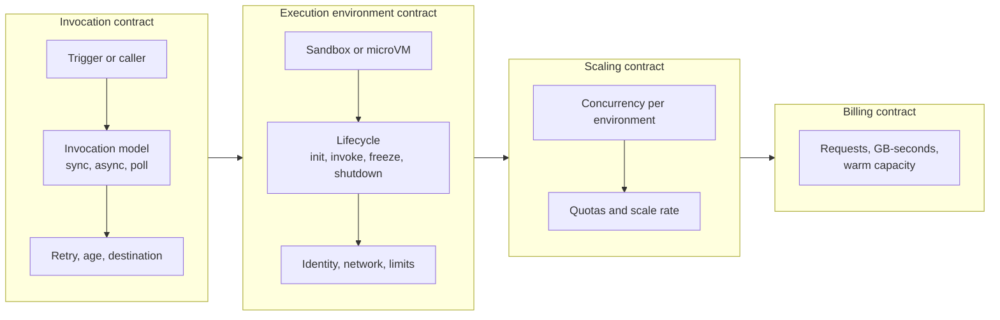

The diagram reads left to right as a request's journey. The trigger fixes the invocation model, which fixes retry behavior before the function runs a line of code. The environment then executes the handler under its limits, the scaling contract decides whether an environment is available at all, and the billing contract turns all of it into a charge. A design review that discusses only the handler code has reviewed none of these contracts.

### 2.1 What serverless removes and what it leaves

Serverless removes instance selection, operating-system patching, runtime patching for managed runtimes, capacity planning for the fleet, zone placement, and the autoscaling controller. It does not remove:

- **Capacity limits.** They move from "how many instances did I buy" to "how much concurrency does my account, plan, or function allow, and how fast can it grow."
- **State.** The environment is disposable, so durable state must live in a database, object store, queue, or workflow engine.
- **Failure handling.** The provider retries according to the trigger. The function must make retries safe.
- **Network and identity design.** A function that reaches a private database needs network attachment, routes, Domain Name System (DNS) resolution, and permissions like any other workload.
- **Cost risk.** Pay-per-use billing has no ceiling unless you set one. A retry loop or a recursive trigger bills every iteration.

### 2.2 The serverless execution family

"Serverless" covers several products with different contracts. The table below names them by what they execute.

| Execution form | AWS | Azure | Google Cloud | Contract summary |
|---|---|---|---|---|
| Event function, one event per environment at a time | Lambda (Event Functions) | No direct equivalent | Cloud Run functions (1st gen) | Short handler, platform-managed concurrency, per-request billing |
| Function with per-instance concurrency | Lambda Managed Instances; Lambda Web Functions for HTTP | Functions on Flex Consumption, Consumption (legacy), Premium, Dedicated, or Container Apps | Cloud Run functions | Many invocations share an instance; CPU and connection pools are shared |
| Serverless container | Lambda container images (still function contract); Fargate via Amazon Elastic Container Service (ECS) | Azure Container Apps | Cloud Run services and jobs | Container image, HTTP or job contract, scale to zero optional |
| Workflow orchestrator | Step Functions; Lambda durable functions | Durable Functions; Logic Apps | Workflows | Durable state between steps; waits do not hold compute |

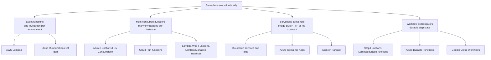

The hierarchy matters because the branches have different concurrency semantics. On standard Lambda, each environment processes one invocation at a time, so a global variable is never touched by two requests at once and concurrency equals environment count. On Cloud Run functions and Azure Flex Consumption, one instance may process many invocations at once, so global state needs thread safety and a connection pool is shared by all in-flight requests. Moving a function between branches changes its correctness assumptions, not only its price.

### 2.3 Function, serverless container, or workflow

A short rule of thumb, refined in Section 16:

- Use a **function** when work has a clear trigger, finishes well inside the platform timeout, and keeps no state between invocations.
- Use a **serverless container** when you need a container image contract, an existing HTTP server framework, long request durations, or many concurrent requests per instance, but you do not want to run a cluster. [Containers](CH07_Containers.md#85-google-cloud-run) teaches Cloud Run, Container Apps, and Fargate as container services.
- Use a **workflow** when a business process has multiple steps, waits for humans or external systems, needs compensation on failure, or must survive for longer than one function invocation.

## 3. Invocation models

The invocation model is the single most consequential property of a function trigger. It determines who holds the event while the function is busy, who retries, and what the caller sees. AWS documents three models explicitly. Azure and Google Cloud implement the same three behaviors through different products.

### 3.1 Synchronous request/response

In a synchronous invocation the caller sends an event and waits for the function's response on the same connection. Amazon API Gateway, Application Load Balancer (ALB), Lambda function URLs, and a direct `Invoke` call with `InvocationType=RequestResponse` all use this model. The platform does not retry a synchronous invocation on a function error. It returns the error to the caller, and the caller decides.

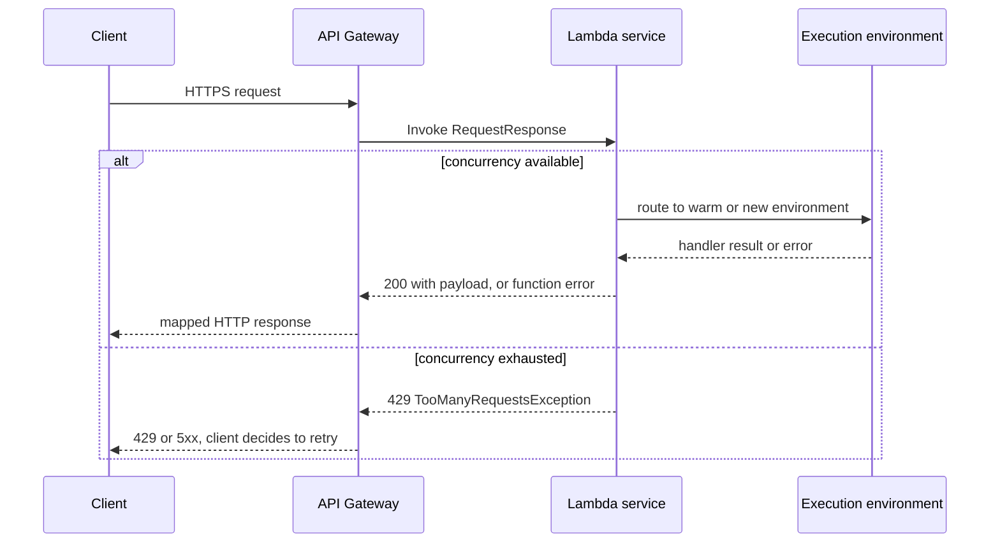

Three consequences follow from the diagram. First, a throttle is visible to the client immediately as an HTTP 429 or a gateway 5xx, so the client's retry policy, not the platform's, controls load amplification. Second, the caller's timeout bounds the useful function duration: API Gateway's integration timeout (29 seconds by default for Representational State Transfer (REST) APIs at the time of writing) is far below Lambda's 900-second maximum, so a function that runs 40 seconds behind a gateway produces a gateway timeout while the function keeps running and billing. Third, payload limits are tight: 6 MB each for a synchronous request and response, or up to 200 MB for a streamed response ([Lambda quotas](https://docs.aws.amazon.com/lambda/latest/dg/gettingstarted-limits.html)).

Azure Functions HTTP triggers and Cloud Run functions HTTP functions follow the same model. On Azure, an HTTP-triggered function must respond within 230 seconds regardless of `functionTimeout`, because of the idle timeout of the Azure Load Balancer in front of the platform ([Azure Functions hosting options](https://learn.microsoft.com/en-us/azure/azure-functions/functions-scale)). On Cloud Run functions, the request timeout defaults to 5 minutes and can be raised to 60 minutes ([Cloud Run request timeout](https://docs.cloud.google.com/run/docs/configuring/request-timeout)).

Use synchronous invocation when the caller needs the result to continue, the work fits comfortably in the caller's deadline, and the caller can tolerate or retry an error. Do not use it for work whose duration is unpredictable or long: return a job identifier and process asynchronously instead.

### 3.2 Asynchronous event invocation with an internal queue

In an asynchronous invocation the caller hands the event to the platform and receives an acknowledgment immediately. Amazon Simple Storage Service (S3) event notifications, SNS, EventBridge, and `Invoke` with `InvocationType=Event` use this model. Lambda places the event in an internal queue that it manages, then a separate set of pollers inside the Lambda service reads that queue and invokes the function.

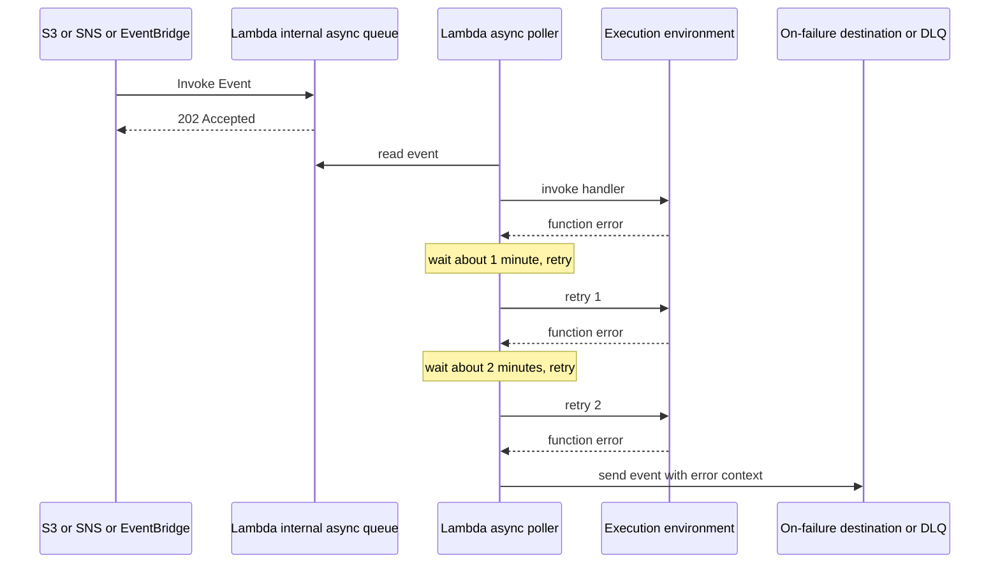

The source sees success as soon as the event is queued, so the source never learns whether the function succeeded. The platform owns retries from that point. By default Lambda retries a function error twice, waiting about one minute before the first retry and two minutes before the second. Throttles and system errors are handled differently: Lambda returns the event to the queue and keeps retrying with exponential backoff, from 1 second up to 5 minutes between attempts, for up to 6 hours by default ([Lambda asynchronous error handling](https://docs.aws.amazon.com/lambda/latest/dg/invocation-async-error-handling.html)). You can reduce retry attempts to 0 or 1 and reduce the maximum event age to as little as 60 seconds. When an event exhausts its attempts or expires, Lambda sends it to an on-failure destination or a DLQ if one is configured, and discards it otherwise.

AWS also states that the internal queue is eventually consistent, so a function can receive the same event more than once even when it never fails, and that events can expire from a long queue before they are processed. Both properties make idempotent handling mandatory for asynchronous functions. The asynchronous payload limit is 1 MB at the time of writing, raised from 256 KB in 2025 ([Lambda quotas](https://docs.aws.amazon.com/lambda/latest/dg/gettingstarted-limits.html)).

Azure has no single equivalent of the Lambda internal queue. Azure Event Grid pushes events to a function's Event Grid trigger and retries with its own schedule and dead-letter storage. Storage queue and Service Bus triggers behave as poll-based sources (Section 3.3). On Google Cloud, an event-driven Cloud Run function receives events from Eventarc. Eventarc Standard uses a Pub/Sub subscription as its transport, so retries follow that subscription's retry policy (Section 9.6).

### 3.3 Poll-based event source mappings

For queues and streams, the function does not receive pushes. A poller reads from the source, assembles a batch, and invokes the function synchronously with that batch. Lambda calls this resource an **event source mapping (ESM)**. It supports SQS, Kinesis Data Streams, Amazon DynamoDB Streams, Amazon Managed Streaming for Apache Kafka (MSK), self-managed Apache Kafka, Amazon MQ, and Amazon DocumentDB change streams. The poller is part of the Lambda service and is configured on the mapping, not in the function.

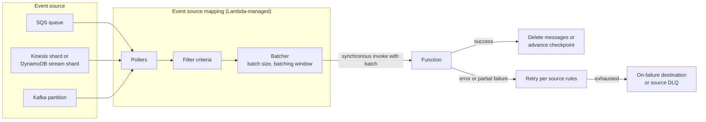

The mapping turns an asynchronous source into a synchronous call, which changes three things.

- **Acknowledgment belongs to the poller.** For SQS, the poller deletes messages only when the function returns success. If the function fails, the messages stay in the queue and become visible again after the queue's visibility timeout. For streams, the poller advances the shard iterator only after success, so a failure blocks that shard until the batch succeeds or is discarded.
- **Retries follow the source, not the async rules.** SQS retries are governed by the queue's visibility timeout and its redrive policy (`maxReceiveCount` into a DLQ). Stream retries are governed by the mapping's `MaximumRetryAttempts`, `MaximumRecordAgeInSeconds`, and `BisectBatchOnFunctionError` settings (Section 9.4).
- **Scaling follows the source structure.** For SQS standard queues, the poller adds concurrency as backlog grows (Section 6.3). For streams, concurrency is per shard: by default one concurrent batch per shard, raised to up to ten with the `ParallelizationFactor` setting, while preserving order per partition key.

Azure Functions implements polling inside the Functions host rather than as a separate service. The Service Bus, Storage queue, Event Hubs, Kafka, and Azure Cosmos DB triggers each have extension code that leases messages or partitions, invokes the function, and completes or abandons the message. The scale controller watches queue length or partition lag and adds instances. On Google Cloud, a Pub/Sub push subscription delivers to Cloud Run as HTTP, so even "polling" sources arrive as pushes. Pull consumers that read Pub/Sub or Kafka continuously are a better fit for Cloud Run worker pools or always-on containers than for functions.

### 3.4 Comparing the three models

| Property | Synchronous | Asynchronous (internal queue) | Poll-based mapping |
|---|---|---|---|
| Caller waits for result | Yes | No, receives acknowledgment | No; the poller waits |
| Who retries on function error | The caller | The platform, default 2 retries | The poller, per source rules |
| Behavior when throttled | Error returned to caller (HTTP 429) | Event requeued, retried up to max age | Poller backs off; messages stay in source |
| Where failures land | Caller's error handling | On-failure destination or DLQ | Source DLQ (SQS) or on-failure destination (streams) |
| Ordering | Per caller | None | Per shard, partition, or first-in, first-out (FIFO) message group |
| Batch | One event | One event | Up to configured batch size |
| AWS examples | API Gateway, function URL, ALB | S3, SNS, EventBridge | SQS, Kinesis, DynamoDB Streams, Kafka |

### 3.5 Worked scenario: choosing the model for an order pipeline

A retailer receives 50 orders per second at peak. Each order needs a fraud check (300 milliseconds), a payment authorization through a third-party API (1.2 seconds, rate-limited to 40 requests per second), and a confirmation email.

- **Fraud check, synchronous.** The checkout page needs an answer before it shows the confirmation screen. A synchronous function behind the API gateway fits: 300 ms is well within the 29-second gateway timeout, and a failure can return a "try again" page.
- **Payment, poll-based from a queue.** The payment provider allows 40 requests per second, below the 50 orders per second peak. A synchronous design would push 50 per second at a 40 per second limit and fail 20 percent of peak payments. An SQS queue in front of a function with a concurrency limit absorbs the burst. By Little's Law (Section 6.1), 40 requests per second at 1.2 seconds each needs 48 concurrent invocations, so capping the mapping's maximum concurrency at 48 holds the provider at its limit while the queue absorbs the difference.
- **Email, asynchronous.** The checkout does not wait for email. An EventBridge rule invokes the email function asynchronously. Duplicate emails are a nuisance, not a financial error, but the function still records a sent marker keyed by order identifier (ID) to suppress duplicates.

The same handler language and runtime serve all three. Only the trigger changes, and with it every retry and scaling property.

## 4. The execution environment lifecycle

An execution environment is the isolated sandbox that runs your code. On Lambda it is a Firecracker microVM (Firecracker's isolation model is taught in [Virtualization and Container Fundamentals](../05_Networking_and_OS/CH28_Virtualization_and_Container_Fundamentals.md)). On Cloud Run functions it is a container instance in a gVisor sandbox or a microVM-based second-generation execution environment. On Azure Functions it is a worker process hosted by the Functions host on a platform-managed instance. The environment's lifecycle explains cold starts, the safety of caching, and the meaning of "stateless."

### 4.1 The lifecycle as a state machine

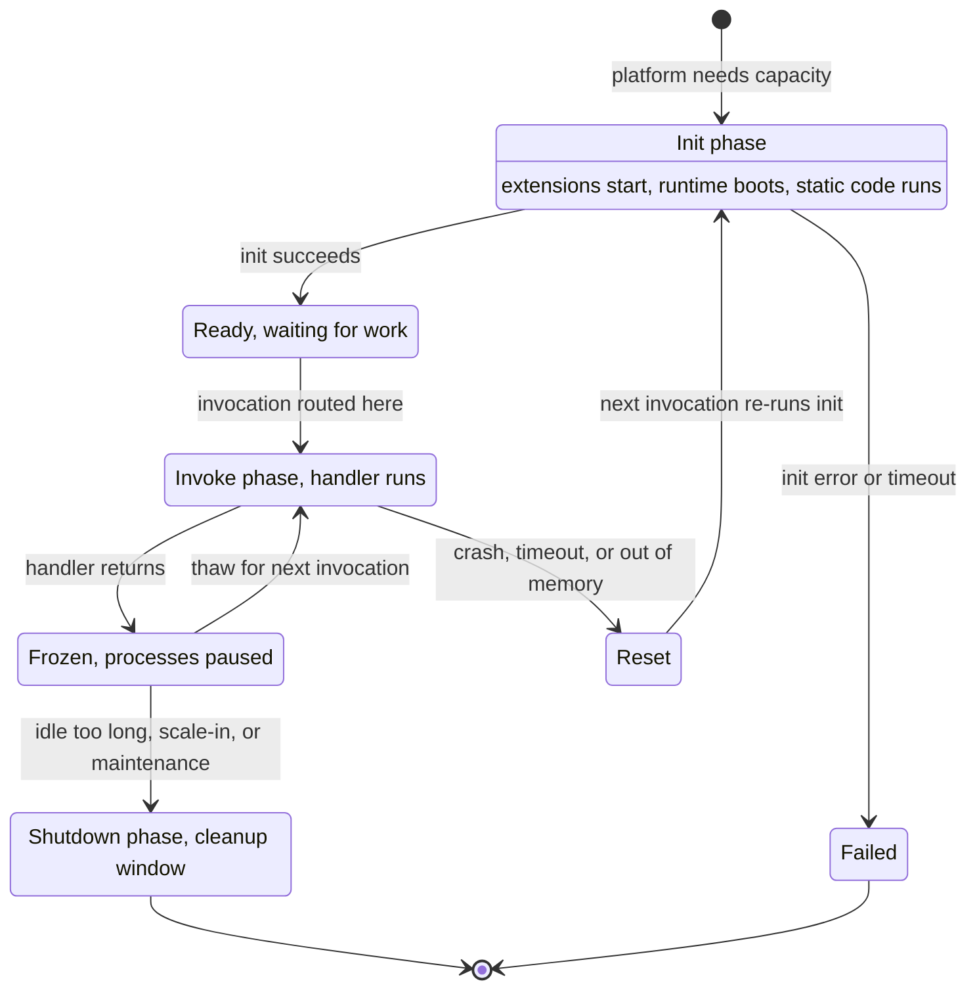

The Lambda documentation defines the phases precisely ([Lambda execution environment lifecycle](https://docs.aws.amazon.com/lambda/latest/dg/runtimes-context.html)):

- **Init.** Lambda starts any extensions, bootstraps the language runtime, and runs the function's static initialization code (everything outside the handler). For on-demand functions the Init phase is limited to 10 seconds. If it does not finish, Lambda retries initialization at the time of the first invocation, bounded by the function timeout. Functions using provisioned concurrency, SnapStart, or Lambda Managed Instances can run initialization for longer.
- **Invoke.** Lambda sends the event to the runtime, which calls the handler. The function timeout bounds the whole Invoke phase, including time extensions spend after the handler returns.
- **Freeze.** When the runtime and every extension signal completion, Lambda freezes the environment. Processes are suspended: background threads do not run, timers do not fire, and an open socket may be closed by the remote side while the environment sleeps.
- **Thaw and reuse.** The next invocation routed to this environment thaws it. Objects created during Init (database clients, Software Development Kit (SDK) clients, parsed configuration) are still in memory, and files written to `/tmp` are still on disk.
- **Reset.** If the handler crashes or times out, Lambda resets the environment, which behaves like a shutdown. The next invocation re-runs Init (a "suppressed init" that AWS does not report as a separate phase). `/tmp` is not cleared by a reset.
- **Shutdown.** When Lambda retires an environment, it sends a Shutdown event to extensions. The window is 0 ms with no extensions, 500 ms with an internal extension, and 2,000 ms with external extensions. Lambda also recycles environments every few hours even under continuous traffic, for runtime updates and maintenance.

### 4.2 What is safe to keep between invocations

Reuse is an optimization, never a guarantee. Use this classification:

| Kept across invocations | Safe use | Unsafe use |
|---|---|---|
| SDK and database clients created in Init | Reuse to avoid reconnecting; validate or reconnect on error | Assume the connection is alive after a long freeze |
| In-memory caches | Cache immutable or slowly changing reference data with a time-to-live (TTL) | Hold the only copy of a counter, session, or order state |
| Files in `/tmp` | Cache a downloaded model or library | Store data that must survive; another invocation may run elsewhere |
| Credentials fetched in Init | Cache with refresh before expiry | Cache forever; rotation will break the function (Section 18.4) |
| Background threads | None that must finish; they freeze with the environment | Flush logs or metrics after the handler returns without an extension |

The last row is a frequent source of lost telemetry. A Node.js handler that returns before an asynchronous metrics flush completes will have that flush frozen mid-flight. It may complete on the next thaw, minutes later, or never. Await all work before returning, or use an extension designed to flush during the Invoke or Shutdown phase.

### 4.3 Azure Functions and Cloud Run functions lifecycles

Azure Functions separates a **host process** (the Functions runtime, trigger extensions, and scale signals) from a **language worker process** (your .NET isolated, Java, Node.js, Python, or PowerShell code) connected by gRPC Remote Procedure Call (gRPC). Both must start before the first execution. On Flex Consumption, app initialization times out after 30 seconds, and the language worker has a 60-second startup limit across plans ([Flex Consumption considerations](https://learn.microsoft.com/en-us/azure/azure-functions/flex-consumption-plan)). An instance is not frozen between executions in the Lambda sense. It keeps running while it has work, and the platform scales it in when it is idle. On scale-in, Flex Consumption and Premium give in-flight executions a grace period of up to 60 minutes.

A Cloud Run function instance is a container that starts an HTTP server provided by the Functions Framework, receives requests, and is shut down with a `SIGTERM` signal and a 10-second grace period when Cloud Run scales in. Under the default request-based billing, CPU is allocated only while a request is in flight (and during startup and shutdown), so background work between requests is throttled to near zero. Instance-based billing keeps CPU allocated for the instance's lifetime, which allows background work at higher cost ([Cloud Run pricing](https://cloud.google.com/run/pricing)).

The practical difference is concurrency. A Lambda environment processes one invocation at a time, so the lifecycle is per invocation. Azure and Cloud Run instances process many invocations concurrently, so the lifecycle is per instance and every in-memory object is shared by concurrent requests.

## 5. Cold starts

A cold start is an invocation that must wait for a new execution environment to be created and initialized before the handler runs. Warm invocations reuse an existing environment. Cold starts are the main source of tail latency in serverless systems, and the main reason teams buy warm capacity.

### 5.1 Causes

A new environment is needed when:

- **Traffic grows** beyond the number of warm environments (scale-out).
- **The first request** arrives after the function scaled to zero.
- **A new version** is deployed, or configuration changes, which invalidates existing environments.
- **The platform recycles** environments for maintenance, every few hours on Lambda.
- **An invocation crashed or timed out**, which resets the environment.
- **Requests are spread** across availability zones or across many function versions and aliases, each needing its own warm pool.

### 5.2 The cold-start request path and its measured phases

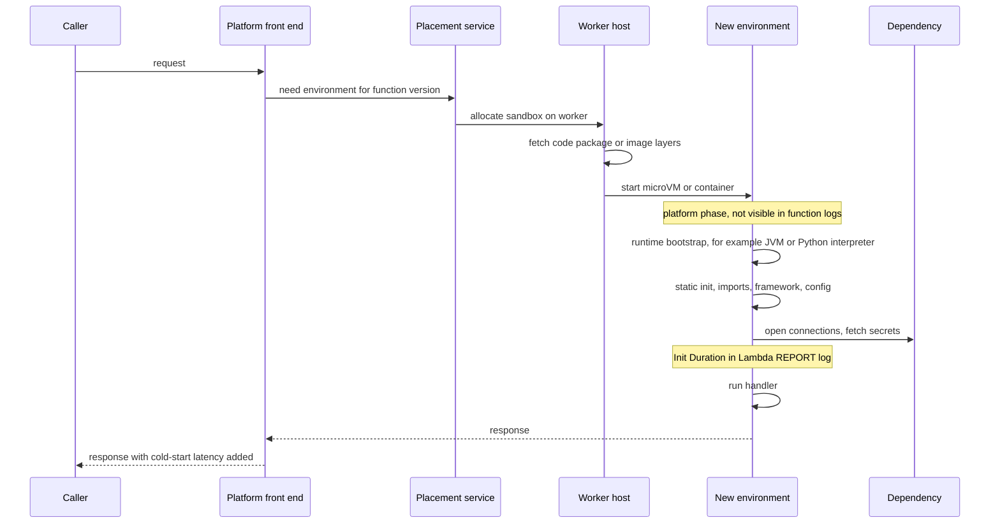

The path has two halves that are measured differently.

1. **Platform phase.** The front end finds no free environment, the placement service picks a worker, the worker fetches the code package or container image, and the sandbox boots. You cannot see this phase in function logs. You can only infer it from end-to-end latency minus the init and handler time.
2. **Initialization phase.** The runtime starts and your static code runs. Lambda reports this as `Init Duration` in the `REPORT` log line of the first invocation in each environment. Cloud Run exposes a container startup latency metric. Azure exposes host and worker startup events in Application Insights.

A cold invocation's latency is therefore:

```text
cold latency = platform phase + runtime bootstrap + static init + handler duration
warm latency = handler duration (+ small routing overhead)
```

Since 1 August 2025, Lambda bills the Init phase for on-demand Zip-packaged functions on managed runtimes, which were previously unbilled ([AWS Compute Blog](https://aws.amazon.com/blogs/compute/aws-lambda-standardizes-billing-for-init-phase/)). Heavy initialization now costs money on every cold start, not only latency.

### 5.3 Runtime, package size, and initialization code

The phases respond to different levers:

- **Runtime.** Interpreted runtimes (Python, Node.js) start in tens to low hundreds of milliseconds for a small package. Java Virtual Machine (JVM) and .NET runtimes pay for class loading and just-in-time compilation, and frameworks such as Spring Boot add dependency-injection scanning. Ahead-of-time compiled binaries (Go, Rust, GraalVM native images) start fastest. Measure your own function: framework choice usually matters more than language.
- **Package size.** A larger Zip package or image takes longer to fetch and decompress, and more modules take longer to import. Lambda caches container image layers and loads them lazily, so image size matters less than the amount of the image read during Init ([Containers](CH07_Containers.md#63-what-happens-on-pull-and-why-image-size-matters) covers image loading). Trimming unused dependencies and lazy-importing rarely used modules shortens static init.
- **Memory size.** Lambda allocates CPU in proportion to memory (Section 7.2). A 128 MB function receives a small fraction of a vCPU and initializes slowly. Raising memory often shortens Init enough to reduce total cost.
- **Initialization work.** Every network call during Init (fetching secrets, warming a cache, opening a database connection) adds its full latency to every cold start. Fetch only what the first invocation needs.

### 5.4 Network attachment: the VPC history

Before September 2019, attaching a Lambda function to an Amazon Virtual Private Cloud (VPC) created an elastic network interface (ENI) in the customer's subnet for each execution environment at cold start. That added seconds to cold starts, consumed one subnet Internet Protocol (IP) address per environment, and could exhaust a subnet during a burst. AWS then moved to shared Hyperplane ENIs: Lambda creates an ENI per unique subnet and security-group combination when the function is created or its VPC configuration changes, and environments reach the VPC through it. The cost moved from cold start to function creation, where the function sits in a `Pending` state until the ENI exists. VPC attachment today adds little to each cold start, but subnet choice, ENI quotas (3,000 per VPC by default at the time of writing), and route design still matter (Section 13).

Azure Functions on Flex Consumption and Premium use regional virtual network (VNet) integration through a delegated subnet. Cloud Run functions use Direct VPC egress or a Serverless VPC Access connector. Neither adds a per-instance interface at cold start in the way pre-2019 Lambda did, but Direct VPC egress consumes subnet IP addresses as instances scale, so subnet sizing is a scale limit.

### 5.5 Mitigations

| Mechanism | Provider | How it works | What you pay | Limits and caveats |
|---|---|---|---|---|
| Provisioned concurrency | Lambda | Lambda pre-initializes N environments for a version or alias and keeps them warm | A per-GB-second charge for the provisioned amount while enabled, plus a lower duration rate | Applies to one version or alias; excess traffic spills to on-demand cold starts |
| SnapStart | Lambda (Java 11+, Python 3.12+, .NET 8+) | Lambda runs Init when you publish a version, snapshots the microVM memory and disk, and restores new environments from the snapshot | Free for Java; caching and restore charges for Python and .NET | Not compatible with provisioned concurrency, Amazon Elastic File System (EFS), or ephemeral storage above 512 MB; unique values generated in Init are duplicated across environments |
| Always-ready instances | Azure Flex Consumption | A configured number of instances per function group stays running and handles executions first | Baseline GB-seconds for always-ready memory, no free grant | At least two per group when zone redundancy is enabled; counts against the regional memory quota |
| Always-ready plus pre-warmed instances | Azure Premium | Always-ready instances stay running; a pre-warmed buffer is started ahead of scale-out | Per-core and per-memory hourly rate for every allocated instance | Minimum one instance always billed |
| Minimum instances | Cloud Run functions | Cloud Run keeps N instances started per service or revision | Idle-time rate for CPU and memory of minimum instances | Instances can still be replaced; scale beyond N is cold |
| Startup CPU boost | Cloud Run | Extra CPU during instance startup | Billed CPU during boost | Shortens bootstrap, does not remove it |

Sources: [Lambda SnapStart](https://docs.aws.amazon.com/lambda/latest/dg/snapstart.html), [Lambda pricing](https://aws.amazon.com/lambda/pricing/), [Flex Consumption plan](https://learn.microsoft.com/en-us/azure/azure-functions/flex-consumption-plan), [Cloud Run pricing](https://cloud.google.com/run/pricing).

SnapStart deserves a closer look because it changes correctness, not only latency. Every environment restored from the same snapshot starts with identical memory. A random seed, a universally unique identifier (UUID) generated at Init, a cached timestamp, or a temporary credential captured before the snapshot is duplicated across every restored environment. Generate unique values in the handler or in an after-restore runtime hook, and re-validate network connections after restore.

"Keep-warm" pings, a scheduled event that invokes the function every few minutes, keep one environment warm at most. They do nothing for the second concurrent request and are a weaker, untracked version of provisioned concurrency or minimum instances. Prefer the platform mechanism.

### 5.6 Worked example: does this API need warm capacity?

A Java 21 Spring Boot function behind API Gateway has a service-level objective (SLO) of 800 ms at the 99th percentile (p99). Measurements at 2,048 MB:

- Warm handler duration: p99 = 180 ms.
- `Init Duration` (from `REPORT` lines): median 3,100 ms.
- Estimated platform phase (end-to-end minus init minus handler): about 250 ms.
- Traffic: 20 requests per second steady, 1 percent of invocations are cold starts in a load test that mimics production.

Cold latency is about 250 + 3,100 + 180 = 3,530 ms. If 1 percent of requests are cold and all are slower than 800 ms, the 99th percentile sits right at the boundary between warm and cold requests. Any increase in cold-start rate (a deploy, a burst) pushes p99 above 3 seconds. The SLO fails.

Options compared:

1. **SnapStart.** Restores replace the 3,100 ms Init with a restore that is typically several hundred milliseconds for a framework-heavy Java function. Measure it. If restore p99 plus handler p99 plus platform phase is under 800 ms, SnapStart meets the SLO at no extra charge for Java.
2. **Provisioned concurrency.** By Little's Law (Section 6.1), 20 requests per second × 0.18 s = 3.6 concurrent, so 5 provisioned environments cover steady traffic with headroom. The charge is 5 × 2 GB × 2,592,000 seconds per month × $0.0000041667 per GB-second ≈ $108 per month at the us-east-1 price at the time of writing, plus duration at the lower provisioned rate. Bursts above 5 still cold-start.
3. **Reduce Init.** Replacing classpath scanning with explicit configuration or a native image might cut Init to under 500 ms, solving the problem permanently.

The decision: enable SnapStart first because it is free for Java and needs no capacity planning, add provisioned concurrency only if measured restore latency still violates the SLO, and schedule the Init reduction as engineering work. Record the measured restore p99 as validation evidence.

## 6. Concurrency and scaling

Serverless platforms scale for you, but within limits you must know. The relevant number is concurrency: how many invocations are in flight at the same moment.

### 6.1 Little's Law for functions

Little's Law states that the average number of items in a stable system equals the arrival rate multiplied by the average time each item spends in the system. Its general derivation and use in capacity estimation are taught in [Non-Functional Requirements](../07_System_Design_and_Distributed_Systems/CH02_Non_Functional_Requirements.md). Applied to functions:

```text
concurrency = arrival rate (invocations per second) × average duration (seconds)
```

AWS uses the same formula in its own guidance: 5,000 requests per second at 200 ms average duration means a concurrency of 1,000 ([Lambda concurrency](https://docs.aws.amazon.com/lambda/latest/dg/lambda-concurrency.html)).

Three practical points follow.

- **Duration includes waiting.** A function that spends 700 ms of an 800 ms duration waiting for a database still occupies an environment for 800 ms. Slow dependencies raise concurrency even when CPU is idle.
- **Duration rises under load.** When a downstream service slows from 100 ms to 1 second, concurrency rises tenfold at the same arrival rate. That is the mechanism by which a slow database exhausts a function's concurrency quota (Section 6.6).
- **For multi-concurrent platforms divide by per-instance concurrency.** On Cloud Run functions or Azure Flex Consumption, instances = concurrency ÷ per-instance concurrency, rounded up.

### 6.2 Lambda concurrency: account pool, reserved, provisioned, and scaling rate

Lambda's scaling contract has four controls.

1. **Account concurrency quota.** All on-demand functions in an account and Region share one pool, 1,000 concurrent executions by default, increasable to tens of thousands through Service Quotas. New accounts may start with a reduced quota that AWS raises automatically with usage ([Lambda quotas](https://docs.aws.amazon.com/lambda/latest/dg/gettingstarted-limits.html)).
2. **Per-function scaling rate.** Each function can add 1,000 execution environments every 10 seconds, independent of other functions. For synchronous invocations, each environment can also serve at most 10 requests per second, so the per-function request ceiling is 10 times its concurrency.
3. **Reserved concurrency.** Setting reserved concurrency on a function both guarantees it that many units from the account pool and caps it at that number. No other function can use reserved units. Setting it to 0 stops the function from running, which is an emergency brake.
4. **Provisioned concurrency.** Pre-initialized environments for a specific version or alias (Section 5.5). Provisioned concurrency counts against the function's reserved concurrency, if set, and against the account pool.

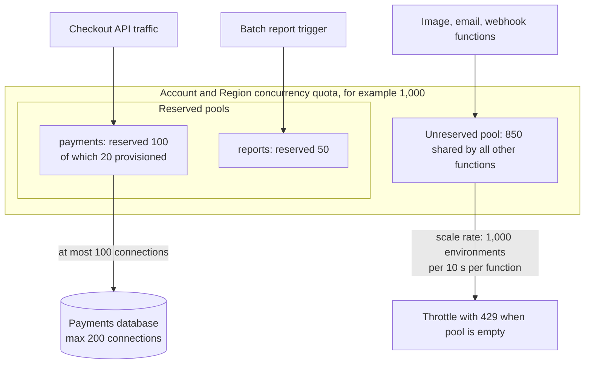

The diagram shows the two jobs concurrency controls do. Reserved concurrency protects the payments function from starvation: when the image-processing function bursts and consumes the unreserved pool, payments still has 100 units. The same setting caps payments at 100, which keeps it below the database's connection limit. Unreserved functions share whatever is left, and AWS requires a minimum of 100 units to remain unreserved, so you cannot reserve the whole account pool.

**Worked example: burst headroom.** A ticket sale expects 6,000 requests per second at 250 ms average duration, starting within seconds of an announcement.

- Required concurrency: 6,000 × 0.25 = 1,500.
- Account quota: 1,000 by default. Without an increase, 500 concurrent invocations' worth of traffic (about 2,000 requests per second) is throttled at peak. Request an increase to at least 2,000, which leaves 33 percent headroom for duration growth.
- Scaling rate: from zero, the function can reach 1,000 environments in the first 10-second interval and 1,500 in the second, so for up to about 20 seconds part of the burst sees throttles or cold starts. If that is unacceptable, provision concurrency ahead of the announcement: 1,500 provisioned environments for the sale window.
- Synchronous request ceiling: 10 × 1,500 = 15,000 requests per second, comfortably above 6,000.

### 6.3 Scaling of Lambda event source mappings

Poll-based sources add their own scaling rules on top of the account pool.

- **SQS standard queues.** The default mapping increases pollers as messages accumulate, adding up to 300 concurrent invocations per minute to a maximum of 1,250 concurrent invocations per mapping ([SQS scaling](https://docs.aws.amazon.com/lambda/latest/dg/services-sqs-scaling.html)). The optional provisioned mode, launched in November 2025, uses dedicated event pollers (each handling up to 1 MB per second or 10 concurrent invocations) that scale up to 1,000 concurrent executions per minute and up to 20,000 concurrency, billed by event poller usage ([AWS announcement](https://aws.amazon.com/about-aws/whats-new/2025/11/aws-lambda-provisioned-mode-sqs-esm/)). The mapping's **maximum concurrency** setting caps how many concurrent invocations the mapping drives, which is the right control for downstream protection on a queue (Section 6.6).
- **SQS FIFO queues.** Concurrency is bounded by the number of active message groups, because Lambda processes one batch per message group at a time to preserve order.
- **Kinesis and DynamoDB Streams.** One concurrent batch per shard by default, up to 10 with `ParallelizationFactor`. A stream with 8 shards and a factor of 4 drives at most 32 concurrent invocations, regardless of backlog. Throughput is raised by adding shards or raising the factor, not by the account quota.
- **Kafka.** Concurrency is bounded by partition count. Provisioned mode for Kafka mappings lets you set minimum and maximum event pollers.

Why reserved concurrency is a poor brake for SQS: if a function's reserved concurrency is lower than the number of invocations the pollers attempt, the extra invocations are throttled, the messages return to the queue, and each throttle counts as a receive. Messages can reach the queue's `maxReceiveCount` and move to the DLQ without ever being processed. Use the mapping's maximum concurrency setting instead, which stops the pollers from fetching more than the function can run.

### 6.4 Azure Functions plans and per-instance concurrency

Azure Functions scales function **apps**, not individual functions, except on Flex Consumption, where functions are grouped for scaling. The plan decides almost everything.

| Plan | Scaling model | Maximum instances (at the time of writing) | Warm capacity | Networking | Billing |
|---|---|---|---|---|---|
| Flex Consumption (recommended) | Per-function scaling: HTTP triggers scale together, Blob (Event Grid) triggers together, Durable triggers together, every other function on its own instances | 1,000 per function group; regional subscription quota of 250 cores by default | Optional always-ready instances | VNet integration supported | Execution GB-seconds plus executions; always-ready baseline |
| Premium | Event-driven, per plan | 100 on Windows; 20 to 100 on Linux depending on region | At least one always-ready instance, plus pre-warmed buffer | VNet integration | Per-core and memory hour for allocated instances |
| Dedicated (App Service plan) | Manual or autoscale rules | 10 to 30 (100 on App Service Environment) | Instances you pay for anyway | VNet integration | App Service plan rate |
| Container Apps | Event-driven with KEDA (Kubernetes Event-driven Autoscaling) | Up to 1,000 replicas, cores quota permitting | Minimum replicas | Container Apps environment | Container Apps rates |
| Consumption (legacy, Windows) | Event-driven, per app | 200 on Windows | None | No VNet integration | Execution GB-seconds plus executions |

Source: [Azure Functions hosting options](https://learn.microsoft.com/en-us/azure/azure-functions/functions-scale) and [Flex Consumption plan](https://learn.microsoft.com/en-us/azure/azure-functions/flex-consumption-plan).

On Flex Consumption you choose an instance memory size of 512 MB (about 0.25 cores), 2,048 MB (1 core), or 4,096 MB (2 cores), and a per-instance concurrency. The platform computes desired instances from event volume divided by per-instance concurrency, then adds instances along a scale curve that is fast at small sizes and slows at very large ones. Three limits apply at once: the scale curve, the per-group maximum instance count, and the regional subscription memory quota shared by all Flex Consumption apps in the subscription and region. One 2,048 MB app at 250 instances consumes the entire default 250-core quota and stops every other Flex Consumption app in that region from scaling. Treat the regional quota as a shared failure domain and request increases before launch.

HTTP concurrency defaults on Flex Consumption depend on instance memory size. For non-HTTP triggers, target-based scaling uses per-trigger settings such as the Service Bus or Event Hubs batch and prefetch sizes. Concurrency in Azure means many executions on the same worker process: a static `HttpClient` or database pool is shared by all of them.

### 6.5 Cloud Run functions concurrency and maximum instances

A Cloud Run function is a Cloud Run service, so it inherits Cloud Run's scaling contract ([Cloud Run concurrency](https://docs.cloud.google.com/run/docs/about-concurrency)).

- **Maximum concurrent requests per instance** can be set from 1 to 1,000. New services deployed with the Google Cloud command-line interface (CLI) or Terraform default to 80 times the number of vCPUs, and the console defaults to 80. Functions created through the older Cloud Functions v2 API were commonly deployed with concurrency 1; check the deployed value rather than assuming.
- **Maximum instances** default to 100 per revision and can be set at service level (recommended) or revision level. Google documents that the maximum can be exceeded briefly during traffic spikes ([Cloud Run maximum instances](https://docs.cloud.google.com/run/docs/configuring/max-instances)). A downstream connection budget must include that overshoot.
- **Minimum instances** keep instances started (Section 5.5).
- **CPU-based scaling.** Cloud Run also scales on CPU utilization, so an instance may receive fewer requests than its concurrency setting when CPU is busy.

Worked example: an event-driven Cloud Run function processes 300 events per second, each taking 400 ms of mostly input/output (I/O) wait. Concurrency = 300 × 0.4 = 120. At per-instance concurrency 80, it needs ⌈120 ÷ 80⌉ = 2 instances. At concurrency 1 (a common setting for functions migrated from 1st gen), it needs 120 instances, more cold starts, and 60 times the connection count. Raising concurrency is the largest cost and latency lever on Cloud Run functions, provided the code is safe for concurrent requests.

### 6.6 Concurrency as downstream protection

Function platforms can scale faster than almost anything behind them. A relational database with a 500-connection limit, a partner API limited to 100 requests per second, or a legacy service with 20 worker threads all fail before the function platform does. The function's concurrency limit is the cheapest admission control you have. General backpressure and rate-limiting algorithms are owned by [Rate Limiting](../08_API_Architecture/CH11_Rate_Limiting.md); this section sets the function-side limit.

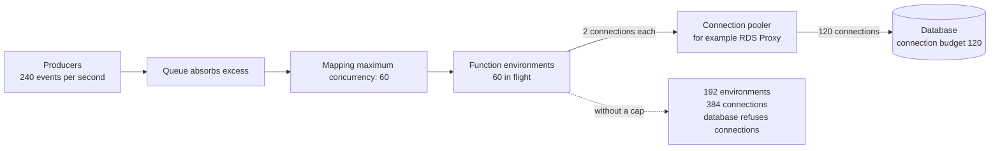

**Worked example: connection exhaustion.** This is the scenario modeled by [`02_concurrency_limit.py`](../code/python/serverless-chapter/02_concurrency_limit.py).

- Arrival rate 240 events per second, average duration 0.8 seconds. Demand concurrency = 240 × 0.8 = 192.
- Each invocation opens 2 database connections (one read, one write). Unbounded, 192 environments need 384 connections.
- The database team allocates this function a budget of 120 connections. Safe concurrency = 120 ÷ 2 = 60.
- At 60 concurrent invocations and 0.8 s each, throughput is 60 ÷ 0.8 = 75 events per second. Demand is 240, so the backlog grows by 165 events per second during the peak.
- If the peak lasts 10 minutes, the backlog reaches 165 × 600 = 99,000 events. Drained at the 75 per second capacity once arrivals fall to a 30 per second off-peak rate, the net drain rate is 45 per second, and recovery takes 99,000 ÷ 45 = 2,200 seconds, about 37 minutes.

That backlog is the price of protecting the database. The alternatives are to give the function more connections (a database decision), make each invocation cheaper (one connection instead of two doubles safe concurrency to 120), or use a connection pooler. Amazon Relational Database Service (RDS) Proxy, Azure Database for PostgreSQL's built-in PgBouncer, and Cloud SQL managed connection pooling (check edition availability) multiplex many short client connections onto fewer database connections, but they move the limit rather than remove it.

How to apply the cap per provider:

- **Lambda behind a queue:** set the SQS mapping's maximum concurrency to 60. Do not use reserved concurrency alone (Section 6.3).
- **Lambda behind an API:** set reserved concurrency to 60 and accept HTTP 429 responses at the edge, or put a queue in front and return 202 Accepted.
- **Azure Functions:** set the function group's maximum instance count and per-instance concurrency so that instances × concurrency × connections ≤ 120. For Service Bus triggers, `maxConcurrentCalls` per instance bounds concurrency.
- **Cloud Run functions:** set maximum instances × per-instance concurrency × connections per request ≤ 120, minus a margin for the documented brief overshoot. A per-instance connection pool sized to the concurrency is the usual implementation.

### 6.7 Quality scenario: quota limit during scale-out

| Element | Value |
|---|---|
| Stimulus | A marketing push raises checkout traffic from 400 to 3,000 requests per second within 60 seconds |
| Environment | Lambda behind API Gateway, account quota 2,000, payments function reserved at 300 |
| Expected response | Unreserved functions throttle before payments does; API Gateway returns 429 with a retry-after hint for non-critical endpoints; payments stays within its 300 reservation; alarms fire on `Throttles` and account `ConcurrentExecutions` above 80 percent |
| Success criterion | Payment success rate stays above 99.5 percent; non-critical endpoint 429 rate below 5 percent for no longer than 2 minutes; no database connection errors |
| Validation | Load test against a staging account with the same quotas; quota headroom review recorded before every planned campaign |

## 7. Runtime limits

Limits are part of the execution contract. Most are fixed per platform. Exceeding one produces a specific failure that is easy to misdiagnose.

### 7.1 Limit comparison

| Limit | AWS Lambda (Event Functions) | Azure Functions (Flex Consumption) | Cloud Run functions |
|---|---|---|---|
| Maximum duration | 900 s; 5,400 s for asynchronous and most mapping invocations on Managed Instances | Default 30 min, unbounded maximum; HTTP response within 230 s | HTTP up to 60 min; event-driven bounded by trigger acknowledgment deadline |
| Memory | 128 MB to 10,240 MB in 1 MB steps | 512, 2,048, or 4,096 MB instance sizes | Configurable per service, with CPU, up to Cloud Run limits |
| CPU | Proportional to memory; 1 vCPU equivalent at 1,769 MB | About 0.25, 1, or 2 cores by instance size | Configurable vCPU, decoupled from memory within allowed ratios |
| Request payload | 6 MB synchronous (200 MB streamed response); 1 MB asynchronous | 210 MB HTTP request | Cloud Run HTTP request limits |
| Temporary storage | `/tmp` 512 MB to 10,240 MB | Instance-local storage; Azure Files mounts | In-memory filesystem counted against memory; volume mounts |
| Environment variables | 4 KB total | App settings | Per service |
| Package | 50 MB zipped upload, 250 MB unzipped with layers; 10 GB container image | Deployment package in blob storage | Container image built from source |

Sources: [Lambda quotas](https://docs.aws.amazon.com/lambda/latest/dg/gettingstarted-limits.html), [Azure Functions hosting options](https://learn.microsoft.com/en-us/azure/azure-functions/functions-scale), [Cloud Run request timeout](https://docs.cloud.google.com/run/docs/configuring/request-timeout). Verify current values, which change.

### 7.2 Memory and CPU coupling

On Lambda you configure memory and receive CPU in proportion. At 1,769 MB a function receives the equivalent of one vCPU, and the maximum of 10,240 MB provides up to six vCPUs. A CPU-bound function at 512 MB receives about 0.29 vCPU. Doubling memory roughly halves its duration, so GB-seconds (memory × duration) stay about the same while latency halves. For CPU-bound work, the cheapest memory setting is often higher than the minimum. Measure with a power-tuning sweep: run the function at several memory sizes and plot cost and duration. Note that extra vCPUs above one help only if the code uses multiple threads.

On Azure Flex Consumption the instance size sets cores and memory together, and many executions share them. On Cloud Run, CPU and memory are configured separately within allowed ratios, so a memory-hungry but single-threaded function can get 4 gibibytes (GiB) with 1 vCPU.

### 7.3 Payload limits and the claim-check pattern

When an event exceeds a payload limit, the invocation is rejected before the function runs. The standard design is a **claim check**: store the large body in object storage and pass a reference (bucket, key, version, and checksum) in the event. The function fetches the body. This also keeps sensitive payloads out of event logs and DLQs, which only see the reference.

### 7.4 Timeout alignment across a call chain

Timeouts must shrink as you move down a call chain, or retries multiply work. Consider a synchronous chain: client (10 s), API Gateway (29 s integration timeout), function (900 s configured), database query (no timeout).

- The client gives up at 10 s and retries. The gateway is still waiting. The function is still running.
- The function may finish at 35 s and commit a write. The client has retried twice by then.
- Result: three concurrent executions of the same request, up to three writes, and no successful response.

Correct alignment: client 10 s with one retry, gateway 9 s, function timeout 8 s, database statement timeout 6 s, HTTP client timeouts to dependencies 3 s with one retry. Each layer fails before the layer above gives up, so the error propagates instead of being orphaned. For queue-driven functions, set the SQS visibility timeout to at least six times the function timeout, as AWS recommends, so that a message does not become visible to a second consumer while the first is still processing it.

## 8. Triggers and event sources

A trigger binds an event source to a function and fixes the invocation model. The catalog below groups common sources by model.

| Source category | AWS | Azure | Google Cloud | Model |
|---|---|---|---|---|
| HTTP | API Gateway, function URLs, Application Load Balancer (ALB), Lambda Web Functions | HTTP trigger | HTTP function | Synchronous |
| Object storage events | S3 event notifications or EventBridge | Blob trigger via Event Grid | Cloud Storage via Eventarc | Asynchronous push |
| Event bus | EventBridge rules | Event Grid subscriptions | Eventarc triggers | Asynchronous push |
| Pub/sub topic | SNS | Event Grid, Service Bus topics | Pub/Sub via Eventarc or push subscription | Push (SNS async), poll (Service Bus) |
| Queue | SQS | Storage queues, Service Bus queues | Pub/Sub, Cloud Tasks HTTP targets | Poll (AWS, Azure); push (Google) |
| Stream or log | Kinesis, DynamoDB Streams, MSK, Kafka | Event Hubs, Kafka, Cosmos DB change feed | Pub/Sub, Firestore events | Poll per shard or partition |
| Schedule | EventBridge Scheduler | Timer trigger | Cloud Scheduler | Asynchronous (AWS), timer in host (Azure), HTTP push (Google) |
| Workflow step | Step Functions task | Durable Functions activity | Workflows HTTP call | Synchronous within the workflow |

### 8.1 Azure triggers and bindings

Azure Functions separates **triggers** (what starts the function, exactly one per function) from **bindings** (declarative input and output connections). An output binding to a Service Bus queue writes a message when the function returns successfully, which is convenient but hides two decisions: the write happens after the handler, so a crash after a side effect and before the binding flush produces a partial outcome, and the binding uses the app's connection settings and identity. Treat output bindings as side effects that need the same idempotency analysis as explicit SDK calls.

### 8.2 Filtering before invocation

Filtering at the source is cheaper than filtering in code, because a filtered event is never invoked or billed. Lambda mappings support filter criteria on message body and attributes, EventBridge rules match on event patterns, Event Grid subscriptions filter on subject and type, and Eventarc triggers filter on event attributes. A function that discards 90 percent of its events in the first line of the handler pays for 100 percent of invocations.

### 8.3 Recursive loops

A function that writes to the same bucket or queue that triggers it can invoke itself indefinitely, billing every iteration. Lambda detects some recursive loops between Lambda, SQS, SNS, and S3 and stops them after about 16 iterations, but detection covers only supported services and only when trace headers propagate. Prevent loops by design: write outputs to a different bucket or prefix than the trigger watches, and filter the trigger to exclude output prefixes.

### 8.4 Event schemas

Every trigger delivers a provider-specific envelope (an S3 notification record, an Event Grid event, a CloudEvents envelope from Eventarc) around the business payload. Parse the envelope at the edge of the handler, validate the business payload against a versioned schema, and reject or quarantine invalid events immediately rather than letting them fail deep in the handler and be retried. A permanently invalid event is the most common poison message.

## 9. Failure handling: retries, dead letters, partial batches, and idempotency

The previous sections established that each invocation model has its own retry owner. This section works through the mechanics per model and provider, then shows how to make the function's side effects safe under the duplicate delivery that every model eventually produces. The general theory of at-least-once delivery and idempotent operations is owned by [Idempotency](../07_System_Design_and_Distributed_Systems/CH16_Idempotency.md) and [Deduplication](../07_System_Design_and_Distributed_Systems/CH19_Deduplication.md): an operation is idempotent when applying it more than once has the same effect as applying it once, and a caller-supplied or derived key lets the system recognize a repeat. Here we apply that to function triggers.

### 9.1 Retry behavior by invocation type

| Invocation type | Default retries on function error | Configurable controls | Failure sink |
|---|---|---|---|
| Lambda synchronous | None by Lambda; caller decides | Caller retry policy | Caller |
| Lambda asynchronous | 2 retries (about 1 min, then 2 min apart); throttles retried up to 6 h | `MaximumRetryAttempts` 0 to 2, `MaximumEventAgeInSeconds` 60 to 21,600 | On-failure destination (SQS, SNS, EventBridge, Lambda, S3) or DLQ (SQS or SNS) |
| Lambda with SQS | Until `maxReceiveCount` on the queue's redrive policy | Visibility timeout, `maxReceiveCount`, `ReportBatchItemFailures`, maximum concurrency | Queue's DLQ |
| Lambda with Kinesis or DynamoDB Streams | Until success or record expiry by default | `MaximumRetryAttempts`, `MaximumRecordAgeInSeconds`, `BisectBatchOnFunctionError`, `ReportBatchItemFailures` | On-failure destination |
| Azure Storage queue trigger | Up to `maxDequeueCount` (default 5) | `maxDequeueCount`, visibility timeout | `<queue>-poison` queue |
| Azure Service Bus trigger | Up to the entity's `MaxDeliveryCount` (default 10) | Max delivery count, lock duration, `maxConcurrentCalls` | Service Bus dead-letter subqueue |
| Azure Event Hubs trigger | None by default; checkpoint advances | Function retry policy (fixed delay or exponential backoff) | None; you must write failures somewhere |
| Azure Event Grid trigger | Event Grid retries with backoff, up to 30 attempts or 24 h by default | Retry policy, event time-to-live | Dead-letter blob container if configured |
| Cloud Run function via Eventarc | Pub/Sub retry with exponential backoff (10 s to 600 s by default) within message retention (24 h default for Eventarc) | Trigger retry setting, subscription retry policy | Pub/Sub dead-letter topic if configured |

Sources: [Lambda asynchronous error handling](https://docs.aws.amazon.com/lambda/latest/dg/invocation-async-error-handling.html), [Eventarc retry events](https://cloud.google.com/eventarc/docs/retry-events), [Cloud Run function retries](https://docs.cloud.google.com/run/docs/tips/function-retries). Azure values come from the respective trigger reference pages; verify current defaults.

Two rows deserve emphasis. The Azure Event Hubs trigger checkpoints after each batch whether the function succeeded or not, so an unhandled exception silently skips those events unless you configure a retry policy and write failed events to a store yourself. And Lambda's stream defaults retry forever, which means one bad record can stop a shard for the stream's entire retention period.

### 9.2 Asynchronous invocation: retries, maximum event age, destinations, and DLQs

For Lambda asynchronous invocation, three settings shape the failure path.

- **`MaximumRetryAttempts` (0 to 2).** How many times Lambda retries after a function error. Set 0 when the handler is not idempotent and a human must decide, or when a downstream workflow retries anyway.
- **`MaximumEventAgeInSeconds` (60 to 21,600).** How long an event may wait in the internal queue, including throttle retries. Set it from the business value of a late event: a price-change notification older than 5 minutes may be worse than no notification.
- **Destinations.** An on-success destination and an on-failure destination receive an invocation record that contains the original event, the response or error, the request context, and the number of attempts. A DLQ, the older mechanism, receives only the original event with error attributes. Prefer on-failure destinations because the error context makes replay decisions possible.

```json
{
  "FunctionName": "notify-price-change",
  "MaximumRetryAttempts": 1,
  "MaximumEventAgeInSeconds": 300,
  "DestinationConfig": {
    "OnFailure": {
      "Destination": "arn:aws:sqs:eu-west-1:111122223333:notify-price-change-failed"
    }
  }
}
```

This is the request body for `PutFunctionEventInvokeConfig`. The Amazon Resource Name (ARN) points to a queue that an operator or a replay function reads.

### 9.3 Queue sources: visibility timeout, redrive, and partial batch response

With an SQS mapping, a batch of up to 10,000 messages (with a batching window) is delivered to one invocation. By default the batch succeeds or fails as a unit: if one message causes the handler to throw, every message in the batch returns to the queue after the visibility timeout, including the ones already processed. Those messages are then processed again, which is a duplicate delivery caused by your own error handling.

**Partial batch response** fixes this. Enable `ReportBatchItemFailures` in the mapping's `FunctionResponseTypes`, catch failures per message, and return the IDs of only the failed messages:

```json
{
  "batchItemFailures": [
    { "itemIdentifier": "059f36b4-87a3-44ab-83d2-661975830a7d" }
  ]
}
```

Lambda deletes every message not listed and leaves the listed ones for retry. An empty list means full success. If the handler throws instead of returning, the whole batch is treated as failed, so the handler must catch per-record exceptions.

The redrive policy on the queue sets `maxReceiveCount`. After that many receives, SQS moves the message to the DLQ. AWS recommends a `maxReceiveCount` of at least 5 for Lambda sources so that transient throttles do not move healthy messages to the DLQ. Every receive counts, including those that ended in a throttle (Section 6.3).

### 9.4 Stream sources: ordering, bisection, record age, and poison records

Kinesis and DynamoDB Streams deliver records in order per shard, and Lambda processes one batch per shard at a time (or one per partition key within a shard with `ParallelizationFactor`). Order is preserved by blocking: the poller does not advance past a failed batch. That makes poison records far more damaging on a stream than on a queue.

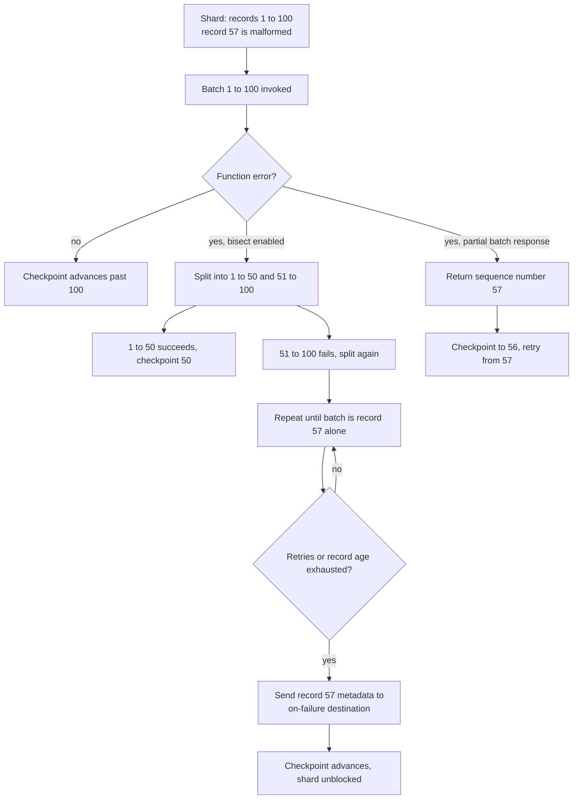

The controls work together:

- **`BisectBatchOnFunctionError`** splits a failing batch in two and retries each half, recursively, so that the good records in a batch are committed and the poison record is isolated. Bisection retries do not count against `MaximumRetryAttempts`.
- **`ReportBatchItemFailures`** for streams returns the sequence number of the first failed record. Lambda checkpoints just before it and retries from that record, which avoids reprocessing the successful prefix.
- **`MaximumRetryAttempts`** and **`MaximumRecordAgeInSeconds`** bound how long a poison record can block the shard. The defaults (-1, retry until the record expires) mean that with 7-day stream retention, one bad record can stop a shard for 7 days while `IteratorAge` climbs. Set both explicitly.
- **On-failure destination.** For streams, Lambda sends a JavaScript Object Notation (JSON) document describing the failed batch (shard and sequence range) to an SQS queue, SNS topic, S3 bucket, or Kafka topic. Only the S3 destination also receives the full invocation record ([DynamoDB Streams error handling](https://docs.aws.amazon.com/lambda/latest/dg/services-dynamodb-errors.html)). With SQS or SNS, the replay process must read the original records from the stream before they expire.

Ordering scope matters for correctness. Order is guaranteed only per shard (and per partition key with a parallelization factor above 1). Records with different keys on different shards are processed concurrently in no defined order. Kafka gives the same per-partition guarantee; SQS FIFO gives it per message group. Discarding a poison record to unblock a shard also breaks order for that key: the next record for the same key is processed without its predecessor. If that matters (an account balance update), park later records for the same key until the poisoned one is resolved. The general ordering model is owned by [Ordering Guarantees](../07_System_Design_and_Distributed_Systems/CH18_Ordering_Guarantees.md).

### 9.5 The retry and dead-letter lifecycle

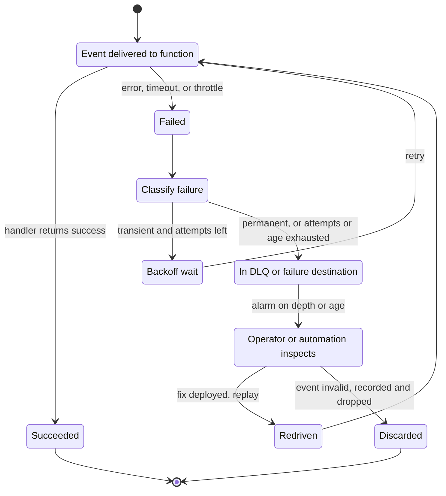

The state machine makes two design obligations visible. First, the **Classify** step should exist in your code, not only in the platform. A validation error will fail identically on every retry, so retrying it wastes attempts and delays the DLQ alarm. Catch permanent errors, record them, and either report the item as handled (sending it to your own quarantine store) or fail fast with retries disabled. Second, **Redriven** sends events back through the same function, so replay is itself a duplicate delivery. A DLQ is only useful if replay is safe, and replay is safe only if the side effects are idempotent. SQS supports redriving a DLQ back to its source queue from the console or API. Service Bus dead-letter subqueues and Pub/Sub dead-letter topics need a small replay consumer.

### 9.6 Google Cloud and Azure specifics

On Google Cloud, an event-driven Cloud Run function receives a CloudEvent over HTTP from Eventarc. A 2xx response acknowledges the event; any other response or a timeout is a failure. Retries are configured on the Eventarc trigger and its underlying Pub/Sub subscription, not on the function ([Cloud Run function retries](https://docs.cloud.google.com/run/docs/tips/function-retries)). With retries enabled, every unhandled error is retried until success or the retention window expires, so Google recommends an end condition in code: discard events whose timestamp is older than a threshold. Configure a dead-letter topic on the subscription with a maximum number of delivery attempts to stop infinite loops. The function's useful duration for Pub/Sub-transported events is bounded by the push subscription's acknowledgment deadline, which is at most 10 minutes, even though Cloud Run allows 60-minute HTTP requests.

On Azure, the Service Bus trigger completes the message when the function succeeds and abandons it when the function throws; the broker increments the delivery count and dead-letters it at the limit. Storage queue triggers behave the same way with a poison queue. For Event Hubs, Kafka, Cosmos DB, and Timer triggers, function-level retry policies (fixed delay or exponential backoff with a maximum retry count) re-execute the function in place before the checkpoint advances. Retry policies hold the instance and the partition while waiting, so long backoffs reduce throughput for that partition.

### 9.7 Idempotent side effects with idempotency keys

Every model above can deliver the same event more than once: retries after a timeout where the work had in fact completed, eventual consistency in Lambda's async queue, SQS standard queue at-least-once delivery, batch retries, stream re-reads after a checkpoint failure, and operator replay from a DLQ. The function must therefore produce the same business outcome for repeated deliveries.

The function-side recipe:

1. **Choose the key from the business operation, not the delivery.** Use the order ID, the payment intent ID, or a producer-generated event ID. Do not use the Lambda request ID or the SQS message ID alone; a retry by the producer creates a new message ID for the same operation.
2. **Claim the key atomically before the side effect.** Write a record with a conditional put (DynamoDB `attribute_not_exists`, a unique index in a Structured Query Language (SQL) database, or a Cosmos DB create that fails on conflict) in state `IN_PROGRESS` with an expiry slightly longer than the function timeout.
3. **Perform the side effect, passing the key downstream** when the downstream API supports idempotency keys (most payment APIs do).
4. **Record the outcome** in the same record (state `COMPLETED`, stored response).
5. **On a repeat,** return the stored outcome if `COMPLETED`; if `IN_PROGRESS` and not expired, fail with a retryable error so the platform retries later; if expired, the earlier attempt died, so take over the claim.

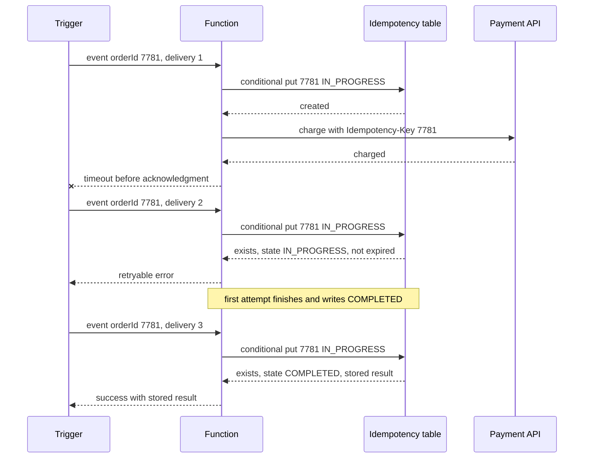

The sequence shows why the key is passed to the payment API as well: if the first attempt had died after charging but before writing `COMPLETED`, the claim would expire, a later delivery would take it over and call the API again, and only the API's own idempotency key would prevent a double charge. Function-local idempotency protects the function's writes; downstream idempotency protects effects the function cannot see.

[`03_retry_idempotency.py`](../code/python/serverless-chapter/03_retry_idempotency.py) demonstrates the suppression logic with an in-memory set: five deliveries of three event IDs produce three side effects and two suppressed duplicates. Its closing comment is the important part: production needs durable, atomic state, because an in-memory set lives in one execution environment, and the duplicate will usually arrive at a different one. Powertools for AWS Lambda provides an idempotency utility built on this pattern for Python, TypeScript, Java, and .NET.

## 10. Durable state and workflows

A function invocation is bounded in time and loses its memory when it ends. A business process that spans many steps, waits hours for a human approval, or must compensate earlier steps when a later one fails needs durable state that outlives any single invocation. Chaining functions through queues can do this, but the process state is then scattered across queue messages and logs, and nobody can answer "where is order 7781 right now?" Workflow services make that state explicit. The Saga pattern, compensation design, and orchestration versus choreography are owned by the [Saga Pattern](../07_System_Design_and_Distributed_Systems/CH13_Saga_Pattern.md) chapter; this section compares the provider engines.

### 10.1 AWS Step Functions: Standard and Express

Step Functions runs state machines defined in Amazon States Language, a JSON document of states (Task, Choice, Wait, Parallel, Map, Pass, Succeed, Fail) with per-state `Retry` and `Catch` blocks. It offers two workflow types with different guarantees ([Step Functions workflow types](https://docs.aws.amazon.com/step-functions/latest/dg/concepts-standard-vs-express.html)):

| Property | Standard | Express |
|---|---|---|
| Maximum duration | One year | Five minutes |
| Execution semantics | Exactly-once workflow execution: each state runs once unless you configure `Retry` | At-least-once (asynchronous start) or at-most-once (synchronous start) |
| Execution history | Persisted, retrievable through the API for 90 days after completion | Sent to Amazon CloudWatch Logs if logging is enabled |
| Billing | Per state transition | Per execution plus duration and memory |
| Suits | Long-running, auditable business processes; human approval; callbacks | High-volume, short event processing; data transformation |

"Exactly-once" here describes the engine's step bookkeeping, not your side effects. A Task state that calls a payment API and times out will be retried if you configured `Retry`, and the API will see two calls. Step Functions makes the workflow's position durable; the task still needs an idempotency key.

The **callback pattern** (`.waitForTaskToken`) pauses a Standard workflow until an external system returns the task token, without running any compute while waiting. That is how a workflow waits two days for a manual review at no compute cost.

### 10.2 Lambda durable functions

Lambda durable functions, announced at re:Invent 2025, put workflow durability inside a Lambda function's own code. The Durable Execution SDK records each durable operation (a step, a wait, a callback) in a checkpoint log. When the function suspends for a wait or fails, Lambda saves the log and stops. On resume, Lambda invokes the function from the beginning and replays the log, substituting stored results for completed operations so they are not executed again ([Lambda durable functions basic concepts](https://docs.aws.amazon.com/lambda/latest/dg/durable-basic-concepts.html)). A durable execution can last up to one year, and on-demand functions incur no compute charges while suspended.

Replay imposes a determinism rule: code outside durable steps runs again on every replay, so it must produce the same decisions each time. Reading the clock, generating random IDs, or calling an API outside a step breaks replay. Quotas at the time of writing include 30,000 durable operations per execution, 100 MB of checkpointed data per execution, and 1 MB per operation payload ([Lambda quotas](https://docs.aws.amazon.com/lambda/latest/dg/gettingstarted-limits.html)).

Choose durable functions when the workflow logic is naturally expressed as code by one team and the steps are mostly calls from that function. Choose Step Functions when the workflow coordinates many services through direct service integrations, needs a visual definition that non-developers review, or needs the 90-day execution history for audit.

### 10.3 Azure Durable Functions

Azure Durable Functions, an extension of Azure Functions, uses the same replay principle and predates the Lambda feature by several years. An **orchestrator function** describes the workflow in code and calls **activity functions** that do the work. **Entity functions** hold small pieces of durable state addressed by key. The extension stores orchestration history as an append-only event log in a storage backend. When an activity completes, the orchestrator replays from the start using recorded results. Orchestrator code must therefore be deterministic: use the orchestration context's current-time and new globally unique identifier (GUID) APIs instead of the system clock and random generators, and do no I/O directly.

Supported backends include Azure Storage and the managed Durable Task Scheduler; on Flex Consumption these two are the only supported providers ([Flex Consumption considerations](https://learn.microsoft.com/en-us/azure/azure-functions/flex-consumption-plan)). Activities run with at-least-once semantics, so activity side effects need idempotency keys. A timer in an orchestrator (`CreateTimer`) suspends the orchestration without holding an instance.

### 10.4 Google Cloud Workflows

Workflows defines a process in YAML Ain't Markup Language (YAML) or JSON as a sequence of steps that call HTTP endpoints, Google Cloud APIs through connectors, or Cloud Run functions and services. A workflow execution can run for up to one year, supports callbacks for external events, and has `try`/`retry`/`except` blocks with configurable backoff. Billing is per executed step, with internal steps (calls to Google APIs) cheaper than external HTTP steps. Workflows does not run your code; it orchestrates code running elsewhere, which keeps the orchestrator free of the determinism constraints of replay engines at the cost of expressing logic in a declarative language.

### 10.5 Choosing a workflow mechanism

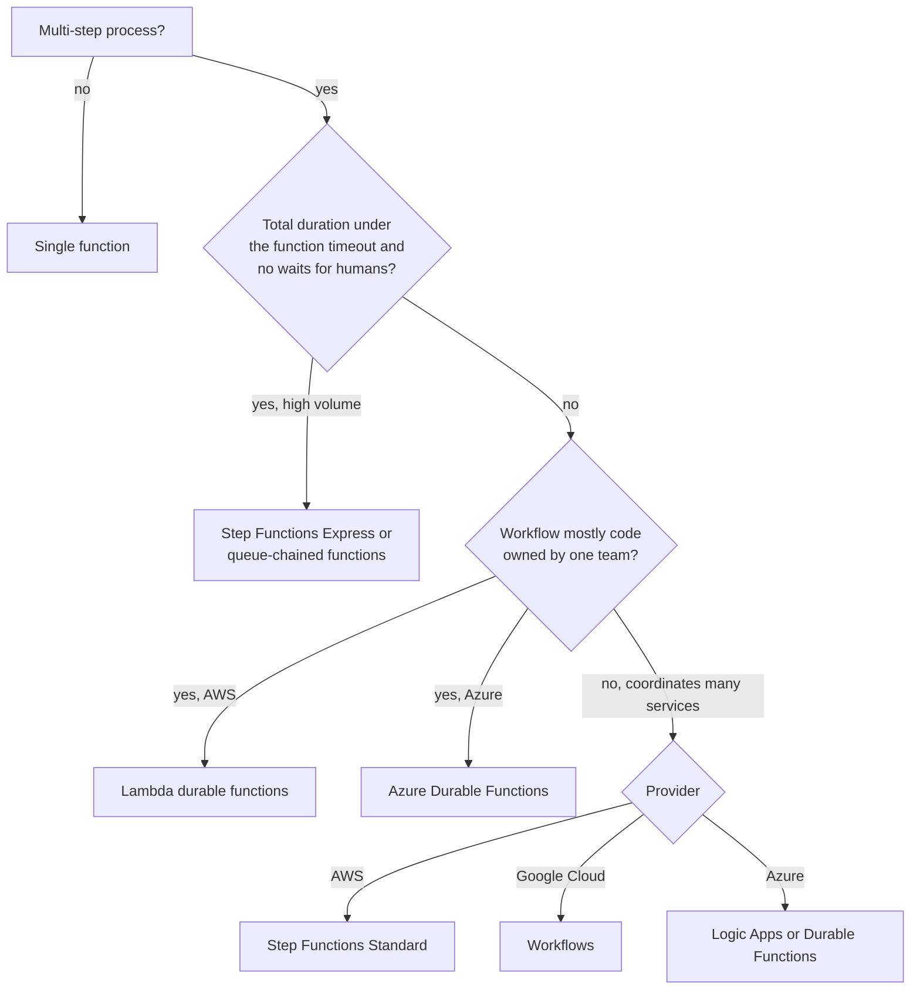

Whatever the engine, three rules carry over: every step that has an external effect needs an idempotency key derived from the workflow execution and step; compensations must themselves be idempotent; and the workflow's execution ID should appear in every log line and trace span the steps emit, so that the question "where is order 7781?" has one answer.

## 11. Serverless containers and the function boundary

Container mechanics (images, registries, revisions, traffic splitting, and scaling rules for Cloud Run, Azure Container Apps, and ECS on Fargate) are taught in [Containers](CH07_Containers.md#8-the-managed-container-execution-spectrum). The question for this chapter is narrower: when a workload is packaged as a container, which execution contract does it get?

- **A Lambda function packaged as a container image is still a Lambda function.** It has the same 900-second timeout, one-invocation-per-environment concurrency, event source mappings, and billing. The image (up to 10 GB) changes packaging, not behavior. The image must implement the Lambda Runtime API, usually by building on an AWS base image or adding the runtime interface client.
- **A Cloud Run function is a Cloud Run service** built from source by Cloud Build with Google Cloud's buildpacks and stored in Artifact Registry ([Deploy a Cloud Run function](https://cloud.google.com/run/docs/deploy-functions)). The build service and the registry are therefore part of the deployment path: if the build identity lacks permission or the registry is unavailable in the region, deployment fails even though the function code is fine. Once deployed, the function and a hand-built container service have the same scaling and billing contract.
- **Azure Functions on Container Apps** runs the Functions host in a container you build, inside a Container Apps environment, with KEDA-based scaling. You get the Functions programming model and triggers with Container Apps' networking and graphics processing unit (GPU) options.
- **Lambda Web Functions** (new at the time of writing, Node.js only) and **Lambda Managed Instances** move Lambda toward the container contract: one environment serves many concurrent requests, and Managed Instances run on Amazon Elastic Compute Cloud (EC2) instances in your account through a capacity provider, billed at EC2 rates plus a management fee, with a minimum function size of 2 GB and 1 vCPU ([Lambda Managed Instances](https://docs.aws.amazon.com/lambda/latest/dg/lambda-managed-instances.html)). Managed Instances scale asynchronously on CPU and concurrency saturation rather than on invocation arrival, so they have no per-invocation cold start but also no instant burst.

The boundary to remember: a serverless container gives you a long-lived HTTP server with many concurrent requests per instance and a request timeout up to an hour; a classic function gives you one invocation per environment, native event source mappings, and per-invocation retries. Section 16 turns this into a decision tree.

## 12. Permissions: execution identity versus invocation permission

A function has two independent permission questions, and conflating them is the most common serverless IAM error.

1. **What may the function do?** This is the function's **execution identity**: the Lambda execution role, the Azure Functions managed identity, or the Cloud Run service identity (a service account). It authorizes the function's calls to databases, queues, and storage.
2. **Who may invoke the function?** This is the **invocation permission**: a resource-based policy on the Lambda function, the Azure Functions HTTP authorization level or Microsoft Entra ID authentication, or the Cloud Run `roles/run.invoker` binding on the service.

Policy evaluation across identity and resource policies is owned by [IAM](CH09_IAM.md). The diagram applies it to a function.

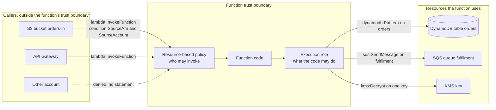

The left half of the diagram is checked when the call arrives; the right half is checked each time the function calls an AWS API. A push source (S3, SNS, EventBridge, API Gateway) needs a statement in the function's resource-based policy. A poll-based source is different: the event source mapping polls with the **function's execution role**, so reading from SQS or Kinesis requires `sqs:ReceiveMessage`, `sqs:DeleteMessage`, or the stream read permissions in the execution role, and no resource-based policy is involved.

A minimal resource-based policy statement for an S3 trigger, with the conditions that prevent another account's bucket of the same name from invoking the function:

```json
{
  "Sid": "AllowOrdersBucket",
  "Effect": "Allow",
  "Principal": { "Service": "s3.amazonaws.com" },
  "Action": "lambda:InvokeFunction",
  "Resource": "arn:aws:lambda:eu-west-1:111122223333:function:ingest-order",
  "Condition": {
    "ArnLike": { "AWS:SourceArn": "arn:aws:s3:::orders-in" },
    "StringEquals": { "AWS:SourceAccount": "111122223333" }
  }
}
```

The `SourceAccount` condition matters because S3 bucket ARNs do not contain an account ID. Without it, if the bucket is deleted and someone in another account creates a bucket with the same name, their events could invoke your function.

The same split on the other providers:

- **Azure Functions.** The function app's system-assigned or user-assigned managed identity receives Azure role-based access control (RBAC) roles on target resources. Identity-based connections for triggers (for example `AzureWebJobsStorage__accountName` or a Service Bus connection with `__fullyQualifiedNamespace`) let the host itself use the managed identity instead of connection strings with keys. Invocation of HTTP functions is controlled by authorization level (anonymous, function key, admin key) or, better, by App Service authentication with Microsoft Entra ID.
- **Cloud Run functions.** The service runs as a service identity (a user-managed service account is strongly preferable to the default compute service account, which often has broad Editor permissions in older projects). Invocation requires `roles/run.invoker` on the service: grant it to `allUsers` only for public endpoints, and grant it to the Eventarc trigger's service account for event-driven functions. The build path uses a separate Cloud Build service account, so build permissions and runtime permissions should be different principals.

Least-privilege rules that apply on every provider: one identity per function (a shared role across fifty functions means a compromise of any one grants all fifty functions' permissions); scope actions to specific resource ARNs or IDs; separate build and deployment identity from runtime identity; and never put long-lived keys in environment variables. Secrets should be fetched at runtime from a secret store and cached with a refresh interval, as taught in [Secrets Management](CH13_Secrets_Management.md).

## 13. Networking

By default, every major function platform runs functions in a provider-owned network with outbound internet access and no access to private resources in your network. Private connectivity, endpoint design, and egress control are owned by [Networking](CH05_Networking.md). This section covers what is specific to functions.

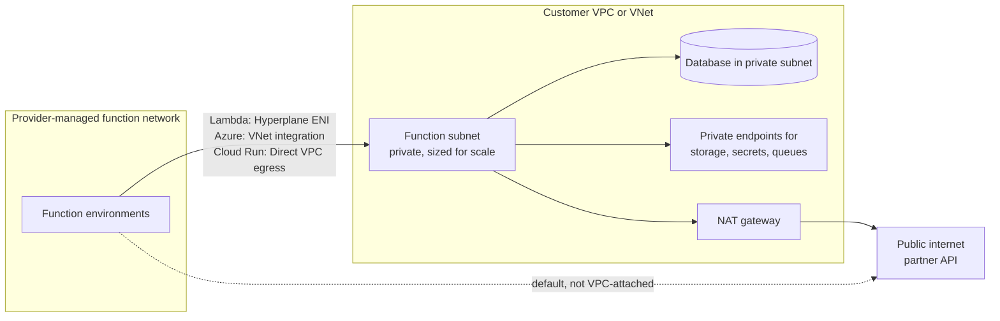

When a function is attached to a private network, its outbound traffic leaves through the customer subnet and follows the customer's routes. That has three consequences that teams routinely miss.

- **Lambda functions in a VPC lose direct internet access.** A function attached to private subnets reaches the internet, including public AWS service endpoints, only through a network address translation (NAT) gateway or through VPC endpoints for the specific services. A function that times out calling DynamoDB right after VPC attachment usually lacks a route or a gateway endpoint, not permission. Attaching a Lambda function to a public subnet does not give it internet access, because the Hyperplane ENI has no public IP address.
- **Subnet size is a scale limit on some platforms.** Lambda's Hyperplane ENIs are shared, so subnet IP consumption is low. Cloud Run Direct VPC egress assigns addresses from the subnet to instances, and Azure Flex Consumption uses a delegated subnet (delegation `Microsoft.App/environments`), so a small subnet caps instance count. Size the subnet for maximum instances plus deployment overlap.
- **Egress IPs become stable.** Partners that allow-list caller IP addresses can be given the NAT gateway's public address. Without VPC attachment, function egress comes from a large, changing provider range.

Inbound private access is a separate feature. Lambda functions can be invoked privately through an interface VPC endpoint for the Lambda API, and API Gateway private APIs restrict HTTP access to a VPC endpoint. Azure Functions on Flex Consumption and Premium support private endpoints for inbound HTTP. Cloud Run supports internal ingress settings that accept traffic only from the VPC or through an internal load balancer.

## 14. Observability

Serverless observability must answer questions that do not arise with long-lived servers: was this invocation cold, was it a retry, did the platform throttle it, and how old was the event when it arrived? Telemetry pipelines and cross-account monitoring are owned by [Monitoring](CH10_Monitoring.md); this section lists what to collect.

### 14.1 Signals that matter

| Question | Lambda (CloudWatch) | Azure Functions (Application Insights, Azure Monitor) | Cloud Run functions (Cloud Monitoring) |
|---|---|---|---|
| Is it failing? | `Errors`, `Invocations`, `DeadLetterErrors`, `DestinationDeliveryFailures` | Failed executions, exceptions | Request count by response code |
| Is it throttled? | `Throttles`, account `ConcurrentExecutions`, `UnreservedConcurrentExecutions` | Scale controller logs, quota throttling | Instance count at max instances, 429 responses |
| Are events late? | `AsyncEventAge`, `AsyncEventsDropped`, `IteratorAge` for streams | Queue length, Event Hubs consumer lag | Pub/Sub oldest unacknowledged message age |
| Is it cold? | `Init Duration` in `REPORT` log, `INIT_REPORT` | Host startup and worker initialization traces | Container startup latency |
| Is it slow? | `Duration` percentiles, `PostRuntimeExtensionsDuration` | Execution duration | Request latencies |
| Is it costly? | Billed duration, memory used versus configured | Execution units, GB-seconds | Billable instance time |

Three alarms catch most serverless incidents early: age of the oldest unprocessed event (`AsyncEventAge`, `IteratorAge`, queue age), DLQ depth greater than zero, and concurrency above 80 percent of the relevant quota or reservation. Error rate alone misses the stuck-shard failure, in which the error count is a steady trickle while the iterator age grows for hours.

### 14.2 Correlation

Each invocation has a platform request ID, but a business operation spans many invocations, retries, and services. Log three identifiers on every line: the platform request ID, the business key (order ID, used also as the idempotency key), and the trace ID propagated from the event's trace headers (AWS X-Ray or OpenTelemetry trace context). Structured JSON logging with those fields makes "show me everything that happened to order 7781, including retries" a single query. Distributed tracing works across asynchronous hops only when the producer injects trace context into the event and the function extracts it. EventBridge, SQS, and SNS carry X-Ray trace headers; OpenTelemetry instrumentation through the AWS Distro for OpenTelemetry (ADOT) Lambda layer, Azure Monitor OpenTelemetry, and Cloud Trace covers the rest.

### 14.3 Logging cost and payload hygiene

Log ingestion is often a larger line item than compute for small, high-volume functions. A function that logs the full 20 KB event on every one of 100 million monthly invocations writes 2 terabytes of logs a month. Log the business key and a schema version, not the payload; sample debug logs; and set retention explicitly. Never log secrets or personal data contained in events. Log level, retention, and sampling should be configuration, not code.

## 15. Pricing and cost

Billing data, allocation, and anomaly response are owned by [Cost Optimization](CH14_Cost_Optimization.md). This section teaches the serverless meters and how they compare with always-on capacity.

### 15.1 The meters

**Lambda** (us-east-1, x86, at the time of writing, from [Lambda pricing](https://aws.amazon.com/lambda/pricing/)):

- Requests: $0.20 per million.
- Duration: $0.0000166667 per GB-second, where GB-seconds = invocations × billed duration in seconds × configured memory in GB. Duration is rounded up to the nearest millisecond and, since August 2025, includes Init for on-demand Zip functions on managed runtimes. Arm-based functions have a lower GB-second rate.
- Provisioned concurrency: $0.0000041667 per GB-second of provisioned capacity while enabled, plus duration at $0.0000097222 per GB-second for invocations on it. The free tier does not apply.
- Free tier: 1 million requests and 400,000 GB-seconds per month.
- Adjacent: SQS provisioned-mode event pollers, SnapStart caching and restore for Python and .NET, CloudWatch Logs, data transfer, NAT gateway processing for VPC-attached functions.

**Azure Functions Flex Consumption** bills on-demand execution memory in GB-seconds and executions, with monthly free grants, and bills always-ready instances a baseline GB-second rate for their memory plus execution time. The minimum billable execution is 1,000 ms, then rounded up to 100 ms ([Flex Consumption billing](https://learn.microsoft.com/en-us/azure/azure-functions/flex-consumption-plan)). That minimum means a 50 ms function is billed as 1 second, which changes the comparison for very short executions. Premium bills each allocated instance by core-hour and memory-hour whether busy or not. Check the [Azure Functions pricing page](https://azure.microsoft.com/pricing/details/functions/) for current rates.

**Cloud Run functions** are billed as Cloud Run services ([Cloud Run pricing](https://cloud.google.com/run/pricing), Tier 1 regions at the time of writing):

- Request-based billing: $0.000024 per vCPU-second and $0.0000025 per GiB-second while an instance is starting, handling at least one request, or shutting down, plus $0.40 per million requests. Minimum instances that are idle are billed at an idle rate.
- Instance-based billing: $0.000018 per vCPU-second and $0.000002 per GiB-second for the instance's whole lifetime, no per-request fee.
- Concurrency changes the arithmetic: with 80 concurrent requests sharing one instance, the instance-second is shared by up to 80 requests, whereas Lambda bills each concurrent invocation separately.
- Adjacent: Cloud Build minutes and Artifact Registry storage for builds, and Eventarc delivery.

### 15.2 Worked cost comparison: function versus container

The base case matches [`01_execution_cost.py`](../code/python/serverless-chapter/01_execution_cost.py): 8 million invocations per month, 180 ms average billed duration, 512 MB memory.

**Lambda, low volume.**

- GB-seconds = 8,000,000 × 0.18 × 0.5 = 720,000.
- Duration cost = 720,000 × $0.0000166667 = $12.00.
- Request cost = 8 × $0.20 = $1.60.
- Total before free tier: $13.60. After the free tier: (720,000 − 400,000) × $0.0000166667 + (8 − 1) × $0.20 = $5.33 + $1.40 = $6.73.

**Always-on container alternative.** A Cloud Run service with instance-based billing, 1 vCPU and 0.5 GiB, running all month (30 days = 2,592,000 seconds):

- Per instance: 2,592,000 × ($0.000018 + 0.5 × $0.000002) = 2,592,000 × $0.000019 = $49.25.
- Two instances for availability: $98.50.

At 3 requests per second average, the function costs a fraction of the always-on container. The always-on option is paying for idle capacity.

**High volume.** Now 200 requests per second steady, same 180 ms and 512 MB. The workload is I/O-bound: each request uses 20 ms of CPU and waits 160 ms on a database.

- Monthly invocations = 200 × 2,592,000 = 518.4 million.
- Lambda GB-seconds = 518,400,000 × 0.18 × 0.5 = 46,656,000; duration cost = 46,656,000 × $0.0000166667 ≈ $777.60.
- Lambda requests = 518.4 × $0.20 = $103.68.
- Lambda total ≈ $881 per month, before free tier.

Container sizing with Little's Law: in-flight requests = 200 × 0.18 = 36. CPU actually used = 200 × 0.02 = 4 vCPU-seconds per second. At a 60 percent CPU utilization target, the fleet needs 4 ÷ 0.6 ≈ 6.7 vCPU, so 8 instances of 1 vCPU for headroom and zone spread. Each instance handles about 36 ÷ 8 ≈ 5 concurrent requests, well within a concurrency of 80.

- Container cost = 8 × $49.25 = $394 per month.

The container is cheaper because Lambda bills each invocation's full 180 ms of wall-clock time at its configured memory, including the 160 ms spent waiting, while the container's instances share CPU among concurrent requests and are billed for capacity, not per request.

**Break-even.** Lambda's marginal cost per request here is 0.18 × 0.5 × $0.0000166667 + $0.0000002 = $0.0000015 + $0.0000002 = $0.0000017. The 8-instance fleet costs $394 regardless of load. Break-even volume = $394 ÷ $0.0000017 ≈ 232 million requests per month, or about 89 requests per second sustained. Below that, the function is cheaper; above it, the container is cheaper, provided the container fleet can be kept at the assumed utilization.

What the arithmetic leaves out, and must be added before a decision:

- **Operations.** The container needs an image pipeline, base-image patching, health checks, and scaling configuration ([Containers](CH07_Containers.md)). The function needs fewer of these.
- **Traffic shape.** The calculation assumed steady 200 requests per second. A workload that runs at 400 for 6 hours and near zero otherwise has a much lower Lambda bill and needs the container fleet to autoscale, which brings warm-up and minimum-capacity costs.
- **Adjacent charges.** NAT gateway processing, log ingestion, and load balancers often exceed the compute delta.
- **Multi-concurrent functions.** Azure Flex Consumption and Cloud Run functions share instances across concurrent executions, so they behave more like the container line than the Lambda line at high volume. Lambda Web Functions and Managed Instances exist for the same reason.

A VM alternative has the same shape as the container line with a lower unit price and a higher operating burden: operating-system patching, image baking, and an autoscaling group, as taught in [Compute](CH04_Compute.md). Commitment discounts (Savings Plans, committed use discounts) lower both the container and VM lines for steady load and also apply to Lambda and Cloud Run in some forms.

### 15.3 Cost failure modes

- **Retry storms.** A downstream outage makes every invocation time out at the full timeout, and the platform retries each one. A function with a 30-second timeout that normally runs 200 ms costs 150 times more per attempt during the outage, multiplied by retries.
- **Recursive triggers.** Section 8.3.
- **Over-provisioned warm capacity.** Provisioned concurrency left on after a launch. 100 environments at 2 GB for a month cost 100 × 2 × 2,592,000 × $0.0000041667 ≈ $2,160 before any invocation.
- **Minimum billing granularity.** Azure Flex Consumption's 1,000 ms minimum makes very short executions relatively expensive; batching several events into one execution amortizes it.

## 16. Serverless versus container versus VM

The compute-wide decision tree, including accelerators and Kubernetes, is in [Compute](CH04_Compute.md#16-workload-to-compute-decision-tree). The tree below zooms into the serverless end and the boundary with containers and VMs.

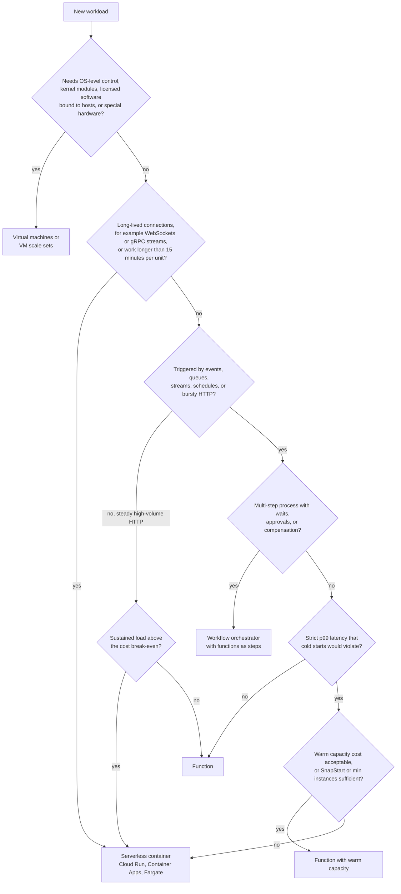

How to read the tree. The first two questions are hard constraints: a function cannot load a kernel module or hold a WebSocket open for an hour, so no amount of cost advantage changes the answer. The middle questions are about fit: event-shaped work matches the function invocation contract directly, while steady HTTP traffic above the break-even point (Section 15.2) is cheaper on a container. The final questions trade latency against warm-capacity cost. Two outcomes deserve emphasis. A workflow orchestrator is chosen for state, not for compute, and usually calls functions as its steps. "Function with warm capacity" is a legitimate answer, but if most of the function's traffic runs on provisioned capacity, compare it with a container again, because you are paying for always-on capacity with function limits attached.

[`04_service_fit.py`](../code/python/serverless-chapter/04_service_fit.py) scores a function service, a serverless container, and a managed worker fleet against weighted requirements (event fit, long-running fit, custom runtime fit, operational simplicity). With strong event fit and low need for long-running execution, the function scores highest. Treat the scores as prompts for the review conversation, not as the decision.

## 17. Security across the serverless path

Security foundations are owned by [Part 15 Security](../15_Security/PART_OVERVIEW.md). The serverless-specific concerns:

- **Event injection.** Every event field is untrusted input, including fields from "internal" sources such as an S3 object key or a queue message written by another team. Object keys reach shell commands, SQL, and file paths. Validate against a schema and parameterize every query.
- **Over-privileged execution identities.** Section 12. Wildcard actions on a function exposed to the internet turn an input-validation bug into an account compromise. IAM Access Analyzer on AWS and the IAM Recommender on Google Cloud report unused permissions; on Azure, periodic access reviews of managed identity role assignments serve the same purpose.
- **Unauthenticated invocation.** Function URLs with `AuthType NONE`, Azure HTTP functions at anonymous level, and Cloud Run functions granting `roles/run.invoker` to `allUsers` are public endpoints. Make each one a deliberate, reviewed decision.
- **Dependency and image supply chain.** The deployment package is the attack surface. Pin dependencies, scan packages and images, and sign artifacts. Lambda code signing with AWS Signer rejects unsigned Zip deployments.
- **Secrets in environment variables.** Environment variables are visible to anyone with read access to the function configuration. Lambda encrypts them at rest with AWS Key Management Service (KMS), but encryption at rest does not restrict who can read the configuration. Store secrets in a secret store and reference them.
- **Denial of wallet.** An attacker who can invoke a public function can run up the bill. Throttling at the gateway, reserved concurrency as a ceiling, maximum instance counts, and budget alarms bound the damage.
- **Isolation.** Lambda's Firecracker microVMs and Cloud Run's sandboxes isolate tenants from each other. An environment is reused only for the same function version, so data in `/tmp` from one invocation is visible to the next invocation of the same function. Clear sensitive temporary files in the handler.

## 18. Failure scenarios and quality scenarios

### 18.1 Failure catalog

| Failure | Symptom | Likely cause | Response |
|---|---|---|---|
| Throttling | HTTP 429, `Throttles` metric, async event age rising | Account or reserved concurrency exhausted; per-function scaling rate during burst | Raise quota, reserve for critical functions, buffer with a queue, provision ahead of known events |
| Stuck shard | `IteratorAge` climbs steadily, low steady error rate | Poison record with default infinite retries | Set `MaximumRetryAttempts` and `MaximumRecordAgeInSeconds`, enable bisection and partial batch response |
| Healthy messages in DLQ | DLQ fills without function errors | Reserved concurrency below SQS poller concurrency; `maxReceiveCount` too low | Use mapping maximum concurrency; set `maxReceiveCount` to at least 5 |
| Database connection exhaustion | Connection refused errors, then function timeouts | Function concurrency exceeds connection budget | Cap concurrency from the budget; add a connection pooler |
| Duplicate side effects | Double emails or charges | Retry after timeout, batch retry, DLQ replay | Idempotency keys with atomic claim (Section 9.7) |
| Orphaned work | Function completes after caller gave up | Function timeout above upstream timeout | Align timeouts down the chain (Section 7.4) |
| Silent event loss | Downstream missing records, no errors | Event Hubs checkpoint after failure; async events aged out with no destination | Configure destinations and retries; alarm on `AsyncEventsDropped` |
| Init failure after deploy | All invocations fail with init errors | Missing environment variable, secret, or permission at startup | Deploy with aliases or revisions and shift traffic gradually; roll back |
| Regional quota exhaustion on Flex Consumption | Apps in one region stop scaling | Shared regional memory quota consumed | Request quota increase; set maximum instance counts per app |
| VPC egress failure | Timeouts on AWS API calls after VPC attachment | No NAT gateway or VPC endpoint | Add endpoints or NAT; test from the function |

### 18.2 Zonal failure

Lambda, Azure Functions on zone-redundant Flex Consumption or Premium plans, and Cloud Run functions run across multiple zones within a region and route around a failed zone without customer action. The customer-owned parts of the path decide whether the workload survives:

| Element | Value |
|---|---|
| Stimulus | One availability zone in the region becomes unavailable |
| Environment | VPC-attached Lambda functions, Amazon RDS for PostgreSQL Multi-AZ, NAT gateways |
| Expected response | Lambda places environments in the remaining zones' subnets; RDS fails over to the standby; functions reconnect |
| Success criterion | Error rate below 1 percent within 3 minutes of the zone loss; no lost events (queue depth recovers, DLQ stays empty) |
| Preconditions | Function subnets configured in at least two zones; one NAT gateway per zone with per-zone routes; database clients retry connections with backoff |

A function attached to a single subnet in one zone loses that resilience entirely. On Azure Flex Consumption, zone redundancy requires at least two always-ready instances per function group, so enabling it has a baseline cost.

### 18.3 Quota limit during scale-out

Covered in Section 6.7 for Lambda. The Azure equivalent is the Flex Consumption regional subscription memory quota, and the Google Cloud equivalent is the Cloud Run maximum instances and regional CPU quota. The same response pattern applies: reserve or cap critical paths, alarm at 80 percent of the quota, request increases before planned events, and verify in a load test.

### 18.4 Identity or key rotation

| Element | Value |
|---|---|
| Stimulus | The database password used by 40 function environments is rotated by the secret store |
| Environment | Lambda functions cache the secret in Init with a 5-minute refresh; rotation uses the two-version (alternating users or pending and current versions) strategy |
| Expected response | Functions keep working with the previous credential until refresh, then switch; on an authentication error, a function refreshes the secret immediately and retries once |
| Success criterion | Zero authentication errors visible to callers during rotation; all environments on the new credential within 5 minutes |
| Failure mode avoided | A function that cached the secret forever keeps the old credential until its environment is recycled, which on Lambda may be hours, and fails when the old credential is revoked |

Execution role credentials themselves are short-lived and rotated by the platform (Lambda injects temporary credentials into the environment). Long-lived keys should not exist in a serverless design; if a third-party API key must be used, it belongs in the secret store with the same refresh-on-failure logic. Rotation state machines are owned by [Secrets Management](CH13_Secrets_Management.md).

### 18.5 Migration with reversible cutover

Lambda aliases with weighted routing, Azure Functions deployment slots (Premium and Dedicated) or rolling updates (Flex Consumption), and Cloud Run revision traffic splitting all allow gradual shifts between versions. For event-driven functions the reversible cutover is harder than for HTTP, because events are not routed by weight in the same way.

| Element | Value |
|---|---|
| Stimulus | A new version of an SQS-triggered order function changes the order record schema |
| Expected response | Version 2 is deployed behind an alias; the event source mapping points at the alias; CodeDeploy shifts 10 percent of invocations to version 2 for 15 minutes, then all |
| Success criterion | Automatic rollback to version 1 if the error alarm fires during the shift; no event processed by both versions with conflicting results |
| Precondition | Both versions read and write a schema that the other version understands (expand and contract), because during the shift, and after a rollback, records written by version 2 are read by version 1 |

The precondition is the real constraint. Traffic routing is reversible; data written by the new version is not. Progressive delivery techniques are owned by [Progressive Delivery](../13_DevOps/CH13_Progressive_Delivery.md).

## 19. Provider comparison: guarantees, scopes, and responsibilities

| Dimension | AWS Lambda (Event Functions) | Azure Functions (Flex Consumption) | Google Cloud Run functions |
|---|---|---|---|
| Concurrency per environment | One invocation at a time (Web Functions and Managed Instances: many) | Many executions per instance, configurable | Many requests per instance, 1 to 1,000 |
| Scaling unit and scope | Per function; account pool per Region | Per function group; regional subscription memory quota | Per service or revision; maximum instances setting |
| Scale rate | 1,000 environments per 10 s per function | Platform scale curve, fast at small sizes | Platform managed; maximum may be briefly exceeded |
| Native poll-based sources | SQS, Kinesis, DynamoDB Streams, Kafka, MQ, DocumentDB through event source mappings | Service Bus, Storage queues, Event Hubs, Kafka, Cosmos DB through host extensions | None; events pushed through Eventarc and Pub/Sub |
| Async retry owner | Lambda internal queue: 2 retries, up to 6 h | Source-specific (Event Grid, Service Bus, queues) | Eventarc and Pub/Sub subscription |
| Partial batch failure | `ReportBatchItemFailures` for SQS and streams | Per-message completion for Service Bus; none built in for Event Hubs | Not applicable; one event per request |
| Warm capacity | Provisioned concurrency; SnapStart | Always-ready instances | Minimum instances |
| Maximum duration | 15 min (90 min on Managed Instances for async and mappings) | Unbounded by default plan setting; 230 s for HTTP responses | 60 min HTTP; event delivery bounded by acknowledgment deadline |
| Durable workflow | Step Functions; Lambda durable functions | Durable Functions | Workflows |
| Execution identity | Execution role | Managed identity | Service account |
| Invocation authorization | Resource-based policy; IAM for direct invoke | Function keys or Entra ID authentication | `roles/run.invoker` |
| Private network egress | Hyperplane ENI in customer subnets | VNet integration through delegated subnet | Direct VPC egress or connector |
| Billing unit | Requests plus GB-seconds per invocation | Executions plus GB-seconds; 1 s minimum | vCPU-seconds and GiB-seconds per instance, plus requests |
| Provider responsibility | Runtime patching for managed runtimes, placement, scaling | Host and runtime patching, scaling | Base image updates for managed runtimes, scaling |
| Customer responsibility | Code, dependencies, idempotency, concurrency limits, IAM, VPC design | Same, plus plan and quota selection | Same, plus concurrency safety and build identity |

Similar names hide different guarantees. "Concurrency" on Lambda counts environments; on Cloud Run it counts requests inside an instance. "Retries" on Lambda async are a function setting; on Cloud Run functions they are a property of the trigger's subscription. "Maximum instances" on Cloud Run is a soft cap with documented overshoot; reserved concurrency on Lambda is a hard cap. Design reviews should compare these semantics, not product names.

## 20. Case study: an insurance claims intake platform

### 20.1 Context

A mid-sized insurer receives motor insurance claims through a mobile app and a partner portal. Each claim includes a form (about 8 KB of JSON) and 3 to 12 photographs (2 to 6 MB each). Volume averages 4 claims per minute, with storm-driven peaks of 600 claims per minute lasting up to 3 hours, about 150 times the average. The current system runs on six always-on VMs that are sized for peak and sit about 3 percent utilized on a normal day. Claims are processed by: intake validation, photo virus scanning and thumbnailing, a fraud score from a third-party API limited to 50 requests per second, a policy lookup in a PostgreSQL database with a 400-connection limit shared by several applications, and a human adjuster review that can take two days. The team runs on AWS, with a group subsidiary on Azure that may adopt the design later.

Requirements and constraints:

- Intake API p99 under 1.5 seconds; the app must show "claim received" immediately.
- No claim may be lost or processed twice in a way that creates two claim records or two fraud-API charges.
- The intake must absorb a 150× peak without manual action.
- The claims database team grants this platform at most 100 connections.
- Audit requires the full history of each claim's processing steps for seven years.

### 20.2 Decisions

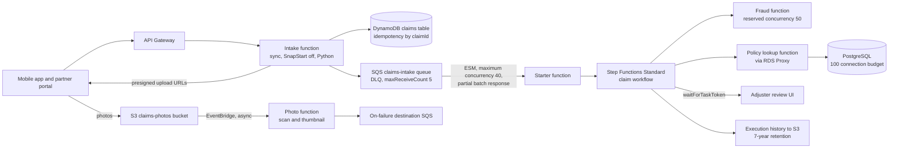

1. **Synchronous intake that returns quickly.** The intake function validates the form, writes the claim record to DynamoDB with a conditional put on a client-generated `claimId` (the mobile app creates it before the first attempt, so retries reuse it), returns presigned S3 upload URLs for the photos, and enqueues a message. It responds in about 150 ms warm. Rejected alternative: processing photos inside the request, which would push p99 past 10 seconds and couple intake availability to the scanner.
2. **Photos never pass through a function payload.** The 6 MB synchronous payload limit and the 1 MB asynchronous limit rule it out, and the claim-check design (Section 7.3) keeps photographs out of logs and DLQs. Photo uploads trigger the photo function asynchronously through EventBridge, with `MaximumRetryAttempts` 2, `MaximumEventAgeInSeconds` 3,600, and an on-failure destination. Output thumbnails go to a separate bucket to prevent a recursive trigger.
3. **A queue absorbs the storm.** At 600 claims per minute (10 per second), intake writes 10 messages per second. The starter function's mapping maximum concurrency of 40 is far above need, so the queue mostly smooths retries rather than holding a backlog.
4. **Step Functions Standard for the claim workflow.** The workflow waits up to two days for an adjuster through the callback pattern at no compute cost, its per-step history satisfies audit after export to S3 (the API retains it for 90 days), and its exactly-once step bookkeeping means each claim has one authoritative position. Rejected alternatives: Express workflows (5-minute maximum), chained queues (no single view of a claim's state), and Lambda durable functions (viable, but the audit team wanted the visual state machine definition and the service integrations to DynamoDB without code).
5. **Concurrency sized from the fraud API limit.** The fraud call takes 0.8 seconds p50 and 1.6 seconds p99. Little's Law at the 50 requests per second limit with average 1.0 s gives 50 concurrent calls. Reserved concurrency of 50 on the fraud function caps it. Step Functions `Retry` with exponential backoff on `Lambda.TooManyRequestsException` absorbs throttles. The fraud API accepts an idempotency key, set to `claimId`, so a retried call is not charged twice.
6. **Database protection.** The policy lookup takes 120 ms with one connection. At peak 10 claims per second, concurrency is 10 × 0.12 = 1.2. Reserved concurrency of 30 leaves wide headroom and still bounds connections to 30 through RDS Proxy, well under the 100-connection budget, leaving room for the photo function's metadata writes.
7. **Cold starts accepted on the intake path after measurement.** The Python intake function's measured `Init Duration` is 420 ms p99 at 1,024 MB. Cold p99 end-to-end measured 780 ms, under the 1.5 s objective, so neither provisioned concurrency nor SnapStart was enabled. The decision is revisited if a dependency increases Init.

### 20.3 Capacity and quota arithmetic

Peak concurrency across all functions in the account:

| Function | Peak rate | Duration | Concurrency |
|---|---|---|---|
| Intake | 10 claims/s plus 20 percent retries = 12/s | 0.15 s | 1.8 |
| Photo | 10 claims/s × 8 photos average = 80/s | 2.5 s | 200 |
| Starter | 10/s | 0.1 s | 1 |
| Fraud | 10/s | 1.0 s | 10 (capped at 50) |
| Policy lookup | 10/s | 0.12 s | 1.2 (capped at 30) |
| Total | | | about 214 |

The photo function dominates. With the default 1,000 account quota and other applications in the account using up to 400 at their own peaks, headroom is 1,000 − 400 − 214 = 386, adequate but not generous. The team requested an increase to 3,000 to allow for a storm coinciding with month-end batch jobs, and set CloudWatch alarms at 80 percent of the account quota.

Monthly cost estimate for a month with two storm days (compute only, us-east-1 x86, before free tier):

- Photo function: average 4 claims per minute × 8 photos = 32 photos per minute ≈ 1.38 million photos per normal month, plus storm days at 600 claims per minute for 3 hours each (600 × 180 minutes × 8 × 2 storms ≈ 1.73 million). Total about 3.1 million invocations × 2.5 s × 1.5 GB = 11.6 million GB-seconds ≈ $194, plus $0.62 for requests.
- All other functions together: under $20.
- Step Functions: about 390,000 claims per month (4 per minute × 43,200 minutes = 172,800 normal, plus 600 × 180 × 2 = 216,000 on storm days) × about 12 state transitions per claim ≈ 4.7 million transitions. At the Standard rate per 1,000 transitions on the pricing page at the time of writing, this is the second largest line item. Verify current rates.

The previous six always-on VMs cost about three times more per month and were still at risk of saturation in an unusually large storm.

### 20.4 Validation evidence

- **Load test** replaying a recorded storm at 1.5× (900 claims per minute for 30 minutes): intake p99 910 ms; zero throttles on intake; photo function peaked at 310 concurrent; fraud function throttled at 50 as designed, with Step Functions retries absorbing all throttles; DLQs empty.
- **Duplicate injection test:** every message in a 10,000-claim test was delivered twice by a test harness; the DynamoDB conditional writes and fraud API idempotency key produced exactly 10,000 claim records and 10,000 fraud charges.
- **Poison test:** a malformed photo (a renamed executable) was rejected by the scanner as a permanent error, recorded in the quarantine table, and did not retry. A photo that crashed the thumbnailer went to the on-failure destination after three attempts with the error context attached.
- **Zonal failure game day:** the team removed one zone's subnet from the photo function's VPC configuration during a load test. Error rate stayed under 0.3 percent.
- **Rotation test:** the RDS Proxy secret rotated during the load test; the policy function saw no authentication errors because RDS Proxy fetches credentials from Secrets Manager itself.

### 20.5 What remained open

The Azure subsidiary can replicate the design with an HTTP-triggered function on Flex Consumption, Blob triggers through Event Grid, Service Bus with `maxConcurrentCalls`, and Durable Functions for the workflow. Two differences need their own decisions: Durable Functions replaces the visual state machine with orchestrator code, which the audit team must accept, and the Flex Consumption regional memory quota is shared with other apps in the subscription and region, so the photo function group needs a maximum instance count and a quota increase. The team also recorded a risk: the photo function's 2.5-second duration is mostly virus scanning, and a scanner upgrade that doubles it would double concurrency to about 400 at peak.

## 21. Common mistakes and anti-patterns

- **Treating function invocation as exactly once.** Cause: assuming the platform delivers each event once. Consequence: duplicate charges, emails, and records after retries, batch failures, or replays. Fix: idempotency keys from the business operation with atomic claims.
- **Throwing on one bad record in a batch.** Cause: no partial batch response. Consequence: every good record in the batch is reprocessed, and on streams the shard stalls. Fix: catch per record and return `batchItemFailures`.
- **Leaving stream retry defaults.** Cause: `MaximumRetryAttempts` and `MaximumRecordAgeInSeconds` left at -1. Consequence: one poison record stops a shard for the stream's retention period. Fix: set both, enable bisection, and add an on-failure destination.
- **Using reserved concurrency as the SQS brake.** Cause: misunderstanding poller scaling. Consequence: throttled receives push healthy messages to the DLQ. Fix: mapping maximum concurrency.
- **Unbounded concurrency in front of a database.** Cause: trusting platform elasticity. Consequence: connection exhaustion that takes down other applications sharing the database. Fix: cap concurrency from the connection budget; use a pooler.
- **Function timeout longer than the caller's.** Cause: setting timeouts independently. Consequence: orphaned work, duplicate execution after client retries, and wasted cost. Fix: shrink timeouts down the chain.
- **State in globals or `/tmp`.** Cause: observing reuse in testing. Consequence: data appears and disappears depending on which environment serves a request; on multi-concurrent platforms, concurrent requests corrupt shared state. Fix: external state; thread-safe, read-only caches.
- **Unique values generated during Init with SnapStart.** Cause: moving code to Init for speed. Consequence: identical IDs or random seeds across restored environments. Fix: generate in the handler or after-restore hook.
- **One shared execution role.** Cause: convenience. Consequence: a vulnerability in any function grants every function's permissions. Fix: one least-privilege identity per function.
- **Recursive triggers.** Cause: writing output where the trigger watches. Consequence: runaway invocations and bills. Fix: separate output location and trigger filters.
- **Function chains standing in for a workflow.** Cause: adding "one more function and queue" per step. Consequence: no single view of process state, ad hoc compensation, and hard-to-reason retries. Fix: an explicit workflow engine.
- **Keep-warm pings instead of warm capacity.** Cause: avoiding provisioned concurrency cost. Consequence: one warm environment, while the second concurrent request still cold-starts. Fix: provisioned concurrency, SnapStart, always-ready, or minimum instances, chosen on measured evidence.
- **Ignoring adjacent costs.** Cause: comparing only GB-seconds. Consequence: NAT gateway, log ingestion, and workflow transition charges exceed compute. Fix: model the full bill (Section 15).

## 22. Design-review checklist

Invocation and failure handling:

- [ ] For each trigger, the invocation model (synchronous, asynchronous, or poll-based) is named, and the retry owner, retry count, and failure sink are documented.
- [ ] Asynchronous functions have `MaximumRetryAttempts`, `MaximumEventAgeInSeconds`, and an on-failure destination set deliberately.
- [ ] Queue mappings use partial batch response, a visibility timeout at least six times the function timeout, and a DLQ with `maxReceiveCount` of at least 5.
- [ ] Stream mappings set maximum retries and record age, enable bisection or partial batch response, and have an on-failure destination and a replay procedure.
- [ ] Every side effect has an idempotency key derived from the business operation, claimed atomically, and passed to downstream APIs that support it.
- [ ] DLQ replay has been tested end to end.

Capacity and latency:

- [ ] Peak concurrency is computed with Little's Law for every function and compared with account, plan, regional, and per-source limits, with quota increases requested ahead of launch.
- [ ] Concurrency caps are derived from downstream budgets (connections, API rate limits) and implemented with the right control for the source.
- [ ] Cold-start latency is measured (init duration and end-to-end) at the target percentile, and warm-capacity choices are justified by that evidence.
- [ ] Timeouts shrink down every call chain; HTTP functions respect gateway and load balancer limits.

Security, networking, operations:

- [ ] Each function has its own execution identity with resource-scoped permissions; build and runtime identities are separate.
- [ ] Every public invocation path is a reviewed decision; push sources have resource-policy conditions on source account and ARN.
- [ ] Secrets come from a secret store with refresh-on-failure; no long-lived keys in environment variables.
- [ ] VPC-attached functions have subnets in at least two zones, sized for maximum instances, with NAT or endpoints for required services.
- [ ] Alarms exist for oldest-event age, DLQ depth, throttles, and quota utilization above 80 percent.
- [ ] Logs carry request ID, business key, and trace ID, and exclude payloads and secrets.
- [ ] The cost model includes requests, duration, warm capacity, logs, NAT, and workflow charges, with a comparison against a container alternative at expected volume.

## 23. Exercises

### 23.1 Interview questions

1. Explain the three Lambda invocation models and, for each, who retries a failed event and where it ends up when retries are exhausted.
2. A Kinesis-triggered function's `IteratorAge` has been rising for six hours while its error rate is near zero. What is happening, and which settings would have prevented it?
3. Why can a function receive the same event twice even if it never fails?
4. Compare reserved concurrency and provisioned concurrency. Which one protects a database, and which one reduces cold starts?
5. Why does raising Lambda memory sometimes reduce cost?
6. How does concurrency mean different things on Lambda and on Cloud Run functions, and what does that change in your code?
7. What does SnapStart change about the correctness of code in the Init phase?
8. When would you choose Step Functions Standard over Lambda durable functions?
9. A function attached to a VPC can no longer reach DynamoDB. What do you check first?
10. Where does a Cloud Run function's retry configuration live, and why?

### 23.2 Design exercises

1. **Webhook receiver.** Design a receiver for a partner that sends 2,000 webhooks per second in bursts, retries on any non-2xx response within 5 seconds, and occasionally sends the same webhook twice. Specify the invocation model, the acknowledgment point, the idempotency key, and the concurrency cap for a downstream service that accepts 300 requests per second.
2. **Migrate a cron VM.** A nightly job on a VM processes 2 million records in 90 minutes. Design a serverless replacement within a 15-minute function timeout, using a fan-out and a workflow, and compute the concurrency needed to finish in 20 minutes if each record takes 50 ms.
3. **Multi-provider event processor.** Design the same order-processing function on Lambda with SQS, Azure Functions with Service Bus, and Cloud Run functions with Pub/Sub through Eventarc. Tabulate where retries, poison handling, and concurrency caps are configured in each.
4. **Latency SLO.** A .NET 8 API function has a p99 objective of 300 ms and an Init Duration of 1.8 s. Traffic is 5 requests per second at night and 400 at midday. Compare SnapStart, provisioned concurrency with scheduled scaling, and a Cloud Run-style container, with costs.

### 23.3 Hands-on exercises with the chapter code

1. Run [`01_execution_cost.py`](../code/python/serverless-chapter/01_execution_cost.py) with the base inputs, then with the high-volume case from Section 15.2 (518.4 million invocations). Add a fixed container cost and find the break-even invocation count.
2. Run [`02_concurrency_limit.py`](../code/python/serverless-chapter/02_concurrency_limit.py), then halve `connections_per_invocation` and double `duration_seconds`. Explain which change helps the database and which hurts it.
3. Extend [`03_retry_idempotency.py`](../code/python/serverless-chapter/03_retry_idempotency.py) so that the completed set is replaced by a dictionary with `IN_PROGRESS` and `COMPLETED` states and an expiry, and simulate a crash between claim and completion.
4. Run [`04_service_fit.py`](../code/python/serverless-chapter/04_service_fit.py) with requirements for a long-running stream consumer (`long_running_fit` 5) and compare the ranking with the decision tree in Section 16.

## 24. Summary

Serverless functions remove fleet management, not architecture. The invocation model chosen by the trigger decides who retries, how often, in what order, and where failed events go: synchronous callers retry for themselves; asynchronous invocations go through a provider queue with bounded retries, an event-age limit, and destinations; poll-based mappings retry according to the queue's redrive policy or the stream's blocking, per-shard semantics. Every model can deliver an event more than once, so side effects need idempotency keys claimed atomically and passed downstream.

Execution environments are created, frozen, reused, and destroyed at the platform's discretion. Reuse makes cached clients effective but never makes local state durable. Cold starts come from the platform phase and from your initialization code. Measure both, then choose SnapStart, provisioned concurrency, always-ready instances, or minimum instances on evidence. Concurrency, computed with Little's Law, is bounded by account, plan, and regional quotas and by per-function scaling rates, and it is also your cheapest downstream protection: cap it from the connection or rate budget of whatever sits behind the function.

Workflows hold state that functions cannot: Step Functions, Lambda durable functions, Azure Durable Functions, and Google Cloud Workflows each make process position durable, but none makes a step's side effects idempotent for you. Execution identity and invocation permission are separate controls. VPC attachment changes egress paths and can make subnet size a scale limit. Pay-per-invocation pricing is cheapest for spiky and low-volume work and loses to shared-instance containers at sustained volume; the break-even point is a calculation, not a belief.

## 25. Code examples

The examples use synthetic inputs and Python's standard library. They do not call provider APIs, and their rates are illustrative, not current prices.

- [`01_execution_cost.py`](../code/python/serverless-chapter/01_execution_cost.py) computes GB-seconds, request cost, and compute cost from invocations, duration, memory, and per-unit rates, matching the base case in Section 15.2.
- [`02_concurrency_limit.py`](../code/python/serverless-chapter/02_concurrency_limit.py) applies Little's Law to estimate concurrency demand and derives a safe concurrency cap from a downstream connection budget, as in Section 6.6.
- [`03_retry_idempotency.py`](../code/python/serverless-chapter/03_retry_idempotency.py) shows duplicate deliveries suppressed by an idempotency key, the in-memory version of the pattern in Section 9.7.
- [`04_service_fit.py`](../code/python/serverless-chapter/04_service_fit.py) ranks a function service, a serverless container, and a managed worker fleet against weighted workload requirements, supporting the decision in Section 16.
