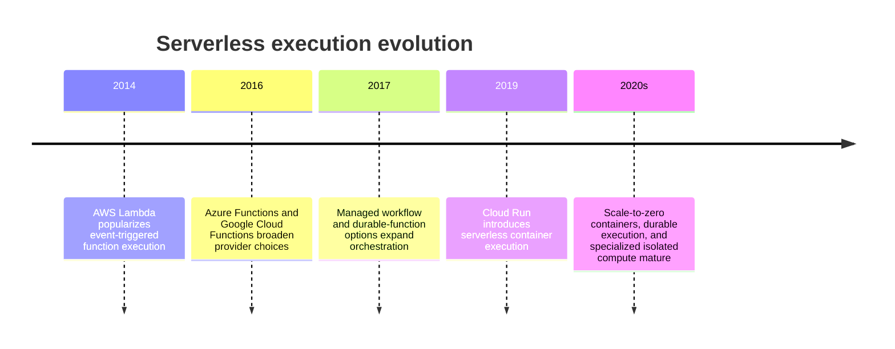
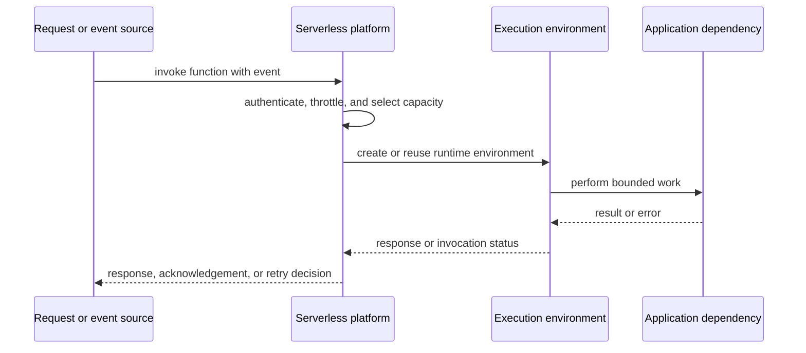
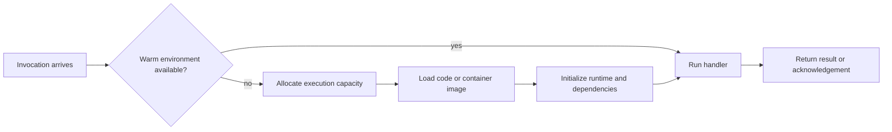
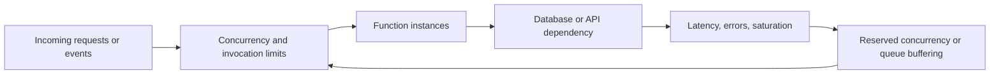
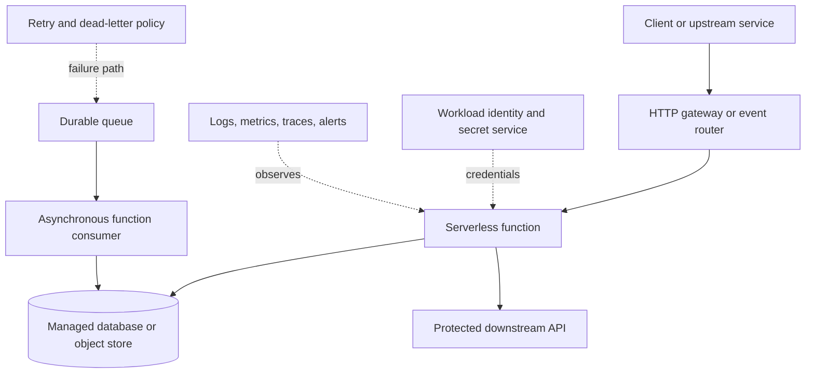

# Chapter: Serverless Architecture

Part: [09 — Cloud Computing](PART_OVERVIEW.md) · Status: Drafted

## 1. Introduction

Serverless is a cloud operating model in which the provider provisions and scales execution capacity while the customer deploys application code or configuration. It does not mean that servers cease to exist or that the workload has no architecture. The team still owns runtime behavior, identity, data, event contracts, failure handling, observability, quotas, and cost.

This chapter focuses on function and serverless execution architecture across Amazon Web Services (AWS), Microsoft Azure, and Google Cloud Platform (GCP): invocation models, triggers, cold starts, concurrency, retries, state, networking, and service fit. The preceding Compute and Containers chapters cover broader managed execution alternatives. Messaging owns broker delivery mechanics, while Part 07 owns generic event-processing guarantees and idempotency.

## 2. Historical Evolution

Serverless execution emerged from event-driven functions that ran code on demand and billed by invocation and duration. Providers expanded the model with Hypertext Transfer Protocol (HTTP) endpoints, managed event sources, workflow orchestration, durable execution, and serverless containers. The category now includes products with different lifecycle and concurrency models; the label alone no longer predicts execution limits or scaling behavior.

Functions remain useful for bounded event-driven work; managed container services support longer-lived request workloads; workflow services coordinate multi-step processes. These are related but not interchangeable runtime models.

## 3. Why It Exists

Serverless services reduce the need to provision and patch a worker fleet for workloads whose demand is intermittent, event-driven, or operationally expensive to host continuously. They can scale with incoming requests and bill according to service-specific measures. They also constrain execution duration, runtime, concurrency, networking, and startup behavior.

The architectural question is whether the provider's execution contract fits the workload better than a managed container, Kubernetes deployment, or VM service. Serverless can simplify capacity management, but a poor fit can move complexity into retries, cold-start mitigation, state externalization, and provider-specific limits.

## 4. Core Concepts

### 4.1 Function execution model and invocation boundary

**Definition.** A function is a deployable unit invoked by a request, schedule, stream, or event. The function handler receives an input, executes within a provider-managed environment, and returns a result or acknowledgement according to the trigger contract. A serverless container may expose a continuously available HTTP service while leaving instance provisioning and scaling to the provider.

**Mechanism.** A trigger or caller submits an invocation. The platform authenticates it, selects or creates an execution environment, loads code and configuration, invokes the handler, and reports a response or failure. Environments can be reused, but local memory and disk are not generally durable application state. Concurrency and lifecycle are provider-specific: one request per environment, concurrent request multiplexing, or stream-specific batching may apply.

**Decision implications.** Choose a function when work has a clear invocation boundary, bounded execution, and manageable state. Choose a serverless container when a service needs a container contract or longer-lived request handling but not cluster ownership. Confirm concurrency, duration, networking, and startup limits before selecting either model.

**Common failure mode.** Treating an execution environment as a durable process and storing authoritative state in local memory or disk. A later invocation may run elsewhere or in a fresh environment.

**Scenario.** A file-upload event starts a function that validates metadata and submits a conversion task. The function returns after durable queue admission; the longer conversion runs in a separate worker model appropriate to its execution duration.

### 4.2 Triggers, invocation types, and delivery boundaries

Functions can be invoked synchronously by an HTTP caller or asynchronously by an event source. Some event integrations use polling, streams, or provider-managed event routers. Trigger configuration defines batching, filtering, acknowledgement, timeout, and retry behavior; the function's invocation is not automatically equivalent to a business transaction.

Use synchronous invocation when the caller requires an immediate result and the function can meet latency limits. Use asynchronous event handling when the workflow tolerates delay and has explicit retry, dead-letter, and duplicate handling. Part 09 Messaging and Part 07 distributed-systems chapters own broker guarantees; this section maps execution boundaries.

### 4.3 Statelessness, external state, and durable workflows

Stateless execution makes instances replaceable: persistent state is stored in a database, object store, workflow service, or durable queue. A workflow with progress spanning multiple invocations needs a durable state machine rather than relying on an in-memory call stack. Provider durable-function products can checkpoint orchestration state, but their replay and side-effect rules are service-specific.

Separate orchestration state from business data, and make external side effects safe under retries. Long-running workflows may be better modeled as queued steps or durable orchestration rather than a function that sleeps while holding execution capacity.

### 4.4 Cold starts, warm capacity, and latency

A cold start occurs when the platform must initialize execution capacity before handling an invocation. Initialization can include environment allocation, image or package retrieval, runtime startup, dependency loading, network attachment, and application initialization. A warm environment may be reused, but reuse is opportunistic unless the service provides an explicit provisioned or minimum-capacity option.

Measure cold-start and warm latency separately at relevant percentiles. Reduce package and initialization work, reuse clients safely, and provision warm capacity only when the latency objective justifies its cost. Do not depend on undocumented runtime reuse to preserve state.

### 4.5 Concurrency, scaling, and backpressure

Serverless scaling adds execution capacity in response to requests, events, or concurrency. The platform's scale rate, maximum concurrency, regional quota, and service limits constrain effective capacity. A rapid scale-out can overwhelm databases or downstream APIs even when the function platform has abundant capacity.

Set concurrency from downstream capacity, not only from function demand. Use queues, quotas, circuit breakers, and provider throttles to protect dependencies. Understand whether the platform queues, rejects, retries, or sheds excess work.

### 4.6 Retries, timeouts, and idempotency

Invocation retries depend on trigger type and service configuration. A timeout or lost response can leave the source uncertain whether side effects completed. At-least-once delivery may produce duplicate executions; synchronous retry behavior differs from queue or stream retry behavior. Part 07 owns generic delivery and idempotency concepts; this chapter applies them to functions.

Set timeouts below upstream deadlines, classify transient and permanent failures, bound retry attempts, and route poison events to a dead-letter or quarantine path. Use idempotency keys and conditional writes for side effects. Record invocation and business-operation identifiers separately.

### 4.7 Event payload, batch, and partial-failure behavior

Event sources may invoke one function per event or batch multiple records. Batch size, window, visibility timeout, acknowledgement, and partial-batch response behavior affect throughput and duplicate exposure. A function that fails one record may cause an entire batch to retry unless partial failure handling is configured.

Keep handlers within payload and duration limits, validate schema versions, and isolate poison records. For streams, track checkpoint and ordering scope. The Messaging chapter owns broker design; this section focuses on how the execution service maps deliveries into handler calls.

### 4.8 Runtime, packaging, and execution limits

Functions offer supported language runtimes and may allow custom runtimes or container images. The service contract defines package size, memory, CPU relationship, execution time, temporary storage, environment variables, and concurrency. Managed containers can widen the runtime surface but retain provider-specific lifecycle and ingress behavior.

Pin runtime versions, test startup and dependency loading, and keep large artifacts in object storage or container registries when appropriate. Monitor deprecation notices and plan upgrades. Do not assume that a containerized function has the same execution limits as a long-running container service.

### 4.9 Networking, identity, and secrets

Serverless functions may run outside a customer virtual network by default, or attach to an Amazon Virtual Private Cloud (VPC) or Azure Virtual Network (VNet) through provider-specific integrations. Network attachment can add startup latency, address consumption, routing complexity, and egress cost. A private dependency requires correct DNS, routes, firewall rules, and service authorization.

Use a dedicated workload identity, restrict data-plane permissions, and retrieve secrets from an approved secret service. Do not embed credentials in code packages or deployment configuration. Detailed cloud IAM, networking, and secret storage belong to CH09, CH05, and the pending Secrets Management chapter.

### 4.10 Serverless service selection

Choose among functions, durable workflows, serverless containers, managed task services, and always-on compute by invocation shape, duration, protocol, state, latency, concurrency, hardware, and networking. Functions fit short bounded operations; durable orchestration fits workflows with checkpointed progress; serverless containers fit containerized services with managed capacity; long-running or specialized workloads may fit other Compute services.

Record execution limits, retry behavior, concurrency, cold-start goals, provider lock-in, data location, and expected idle/burst cost. A small prototype should test the production trigger and network path rather than only invoke the handler locally.

## 5. Internal Working

The provider accepts a request or event, authenticates the invocation, applies quota and concurrency policy, and routes work to an execution environment. The environment may be warm or newly initialized. The platform injects configuration and identity, starts the handler, captures logs and metrics, and returns a result or acknowledgement. Asynchronous sources may independently decide to retry based on that outcome.

Function source deployment can involve a build service, artifact store, registry, and runtime service. Google Cloud Run functions, for example, builds function source into a container image before deployment. This makes build identity, artifact retention, and registry availability part of the execution path, not merely developer tooling.

## 6. Design Principles

- Use functions for bounded work with a clear invocation contract.
- Keep authoritative state outside ephemeral execution environments.
- Make handlers idempotent where retries or duplicate delivery are possible.
- Bound concurrency to protect downstream systems.
- Size timeout and retry policy from upstream deadlines and failure classes.
- Measure cold starts and warm latency separately.
- Use dedicated workload identity and runtime secret retrieval.
- Keep event schemas versioned and handle partial batch failures explicitly.
- Compare total cost, including requests, duration, warm capacity, logging, and egress.

## 7. Architecture Patterns

**Synchronous request handler.** An application programming interface (API) gateway invokes a function for short request processing; the function validates identity, accesses data, and returns within the caller's timeout.

**Event-driven transformation.** Object creation or a message triggers a function that validates and transforms data, then stores results or emits a downstream event.

**Queue-backed worker.** A durable queue buffers bursts and a function consumer scales within configured concurrency and retry limits. The queue and function jointly define delivery behavior.

**Durable workflow.** A workflow service tracks long-running steps, retries, waits, and compensations; functions implement bounded activities rather than holding a process open.

## 8. Production Architecture

Production readiness includes trigger security, execution limits, concurrency ceilings, retry policy, dead-letter handling, function identity, network access, artifact provenance, monitoring, quotas, and rollback. Keep the asynchronous path and synchronous API path distinct when their latency and failure contracts differ.

## 9. Implementation

1. Classify the workload by trigger, duration, state, and response requirement.
2. Compare function, workflow, serverless container, and managed task models.
3. Define input schema, authentication, idempotency key, timeout, and failure response.
4. Select runtime, memory/CPU configuration, concurrency, region, and network integration.
5. Assign workload identity and retrieve secrets at runtime.
6. Configure retry, partial-batch, dead-letter, and poison-message handling.
7. Instrument startup, handler latency, dependency calls, throttling, and business outcome.
8. Load-test scale behavior and validate total cost and recovery paths.

## 10. Complete Code Examples

- [Function execution and billing estimator](../code/python/serverless-chapter/01_execution_cost.py)
- [Concurrency and downstream-protection planner](../code/python/serverless-chapter/02_concurrency_limit.py)
- [Retry and idempotency behavior simulator](../code/python/serverless-chapter/03_retry_idempotency.py)
- [Serverless workload-fit decision matrix](../code/python/serverless-chapter/04_service_fit.py)

The examples use synthetic inputs and Python's standard library. They do not call provider APIs or encode current prices; verify current runtime limits and pricing for the selected service.

## 11. Performance

Measure invocation latency by cold and warm starts, trigger delay, handler execution, downstream calls, and response serialization. Tail latency can be dominated by environment initialization, network attachment, dependency initialization, or a cold database connection. Provisioned capacity may reduce startup delay but incurs idle cost and still needs failure planning.

Keep function packages and initialization work bounded. Reuse clients safely, but never rely on environment reuse for correctness. Batch events when the handler can process them efficiently and partial failure semantics are understood.

## 12. Scalability

Serverless platforms can create execution capacity in response to demand, but scaling is subject to account quotas, regional availability, concurrency limits, and source-specific throughput. A sudden traffic spike can increase downstream connections faster than a database can scale.

Use reserved concurrency, queue buffering, batching, and downstream protection. Request quota increases before launch and test scale-out and scale-in with realistic event rates. Observe throttles and queue age rather than assuming the platform scaled because requests were accepted.

## 13. Security

Authenticate invocation sources, validate input, and grant each function a workload identity scoped to its resources. Restrict public endpoints, apply network controls, protect secrets, and prevent arbitrary code from being passed into privileged execution. Separate build identity from runtime identity.

Function isolation and runtime lifecycle are provider-specific. For untrusted multi-tenant code, evaluate the service's isolation guarantees and consider virtual machine (VM)-backed or dedicated execution. General cryptographic, network, and application API security remain with their owning chapters.

## 14. Observability

Collect invocation count, errors, duration, throttling, concurrency, cold starts, retries, queue age, and downstream latency. Correlate the function invocation ID with trace context and business-operation ID. Provider logs should capture enough context to troubleshoot without recording secrets or full sensitive payloads.

Alert on user-impacting failures, retry exhaustion, dead-letter growth, quota headroom, and missing telemetry. Distinguish a handler error from trigger delivery failure or a provider invocation limit.

## 15. Failure Scenarios

| Failure | Likely symptom | Architectural response |
|---|---|---|
| Trigger delivery failure | Events are delayed or absent | Inspect source health, permissions, retry state, and dead-letter path |
| Cold-start spike | Tail latency increases | Reduce initialization or provision warm capacity if justified |
| Concurrency surge | Downstream connection exhaustion | Cap concurrency, buffer with a queue, and apply backpressure |
| Poison event | Repeated retries on one record | Quarantine or dead-letter the record with diagnostic metadata |
| Timeout | Work may complete but caller sees failure | Use idempotency and align deadlines across the call chain |
| Quota exhaustion | Invocations throttled | Monitor quota, request increases, and define overload behavior |
| Secret or identity failure | Handler cannot access dependency | Validate role binding and secret service availability |
| Regional outage | Function or trigger unavailable | Use a tested alternate region and reconcile duplicate events safely |

Failure recovery must preserve event identity and side-effect safety. Retrying an invocation after a timeout can repeat a completed external operation unless the operation is idempotent or its result can be reconciled.

## 16. Testing

Unit-test handlers with representative and malformed events. Integration-test actual provider triggers, identity, network attachment, secrets, and downstream permissions. Validate retries, duplicate delivery, partial batch failure, timeout, throttling, and dead-letter replay.

Load-test cold starts and burst concurrency, including downstream saturation. Test deployment rollback and runtime upgrades. Verify logs and traces are emitted even when a handler fails during initialization.

## 17. Common Mistakes

- Treating a function invocation as exactly once.
- Storing authoritative state in local execution memory or temporary disk.
- Allowing automatic scale-out to overwhelm dependencies.
- Ignoring cold-start latency for synchronous user requests.
- Using long timeouts without coordinating upstream deadlines.
- Logging entire event payloads that contain sensitive data.
- Assuming a provider trigger's retry policy matches application expectations.
- Ignoring deployment build and artifact registry dependencies.

## 18. Best Practices

- Keep handlers small, focused, and safe to retry.
- Use explicit concurrency limits and downstream connection budgets.
- Separate synchronous response paths from asynchronous work.
- Validate event schemas and version them compatibly.
- Use dead-letter paths and test replay procedures.
- Retrieve secrets at runtime through workload identity.
- Instrument cold starts, trigger lag, retries, and business outcomes.
- Estimate cost using observed duration, memory, request rate, and data transfer.

## 19. Anti-Patterns

**Function as a long-running server.** A function designed for bounded invocations may be a poor fit for persistent connections, unbounded work, or specialized runtime control. Use a managed container or other compute model when its contract fits better.

**Retry without idempotency.** Automatic retries can repeat payments, notifications, or writes. Add idempotency keys and reconciliation before enabling aggressive retries.

**One function per tiny step without a workflow model.** A large collection of loosely coordinated functions can hide state transitions and failure handling. Use an explicit workflow or durable queue contract.

**Unlimited concurrency.** Scaling faster than dependencies can accept load turns elasticity into an outage multiplier. Set protective concurrency and backpressure.

## 20. Trade-off Analysis

| Choice | Benefits | Costs and risks | Choose when |
|---|---|---|---|
| Function runtime | Fine-grained event handling and scale with invocation demand | Execution limits and cold-start behavior | Work is bounded and trigger-oriented |
| Serverless container | Container packaging and managed capacity | Service-specific request and lifecycle contract | Existing container fits serverless hosting |
| Managed container service | Longer-lived services and runtime flexibility | More capacity and deployment configuration | Workload needs persistent service behavior |
| Provisioned concurrency | Lower startup latency | Idle capacity cost | Tail latency objective justifies warm capacity |
| Queue buffering | Smooths bursts and decouples producers | Added latency and delivery/replay design | Work can complete asynchronously |
| Workflow orchestration | Durable state and explicit step transitions | Provider-specific model and workflow overhead | Long-running process spans multiple steps |

## 21. Comparison Table

| Dimension | AWS Lambda | Azure Functions | Google Cloud Run functions |
|---|---|---|---|
| Invocation | HTTP and event-source integrations | HTTP, timer, and event triggers/bindings | HTTP and event triggers, including Eventarc integrations |
| Hosting controls | Managed function execution and optional provisioned capacity | Flex Consumption, Premium, Dedicated, and container options | Function source builds to a container image and runs on Cloud Run |
| Scaling | Service-managed concurrency and quotas | Hosting-plan-specific scaling | Cloud Run service scaling and concurrency configuration |
| Packaging | Zip, layers, or container images | Runtime packages or container-based options | Buildpacks/Functions Framework into container image |
| Main operational focus | Invocation and event-source semantics | Hosting plan, trigger, and binding behavior | Container build path, Cloud Run resource model, and event source |

Limits and pricing vary by runtime, region, plan, and invocation type. Compare current execution duration, concurrency, networking, storage, and billing documentation before selecting.

## 22. Real-World Case Study

### Event-driven image processing reference architecture

Provider documentation commonly demonstrates an image-upload workflow: an object-created event invokes a function, which validates metadata, generates a thumbnail, and writes a derived object. This is a reference architecture pattern rather than a claim about one named customer deployment.

The design separates the upload path from asynchronous processing. The object store is the durable source; the event carries an object identifier; the function performs bounded work and writes a deterministic output key. Retry and duplicate events require idempotent writes, and oversized images may need a queue or managed container worker rather than a single function invocation.

The pattern is effective when processing is short, parallelizable, and naturally triggered by object creation. Before production, add an event schema, poison-event handling, concurrency limits, access controls, image-size validation, cost ceilings, and a replay process. A reference diagram is not a substitute for testing the selected provider's trigger guarantees and runtime limits.

## 23. Interview Questions

1. When is a function a better fit than a serverless container?
2. What causes cold starts, and which mitigations have cost implications?
3. Why can an asynchronous trigger deliver duplicate work?
4. How do concurrency limits protect downstream services?
5. What is the difference between a retry policy and a durable workflow?
6. How do provider-specific hosting plans change serverless responsibilities?
7. How can function source deployment depend on a build service and registry?
8. Which signals distinguish function errors from event-source delivery failures?

## 24. Hands-on Exercises

1. Run the execution estimator for a low-volume and bursty workload; compare request and duration costs.
2. Run the concurrency planner with a database connection ceiling and estimate safe maximum concurrency.
3. Run the retry simulator with duplicate events and add an idempotency key.
4. Run the service-fit matrix for an HTTP endpoint, a scheduled batch job, and a long-running stream consumer.

## 25. Design Exercises

1. Design an upload-triggered document processing pipeline with quarantine, retry, and dead-letter behavior.
2. Design a serverless API with a strict ninety-ninth percentile (p99) latency target and a downstream database connection limit.
3. Migrate a long-running worker to functions and identify where durable workflow or queue semantics are required.
4. Compare AWS Lambda, Azure Functions, and Cloud Run functions for a multi-region event processor with residency constraints.

## 26. Architecture Review Questions

- Does the invocation model fit the execution duration, protocol, and state requirements?
- Are trigger authentication, event schema, retry, duplicate, and partial failure behaviors explicit?
- Are concurrency and quota limits bounded by downstream capacity?
- Are cold-start and tail-latency objectives measured under realistic load?
- Are workload identity and secret access least-privileged and independent of build identity?
- Are event payloads and logs scrubbed of sensitive data?
- Are cost assumptions based on observed duration, memory, requests, and transfer?
- Can operators replay, reconcile, and observe failures without repeating side effects?

## 27. Summary

Serverless reduces capacity management for supported event and request workloads, but leaves architecture decisions around invocation, state, retries, concurrency, identity, networking, and cost. Use functions for bounded work, durable workflows for multi-step execution, and serverless containers when their runtime contract fits better. Validate provider-specific triggers, limits, cold starts, and recovery behavior before treating scale-to-zero as a complete operating model.

Further reading: [AWS Architecture](CH01_AWS.md), [Microsoft Azure Architecture](CH02_Azure.md), [Google Cloud Platform Architecture](CH03_GCP.md), [Compute](CH04_Compute.md), [Containers](CH07_Containers.md), and [Messaging](PART_OVERVIEW.md).
