# Chapter: Provider-Managed Messaging: Queues, Topics, Event Buses, and Streams

Part: [09 — Cloud Computing](PART_OVERVIEW.md) · Status: Revised (in-depth rewrite)

## 1. Introduction

Every major cloud provider sells several messaging services, and the product names overlap in confusing ways. Amazon Web Services (AWS) has Amazon Simple Queue Service (SQS), Amazon Simple Notification Service (SNS), Amazon EventBridge, Amazon Kinesis Data Streams, and Amazon Managed Streaming for Apache Kafka (MSK). Microsoft Azure has Azure Service Bus, Azure Event Grid, and Azure Event Hubs. Google Cloud has Pub/Sub, Eventarc, and Google Cloud Managed Service for Apache Kafka. A "topic" in SNS, a "topic" in Service Bus, and a "topic" in Pub/Sub are three different things with different retention, ordering, acknowledgment, and replay behavior. Choosing among them by name or habit is the most common source of messaging incidents in cloud systems.

This chapter teaches the broker side of those services: what state the provider keeps for each message or each consumer, how the provider decides that a message is delivered, when it delivers again, where failed messages go, how ordering and replay are scoped, how capacity and quotas are counted, how access is granted across accounts and projects, and how the bill is computed.

After working through this chapter you should be able to:

- Classify any provider messaging product as a queue, a publish-subscribe topic, an event bus, or a stream, and explain what state the provider keeps in each case.
- Trace a message through the producer admission, lease, settlement, and redelivery lifecycle for SQS, Service Bus, Pub/Sub, Event Grid, Kinesis, and Event Hubs, and set lease timers from measured processing time.
- Configure ordering scopes (SQS first-in, first-out (FIFO) message groups, Service Bus sessions, Pub/Sub ordering keys, Kinesis shards, Event Hubs partitions) and predict their throughput ceilings and head-of-line blocking behavior.
- Design retry, dead-letter, and redrive paths with each provider's actual retry schedule and retention rules.
- State precisely what provider "exactly-once" and deduplication features guarantee, and where an idempotent consumer is still required.
- Size shards, partitions, throughput units, and consumer pools with worked arithmetic, and operate backlog and lag alarms.
- Grant least-privilege, cross-account or cross-project access with queue policies, Azure role-based access control (RBAC) data roles, and Pub/Sub Identity and Access Management (IAM) roles.
- Estimate request, throughput, retention, and fan-out cost, and pick a service with a selection matrix and decision tree.

### 1.1 Scope and ownership boundaries

This chapter owns provider-managed messaging service behavior. Several neighboring topics are owned elsewhere and are only recapped here:

- **Generic messaging semantics** belong to Part 07. Operation idempotency is taught in [Idempotency](../07_System_Design_and_Distributed_Systems/CH16_Idempotency.md), the meaning and limits of "exactly once" in [Exactly-Once Processing](../07_System_Design_and_Distributed_Systems/CH17_Exactly_Once_Processing.md), ordering taxonomies in [Ordering Guarantees](../07_System_Design_and_Distributed_Systems/CH18_Ordering_Guarantees.md), deduplication windows and seen-ID stores in [Deduplication](../07_System_Design_and_Distributed_Systems/CH19_Deduplication.md), partitioning in [Partitioning](../07_System_Design_and_Distributed_Systems/CH11_Partitioning.md), and the dual-write problem and transactional outbox in [Distributed Transactions](../07_System_Design_and_Distributed_Systems/CH12_Distributed_Transactions.md). This chapter maps provider features onto those contracts.
- **Application programming interface (API) event contracts** (AsyncAPI documents, webhook delivery contracts, acceptance-to-completion semantics for asynchronous APIs) belong to [Async APIs](../08_API_Architecture/CH06_Async_APIs.md). Schema versioning for event payloads is covered there and in [Versioning](../08_API_Architecture/CH10_Versioning.md).
- **Cloud event architecture** (how to compose queues, buses, and streams into a workload, event backbones across teams, choreography versus orchestration) belongs to [Event, Queue, and Messaging Architectures in Cloud](../10_Cloud_Architecture/CH08_Event_Queue_and_Messaging_Architectures_in_Cloud.md) and [Cloud-Native Application and Integration Patterns](../10_Cloud_Architecture/CH07_Cloud_Native_Application_and_Integration_Patterns.md).
- **Function triggers on the consumer side** (event source mappings, batch windows, partial-batch responses, function retry and on-failure destinations) belong to [Serverless](CH11_Serverless.md). This chapter stops at the broker: what the queue, topic, or stream does with a message before and after a function or worker touches it.
- **Provider identity, secrets, monitoring, and billing tools** belong to [IAM](CH09_IAM.md), [Secrets Management](CH13_Secrets_Management.md), [Monitoring](CH10_Monitoring.md), and [Cost Optimization](CH14_Cost_Optimization.md). This chapter shows how messaging resources plug into them.

Provider facts in this chapter were checked against official documentation at the time of writing. Messaging limits change often: SQS raised its maximum message size from 256 KiB to 1 MiB in 2025, Kinesis raised its record size to 10 MiB in 2025, and EventBridge launched a new kind of custom event bus in September 2026. Treat every number as "at the time of writing; verify current quotas" and follow the inline links.

## 2. The foundational model: four service shapes

A messaging service is a durable intermediary between a producer that writes and a consumer that reads. Every product in this chapter answers four questions differently:

1. **Who receives a copy?** One consumer from a pool, every subscription, every matching rule target, or any reader that asks.
2. **Where is delivery state kept?** Per message (the broker remembers whether each message is available, leased, or deleted) or per consumer (the broker keeps an immutable log and each consumer remembers its own position).
3. **When does the broker forget the message?** When a consumer settles it, when a retention timer expires, or both.
4. **Who initiates delivery?** The consumer pulls, or the broker pushes to an endpoint.

Those answers produce four service shapes.

### 2.1 Queue

A queue holds messages for a pool of **competing consumers**. Each message is meant to be processed by one consumer. The broker keeps per-message state: a message is available, temporarily hidden while a consumer works on it, or deleted after the consumer confirms success. Adding consumers increases throughput because they divide the work. Once a message is deleted it is gone; a queue has no built-in way to reread history.

SQS queues and Service Bus queues are queues in this sense. A single Pub/Sub subscription with several subscriber clients also behaves like a queue, because the clients share that subscription's messages.

### 2.2 Publish-subscribe topic

A topic copies each published message to every **subscription**. Each subscription then behaves like its own queue with independent delivery state, retry, and dead-lettering. A slow subscriber cannot block a fast one because they do not share state. Subscriptions usually filter, so a subscription receives only the messages whose attributes match.

SNS topics push copies to subscribers (SQS queues, AWS Lambda functions, Hypertext Transfer Protocol Secure (HTTPS) endpoints, email, and others) and keep no durable backlog of their own beyond the retry window. Service Bus topics keep a durable backlog per subscription. Pub/Sub topics feed subscriptions that hold unacknowledged messages for a retention period and can replay. Same word, three retention models.

### 2.3 Event bus

An event bus is a router. Producers publish structured events (usually JavaScript Object Notation (JSON) with a source, a type, and a body). The bus evaluates **rules** or **subscribers** that match on event fields and delivers each match to a target. The distinction from a topic is that routing logic lives in the bus as content-based patterns, often across many event sources and many teams, and targets are frequently provider APIs rather than queues. EventBridge, Azure Event Grid, and Google Eventarc are event buses.

### 2.4 Stream

A stream is a partitioned, append-only log. The broker does not track per-message delivery. It stores records in order inside each partition (Kinesis calls them shards) for a retention period, and each consumer group keeps a **checkpoint** or **offset** that says how far it has read. Many consumer groups read the same records independently, and any of them can rewind to reread. Ordering is guaranteed within a partition, and throughput scales by adding partitions. Kinesis Data Streams, Event Hubs, Amazon MSK, and Managed Service for Apache Kafka are streams.

The diagram below places the four shapes side by side.

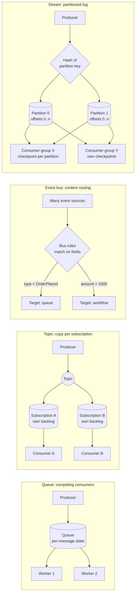

Read the diagram by asking where the cylinder (durable state) sits. In the queue, one cylinder holds per-message state shared by all workers. In the topic, each subscription has its own cylinder, so state is per subscription. In the event bus, the routing decision is the product; durable state may live only in the retry buffer. In the stream, the cylinders are partitions of an immutable log, and the consumer groups hold the state. That single difference explains most of the operational behavior later in the chapter: queues need lease timers and dead-letter queues, streams need checkpoint management and partition sizing, and buses need rule ownership.

### 2.5 Where delivery state lives

| Property | Queue | Topic | Event bus | Stream |
|---|---|---|---|---|
| Copies per message | One per queue | One per subscription | One per matching rule or subscriber | Readable by every consumer group |
| Delivery state | Per message | Per message, per subscription | Per delivery attempt | Per consumer group, per partition (offset) |
| Message removed when | Consumer deletes it, or retention expires | Subscriber settles it, or retention expires | Delivered, or retry window ends | Retention expires (reading never deletes) |
| Replay | No (only dead-letter redrive) | Product-dependent (Pub/Sub seek; Service Bus none) | Archive and replay (EventBridge) | Rewind offset within retention |
| Scaling unit | Consumers | Subscriptions and consumers | Rules and targets | Partitions |
| Ordering | None, or per group or session | None, or per key | Usually none | Per partition |
| Typical delivery | Pull | Push (SNS, Event Grid) or pull (Pub/Sub, Service Bus) | Push | Pull |

Two consequences matter for design. First, a queue's throughput scales with consumers but a stream's consumer parallelism is capped by its partition count; you cannot run more active readers per consumer group than partitions. Second, a stream gives replay for free but forces every consumer to handle its own failures; a stream cannot "dead-letter" one record and move on unless the consumer does it.

### 2.6 Products mapped to shapes

Real products are often hybrids. Pub/Sub is a topic whose subscriptions act as queues and which can replay by seeking. Service Bus offers both queues and topics in one namespace with the same lock-based delivery. The new EventBridge Custom Event Bus (Section 4.3) adds retention and replay to a bus. Event Hubs is a stream that also exposes an Apache Kafka endpoint. The table maps each product to its primary shape.

| Shape | AWS | Azure | Google Cloud |
|---|---|---|---|
| Queue | SQS standard, SQS FIFO | Service Bus queues (Azure Storage Queues for simple, low-feature cases) | A Pub/Sub subscription shared by workers; Cloud Tasks for Hypertext Transfer Protocol (HTTP) task dispatch |
| Topic | SNS standard and FIFO topics | Service Bus topics and subscriptions | Pub/Sub topics and subscriptions |
| Event bus | EventBridge (Custom Event Bus - Classic, and the new Custom Event Bus) | Event Grid (system and custom topics, namespaces) | Eventarc Standard and Eventarc Advanced |
| Stream | Kinesis Data Streams, Amazon MSK | Event Hubs (including its Kafka endpoint) | Managed Service for Apache Kafka (Pub/Sub Lite is turned down) |

The table lists entry points, not equivalent guarantees. The rest of the chapter explains how each product behaves.

## 3. The delivery lifecycle: admission, lease, and settlement

Every message passes through the same stages: the producer asks the broker to accept it, the broker stores or routes it, a consumer receives it, the consumer processes it, and the consumer or broker settles it. Failures between any two stages create either a lost message or a duplicate. Part 07 explains why a distributed system cannot avoid both without application help; this section shows where each provider draws the lines.

### 3.1 Producer admission

A producer calls a send or publish API. The broker authenticates the caller, checks authorization, validates size and attributes, checks quotas, writes the message durably (typically replicated across availability zones in the region), and returns a success response with a message identifier. **Success means the broker accepted the message under its durability contract. It says nothing about whether any consumer has processed it.**

The dangerous case is a timeout. If the network fails after the broker commits but before the response reaches the producer, the producer cannot tell whether the message was stored. Its only safe choice is to send again, which can create a duplicate. Provider defenses against this producer-side duplicate are:

- **SQS FIFO and SNS FIFO**: a `MessageDeduplicationId` (or content-based deduplication using a hash of the body) suppresses repeats within a 5-minute deduplication interval.
- **Service Bus**: duplicate detection on a queue or topic remembers application-set `MessageId` values for a configurable window (default 10 minutes, minimum 20 seconds, maximum 7 days; [Microsoft documentation](https://learn.microsoft.com/en-us/azure/service-bus-messaging/duplicate-detection)). A repeat is acknowledged as accepted and silently dropped.
- **EventBridge Custom Event Bus** (new type): publish-time deduplication by content or supplied key within a 5-minute window ([AWS documentation](https://docs.aws.amazon.com/eventbridge/latest/userguide/eb-custom-bus-what-is.html)).
- **Kafka (MSK, Event Hubs Kafka endpoint, Managed Service for Apache Kafka)**: the idempotent producer assigns sequence numbers per partition so the broker discards retried batches; transactions extend this across partitions.
- **SQS standard, SNS standard, Pub/Sub, Kinesis, Event Hubs native protocol, Event Grid**: no producer-side deduplication. Consumers must tolerate duplicates.

Producer admission also has a relationship with the producer's own database. If an order service writes an order row and then publishes "OrderPlaced," a crash between the two loses the event or, in the reverse order, publishes an event for an order that was never committed. That dual-write problem is solved by the transactional outbox pattern taught in [Distributed Transactions](../07_System_Design_and_Distributed_Systems/CH12_Distributed_Transactions.md). On AWS, EventBridge Pipes can read an outbox exposed as an Amazon DynamoDB stream; on Azure and Google Cloud, change data capture tools or a small relay process perform the same role.

### 3.2 Lease-based consumption

Queues and topic subscriptions that keep per-message state use a **lease**. When a consumer receives a message, the broker does not delete it. It hides it from other consumers for a lease period. If the consumer settles the message within the lease, the broker deletes it. If the lease expires first, the broker makes the message available again and another consumer (or the same one) receives it. The lease is what makes delivery at-least-once: the broker prefers redelivery to loss.

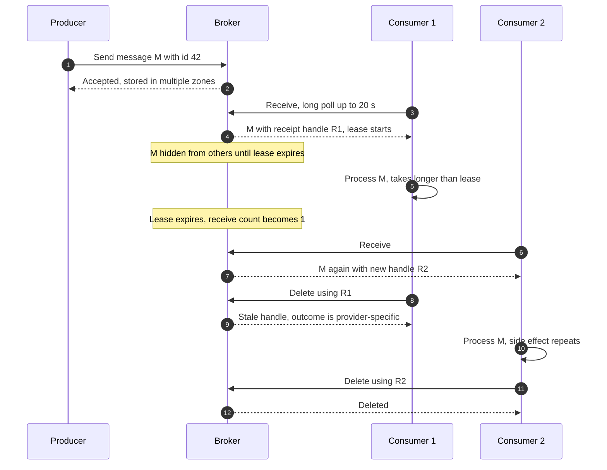

The sequence shows the failure that lease tuning prevents. Consumer 1 was still working when the lease expired, so Consumer 2 received the same message and the side effect ran twice. Steps 8 and 9, the late delete with the old handle, are where providers differ. SQS documents that each receive returns a new receipt handle and that a delete with an older handle can return success without deleting the message, so the consumer must use the most recent handle ([AWS `DeleteMessage` reference](https://docs.aws.amazon.com/AWSSimpleQueueService/latest/APIReference/API_DeleteMessage.html)). Service Bus rejects settlement with a lost lock error once the lock has expired. Pub/Sub with exactly-once delivery enabled rejects an expired acknowledgment ID with an `INVALID_ARGUMENT` error so the consumer learns it lost the lease; without exactly-once, the stale acknowledgment returns success and the duplicate is silent ([Google Cloud documentation](https://docs.cloud.google.com/pubsub/docs/exactly-once-delivery)). The design implication is that a consumer must either finish within the lease, extend the lease while it works, or tolerate duplicates. Usually it should do all three.

### 3.3 The message state machine

The lease, retry count, dead-letter threshold, and retention timer together define a state machine for each message in a queue or subscription.

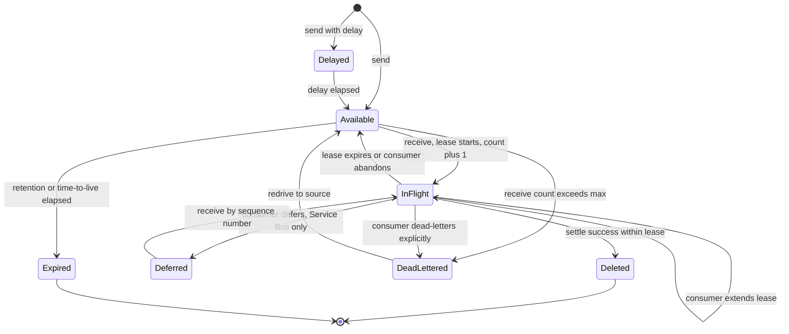

The states map onto provider vocabulary as follows. `Available` is "visible" in SQS, "active" in Service Bus, and "undelivered" (unacknowledged and not currently leased) in Pub/Sub. `InFlight` is "in flight" (hidden by the visibility timeout) in SQS, "locked" in Service Bus peek-lock mode, and "outstanding" within the acknowledgment deadline in Pub/Sub. The transition from `Available` to `DeadLettered` is evaluated differently: SQS moves a message to the dead-letter queue when a receive would push its `ApproximateReceiveCount` past `maxReceiveCount`; Service Bus moves it when `DeliveryCount` exceeds `MaxDeliveryCount` (default 10); Pub/Sub forwards it after approximately `maxDeliveryAttempts` (5 to 100) and documents that the count is best-effort. The `Expired` path matters because a message can be deleted by retention while it is still failing, which turns a retry problem into silent loss unless a dead-letter path exists with longer retention (Section 8.4).

### 3.4 Provider lease vocabulary

| Mechanism | SQS | Service Bus | Pub/Sub | Event Grid (push) | Streams (Kinesis, Event Hubs, Kafka) |
|---|---|---|---|---|---|
| Lease name | Visibility timeout | Message lock (peek-lock) | Acknowledgment deadline | Delivery attempt timeout | None; consumer checkpoint |
| Default and range | 30 s; 0 s to 12 h | 1 min default; maximum 5 min per lock | 10 s default; 10 s to 600 s | 30 s wait for response | Not applicable |
| Extend while working | `ChangeMessageVisibility` | `RenewMessageLock`; software development kit (SDK) auto-renewal | `ModifyAckDeadline`; client libraries extend automatically | Not possible | Not applicable |
| Settle success | `DeleteMessage` with receipt handle | `Complete` | `Acknowledge` | Return HTTP 200-series | Write checkpoint or commit offset |
| Settle failure | Let lease expire, or set visibility to 0 | `Abandon`, `DeadLetter`, or `Defer` | Negative acknowledgment (`nack`) | Return retryable error | Consumer decides; no broker-side retry |
| Destructive mode | Not available | Receive-and-delete mode | Not available | Not applicable | Not applicable |

Sources: [SQS visibility timeout](https://docs.aws.amazon.com/AWSSimpleQueueService/latest/SQSDeveloperGuide/sqs-visibility-timeout.html), [Service Bus locks and settlement](https://learn.microsoft.com/en-us/azure/service-bus-messaging/message-transfers-locks-settlement), [Pub/Sub subscription properties](https://docs.cloud.google.com/pubsub/docs/subscription-properties), [Event Grid delivery and retry](https://learn.microsoft.com/en-us/azure/event-grid/delivery-and-retry).

Service Bus receive-and-delete mode deserves a warning. The broker marks the message consumed as it hands it over, which gives at-most-once delivery: a consumer crash after receipt loses the message. Microsoft's guidance states that peek-lock gives at-least-once and receive-and-delete gives at-most-once ([Microsoft documentation](https://learn.microsoft.com/en-us/azure/service-bus-messaging/service-bus-message-loss-and-duplicates)). Use it only for data that can be lost, such as telemetry samples that the next sample supersedes.

### 3.5 Worked example: sizing a lease from measured processing time

A document-conversion worker reads from an SQS standard queue. Production traces show processing time with a median of 40 seconds, a 99th percentile (p99) of 150 seconds, and a maximum of 280 seconds when the downstream storage service is slow.

**Option A: static visibility timeout.** Setting the queue's visibility timeout to the p99 (150 seconds) means roughly 1 in 100 messages becomes visible again while still being processed. At 50,000 messages per day that is about 500 duplicate conversions per day, each wasting up to 280 seconds of worker time. Setting it to the maximum plus margin (say 6 minutes) eliminates lease-expiry duplicates but means a crashed worker's message waits 6 minutes before another worker can try it.

**Option B: short timeout with heartbeat.** Set the queue default to 60 seconds. The worker starts a background heartbeat that calls `ChangeMessageVisibility` every 30 seconds, extending visibility to 60 seconds from now each time, until processing completes or a hard ceiling of 10 minutes is reached. A crashed worker's message reappears within 60 seconds. A slow but healthy worker keeps its lease. Each heartbeat is an API request, so a 280-second job costs 9 extra requests, which at SQS request prices is negligible.

Option B is the better design because it decouples crash-recovery latency from worst-case processing time. The hard ceiling matters: without it, a stuck worker extends the lease forever and the message never reaches the dead-letter queue. The same reasoning applies to Service Bus (lock duration of 1 minute with auto-renewal, capped by the SDK's maximum auto-lock-renewal duration) and Pub/Sub (client libraries extend the acknowledgment deadline automatically up to a configured maximum extension period).

The planner in [02_retry_planner.py](../code/python/messaging-chapter/02_retry_planner.py) encodes the first check of this example: it flags any configuration where the visibility window is not longer than the processing time, and any retry horizon longer than an hour. Run it with the numbers above to see the "slow job" risk it reports.

### 3.6 Offset-based consumption in streams

Streams settle differently. The consumer reads a batch from a partition starting at its last checkpoint, processes the records, and writes a new checkpoint. Kinesis consumers built on the Kinesis Client Library store checkpoints in an Amazon DynamoDB table; Event Hubs processors store them in an Azure Blob Storage container; Kafka consumers commit offsets to an internal topic on the cluster.

Three properties follow:

- **Redelivery is replay from the last checkpoint.** If a consumer crashes after processing records 100 to 199 but before checkpointing 199, its replacement starts at 100 and reprocesses the batch. Checkpoint frequency trades write cost against duplicate volume.
- **A failing record blocks its partition.** The broker never moves on by itself. If record 150 always fails, the consumer either retries forever (and the partition's lag grows without bound), skips it, or writes it to a side queue and continues. The broker-side "dead-letter queue" of a queue has no equivalent; the consumer builds one.
- **Retention is the only deletion.** A stream with 7-day retention holds every record for 7 days whether or not anyone read it, which is why streams are billed by retained capacity or throughput rather than per message settled.

Choosing a stream therefore moves failure handling from broker configuration into consumer code. That is acceptable when the consumers are data pipelines built with frameworks that already handle it, and a poor trade when the consumers are simple workers that need a dead-letter queue.

## 4. AWS messaging services

AWS splits messaging across five services that are frequently combined: SNS fans out to SQS queues, EventBridge routes to SQS or Kinesis, and EventBridge Pipes connects queues and streams to targets. Each keeps its own state and its own retry rules, so a message crossing two of them is subject to two delivery contracts.

### 4.1 Amazon SQS standard and FIFO queues

SQS is a regional, fully managed queue. You create a queue, producers call `SendMessage` or `SendMessageBatch` (up to 10 messages per batch), and consumers call `ReceiveMessage`, process, and call `DeleteMessage`. There are no brokers or partitions to size.

**Core settings** ([SQS quotas](https://docs.aws.amazon.com/AWSSimpleQueueService/latest/SQSDeveloperGuide/quotas-messages.html), [queue quotas](https://docs.aws.amazon.com/AWSSimpleQueueService/latest/SQSDeveloperGuide/quotas-queues.html); at the time of writing, verify current quotas):

| Setting | Value | Why it matters |
|---|---|---|
| Message retention | 60 s to 14 days, default 4 days | A queue is a buffer, not an archive. Plan outages shorter than retention. |
| Maximum message size | 1 MiB (raised from 256 KiB in August 2025) | Larger payloads need the claim-check pattern (Section 12). |
| Visibility timeout | 0 s to 12 h, default 30 s | The lease (Section 3.5). |
| Delivery delay | 0 to 15 min | Queue-level or per-message (standard queues) delay. |
| Long polling wait | Up to 20 s | `WaitTimeSeconds` reduces empty responses and request cost. |
| In-flight messages | About 120,000 for most standard queues; 120,000 for FIFO | Beyond this, short polls return `OverLimit` and long polls return nothing. |
| Backlog | Unlimited messages stored | Backlog grows silently; alarm on age. |

**Short versus long polling.** A short poll queries a subset of SQS's servers and returns immediately, possibly empty even when messages exist. A long poll waits up to 20 seconds for a message and queries all servers. Long polling is almost always correct: it lowers request cost and latency of empty queues. The only reason to short-poll is a single thread that must also service other work, and even then a short wait (1 to 5 seconds) is better than zero.

**Standard queues** offer nearly unlimited throughput, at-least-once delivery, and best-effort ordering. A message can be delivered more than once even without lease expiry, because SQS stores copies on multiple servers and a server that was unavailable during deletion can return a copy later. Consumers of standard queues must be idempotent.

**Fair queues** (launched July 2025) address the noisy-neighbor problem in multi-tenant standard queues. When a producer sets `MessageGroupId` on a message to a standard queue, SQS treats the value as a tenant identifier, monitors in-flight messages per tenant, and when one tenant holds a disproportionate share, it prioritizes delivery of other tenants' messages ([AWS documentation](https://docs.aws.amazon.com/AWSSimpleQueueService/latest/SQSDeveloperGuide/sqs-fair-queues.html)). Consumers need no change. Fair queues do not provide ordering or exclusivity per group; that is still a FIFO feature. They solve one specific problem: tenant A's burst of 2 million messages no longer makes tenant B's messages wait behind it.

**FIFO queues** (name must end in `.fifo`) add three properties:

- **Ordering per message group.** Every message carries a `MessageGroupId`. SQS delivers messages of one group in send order and does not deliver the next message of a group while an earlier one is in flight. Different groups are processed in parallel. Ordering is therefore exactly as fine-grained as the group key you choose: one group per customer gives per-customer order with parallelism across customers; one group for the whole queue gives total order and a throughput of one message at a time.
- **Deduplication.** A `MessageDeduplicationId` (or content-based deduplication using a Secure Hash Algorithm 256-bit (SHA-256) hash of the body) causes SQS to accept but not enqueue a repeat within the 5-minute deduplication interval. This defends against producer retries only; it does nothing about consumer-side redelivery after lease expiry.
- **Throughput limits.** Without high-throughput mode, each FIFO queue supports 300 API calls per second per action (send, receive, delete), which is 3,000 messages per second with batches of 10. With **high-throughput FIFO** enabled (deduplication scope set to message group, throughput limit set per message group ID), limits rise to up to 70,000 transactions per second (TPS) per action in US East (N. Virginia), US West (Oregon), and Europe (Ireland), and lower defaults in other regions, down to 2,400 TPS in smaller regions; batching multiplies by up to 10 ([AWS documentation](https://docs.aws.amazon.com/AWSSimpleQueueService/latest/SQSDeveloperGuide/quotas-messages.html); at the time of writing, verify current quotas). High-throughput FIFO spreads message groups across internal partitions by hashing the group ID, so throughput depends on having many distinct groups.

**Worked example: FIFO head-of-line blocking.** A payments queue uses `MessageGroupId = merchantId`. One large merchant sends 40% of all messages, and each payment takes 200 ms to process. Because only one message per group is in flight at a time, that merchant's group drains at most 1 / 0.2 s = 5 messages per second regardless of how many consumers run. If the merchant produces 20 messages per second at peak, its backlog grows by 15 messages per second, or 54,000 messages per hour, while every other merchant flows normally. The fixes are to shrink the ordering scope (group by `merchantId + accountId` if the business invariant is per account), to make each message cheaper, or to accept that this merchant's payments are not strictly ordered and move them to a separate design. Adding consumers does not help. This is the general rule for every ordered service in this chapter: **ordered throughput per key equals one divided by per-message processing time.**

**Dead-letter queues and redrive.** A redrive policy on the source queue names a dead-letter queue (DLQ) and a `maxReceiveCount`. When a message's receive count exceeds the threshold, SQS moves it to the DLQ instead of delivering it again. The DLQ must be the same type as the source (standard with standard, FIFO with FIFO). A redrive allow policy on the DLQ controls which source queues may use it. After fixing the cause, an operator starts a **DLQ redrive** (the `StartMessageMoveTask` API or the console's "Start DLQ redrive"), which moves messages back to the source queue or another queue at a controllable rate ([AWS documentation](https://docs.aws.amazon.com/AWSSimpleQueueService/latest/SQSDeveloperGuide/sqs-configure-dead-letter-queue-redrive.html)). Section 8 covers the retention trap that applies to standard-queue DLQs.

Choose `maxReceiveCount` from the failure profile. A threshold of 1 sends every message that hits a transient error straight to the DLQ, which floods it during a short dependency outage. A threshold of 100 with a 30-second visibility timeout keeps a poison message cycling for 50 minutes, consuming a worker each time. Values between 3 and 10 are common; pair them with visibility-timeout backoff (the consumer extends visibility on failure by an increasing amount, so attempts spread out) to cover dependency outages of minutes without flooding the DLQ.

### 4.2 Amazon SNS standard and FIFO topics

SNS is a push-based publish-subscribe service. A publisher calls `Publish` on a topic, and SNS delivers a copy to each subscription: SQS queues, Lambda functions, HTTP or HTTPS endpoints, Amazon Data Firehose, email over Simple Mail Transfer Protocol (SMTP), short message service (SMS) text messages, and mobile push. SNS does not hold a backlog for a subscriber to pull later; if delivery fails, SNS retries according to the protocol's delivery policy and then discards the message unless the subscription has a dead-letter queue.

**Delivery retries per protocol** ([AWS documentation](https://docs.aws.amazon.com/sns/latest/dg/sns-message-delivery-retries.html)):

| Endpoint type | Retry phases | Total attempts | Customizable |
|---|---|---|---|
| AWS-managed endpoints (SQS, Lambda, Firehose) | 3 immediate, 2 at 1 s, 10 with backoff 1 s to 20 s, 100,000 at 20 s | 100,015 over about 23 days | No |
| Customer-managed endpoints (HTTP/S, SMTP, SMS, mobile push) | 0 immediate, 2 at 10 s, 10 with backoff 10 s to 600 s, 38 at 600 s | 50 over about 6 hours | HTTP/S only, total retry time capped at 3,600 s |

The table shows why the standard AWS fan-out pattern is SNS to SQS rather than SNS directly to HTTP endpoints. Delivery to SQS is retried for weeks and lands in a queue with its own retention, visibility timeout, and DLQ, so each subscriber controls its own failure handling. Delivery to an HTTPS endpoint is retried for at most an hour under a custom policy, and SNS treats any 4xx response other than 429 as a permanent failure.

**Subscription filter policies** let each subscription receive a subset of messages. A filter policy is a JSON document that matches on message attributes (the default scope, `MessageAttributes`) or on the JSON message body (scope `MessageBody`). It supports exact values, prefixes, numeric ranges, `anything-but`, and `exists` matching. Messages that do not match are not delivered and not billed as deliveries to that subscription.

```json
{
  "eventType": ["OrderPlaced", "OrderCancelled"],
  "region": [{ "prefix": "eu-" }],
  "amount": [{ "numeric": [">=", 1000] }]
}
```

This policy, applied with `FilterPolicyScope` set to `MessageBody`, delivers only high-value European order events to, for example, a fraud-review queue. The filter is now part of the application's behavior. A typo in `eventType` silently drops a business process, which is why Section 17 recommends coverage tests like [03_fanout_coverage.py](../code/python/messaging-chapter/03_fanout_coverage.py) that compare required consumers with configured subscriptions.

**FIFO topics** (names ending in `.fifo`) preserve order per message group and deduplicate within a 5-minute interval, like SQS FIFO, and deliver to SQS queues. Use an SNS FIFO topic feeding SQS FIFO queues when several independent consumers each need the same ordered stream per key, for example price updates per product delivered to a cache service and a search indexer. SNS FIFO topics also support an in-place message archive (1 to 365 days, set by the topic owner) from which a subscriber can replay messages to its endpoint with a replay policy; replayed messages keep their original `MessageId` and timestamp ([AWS documentation](https://docs.aws.amazon.com/sns/latest/dg/fifo-message-archiving-replay.html)). Standard topics can now deliver to SQS fair queues by passing a message group ID through, which carries the tenant identifier into the queue.

**Message size.** SNS raised its maximum payload to 1 MiB in September 2026, matching SQS ([AWS announcement](https://aws.amazon.com/about-aws/whats-new/2026/09/amazon-sns-1mib-support/)). The topic attribute `MaximumMessageSize` defaults to 256 KiB when not set ([`GetTopicAttributes` reference](https://docs.aws.amazon.com/sns/latest/api/API_GetTopicAttributes.html)), so check the topic configuration rather than assuming the new ceiling applies. SMS and mobile push have much smaller limits of their own.

### 4.3 Amazon EventBridge

EventBridge is AWS's event bus. It now comes in two distinct resource types, and the difference matters for retry defaults, replay, ordering, cross-account sharing, and pricing.

**Custom Event Bus - Classic and the default bus.** This is the EventBridge most existing systems use. Every account has a **default event bus** that receives events from AWS services (for example, an Amazon Elastic Compute Cloud (EC2) instance state change or an Amazon Simple Storage Service (S3) object-created notification when enabled). You create **custom event buses** for application events and **partner event buses** for software-as-a-service (SaaS) partners. Producers call `PutEvents` with entries that have a `source`, a `detail-type`, and a JSON `detail`. **Rules** on a bus hold an **event pattern** and up to five **targets** (verify current quota). EventBridge evaluates every rule against every event and invokes all matching targets. A target can transform the event with an input transformer before delivery.

An event pattern matches structure, not just values:

```json
{
  "source": ["com.example.orders"],
  "detail-type": ["OrderPlaced"],
  "detail": {
    "total": [{ "numeric": [">", 1000] }],
    "customer": { "tier": [{ "anything-but": "internal" }] }
  }
}
```

If a target invocation fails, EventBridge retries with exponential backoff and jitter for up to 24 hours and 185 attempts by default; both limits are configurable per target, and a per-target dead-letter queue (an SQS standard queue) captures events that exhaust retries or fail with non-retryable errors ([AWS documentation](https://docs.aws.amazon.com/eventbridge/latest/userguide/eb-rule-retry-policy.html)). Without a DLQ, exhausted events are dropped and appear only in metrics.

Classic buses add three capabilities that turn a router into an integration platform:

- **Archive and replay.** An archive stores events from a bus (optionally filtered by a pattern) for a retention period you choose or indefinitely. A replay re-sends archived events from a time range back to the bus, where rules match them again. Replayed events carry a `replay-name` field so targets can distinguish them. Replay is the bus's answer to "a consumer had a bug for six hours; reprocess its events."
- **Schema registry and discovery.** EventBridge can discover the schemas of events flowing through a bus, store them in a registry, and generate code bindings. AWS service event schemas are pre-registered. The registry documents contracts; it does not enforce them at publish time on a classic bus. Event contract governance itself is covered in [Async APIs](../08_API_Architecture/CH06_Async_APIs.md).
- **Cross-account and cross-region delivery.** A rule's target can be an event bus in another account or region. The receiving bus must have a resource-based policy that allows the sender's account or AWS Organizations organization to call `events:PutEvents`, and the sending rule needs an IAM role to deliver. This is how central security or audit accounts collect events from workload accounts (Section 13).

**The new Custom Event Bus (September 2026).** AWS relaunched custom event buses as a separate resource type with its own API namespace. The console labels older buses "Custom Event Bus - Classic" and the new ones "Custom Event Bus" ([AWS documentation](https://docs.aws.amazon.com/eventbridge/latest/userguide/eb-custom-bus-what-is.html)). Its model differs in ways that move it closer to a stream:

- Routing uses **subscribers** instead of rules and targets. Each subscriber has filters and exactly one target; to reach three targets you create three subscribers.
- The bus **retains every event** for 1 to 365 days. Each subscriber has a **starting position**, so a new subscriber can read retained history and a paused subscriber can resume without loss.
- Delivery can be **ordered (FIFO) within an event group, per subscriber**, and publish-time **deduplication** works within a 5-minute window.
- The bus is shared across accounts with **AWS Resource Access Manager (RAM)**, and consumer accounts attach their own subscribers without the bus owner writing routing rules for them.
- `PutRawEvents` accepts JSON, Apache Avro, Protocol Buffers, or raw bytes, with schema-registry deserialization for filtering.
- The default subscriber **retry policy is 5 attempts or 300 seconds**, whichever comes first, configurable up to 185 attempts and 86,400 seconds. The dead-letter record is a JSON failure document that lists event IDs, not the event itself; redrive is done by creating a temporary subscriber that replays the identified events from the bus's retention ([AWS documentation](https://docs.aws.amazon.com/eventbridge/latest/userguide/eb-custom-bus-retry.html)).

The retry default is the trap for migrations. A design that relied on a classic target retrying for a day will, on the new bus, dead-letter events after five minutes of target outage unless the subscriber sets `MaxEventAgeInSeconds` explicitly. For a FIFO subscriber, a failing event also blocks later events in its group while it is retried, so a long retry window trades order for latency. Treat the two bus types as different products and verify regional availability before adopting the new one.

**EventBridge Pipes.** Pipes are point-to-point integrations: a **source** (SQS, Kinesis, Amazon DynamoDB Streams, Amazon MSK, self-managed Kafka, Amazon MQ), an optional **filter**, an optional **enrichment** step (Lambda, AWS Step Functions, API destination, or Amazon API Gateway), and a **target**. A pipe polls the source for you, so it replaces glue code such as "a Lambda function that reads a stream and puts events on a bus." For pipes, retry behavior is inherited from the source: a pipe reading SQS relies on the queue's visibility timeout and DLQ; a pipe reading a stream retries until the record expires or a configured maximum age or attempt count is reached.

### 4.4 Amazon Kinesis Data Streams

Kinesis Data Streams is a partitioned log. A stream has shards; each record has a partition key; Kinesis hashes the key with Message Digest 5 (MD5) into a 128-bit integer and writes the record to the shard whose hash-key range contains it. Within a shard, records receive increasing sequence numbers and are read in order.

**Capacity modes** ([AWS quotas](https://docs.aws.amazon.com/streams/latest/dev/service-sizes-and-limits.html); at the time of writing, verify current quotas):

- **Provisioned.** You choose the shard count. Each shard accepts up to 1 MB per second or 1,000 records per second of writes and serves up to 2 MB per second of shared reads, with up to five `GetRecords` calls per second per shard. You reshard by splitting or merging shards (`UpdateShardCount`), which takes time and creates parent and child shards that consumers must read in order.
- **On-demand Standard.** Kinesis manages shards. A new stream starts with 4 MB per second of write capacity and scales automatically; in the largest regions it scales up to 10 GB per second of writes. Scaling responds to observed traffic, so a sudden step to many times the previous peak can be throttled briefly.
- **On-demand Advantage** (launched November 2025). An account-level mode with a minimum committed throughput that discounts on-demand usage and allows **warm throughput**, pre-provisioned ingest capacity for known spikes. It also raises the enhanced fan-out consumer limit from 20 to 50 per stream.

**Records and retention.** Records can be up to 10 MiB since late 2025; streams default to a 1 MiB maximum and absorb occasional large records with burst capacity ([AWS documentation](https://docs.aws.amazon.com/streams/latest/dev/large-records.html)). Retention defaults to 24 hours and can be extended to 7 days or, as long-term retention, up to 365 days, each priced separately.

**Consumers.** Shared-throughput consumers call `GetRecords` and divide each shard's 2 MB per second among all of them. **Enhanced fan-out** consumers register with the stream and receive records pushed over an HTTP/2 `SubscribeToShard` connection with a dedicated 2 MB per second per shard each, and lower propagation latency. Use enhanced fan-out when more than two or three applications read the same stream or when latency matters; it adds a per-consumer-shard-hour and per-GB charge.

**Iterator age** is the key health metric. `GetRecords.IteratorAgeMilliseconds` measures how far behind the newest record the consumer is reading. If iterator age approaches the retention period, records will expire before the consumer reaches them, which is data loss. Section 11 shows how to alarm on it.

### 4.5 Amazon MSK

Amazon MSK runs Apache Kafka. Choose it over Kinesis when you need the Kafka protocol and ecosystem: existing Kafka clients, Kafka Connect connectors, Kafka Streams applications, log compaction, transactions, or portability to other Kafka platforms. MSK has three operating shapes:

- **MSK Provisioned with Standard brokers.** You choose broker instance type and count, storage (with optional tiered storage), and Kafka configuration. You own partition placement, rebalancing, and capacity.
- **MSK Provisioned with Express brokers.** AWS manages storage and many broker settings; AWS describes up to three times more throughput per broker and much faster scaling than Standard brokers ([AWS documentation](https://docs.aws.amazon.com/msk/latest/developerguide/msk-broker-types-express.html)). You still choose broker count and size.
- **MSK Serverless.** You create a cluster and topics; AWS provisions capacity. It removes broker sizing but imposes per-cluster and per-partition throughput quotas and supports only IAM client authentication.

Kafka's semantics (partitions, consumer groups, offsets, retention by time or size, compaction, the idempotent producer, and transactions) are the same on every Kafka platform; Part 07's [Exactly-Once Processing](../07_System_Design_and_Distributed_Systems/CH17_Exactly_Once_Processing.md) explains where Kafka transactions do and do not give end-to-end exactly-once results. What MSK changes is responsibility: AWS patches brokers, replaces failed ones, and runs Apache ZooKeeper or KRaft controllers; you own topic design, partition counts, client configuration, Kafka version upgrades (on a schedule AWS supports), and, for provisioned clusters, broker capacity. Compared with Kinesis, MSK has more knobs and a fixed hourly cost floor; compared with self-managed Kafka on EC2, it removes broker operations but limits some configuration.

## 5. Azure messaging services

Azure divides messaging by intent. Microsoft's own guidance distinguishes **messages** (a sender expects a specific action, as with commands and work items: Service Bus), **discrete events** (a notification that something happened, delivered to interested handlers: Event Grid), and **event streams** (high-volume telemetry processed as a series: Event Hubs). The three services are separate resources in separate namespaces with separate quotas.

### 5.1 Azure Service Bus

Service Bus is an enterprise message broker built on the Advanced Message Queuing Protocol (AMQP) 1.0. A **namespace** is the container and the unit of capacity, network isolation, and access policy. Inside it you create **queues** and **topics**; each topic has **subscriptions**, and each subscription behaves like a queue that receives a filtered copy of topic messages.

**Receive modes and locks.** In **peek-lock** mode (the default), a receiver gets a message with a lock token, and the broker hides the message for the **lock duration** (default 1 minute, maximum 5 minutes). The receiver then settles it with `Complete` (delete), `Abandon` (release the lock immediately and increment the delivery count), `DeadLetter` (move to the dead-letter subqueue with a reason), or `Defer` (set aside, retrievable later only by sequence number). Work longer than 5 minutes must renew the lock; the Azure SDKs do this automatically up to a configurable maximum auto-lock-renewal duration (default 5 minutes in several SDKs). Lock renewal is a client-side loop, so a long garbage-collection pause or a lost network connection can still lose the lock. In **receive-and-delete** mode the broker deletes the message on delivery; see Section 3.4 for why that is at-most-once.

**Delivery count and dead-lettering.** Every time a lock is abandoned or expires, `DeliveryCount` increases. When it exceeds the entity's `MaxDeliveryCount` (default 10), Service Bus moves the message to the entity's **dead-letter subqueue** (path `<entity>/$deadletterqueue`) with a `DeadLetterReason` of `MaxDeliveryCountExceeded`. Messages also dead-letter when their time-to-live (TTL) expires if dead-lettering on expiration is enabled, when a subscription filter evaluation throws an error if that option is enabled, or when the application dead-letters them explicitly with its own reason and description. Dead-lettered messages never expire on their own; they stay until someone receives them. Redrive is an application or operator action: a tool reads the dead-letter subqueue and resends to the original entity (the Service Bus Explorer in the Azure portal can resend selected messages; verify current capabilities).

**Sessions.** Setting `RequiresSession` on a queue or subscription turns `SessionId` into an ordering and affinity key. A receiver accepts a session and holds a **session lock**; while it holds it, no other receiver gets messages from that session, and the receiver gets them in order. Sessions also have **session state**, a small blob the receiver can read and write, which supports workflows such as "assemble the parts of this order before processing." Sessions are Service Bus's equivalent of SQS FIFO message groups and have the same throughput rule: one session's messages are processed one at a time.

**Duplicate detection.** When enabled at entity creation, Service Bus records each `MessageId` for the detection window (default 10 minutes, 20 seconds to 7 days) and silently drops repeats while reporting success. The identifier must be set by the application from the business context (for example `order-12345/payment`), not a fresh random value per send attempt, or every retry looks unique. Microsoft notes that a larger window reduces throughput because every new ID is checked against the history.

**Topic filters and actions.** Each subscription has one or more **rules**. A rule has a filter and an optional action:

- **SQL filters** evaluate an expression in a subset of Structured Query Language (SQL) over message properties, for example `region = 'EU' AND amount > 1000`. They are flexible and the most expensive to evaluate; a topic can have up to 2,000.
- **Correlation filters** match on equality of system or user properties (`Subject`, `CorrelationId`, `ContentType`, custom properties). They are cheaper and a topic can have up to 100,000.
- **Boolean filters** (`TrueFilter`, `FalseFilter`) select all or nothing.
- **Actions** modify message properties as the message enters the subscription, for example stamping a priority.

Filters evaluate properties, not the message body. Producers must therefore promote routing fields into application properties, which is a contract decision recorded with the event schema.

**Other broker features.** Scheduled messages (enqueue at a future time), auto-forwarding (chain a subscription or queue into another entity in the same namespace), and transactions (group up to 100 sends and settlements on one entity, or "receive from A and send to B" atomically within the namespace) are Service Bus features with no direct SQS equivalent.

**Tiers** ([Microsoft quotas](https://learn.microsoft.com/en-us/azure/service-bus-messaging/service-bus-quotas); at the time of writing, verify current quotas):

| Property | Basic | Standard | Premium |
|---|---|---|---|
| Queues | Yes | Yes | Yes |
| Topics, sessions, duplicate detection, transactions | No | Yes | Yes |
| Maximum message size | 256 KB | 256 KB | 1 MB default; up to 100 MB per entity over AMQP |
| Capacity model | Shared, credit-based throttling around 1,000 operations per second | Shared, same credit model | Dedicated **messaging units (MUs)**: 1, 2, 4, 8, or 16 per namespace |
| Entity size | 1 to 5 GB, 80 GB with partitioning | Same | 80 GB; namespace storage 1 TB per MU |
| Private endpoints, customer-managed keys, geo-replication | No | No | Yes |
| Billing | Per operation | Base charge plus per operation | Per MU-hour |

The Premium tier isolates central processing unit (CPU) and memory resources per MU, so throughput is predictable and is scaled by changing the MU count (manually or with autoscale rules on CPU). Standard shares infrastructure with other tenants and throttles with a credit system, so latency can vary. Choose Premium for production workloads that need private networking, customer-managed keys, large messages, or predictable latency; Standard is reasonable for development and for low-volume production without those needs. A Premium namespace can also be created with 1, 2, or 4 partitions, fixed at creation, with MUs divided equally among them.

Large messages count against entity size more than once: Microsoft documents that a message over 1 MB counts twice in a queue and X + 1 times in a topic, where X is the number of matching subscriptions. A 50 MB message fanned out to four subscriptions consumes 250 MB of entity quota.

### 5.2 Azure Event Grid

Event Grid is a push-based event router with two resource models.

**Event Grid basic resources (topics and event subscriptions).** Azure services publish to **system topics** (for example, Blob Storage "BlobCreated" or Azure Resource Manager resource changes). Applications publish to **custom topics** or **domains** (a domain groups thousands of topics, for example one per tenant, under one endpoint and access policy). An **event subscription** on a topic names a destination (webhook, Azure Functions, Service Bus queue or topic, Event Hubs, Storage Queue, and others), filters on event type, subject prefix or suffix, and advanced filters on data fields, and the delivery policy. Events use the Event Grid schema or the CloudEvents 1.0 schema. Webhook endpoints must complete a validation handshake before Event Grid sends them events, which prevents Event Grid from being used to flood arbitrary URLs.

Event Grid waits 30 seconds for a response. On failure it retries on a fixed exponential schedule (10 s, 30 s, 1 min, 5 min, 10 min, 30 min, 1 h, 3 h, 6 h, then every 12 hours) with randomization, and stops at the first of **maximum attempts** (1 to 30, default 30) or **event TTL** (1 to 1,440 minutes, default 1,440) ([Microsoft documentation](https://learn.microsoft.com/en-us/azure/event-grid/delivery-and-retry)). Some errors are not retried: 400, 413, and 403 from Azure resources, and additionally 401 from webhooks. Exhausted or non-retryable events go to a **dead-letter destination** (a Blob Storage container) if configured, and are dropped otherwise. Event Grid does not guarantee order. Optional output batching delivers up to 5,000 events per request with all-or-none semantics: one failure retries the whole batch.

**Event Grid namespaces.** Namespaces are the newer model. A namespace contains **namespace topics** that accept CloudEvents over HTTP and **event subscriptions** that deliver by **pull** or **push**. Pull delivery uses a lock-based model similar to Service Bus peek-lock: a client receives a batch, then acknowledges, releases, rejects, or renews the lock for each event. Push delivery from namespaces sends to destinations such as Event Hubs and webhooks. Namespaces also host an **MQTT broker** that lets Internet of Things (IoT) devices publish and subscribe with Message Queuing Telemetry Transport (MQTT) versions 3.1.1 and 5, and route MQTT messages into namespace topics for processing by Azure services. Namespaces are sized in throughput units ([Microsoft tier guidance](https://learn.microsoft.com/en-us/azure/event-grid/choose-right-tier)).

Event Grid is the right default for reacting to Azure resource events and for lightweight application events with many independent handlers. It is the wrong choice for commands that must be processed in order, for large backlogs that wait for a consumer to come back (24 hours is the ceiling), or for replay. For those, route Event Grid into a Service Bus queue or an Event Hub and let that service provide the backlog.

### 5.3 Azure Event Hubs

Event Hubs is a partitioned stream. A **namespace** contains **event hubs** (the equivalent of Kafka topics), each with a fixed or growable number of **partitions** and a set of **consumer groups**. Producers send events with an optional partition key, which is hashed to a partition; without a key, Event Hubs distributes events across partitions. Each consumer group reads each partition independently with its own position, and the `EventProcessorClient` in the Azure SDKs balances partition ownership across processor instances and stores checkpoints in a Blob Storage container. A consumer group permits up to five concurrent readers per partition, but the normal design is one active reader per partition per consumer group.

**Capacity and tiers** ([Microsoft quotas](https://learn.microsoft.com/en-us/azure/event-hubs/event-hubs-quotas); at the time of writing, verify current quotas):

| Property | Basic | Standard | Premium | Dedicated |
|---|---|---|---|---|
| Capacity unit | Throughput unit (TU) | TU, with optional auto-inflate | Processing unit (PU), up to 16 | Capacity unit (CU) |
| Throughput per unit | 1 MB/s or 1,000 events/s in, 2 MB/s or 4,096 events/s out | Same | Not fixed; depends on workload | Not fixed |
| Partitions per event hub | 32 | 32 | 100 (200 per PU per namespace) | 1,024 |
| Consumer groups per event hub | 1 | 20 | 100 | 1,000 |
| Maximum retention | 1 day | 7 days | 90 days | 90 days |
| Maximum publication size | 256 KB | 1 MB | 1 MB | 20 MB |
| Kafka endpoint | No | Yes | Yes | Yes |
| Capture | No | Billed hourly | Included | Included |

Throughput units are purchased at the namespace level and shared by every event hub in it, while partitions are per event hub. In Basic and Standard the partition count is fixed at creation, so choosing it is a capacity decision you cannot easily undo. Each partition's throughput is bounded (in Standard, roughly one TU's worth per partition), so the partition count caps both throughput and consumer parallelism.

**Capture** writes the stream to Azure Blob Storage or Azure Data Lake Storage in Apache Avro (or Parquet through the no-code editor) on a time or size window, without consumer code. It is the cheapest way to keep a long-term raw copy beyond the stream's retention.

**Kafka endpoint.** Standard and higher namespaces accept the Kafka protocol on port 9093. Existing Kafka producers and consumers connect by changing the bootstrap server and authentication settings (shared access signature or Microsoft Entra ID through OAuth). Event Hubs is not a Kafka distribution: it implements the protocol on its own engine. Kafka features with no Event Hubs equivalent, or with different limits, include some admin APIs, transaction support details, and compaction behavior. Test the specific client features you rely on before migrating.

## 6. Google Cloud messaging services

### 6.1 Pub/Sub topics, subscriptions, and delivery types

Pub/Sub is Google Cloud's global publish-subscribe service. Publishers send messages to a **topic**. Each **subscription** attached to the topic receives every message (or every message that matches its filter) and keeps its own acknowledgment state. Several subscriber clients sharing one subscription divide its messages, so a subscription is Google Cloud's queue. The service is global in the sense that a client in any region uses the same topic name; messages are stored in the region nearest the publisher unless a **message storage policy** restricts allowed regions.

Subscriptions come in several delivery types:

- **Pull.** The subscriber calls `Pull` (unary) or opens a **StreamingPull** bidirectional stream over gRPC (Google's open-source remote procedure call framework), receives messages, and acknowledges each one. StreamingPull is what the high-level client libraries use: they hold streams open, apply **flow control** (maximum outstanding messages and bytes per client), and manage acknowledgment deadlines in the background. Each stream carries about 10 MB per second.
- **Push.** Pub/Sub sends each message as an HTTPS POST to an endpoint and treats a success status as an acknowledgment. Push subscriptions can attach an OpenID Connect (OIDC) token signed for a service account so the endpoint (often Cloud Run) can authenticate Pub/Sub. Pub/Sub adjusts push rate with a slow-start window based on success rates.
- **Export subscriptions.** **BigQuery subscriptions** write messages directly to a BigQuery table (optionally using the topic schema to map fields to columns), and **Cloud Storage subscriptions** batch messages into files in a bucket. Both remove a consumer service for simple ingestion, and both are billed at a higher throughput rate than pull or push (Section 15).

Key properties ([Pub/Sub quotas](https://docs.cloud.google.com/pubsub/quotas), [subscription properties](https://docs.cloud.google.com/pubsub/docs/subscription-properties); at the time of writing, verify current quotas):

| Property | Value |
|---|---|
| Maximum message size | 10 MB (data field), up to 100 attributes |
| Acknowledgment deadline | 10 s default, 10 s to 600 s, extendable per message with `ModifyAckDeadline` |
| Subscription message retention | 7 days default, 10 minutes to 31 days |
| Topic message retention | Optional, up to 31 days, shared by all subscriptions |
| Subscription expiration | Deleted after 31 days without activity by default; can be set to never expire |
| Subscription filters | Attribute-based only; cannot be changed after creation |

Two properties surprise teams coming from SQS. First, an idle subscription expires and is deleted after 31 days of inactivity by default, taking its backlog with it; set expiration to "never" for subscriptions that serve rare jobs. Second, a filter is immutable. Changing routing means creating a new subscription, which needs a migration plan for in-flight messages.

### 6.2 Acknowledgment deadlines and lease management

Pub/Sub's lease is the acknowledgment deadline. The subscription's configured deadline is only the starting value. The client libraries track processing time and extend each outstanding message's deadline with `ModifyAckDeadline` calls, up to a **maximum extension period** (60 minutes by default in several client libraries; verify for your library). If the client is overloaded, it may hold more messages than it can process, and those messages' deadlines keep being extended while they wait, which hides a backlog inside the client. Flow-control limits prevent this by capping outstanding messages per client so excess messages stay in the subscription where other clients can take them.

### 6.3 Ordering keys

A publisher can attach an **ordering key** to each message and enable message ordering on the subscription. Pub/Sub then delivers messages with the same key, published in the same region, in publish order, and does not deliver a later message for a key until earlier ones are acknowledged. Three behaviors follow:

- Publish throughput per ordering key is limited (1 MB per second per key at the time of writing; verify).
- If a publish for a key fails, the client library pauses that key and rejects further publishes until the application calls `resumePublish`, so a transient error cannot create a silent gap.
- Redelivery is in order too: if message 5 for a key is redelivered, messages 6 onward for that key may be redelivered after it, even if they were already acknowledged.

Ordering keys play the same role as SQS FIFO message groups and Service Bus sessions, with the same throughput rule.

### 6.4 Exactly-once delivery and what it means

Pub/Sub offers **exactly-once delivery** on pull subscriptions (including StreamingPull). When enabled, Google documents that a subscriber can tell whether its acknowledgment succeeded, that no redelivery occurs after a successful acknowledgment or while a message is outstanding, and that when a message has been validly redelivered (after deadline expiry or a `nack`), only the latest acknowledgment ID can acknowledge it ([Google Cloud documentation](https://docs.cloud.google.com/pubsub/docs/exactly-once-delivery)).

What the feature does not do is just as important:

- It applies **within one region**. Subscribers connecting to different regional endpoints can receive duplicates.
- It is keyed on the Pub/Sub-assigned message ID. **A publisher that publishes the same business event twice creates two messages** with two IDs, and both are delivered. Producer-side deduplication is still the application's job.
- **Redelivery still happens** when the acknowledgment deadline expires or the client `nack`s. The guarantee is that the consumer learns about it: an acknowledgment with an expired ID fails with `INVALID_ARGUMENT` rather than silently succeeding.
- It says nothing about **side effects outside Pub/Sub**. If the consumer charges a card and then crashes before acknowledging, the redelivered message charges again unless the consumer recorded its progress. Google's own guidance tells subscribers to keep processing progress and use it to avoid duplicate work when an acknowledgment fails.
- Push and export subscriptions do not support it, and it has its own acknowledgment quota and adds latency.

In Part 07's terms ([Exactly-Once Processing](../07_System_Design_and_Distributed_Systems/CH17_Exactly_Once_Processing.md)), Pub/Sub exactly-once is a **delivery** guarantee at the subscription boundary, not an **effect** guarantee. It reduces the duplicate rate and makes lost leases visible, which simplifies an idempotent consumer, but it does not replace one.

### 6.5 Retry policy and dead-letter topics

By default a subscription retries immediately: an expired deadline or `nack` makes the message available again at once. Setting a **retry policy** with exponential backoff spaces redeliveries between a minimum (default 10 seconds) and maximum (default and ceiling 600 seconds). For batches, backoff starts when every message in the batch is `nack`ed or the deadline expires.

A **dead-letter topic** on a subscription receives messages after approximately `maxDeliveryAttempts` (5 to 100, default 5). Pub/Sub wraps the original message and adds attributes identifying the source subscription and delivery attempts. Google documents that the count is best-effort: a message can be forwarded slightly early or late, and the count can reset for pull subscriptions with inactive subscribers ([Google Cloud documentation](https://docs.cloud.google.com/pubsub/docs/handling-failures)). Dead-lettering only works if the **Pub/Sub service agent** for the project has permission to publish to the dead-letter topic and to acknowledge on the source subscription. Missing permissions are the most common reason a dead-letter topic receives nothing. A dead-letter topic needs its own subscription, or forwarded messages are discarded.

### 6.6 Seek, snapshots, and replay

Pub/Sub can replay without a stream. **Seek to a timestamp** marks every message published after that time as unacknowledged in the subscription, provided the messages are still retained (by the topic's retention, or by the subscription's "retain acknowledged messages" option). **Snapshots** capture a subscription's acknowledgment state at a moment; seeking a subscription to a snapshot restores that state. The standard use is deployment safety: take a snapshot before deploying a new subscriber version, and if it corrupts data, seek back to the snapshot and reprocess with the fixed version. Seeking forward to "now" discards a backlog deliberately. Snapshots expire (at most 7 days after creation, and sooner if their oldest unacknowledged message would exceed retention; verify current behavior) and carry storage charges.

### 6.7 Eventarc

Eventarc is Google Cloud's event-routing layer, in two editions:

- **Eventarc Standard** creates **triggers** that filter events from Google Cloud sources (direct events from services such as Cloud Storage, events from Cloud Audit Logs, and Pub/Sub messages) and deliver them in CloudEvents format to Cloud Run, Cloud Run functions, Google Kubernetes Engine services, or Workflows. Most triggers use Pub/Sub as transport underneath, so delivery and retry behavior follow the Pub/Sub subscription Eventarc creates.
- **Eventarc Advanced** adds a central **message bus** that many sources publish to, **enrollments** that subscribe to selected messages, and **pipelines** that optionally transform events and deliver them to destinations ([Google Cloud documentation](https://docs.cloud.google.com/eventarc/advanced/docs/overview)). It is aimed at organizations managing many topics or several messaging systems, comparable in intent to an EventBridge bus shared across accounts.

### 6.8 Pub/Sub Lite status and Managed Service for Apache Kafka

**Pub/Sub Lite**, the zonal or regional, partition-based, capacity-priced variant of Pub/Sub, is deprecated. Google stopped accepting new customers on September 24, 2024, and announced turndown effective March 18, 2026 ([release notes](https://docs.cloud.google.com/pubsub/lite/docs/release-notes)); some localized documentation pages show a later June 30, 2026 date. Either way, do not design on it. Google directs existing users to Pub/Sub or to Managed Service for Apache Kafka.

**Google Cloud Managed Service for Apache Kafka** runs Apache Kafka clusters that you size by total virtual CPUs (vCPUs) and memory rather than by broker. Google manages brokers, storage, and rebalancing, and clients authenticate with Google Cloud IAM through Kafka's Simple Authentication and Security Layer (SASL) mechanisms. Choose it, as with MSK, when you need the Kafka protocol, Kafka Connect, Kafka Streams, compaction, or per-partition offset control, or when migrating Kafka workloads from another platform. Choose Pub/Sub when you want per-message acknowledgment, push delivery, export subscriptions, and no partition planning.

## 7. Partitions, ordering, and replay

Part 07's [Ordering Guarantees](../07_System_Design_and_Distributed_Systems/CH18_Ordering_Guarantees.md) defines total, partial, causal, and per-key order and explains why total order does not scale. Every managed service in this chapter that offers ordering offers **per-key order**: messages with the same key are delivered in the order the broker accepted them, and messages with different keys have no defined relative order. The design work is choosing the key and living with the consequences.

### 7.1 How a key becomes an ordered lane

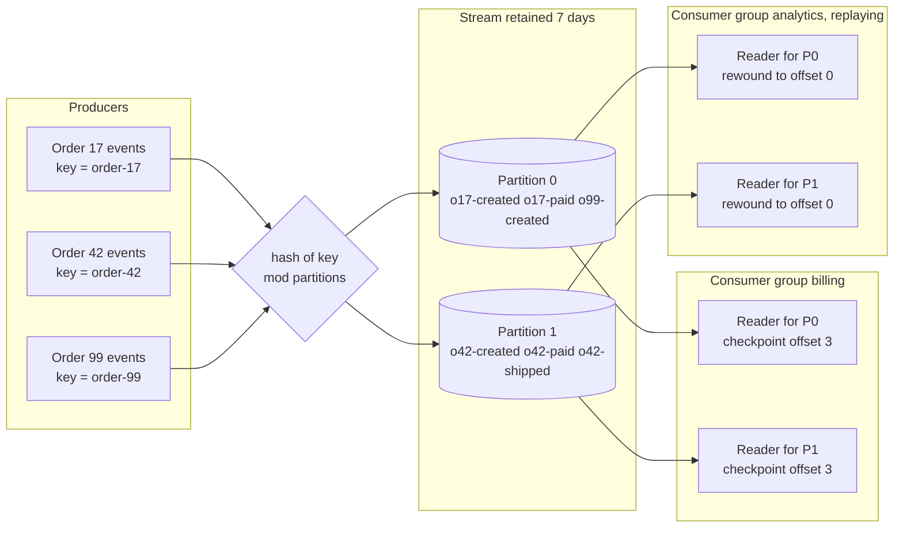

The diagram shows four facts. Every event for order 17 lands in partition 0, so a reader of partition 0 sees `created` before `paid`. Partition 0 also holds order 99, so a slow `o17` event delays `o99` events behind it even though they are unrelated (head-of-line blocking). Two consumer groups read the same partitions with independent checkpoints, so the billing group can be current while the analytics group rewinds to offset 0 and replays seven days of history without affecting billing. And the order between partitions is undefined: the analytics group may process `o42-shipped` before `o17-created`.

Queue-style services implement the same idea without visible partitions. SQS FIFO hashes the message group ID to internal partitions; Service Bus sessions and Pub/Sub ordering keys do the same internally. The difference is that queue-style services block per key (the next message for a key waits for the previous one to be settled) while streams block per partition (a reader that cannot process one record stops its whole partition, including other keys).

### 7.2 Ordering scopes compared

| Service | Ordering key | Scope of order | Blocking unit | Throughput per key or lane | Behavior when one message fails |
|---|---|---|---|---|---|
| SQS FIFO | `MessageGroupId` | Per group, per queue | Group | One in flight per group | Group blocks until success or DLQ |
| SNS FIFO | `MessageGroupId` | Per group, into SQS FIFO subscribers | Group | Bound by SQS FIFO subscriber | As SQS FIFO |
| EventBridge Custom Event Bus (new) | Event group | Per group, per subscriber | Group | Per subscriber | Group blocks while retried |
| Service Bus | `SessionId` | Per session, per queue or subscription | Session | One receiver per session | Session blocks until settled or dead-lettered |
| Pub/Sub | Ordering key | Per key, per region | Key | About 1 MB/s publish per key | Later messages for key wait; redelivery replays later messages too |
| Kinesis | Partition key to shard | Per shard | Shard | 1 MB/s or 1,000 records/s write per shard (provisioned) | Consumer decides; shard blocks if it retries |
| Event Hubs | Partition key to partition | Per partition | Partition | About 1 MB/s per partition in Standard | Consumer decides; partition blocks if it retries |
| Kafka (MSK, Managed Kafka) | Record key to partition | Per partition | Partition | Broker and partition dependent | Consumer decides |
| SQS standard, SNS standard, Event Grid, EventBridge Classic | None | Best-effort or none | Not applicable | Not applicable | Other messages continue |

Choosing a key is a trade between correctness and throughput. The key should be the **smallest scope whose order a business invariant depends on**. For a bank ledger that is the account, not the customer and not the branch. For an inventory reservation it is the stock-keeping unit at a location. Choosing a broader key (all events for a tenant) multiplies head-of-line blocking; choosing a narrower key than the invariant (each line item) silently breaks order. When no invariant depends on order, use no key: unordered delivery is cheaper, faster, and fails more gracefully.

Producers can also break order. With retries and several in-flight requests, a producer can send message 2 successfully while message 1's retry is still pending, so the broker accepts 2 before 1. Kafka's idempotent producer prevents this per partition; Pub/Sub pauses an ordering key on publish failure; SQS FIFO orders by acceptance, so a producer that needs strict order must send one message per group at a time or use batches. Consumers that need order across producers should carry a per-key sequence number in the message and check it, as Part 07 describes.

### 7.3 Replay mechanisms by provider

Replay means processing messages again that were already processed, usually after fixing a consumer bug or adding a new consumer that needs history. Services fall into three groups.

- **Rewind a position in a retained log.** Kinesis (`AT_TIMESTAMP` or `AT_SEQUENCE_NUMBER` iterators), Event Hubs (start a processor from an offset, sequence number, or enqueued time), Kafka (reset consumer-group offsets), and the new EventBridge Custom Event Bus (subscriber starting position). Replay is per consumer group and does not affect other groups. The window is the retention period.
- **Re-mark messages as unacknowledged.** Pub/Sub seek to a timestamp or snapshot. Replay is per subscription. The window is the topic retention or "retain acknowledged messages" window.
- **Re-publish from an archive.** EventBridge Classic archive and replay, and SNS FIFO archive and replay. Replay re-enters routing, so every matching rule or subscription receives the replayed events unless filtered by the replay's scope, which is why replayed events are marked (`replay-name` in EventBridge).
- **No replay.** SQS and Service Bus delete messages on settlement. Their only "replay" is redriving messages that failed into the DLQ. If you need to reprocess successfully consumed messages, the history must come from somewhere else: an upstream stream, an archive, or the system of record.

### 7.4 Worked scenario: a six-hour consumer bug

An analytics consumer reading an Event Hubs event hub with 7-day retention deployed a bug at 02:00 that dropped the `discount` field from its output. The bug was found at 08:00 and fixed at 09:30. The timeline shows what replay must cover.

```mermaid
gantt
    title Replay window after a consumer defect
    dateFormat HH:mm
    axisFormat %H:%M
    section Producers
    Events published continuously        :done, p1, 00:00, 12h
    section Faulty consumer
    Correct output                        :done, c1, 00:00, 2h
    Defective output written              :crit, c2, 02:00, 450m
    Fixed version deployed                :active, c3, 09:30, 150m
    section Replay
    Rewind checkpoint to 01:55 and reprocess :r1, 09:45, 95m
    section Retention
    Data still retained, 7 days           :ret, 00:00, 12h
```

The replay plan follows from the timeline. Rewind the consumer group's checkpoints to 01:55 (a margin before the deployment), not to 08:00 when the bug was noticed. Reprocess 7 hours 50 minutes of events with the fixed version while live traffic continues, which means the consumer runs at more than its normal rate; at a normal rate of 2,000 events per second, the replay holds 56.4 million events, and a consumer capable of 12,000 events per second drains it at a net 10,000 per second in about 94 minutes. The downstream store must absorb six times the normal write rate during that time, or the replay must be throttled and take longer. The consumer's writes must be idempotent (upserts keyed by event ID), because events from 01:55 to 02:00 were already processed correctly and will be processed again. Had the retention been 24 hours and the bug found three days later, replay from the stream would have been impossible, which is the argument for Event Hubs Capture or an equivalent long-term copy.

## 8. Retry, dead-letter, and redrive

[Serverless](CH11_Serverless.md) owns how a function trigger retries and reports partial batch failures. This section covers the broker's half: what the queue, topic, bus, or stream does when a consumer or target fails, and how to design the dead-letter path.

### 8.1 Two retry models

**Pull-side retries** happen in queues and pull subscriptions. The broker does nothing active. A failed consumer simply does not settle, the lease expires, and the message becomes available again. The retry interval is the lease duration (or a backoff set by the consumer or, in Pub/Sub, by the retry policy), and the retry limit is the receive or delivery count threshold.

**Push-side retries** happen in SNS, EventBridge, Event Grid, and Pub/Sub push subscriptions. The broker calls the target, interprets the response, and schedules the next attempt itself on a provider-defined schedule. The retry limit is a time window and an attempt count. When the window ends, the event is dead-lettered or dropped.

The two models fail differently. A pull-side retry loop costs a consumer slot per attempt and can be slowed by backoff, but the message stays durable until retention. A push-side retry loop costs nothing on the consumer, but the event exists only in the broker's retry buffer, and when the window closes it is gone unless a dead-letter destination exists.

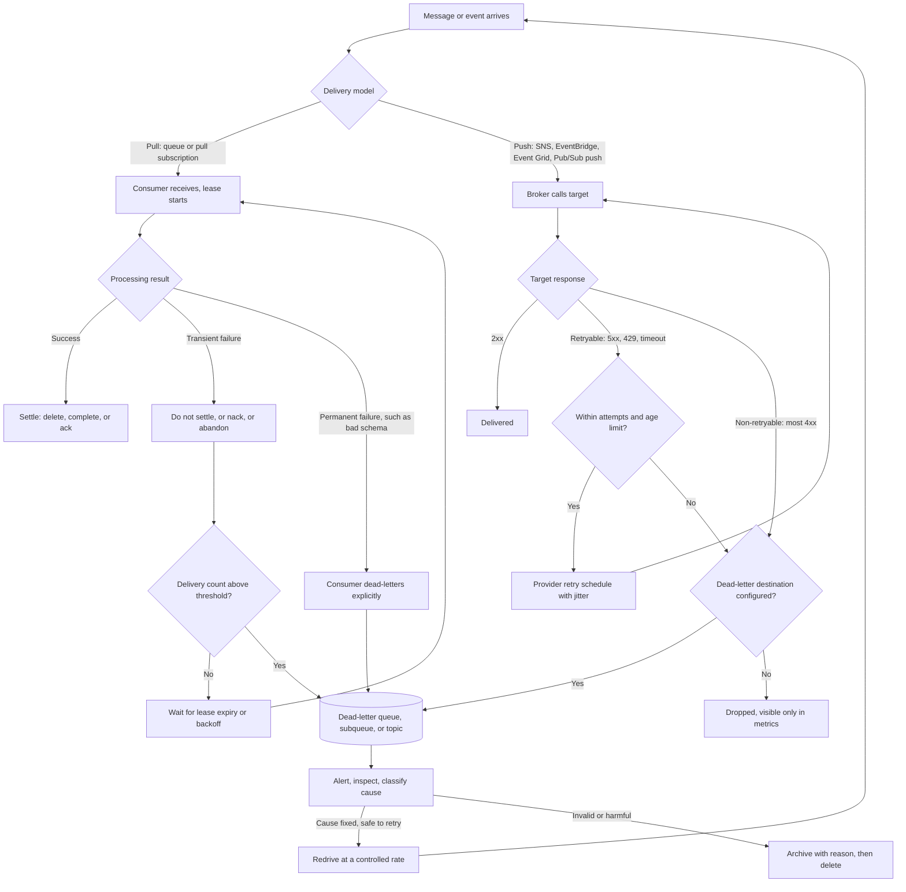

The flowchart's right-hand branch ends in "Dropped," and that box is the reason every push subscription in production needs a dead-letter destination. The left-hand branch has a subtler trap: messages that fail permanently (a schema the consumer cannot parse) should be dead-lettered explicitly on the first attempt rather than cycling through `maxReceiveCount` attempts, each of which occupies a consumer. SQS has no explicit dead-letter API, so an SQS consumer that detects a permanent failure sends the message to the DLQ itself and deletes the original.

### 8.2 Retry and dead-letter controls by provider

| Service | Retry trigger | Retry limit | Interval control | Dead-letter destination | Redrive tooling |
|---|---|---|---|---|---|
| SQS | Visibility timeout expiry | `maxReceiveCount` on redrive policy | Visibility timeout; consumer can change per message | SQS queue of same type | `StartMessageMoveTask`, console redrive |
| SNS | Push delivery failure | Per-protocol policy (Section 4.2) | HTTP/S policy only | SQS queue per subscription | Consumer of the DLQ re-publishes |
| EventBridge Classic | Target failure | 24 h and 185 attempts default, configurable | Provider backoff with jitter | SQS queue per target | Consumer of the DLQ re-sends, or archive replay |
| EventBridge Custom Event Bus | Target failure | 5 attempts or 300 s default, up to 185 and 86,400 s | Provider backoff | SQS queue receiving failure records | Temporary subscriber replays events by ID from retention |
| Service Bus | Lock expiry or abandon | `MaxDeliveryCount`, default 10 | Lock duration; scheduled resend for backoff | Built-in `$deadletterqueue` subqueue | Application or portal resubmits |
| Event Grid | Push delivery failure | 30 attempts and 1,440 min default | Fixed schedule with randomization | Blob Storage container | Application reads blobs and re-publishes |
| Pub/Sub | Deadline expiry or nack; push failure | `maxDeliveryAttempts` 5 to 100 (best-effort) | Retry policy backoff 10 s to 600 s | Dead-letter topic | Subscription on the DLT re-publishes, or seek |
| Kinesis, Event Hubs, Kafka | None at broker | Not applicable | Consumer code | Consumer-built side queue or topic | Consumer replays from offset |

The last row is the important asymmetry. Streams have no broker-side dead-letter path. A stream consumer that wants one writes failures to an SQS queue, a Service Bus queue, or a separate topic, records the original partition and offset, and checkpoints past the failed record. Function triggers on Kinesis and Event Hubs offer this as an on-failure destination, which [Serverless](CH11_Serverless.md) describes.

### 8.3 Designing the dead-letter path

A dead-letter queue is a production system with an owner, not a bin. The design decisions are:

- **One DLQ per source.** Sharing a DLQ across sources mixes failure modes and makes redrive ambiguous. SQS redrive moves messages back to their original source by default precisely because it records that source.
- **Preserve diagnosis data.** Service Bus records `DeadLetterReason` and `DeadLetterErrorDescription`; Pub/Sub adds source-subscription attributes; EventBridge's new bus writes an error code and message. For SQS, add the failure reason as a message attribute when dead-lettering explicitly. Never log full payloads that may contain personal data; log identifiers and reasons.
- **Alarm on arrival, not on volume.** One message in a DLQ means a consumer met something it could not handle. Alarm when the DLQ's visible-message count goes above zero (SQS `ApproximateNumberOfMessagesVisible`, Service Bus `DeadletteredMessages`, Pub/Sub `num_undelivered_messages` on the DLT subscription).
- **Restrict redrive and purge.** Redrive replays possibly harmful work; purge destroys evidence. Grant them to an operator role, not to the application role (Section 13).
- **Redrive at a controlled rate.** A redrive of 500,000 messages into a queue whose consumers autoscale can overwhelm the downstream database that caused the failures. SQS `StartMessageMoveTask` accepts a maximum messages-per-second rate; for other services, the redrive tool must throttle itself.

### 8.4 Worked example: the SQS standard DLQ retention trap

An SQS standard source queue has a 4-day retention period. Its DLQ also has a 4-day retention period. Messages fail because a partner API is down from Friday 18:00 and are moved to the DLQ after `maxReceiveCount` = 5 with a 5-minute visibility timeout, so about 25 minutes after they were sent.

AWS documents that for standard queues a message's expiration is based on its **original enqueue timestamp**, which is unchanged when it moves to the DLQ ([AWS documentation](https://docs.aws.amazon.com/AWSSimpleQueueService/latest/SQSDeveloperGuide/setting-up-dead-letter-queue-retention.html)). A message sent at Friday 18:00 therefore expires from the DLQ at Tuesday 18:00, not four days after it arrived in the DLQ. If the team does not redrive until Wednesday, every message sent during the first day of the outage is gone, and the DLQ's `ApproximateAgeOfOldestMessage` metric understated the risk because it measures time since arrival in the DLQ.

The fix is to set the DLQ retention to the 14-day maximum, longer than the source queue's retention, as AWS recommends, and to alarm on the source message age plus DLQ age. The general lesson applies to every provider: compute the latest time a dead-lettered message can still be redriven, and make sure the on-call process can act before it. For push services the window is shorter still. An Event Grid subscription with default settings drops an undeliverable event 24 hours after publication unless a dead-letter container exists.

## 9. Duplicate delivery and idempotent consumers

### 9.1 Recap of the Part 07 position

Part 07 establishes three results that this chapter relies on. A message system that never loses messages must sometimes deliver them more than once, because a sender cannot distinguish "lost" from "slow" ([Exactly-Once Processing](../07_System_Design_and_Distributed_Systems/CH17_Exactly_Once_Processing.md)). "Exactly once" is achievable only for an effect inside a boundary that commits input progress and output together, such as a Kafka transaction writing to Kafka, or a consumer that records "message X applied" in the same database transaction as the business change. And a consumer becomes safe under duplicates by making its effect idempotent, using a natural key, a conditional write, or a seen-ID record ([Idempotency](../07_System_Design_and_Distributed_Systems/CH16_Idempotency.md), [Deduplication](../07_System_Design_and_Distributed_Systems/CH19_Deduplication.md)).

### 9.2 Where duplicates come from in managed services

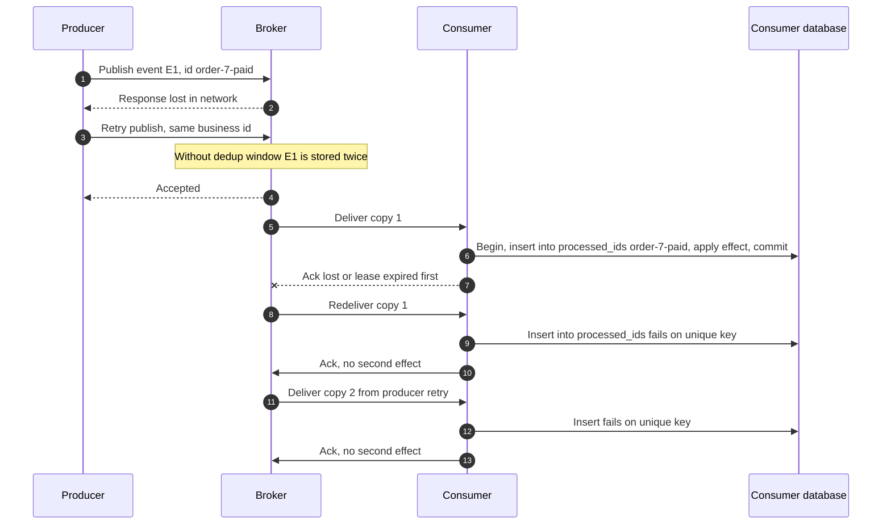

The sequence shows the two duplicate sources that every managed service has in some form. The first is the producer retry after an ambiguous response (steps 1 to 4); a broker deduplication window removes it only if the retry carries the same identifier and arrives within the window. The second is redelivery after a lost acknowledgment or expired lease (steps 7 to 10); no broker feature removes that for side effects outside the broker. The consumer handles both with one mechanism: it records the business identifier in a `processed_ids` table with a unique constraint **in the same transaction** as the business change. A duplicate fails the insert, rolls back, and is acknowledged without a second effect. If the effect is an external API call that cannot join the transaction, the consumer passes the same identifier to the API as an idempotency key, which moves the deduplication to the API owner.

### 9.3 Provider deduplication features and their limits

| Feature | Removes producer retries | Removes redelivery after lease or ack loss | Window | Scope |
|---|---|---|---|---|
| SQS FIFO deduplication ID | Yes | No | 5 minutes | Queue, or message group in high-throughput mode |
| SNS FIFO deduplication ID | Yes | No (subscriber SQS FIFO still redelivers on lease expiry) | 5 minutes | Topic |
| Service Bus duplicate detection | Yes, by `MessageId` | No | 20 s to 7 days | Queue or topic; with partitioning, `MessageId` plus partition key |
| EventBridge Custom Event Bus | Yes, by content or key | No | 5 minutes | Bus |
| Pub/Sub exactly-once delivery | No (two publishes are two messages) | Prevents redelivery after a successful ack, and reports failed acks | Not window-based | One subscription, one region, pull only |
| Kafka idempotent producer | Yes, per partition and producer session | No | Producer session | Partition |
| Kafka transactions | Yes | Yes, for consume-transform-produce within Kafka | Transaction | Kafka topics only |

Every row has "No" or a scope restriction somewhere. The practical rule: **turn on the provider feature to reduce duplicate volume, and still build the idempotent consumer.** The provider feature's window matters in one specific way. A producer that retries for longer than the window (for example, an outbox relay that resends unconfirmed events after a 10-minute outage) defeats a 5-minute SQS FIFO deduplication interval. Size Service Bus's window to exceed the producer's longest retry horizon, and keep the consumer's seen-ID retention longer than the broker's retention plus the longest replay you might run.

## 10. Throughput and partition sizing

Sizing has two halves: the broker must accept and serve the traffic, and the consumers must keep up with it. Partitioned services force the first half to be decided in advance. Every calculation below uses limits quoted earlier in the chapter; recheck them against current quotas before using the results.

### 10.1 Worked example: sizing a Kinesis stream in provisioned mode

A fleet of delivery vans sends location pings. Requirements:

- Average 12,000 records per second, average record size 1.5 KB, daily peak twice the average.
- Three consumer applications read every record: a live map, a fraud detector, and an archiver.
- Partition key is the van ID; 40,000 vans, so keys are numerous and roughly uniform.

**Write capacity.** Peak records per second = 24,000. Peak bytes per second = 24,000 × 1.5 KB = 36 MB/s. Each shard accepts 1,000 records per second or 1 MB/s, whichever is reached first:

- By records: 24,000 / 1,000 = 24 shards.
- By bytes: 36 MB/s / 1 MB/s = 36 shards.

Bytes dominate, so the floor is 36 shards. Hashing 40,000 keys across shards is never perfectly even; a 25% headroom for skew and growth gives 45, rounded to 48 shards.

**Read capacity.** With shared-throughput consumers, each shard serves 2 MB/s to all readers together. Three applications each reading 36 MB/s need 108 MB/s. Forty-eight shards supply 48 × 2 = 96 MB/s, which is not enough, and the five-reads-per-second-per-shard limit is shared too. Two options:

- Add shards until reads fit: 108 / 2 = 54 shards plus headroom, about 68 shards. This pays for write capacity that is not needed.
- Register the three applications as **enhanced fan-out** consumers. Each gets 2 MB/s per shard: 48 × 2 = 96 MB/s per consumer, well above 36 MB/s. This keeps 48 shards and adds per-consumer charges.

Enhanced fan-out is the better choice here because the read problem is caused by the number of consumers, not by the write rate, and it also lowers latency for the live map.

**On-demand alternative.** On-demand Standard removes the shard calculation, but a new stream starts with 4 MB/s of write capacity and scales from observed traffic. A launch-day step from zero to 36 MB/s would be throttled during scale-up. Either pre-warm (On-demand Advantage warm throughput) or create the stream in provisioned mode with 48 shards and switch to on-demand after traffic stabilizes.

### 10.2 Worked example: the same load on Event Hubs

The same 36 MB/s of ingress with three consumer groups on Azure Event Hubs:

- **Ingress** in Standard tier: 36 MB/s needs 36 TUs (1 MB/s each), within the 40-TU maximum but with almost no headroom.
- **Egress**: three consumer groups reading 36 MB/s each is 108 MB/s, needing 54 TUs at 2 MB/s each. That exceeds the Standard maximum of 40 TUs.
- **Partitions**: Standard allows 32 partitions per event hub, and each partition handles roughly 1 MB/s, so 36 MB/s does not fit in one Standard event hub regardless of TUs.

Standard does not fit. **Premium** allows up to 100 partitions per event hub and sizes by processing units without a fixed per-unit throughput, so the design moves to Premium with, for example, 64 partitions and a PU count validated by load test. An alternative that stays in Standard is to split the traffic into two event hubs by region, each with 18 MB/s of ingress, 32 partitions, and separate namespaces, at the cost of consumers reading two hubs. The arithmetic shows why Event Hubs tier choice is a capacity decision, not just a feature decision.

### 10.3 Sizing consumer pools with Little's law

For any queue, the number of messages being processed at once equals arrival rate times processing time. This is Little's law, taught in [Non-Functional Requirements](../07_System_Design_and_Distributed_Systems/CH02_Non_Functional_Requirements.md); here it sizes a consumer pool. An order-enrichment queue receives 800 messages per second at peak, and each message takes 120 ms to process:

- Concurrency needed = 800 × 0.12 = 96 concurrent handlers.
- At a target utilization of 70% (so latency stays stable and bursts are absorbed), provision 96 / 0.7 ≈ 137, rounded to 140 handlers, for example 14 container tasks with 10 worker threads each.
- Downstream check: 140 handlers can sustain 140 / 0.12 ≈ 1,167 messages per second. The enrichment database must accept that write rate, or the consumer pool must be capped below it. The cap is the backpressure mechanism; the queue absorbs the difference.

For a partitioned stream the same formula applies per partition, and the number of concurrent handlers per consumer group cannot exceed the partition count unless the consumer processes records within a partition concurrently and gives up per-partition order.

### 10.4 Worked example: backlog drain time

The enrichment consumers above stop for 60 minutes during an incident while producers continue at 800 messages per second. Backlog = 800 × 3,600 = 2.88 million messages. When consumers return at full capacity of 1,167 messages per second while 800 per second keep arriving, the backlog drains at a net 367 per second: 2,880,000 / 367 ≈ 7,850 seconds, or about 2 hours 11 minutes. Total time from incident start to normal latency is over three hours.

Three things follow. First, recovery takes longer than the outage whenever headroom is small. If the pool could scale to 1,600 messages per second during recovery, and the database accepted that rate, the net drain rate would be 800 per second and the drain would take one hour instead of two. Second, the queue's retention must exceed outage plus drain time (comfortably true for SQS's 4-day default, not true for a 1-hour Event Grid TTL). Third, the age of the oldest message, which is what customers experience, peaks at outage length plus nearly the whole drain, so an age-based service level objective (SLO) of 15 minutes is violated for about three hours by a one-hour outage. Write the drain calculation into the runbook so on-call engineers know whether to scale consumers (if the downstream allows it) or wait.

### 10.5 Ordered throughput per key

For ordered services, apply the per-key rule from Section 4.1 before choosing the key. If a Pub/Sub ordering key is limited to 1 MB/s of publish and a key carries 3 MB/s at peak, ordering by that key fails at the publisher. If an SQS FIFO group's processing time is 200 ms, the group cannot exceed 5 messages per second. If a Service Bus session's handler takes 50 ms, the session tops out at 20 messages per second. Compute the peak rate of the busiest key, not the average key, because key popularity is usually skewed: the largest tenant, the most popular product, or the busiest van depot.

## 11. Backlog, lag, and quota operations

### 11.1 The signals that matter

Queue depth alone is a poor alarm signal. A depth of 100,000 is healthy for a batch queue drained hourly and an emergency for a payment queue. **Age** is the signal that maps to user impact: how long the oldest unprocessed message has waited, or how far behind the newest record a stream consumer is reading.

| Service | Age or lag signal | Backlog signal | Failure signal |
|---|---|---|---|
| SQS | `ApproximateAgeOfOldestMessage` | `ApproximateNumberOfMessagesVisible`, `...NotVisible` (in flight) | DLQ `ApproximateNumberOfMessagesVisible` |
| SNS | Not applicable (push) | Not applicable | `NumberOfNotificationsFailed`, `...Redriven` to DLQ |
| EventBridge | Ingestion-to-invocation latency metrics | Not applicable | `FailedInvocations`, `RetryInvocationAttempts`, `InvocationsSentToDlq`, `EventsDropped` |
| Kinesis | `GetRecords.IteratorAgeMilliseconds`; `MillisBehindLatest` from the consumer library | Not applicable | `WriteProvisionedThroughputExceeded`, `ReadProvisionedThroughputExceeded` |
| Service Bus | Oldest enqueued time via message peek, or application-emitted age | `ActiveMessages`, `ScheduledMessages` | `DeadletteredMessages`, `ThrottledRequests`, `ServerErrors` |
| Event Grid | Delivery latency metrics | Not applicable | `DeliveryAttemptFailCount`, `DeadLetteredCount`, `DroppedEventCount` |
| Event Hubs | Consumer lag (latest sequence number minus checkpoint), often computed by the processor | Not applicable | `ThrottledRequests`, `QuotaExceededErrors` |
| Pub/Sub | `oldest_unacked_message_age` | `num_undelivered_messages` | `dead_letter_message_count`, push `send_request_count` by response class |

Alarm on age against the SLO, alarm on any dead-letter arrival, and alarm on throttling counters. Iterator age in Kinesis and lag in Event Hubs deserve a second, hard threshold at a fraction of retention: if a 24-hour stream's consumer is 18 hours behind, the next six hours decide whether data is lost. [Monitoring](CH10_Monitoring.md) covers how these provider metrics are collected and routed to alerting.

A useful derived signal for queues is **time to drain**: backlog divided by net drain rate (consumer throughput minus arrival rate). It turns "the queue has 2 million messages" into "at the current rate the backlog clears in 90 minutes," which is the number an incident commander needs.

### 11.2 Quotas that bite during scale-out

Messaging quotas fall into three types, and each fails differently:

- **Hard per-resource limits** that cannot be raised: SQS's 14-day retention, Service Bus's 5-minute lock, Event Hubs Standard's 32 partitions, Pub/Sub's 10 MB message. These are design constraints. Hitting one in production means the design was wrong.
- **Throughput limits per unit** that are raised by adding capacity: Kinesis shards, Event Hubs TUs or PUs, Service Bus MUs, SQS FIFO TPS per region. Exceeding them produces throttling errors (`ProvisionedThroughputExceededException`, `ServerBusy`, HTTP 429) that producers must retry with backoff.
- **Account or project quotas** raised by request: Kinesis shards per account, on-demand stream counts, Pub/Sub regional throughput quotas, Event Hubs CUs beyond 10. Requests take time and are not guaranteed, so they belong in launch plans.

**Quality scenario: quota limit during scale-out.**

- **Stimulus:** A marketing campaign drives order events from 2,000 to 15,000 per second within ten minutes. Orders flow to a Kinesis stream in provisioned mode with 20 shards, then to consumers.
- **Expected response:** Producers receive `ProvisionedThroughputExceededException` on some writes and retry with exponential backoff and jitter while buffering locally up to a bound. An alarm on `WriteProvisionedThroughputExceeded` above 1% of requests for 2 minutes pages on-call. A runbook step raises the shard count with `UpdateShardCount` (which takes minutes and is limited in how much and how often it can scale per day), or the stream has been converted to on-demand ahead of the campaign. The account shard quota was raised two weeks earlier as part of the launch checklist.
- **Measurable success criterion:** No accepted orders are lost; fewer than 0.1% of order writes take longer than 5 seconds end to end; iterator age stays under 2 minutes; the shard-quota headroom on the account is at least 2 times the campaign peak before the campaign starts.

### 11.3 Zonal and regional failure

All managed services in this chapter store messages redundantly across availability zones within a region in their standard configurations (Event Hubs and Service Bus use availability zones automatically in regions that support them; MSK places brokers across two or three zones, which you choose). A zonal failure is therefore handled by the provider, but not invisibly to consumers.

**Quality scenario: zonal failure.**

- **Stimulus:** One of three availability zones in the region loses power. A third of the consumer containers and one MSK broker in that zone stop.
- **Expected response:** The broker continues to accept and serve messages from replicas in the other zones. Leases held by the failed consumers expire and their messages are redelivered to surviving consumers. Kafka partitions led by the failed broker elect new leaders from in-sync replicas, and producers configured with `acks=all` and `min.insync.replicas=2` keep writing. The consumer autoscaler replaces lost capacity in healthy zones.
- **Measurable success criterion:** Zero acknowledged messages lost (recovery point objective (RPO) of zero for accepted messages); duplicates limited to messages in flight at failure time, all absorbed by idempotent consumers; oldest-message age returns under the 15-minute SLO within 20 minutes.

A **regional** failure is different, because every service in this chapter is regional (Pub/Sub's global endpoint still stores messages in specific regions). Cross-region protection must be designed: Service Bus and Event Hubs Premium offer geo-replication, Event Hubs and Service Bus also offer metadata-only geo-disaster recovery aliases, EventBridge global endpoints fail over event ingestion between two regions, and SQS and Kinesis need application-level dual-region publishing or replication. The architecture of multi-region event flows belongs to [Resilience, Availability, and Disaster Recovery Architectures](../10_Cloud_Architecture/CH09_Resilience_Availability_and_Disaster_Recovery_Architectures.md).

## 12. Message size limits and the claim-check pattern

### 12.1 Size limits by service

| Service | Maximum message or event size (at the time of writing) | Billing granularity |
|---|---|---|
| SQS | 1 MiB | Each 64 KB chunk of payload counts as one request |
| SNS | 1 MiB (topic `MaximumMessageSize` defaults to 256 KiB) | Each 64 KB chunk counts as one request |
| EventBridge | 1 MB per `PutEvents` request total (raised from 256 KB in January 2026) | Per 64 KB chunk on classic buses; data volume on the new Custom Event Bus |
| Kinesis Data Streams | 10 MiB per record (1 MiB default per stream) | Shard-hours or data volume |
| Service Bus | 256 KB Standard; up to 100 MB Premium over AMQP | Per operation (Standard) or MU-hour (Premium) |
| Event Grid | 1 MB per event (verify) | Per operation, counted in 64 KB increments (verify) |
| Event Hubs | 256 KB Basic; 1 MB Standard and Premium; 20 MB Dedicated | TU, PU, or CU hours plus ingress events |
| Pub/Sub | 10 MB | Bytes, with a 1 KB minimum per request |
| Kafka (MSK, Managed Kafka) | Broker setting (`message.max.bytes`), default around 1 MB | Broker or capacity hours plus storage |

Raised limits do not make large messages a good idea. Large messages increase per-message latency, consume lease time to transfer, reduce batching, count against throughput units, and copy sensitive data into every subscription, dead-letter queue, archive, and replay. The limit is the point where a design breaks, not a target.

### 12.2 The claim-check pattern

The claim-check pattern stores the payload in object storage and sends a small message containing a reference to it.

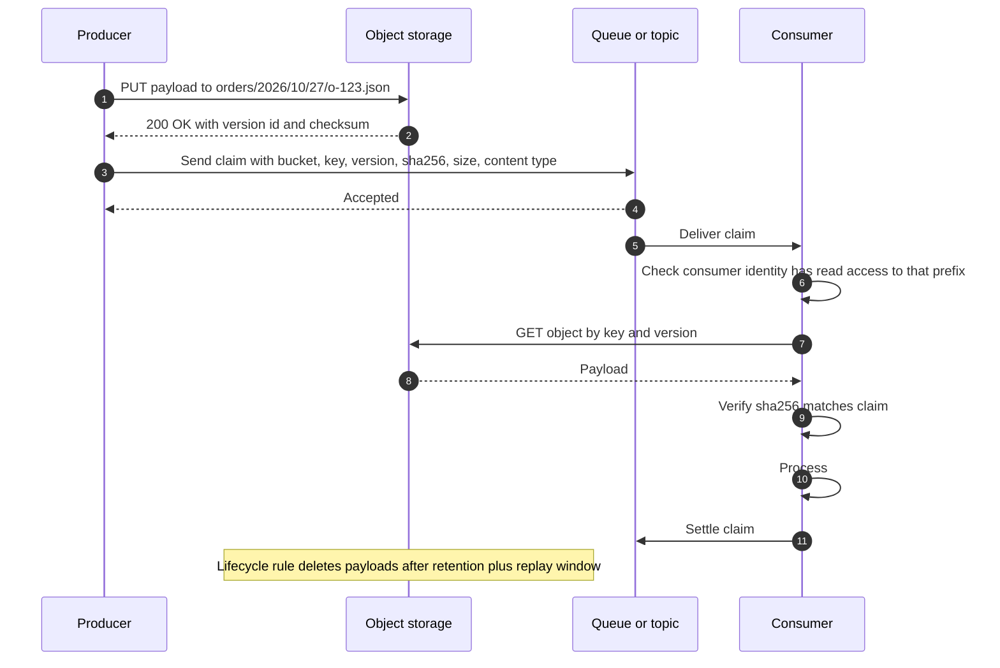

The order of steps matters. The producer writes the object first and sends the claim only after the write succeeds, so a consumer never receives a claim for a missing object. The claim pins a **version** (Amazon S3 version ID, Azure Blob version ID, or Cloud Storage generation number) and a checksum, so a later overwrite cannot change what a replayed message means. Consumers need read access to the storage prefix, which becomes part of the access design in Section 13. And the object's lifecycle must be at least as long as the message's retention plus DLQ retention plus the longest replay window; deleting payloads after 7 days while the stream retains claims for 30 days produces claims that point to nothing.

AWS provides client libraries that implement the pattern for SQS and SNS (the Amazon SQS Extended Client Library and the SNS extended client), which offload payloads above a threshold to Amazon S3 automatically. On Azure and Google Cloud the pattern is usually implemented in application code. Event Grid's Blob Storage "BlobCreated" events and Pub/Sub's Cloud Storage notifications are effectively built-in claim checks: the storage service emits the reference when the object lands.

**Cost effect of the pattern.** An SQS producer sends 200 KB documents. Each message is 4 chunks of 64 KB, so each send and each receive counts as 4 requests. With a claim check, the message is under 1 KB and counts as 1 request, and the payload costs one object write, one object read, and storage for the retention period. At high volume the object storage requests usually cost less than the 4 times request multiplier, and the queue stays fast. Check the arithmetic with current prices, because object storage request pricing differs by provider and class.

## 13. Identity and cross-scope access

[IAM](CH09_IAM.md) teaches how each provider evaluates principals, policies, and resource scopes. Messaging adds three concerns: publish, consume, and administer are different privileges that should belong to different principals; services (not just workloads) publish into queues and topics, so service principals need grants; and messaging is one of the most common paths across account, subscription, and project boundaries.

### 13.1 Separating privileges

Every messaging resource has at least four privilege sets. **Send** (publish) lets a principal add work. **Receive** (consume and settle) lets it read and delete work. **Manage** (create subscriptions, change filters, set retry policy) changes who receives what. **Destructive operations** (purge a queue, redrive a DLQ, seek a subscription forward, delete a subscription) destroy or replay work in bulk. A producer should hold only send on its own topic; a consumer only receive on its own queue or subscription; deployment pipelines hold manage; and destructive operations belong to an operator role used through a break-glass or approval process.

The provider vocabulary:

- **AWS.** Identity policies on roles plus **resource policies** on SQS queues, SNS topics, and EventBridge buses. Actions are fine-grained (`sqs:SendMessage`, `sqs:ReceiveMessage`, `sqs:DeleteMessage`, `sqs:PurgeQueue`, `sqs:StartMessageMoveTask`; `sns:Publish`, `sns:Subscribe`; `events:PutEvents`, `events:PutRule`). Kinesis uses identity policies and, for cross-account access, resource policies on streams and consumers. MSK can use IAM access control for Kafka actions per topic and consumer group.
- **Azure.** Microsoft Entra ID principals (preferably managed identities) with built-in **data-plane roles**: Azure Service Bus Data Sender, Azure Service Bus Data Receiver, Azure Service Bus Data Owner; Azure Event Hubs Data Sender and Data Receiver; EventGrid Data Sender. Assign them at entity scope (one queue or topic) rather than namespace scope where possible. The older **shared access signature (SAS)** keys grant send, listen, or manage through a shared secret; set the namespace's `disableLocalAuth` property to force Entra ID authentication, which removes long-lived secrets entirely.
- **Google Cloud.** IAM roles on topics and subscriptions: `roles/pubsub.publisher` on a topic, `roles/pubsub.subscriber` on a subscription, `roles/pubsub.viewer`, and `roles/pubsub.editor` or `roles/pubsub.admin` for management. Grant at resource level rather than project level so a consumer of one subscription cannot read another. The **Pub/Sub service agent** (a Google-managed service account per project) needs its own grants for dead-letter topics, and push subscriptions use a service account you choose to mint the OIDC token the endpoint verifies.

A minimal SQS queue policy that lets only one SNS topic deliver to a queue, and only one consumer role in another account read from it:

```json
{
  "Version": "2012-10-17",
  "Statement": [
    {
      "Sid": "AllowOrdersTopicOnly",
      "Effect": "Allow",
      "Principal": { "Service": "sns.amazonaws.com" },
      "Action": "sqs:SendMessage",
      "Resource": "arn:aws:sqs:eu-west-1:111122223333:fulfillment-orders",
      "Condition": { "ArnEquals": { "aws:SourceArn": "arn:aws:sns:eu-west-1:111122223333:orders" } }
    },
    {
      "Sid": "AllowFulfillmentConsumer",
      "Effect": "Allow",
      "Principal": { "AWS": "arn:aws:iam::444455556666:role/fulfillment-worker" },
      "Action": ["sqs:ReceiveMessage", "sqs:DeleteMessage", "sqs:ChangeMessageVisibility", "sqs:GetQueueAttributes"],
      "Resource": "arn:aws:sqs:eu-west-1:111122223333:fulfillment-orders"
    }
  ]
}
```

The `aws:SourceArn` condition is the important line. Without it, any SNS topic in any account that knows the queue's Amazon Resource Name (ARN) could deliver to it, a confused-deputy risk. The consumer role in account 444455556666 also needs an identity policy allowing the same actions on the queue, because cross-account access in AWS requires both sides to agree.

### 13.2 Cross-scope messaging topologies

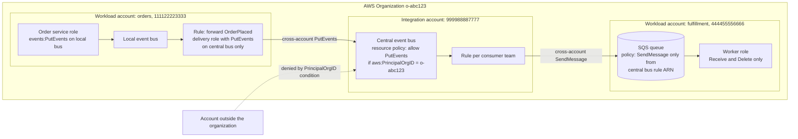

The diagram shows the trust boundaries in a hub-and-spoke event backbone on classic EventBridge buses. Each arrow that crosses an account boundary is authorized twice: by the sender's delivery role (identity policy) and by the receiver's resource policy. The central bus admits only principals from the organization, so a compromised or external account cannot inject events. The fulfillment queue admits only the specific rule that targets it, so a different team's rule cannot write into it by mistake. With the new EventBridge Custom Event Bus, the same topology uses AWS RAM sharing with managed permissions (publish, subscribe, attach sources) instead of hand-written bus policies, and consumer accounts attach their own subscribers, which removes the central team from every routing change ([AWS documentation](https://docs.aws.amazon.com/eventbridge/latest/userguide/eb-custom-bus-what-is.html)).

On Google Cloud, a subscription can live in a different project from its topic. The subscribing project needs permission to attach to the topic (granted on the topic by its owner), and Pub/Sub bills subscription throughput to the project that contains the subscription ([Pub/Sub pricing](https://cloud.google.com/pubsub/pricing)). That gives each consuming team its own subscription, retry policy, dead-letter topic, and cost line while the producer owns only the topic. On Azure, cross-subscription access within one Microsoft Entra tenant is an RBAC assignment on the entity to a managed identity in the other subscription; cross-tenant access requires a multi-tenant application registration or a forwarding service, which is one reason many organizations keep a shared messaging namespace in a platform subscription.

### 13.3 Quality scenario: account compromise contained by organizational boundaries

- **Stimulus:** An attacker obtains credentials for the order service's role in the orders account and attempts to publish forged "RefundIssued" events and to read the fulfillment queue.
- **Expected response:** The order service role can publish only to its local bus, and the local bus forwards only `OrderPlaced` events, so forged refund events never reach the central bus. The role has no `sqs:ReceiveMessage` grant on the fulfillment queue, and the queue policy names only the fulfillment worker role, so reads fail with access denied. AWS CloudTrail records the denied calls, and an alert on unusual `PutEvents` volume or detail types fires.
- **Measurable success criterion:** Zero forged events delivered to any consumer; zero messages read from queues outside the compromised account; detection within 15 minutes from the first denied call; credential revocation (session policy deny or role trust change) completed within 30 minutes.

### 13.4 Quality scenario: identity rotation

Messaging clients hold long-lived connections (AMQP links, StreamingPull streams, Kafka sessions), so credential rotation must not drop them all at once.

- **Stimulus:** The security team rotates the Service Bus SAS keys used by a legacy consumer, or rotates the client secret of an Entra ID application used by an on-premises producer.
- **Expected response:** For SAS, the namespace has two keys per rule; clients move from the primary to the secondary key, the primary is regenerated, and clients move back, with each step confirmed by connection metrics. For Entra ID, tokens are refreshed by the client library before expiry, so a secret rotation affects only new token requests. The preferred end state is managed identities with `disableLocalAuth` set, which removes the secret entirely.
- **Measurable success criterion:** No increase in failed sends or receives during rotation; no client using a revoked credential after 1 hour; rotation completed without a deployment freeze.

## 14. Encryption and network isolation

Every service in this chapter encrypts messages at rest by default and uses Transport Layer Security (TLS) in transit. The decisions are who controls the key and whether the endpoint is reachable from the public internet.

**Keys.** SQS encrypts new queues with SQS-managed server-side encryption (SSE-SQS) by default and offers server-side encryption with AWS Key Management Service (SSE-KMS) keys. SNS, Kinesis, and EventBridge support KMS keys, and MSK encrypts storage with a KMS key you can choose. Azure Service Bus Premium and Event Hubs Premium and Dedicated support customer-managed keys in Azure Key Vault. Pub/Sub encrypts with Google-owned keys by default and supports customer-managed encryption keys (CMEK) in Cloud Key Management Service per topic. Customer-managed keys add control (you can revoke access) and a dependency (if the key is disabled or its policy is wrong, the service cannot read or write messages). Envelope encryption and key hierarchy are taught in [Secrets Management](CH13_Secrets_Management.md).

The most common encryption incident in AWS messaging is a key policy that blocks a service. When an SQS queue uses a customer-managed KMS key and SNS or EventBridge delivers to it, the key policy must allow the delivering service principal to call `kms:GenerateDataKey` and `kms:Decrypt`; otherwise delivery fails and messages are retried and then dropped or dead-lettered. The AWS-managed key `aws/sqs` cannot be used here because its policy cannot be edited to admit other service principals.

**Quality scenario: key rotation.** A queue's customer-managed KMS key has automatic rotation enabled. Rotation creates new key material while retaining old material for decryption, so messages encrypted before rotation remain readable and no client change is needed. The risky operation is not rotation but disabling or scheduling deletion of a key, which makes every message encrypted under it unreadable. The success criterion for a rotation event is zero failed sends or receives and no `KMS_INVALID_STATE` or access-denied errors in the following hour; a key-deletion request on any messaging key should require a second approver and trigger an alert.

**Network isolation.** AWS messaging APIs are reachable privately through interface virtual private cloud (VPC) endpoints (AWS PrivateLink) for SQS, SNS, EventBridge, and Kinesis; endpoint policies can restrict which queues or topics may be reached through the endpoint, and resource policies can require `aws:SourceVpce` so a queue rejects calls from the internet. MSK brokers live in your subnets. Azure Service Bus Premium and Event Hubs Standard and above support private endpoints and can disable public network access. Pub/Sub is reached through Private Google Access or Private Service Connect for Google APIs, and VPC Service Controls perimeters can prevent data exfiltration by blocking access to Pub/Sub resources from outside the perimeter. Push delivery reverses the direction: SNS, EventBridge, Event Grid, and Pub/Sub push call your endpoint from the provider's network, so the endpoint must be reachable by the provider and must authenticate the caller (signature verification for SNS, the validation handshake and Entra ID authentication for Event Grid, and OIDC token verification for Pub/Sub push).

## 15. Cost model and worked examples

### 15.1 What you pay for

| Service | Main billing dimensions |
|---|---|
| SQS | Requests (send, receive, delete, change visibility; each 64 KB chunk counts as one request), data transfer out |
| SNS | Publishes, deliveries per protocol, payload chunks, data transfer |
| EventBridge Classic | Events published to custom buses (64 KB chunks), cross-account events, archive storage and replay, Pipes requests |
| EventBridge Custom Event Bus | Ingress and egress data volume (per GB), retention |
| Kinesis | Shard-hours (provisioned) or data in and out plus stream-hours (on-demand), extended and long-term retention, enhanced fan-out consumer-shard-hours and data |
| MSK | Broker-hours or capacity (Serverless), storage, data transfer |
| Service Bus | Operations (Basic and Standard) or MU-hours (Premium) |
| Event Grid | Operations in 64 KB increments, delivery attempts, namespace throughput units |
| Event Hubs | TU, PU, or CU hours, ingress events (Basic and Standard), Capture, extended retention |
| Pub/Sub | Throughput bytes published and delivered (1 KB minimum per request), retention storage, export subscription throughput, cross-region data transfer |

### 15.2 Worked example: SQS request cost and batching

A queue carries 800 messages per second on average, each 10 KB (one 64 KB chunk). Monthly messages = 800 × 86,400 × 30 = 2,073.6 million. Using the published US East (N. Virginia) standard-queue price at the time of writing of $0.40 per million requests after the first million free each month (verify current pricing on the [SQS pricing page](https://aws.amazon.com/sqs/pricing/)):

- **Unbatched**: one send, one receive, and one delete per message = 3 requests per message = 6,220.8 million requests ≈ $2,488 per month.
- **Batched by 10** on send, receive, and delete: 0.3 requests per message = 622.1 million requests ≈ $249 per month.
- **Empty receives**: with short polling, idle consumers can generate more requests than the messages themselves. Twenty consumer threads short-polling an empty queue in a tight loop at 10 calls per second each generate 518 million requests a month (about $207) for nothing. Long polling with a 20-second wait reduces that to at most 20 × 3 calls per minute = 2.6 million requests a month.

If the messages were 200 KB instead of 10 KB, each send and receive would count as 4 requests, and a batch could hold only five such messages because the batch's total size is also capped at the maximum message size. That more than triples the batched cost before considering the claim-check alternative in Section 12. FIFO queues cost more per request ($0.50 per million at the time of writing). Batching and long polling are the two largest SQS cost levers, and neither changes delivery semantics.

### 15.3 Worked example: Pub/Sub throughput, fan-out, and retention

A topic receives 8 MB per second (for example 800 messages of 10 KB) and has three pull subscriptions. Using Pub/Sub's published price at the time of writing of $40 per TiB of throughput after 10 GiB free per month, and $0.27 per GiB-month of retention storage ([Pub/Sub pricing](https://cloud.google.com/pubsub/pricing); verify current pricing):

- Monthly publish volume = 8,000,000 bytes × 2,592,000 seconds = 20.74 TB ≈ 18.86 TiB.
- Delivery volume = 3 subscriptions × 18.86 TiB = 56.58 TiB.
- Throughput charge ≈ (18.86 + 56.58) × $40 ≈ $3,018 per month.
- Adding **7 days of topic retention** for replay stores 8 MB/s × 604,800 s ≈ 4.84 TB ≈ 4,506 GiB continuously, ≈ $1,217 per month.
- Using **subscription retention** instead and keeping backlogs under one day costs nothing extra, because Pub/Sub charges subscription storage only for unacknowledged messages older than a day (or for retained acknowledged messages).

Two conclusions follow. Fan-out multiplies throughput cost: each new subscription adds about $754 per month at this volume, so "just add a subscription" is a budget decision. And replay capability has a visible price; whether $1,217 per month is worth a 7-day replay window depends on how often consumer defects happen and what reprocessing from the system of record would cost. Batching small messages also matters on Pub/Sub because each publish request is billed at a minimum of 1 KB: publishing 200-byte messages one at a time costs five times the bytes actually sent.

### 15.4 Worked example: retained storage from backlog and retention

The estimator in [04_retention_cost.py](../code/python/messaging-chapter/04_retention_cost.py) models storage as rate × size × retention, plus a dead-letter fraction. For 350 messages per second of 8 KB with 5% of messages also held in a DLQ:

- 24 hours: 350 × 86,400 = 30.24 million messages × 8 KB = 241.9 GB × 1.05 ≈ 254.0 GB.
- 72 hours: ≈ 762.0 GB.
- 168 hours (7 days): ≈ 1,778.1 GB.

The script prints these values. As it states, the estimate ignores replication, indexes, request charges, and egress. Its purpose is to show that retention is linear in time and therefore a deliberate knob: tripling retention triples stored bytes, and on services that bill retained storage (Pub/Sub topic retention, Kinesis extended retention, Event Hubs Premium storage) it triples that line item. On services that bill capacity rather than bytes (Event Hubs Standard includes storage per TU; Service Bus Premium includes storage per MU), the same calculation tells you whether the retention fits in the purchased capacity.

### 15.5 Hidden cost multipliers

- **Fan-out.** Every subscription, rule target, or consumer group multiplies delivery cost and often downstream compute.
- **Large messages.** Chunk-based billing (SQS, SNS, EventBridge Classic, Event Grid) and Service Bus large-message accounting multiply cost per byte above the chunk size.
- **Retries and redrives.** A poison message retried 10 times costs 10 receives; a redrive of a million messages costs a million more sends and receives.
- **Cross-region and internet egress.** Delivering to subscribers in another region is billed as data transfer on every provider. Pub/Sub bills it per subscriber, independently.
- **Idle capacity.** Kinesis provisioned shards, Event Hubs TUs, Service Bus MUs, and MSK brokers bill whether or not messages flow. Use on-demand or autoscale where traffic is uneven, and review idle namespaces with the tools in [Cost Optimization](CH14_Cost_Optimization.md).

## 16. Provider comparison and service selection

### 16.1 Guarantees, scopes, and responsibilities compared

The table compares what each service promises and what it leaves to you. It deliberately compares guarantees rather than features; two products with "FIFO" or "exactly-once" in their documentation can mean different things.

| Service | Delivery guarantee | Ordering scope | Retention and replay | Failure path owned by | Capacity you manage | Scope of resource |
|---|---|---|---|---|---|---|
| SQS standard | At least once; occasional duplicates even without lease expiry | Best effort | Up to 14 days; no replay | Broker (DLQ) | None | Regional queue |
| SQS FIFO | At least once to consumer; producer dedup 5 min | Per message group | Up to 14 days; no replay | Broker (DLQ) | Group-key design; TPS per region | Regional queue |
| SNS standard | At least once push; protocol-specific retry | None | None beyond retry window | Broker retry, then subscription DLQ | None | Regional topic |
| SNS FIFO | At least once into SQS FIFO; producer dedup 5 min | Per message group | Archive 1 to 365 days with replay | Broker plus SQS FIFO subscriber | Group-key design | Regional topic |
| EventBridge Classic | At least once push | None | Archive and replay | Broker retry 24 h, then target DLQ | Rule and target quotas | Regional bus, cross-account by policy |
| EventBridge Custom Event Bus | At least once push; publish dedup 5 min | Optional per event group per subscriber | Retention 1 to 365 days; subscriber start positions | Broker retry (5 attempts or 300 s default), failure records | None | Regional bus, shared with AWS RAM |
| Kinesis Data Streams | At least once to consumer (replay from checkpoint) | Per shard | 24 h to 365 days; rewind | Consumer | Shards, or on-demand mode | Regional stream |
| Amazon MSK | At least once; Kafka transactions within Kafka | Per partition | Time or size retention; compaction; offset reset | Consumer | Brokers, partitions (Provisioned) | Cluster in your VPC |
| Service Bus | At least once (peek-lock) or at most once (receive-and-delete); producer dedup up to 7 days | Per session | Until settled or TTL; no replay | Broker (`$deadletterqueue`) | Tier; MUs in Premium | Namespace in a region |
| Event Grid | At least once push | None | Retry up to 24 h; no replay | Broker retry, then Blob dead-letter | Throughput units for namespaces | Regional topic or namespace |
| Event Hubs | At least once to consumer (replay from checkpoint) | Per partition | 1 to 90 days by tier; Capture for long-term | Consumer | TUs, PUs, or CUs; partitions | Namespace in a region |
| Pub/Sub | At least once; optional exactly-once delivery on pull, per region | Per ordering key, per region | Subscription 10 min to 31 days; topic up to 31 days; seek and snapshots | Broker (DLT, best-effort count) | None; regional quotas | Global topic name, regional storage |
| Managed Service for Apache Kafka | As Kafka | Per partition | As Kafka | Consumer | Cluster vCPU and memory; partitions | Regional cluster |

### 16.2 Selection matrix

Score the workload's requirements against the shapes before naming a product. The screening script [01_service_fit.py](../code/python/messaging-chapter/01_service_fit.py) does this with weighted scores for work distribution, fan-out, replay, and operational simplicity; it caps each candidate's score at the requirement level so that over-delivering on an unneeded capability earns nothing. Its output is a screening aid, and the real decision depends on the contracts in the table above. A qualitative matrix:

| Requirement | Best fit | Acceptable | Poor fit |
|---|---|---|---|
| One worker per task, retries, DLQ | SQS, Service Bus queue, Pub/Sub subscription | Event Grid namespace pull | Streams (no broker DLQ) |
| Several independent consumers of the same event | SNS to SQS, Service Bus topic, Pub/Sub, EventBridge | Streams with consumer groups | Single queue |
| Content-based routing across many teams and accounts | EventBridge, Eventarc Advanced, Event Grid | SNS filter policies, Service Bus SQL filters | Streams |
| Strict per-key order | SQS FIFO, Service Bus sessions, Pub/Sub ordering keys, streams | SNS FIFO, new EventBridge bus with event groups | SQS standard, Event Grid, EventBridge Classic |
| Replay of consumed history | Kinesis, Event Hubs, Kafka, Pub/Sub seek, EventBridge archive or retention | SNS FIFO archive | SQS, Service Bus |
| Sustained high-volume ingestion (tens of MB/s and up) | Kinesis, Event Hubs, Kafka, Pub/Sub | SQS standard | Service Bus Standard, Event Grid |
| Kafka protocol compatibility | MSK, Managed Service for Apache Kafka, Event Hubs Kafka endpoint | Confluent Cloud or self-managed Kafka | Native APIs of other services |
| Transactions and Java Message Service (JMS)-style broker features | Service Bus Premium | Amazon MQ (not covered here) | Most cloud-native services |
| React to provider resource events | EventBridge default bus, Event Grid system topics, Eventarc | Pub/Sub notifications from Cloud Storage | Application queues |
| Minimal operations, pay per use | SQS, SNS, Pub/Sub, EventBridge | Kinesis on-demand, MSK Serverless | MSK Provisioned, Event Hubs Dedicated |

### 16.3 Selection decision tree

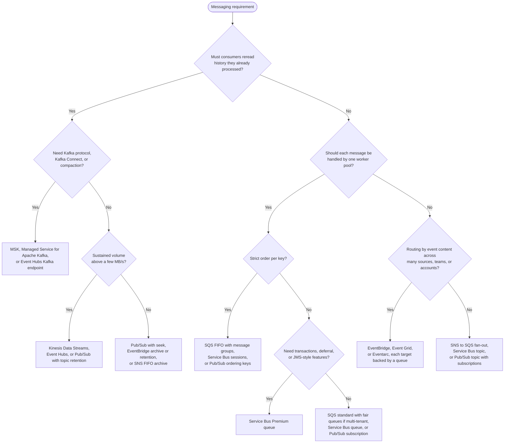

The tree asks the replay question first because it is the hardest to retrofit: a system built on queues that later needs replay must add a stream or archive and backfill it. The second question separates work distribution from notification, which decides whether a message has one owner or many. Order is asked only after that, because order narrows choices and costs throughput. Two leaves recommend combinations rather than single products: event buses are best used with a queue behind each target, so each consumer has a buffer and DLQ under its own control, and fan-out on AWS is SNS to SQS rather than SNS to endpoints, for the retry reasons in Section 4.2. The tree is a starting point. Before committing, check the chosen service against the comparison table for retention, failure path, capacity, and scope, and against the numbers in Sections 10 to 15.

## 17. Failure scenarios and quality-attribute scenarios

### 17.1 Failure catalog

| Failure | Mechanism | Symptom | Prevention and response |
|---|---|---|---|
| Lease shorter than processing | Visibility timeout, lock, or ack deadline expires mid-processing | Duplicate side effects, rising receive counts | Heartbeat lease extension with a ceiling; idempotent consumer |
| Poison message | Payload or schema the consumer cannot handle | Same message retried until DLQ; consumer slot wasted | Explicit dead-letter on permanent errors; schema validation at producer |
| Missing dead-letter destination on push | Retry window exhausted | Events dropped; only a metric shows it | Require DLQ in infrastructure policy checks |
| DLQ retention shorter than recovery | SQS standard expiry from original enqueue time; Event Grid TTL | Messages vanish before redrive | DLQ retention 14 days; age alarms on both queues |
| Hot partition or key | Skewed key popularity | One partition or group lags; others idle | Narrower key, key salting where order allows, more partitions |
| Stream consumer stuck on one record | No broker-side DLQ | Iterator age or lag climbs on one partition | Consumer-side failure queue and checkpoint past the record |
| Retention expiry on a lagging stream | Lag approaches retention | Records lost before processing | Lag alarm at a fraction of retention; Capture or Firehose copy |
| Filter or rule misconfiguration | Typo or schema change in routing field | Consumer silently stops receiving | Coverage tests; per-rule invocation metrics; contract tests |
| Idle Pub/Sub subscription expired | 31-day inactivity default | Subscription and backlog deleted | Set expiration to never for rare consumers |
| Throttling at scale-out | Shard, TU, MU, or TPS limit | Producer errors, rising latency | Capacity plan, quota requests, on-demand or autoscale, producer backoff |
| KMS key policy or state error | Service principal lacks key access, key disabled | Delivery failures to encrypted queues | Key policy review; alerts on key state changes |
| Redrive overload | Large DLQ redriven at full speed | Downstream outage repeats | Rate-limited redrive; fix cause first |
| Producer dual-write | Database commit and publish not atomic | Missing or phantom events | Transactional outbox ([Distributed Transactions](../07_System_Design_and_Distributed_Systems/CH12_Distributed_Transactions.md)) |
| Regional outage | Messaging services are regional | Producers and consumers fail in region | Geo-replication where offered; dual-region publish; tested failover |

### 17.2 Quality scenario: migration with reversible cutover

A company moves order-processing work queues from a self-managed RabbitMQ cluster on virtual machines to Amazon SQS. Ten producer services and four consumer services are involved.

- **Plan.** First, make every consumer idempotent by order event ID (a precondition, because the overlap period will create duplicates). Second, add an SQS publisher to each producer behind a feature flag with three states: RabbitMQ only, both, SQS only. Third, deploy SQS consumers alongside RabbitMQ consumers, reading from SQS but in "shadow" mode (process and compare results without side effects) for one week. Fourth, switch producers to "both" and switch consumers to process from SQS for real, with RabbitMQ consumers still running and the idempotency store shared so whichever processes first wins. Fifth, switch producers to "SQS only," let RabbitMQ drain, and keep it running empty for two weeks.
- **Stimulus:** During step four, SQS consumers show a 3% error rate on one message type because of a serialization difference.
- **Expected response:** Flip producers back to "RabbitMQ only" with the flag; SQS consumers drain what is already queued (the shared idempotency store prevents double processing); failing messages land in the SQS DLQ for analysis and are redriven after the fix.
- **Measurable success criterion:** Rollback completes within 5 minutes of the decision with no lost orders and no duplicate side effects; the SQS DLQ contains exactly the failed messages; the cutover is retried within one week. The reversibility comes from three properties: dual publishing, idempotent consumers sharing one store, and keeping the old broker alive until the new path has run cleanly for a defined period.

## 18. Case study: an event backbone for a parcel-delivery company

### 18.1 Context

Northwind Parcel (a composite organization) delivers 1.2 million parcels a day across Europe. It runs on AWS in a multi-account organization: 14 workload accounts owned by 9 product teams, a shared integration account, and a security account. Its legacy integration was point-to-point HTTPS calls between services, which caused cascading failures during peak season, and a nightly batch export to analytics, which meant customer-service agents saw parcel status up to a day late.

### 18.2 Requirements and constraints

- **Shipment lifecycle events** (created, label printed, picked up, at depot, out for delivery, delivered, exception): peak 400 events per second, average 2 KB, consumed by 7 teams in different accounts. Customers must never see an older status replace a newer one. Analytics needs 30 days of replay after consumer defects.
- **Label generation**: each new shipment requires a label rendered by a partner carrier's API; one worker per label; peak 150 per second; the partner API fails intermittently for minutes at a time; large merchants submit bursts of 50,000 shipments.
- **Van telemetry**: the 36 MB/s location stream from Section 10.1, read by live map, fraud detection, and archive.
- **Customs documents**: Portable Document Format (PDF) files up to 5 MB attached to cross-border shipments.
- **Constraints**: EU data residency (all data in EU regions), encryption with customer-managed keys for anything containing addresses, no long-lived credentials, a platform team of four engineers.

### 18.3 Decisions

**D1. Shipment lifecycle events on EventBridge (classic custom buses) with a central integration bus, and an SQS queue behind every consumer.** Each workload account publishes to its local bus; a rule forwards shipment events to a central bus in the integration account whose resource policy admits only the organization (`aws:PrincipalOrgID`). Each consumer team owns a rule on the central bus that targets an SQS queue in its own account, so each team controls its own visibility timeout, DLQ, and scaling. An archive on the central bus retains shipment events for 30 days for replay.

Per-shipment order is enforced by the consumers, not by the broker: every event carries a `shipmentVersion` that the shipment service increments in the same transaction that changes status (written through a transactional outbox and relayed to EventBridge). Consumers apply an event only if its version is higher than the stored one, with a conditional write. Out-of-order or duplicate events are therefore harmless.

*Rejected alternatives.* **SNS FIFO to SQS FIFO** would have given broker ordering per shipment and a 365-day archive, but it would have tied every consumer to FIFO throughput limits and head-of-line blocking per shipment group, for an invariant ("never go backward") that a version check enforces more cheaply. **The new EventBridge Custom Event Bus** matched the needs well (retention, per-group ordering, RAM sharing, subscriber-owned routing), but it had launched weeks before the decision and its regional availability and operational track record needed verification; the team recorded a review to revisit it in six months. **Amazon MSK** would have provided replay and order, but required cross-account network connectivity to brokers, Kafka client expertise in all 9 teams, and broker capacity management, which the four-person platform team could not support.

**D2. Label generation on an SQS standard queue with fair queues.** Producers set `MessageGroupId = merchantId`, so a 50,000-shipment burst from one merchant does not delay labels for others. Visibility timeout is 60 seconds with a heartbeat that extends it every 30 seconds up to 10 minutes. `maxReceiveCount` is 6, and the consumer extends visibility on failure by 30 s, 60 s, 120 s, 240 s, and 480 s, so six attempts span about 16 minutes and ride out typical partner outages. The DLQ has 14-day retention and a redrive allow policy naming only the source queue. Consumer concurrency is capped at 200 handlers, the partner API's agreed rate limit divided by average call latency. *Rejected:* SQS FIFO (no order requirement; would have limited throughput per merchant), a direct EventBridge-to-Lambda target (push retries would not respect the partner's rate limit as directly as a capped consumer pool).

**D3. Telemetry on Kinesis Data Streams in provisioned mode with 48 shards and enhanced fan-out**, sized in Section 10.1, retention 7 days, and an Amazon Data Firehose delivery to Amazon S3 for long-term storage. *Rejected:* on-demand mode at launch (cold-start throttling at 36 MB/s; to be reconsidered after three months of traffic data), MSK (no Kafka requirement).

**D4. Customs documents by claim check.** The document service writes PDFs to an S3 bucket with versioning and a KMS key, then emits a `CustomsDocumentAttached` event carrying bucket, key, version ID, SHA-256, and size. Lifecycle rules retain documents for the customs retention period, far longer than the 30-day event archive.

**D5. Security.** One customer-managed KMS key per data domain; key policies allow `events.amazonaws.com` and the specific SQS queues' consumers. Every queue policy restricts `sqs:SendMessage` to the specific rule ARN with `aws:SourceArn`. Workers run with roles that have receive and delete only; redrive and purge require an operator role assumed through AWS IAM Identity Center with approval. Interface VPC endpoints for SQS, EventBridge, and Kinesis, with queue policies requiring `aws:SourceVpce` for consumers.

The resulting architecture:

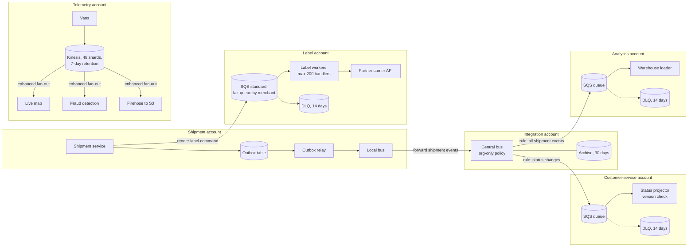

The diagram shows the three shapes used for three jobs: a bus with per-consumer queues for shared domain events, a queue for owned work, and a stream for high-volume telemetry. The dotted arrows are the dead-letter paths, one per queue, each owned by the account that owns the consumer. No consumer depends on another consumer's health, and the shipment service depends only on its own database and local bus.

### 18.4 Validation evidence

Before go-live the team collected evidence for each decision:

- **Load test.** Shipment events at 1,200 per second (three times peak) for one hour: central bus to queue delivery latency p99 under 1 second; no throttling; the warehouse loader queue backlog peaked at 40,000 and drained in 6 minutes.
- **Duplicate and order test.** A test harness injected each event twice and shuffled delivery order within 10-second windows. The status projector's stored status matched the shipment service's final state for 100% of 2 million test shipments.
- **Consumer failure drill.** Killing half the label workers mid-processing produced 312 redeliveries, all absorbed by the idempotency check on shipment ID; zero duplicate labels were requested from the partner.
- **Partner outage drill.** Blocking the partner API for 12 minutes produced zero DLQ messages (the backoff schedule spans about 16 minutes); blocking it for 25 minutes sent 4,180 messages to the DLQ, all redriven at 50 per second with zero failures after the block was lifted.
- **Replay drill.** Replaying six hours of archived shipment events (8.6 million) into a new analytics rule took 41 minutes, throttled by the loader's concurrency cap.
- **Security tests.** A role from a test account outside the organization was denied `PutEvents` on the central bus; a worker role was denied `sqs:PurgeQueue`; a queue rejected calls not through the VPC endpoint.
- **Quota review.** Kinesis shard quota in the region raised to 200 (4 times need); EventBridge `PutEvents` throughput and invocation quotas checked in Service Quotas with more than 5 times headroom.
- **Cost estimate.** EventBridge, SQS (with batching and long polling), Kinesis with enhanced fan-out, archive storage, and KMS requests estimated monthly and tagged per team, with the archive and fan-out lines identified as the two largest controllable items.

### 18.5 Outcome and residual risks

Peak-season cascades disappeared because no synchronous call chain crossed team boundaries. Customer-service status latency fell from up to a day to under 5 seconds at p99. Residual risks recorded in the decision log: EventBridge Classic provides no broker ordering, so any new consumer that forgets the version check can regress status (mitigated by a shared consumer library and a contract test); the 30-day archive is the only replay source for shipment events older than SQS retention; and the decision to revisit the new EventBridge Custom Event Bus is scheduled, because its retention and subscriber model could replace the archive-and-rule setup.

## 19. Common mistakes and anti-patterns

- **Choosing by product name.** Cause: assuming "topic" or "FIFO" means the same across providers. Consequence: an SNS topic with no backlog is used where a Pub/Sub-style retained subscription was needed, and events are lost during a consumer outage.
- **Treating broker acceptance as completion.** Cause: the producer's API call succeeded. Consequence: dashboards show healthy publish rates while consumers fall hours behind; the alarm that matters is age, not publish success.
- **Lease shorter than worst-case processing without extension.** Cause: default visibility timeout, lock, or acknowledgment deadline left in place. Consequence: duplicate side effects under load, exactly when the system is most stressed.
- **Unbounded lease extension.** Cause: a heartbeat with no ceiling. Consequence: a stuck consumer holds a message forever, it never reaches the DLQ, and the backlog for its FIFO group or session stops.
- **Push subscriptions without dead-letter destinations.** Cause: defaults. Consequence: events silently dropped after the retry window; only a metric records the loss.
- **One DLQ for everything, or a DLQ nobody watches.** Cause: treating dead-lettering as a sink. Consequence: messages expire unread, and redrive cannot tell which source they belong to.
- **Redriving at full speed into the dependency that failed.** Cause: urgency during an incident. Consequence: the original outage repeats and the DLQ refills.
- **Ordering by a key broader than the invariant.** Cause: "order everything per tenant" by default. Consequence: head-of-line blocking per tenant; adding consumers does not help.
- **Relying on provider deduplication as exactly-once processing.** Cause: reading "exactly-once" or "deduplication" in product documentation as an effect guarantee. Consequence: duplicate charges, emails, or shipments after lease expiry or replay.
- **Stream consumers with no failure path.** Cause: assuming the stream has a DLQ. Consequence: one bad record halts a partition until retention deletes data behind it.
- **Large payloads in messages because the limit allows it.** Cause: raised size limits. Consequence: higher cost from chunk billing, slower consumers, and sensitive data copied into every subscription, DLQ, archive, and replay.
- **Broad data-plane roles.** Cause: granting namespace-level owner or project-level Pub/Sub editor to applications. Consequence: one compromised workload can read, purge, or reroute every queue in the scope.
- **Ignoring fan-out and retention cost.** Cause: subscriptions and retention added without a budget owner. Consequence: messaging becomes one of the largest bills with no clear owner.
- **Using the broker as the system of record.** Cause: "the events are all in the stream." Consequence: retention expiry or a mistaken purge deletes business history that cannot be rebuilt.

## 20. Design-review checklist

- [ ] The workload's interaction is classified as work distribution, fan-out, content routing, or retained stream, and the chosen service's shape matches.
- [ ] Message identity, schema version, routing attributes, and partition or ordering key are part of the documented contract.
- [ ] The ordering key is the smallest scope required by a stated business invariant, and per-key throughput at peak is calculated.
- [ ] Lease durations (visibility timeout, lock, acknowledgment deadline) are set from measured processing time, with heartbeat extension and a ceiling.
- [ ] Every queue, subscription, rule target, and push subscription has a dead-letter destination with an owner, an arrival alarm, and retention longer than the source's.
- [ ] Retry limits and backoff cover expected dependency outages without flooding the DLQ.
- [ ] Redrive is rate-limited and restricted to an operator role; purge and seek-forward are restricted the same way.
- [ ] Consumers are idempotent for every side effect, and the seen-ID store outlives broker retention plus the longest replay.
- [ ] Provider deduplication windows are longer than the producer's retry horizon, or are not relied on.
- [ ] The producer avoids dual writes (transactional outbox or equivalent).
- [ ] Replay requirements are stated with a window, and the window is provided by stream retention, Pub/Sub retention, an archive, or the system of record.
- [ ] Capacity (shards, partitions, TUs, PUs, MUs, FIFO TPS) is sized with headroom, and account or project quotas have at least 2 times headroom over peak.
- [ ] Alarms exist on oldest-message age or consumer lag against the SLO, on throttling, and on lag as a fraction of retention for streams.
- [ ] Backlog drain time after the longest tolerated outage is calculated and fits within retention.
- [ ] Payloads above a few hundred kilobytes use a claim check with versioned objects and a lifecycle longer than message retention.
- [ ] Send, receive, manage, and destructive privileges are held by different principals, granted at entity scope, with no long-lived shared keys.
- [ ] Cross-account or cross-project paths are authorized on both sides with conditions (`aws:SourceArn`, `aws:PrincipalOrgID`, resource-level IAM).
- [ ] Encryption keys are chosen deliberately, key policies admit the delivering services, and key disablement is guarded.
- [ ] Private connectivity is used where policy requires it, and push endpoints authenticate the provider.
- [ ] Request, throughput, fan-out, retention, and egress costs are estimated with current prices and attributed to an owner.

## 21. Interview and design exercises

1. **Explain the difference.** A colleague says "SNS topics, Service Bus topics, and Pub/Sub topics are the same thing." Explain, for each, where unconsumed messages are stored, for how long, and what happens when a subscriber is offline for six hours.
2. **Lease arithmetic.** A Service Bus consumer's processing time has a p99 of 4 minutes and a maximum of 11 minutes. The lock duration maximum is 5 minutes. Design the lock and renewal settings, state the crash-recovery latency your design gives, and state what happens if the consumer process pauses for 6 minutes.
3. **Ordering trade-off.** A brokerage needs trades for each account processed in order. Peak load is 30,000 trades per second across 2 million accounts, and the busiest account sends 40 trades per second with 30 ms processing time. Compare SQS FIFO with message groups, Service Bus sessions, Pub/Sub ordering keys, and a Kinesis stream keyed by account. Which constraints does each hit first?
4. **Exactly-once claim review.** A design document states, "We enabled Pub/Sub exactly-once delivery, so the payment consumer does not need idempotency." List the cases in which a payment is still applied twice, and propose the minimum change that fixes them.
5. **Retention trap.** Using Section 8.4, design an SQS DLQ policy and alarm set for a queue that must survive a 5-day consumer outage without loss. Show the timestamps.
6. **Sizing.** Size an Event Hubs deployment for 15 MB/s of ingress, 2 KB events, four consumer groups, and 14-day retention. Which tier is required, how many partitions, and why?
7. **Cross-account design.** Draw the policies required for a Google Cloud topic in project A to be consumed by a subscription in project B, with a dead-letter topic in project B. Which principals need which roles, and which project pays for delivery?
8. **Migration.** Plan the migration of a self-managed Kafka cluster with 120 topics to Amazon MSK or Managed Service for Apache Kafka with a reversible cutover. Explain how consumer offsets move, how you would roll back after producers have switched, and what idempotency the consumers need.

## 22. Summary

Provider messaging services come in four shapes. Queues keep per-message state for competing consumers. Topics copy each message to independent subscriptions. Event buses route structured events by content to targets. Streams retain a partitioned log that consumers read by position. Which shape a service has determines where delivery state lives, how failure is handled, whether replay is possible, and what you must size.

Lease-based services (SQS, Service Bus, Pub/Sub) deliver at least once because an expired visibility timeout, lock, or acknowledgment deadline causes redelivery; set leases from measured processing time and extend them with a ceiling. Push services (SNS, EventBridge, Event Grid, Pub/Sub push) retry on provider schedules that range from five minutes to 23 days and drop events at the end unless a dead-letter destination exists. Streams (Kinesis, Event Hubs, Kafka) never dead-letter on their own; consumers must build the failure path and watch lag against retention.

Ordering is always per key, and ordered throughput per key is one divided by per-message processing time, so choose the narrowest key a business invariant needs. Provider deduplication and exactly-once features reduce duplicates within stated windows and scopes, but none guarantees a single external side effect; idempotent consumers remain mandatory. Size partitions and consumer pools with arithmetic, alarm on age rather than depth, use claim checks for large payloads, separate send, receive, manage, and destructive privileges across accounts and projects, and estimate request, throughput, fan-out, and retention costs before they arrive on the bill.

## 23. Code examples

The examples in `code/python/messaging-chapter/` use only Python's standard library and synthetic assumptions. They do not connect to any broker and do not use current provider prices.

- [01_service_fit.py](../code/python/messaging-chapter/01_service_fit.py) ranks a managed queue, a publish-subscribe topic, and a partitioned stream against weighted requirements for work distribution, fan-out, replay, and operational simplicity, as a screening step before the selection matrix in Section 16.
- [02_retry_planner.py](../code/python/messaging-chapter/02_retry_planner.py) checks whether a visibility window is longer than processing time and whether the retry horizon is plausible, the first checks in the lease-sizing example of Section 3.5.
- [03_fanout_coverage.py](../code/python/messaging-chapter/03_fanout_coverage.py) compares the set of required consumers with the consumers configured on each topic and reports missing or unexpected subscriptions, the kind of routing coverage test recommended in Sections 4.2 and 17.
- [04_retention_cost.py](../code/python/messaging-chapter/04_retention_cost.py) estimates retained storage from message rate, size, retention hours, and dead-letter fraction, reproducing the figures in Section 15.4.
