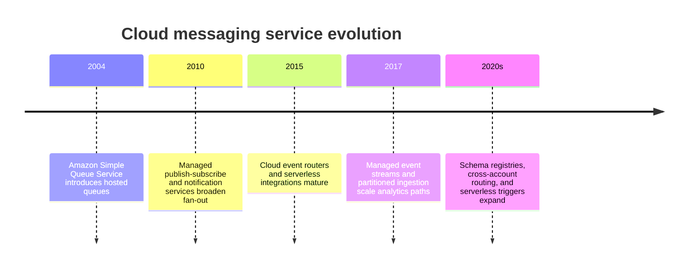
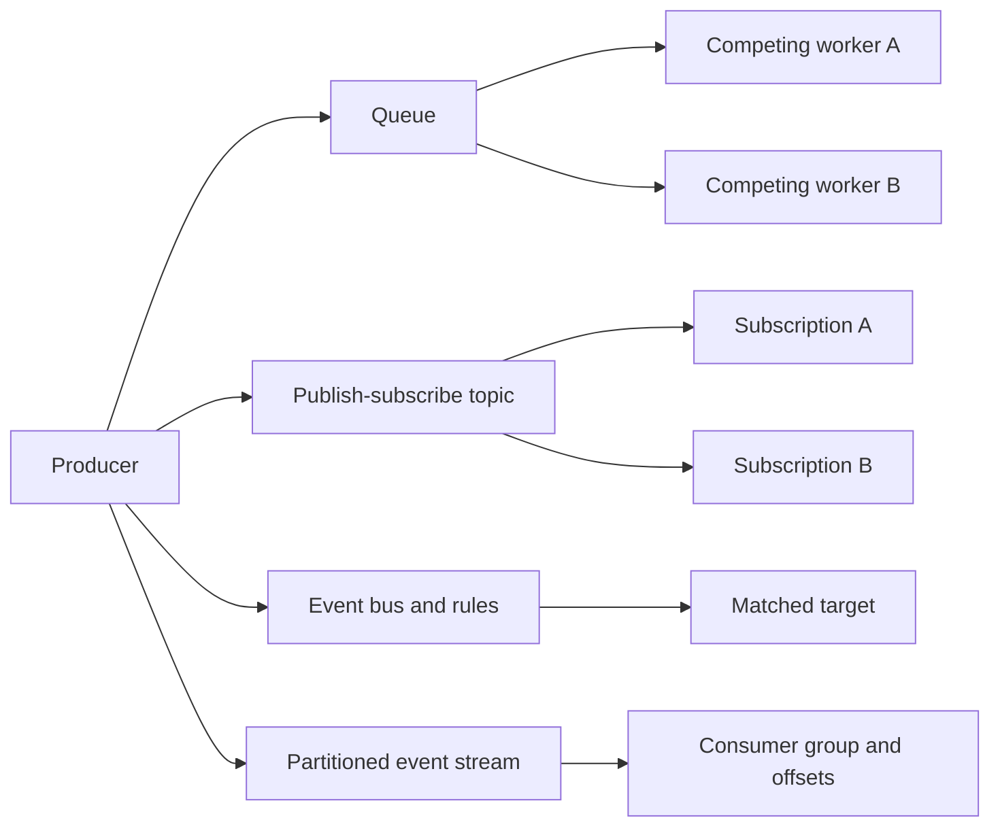
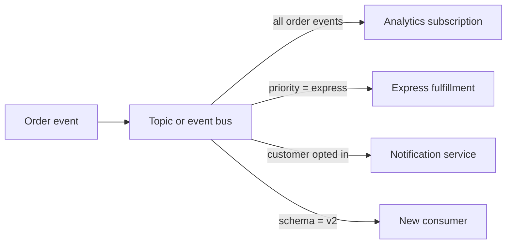
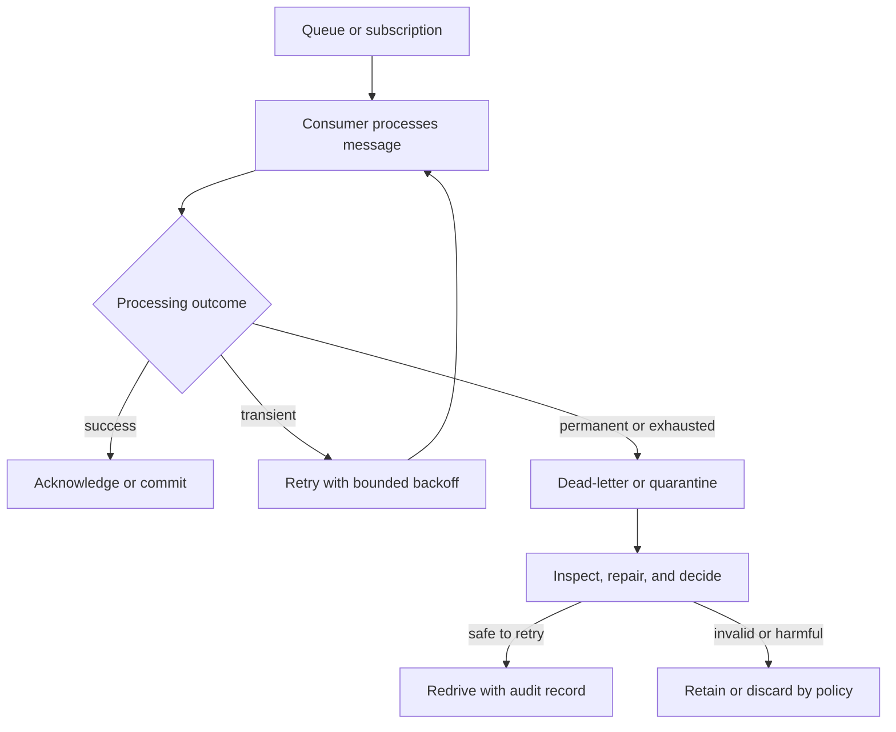
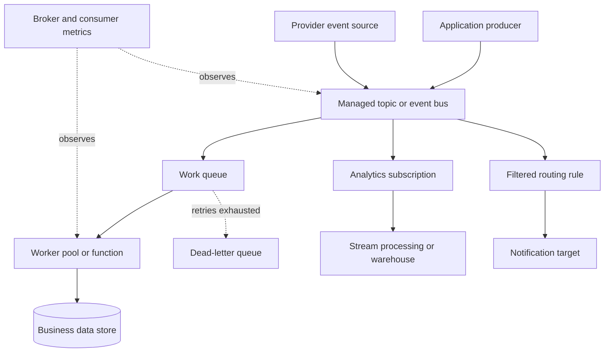

# Chapter: Cloud Messaging Architecture

Part: [09 — Cloud Computing](PART_OVERVIEW.md) · Status: Drafted

## 1. Introduction

Cloud messaging services let producers and consumers exchange work or events without requiring them to run at the same time or share direct deployment lifecycles. Providers offer queues, publish-subscribe topics, event routers, and partitioned event streams, each with different retention, fan-out, ordering, delivery, and scaling contracts.

This chapter focuses on managed messaging service models across Amazon Web Services (AWS), Microsoft Azure, and Google Cloud Platform (GCP): Amazon Simple Queue Service (SQS), Amazon Simple Notification Service (SNS), Amazon EventBridge, Azure Service Bus, Azure Event Hubs, Azure Event Grid, and Google Cloud Pub/Sub. Part 07 owns generic delivery guarantees, ordering, deduplication, and idempotency. The chapter compares provider products, configuration boundaries, service integrations, and operational responsibilities without re-teaching those distributed-systems concepts.

## 2. Historical Evolution

Cloud messaging evolved from managed queues into distinct services for task distribution, event fan-out, application integration, and high-throughput stream ingestion. Providers first exposed queues that decoupled workers from producers, then added topics and event buses for many-to-many routing, and later partitioned streams for durable replay and analytics.

Product overlap has increased, but queue, event bus, and stream remain distinct architectural models. A provider may integrate these services, yet their retention, filtering, ordering, acknowledgement, and replay behavior still differ.

## 3. Why It Exists

Messaging decouples components in time and deployment. A producer can submit work while consumers are unavailable; independent consumers can scale at different rates; and events can be routed to multiple systems. These benefits come with delivery state, retries, poison messages, ordering scope, schema evolution, and monitoring obligations.

Choosing a cloud messaging service determines who operates the broker, how capacity is billed, which integrations are native, and which failure contracts apply. A durable queue is useful for work that one consumer should process; a topic supports multiple subscriptions; an event router matches structured events to targets; a partitioned stream retains ordered records for parallel processing and replay.

## 4. Core Concepts

### 4.1 Queue, topic, event bus, and event stream

**Definition.** A queue buffers work for competing consumers; a publish-subscribe topic fans a publication out to independent subscriptions; an event bus routes events by attributes or rules; and an event stream retains ordered records in partitions for consumers to process. These are service models rather than interchangeable product labels.

**Mechanism.** A queue holds a message until a consumer receives and settles it. A topic creates or feeds subscriptions that each maintain their own delivery state. An event bus evaluates rules against event metadata and sends matches to targets. A stream appends records to partitions and allows consumers to track offsets or positions over a retention period.

**Decision implications.** Use queues for buffered work assigned to a worker pool, topics for independent subscribers, event buses for rule-based integration, and streams when retention, replay, partition ordering, or sustained ingestion matters. Part 07 [Exactly Once Processing](../07_System_Design_and_Distributed_Systems/CH17_Exactly_Once_Processing.md), [Ordering Guarantees](../07_System_Design_and_Distributed_Systems/CH18_Ordering_Guarantees.md), and [Deduplication](../07_System_Design_and_Distributed_Systems/CH19_Deduplication.md) own the generic guarantees and mechanics.

**Common failure mode.** Selecting a stream when a queue is enough, then operating partitions and consumer offsets unnecessarily. The reverse failure is using a simple queue for a replayable event log or multi-subscriber domain event stream.

**Scenario.** An order service sends a fulfillment command to a queue so one worker performs the task. It separately publishes an order-created event to a topic with subscriptions for analytics and customer notifications. The event stream retains high-volume click events for replay and data processing.

### 4.2 Producers, admission, and message contracts

A producer serializes a message, authenticates to the service, and submits it to a queue, topic, bus, or stream. The service validates size, authorization, quota, and configuration, then acknowledges admission or reports a failure. Acceptance means the service accepted the message under its contract; it does not prove that downstream business processing completed.

Define message identity, schema version, tenant or partition key, event time, and trace context. Avoid putting secrets or excessive payloads in messages; store large payloads elsewhere and send a durable reference. Provider message-size limits, batch application programming interfaces (APIs), quotas, and pricing differ.

### 4.3 Consumers, settlement, and visibility

Queue consumers receive messages and acknowledge, delete, or otherwise settle them after processing. Visibility or lock timeouts prevent immediate concurrent delivery while a consumer works. If the consumer crashes or fails to settle before expiry, the message may become available again. Topic subscriptions often behave like independent queues from the consumer's perspective; stream consumers maintain offsets or checkpoints.

Tune processing duration, lock/visibility windows, concurrency, and renewal behavior together. Do not extend a lock indefinitely to hide a slow or stuck handler. Generic at-least-once and exactly once boundaries remain owned by Part 07.

### 4.4 Fan-out, filtering, and routing

Topics and event buses reduce direct producer-to-consumer coupling by routing one publication to multiple targets. A subscription can filter on attributes, and an event-bus rule can match event source, type, or payload fields. This makes the broker configuration part of application behavior: rule changes can silently remove or duplicate downstream business processes.

Give each subscription or rule an owner, test its filter, and monitor delivery and target failures. Use separate subscriptions when consumers require independent retry, retention, access, or replay behavior.

### 4.5 Event streams, partitions, and replay

Event streams append records into partitions or shards. Partition keys distribute records and can preserve order within a limited scope; consumers read positions or offsets and may replay within the retention window. Throughput is bounded by partition count, producer behavior, consumer capacity, and provider service limits.

Use a stream for sustained event ingestion, multiple consumers, replay, or analytics pipelines. Choose partition keys to balance distribution and per-key ordering needs. Part 07 owns general ordering and checkpoint semantics; Part 06 databases own database replication mechanics.

### 4.6 Ordering, duplicate delivery, and idempotency

Managed services offer different ordering scopes: none, best-effort, first-in, first-out (FIFO) group, partition, or session. Some products provide deduplication windows or message groups, but these features do not guarantee that external side effects occur exactly once. Part 07 owns the generic ordering taxonomy and idempotency mechanics; this section requires architects to map the service's documented scope to those contracts.

State the key that defines ordering, the duration and scope of deduplication, and what happens after retry or failover. If a business invariant needs serialization, select a service feature that matches the invariant and test its throughput ceiling. Do not infer global ordering from a queue or topic label.

### 4.7 Retry policies, dead-lettering, and poison messages

Providers can retry failed delivery, move messages to a dead-letter queue or subscription, or expire them after a retention limit. A poison message fails repeatedly because its content or processing path is invalid. Redrive restores quarantined messages to a normal path after diagnosis; it is not a substitute for fixing the underlying cause.

Set maximum deliveries, retry delay, dead-letter retention, alarm thresholds, and redrive permissions. Preserve original message metadata and failure reason. A manual redrive should not bypass idempotency or business validation.

### 4.8 Serverless and cloud-service integrations

Managed messaging services can trigger functions, containers, workflows, data pipelines, and notification services. Native integrations reduce custom polling but may introduce provider-specific retry, batching, partial failure, identity, and scaling semantics. The Serverless chapter owns function lifecycle; this chapter owns the broker-to-consumer service contract.

Prefer direct integration when the provider exposes the required acknowledgement and retry behavior. Use a custom consumer when the workload needs specialized batching, protocol handling, or state. Monitor both broker admission and downstream target health so an accepted event cannot silently accumulate without processing.

### 4.9 Security, retention, and message data governance

Messaging security includes producer and consumer identity, topic/queue policy, network access, encryption, retention, and audit. Restrict publish and subscribe permissions separately. Message payloads can contain personal or confidential data; retention, replay, exports, and dead-letter queues must follow the same classification.

Choose service-managed or customer-managed encryption keys according to policy, and consider the operational dependency on key availability. Use resource-level access and private connectivity when required. Avoid logging full message payloads in consumer errors.

### 4.10 Managed messaging service selection

Select a service by workload pattern, delivery scope, retention, throughput, ordering, replay, protocol compatibility, filters, transaction support, regional behavior, and operating model. Compare queues, topics, event buses, and streams before comparing product names. Some provider products bundle several capabilities; verify which one supplies the contract the application needs.

Create a service decision record with producer/consumer count, message size and rate, retention, ordering key, retry policy, downstream limits, data location, and cost. Test quotas and failure behavior in the target region, not only in a local emulator.

## 5. Internal Working

A producer authenticates and submits a message to a provider endpoint. The broker evaluates authorization, quota, schema or message constraints, and destination state before accepting it. The service stores or routes the message according to its durability and replication contract, then a consumer receives it through a pull request, push delivery, or streaming connection.

The consumer processes the message and settles it, commits an offset, or returns a response. Failed or unacknowledged work may be retried, redelivered, expired, or moved to a dead-letter path depending on configuration. Broker admission, consumer execution, and business side effects are separate stages and should have distinct telemetry and ownership.

## 6. Design Principles

- Choose queue, topic, event bus, or stream from the interaction pattern.
- Treat message identity, schema, and partition key as part of the contract.
- State ordering scope and duplicate behavior explicitly.
- Make consumers idempotent and bound retries.
- Protect downstream services with backpressure and concurrency limits.
- Give each subscription and dead-letter path a named owner.
- Set retention and replay windows from business recovery needs.
- Monitor both broker admission and consumer completion.
- Include payload size, requests, retention, and egress in cost estimates.

## 7. Architecture Patterns

**Queue-based load leveling.** A producer enqueues work and a consumer pool drains according to downstream capacity. The queue absorbs short bursts but needs an age/volume objective and poison-message path.

**Topic fan-out.** A domain event is published once and independent subscriptions deliver copies to analytics, notifications, and downstream services.

**Event-bus integration.** Producers publish structured events; rules route selected events to targets, reducing direct integration code while introducing policy ownership.

**Stream ingestion.** High-volume ordered records are partitioned for parallel consumption and replay by analytics or projection systems.

## 8. Production Architecture

Production readiness includes service quotas, producer credentials, consumer identity, retention, encryption, retry and dead-letter policy, schema ownership, monitoring, and recovery of subscriptions or offsets.

## 9. Implementation

1. Identify whether the requirement is work distribution, event fan-out, rule routing, or retained stream processing.
2. Define message schema, identity, payload limit, partition key, and retention.
3. Choose provider service and region based on throughput, availability, protocol, and integration.
4. Configure producer and consumer permissions separately.
5. Define acknowledgement, ordering, retry, dead-letter, replay, and idempotency behavior.
6. Protect downstream systems with concurrency and backpressure controls.
7. Instrument admission, delivery, processing, retry, and dead-letter stages.
8. Load-test cost, quotas, failover, and redrive before production.

## 10. Complete Code Examples

- [Managed messaging service-fit matrix](../code/python/messaging-chapter/01_service_fit.py)
- [Visibility timeout and retry planner](../code/python/messaging-chapter/02_retry_planner.py)
- [Topic fan-out subscription coverage checker](../code/python/messaging-chapter/03_fanout_coverage.py)
- [Retention and dead-letter cost estimator](../code/python/messaging-chapter/04_retention_cost.py)

The examples use synthetic assumptions and Python's standard library. They do not connect to brokers or represent current provider pricing.

## 11. Performance

Measure publish latency, broker acceptance rate, queue age, delivery delay, consumer processing time, retry rate, partition skew, and downstream saturation. Throughput depends on message size, batching, partitioning, protocol, and service tier. A low broker latency does not prove that a business operation completes quickly if consumers are backlogged.

Batch when it reduces request overhead without violating latency or payload limits. Monitor hot keys and uneven consumer assignments. For streaming systems, evaluate end-to-end lag and retention headroom, not only producer throughput.

## 12. Scalability

Queues scale by increasing consumers within service and downstream limits. Topics scale through subscriptions and fan-out; event buses scale with rules and targets; streams scale through partitions, shards, and consumer parallelism. Each model has quota and partitioning ceilings.

Estimate peak message rate, average and maximum payload size, retention volume, fan-out multiplier, consumer concurrency, and recovery backlog. Scale consumers based on queue age or lag while protecting databases and external APIs. Test a backlog drain after a prolonged consumer outage.

## 13. Security

Use separate publisher and subscriber identities, restrict resource policies, encrypt messages, and limit network exposure. Review cross-account/project subscriptions and event targets as trust relationships. Message bodies and dead-letter queues may contain credentials or personal information; redact logs and define retention.

Apply least privilege to redrive and purge operations because they can replay or destroy large amounts of work. General IAM and secret handling are owned by CH09 and the pending Secrets Management chapter.

## 14. Observability

Monitor publish errors, accepted message rate, queue depth, oldest-message age, delivery attempts, consumer concurrency, processing errors, stream lag, partition distribution, and dead-letter volume. Tag signals with workload, environment, region, subscription, and schema version.

Alert on customer-impacting queue age or stream lag, not only raw depth. Include a runbook for replay and redrive. Keep broker control-plane audit events distinct from application message telemetry.

## 15. Failure Scenarios

| Failure | Likely symptom | Architectural response |
|---|---|---|
| Consumer outage | Queue depth or stream lag grows | Restore consumers and drain within downstream limits |
| Poison message | Repeated processing failure | Quarantine after bounded attempts and inspect payload/schema |
| Duplicate delivery | Repeated handler execution | Use idempotency keys and reconcile side effects |
| Ordering key hot spot | One partition or group lags | Revisit key distribution and ordering requirement |
| Broker quota exhausted | Publish or receive throttled | Alert on quota headroom and request capacity before launch |
| Subscription misconfigured | One consumer misses or overreceives events | Validate filters, identity, and test event coverage |
| Retention expires | Replay window no longer includes needed messages | Restore from archive or upstream source; revise retention policy |
| Cross-region outage | Producers or consumers cannot reach service | Use tested regional failover and reconcile duplicates or order |

Failure analysis should distinguish broker acceptance, delivery, handler execution, and business effect. A message visible in a queue does not prove it is safe to replay or that its consumer is making progress.

## 16. Testing

Test schema compatibility, message size, authorization, trigger behavior, acknowledgement, retry, duplicate delivery, dead-letter routing, and replay. Exercise consumer outages and backlog recovery under realistic downstream capacity. Verify ordering only within the documented key or partition scope.

Load-test burst and sustained rates, then estimate how long a backlog takes to drain. Test regional failover, subscription recreation, offset restoration, and key access. Validate that test tools do not publish production side effects.

## 17. Common Mistakes

- Treating a queue, topic, event bus, and stream as equivalent.
- Assuming one delivery means one business effect.
- Configuring retries without a dead-letter, poison-message, or replay process.
- Choosing a partition key that creates a hot stream partition.
- Ignoring retention and redrive costs.
- Giving all producers and consumers broad access to every topic and queue.
- Scaling consumers without a downstream concurrency budget.
- Treating broker acceptance as end-to-end processing success.

## 18. Best Practices

- Document message schemas, identity, retention, ordering scope, and ownership.
- Separate work queues from broadcast event topics where semantics differ.
- Set retry limits, backoff, visibility/lock duration, and dead-letter retention deliberately.
- Make consumers idempotent and support safe replay.
- Monitor oldest-message age, stream lag, and downstream saturation.
- Use schema compatibility checks and staged event changes.
- Protect purge, redrive, and subscription administration actions.
- Include payload, request, retention, and fan-out costs in design reviews.

## 19. Anti-Patterns

**Broker as database.** Using a queue as the only durable business record makes querying, correction, and recovery difficult. Persist authoritative state separately when the workload requires it.

**Unbounded retries.** Infinite redelivery can monopolize capacity and repeatedly harm a dependency. Bound attempts and quarantine poison messages.

**One topic for unrelated domains.** Shared topics couple schema, access, retention, and incident ownership. Split by domain or contract when lifecycle differs.

**Replay without a plan.** Reprocessing retained events can duplicate external effects or overwhelm dependencies. Define replay scope, rate, and idempotency before an incident.

## 20. Trade-off Analysis

| Choice | Benefits | Costs and risks | Choose when |
|---|---|---|---|
| Queue | Competing consumers and load leveling | Single work path; retry and visibility tuning | One worker group should process each task |
| Topic/pub-sub | Independent fan-out subscribers | Per-subscription retention and duplicate handling | Multiple systems need the same event |
| Event bus | Attribute-based routing and integration | Rule sprawl and provider-specific schema handling | Many event sources and targets need loose coupling |
| Partitioned stream | Retention, replay, and high-throughput order scope | Partition planning and offset operations | Sustained event logs or analytics need replay |
| Managed broker | Less infrastructure operation | Service semantics, quotas, and egress cost | Provider service fits workload contract |
| Self-managed broker | Protocol and configuration control | Upgrades, capacity, quorum, and on-call burden | Specific compatibility or control need justifies ownership |

## 21. Comparison Table

| Pattern | AWS | Azure | Google Cloud |
|---|---|---|---|
| Queue/work distribution | Amazon SQS | Azure Service Bus queues / Storage Queues | Pub/Sub subscriptions / Cloud Tasks |
| Publish-subscribe | Amazon SNS | Service Bus topics / Event Grid | Pub/Sub topics |
| Event routing | Amazon EventBridge | Event Grid | Eventarc / Pub/Sub integrations |
| Partitioned stream | Amazon Kinesis / Managed Kafka | Event Hubs / Managed Kafka | Pub/Sub / Managed Service for Apache Kafka |
| Broker compatibility | Amazon MQ supports common broker engines | Service Bus supports Advanced Message Queuing Protocol (AMQP) | Managed Kafka or Pub/Sub APIs |

These are service entry points, not semantic equivalence. Verify delivery, ordering, retention, retry, filtering, transactions, and regional behavior for the exact product and tier.

## 22. Real-World Case Study

### Queue and topic fan-out reference pattern

AWS documents a common fan-out pattern that publishes one event to an Amazon SNS topic and delivers a separate copy to multiple Amazon SQS queues. Each consumer then processes at its own rate and has an independent queue, retry, and dead-letter policy. This is a provider reference pattern, not a claim about one named customer.

The architecture separates broadcast intent from work ownership: the topic distributes the event, while each queue buffers for one subscriber. A slow analytics consumer does not need to block a notification consumer. The pattern still requires schema versioning, per-subscriber access, duplicate-safe effects, retention, and monitoring of each queue's oldest-message age.

Before production, test subscriber creation, filter changes, outage recovery, and replay. Estimate the fan-out multiplier because each additional subscription can increase storage, delivery, and downstream processing cost. Use a stream instead when consumers need replayable ordered history beyond the queue retention contract.

## 23. Interview Questions

1. How do queues, topics, event buses, and event streams differ?
2. What happens when a consumer receives a message but fails before acknowledgement?
3. Why does at-least-once delivery require idempotent consumers?
4. How do visibility timeout and consumer processing duration interact?
5. What is a poison message, and how should dead-letter redrive work?
6. How does partition-key choice affect stream throughput and order?
7. When is managed Kafka or a self-managed broker preferable to cloud-native messaging?
8. How do you estimate the cost of fan-out and retention?

## 24. Hands-on Exercises

1. Run the service-fit matrix for a single worker queue, multi-subscriber event, and replayable stream.
2. Run the retry planner with different processing durations and visibility windows.
3. Run the fan-out checker with a missing analytics subscription and add the required consumer.
4. Run the retention estimator with different queue ages and dead-letter rates.

## 25. Design Exercises

1. Design order-created event delivery to fulfillment, analytics, and customer notifications with independent failure handling.
2. Design a queue-backed image processing system that caps concurrency to protect object storage and a downstream database.
3. Design a replayable event stream for analytics with partition keys, retention, and consumer checkpoint recovery.
4. Migrate a legacy Java Message Service (JMS) application to managed messaging while preserving its transaction and ordering assumptions.

## 26. Architecture Review Questions

- Does the selected product match work distribution, fan-out, routing, or stream retention needs?
- Are message identity, schema version, payload size, and ownership explicit?
- Are delivery, ordering, duplicate, and replay guarantees documented at the actual service boundary?
- Are producer, consumer, redrive, and purge permissions separate?
- Are retries bounded, dead-letter paths monitored, and replay safe?
- Can consumer concurrency overwhelm any downstream dependency?
- Are retention, fan-out, request, and egress costs estimated?
- Are cross-region failure and service quotas tested in the selected tier?

## 27. Summary

Cloud messaging services provide queues, topics, event routers, and retained streams with different contracts for work distribution, fan-out, routing, and replay. Select from the interaction pattern, then validate provider-specific ordering, acknowledgement, retry, retention, and quota behavior. Make consumers safe for duplicate delivery, bound retries and concurrency, and monitor end-to-end processing rather than treating broker acceptance as completion.

Further reading: [AWS Architecture](CH01_AWS.md), [Microsoft Azure Architecture](CH02_Azure.md), [Google Cloud Platform Architecture](CH03_GCP.md), [Serverless](CH11_Serverless.md), and [Distributed Messaging Guarantees](../07_System_Design_and_Distributed_Systems/CH17_Exactly_Once_Processing.md).
