# Chapter: Cloud Secrets and Key Management

Part: [09 — Cloud Computing](PART_OVERVIEW.md) · Status: Revised (in-depth rewrite)

## 1. Introduction

Most production outages caused by secrets are not breaches. They happen when a database password rotates and half the fleet keeps the old one in memory, when someone disables a customer-managed key and every read of a storage account returns an error, when a deployment restarts 3,000 containers and each one calls the secret store at the same second, or when a replica secret is missing in the recovery region on the day the primary region fails. The breaches that do happen usually trace back to a long-lived credential that was copied somewhere it should not have been, combined with nobody being able to say quickly who read it and how to revoke it.

The three large providers, Amazon Web Services (AWS), Microsoft Azure, and Google Cloud Platform (GCP), each offer a secret store, a key management service (KMS), and certificate services. The products look alike from a distance. Up close they differ in resource model, authorization model, versioning semantics, deletion and recovery behavior, replication, quotas, and pricing, and those differences decide whether a rotation is safe and whether a key outage is survivable.

After this chapter you should be able to:

- Choose between a secret store, a key management service, and a certificate authority (CA) for a given piece of sensitive material, and explain why.
- Explain envelope encryption as the providers implement it, including which key service calls happen on each read and write and how data key caching changes the quota and exposure picture.
- Design authorization for secrets and keys on each provider: AWS KMS key policies and grants, Azure Key Vault role-based access control (RBAC) data roles, and Google Cloud Identity and Access Management (IAM) roles on secrets and keys.
- Decide between provider-managed and customer-managed keys with the availability dependency stated, and plan for key deletion waiting periods and key rotation.
- Model a secret's lifecycle (versions, labels, aliases, deletion, recovery) and design coordinated rotation as a state machine across the target system, the store, and every consumer.
- Calculate cache refresh intervals against staleness, outage-tolerance, and revocation targets, and size request rates against provider quotas.
- Plan replication and residency, audit, revocation, and incident response for a leaked secret, and estimate cost.

### 1.1 Scope and ownership boundaries

This chapter owns the provider secret and key services and how workloads integrate with them. The [concept registry](../CORE_CONCEPTS.md) assigns it the cloud secret-value lifecycle (versions, aliases, retrieval, deletion), coordinated secret rotation as a target/store/consumer state machine, secret caching and the refresh-versus-revocation window, secret-store access and replication boundaries, and the distinction between a secret store, a key management service, and a certificate authority. These are taught in full. Adjacent material is owned elsewhere and is recapped and linked:

- **General secret security and cryptography.** [Secrets Management](../15_Security/CH09_Secrets_Management.md) in Part 15 owns provider-neutral secret classification, delivery-channel risks, dynamic credentials, and leak response principles. [Encryption](../15_Security/CH10_Encryption.md) owns cryptographic primitives and the general envelope-encryption model. This chapter uses those foundations and adds the provider mechanics.
- **Certificates and PKI.** [Certificates](../05_Networking_and_OS/CH15_Certificates.md) in Part 05 and [PKI](../15_Security/CH11_PKI.md) in Part 15 own public key infrastructure (PKI), certificate issuance, and renewal. This chapter covers only where provider certificate services sit relative to secret stores and key services.
- **Workload identity.** [IAM](CH09_IAM.md) owns workload identity federation and managed identities across providers. [Azure](CH02_Azure.md#102-the-token-path) owns the managed identity token path and its caching behavior, and [Kubernetes](CH08_Kubernetes.md#53-workload-identity) owns the cluster workload identity integrations. [Cloud Identity and Access Architecture](../10_Cloud_Architecture/CH04_Cloud_Identity_and_Access_Architecture.md) in Part 10 owns how identities are composed across a workload.
- **Storage encryption.** [Storage](CH06_Storage.md#10-encryption-and-the-key-dependency) owns the storage-side choice of encryption option and treats customer-managed keys as a storage recovery dependency. This chapter owns the key service side of that dependency.
- **Kubernetes Secret objects.** [Kubernetes Security](../12_Kubernetes/CH13_Security.md#secrets-encryption-and-rotation) and [Volumes](../12_Kubernetes/CH08_Volumes.md) in Part 12 own the Kubernetes Secret API object, its encryption at rest, and projected-volume update behavior. Section 7.5 recaps the two common bridges from cloud secret stores into clusters.

### 1.2 A note on provider facts

Quotas, prices, and defaults in this chapter were checked against official documentation at the time of writing, and each provider changes them. Google Cloud, for example, moved Cloud KMS to a new quota model in February 2026. Treat every number as "at the time of writing; verify current quotas and prices" before you commit a design to it. Where a number is illustrative rather than a provider figure, the text says so.

## 2. The foundational model

### 2.1 Three resource classes

Sensitive material in a cloud estate falls into three classes, and each class needs a different kind of service.

A **secret** is a value that an authorized workload must be able to read in plaintext: a database password, a third-party application programming interface (API) key, an OAuth client secret, a webhook signing secret. The workload uses the value itself to authenticate to something else. A secret store's job is to keep the value encrypted at rest, release it only to authorized callers over an authenticated channel, keep versions, record who read it, and support rotation.

A **cryptographic key** is material used to encrypt, decrypt, sign, verify, or compute a message authentication code (MAC). A key management service's job is the opposite of a secret store's: it performs the cryptographic operation inside its boundary and never releases the key material to the caller. A workload sends a request such as "decrypt this 200-byte blob" or "sign this digest" and receives the result. The key may live in a hardware security module (HSM), a tamper-resistant device that generates and holds keys and performs operations on them.

A **certificate** binds a public key to an identity and is signed by a certificate authority. Certificates have issuance, validation, renewal, and revocation semantics that neither a secret store nor a key service provides by itself. A CA service issues certificates. A certificate manager stores certificates, tracks expiry, and deploys them to load balancers and other endpoints that terminate Transport Layer Security (TLS) or mutual TLS (mTLS).

| Class | Caller receives | Typical operations | AWS | Azure | Google Cloud |
|---|---|---|---|---|---|
| Secret | The plaintext value | Get, put new version, rotate | Secrets Manager; Systems Manager Parameter Store `SecureString` | Key Vault secrets | Secret Manager |
| Cryptographic key | The result of an operation | Encrypt, decrypt, generate data key, sign, wrap | AWS KMS; AWS CloudHSM | Key Vault keys; Azure Key Vault Managed HSM | Cloud KMS; Cloud HSM; Cloud External Key Manager (EKM) |
| Certificate | A certificate and, if exportable, its private key | Issue, renew, deploy, revoke | AWS Certificate Manager (ACM); AWS Private CA | Key Vault certificates; App Service managed certificates | Certificate Manager; Certificate Authority Service (CAS) |

Azure Key Vault holds all three object types in one vault, which makes the distinction easy to blur. The objects still have separate APIs, separate permissions, and separate lifecycles. A Key Vault *key* is non-exportable and used through operations such as `wrapKey` and `sign`. A Key Vault *secret* is returned in plaintext. A Key Vault *certificate* is a composite: Key Vault creates a key, a secret holding the certificate and private key in exportable form (if the policy marks it exportable), and the certificate object with its issuance policy.

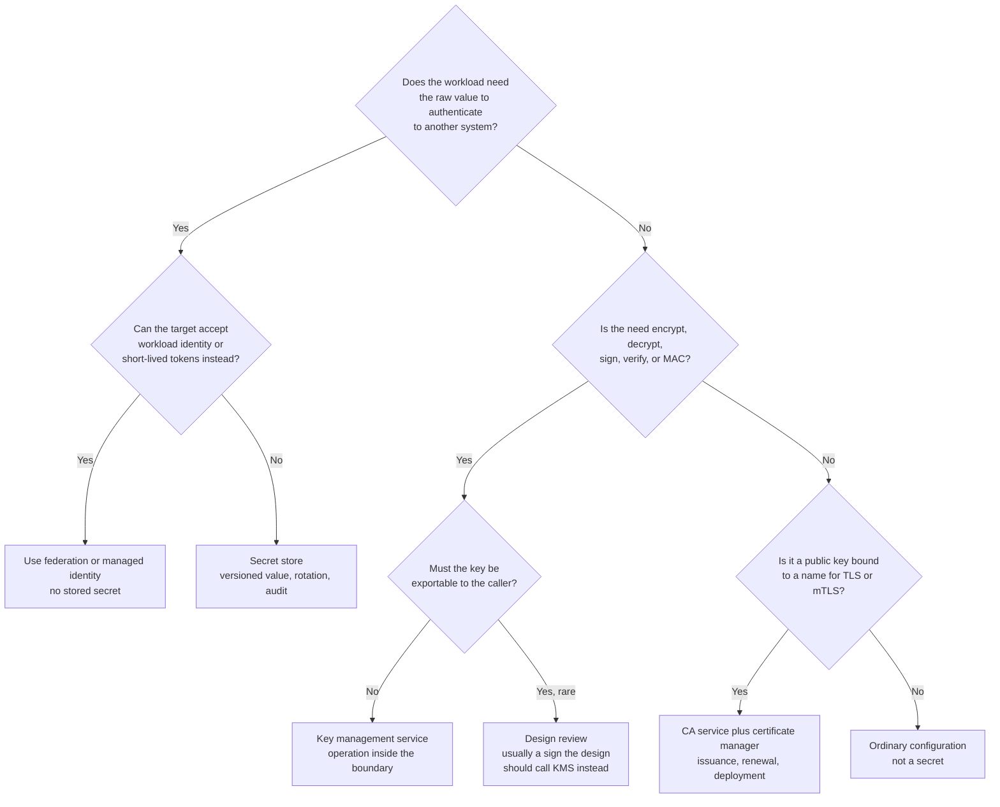

The decision tree shows the order in which to ask the questions. The first branch matters most: the best secret is one that does not exist. If the target accepts a federated identity token (an AWS service called from another AWS service, Azure SQL accepting Microsoft Entra ID tokens, a Google API called with an attached service account), use that and store nothing. Secret stores are for the residue: third-party API keys, database passwords for engines that cannot federate, and shared webhook secrets. The second branch catches the most common misuse, which is storing an encryption key as a secret, distributing it to every instance, and doing the cryptography in application memory. That design loses non-exportability, per-operation audit, and the ability to revoke use without rotating the key. The third branch separates certificates, whose expiry and renewal behavior is the main operational risk, from both.

### 2.2 Three identities around every secret

Every secret has at least three kinds of principal acting on it, and keeping them separate is the most important access decision in this chapter.

1. **Administrators** create the secret resource, set its policy, configure replication and rotation, and can delete it. They should not need to read the value.
2. **The rotator** is the identity of the rotation function or job. It must write new versions to the store and change the credential at the target system (for example, run `ALTER USER` on a database). It is the most powerful identity in the design because it touches both sides.
3. **Consumers** are the runtime workload identities that read the current value. They need read access to the specific secrets they use, and nothing else.

A fourth principal, the **auditor** or security operations function, reads logs and metadata but not values. Each provider has roles that match this split, covered in Section 6.

### 2.3 The dependency chain of one secret read

A single `GetSecretValue`, Key Vault `GET /secrets/{name}`, or Secret Manager `AccessSecretVersion` call depends on more than the secret store. The workload must obtain a token from the identity plane (an instance metadata endpoint, a managed identity endpoint, or a token exchange). It must reach the store's endpoint over the network, which may mean a private endpoint, a DNS zone, and a firewall rule. The store must authorize the request against identity policy and resource policy. The store must then decrypt the value, which means calling its key service, and if the secret is protected by a customer-managed key, the store's service identity must be authorized on that key and the key must be enabled. Only then does the value return, and the workload must use it to authenticate to the target, which must still accept it.

Any link can fail independently. Secret stores advertise high availability, but the effective availability of "get the password and log in" is the product of the availabilities of identity, network path, store, key service, and target. A design review should name each link, its failure behavior, and what the workload does when it fails. Caching (Section 8) is the main tool for decoupling a running workload from a short failure in the chain. It does nothing for a workload that is starting up for the first time.

## 3. Envelope encryption in cloud key services

### 3.1 Why envelope encryption exists

[Encryption](../15_Security/CH10_Encryption.md#envelope-encryption-and-key-hierarchy) owns the general model: data is encrypted with a data encryption key (DEK), and the DEK is encrypted ("wrapped") with a key encryption key (KEK) that never leaves a protected key service. This section explains how the cloud key services implement it, because the API calls, quotas, and failure behavior come directly from that implementation.

Cloud key services cannot encrypt bulk data directly for two practical reasons. First, they limit plaintext size per request. AWS KMS `Encrypt` accepts at most 4,096 bytes, and Cloud KMS `encrypt` accepts at most 64 KiB. Second, every call is a network round trip that counts against a shared request quota and costs money. Encrypting a 2 GB file block by block through a remote HSM would be slow and expensive. Envelope encryption keeps the remote call count proportional to the number of objects (or less, with caching) rather than to the number of bytes.

### 3.2 The key hierarchy

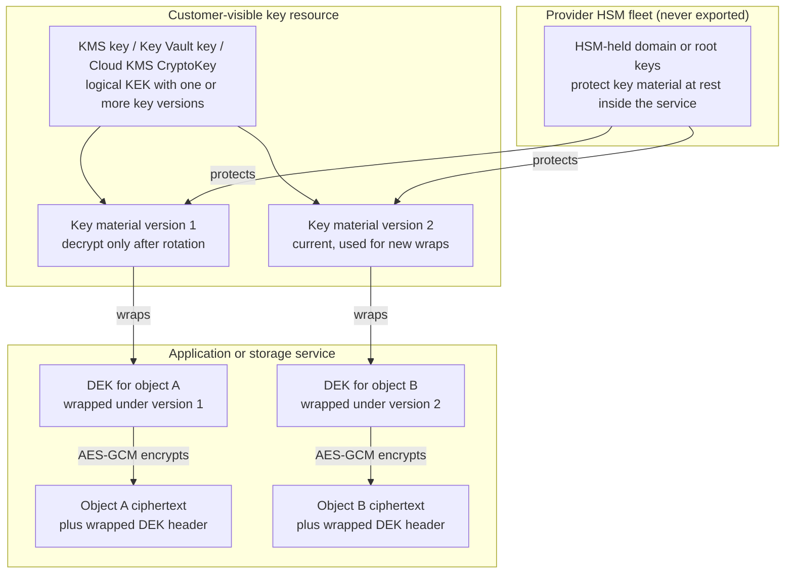

The hierarchy has three levels, and each level has a different owner and a different exposure.

At the top, the provider's HSM fleet holds internal keys that protect the material of customer keys when it is stored or moved between HSMs. Customers never see or address these. AWS describes HSM-protected domain keys in its KMS cryptographic details. Google describes a hierarchy of KMS master keys under a root KMS key. The purpose is the same: customer key material exists in plaintext only inside HSM memory.

In the middle is the key the customer manages: an AWS KMS key, an Azure Key Vault or Managed HSM key, or a Cloud KMS `CryptoKey`. It is a logical resource with an identifier, a policy, and one or more versions of key material. Rotation adds a version. Ciphertext records which version wrapped it, so old data stays decryptable while new wraps use the newest version.

At the bottom are DEKs, generated per object, per file, per message batch, or per session. They are symmetric keys, usually for the Advanced Encryption Standard (AES) in Galois/Counter Mode (GCM), an authenticated mode. The plaintext DEK exists only in the memory of the process doing the encryption. The wrapped DEK is stored next to the ciphertext, usually in a header.

The implication for architecture is that "the key" in a compliance conversation usually means the middle level. Disabling it stops every unwrap, which makes every object above it unreadable, even though no ciphertext changed. That is both the feature (one switch revokes access to a whole dataset) and the risk (one switch causes an outage), covered in Section 4.4.

### 3.3 The data path: GenerateDataKey, Encrypt, and Decrypt

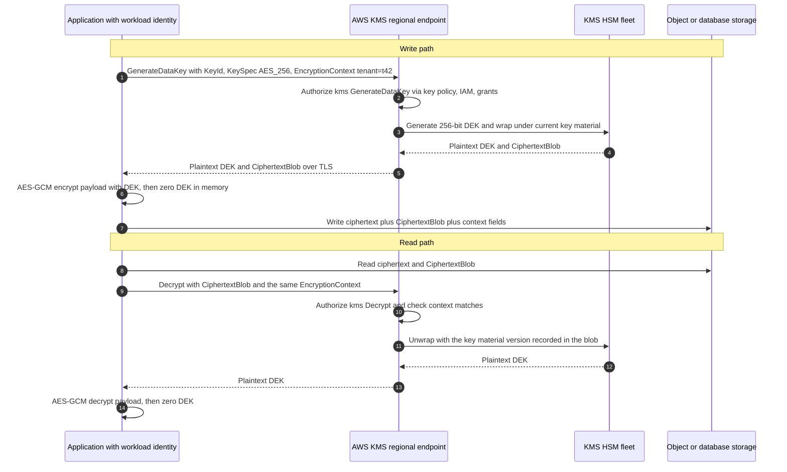

The sequence shows the AWS form, which has a dedicated `GenerateDataKey` operation. It returns two copies of a fresh DEK: one in plaintext for immediate use and one wrapped under the KMS key. `GenerateDataKeyWithoutPlaintext` returns only the wrapped copy, which suits a component that prepares keys for another component to use later. `Decrypt` takes the wrapped blob; for symmetric keys the blob identifies the KMS key and key material version, so the caller does not need to say which version to use. `ReEncrypt` unwraps and rewraps under a different key inside KMS without exposing the plaintext DEK to the caller, which is how you move wrapped DEKs to a new key.

**Encryption context** is a set of non-secret key-value pairs bound to the ciphertext as additional authenticated data (AAD). Decryption fails unless the caller supplies the same context. It does three jobs. It prevents a ciphertext from one tenant or record being swapped into another, because the context will not match. It appears in AWS CloudTrail log entries, so audit records say which tenant's data was decrypted without logging data. And key policies can require it through the `kms:EncryptionContext:` condition keys, so a role can decrypt only data tagged with its own tenant.

The other providers implement the same pattern with different primitives, and the differences matter when porting code.

- **Azure Key Vault and Managed HSM** have no "generate data key" operation. The application generates a DEK locally with a cryptographically secure random generator and calls `wrapKey` (with Optimal Asymmetric Encryption Padding (OAEP) for Rivest-Shamir-Adleman (RSA) keys, or AES key wrap for Managed HSM symmetric keys) to wrap it, then `unwrapKey` to recover it. Key Vault Standard and Premium vaults hold RSA and elliptic-curve keys, so wrapping is asymmetric. Managed HSM also supports symmetric AES keys.
- **Google Cloud KMS** also has no data-key operation. Applications generate a DEK locally, usually through the Tink library, which implements envelope encryption with a Cloud KMS key as the KEK, and call `encrypt` and `decrypt` on a symmetric `CryptoKey` to wrap and unwrap it. Cloud KMS accepts optional additional authenticated data on `encrypt` and requires the same AAD on `decrypt`, which is the equivalent of encryption context, though it is not written into audit logs the way AWS records encryption context.
- **Managed services** (object storage, block storage, databases, and the secret stores themselves) do this on your behalf when you configure a customer-managed key. The storage service's own identity, not your workload's, calls the key service. That is why customer-managed key designs need a grant or role assignment for a service principal, as Section 6 explains.

### 3.4 Data key caching and its trade-off

Envelope encryption still makes one key service call per object written and one per object read. At high rates that call becomes the bottleneck. Data key caching reuses a plaintext DEK for several encryptions, or keeps an unwrapped DEK in memory for several decryptions, within explicit bounds. The AWS Encryption SDK, a client-side encryption software development kit (SDK), provides a caching cryptographic materials manager with three limits: maximum age, maximum number of messages encrypted under one DEK, and maximum bytes encrypted. Amazon Simple Storage Service (S3) Bucket Keys apply the same idea inside S3: S3 obtains a bucket-level key from KMS and derives per-object keys from it for a period, so most object operations do not call KMS. Tink and the Google client libraries support similar key reuse within a process.

Caching trades two things for throughput. A plaintext DEK sits in memory longer, so a memory disclosure exposes more data. And the key service sees fewer calls, so audit logs show one `GenerateDataKey` for many objects and revocation is delayed: disabling the KMS key does not stop a process from encrypting or decrypting with a DEK it already holds until the cache entry expires. Choose the cache bounds from the revocation target, not only from the quota.

**Worked calculation: KMS request budget for an ingestion service.** An ingestion service in `eu-central-1` writes 1,500 records per second and serves 9,000 record reads per second at peak. Each record is encrypted under its own DEK with a customer-managed KMS key. At the time of writing, AWS KMS's shared quota for symmetric cryptographic operations is 20,000 requests per second in Europe (Frankfurt), 100,000 in a few large Regions, and 10,000 in most others ([AWS KMS request quotas](https://docs.aws.amazon.com/kms/latest/developerguide/requests-per-second.html)). The quota is shared by every principal and every AWS service acting on the account's behalf in that Region.

- Without caching: 1,500 `GenerateDataKey` plus 9,000 `Decrypt` is 10,500 requests per second. That is 52.5 percent of the 20,000 quota, from one service, before S3, Amazon Elastic Block Store (EBS), Secrets Manager, and other services that call KMS for the same account are counted. In a 10,000-quota Region it would already throttle.
- With write-side caching (one DEK reused for at most 60 seconds or 5,000 records): 1,500 records per second exhausts the 5,000-record limit every 3.3 seconds, so writes need about 0.3 `GenerateDataKey` calls per second.
- With read-side caching of unwrapped DEKs (a 60-second in-process cache): reads still need one `Decrypt` per distinct wrapped DEK seen per minute. Because records written in the same 3.3-second window now share a DEK, the number of distinct DEKs is far smaller. If reads concentrate on the last hour of data, that is at most 3,600 / 3.3 ≈ 1,091 distinct DEKs, so at most about 1,091 `Decrypt` calls per minute, or 18 per second.
- Result: roughly 18 requests per second instead of 10,500. The cost is that one DEK now protects up to 5,000 records, and a disabled key stops new decrypts within 60 seconds rather than immediately.

Whether that trade is acceptable depends on the threat model and revocation target. A design that must stop all decryption within 10 seconds of a key being disabled cannot use a 60-second cache. Request a quota increase instead, and alert at 70 percent of the quota using the Service Quotas integration with Amazon CloudWatch.

### 3.5 How the secret stores use envelope encryption

Each secret store is itself an envelope-encryption client of its provider's key service, and that is where customer-managed keys enter secret management.

- **AWS Secrets Manager** encrypts each secret version with a unique data key obtained from AWS KMS under the secret's KMS key. By default that key is the AWS managed key `aws/secretsmanager`. You can choose a customer managed key instead. Cross-account access to a secret requires a customer managed key, because the AWS managed key's policy cannot be edited to admit another account. Reading a secret makes Secrets Manager call `Decrypt` on the caller's behalf, so the caller needs `kms:Decrypt` on the key (the AWS managed key grants this automatically to principals in the account that use it through Secrets Manager) as well as `secretsmanager:GetSecretValue`.
- **Systems Manager Parameter Store** `SecureString` parameters are encrypted with a KMS key (the AWS managed `aws/ssm` key by default), with the same cross-account consideration.
- **Azure Key Vault** encrypts vault contents with keys that Microsoft manages inside the service. Customer-managed keys for Key Vault's own contents are not a standard vault option; Managed HSM is the choice when the key hierarchy itself must be customer-controlled.
- **Google Secret Manager** encrypts payloads with Google-managed keys by default and supports customer-managed encryption keys (CMEK) from Cloud KMS. With a user-managed replication policy, each replica location takes a key in that location. With automatic replication, the key must be in the Cloud KMS `global` location. Disabling or destroying that key makes the secret's versions inaccessible.

The pattern is consistent: a customer-managed key on a secret store adds the key service to the read path's dependency chain from Section 2.3. Choose it when you need the separation of duties or audit it provides, not by default.

## 4. Provider key services

### 4.1 AWS KMS

**Key types and ownership.** AWS KMS has three ownership classes. *AWS owned keys* are used by AWS services internally, are invisible in your account, and do not count against your quotas. *AWS managed keys* (named `aws/s3`, `aws/ebs`, `aws/secretsmanager`, and so on) are created in your account by a service the first time you use it with encryption; you can see them and their usage in CloudTrail, but you cannot change their policies or rotation, and they cannot be used across accounts. *Customer managed keys* are yours: you set the key policy, rotation, aliases, tags, and deletion. KMS keys can be symmetric (AES-256 with GCM, the default and the only kind most services accept for at-rest encryption), asymmetric RSA or elliptic-curve for signing or public-key encryption, or hash-based message authentication code (HMAC) keys.

**Key policy as the primary control.** Every KMS key has exactly one key policy, and no principal, including the account root, can use or manage the key unless the key policy allows it directly or delegates to IAM. The default key policy contains a statement that allows the account principal (`arn:aws:iam::111122223333:root`). That statement lets IAM policies in this account grant access to the key, and gives the root user no special standing of its own. Remove it and IAM policies stop working for that key, which is how a team builds a key that only named roles can use regardless of who holds `AdministratorAccess`. It is also how teams lock themselves out. KMS refuses a key policy change that would make the key unmanageable only in limited cases, so policy edits deserve review.

```json
{
  "Sid": "AllowOrdersRuntimeDecryptViaSecretsManagerOnly",
  "Effect": "Allow",
  "Principal": { "AWS": "arn:aws:iam::111122223333:role/orders-runtime" },
  "Action": "kms:Decrypt",
  "Resource": "*",
  "Condition": {
    "StringEquals": {
      "kms:ViaService": "secretsmanager.eu-central-1.amazonaws.com",
      "kms:EncryptionContext:SecretARN": "arn:aws:secretsmanager:eu-central-1:111122223333:secret:orders/db-AbCdEf"
    }
  }
}
```

The statement shows two conditions worth knowing. `kms:ViaService` restricts use to requests that a named service makes on the principal's behalf, so the role cannot call `Decrypt` directly with a stolen ciphertext. The encryption-context condition binds the permission to one secret, because Secrets Manager passes the secret's Amazon Resource Name (ARN) as encryption context. In a key policy, `"Resource": "*"` means "this key".

**Grants.** A grant is a delegated, narrowly scoped permission on one key for one grantee principal, created with `CreateGrant` and removable with `RetireGrant` or `RevokeGrant`. AWS services use grants heavily: when you attach an encrypted EBS volume to an instance, EBS creates a grant so that its service principal can decrypt the volume's data key for the life of the attachment. Grants suit temporary, programmatic delegation that would be awkward to express as policy edits, and they do not consume key-policy size. They are eventually consistent. A new grant may take a short time to take effect everywhere, and AWS provides *grant tokens* that a caller can pass to use a grant immediately. Audit grants as part of key reviews (`ListGrants`), because a forgotten grant to a decommissioned role is a standing permission.

**Evaluation.** For a KMS request, AWS combines the key policy, IAM identity policies (if the key policy delegates to IAM), grants, service control policies (SCPs) and resource control policies (RCPs) from AWS Organizations, virtual private cloud (VPC) endpoint policies if the call traverses an interface endpoint, and session policies. An explicit deny anywhere wins. Cross-account use requires an allow in the key policy of the owning account and an allow in an IAM policy of the calling account. [IAM](CH09_IAM.md) owns the general evaluation logic.

**Key stores.** Standard KMS keys live in AWS-managed HSMs. A *CloudHSM key store* backs KMS keys with an AWS CloudHSM cluster you own, which gives single-tenant HSMs and your own HSM user management, at the price of running at least two HSMs for availability and a lower request quota (1,800 cryptographic requests per second per custom key store at the time of writing). An *external key store* (XKS) keeps the key material in an HSM outside AWS, reached through an XKS proxy you operate. Every cryptographic call then depends on your proxy and external HSM, so their availability and latency become KMS's availability and latency for those keys. Choose an external key store only when a regulation requires keys to stay outside the cloud provider, and accept that you now own a critical path. CloudHSM can also be used directly, without KMS, when an application needs Public-Key Cryptography Standards (PKCS) #11 or Java Cryptography Extension interfaces, but then no AWS service integrates with those keys natively.

**Multi-Region keys.** A KMS key is regional. A *multi-Region key* is a set of interoperable keys in different Regions that share key material and a key ID (prefixed `mrk-`). Ciphertext produced in one Region can be decrypted with the replica in another without a cross-Region call. Each replica is a separate resource with its own key policy, its own aliases, and its own $1 monthly charge, and rotation is managed from the primary and propagated to replicas. Multi-Region keys suit client-side encryption of data that is replicated across Regions, and disaster recovery for data that must be decrypted in a recovery Region. They do not suit data that must stay in one jurisdiction, because the same key material then exists in another Region.

### 4.2 Azure Key Vault keys and Managed HSM

Azure offers two resource types under the Key Vault name, and they differ in tenancy, scope of authorization, and key types.

**Vaults** come in Standard and Premium tiers. Standard vaults hold software-protected keys. Premium vaults also hold HSM-protected keys, performed in multi-tenant HSMs that Microsoft operates. Vault keys are RSA or elliptic-curve, and vaults also hold secrets and certificates (Section 5.3). Authorization is through Azure RBAC data actions (or the older access policy model) evaluated by the vault.

**Managed HSM** is a single-tenant pool of HSMs dedicated to one customer, holding only keys (including symmetric AES keys). It has its own local RBAC model on the data plane, with roles such as Managed HSM Crypto User and Managed HSM Crypto Officer assigned at the HSM or individual key scope. Activating a Managed HSM requires downloading its *security domain*, an encrypted blob that lets the customer restore or migrate the HSM, protected by a quorum of RSA key pairs the customer supplies. Losing the security domain and its quorum keys means losing the ability to recover the HSM. Managed HSM is billed per HSM pool per hour, which makes it far more expensive than vault keys. Choose it when a requirement calls for single-tenant HSMs, customer control of the security domain, symmetric keys, or higher throughput than a vault provides.

Both resource types support key rotation policies that create new key versions on a schedule and can raise near-expiry events. Azure services that use customer-managed keys (Storage, SQL, disks through disk encryption sets) reference a key uniform resource identifier (URI). If the URI has no version, the service follows the latest version automatically, which is what makes Azure key rotation transparent to those services.

### 4.3 Google Cloud KMS

**Resource hierarchy.** Cloud KMS organizes keys as project → *key ring* → *key* (`CryptoKey`) → *key version* (`CryptoKeyVersion`). A key ring lives in one location (a region such as `europe-west3`, a multi-region such as `europe`, or `global`) and groups keys for IAM and organization. A key has a purpose (symmetric encrypt/decrypt, asymmetric sign or decrypt, MAC, or raw encryption), a primary version for symmetric keys, an optional rotation schedule, and a protection level fixed at creation. Key rings and keys cannot be deleted. Only key versions can be destroyed, which avoids name reuse confusing ciphertext but means a project accumulates key resources.

**Protection levels.** Each key has one protection level:

- `SOFTWARE`: key material is protected by Google's software key management, inside the hierarchy rooted in HSMs.
- `HSM`: operations happen in Cloud HSM, a multi-tenant, Federal Information Processing Standard (FIPS) 140-validated HSM service operated by Google. Same API, different price and quota.
- `EXTERNAL`: key material lives in a supported third-party external key manager reached over the internet through Cloud EKM.
- `EXTERNAL_VPC`: same as `EXTERNAL`, but Google reaches the external key manager over a VPC network.

Cloud EKM gives the strongest separation, because Google never holds the key. It also inherits the external manager's availability: if the partner endpoint is unreachable, every CMEK-protected resource using that key stops working. Google also offers Single-tenant Cloud HSM for dedicated HSM partitions, and Key Access Justifications, which attach a reason to each Google-initiated key access request so that an external key manager can approve or deny it by policy.

**Cloud KMS Autokey** creates CMEK keys on demand when a developer creates a protected resource, in a dedicated key project, with a consistent naming and IAM pattern. It addresses a common CMEK problem, which is keys created ad hoc by each team with inconsistent rotation and access.

**Key version states.** A symmetric key version is `ENABLED`, `DISABLED`, `DESTROY_SCHEDULED`, or `DESTROYED`. Only enabled versions can encrypt or decrypt. The primary version is used for new encryptions. Changing which version is primary does not affect decryption of older ciphertext, which records its version. A version scheduled for destruction can be restored (to `DISABLED`) during the scheduled-destruction period, which defaults to 30 days and can be set between 24 hours and 120 days only when the key is created ([Cloud KMS key version states](https://docs.cloud.google.com/kms/docs/key-states)).

### 4.4 Customer-managed versus provider-managed keys

Every provider encrypts data at rest by default with keys it manages. A customer-managed key (AWS customer managed KMS key, Azure customer-managed key in Key Vault or Managed HSM, Google CMEK) moves the KEK into a key resource you control. The table summarizes what changes.

| Property | Provider-managed key | Customer-managed key |
|---|---|---|
| Who sets access policy | Provider | You, through key policy, RBAC, or IAM |
| Rotation | Provider schedule | You choose schedule and can rotate on demand |
| Audit of each use | Limited or none | Each wrap and unwrap appears in your audit logs (subject to log configuration) |
| Revoke access to all data with one action | No | Yes, by disabling the key or removing the service's permission |
| New failure modes | None you control | Disabled key, deleted key, missing permission, key-service quota, external key manager outage |
| Cost | Included | Per-key monthly charge plus per-request charges |
| Cross-account or cross-region use | Often impossible (AWS managed keys cannot be shared) | Possible with policy and, for regions, a key per region |

The table's fifth row is the reason this decision needs an owner. Every read of data protected by a customer-managed key requires the key to exist, be enabled, and authorize the calling service. That turns the key into a shared dependency for every resource it protects.

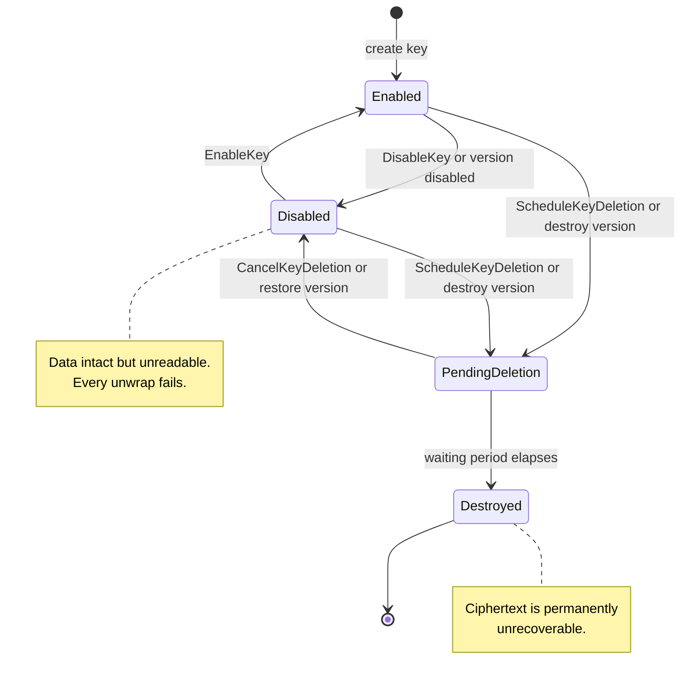

The state diagram is the AWS KMS key lifecycle, with the Cloud KMS key-version names in the transition labels. Azure Key Vault keys follow the same shape with soft delete and purge in place of pending deletion. The two states on the right matter for availability. In `Disabled`, data is intact but every unwrap fails, so an S3 `GET` on an object stored with server-side encryption under a KMS key (SSE-KMS), an Azure Storage read with a customer-managed key, or a Secret Manager access on a CMEK secret returns an error. Durability is unaffected and availability is zero. In `Destroyed`, the ciphertext is permanently unreadable, including backups and snapshots encrypted under the same key.

Three operational consequences follow:

1. **Disabling a key is an outage switch.** Use it deliberately, for example as a containment step when a key's policy has been compromised, and know which resources it will take down. Keep an inventory that maps each key to the resources and services that depend on it.
2. **Removing a permission is also an outage switch.** An Azure Storage account loses access to data if the storage account's managed identity loses its role on the key, and a Google service loses access if its service agent loses `roles/cloudkms.cryptoKeyEncrypterDecrypter`. Policy-as-code changes to key permissions need the same review as key state changes.
3. **The key service's availability and quota become yours.** Services that call the key on every operation (S3 SSE-KMS without Bucket Keys, direct application calls) consume the account's KMS quota. Services that unwrap once and cache (Azure Storage, which wraps an account encryption key; S3 with Bucket Keys) are more tolerant, but still fail when their cached key expires and the key service cannot be reached.

Choose a customer-managed key when a requirement calls for separation of duties between key administrators and data administrators, per-use audit, the ability to cut off a dataset quickly, or key custody evidence. Choose provider-managed keys when "encrypted at rest" is the requirement and nobody will operate the key. A customer-managed key that nobody monitors adds risk without adding control.

### 4.5 Deletion waiting periods

Every provider inserts a delay before key material or secret values are irreversibly destroyed, because deletion of a key in use is unrecoverable. The delays differ and some are configurable only at creation.

| Resource | Deletion behavior | Window (at the time of writing) |
|---|---|---|
| AWS KMS key | `ScheduleKeyDeletion` sets `PendingDeletion`; key unusable; `CancelKeyDeletion` restores it as disabled | 7 to 30 days, default 30 |
| AWS KMS multi-Region primary | Cannot be deleted while replicas exist | Replicas first, each with its own waiting period |
| AWS Secrets Manager secret | `DeleteSecret` schedules deletion; `RestoreSecret` recovers it; `ForceDeleteWithoutRecovery` skips the window | 7 to 30 days, default 30 |
| Azure Key Vault object (key, secret, certificate) | Soft delete keeps deleted objects recoverable; purge protection prevents purging before retention ends | Retention 7 to 90 days, default 90; soft delete cannot be turned off on vaults; purge protection cannot be disabled once enabled |
| Azure Key Vault vault | Soft-deleted vault is recoverable; name is reserved until purged | Same retention setting |
| Cloud KMS key version | `DESTROY_SCHEDULED` then `DESTROYED` | 24 hours to 120 days, default 30, set at key creation |
| Google Secret Manager secret | Deleting a secret is immediate and irreversible | None |
| Google Secret Manager secret version | Destroy is immediate by default; delayed destruction (`version_destroy_ttl`) disables the version and destroys it later | Configurable per secret |

The Google Secret Manager rows are the ones teams miss. A secret deleted in Secret Manager cannot be restored, and Secret Manager secrets with an expiration time are deleted automatically when it passes. Protect production secrets with IAM (few principals hold `secretmanager.secrets.delete`), with delayed destruction for versions, and with an organization-level alert on `DeleteSecret` audit events. On Azure, enable purge protection on any vault that holds customer-managed keys for other services; Azure Storage and several other services require it. On AWS, alert on `ScheduleKeyDeletion` and `DeleteSecret` through Amazon EventBridge rules on CloudTrail events, and consider an SCP that denies `ScheduleKeyDeletion` outside a break-glass role.

### 4.6 Key rotation: what it does and does not do

Key rotation in a cloud key service means adding a new version of key material to the same logical key and making it the version used for new encryption. All three providers do it the same way at that level.

- **AWS KMS** automatic rotation for symmetric customer managed keys generates new key material on a schedule (yearly by default, with a configurable rotation period) and supports on-demand rotation. The key ID, ARN, aliases, and policy stay the same. KMS keeps every previous version of the material and chooses the right one for each `Decrypt` automatically ([Rotate AWS KMS keys](https://docs.aws.amazon.com/kms/latest/developerguide/rotate-keys.html)). Asymmetric keys, HMAC keys, and keys in custom key stores cannot be rotated automatically. AWS charges an extra $1 per month for each of the first two rotations of a key, capped after the second.
- **Azure Key Vault** key rotation policies create a new key version on a schedule. Services configured with a versionless key URI pick up the new version and rewrap their internal keys.
- **Cloud KMS** automatic rotation on symmetric keys creates a new key version at `next_rotation_time` and every `rotation_period` after, and makes it primary. Rotation is a free administrative operation.

What rotation does **not** do is just as important.

- It does not re-encrypt data. Ciphertext and wrapped DEKs created before rotation remain wrapped under the old version, and the old version must stay enabled for them to be readable. AWS states explicitly that rotation does not rotate data keys that the KMS key generated or re-encrypt any data it protects.
- It does not mitigate a compromised DEK. If an attacker has a plaintext DEK, rotating the KEK changes nothing about the data that DEK protects.
- It does not help after a compromised KEK version, unless you also re-encrypt. Disabling the old version would make old data unreadable, so a real response is to rotate, re-encrypt (rewrap) everything under the new version, and only then disable and destroy the old version.
- On Azure, rewrapping is cheap for services that wrap one intermediate key (Azure Storage rewraps the account encryption key, a metadata operation). On AWS and Google Cloud, moving existing data to a *different* key (not a new version of the same key) requires re-encrypting or rewrapping each object, for example with S3 Batch Operations copy jobs or the KMS `ReEncrypt` operation for wrapped DEKs, which consumes requests and time.

**Quality scenario: emergency key rotation after a policy compromise.**

- *Stimulus.* A security review finds that for 11 days a misconfigured key policy allowed a contractor role in another account to call `kms:Decrypt` on the customer managed key that protects a 40 TB S3 data lake and the wrapped DEKs of an application's client-side encrypted records (220 million records).
- *Response.* (1) Remove the policy statement and verify with `aws kms get-key-policy` and an IAM Access Analyzer finding. (2) Query CloudTrail for `Decrypt` calls by the contractor role during the 11 days, using encryption context to identify which tenants' data was unwrapped. (3) Create a new customer managed key (a new key, because the concern is exposure of material usable by the old key's permissions, and a clean policy history is easier to evidence). (4) For S3, set the new key as the bucket default and run an S3 Batch Operations copy to re-encrypt existing objects. (5) For the application records, run a rewrap job that calls `ReEncrypt` from the old key to the new key for each stored wrapped DEK, at a controlled rate. (6) When both jobs report completion and a sample read test passes, disable the old key, wait through one backup cycle to confirm nothing still needs it, then schedule deletion with the 30-day waiting period.
- *Measurable success.* No read errors during the migration. The rewrap job holds KMS usage below 60 percent of the Regional quota: at 2,000 `ReEncrypt` calls per second, 220 million records take 110,000 seconds, about 30.6 hours. CloudTrail shows zero `Decrypt` calls on the old key during the 14 days before scheduled deletion.

The arithmetic in the success criterion is part of the design. If the response had to finish in 8 hours, the rewrap rate would need to be 220,000,000 / 28,800 ≈ 7,640 calls per second, which in a 20,000-per-second Region would leave little room for production traffic, and a temporary quota increase would need to be requested before the job starts.

## 5. Provider secret stores and the secret lifecycle

A secret store's resource model decides three things a design depends on: how a consumer names "the current value", how a rotation stages a new value before promoting it, and how a deleted or overwritten value can be recovered. The providers answer each question differently.

### 5.1 AWS Secrets Manager

**Resource model.** A secret is a regional resource with an ARN, a name, a KMS key, an optional resource-based policy, optional rotation configuration, optional replica Regions, tags, and up to 100 versions. Each version has a version ID (a universally unique identifier, often supplied by the caller as a client request token for idempotency) and holds a string or binary value of up to 65,536 bytes. Database secrets conventionally hold a JavaScript Object Notation (JSON) document with `engine`, `host`, `username`, `password`, and `port`, which the provided rotation functions expect.

**Staging labels.** Versions are not addressed by "latest". They are addressed by *staging labels*, which are pointers that can be moved between versions. Three labels have defined meaning:

- `AWSCURRENT` marks the version consumers should use. `GetSecretValue` without a version or label returns it.
- `AWSPENDING` marks a version created by a rotation that has not yet been promoted.
- `AWSPREVIOUS` marks the version that held `AWSCURRENT` before the last promotion. Secrets Manager moves it automatically when `AWSCURRENT` moves.

You can add custom labels, up to 20 across all versions of a secret. A version with no labels is *deprecated*. Secrets Manager deletes deprecated versions when the secret has more than 100 versions, but not versions created in the last 24 hours. AWS warns that calling `PutSecretValue` or `UpdateSecret` more often than once every 10 minutes at a sustained rate can therefore reach the version quota ([Secrets Manager quotas](https://docs.aws.amazon.com/secretsmanager/latest/userguide/reference_limits.html)). That is a sign the value is not a secret in the usual sense; frequently changing tokens belong in a different design.

**Recovery window.** `DeleteSecret` schedules deletion after 7 to 30 days (30 by default). During the window the secret cannot be read, and `RestoreSecret` brings it back. `ForceDeleteWithoutRecovery` deletes immediately and should be denied by policy for production secrets.

**Resource policy.** A secret can carry a resource-based policy, which is how another account's role is granted access. `PutResourcePolicy` accepts a `BlockPublicPolicy` parameter that rejects policies granting broad access, and IAM Access Analyzer reports secrets shared outside a zone of trust.

### 5.2 AWS Systems Manager Parameter Store

Parameter Store holds hierarchical configuration parameters (`/orders/prod/db/host`) of type `String`, `StringList`, or `SecureString`. `SecureString` values are encrypted with a KMS key. Standard-tier parameters hold up to 4 KB, are free, and are limited to 10,000 per account and Region. Advanced-tier parameters hold up to 8 KB, support parameter policies (expiration and notification), can be shared across accounts, and carry a per-parameter charge ([Parameter Store tiers](https://docs.aws.amazon.com/systems-manager/latest/userguide/parameter-store-advanced-parameters.html)). Throughput is a separate setting: the default throughput quota suits low to moderate volume, and *higher throughput* can be enabled per account and Region for a per-request charge.

Parameter Store has versions and labels but no built-in rotation, no replica Regions, and no staging labels with rotation semantics. The choice between the two AWS services is therefore about lifecycle, not storage:

- Use **Secrets Manager** for credentials that rotate, that other accounts read, or that must exist in a recovery Region.
- Use **Parameter Store** for configuration, including `SecureString` values that change rarely and are consumed in one account, where the free standard tier makes a large number of parameters cheap.
- Parameter Store can also read Secrets Manager secrets through the `/aws/reference/secretsmanager/` path, which lets code that already reads parameters fetch a rotated secret without a second client.

### 5.3 Azure Key Vault secrets

**Resource model.** A vault is a regional Azure resource in a resource group, with its own Domain Name System (DNS) name (`https://kv-orders-prod.vault.azure.net`). It holds secrets, keys, and certificates. A secret has a name and any number of versions, each identified by a 32-character hexadecimal ID, each with attributes: enabled, not-before time, expiry time, content type, and tags. A secret value can be up to 25 KB.

**No labels.** Key Vault has no staging labels or aliases. A request without a version returns the newest enabled version. "Promote" therefore means "create a new version", and "roll back" means either creating another new version holding the old value or pointing consumers at a specific version URI. This simplicity has a consequence for rotation. There is no native place to stage a pending value that consumers will not see, so a staged value must either be written only after the target has accepted it, or be held in a second secret (for example `orders-db-password-pending`) until promotion.

**Soft delete and purge protection.** Soft delete is always on for vaults. Deleted secrets, keys, certificates, and vaults are kept for the retention period (7 to 90 days, chosen at vault creation) and can be recovered. Purging (permanent deletion before retention ends) is a separate permission. *Purge protection* blocks purging entirely until retention ends, even for administrators, and once enabled cannot be disabled. A soft-deleted vault still reserves its name, which surprises infrastructure-as-code pipelines that delete and recreate a vault with the same name.

**RBAC versus access policies.** Key Vault has two data-plane authorization models, chosen per vault with the `enableRbacAuthorization` property.

- *Access policies* are the original model: a list on the vault, each entry granting a principal a set of permissions (`get`, `list`, `set`, `delete`, and so on) on all secrets, all keys, or all certificates in the vault. They cannot be scoped to one secret. Anyone with the management-plane `Microsoft.KeyVault/vaults/write` permission, which the Contributor role includes, can edit access policies and grant themselves data access. That makes Contributor on the vault equivalent to full data access.
- *Azure RBAC* uses role assignments evaluated by the vault, scoped to the vault or to individual secrets, keys, or certificates, and managed through the same tooling, Privileged Identity Management, and Azure Policy as other Azure permissions. Contributor does not include data actions, so management and data access separate cleanly. Microsoft recommends RBAC, and vaults created with Key Vault API version 2026-02-01 or later default to RBAC unless access policies are requested explicitly ([Key Vault RBAC default](https://learn.microsoft.com/en-us/azure/key-vault/general/access-control-default)).

**Network.** Vaults have a public endpoint by default, which can be restricted with the Key Vault firewall (allowed public addresses and virtual network service endpoints) or disabled in favor of private endpoints. The "allow trusted Microsoft services" exception lets listed Azure services reach a firewalled vault. [Networking](CH05_Networking.md) owns private endpoint mechanics.

### 5.4 Google Secret Manager

**Resource model.** A secret is a project-level resource that holds metadata (replication policy, labels, annotations, rotation schedule, Pub/Sub topics, expiration, optional CMEK) and a sequence of *secret versions*. Each version has an integer ID (1, 2, 3, ...), a payload of up to 64 KiB, and a state of `ENABLED`, `DISABLED`, or `DESTROYED` ([Secret Manager quotas and limits](https://docs.cloud.google.com/secret-manager/quotas)). Access is to a version: `projects/p/secrets/orders-db/versions/7`, or `versions/latest`, which resolves to the newest enabled version.

**Aliases.** A secret can define *version aliases*, named pointers to version numbers (for example `current` → 7, `pending` → 8), up to 50 per secret. Consumers can access `versions/current` instead of `latest`. Aliases give Google Cloud the equivalent of AWS staging labels, with the difference that Secret Manager attaches no rotation meaning to any alias. Your rotation process defines and moves them.

**Replication policies.** A global secret's replication policy is fixed at creation.

- *Automatic*: Google chooses where to store the payload, and the secret is billed as one location. Use it when there is no residency requirement.
- *User-managed*: you list the locations (for example `europe-west3` and `europe-west4`). Payloads are stored only there, each location is billed separately, and with CMEK each location needs a key in that location.

**Regional secrets.** Separately from global secrets, Secret Manager offers *regional secrets*, created and accessed through a regional endpoint (`secretmanager.LOCATION.rep.googleapis.com`). The secret's data is stored and processed in that region, and there is no replication policy. Regional secrets suit strict residency, at the cost of a per-region resource that does not fail over, and they have higher write-rate limits than global secrets at the time of writing.

**Expiration and destruction.** A secret can have an expiration time or time to live (TTL), after which Secret Manager *deletes the secret*. This is useful for temporary credentials and dangerous if set on a long-lived secret by mistake. Destroying a version is immediate by default. *Delayed destruction* (`version_destroy_ttl`) makes destroy disable the version and schedule the actual destruction later, which gives the same protection Azure soft delete gives.

### 5.5 Versions, pointers, and pinning

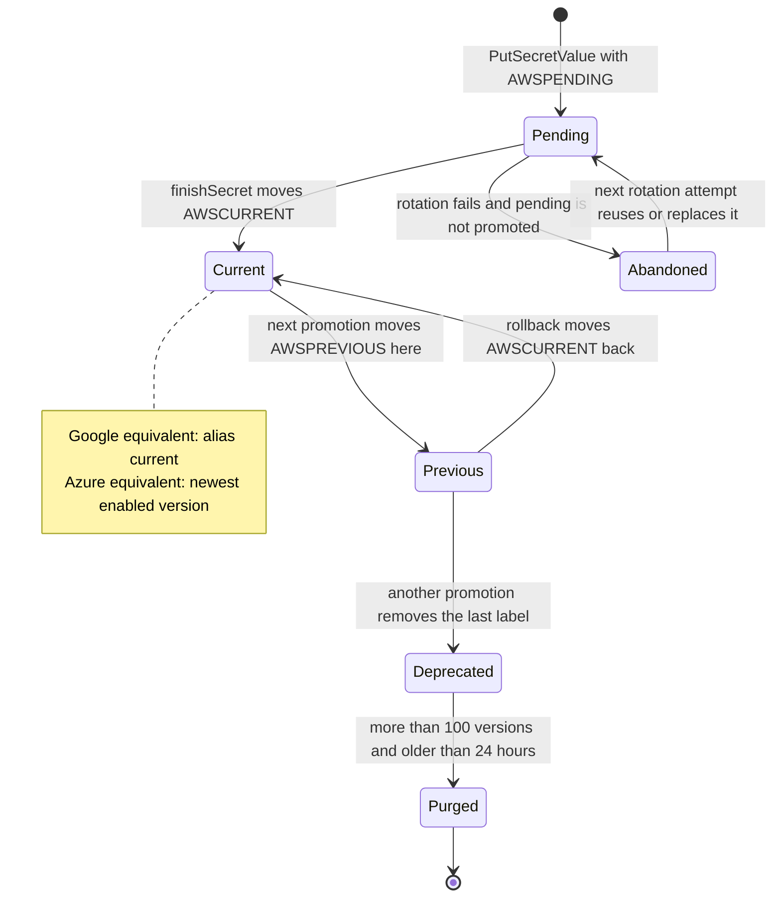

The diagram follows one AWS Secrets Manager version through its life, labeled by the staging label it holds. The `Previous` state is the rollback path: moving `AWSCURRENT` back to the version labeled `AWSPREVIOUS` is a single `UpdateSecretVersionStage` call, and is only safe if the target system still accepts that credential. On Google Cloud the same path is moving the `current` alias back. On Azure there is no pointer to move, so rollback means writing the old value as a new version, which requires that someone can still read the old version.

Consumers must choose between following a pointer and pinning a version.

| Consumer reference | Behavior on rotation | Use when |
|---|---|---|
| Pointer (`AWSCURRENT`, alias `current`, versionless Key Vault URI, `latest`) | Picks up the new value on next refresh, without deployment | The consumer refreshes and the target accepts overlapping credentials |
| Pinned version (version ID, version number, versioned URI) | Keeps the old value until redeployed | Reproducible deployments, configuration that must change only with a release, or values whose change must be tested first |

Pinning moves rotation into the deployment pipeline: every rotation needs a deployment, and the old credential must stay valid until every pinned consumer is redeployed. Pointer-following moves rotation into the runtime: every consumer needs a refresh mechanism and the rotation must allow an overlap at least as long as the slowest refresh. Neither is wrong. Mixing them for the same secret without knowing which consumers do which is the usual cause of rotation outages. Google's `latest` is a particular hazard because it is not under your control: anyone who adds a version changes what `latest` means, including a version added for testing. Prefer an alias that a rotation process moves deliberately.

## 6. Access control for secrets and keys

### 6.1 The evaluation path for one secret read

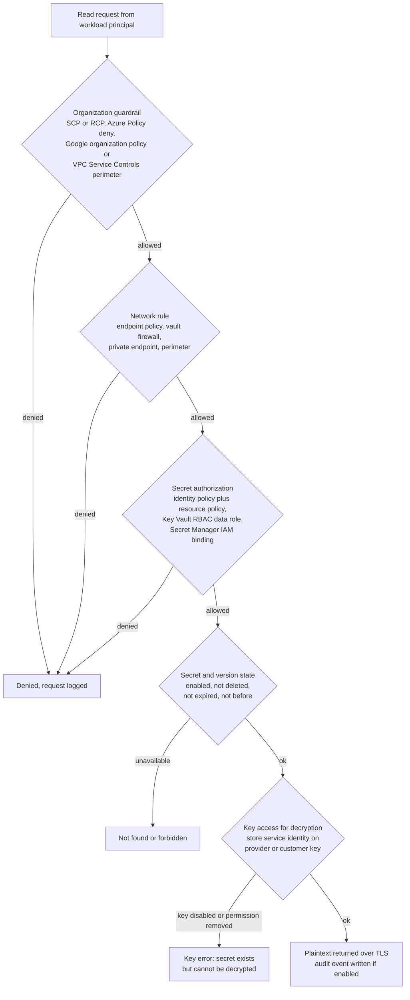

The flow shows that a secret read crosses up to five independent checks, and each has a different owner and a different error. Organization guardrails are owned by the platform team. Network rules are owned by the network team. Secret authorization is owned by the application or security team. Version state is owned by the rotation process. Key access is owned by whoever owns the customer-managed key. When a read fails, the error code tells you which check refused it: an AWS `AccessDeniedException` naming an SCP, a Key Vault `403` with `ForbiddenByFirewall` versus `ForbiddenByRbac`, a Google `PERMISSION_DENIED` with a VPC Service Controls violation ID, or a KMS-related error such as AWS `KMSInvalidStateException` or a Google `FAILED_PRECONDITION` for a disabled CMEK key version. Teach on-call engineers to read these errors, because each points to a different team.

### 6.2 AWS: identity policies, secret policies, and key policies

In a single account, a role needs `secretsmanager:GetSecretValue` on the secret ARN in its identity policy, and the secret's KMS key must allow `kms:Decrypt` for that role (automatically true for the AWS managed key, explicit for a customer managed key). Scope `Resource` to specific secret ARNs or name prefixes (`arn:aws:secretsmanager:eu-central-1:111122223333:secret:orders/*`); secret ARNs end in a random six-character suffix, so use a trailing wildcard. Attribute-based access control works well here: a condition on `secretsmanager:ResourceTag/app` matching `aws:PrincipalTag/app` lets one policy serve many applications, provided tagging permissions are locked down so a principal cannot tag a secret into its own scope.

For cross-account access, three things must line up: the secret's resource policy allows the external role, the external role's identity policy allows the secret, and the secret's customer managed KMS key policy allows the external role to decrypt. Missing any one gives an access-denied error. Secrets Manager quotas for cross-account requests are charged to the calling account, not the owner.

### 6.3 Azure: Key Vault RBAC data roles

| Role | Grants | Typical holder |
|---|---|---|
| Key Vault Secrets User | Read secret values | Consumer workload identity |
| Key Vault Secrets Officer | All secret actions except permission management, including set and delete | Rotation function identity |
| Key Vault Crypto User | Perform cryptographic operations with keys | Application doing client-side encryption |
| Key Vault Crypto Service Encryption User | Read key metadata and wrap/unwrap | Managed identity of a storage account, SQL server, or disk encryption set using a customer-managed key |
| Key Vault Crypto Officer | All key actions except permission management | Key administrators |
| Key Vault Certificates Officer | All certificate actions except permission management | Certificate operators |
| Key Vault Reader | Read metadata, not values | Auditors, inventory tools |
| Key Vault Data Access Administrator | Manage role assignments for Key Vault data roles only | Delegated access managers |
| Key Vault Administrator | All data-plane actions | Break-glass only |

Assign consumer roles at the individual secret scope when one vault serves several applications, or give each application its own vault and assign at vault scope. Microsoft's general guidance is one vault per application per environment, which keeps blast radius small and avoids hitting per-vault throttling limits (Section 11). Role assignment propagation can take several minutes, and a managed identity's access through an Entra group can take hours to revoke because group claims are inside cached tokens; [Azure](CH02_Azure.md#102-the-token-path) explains why direct assignments revoke faster.

```bash
az role assignment create \
  --assignee-object-id "$(az identity show -g rg-orders -n id-orders-api --query principalId -o tsv)" \
  --assignee-principal-type ServicePrincipal \
  --role "Key Vault Secrets User" \
  --scope "/subscriptions/<sub-id>/resourceGroups/rg-orders/providers/Microsoft.KeyVault/vaults/kv-orders-prod/secrets/orders-db-password"
```

### 6.4 Google Cloud: IAM on secrets and keys

Secret Manager roles can be granted at the project, folder, organization, or individual secret level:

- `roles/secretmanager.secretAccessor` reads payloads. It is the consumer role.
- `roles/secretmanager.secretVersionAdder` adds versions without reading. It suits a rotation job that generates a new value and never needs the old one.
- `roles/secretmanager.secretVersionManager` adds, enables, disables, and destroys versions.
- `roles/secretmanager.viewer` reads metadata only.
- `roles/secretmanager.admin` does everything.

Grant `secretAccessor` on the secret, not the project; a project-level grant gives every current and future secret in the project to that principal. IAM conditions can restrict a binding by resource name prefix (`resource.name.startsWith("projects/123/secrets/orders-")`) or by time, which is useful for temporary break-glass access.

Cloud KMS separates key administration from use. `roles/cloudkms.admin` manages keys but cannot encrypt or decrypt. `roles/cloudkms.cryptoKeyEncrypterDecrypter` uses keys but cannot manage them. For CMEK, the principal that needs the use role is the consuming service's *service agent* (for example `service-PROJECT_NUMBER@gcp-sa-secretmanager.iam.gserviceaccount.com`), granted on the specific key. Placing keys in a dedicated key project, administered by a different team from the workload projects, enforces separation of duties through the resource hierarchy.

### 6.5 Separating administrators, rotators, and consumers

The three identities of Section 2.2 map to roles on each provider as follows.

| Identity | AWS | Azure | Google Cloud |
|---|---|---|---|
| Secret administrator | `secretsmanager:CreateSecret`, `PutResourcePolicy`, `RotateSecret` config, no `GetSecretValue` | Contributor on the vault (management plane) plus Key Vault Data Access Administrator, no Secrets User | `roles/secretmanager.admin` scoped narrowly, or a custom role without `versions.access` |
| Rotator | `GetSecretValue`, `PutSecretValue`, `UpdateSecretVersionStage`, `DescribeSecret` on its secrets, plus target-side privilege | Key Vault Secrets Officer on its secrets | `secretVersionAdder` or `secretVersionManager` on its secrets, plus accessor if it must read the current value |
| Consumer | `GetSecretValue` on named secrets, `kms:Decrypt` via Secrets Manager | Key Vault Secrets User on named secrets or its vault | `secretAccessor` on named secrets |
| Auditor | `DescribeSecret`, `ListSecrets`, CloudTrail read | Key Vault Reader, Log Analytics read | `secretmanager.viewer`, Logs Viewer |

The [secret access policy analyzer](../code/python/secrets-chapter/02_access_policy.py) models these rules over a list of synthetic grants. It flags a wildcard principal or wildcard secret scope as high risk, asks for explicit ownership of any delete permission, and flags write permission held by anything other than a rotation identity. The sample data deliberately includes an `all-workloads` principal with read, write, and delete on `*`, the pattern most often found in real reviews, where a single platform role was given vault-wide access during an early migration and never narrowed.

## 7. Retrieval paths with workload identity

### 7.1 From workload identity to secret value

Workload identity is owned by [IAM](CH09_IAM.md): a workload proves what it is to the provider's token service and receives a short-lived credential, with no stored secret involved. This section follows that credential into the secret store, because the retrieval path determines latency, failure behavior, and what appears in the audit log.

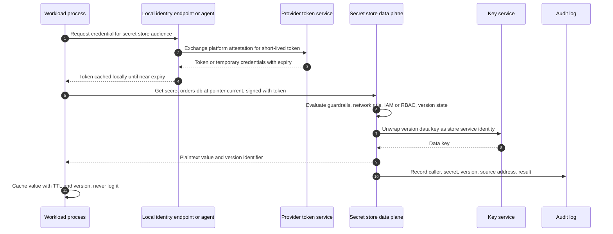

The sequence has the same shape on every provider. The differences sit in steps 1 to 4.

- **AWS.** On Amazon Elastic Compute Cloud (EC2), the SDK reads temporary role credentials from the Instance Metadata Service (IMDS), preferably version 2 with session tokens. On Amazon Elastic Container Service (ECS) and AWS Lambda, the platform provides task or function role credentials. On Amazon Elastic Kubernetes Service (EKS), EKS Pod Identity or IAM roles for service accounts exchange a projected service-account token for role credentials. The call to Secrets Manager is signed with Signature Version 4 using those credentials.
- **Azure.** The managed identity endpoint (IMDS on virtual machines, `IDENTITY_ENDPOINT` on App Service, Functions, and Container Apps) returns a Microsoft Entra ID access token with the Key Vault audience, which is presented as a bearer token. On Azure Kubernetes Service (AKS), Microsoft Entra Workload ID federates the Kubernetes service-account token.
- **Google Cloud.** The metadata server returns an OAuth 2.0 access token for the attached service account. On Google Kubernetes Engine (GKE), Workload Identity Federation for GKE intercepts the request on the node and exchanges the Kubernetes token through the Security Token Service.

Two consequences follow for secret design. First, the identity token is itself cached and has its own lifetime, so revoking a workload's identity is not instant (Section 12). Second, the audit record in step 11 names the workload identity, not the human who deployed it, so attribution depends on one identity per workload. A shared identity across ten services makes the audit log unable to say which service read a secret.

### 7.2 Delivery patterns by runtime

There are four ways a secret value reaches application code, and each changes the refresh behavior.

1. **Direct SDK call.** The application calls the secret store through the provider SDK, usually through a caching client: the AWS Secrets Manager caching libraries for Java, Python, .NET, and Go; the Azure `SecretClient` with application-level caching; the Google Secret Manager client. The application controls TTL, refresh, and error handling. It also carries the dependency on the store in its own code.
2. **Local agent or extension.** A process next to the application fetches and caches secrets and serves them over localhost. On AWS, the AWS Parameters and Secrets Lambda Extension serves Lambda functions, and the AWS Workload Credentials Provider (formerly the AWS Secrets Manager Agent) does the same for EC2, ECS, EKS, and Lambda. It caches values in memory with a default TTL of 300 seconds, requires a server-side request forgery (SSRF) token header on each local request, and does not invalidate its cache when a secret rotates ([AWS Workload Credentials Provider](https://docs.aws.amazon.com/secretsmanager/latest/userguide/secrets-manager-agent.html)). The pattern lets applications in any language read secrets without an SDK, and centralizes caching policy.
3. **Platform injection at start.** The platform resolves a reference and injects the value as an environment variable or file when the container or function starts. ECS task definitions accept a `secrets` block that names a Secrets Manager ARN or Parameter Store parameter; the value is fixed for the life of the task. Cloud Run can expose a Secret Manager version as an environment variable, resolved at instance start, or mount it as a file; Google recommends pinning a specific version for environment variables because a `latest` reference silently changes on the next instance start. Lambda environment variables can hold only literal values, so Lambda uses the extension or SDK.
4. **Platform reference with periodic refresh.** Azure App Service and Azure Functions resolve app settings of the form `@Microsoft.KeyVault(SecretUri=https://kv-orders-prod.vault.azure.net/secrets/orders-db-password)` using the app's managed identity. With a versionless URI, the platform refetches the value every 24 hours, and any configuration change restarts the app and refetches immediately. An authenticated `POST` to the `config/configreferences/appsettings/refresh` management endpoint forces resolution ([App Service Key Vault references](https://learn.microsoft.com/en-us/azure/app-service/app-service-key-vault-references)). Azure Container Apps secrets can reference a Key Vault secret URI. With a versionless URI, the app picks up a new version within 30 minutes, and active revisions that reference the secret in an environment variable are restarted to pick up the new value ([Container Apps secrets](https://learn.microsoft.com/en-us/azure/container-apps/manage-secrets)).

The refresh behavior of patterns 3 and 4 is a fixed property of the platform, and rotation design must respect it. An App Service app with a versionless Key Vault reference can run with the old value for up to 24 hours after a rotation, so the old credential must stay valid for at least that long, or the rotation job must call the refresh endpoint for every consuming app. An ECS task keeps its injected value until it is replaced, so rotation must be followed by a service deployment, or the overlap must exceed the longest task lifetime.

### 7.3 Delivery channel risks

[Secrets Management](../15_Security/CH09_Secrets_Management.md#delivery-to-workloads-and-caching) in Part 15 owns the risk comparison between environment variables, mounted files, and runtime API calls. In short, environment variables are inherited by child processes and appear in crash reports and platform consoles, mounted files persist on disk or in memory-backed volumes and can be copied, and API retrieval adds a network and identity dependency but keeps the value only in process memory. In cloud platforms the choice is often made by the platform (patterns 3 and 4 above), so check what each platform's console and diagnostic tools display. The ECS console, for example, shows the secret's ARN, not its value, while a container's own `/proc/self/environ` contains the value.

### 7.4 Network path

The secret store's endpoint is a public service endpoint by default on all three providers. Private paths are available and usually required in regulated environments: AWS interface VPC endpoints for Secrets Manager, KMS, and Systems Manager, with endpoint policies that limit which secrets can be read through them; Azure private endpoints for Key Vault with the `privatelink.vaultcore.azure.net` DNS zone; and Google Private Service Connect or Private Google Access, with VPC Service Controls perimeters around Secret Manager and Cloud KMS to stop a stolen credential being used from outside the perimeter. [Networking](CH05_Networking.md) owns endpoint and DNS mechanics. The point for secret design is that the network path is part of the dependency chain: a rotation function in a VPC without a route to the Secrets Manager endpoint or to the database fails in the `setSecret` step, and an App Service app whose outbound traffic is not routed through its virtual network fails to resolve Key Vault references to a firewalled vault.

### 7.5 Kubernetes consumption

[Kubernetes Security](../12_Kubernetes/CH13_Security.md#secrets-encryption-and-rotation) in Part 12 owns the Kubernetes Secret object, which is an API resource stored in etcd and not by itself a secret manager. Two open-source bridges connect a cloud secret store to Pods, and they make opposite choices about whether a Kubernetes Secret exists at all.

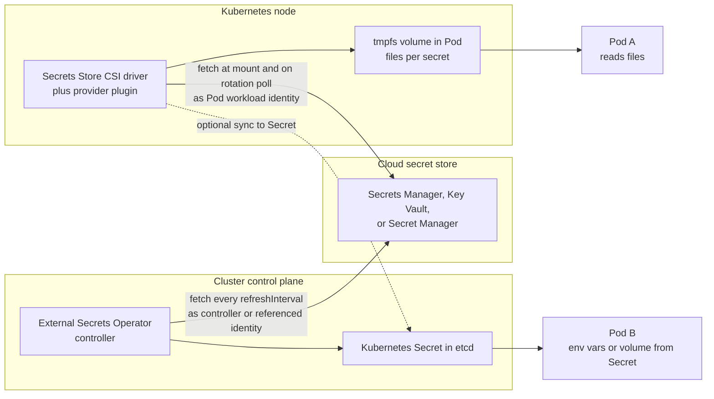

The **Secrets Store Container Storage Interface (CSI) driver** mounts secrets as files in an in-memory volume when the Pod starts, fetching them with the Pod's own workload identity through a provider plugin: the AWS Secrets and Configuration Provider, the Azure Key Vault provider (packaged as the AKS Key Vault Secrets Provider add-on), or the Google provider (also available as the GKE Secret Manager add-on). With rotation enabled, the driver polls on an interval (two minutes by default in the upstream driver at the time of writing) and updates the mounted files. The application must reread the files to see the change. The driver can optionally sync values into a Kubernetes Secret for workloads that need environment variables, which reintroduces a copy in etcd.

The **External Secrets Operator** runs as a controller that reads an `ExternalSecret` resource, fetches the value from the cloud store on a `refreshInterval`, and writes a normal Kubernetes Secret. Pods consume that Secret in the usual ways. It suits teams that already use Kubernetes Secrets everywhere and want the cloud store as the source of truth, and it supports templating and many backends. Its trade-offs are a copy of every value in etcd (so etcd encryption at rest and Secret read permissions matter), a controller identity that can read many secrets, and two refresh delays in series: the operator's interval, then the kubelet's update of mounted Secret volumes or a Pod restart for environment variables.

Choose the CSI driver when per-Pod identity and no etcd copy matter more than convenience. Choose External Secrets when workloads already consume Kubernetes Secrets and the platform team can protect etcd and the controller's identity. In both cases, the refresh delay chain must be counted in the rotation overlap (Section 9.6).

## 8. Caching, refresh, and the revocation window

### 8.1 The cache and refresh path

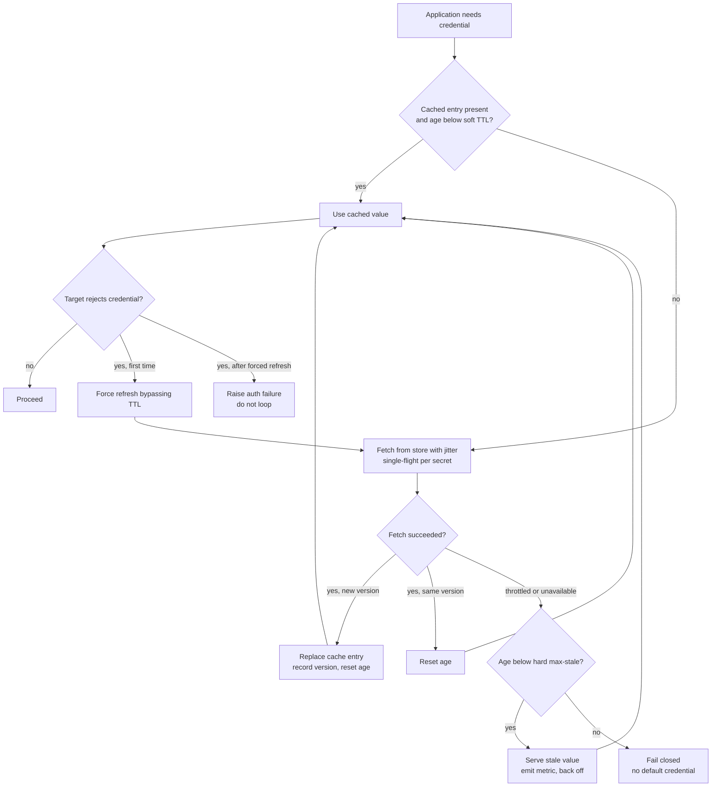

The flow is the refresh logic a production client needs, whether it lives in application code, an agent, or a sidecar. It has five properties that separate it from a naive cache.

1. **Soft TTL with jitter.** Each entry is refreshed after its TTL plus a random offset, so 2,000 instances started together do not all refresh in the same second.
2. **Single-flight.** Concurrent requests for the same expired entry wait for one fetch instead of each calling the store.
3. **Stale-if-error with a hard limit.** If the store is unavailable or throttling, the client keeps using the cached value up to a maximum staleness, then fails closed. Without the hard limit, a long store outage would let a revoked credential be used indefinitely. Without stale-if-error, a short store outage would take down every instance whose TTL expired during it.
4. **Refresh on authentication failure.** If the target rejects the credential, the client refreshes once, bypassing the TTL, and retries. This is what makes single-user rotation (Section 9.2) survivable. The client must not loop, or a wrong password at the target becomes a request storm on the store.
5. **Version awareness.** The cache records the version identifier, so metrics can report which version each instance uses. That is the evidence that a rotation reached all consumers.

Connection pools add a layer the cache does not see. A database connection authenticated with the old password usually stays open after the password changes, because most engines check the password only at login. The old credential's effective lifetime in a consumer is therefore the cache TTL plus the pool's maximum connection lifetime. Configure a maximum connection lifetime (for example HikariCP `maxLifetime`, or Npgsql `Connection Lifetime`) so that this bound exists.

### 8.2 Three clocks

A cache TTL is constrained by three different requirements, and they pull in different directions.

- **Staleness.** After a rotation promotes a new value, how long may a consumer keep using the old one? This bounds TTL from above, and it must be shorter than the rotation's overlap window, or consumers will be holding a credential the target has already revoked.
- **Outage tolerance.** How long must a running consumer survive if the store or the identity plane is unavailable? This bounds the hard max-stale from below. A longer TTL also reduces request volume and cost.
- **Revocation.** If the *consumer's access to the store* is revoked (for example, a compromised workload's role is removed), how long can it keep using values it already has? This is bounded by TTL plus max-stale plus connection lifetime. Note what this clock does not cover: removing a workload's permission to read the store does nothing to a credential it has already read. Only changing the credential at the target revokes it.

The third point drives incident response. If a credential is compromised, rotating it at the target is the revocation. Cache TTLs then decide how long *legitimate* consumers fail or use the old value, which is an availability concern, not a security one.

### 8.3 Worked calculation: choosing a TTL

A payments API on AKS reads a database password and a payment-provider API key from Key Vault through the Secrets Store CSI driver with rotation polling every 2 minutes, and the application rereads the mounted file through its own cache. Requirements:

- Rotation overlap available at the target: the database uses alternating users, so the previous credential stays valid until the next rotation, 30 days later. The payment provider allows two active API keys, and the team revokes the old key 2 hours after promotion.
- Outage tolerance: survive a 30-minute Key Vault or identity outage without failing requests.
- Revocation of a compromised Pod's access to the vault should limit its use of *new* values within 15 minutes. (The credential itself is revoked at the target.)
- Database pool maximum connection lifetime: 30 minutes.

The calculation for the API key, which has the tightest overlap:

- Old key's maximum survival in a consumer = CSI poll interval + application cache TTL + time for in-flight requests to finish. With a 2-minute poll and a 10-minute application TTL with up to 1 minute of jitter, that is 2 + 10 + 1 = 13 minutes, plus a few seconds for in-flight requests.
- Required overlap = 13 minutes plus a rollback hold. The team wants the ability to roll back to the old key for 60 minutes after promotion, so the overlap must be at least 13 + 60 = 73 minutes. The 2-hour (120-minute) revocation delay satisfies this with 47 minutes of margin.
- Outage tolerance: with a hard max-stale of 45 minutes, a 30-minute outage beginning at the worst moment (just as an entry's TTL expires) is covered, because the value stays usable until age 10 + 45 = 55 minutes. But max-stale also extends the staleness bound during an outage. If a rotation and a 30-minute outage coincide, a consumer can hold the old key up to 2 + 55 = 57 minutes, still inside the 120-minute overlap.
- Revocation clock: a Pod whose identity is removed stops getting new values at the next poll, so at most 2 minutes for new values, plus the identity token's cache lifetime (Section 12). Its cached values remain usable until max-stale, which is why the team rotates the key at the target in an incident.

For the database password, the 30-day alternating overlap dominates. The binding term is the pool: a connection opened just before promotion may live 30 more minutes, which is far inside the overlap.

The [secret rotation window checker](../code/python/secrets-chapter/01_rotation_window.py) encodes the overlap rule: it reports a risk when the overlap is shorter than the maximum consumer cache time plus the rollback window. Its sample values (12-hour cache, 24-hour rollback, 36-hour overlap) pass at exactly the limit, which is a useful prompt to ask whether zero margin is acceptable. The [cache staleness and refresh planner](../code/python/secrets-chapter/03_cache_refresh.py) checks a refresh interval against an allowed staleness and a revocation target. Its sample (15-minute refresh, 20-minute staleness allowance, 10-minute revocation target) fails the revocation check, which is the common case where a cache tuned for request volume is too slow for the security team's revocation requirement.

### 8.4 Built-in cache defaults

| Client or platform | Default refresh behavior (at the time of writing) | Invalidation on rotation |
|---|---|---|
| AWS Secrets Manager caching libraries | Refresh interval of one hour by default, configurable | None; refresh on TTL or explicit call |
| AWS Parameters and Secrets Lambda Extension | TTL 300 seconds, configurable | None |
| AWS Workload Credentials Provider (formerly Secrets Manager Agent) | TTL 300 seconds, range 0 to 3,600; `refreshNow` parameter forces a fetch | None |
| ECS task `secrets` injection | Resolved at task start only | Requires new tasks |
| Azure App Service and Functions Key Vault references | Refetch every 24 hours; on any configuration change; or forced refresh endpoint | Not automatic within 24 hours |
| Azure Container Apps Key Vault references | Picks up new versions within 30 minutes; restarts revisions using env vars | Restart-based |
| Cloud Run environment variable from Secret Manager | Resolved at instance start | Requires new instances |
| Secrets Store CSI driver | Rotation poll interval, two minutes by default when rotation is enabled | Files updated; application must reread |
| External Secrets Operator | `refreshInterval` on each `ExternalSecret` | Secret updated; Pods see it per kubelet behavior |

The table matters most for rotation planning. The slowest consumer of a secret sets the minimum overlap, and the slowest consumer is often a platform reference (24 hours on App Service) or a long-lived task, not the application with a carefully tuned cache.

## 9. Coordinated rotation

### 9.1 Rotation as a state machine across three parties

Rotation changes a credential in three places that do not share a transaction: the **target** (the database, the third-party API, the service that validates the credential), the **store** (the secret's versions and pointers), and the **consumers** (every process holding a cached copy). Each party moves at its own pace, and a rotation is complete only when all three have moved and the old credential is retired. A one-step "overwrite the secret" breaks this, because it changes the store before the target accepts the new value or after consumers have cached the old one, depending on which order the overwriting script chose.

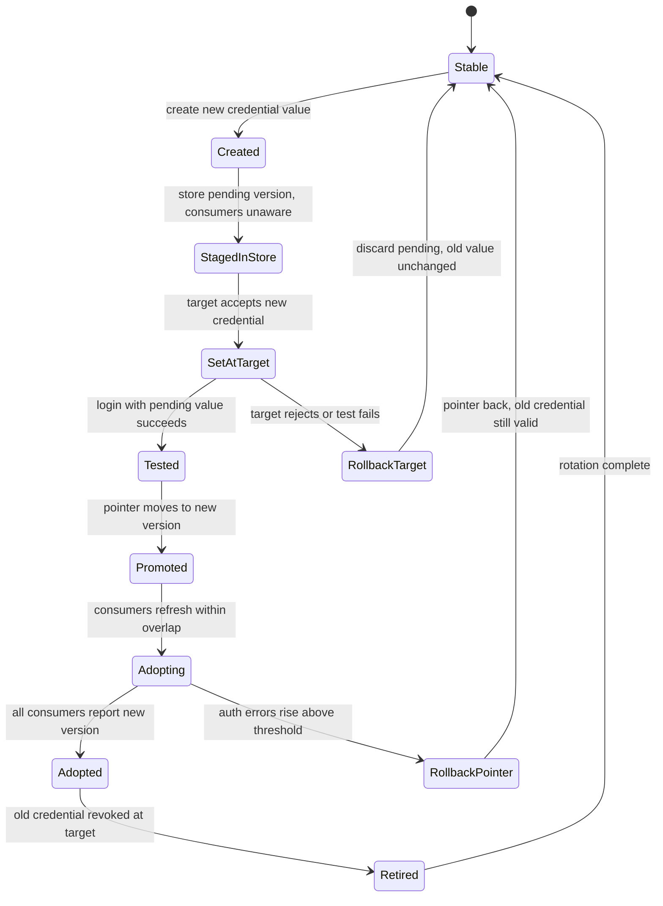

The state machine shows where a rotation can stop safely and where it cannot. Every state before `Promoted` is invisible to consumers, so a failure there costs nothing except a retry; the old credential is still the current one. `Promoted` to `Adopted` is the dangerous stretch. Consumers are switching, and the old credential must remain valid at the target until the last one has switched, or rollback becomes impossible. `Retired` is the only step that revokes anything, and it must wait for evidence of adoption, not for a timer alone.

Two rules follow. The target must accept the new credential before the store promotes it, because a promoted value that the target rejects is an immediate outage for every consumer that refreshes. And the old credential must stay valid at the target for at least the slowest consumer's refresh time plus the rollback hold, as computed in Section 8.3.

### 9.2 Rotation strategies

**Single user.** The rotation changes the password of the one database user the application uses. Between the moment the target accepts the new password and the moment each consumer refreshes, new logins with the old password fail. Existing connections usually continue. The overlap is effectively zero, so single-user rotation depends on consumers refreshing on authentication failure (Section 8.1) and on the pool retrying. It suits low-traffic systems, users that cannot be cloned, and targets that allow only one credential per identity.

**Alternating users.** The target has two equivalent users, for example `orders_app_a` and `orders_app_b`, with the same grants. Each rotation changes the password of the user that is *not* current, then promotes the secret version that names that user. Consumers that have not refreshed keep logging in as the other user with its still-valid password. The old credential stays valid until the *next* rotation changes it, so the overlap equals the rotation interval. The cost is that the rotator needs a privileged credential (a separate administrative secret) to change another user's password, and the target must allow two users with identical permissions. AWS documents both strategies for its database rotation functions; its alternating-users templates create the second user by cloning the first (with a `_clone` suffix) using a superuser secret, and Amazon Relational Database Service (RDS) Proxy does not support the alternating-users strategy ([Lambda function rotation strategies](https://docs.aws.amazon.com/secretsmanager/latest/userguide/rotation-strategy.html)).

**Dual keys at a third party.** Many API providers allow two active keys per account. The rotation creates key 2, promotes it, waits for adoption, then deletes key 1. This is alternating users with the overlap controlled explicitly.

**Managed or dynamic credentials.** Some services remove the rotation problem from the application. Amazon RDS and Aurora can manage the master user password in Secrets Manager and rotate it themselves. Databases that accept IAM or Entra ID authentication (RDS IAM authentication, Azure SQL with Entra ID, Cloud SQL IAM database authentication) let the workload log in with a short-lived token derived from its identity, so there is no password to rotate. Dynamic credential brokers issue a unique credential per lease ([Part 15](../15_Security/CH09_Secrets_Management.md#rotation-revocation-and-dynamic-credentials) owns that pattern). Prefer these whenever the target supports them, and use stored-secret rotation for the targets that do not.

### 9.3 AWS: the four-step rotation function

Secrets Manager rotation calls an AWS Lambda rotation function four times per rotation, passing the secret ARN, a client request token that becomes the new version ID, and a step name. AWS provides template functions for common databases, and managed rotation is available for some services.

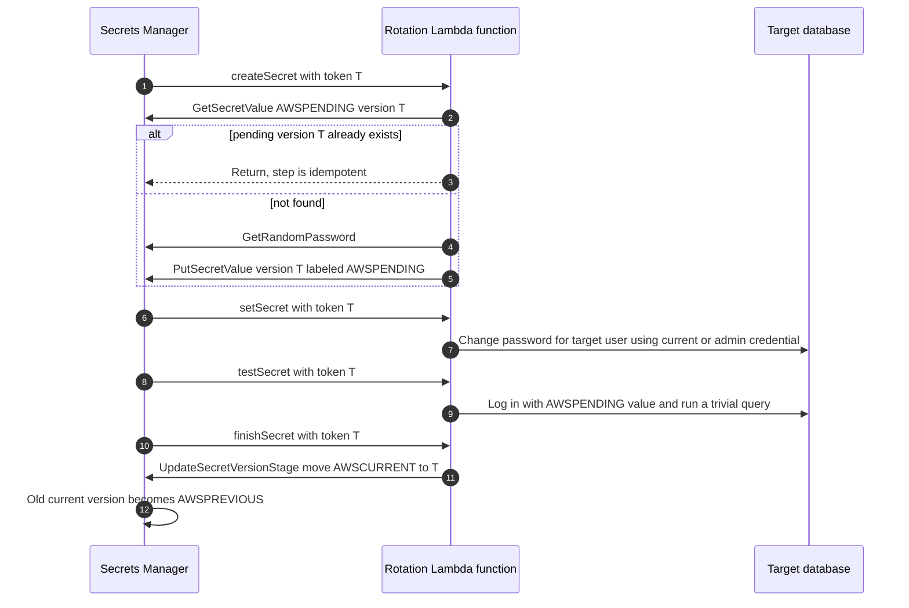

Each step has a specific contract.

1. **`createSecret`** generates the new value and stores it as a new version labeled `AWSPENDING`, using the token as the version ID. If a version with that ID already exists, the step does nothing, which makes retries safe.
2. **`setSecret`** changes the credential at the target. For single-user rotation it logs in with `AWSCURRENT` and changes its own password. For alternating users it logs in with the administrative secret and changes the other user's password. This is the step that needs network access to the target.
3. **`testSecret`** logs in with the `AWSPENDING` value. If it fails, the rotation stops before promotion and consumers are unaffected.
4. **`finishSecret`** moves `AWSCURRENT` to the new version. Secrets Manager moves `AWSPREVIOUS` automatically.

Secrets Manager retries a failed step, and if rotation fails the `AWSPENDING` label stays on the incomplete version until the next attempt. Every step must therefore be idempotent. A `setSecret` that runs twice must not change the password to a second random value; it must set the password to the `AWSPENDING` value, which is the same each time. Rotation schedules use `rate()` or `cron()` expressions with an optional window duration, and can run as often as every four hours. The rotation function needs `secretsmanager:GetSecretValue`, `PutSecretValue`, `DescribeSecret`, and `UpdateSecretVersionStage` on its secrets, `kms:Decrypt` and `kms:GenerateDataKey` on the secret's key, a network path to both the target and the Secrets Manager endpoint (a VPC endpoint or a NAT path when the function runs in a VPC), and a Lambda resource policy allowing `secretsmanager.amazonaws.com` to invoke it.

The commonest failure is network: the function is placed in the database's private subnet for `setSecret` and then cannot reach Secrets Manager for `finishSecret`. The second commonest is a database whose password policy rejects the generated password; `GetRandomPassword` takes parameters (`ExcludeCharacters`, length) to match the target's rules.

### 9.4 Azure: near-expiry events and an event-driven rotator

Key Vault has native rotation policies for keys and renewal policies for certificates, but no built-in rotation function for secrets. The documented pattern uses expiry metadata and Azure Event Grid. Each secret version is given an expiry time. Key Vault publishes `Microsoft.KeyVault.SecretNearExpiry` (30 days before expiry), `Microsoft.KeyVault.SecretExpired`, and `Microsoft.KeyVault.SecretNewVersionCreated` events to Event Grid. An Event Grid subscription triggers an Azure Function, which runs the same four logical steps as the AWS function: generate a value, set it at the target, test it, and write it to Key Vault as a new version with a new expiry.

Because Key Vault has no pending pointer, the function must write the new version only after the target accepts it, which collapses `createSecret` and `finishSecret` into one write. Consumers using a versionless reference then pick up the new version at their next refresh. The design must therefore keep the old credential valid at the target. For two-credential targets, Microsoft's sample alternates between two credentials and records which one is active in the secret's tags. For a single-credential target there is no safe automated pattern without consumer refresh-on-failure.

The `SecretNewVersionCreated` event is also useful for consumers: an application or a deployment workflow can subscribe and refresh immediately, which shortens the adoption window. For App Service, that subscriber can call the Key Vault reference refresh endpoint instead of waiting up to 24 hours.

### 9.5 Google Cloud: rotation notifications through Pub/Sub

Secret Manager rotation schedules do not rotate anything themselves. A secret with a `rotation_period` (at least one hour) and a `next_rotation_time` publishes a `SECRET_ROTATE` message to the Pub/Sub topics configured on the secret when the time arrives, then advances `next_rotation_time`. A subscriber, typically a Cloud Run function or service, performs the rotation. Secret Manager retries failed message delivery for up to seven days, skips a scheduled rotation if a previous notification is still in flight, and charges per rotation notification beyond a small free allowance ([Secret Manager rotation schedules](https://docs.cloud.google.com/secret-manager/docs/secret-rotation)). The same topics also receive event notifications such as `SECRET_VERSION_ADD`, which consumers can use to refresh.

Version aliases give the Google design a staging mechanism. The subscriber adds the new value as a new version, moves a `pending` alias to it, sets and tests the credential at the target, then moves the `current` alias. Consumers that read `versions/current` see the change only at promotion. Consumers that read `latest` see the new version as soon as it is added, before the target has accepted it, which is another reason not to use `latest` with rotating credentials. Pub/Sub delivers at least once, so the subscriber must be idempotent; use the message's publish time or a version annotation to detect a rotation that already ran.

### 9.6 The overlapping-version timeline

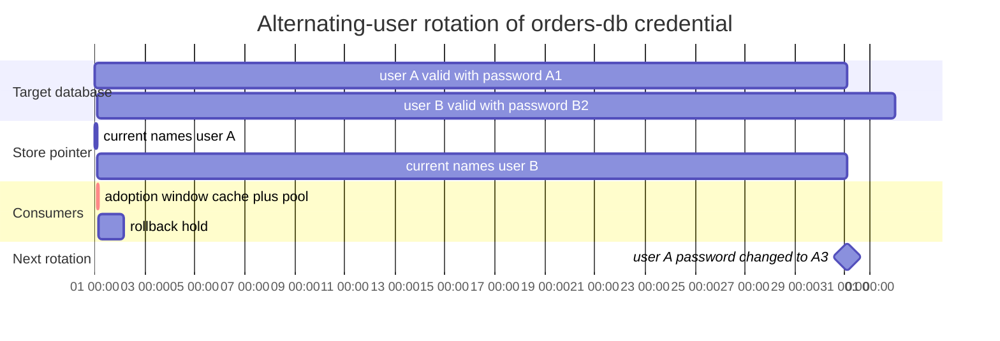

The timeline shows why alternating users is the safer default. At 02:00 the rotation sets a new password on user B, which no consumer is using, and at 02:05 it moves the pointer to user B. Consumers adopt over the next 75 minutes (a 10-minute cache with jitter, plus a 60-minute maximum pool connection lifetime, plus margin). User A's password remains valid throughout, and in fact for the whole 30-day interval, until the next rotation changes user A's password. The rollback hold is a day in this design, but rollback is possible for the full month because user A still works. Contrast single-user rotation, where the first bar would end at 02:00 and every consumer that had not refreshed would fail its next login.

For dual-key third-party APIs, the old key's bar ends at an explicit revocation time. The overlap rule from Section 8.3 then becomes a hard check on that time: revocation time minus promotion time must exceed the slowest consumer's adoption time plus the rollback hold. For a consumer on App Service with a versionless Key Vault reference and no forced refresh, the slowest adoption is 24 hours, so a 2-hour revocation delay would break that consumer.

### 9.7 Rotation failures and a quality scenario

| Failure | Where in the state machine | Symptom | Prevention |
|---|---|---|---|
| Rotator cannot reach target | `StagedInStore` to `SetAtTarget` | Rotation stuck with pending version; alerts on rotation failure | Network path test in rotation preflight |
| Target rejects password complexity | `SetAtTarget` | `setSecret` error | Generate values that match target policy |
| Test step passes but consumers fail | `Promoted` to `Adopting` | Auth errors after promotion | Test with the consumer's network path and grants, not the rotator's |
| Promotion before target accepted | Skips `SetAtTarget` | Immediate outage on refresh | Order steps: target first, pointer second |
| Old credential revoked before adoption | `Adopting` to `Retired` too early | Auth errors on slow consumers | Retire on adoption evidence, overlap above slowest refresh |
| Concurrent rotations | Two machines on one secret | Lost update, wrong password stored | Provider single-flight (Secrets Manager rejects a rotation while one is in progress, Secret Manager skips a schedule with a notification in flight); idempotent steps |
| Rotation storm | Many secrets rotate at once | Target overloaded, throttling at store | Spread schedules, cap concurrency |

**Quality scenario: identity or key rotation without downtime.**

- *Stimulus.* The quarterly rotation of 140 database credentials for a platform of 60 services, plus the annual rotation of the customer-managed key protecting those secrets.
- *Expected response.* Rotations run in five waves of 28 secrets over a week, alternating-users strategy, at most four concurrent rotations per database cluster. The key rotation adds a new key version; existing secret versions stay decryptable with the old version, and new versions written by the rotations use the new one. Each consumer reports the version ID it uses as a metric label (never the value).
- *Measurable success.* Zero failed requests attributable to authentication across all services during the week. Every consumer reports the new version within 2 hours of promotion. No rotation leaves an `AWSPENDING` or `pending` pointer older than 24 hours. The old key version shows no decrypt failures and remains enabled.

## 10. Replication, residency, and multi-region design

### 10.1 Replication models by provider

A secret or key that exists only in one region is a single-region dependency for every workload that needs it, including the recovery workload in another region. The providers offer three different models.

**AWS: customer-directed replicas.** A Secrets Manager secret can be replicated to other Regions with `ReplicateSecretToRegion`. Each replica is a read-only copy with the same name, encrypted under a KMS key in the replica Region (the AWS managed key there, or a customer managed key you name). Replication is asynchronous. Writes and rotation happen only on the primary and propagate to replicas, so a rotation function runs in the primary Region and replicas follow. If the primary Region is unavailable, `StopReplicationToReplica` promotes a replica to a standalone secret that can be written and rotated, which is a one-way operation that the recovery runbook must include. Each replica is billed as a secret. KMS keys are regional; multi-Region keys (Section 4.1) give interoperable keys for client-side encrypted data replicated across Regions. Parameter Store has no replication; copy parameters with your deployment pipeline.

**Azure: platform-managed replication.** Key Vault replicates vault contents within the region and, for regions with a pair, to the paired region. If the primary region fails, Microsoft fails the vault over, and during failover the vault is read-only: reads work, but creating, updating, or deleting secrets, keys, and certificates does not. Customers do not choose the replica region and cannot trigger failover, and the behavior differs for regions without a pair, so verify it for your regions. A rotation that fires during a regional failover will fail at the write step. Teams that need a writable vault in the recovery region create a second vault there and write each new secret version to both, usually from the rotation function. Key Vault backups (`backup` and `restore` of individual objects) can be restored only into a vault in the same subscription and Azure geography, so they help with accidental deletion, not with cross-geography moves.

**Google Cloud: replication policy per secret.** Global secrets with automatic replication are stored in locations Google chooses. User-managed replication stores payloads only in the listed locations, and reads are served from a replica, so losing one listed location does not stop access. Regional secrets live in one region with no replication. Cloud KMS keys live in a location chosen at key ring creation: a region, a multi-region (`us`, `europe`, `asia`), or `global`. A key in a multi-region location is available across the regions of that multi-region. Neither secrets' replication policies nor keys' locations can be changed after creation; moving requires creating a new resource and migrating consumers.

### 10.2 Failure domains of a secret read

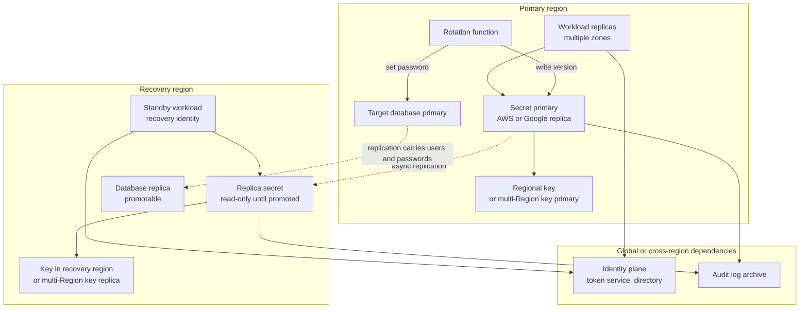

The map shows that replicating the secret is only one of four things that must be true in the recovery region. The recovery workload needs an identity that is authorized on the replica secret (a role, managed identity, or service account that exists and holds a grant in that region, which is easy to forget when grants are attached per Region). The replica secret needs a decryptable key in the recovery region. The target, usually a database replica, must accept the credential, which works for database-native users because database replication copies the user table, but not for credentials that a third-party API binds to an address or region. And the identity plane must be available: AWS Security Token Service has Regional endpoints and the SDKs should be configured to use them, Microsoft Entra ID and Google's token services are global services with their own resilience.

The arrows also show the timing hazard. Database replication and secret replication are independent and asynchronous. If a rotation runs seconds before a regional failure, the database replica may have the new password while the replica secret still has the old one, or the reverse. Alternating users protects against both orders, because the previous user still works. Single-user rotation does not, which is another reason to prefer alternating users for databases that must fail over.

### 10.3 Residency

Replication is also a data-location decision. A secret is often less sensitive than the data it protects, but some regimes treat credentials and keys for regulated systems as in scope, and customer-managed keys exist precisely to keep control of key location. Check three things:

1. **Where the payload is stored.** AWS replicas and Google user-managed replicas are in Regions you choose; Google automatic replication and Azure paired-region replication are where the provider chooses. Regional Google secrets stay in one region.
2. **Where the key is.** A Google CMEK secret with user-managed replication needs a key in each replica location. An AWS replica uses a key in the replica Region. An AWS multi-Region key puts the same key material in every Region with a replica.
3. **Where the processing and the logs are.** Audit logs may be routed to a central account or project in another region. For strict regimes, keep log sinks in-region too.

The [secret replication and residency checker](../code/python/secrets-chapter/04_replication_residency.py) compares a set of replication targets to an allowlist. Its sample allows `westeurope` and `northeurope` and is given a target set that also includes `us-east1`, so it reports a deny finding for that Region alongside the two approved ones. In practice, run the same check as a policy: an AWS SCP that denies `secretsmanager:ReplicateSecretToRegion` with `secretsmanager:AddReplicaRegions` outside an allowed list, Azure Policy allowed locations on vaults, and a Google organization policy `gcp.resourceLocations` constraint, which Secret Manager and Cloud KMS respect.

### 10.4 Quality scenario: regional failure with secrets in the recovery path

- *Stimulus.* The primary Region hosting an order service becomes unavailable at 14:00. The recovery plan promotes the database replica in the second Region and starts the standby workload.
- *Expected response.* The standby workload's role is already authorized on the replica secret and its key. The runbook promotes the database replica, starts the workload (which reads the replica secret, a read-only operation that does not need promotion), and confirms logins. Because rotation runs only on the primary, the runbook disables the rotation schedule and, if the outage is expected to exceed the next rotation date, promotes the replica secret to standalone with `StopReplicationToReplica` and re-creates rotation in the recovery Region.
- *Measurable success.* Standby workload authenticates to the promoted database within 5 minutes of promotion. No secret write is needed in the first hour. The recovery drill, run quarterly, shows the replica secret's `AWSCURRENT` version matching a credential the database replica accepts.

## 11. API quotas, throttling, and performance

### 11.1 Quotas that matter

| Service | Read quota (at the time of writing) | Scope | Adjustable |
|---|---|---|---|
| AWS Secrets Manager `GetSecretValue` | 10,000 requests per second | Account and Region; cross-account calls count against the caller | No |
| AWS Secrets Manager `BatchGetSecretValue` | 100 requests per second | Account and Region | No |
| AWS Secrets Manager writes (`PutSecretValue`, `UpdateSecretVersionStage`, replication changes) | 50 requests per second combined | Account and Region | No |
| AWS Systems Manager Parameter Store | Standard throughput by default; higher throughput is an opt-in setting with per-request charges | Account and Region | Setting |
| AWS KMS symmetric cryptographic operations | 10,000, 20,000, or 100,000 requests per second shared, by Region | Account and Region, all principals and services | Yes |
| Azure Key Vault secrets | 4,000 transactions per 10 seconds for gets; 300 per 10 seconds for creates, shared with key and certificate imports | Per vault per region; subscription-wide limit is five times the per-vault limit | No |
| Azure Key Vault RSA 2,048-bit keys | 4,000 per 10 seconds software, 2,000 per 10 seconds HSM | Per vault per region, weighted by key type | No |
| Google Secret Manager access | 90,000 requests per minute | Project | By request |
| Google Secret Manager reads and writes (metadata, version changes) | 600 per minute each | Project; plus per-secret limits on adding versions | By request |
| Google Cloud KMS | Token-based quotas since February 2026, enforced softly for software keys and hard for external keys; software CMEK use is not quota-enforced | Project hosting the key | Quota adjuster |

Sources: [Secrets Manager quotas](https://docs.aws.amazon.com/secretsmanager/latest/userguide/reference_limits.html), [AWS KMS request quotas](https://docs.aws.amazon.com/kms/latest/developerguide/requests-per-second.html), [Key Vault service limits](https://learn.microsoft.com/en-us/azure/key-vault/general/service-limits), [Secret Manager quotas](https://docs.cloud.google.com/secret-manager/quotas), and [Cloud KMS quotas](https://docs.cloud.google.com/kms/quotas).

The units differ, and converting them is the first step of any capacity check. Key Vault's 4,000 per 10 seconds is 400 per second per vault. Secret Manager's 90,000 per minute is 1,500 per second per project. AWS's 10,000 per second is per account and Region. Key Vault is the tightest per resource, which is why Microsoft recommends a vault per application per environment, and also why Key Vault throttling usually appears first during scale events.

Throttled requests fail with Hypertext Transfer Protocol (HTTP) status 429 on Azure and Google Cloud (`RESOURCE_EXHAUSTED` on Google) and a `ThrottlingException` on AWS. Every provider recommends exponential backoff with jitter. Cloud KMS quotas are displayed per minute but some were enforced per second under the older model, so a burst can be throttled while the per-minute chart looks healthy.

### 11.2 Worked request-rate example

A retail platform runs 2,400 Pods of a checkout service. Each Pod needs 6 secrets. Peak traffic is 3,000 requests per second across the fleet.

**Design A: fetch secrets on every request.** Suppose the code fetches 2 of the 6 secrets per request.

- Request rate: 3,000 × 2 = 6,000 secret reads per second.
- AWS: 6,000 / 10,000 = 60 percent of the Region's `GetSecretValue` quota, for one service. Two such services exhaust it.
- Google Cloud: 6,000 per second is 360,000 per minute, four times the 90,000-per-minute project quota.
- Azure: 6,000 per second is 60,000 per 10 seconds against 4,000 per vault, fifteen times the limit. Even spread across vaults, the subscription-wide limit of 20,000 per 10 seconds is exceeded threefold.

**Design B: cache with a 300-second TTL.**

- Steady-state rate: 2,400 Pods × 6 secrets / 300 seconds = 48 reads per second. That is 0.5 percent of the AWS quota, 3.2 percent of the Google quota, and 12 percent of one Key Vault's per-vault limit.

**Scale-out and restart burst.** The steady state is not where throttling happens. A zonal failure reschedules a third of the Pods, 800 of them, onto other nodes within about 20 seconds.

- Burst: 800 × 6 = 4,800 reads in 20 seconds, or 240 per second. AWS and Google absorb it easily.
- Azure, one vault: 4,800 reads in 20 seconds is 2,400 per 10-second window, within the 4,000 limit. A full-fleet restart (for example, a cluster upgrade that drains nodes quickly or a deployment with an aggressive surge) of all 2,400 Pods in 20 seconds is 14,400 reads, or 7,200 per 10-second window, which is 1.8 times the vault's limit. About 45 percent of first attempts are throttled. With backoff, the last Pods get their secrets after roughly 14,400 / 400 = 36 seconds at the throttled rate, plus backoff overhead, so readiness is delayed by 20 to 40 seconds and the rollout's health checks must tolerate it.

The responses, in order of preference: start Pods at a controlled rate (a rollout `maxSurge` that keeps the burst under the limit), cache at the node level (one CSI driver or agent fetch per node rather than per Pod, where the security model allows Pods on a node to share), split secrets across vaults by application, and use `BatchGetSecretValue` on AWS where a Pod needs many secrets (one call for up to 20 secrets, subject to its own lower quota).

**Quality scenario: quota limit during scale-out.**

- *Stimulus.* Black Friday autoscaling adds 1,200 Pods in 60 seconds while a rotation of the payment API key is in progress.
- *Expected response.* New Pods fetch secrets with jittered retries, the store's throttling causes at most a delay in readiness, not failed requests, and existing Pods keep serving from cache. Rotation writes are not throttled because they use a different quota bucket (AWS writes, Key Vault create operations) or are rare.
- *Measurable success.* Peak secret read rate stays below 70 percent of the per-vault or per-project quota (alerted at 70 percent through Azure Monitor `ServiceApiHit` metrics, CloudWatch usage metrics, or Cloud Monitoring quota metrics). No Pod fails readiness for more than 60 seconds because of a secret fetch. Zero 5xx responses attributed to secret retrieval.

### 11.3 Latency and startup

A secret fetch is an authenticated HTTP Secure (HTTPS) call to a regional endpoint and usually completes in tens of milliseconds within the Region. The first call in a new process is slower, because it includes TLS setup, token acquisition from the identity endpoint, and for customer-managed keys a key-service call inside the store. Measure startup cost as identity token time plus secret fetch time per secret, and fetch secrets concurrently at startup rather than one after another. For functions, secret fetches on cold start add directly to cold-start latency ([Serverless](CH11_Serverless.md) owns cold-start mechanics), which is why the Lambda extension caches across invocations in the same execution environment.

## 12. Audit, detection, and revocation

### 12.1 What each provider records

Audit is only as good as the log configuration, and the defaults differ.

- **AWS.** CloudTrail records Secrets Manager and KMS API calls, including `GetSecretValue` and `Decrypt`, as management events. Event history keeps 90 days in the console without configuration. For retention and analysis, an organization trail delivers to a central log archive account. KMS events can be excluded from trails to reduce volume; do not exclude them for keys that protect secrets. CloudTrail entries include encryption context for KMS calls and the secret ARN for Secrets Manager calls, never the value.
- **Azure.** The Activity Log records management-plane operations on vaults (creating vaults, changing access policies or network rules). Data-plane operations (`SecretGet`, `KeySign`, `SecretSet`) are recorded only if a diagnostic setting sends the `AuditEvent` category to a Log Analytics workspace, storage account, or Event Hubs. A vault without a diagnostic setting has no record of who read its secrets. Enforce the diagnostic setting with Azure Policy.
- **Google Cloud.** Admin Activity audit logs (creating secrets, changing IAM policies) are always on. Data Access audit logs, which include `AccessSecretVersion` and Cloud KMS `Decrypt`, are off by default for most services and must be enabled per service in the IAM audit configuration, at the organization level for consistency. Data Access logs can be large; route them with a log sink to a dedicated logging project.

Logs belong in a place the secret administrators cannot alter: an AWS log archive account with S3 Object Lock, an Azure workspace in a separate security subscription, a Google log bucket with a locked retention policy in a separate project. [Monitoring](CH10_Monitoring.md) owns cross-account log routing.

Detection rules worth having on every estate: a secret read by a principal that has not read it in the previous 30 days; a read from an address outside the expected networks; `PutResourcePolicy`, access policy changes, or IAM policy changes on secrets; `ScheduleKeyDeletion`, `DisableKey`, key version destruction, and Key Vault purge attempts; a rotation that has failed or has not completed by its deadline; and secrets with no read in 90 days, which are candidates for deletion.

### 12.2 The audit and revocation flow

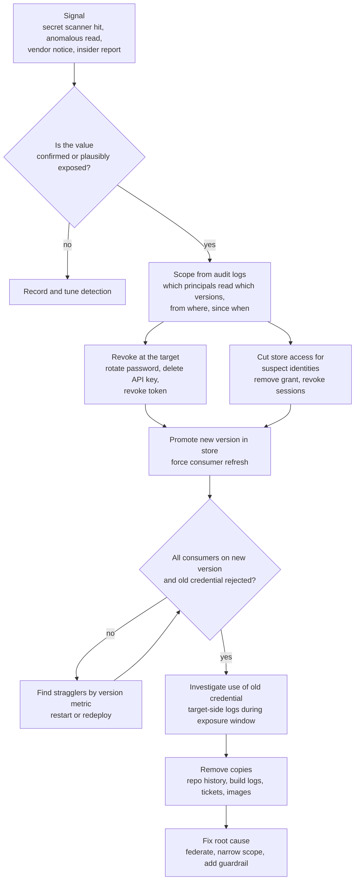

The flow has two parallel revocation branches because they revoke different things. Revoking at the target makes the leaked value useless anywhere it was copied. Cutting store access stops a compromised identity from reading the *new* value. Doing only the second leaves the leaked credential valid; doing only the first lets a compromised workload read the replacement as soon as it is promoted. The verification loop uses the version metric from Section 8.1, because "the store has a new version" does not prove that every consumer moved or that the target rejects the old value. Test the rejection explicitly with a login attempt using the old value from a controlled location.

Revoking an identity's store access has its own propagation delay. On AWS, removing a policy takes effect for new requests within seconds to minutes, but already-issued temporary credentials remain valid until expiry; the IAM console's "Revoke active sessions" for a role attaches a deny policy conditioned on `aws:TokenIssueTime`, which invalidates them. On Azure, removing a direct role assignment propagates within minutes, while access through group membership can persist for hours in cached managed identity tokens ([Azure](CH02_Azure.md#102-the-token-path)). On Google Cloud, removing an IAM binding usually takes effect within minutes, and disabling a service account stops new tokens; existing access tokens expire within their lifetime (one hour by default). [IAM](CH09_IAM.md) owns these mechanics.

### 12.3 Incident response for a leaked secret

[Secrets Management](../15_Security/CH09_Secrets_Management.md#leaks-incident-response-and-observability) in Part 15 owns the provider-neutral response sequence: treat a detected leak as live compromise, revoke first, then assess and clean up. The cloud-specific steps for a typical case follow.

**Scenario.** At 09:12 a repository secret scanner reports that a developer committed a `.env` file containing the production `orders-db` password and a payment-provider API key to a public fork 40 minutes earlier. The secrets are in AWS Secrets Manager with alternating-users rotation for the database, and in a dual-key arrangement for the payment API.

1. **09:15, revoke the database credential.** Run `aws secretsmanager rotate-secret --secret-id orders/db` to trigger an immediate rotation. Because of the alternating strategy, the rotation sets a new password on the *other* user and promotes it. That does not invalidate the leaked password, which belongs to the user that was current. Run a second rotation immediately after the first completes, which changes the leaked user's password. Two rotations in a row are the alternating-users answer to a leak. Alternatively, run `ALTER USER ... PASSWORD` on the leaked user directly and then rotate, if waiting for two rotations is too slow.
2. **09:16, revoke the payment API key.** Create a new key at the provider, write it as a new secret version, promote it, and delete the leaked key at the provider. Deleting it before every consumer refreshes causes payment errors for up to the consumers' cache TTL. Accept that: a live leaked payment key outweighs a few minutes of degraded checkout, and the refresh-on-auth-failure path limits the impact.
3. **09:20, force consumer refresh.** Trigger a rolling restart of the consuming services or call the agent's `refreshNow` path, so the adoption window is minutes rather than a full TTL.
4. **09:25, scope.** Query CloudTrail for `GetSecretValue` on both secrets for the last 30 days, grouped by principal and source address, to confirm that only expected roles read them. Query database logs for logins by the leaked user from unexpected addresses during the 40-minute exposure, and the payment provider's API logs for calls with the leaked key.
5. **09:40, verify.** Version metrics show every Pod on the new versions. A login attempt with the leaked password from a bastion host fails. The payment provider reports the old key as deleted.
6. **Same day, clean up and fix.** Remove the file from the fork's history and ask the hosting provider to purge cached views, knowing that clones may already exist. Add a pre-commit secret scanner and a continuous integration (CI) scan. Remove the reason a developer had the production password locally, for example by giving developers access only to non-production secrets and using IAM database authentication for break-glass access.

**Measurable success.** Leaked credentials rejected by the targets within 15 minutes of detection. All consumers on new versions within 30 minutes. No unexplained use of the leaked credentials in target logs during the exposure window. A post-incident record that lists who could read the secret, who did, and the control that would have prevented the copy.

## 13. Cost

Secret and key services are cheap at rest and can be expensive in motion. Request volume, not storage, usually dominates the bill.

| Item | AWS | Azure | Google Cloud |
|---|---|---|---|
| Secret storage | Secrets Manager $0.40 per secret per month, each replica billed as a secret; Parameter Store standard free, advanced per-parameter charge | No per-secret charge | $0.06 per active version per location per month (enabled and disabled versions are both active); automatic replication billed as one location |
| Secret reads | $0.05 per 10,000 API calls | Per 10,000 transactions (about $0.03 for Standard secrets operations at the time of writing) | $0.03 per 10,000 access operations |
| Rotation | Lambda invocation cost; no rotation fee | Function and Event Grid cost | $0.05 per rotation notification beyond a small free allowance |
| Key storage | $1 per KMS key per month, plus $1 for each of the first two rotations | Software keys per operation; Premium HSM keys per key per month; Managed HSM per pool per hour | $0.06 per software key version, $1.00 per HSM symmetric version, $3.00 per external version, per month |
| Key operations | $0.03 per 10,000 symmetric requests; 20,000 free per month | Per 10,000 transactions | $0.03 per 10,000 ($0.15 for external keys) |
| Dedicated HSM | CloudHSM per HSM per hour | Managed HSM per pool per hour | Single-tenant Cloud HSM per instance per hour |

Prices are list prices at the time of writing from [Secrets Manager pricing](https://aws.amazon.com/secrets-manager/pricing/), [AWS KMS pricing](https://aws.amazon.com/kms/pricing/), [Key Vault pricing](https://azure.microsoft.com/en-us/pricing/details/key-vault/), [Secret Manager pricing](https://cloud.google.com/secret-manager/pricing), and [Cloud KMS pricing](https://cloud.google.com/kms/pricing). Verify current prices.

**Worked cost comparison.** An estate holds 400 secrets, each replicated to a second region, each with 3 active versions on Google Cloud. After caching, the fleet reads 50 secrets per second in total, which is 50 × 2,592,000 seconds in a 30-day month = 129.6 million reads.

- AWS: storage (400 primaries + 400 replicas) × $0.40 = $320. Reads 129.6 million / 10,000 × $0.05 = $648. Total about $968 per month, plus KMS charges if customer managed keys are used.
- Azure: no per-secret charge. Reads 129.6 million / 10,000 × $0.03 = $388.80. Two vaults in two regions add no storage charge.
- Google Cloud with user-managed replication: 400 × 3 versions × 2 locations = 2,400 active version-locations × $0.06 = $144. Reads 129.6 million / 10,000 × $0.03 = $388.80. Total about $533.

Without caching, the per-request design of Section 11.2 at 6,000 reads per second would make 15.55 billion reads a month: $77,760 on AWS, $46,656 on Azure or Google Cloud. Caching is a cost control as much as a quota control. On Google Cloud, destroy old versions rather than only disabling them, because disabled versions are still billed. On AWS, consolidating rarely-rotated, single-account configuration values into Parameter Store standard parameters removes the per-secret charge for them. [Cost Optimization](CH14_Cost_Optimization.md) owns allocation of these charges to teams.

## 14. Provider comparison

The table compares guarantees, scopes, and responsibilities rather than product names. Similar names hide different behavior, and the rows where providers differ most are the ones that break designs ported between them.

| Dimension | AWS | Azure | Google Cloud |
|---|---|---|---|
| Secret resource scope | Regional secret per account | Regional vault; secrets inside a vault | Project-level global secret with replication policy, or regional secret |
| Pointer to current value | Staging labels with rotation meaning (`AWSCURRENT`, `AWSPENDING`, `AWSPREVIOUS`) plus custom labels | None; newest enabled version | `latest` (newest enabled) plus user-defined aliases with no built-in meaning |
| Native rotation | Lambda rotation function with four steps, managed rotation for some services, schedule down to every four hours | None for secrets; Event Grid near-expiry and new-version events drive a function; key rotation policies for keys | Schedule publishes `SECRET_ROTATE` to Pub/Sub; subscriber performs rotation |
| Secret deletion recovery | 7 to 30 day recovery window | Soft delete 7 to 90 days, optional irreversible purge protection | Secret deletion immediate; version delayed destruction optional |
| Data-plane authorization | IAM identity policies plus optional secret resource policy plus KMS key policy | Azure RBAC data roles at vault or object scope (recommended, default for new vaults in API 2026-02-01 and later) or legacy vault-wide access policies | IAM roles at organization, folder, project, or secret scope, with conditions |
| Secret encryption key | AWS managed key or customer managed KMS key (required for cross-account) | Microsoft-managed inside the service | Google-managed or CMEK per location |
| Key service model | Regional KMS keys, key policy primary, grants for delegation, multi-Region keys | Vault keys (multi-tenant HSM on Premium) or single-tenant Managed HSM with local RBAC | Key rings in a location, keys with fixed protection level (software, HSM, external, external over VPC) |
| Data key operation | `GenerateDataKey` returns plaintext and wrapped DEK | Client generates DEK, `wrapKey` and `unwrapKey` | Client generates DEK (Tink), `encrypt` and `decrypt` with AAD |
| Key deletion delay | 7 to 30 days pending deletion | Soft delete and purge protection | 24 hours to 120 days scheduled destruction, fixed at key creation |
| Cross-region availability | Customer-directed replica secrets, promotable; multi-Region keys | Platform replication to paired region, read-only during failover | Replication policy fixed at creation; key location fixed at creation |
| Secret read quota | 10,000 per second per account and Region | 4,000 per 10 seconds per vault | 90,000 per minute per project |
| Data-plane audit default | CloudTrail management events on by default | Requires diagnostic setting | Data Access logs off by default |
| Storage pricing basis | Per secret, per replica | Per operation only | Per active version per location |

Three rows deserve emphasis in design reviews. The pointer row decides whether a staged rotation is native (AWS), built by convention (Google aliases), or impossible without a second secret (Azure). The deletion row decides whether an accidental delete is a ticket or an incident, and Google's immediate secret deletion is the outlier. The audit row decides whether an investigation has data at all, and on Azure and Google Cloud the answer depends on configuration that someone had to remember.

## 15. Case study: a payments platform on two providers

### 15.1 Context and requirements

A payments company runs its customer-facing API on AWS in `eu-central-1` with recovery in `eu-west-1`, and its merchant reporting system on Google Cloud in `europe-west3`. It handles card data, so a Payment Card Industry Data Security Standard (PCI DSS) assessment covers the key management of the card vault. Its requirements:

- R1. No long-lived cloud credentials anywhere. All workloads use workload identity.
- R2. Database credentials rotate every 30 days with zero failed requests.
- R3. A leaked credential must be rejected by its target within 15 minutes of detection.
- R4. Card data encryption keys are customer-managed, with key administrators separated from application operators.
- R5. Secrets and keys stay in the European Union.
- R6. A regional failure of the AWS primary Region must not need any secret write in the first hour of recovery.
- R7. Secret retrieval must survive a 30-minute secret-store outage for running instances.

### 15.2 Decisions

**D1. Federate wherever the target allows it, and store only the residue.** The API's calls to S3, DynamoDB, and Amazon Simple Queue Service (SQS) use task roles on ECS. The reporting system uses attached service accounts for BigQuery and Cloud Storage. Cross-cloud calls from AWS to Google Cloud use workload identity federation from the AWS role to a Google service account, so no Google service account key exists. What remains for secret stores is 38 values: PostgreSQL credentials, three payment network API keys, webhook signing secrets, and a few partner tokens. *Rejected alternative:* putting all configuration in Secrets Manager "to be safe". That would have multiplied cost and blurred which values need rotation and audit.

**D2. Secrets Manager on AWS, Secret Manager on Google Cloud, no cross-cloud secret store.** Each workload reads secrets from its own provider's store with its native identity. *Rejected alternative:* a single third-party vault for both clouds. It would give one policy model, but add a self-operated critical dependency in both read paths, and the team has no operations capacity for it. The cost is two policy models, managed by one Terraform module per provider with the same inputs (owner, consumers, rotation interval, residency).

**D3. Alternating-users rotation for PostgreSQL through RDS, not RDS Proxy.** Alternating users gives a full 30-day overlap, which satisfies R2 even for a consumer that misses a refresh, and protects against secret and database replication racing during failover (Section 10.2). RDS Proxy would have pooled connections, but it does not support the alternating-users strategy, and the team valued the overlap more. *Rejected alternative:* IAM database authentication for the application. It removes the password entirely and was the team's first choice, but the application's connection pool library did not support token refresh at the required rate. The decision is recorded for revisit, and IAM authentication is used for human break-glass access.

**D4. Customer managed KMS keys for the card vault, separated by account.** The card vault's client-side encryption uses a customer managed key in a dedicated `keys-prod` account. The key policy does not delegate to IAM. It names the key administration role (from the security team's identity) and grants `kms:Decrypt` and `kms:GenerateDataKey` only to the card vault's task role, with an encryption context condition on `service=card-vault`. Data key caching is limited to 60 seconds and 1,000 records. Automatic rotation is on with a 365-day period. *Rejected alternative:* an external key store to keep keys outside AWS. The assessor accepted KMS HSMs, and an external key store would have made a self-operated proxy part of every card operation.

**D5. Replica secrets in `eu-west-1`, no replication outside the EU.** Every API secret is replicated to `eu-west-1` with a customer managed key in that Region. An SCP denies `ReplicateSecretToRegion` to any non-EU Region. Google Cloud secrets use user-managed replication to `europe-west3` and `europe-west4`, and an organization policy restricts resource locations to EU locations. *Rejected alternative:* Google automatic replication, which is simpler and cheaper but lets Google choose locations, conflicting with R5.

**D6. Agent-based caching with stale-if-error.** ECS tasks run the AWS Workload Credentials Provider as a sidecar with a 300-second TTL. The application client adds refresh-on-authentication-failure and a hard max-stale of 45 minutes. On Google Cloud, the reporting service on Cloud Run reads secrets through the client library with the same policy. This satisfies R7 with margin and keeps request volume about 30 reads per second across both clouds.

**D7. Audit and detection configured as code.** CloudTrail organization trail to a log archive account with Object Lock. Google Data Access logs enabled for Secret Manager and Cloud KMS at the organization level, sunk to a locked bucket in a logging project. Detection rules for first-time readers, policy changes, key deletion scheduling, and rotation failures.

### 15.3 Validation evidence

- **Rotation drill.** The team forced rotation of all 12 database secrets in staging under a load test at 1,200 requests per second. Result: zero authentication errors, and version metrics showed every task on the new version within 7 minutes (300-second TTL plus jitter plus task restarts from an unrelated deployment).
- **Leak drill.** A synthetic leak of a staging payment API key: rotation at the provider and promotion took 6 minutes, forced refresh took 3 minutes, and a test call with the old key failed at minute 9. This meets R3.
- **Outage drill.** The team blocked the Secrets Manager VPC endpoint for 35 minutes in staging. Running tasks served from cache for the full period; tasks started during the block failed readiness as designed and were not sent traffic. The drill exposed one service with no max-stale configuration, which failed at minute 5 and was fixed.
- **Regional drill.** In the quarterly recovery test, the standby service in `eu-west-1` read replica secrets and logged in to the promoted database replica within 4 minutes. No secret writes were needed, satisfying R6. The runbook's step to promote replica secrets is exercised once a year in a non-production account because it is one-way.
- **Quota check.** Peak deployment burst measured at 210 `GetSecretValue` calls per second, 2.1 percent of the Region's quota. KMS peak for the card vault, with data key caching, measured at 140 requests per second.
- **Cost.** The first month's bill showed about 78 million Secrets Manager reads (30 per second), which at $0.05 per 10,000 is $390. Three quarters of those reads were two non-rotating feature-flag values that had been put in Secrets Manager by habit. Moving them to Parameter Store standard parameters, within the free standard throughput, cut Secrets Manager reads to about 20 million ($100). Monthly secret and key spend is now about $157: 38 secrets plus 38 replicas at $0.40 ($30.40), $100 of reads, about $15 for KMS keys and requests, and about $12 for Google Cloud Secret Manager.

### 15.4 What the team would change

The constraint that caused the most work was on Google Cloud: one early secret was created with automatic replication before the organization policy existed, and replication policies cannot be changed. Migrating it meant creating a new secret, dual-writing for one rotation cycle, moving consumers, and deleting the old one, which on Google Cloud is irreversible, so they verified twice. The lesson they recorded: residency guardrails must exist before the first secret, not after.

## 16. Common mistakes and anti-patterns

**Overwriting a secret as "rotation".** *Cause:* a script writes a new password to the store and then changes the database, or the reverse. *Consequence:* during the gap, either every refresh gets a password the database rejects, or the database rejects the password every consumer still holds. Use the state machine in Section 9.1, with target acceptance before promotion and an overlap.

**Encryption keys stored as secrets.** *Cause:* an application needs to encrypt fields, so a team generates an AES key and stores it in the secret store. *Consequence:* every instance holds the key in memory, use is not audited per operation, rotation means re-encrypting under a key distributed to all instances, and a single memory disclosure exposes all data. Use a key service with envelope encryption.

**Following `latest` with a rotating credential.** *Cause:* Google `versions/latest` or a versionless Key Vault URI is the easiest reference. *Consequence:* any added version, including one added before the target accepts it or a test version, becomes live at the next refresh. Use an alias moved by the rotation process, or write versions only after target acceptance.

**Vault-wide or project-wide read for every workload.** *Cause:* a platform role was granted broad read during a migration. *Consequence:* any compromised workload reads every secret, and the audit log cannot distinguish legitimate reads. Scope grants to named secrets, or give each application its own vault or project.

**Access policies on Azure vaults with broad Contributor.** *Cause:* vaults created years ago use access policies, and many engineers hold Contributor on the resource group. *Consequence:* each of them can grant themselves data access. Migrate to RBAC and review management-plane roles.

**Customer-managed keys with no owner.** *Cause:* a compliance checklist required customer-managed keys everywhere. *Consequence:* keys accumulate with no inventory of dependent resources, a cleanup job or engineer disables or schedules deletion of a key in use, and storage or secret reads fail across services. Map each key to its dependents, alert on state changes, and use provider-managed keys where no one will operate the key.

**Caching without a hard limit, or not caching at all.** *Cause:* a TTL was chosen for request volume alone, or the code fetches on every request. *Consequence:* either a revoked credential lives indefinitely through a long store outage, or the service is throttled and expensive (Section 11.2). Set TTL, jitter, max-stale, and refresh on authentication failure explicitly.

**Synchronized startup storms.** *Cause:* a large deployment or node drain restarts thousands of Pods that each fetch secrets at once. *Consequence:* throttling at the vault, failed readiness, and a slow or stuck rollout. Limit surge, cache at node or agent level where acceptable, and spread secrets across vaults.

**Rotation function that cannot reach both sides.** *Cause:* the function sits in a private subnet with a route to the database but not to the store, or the reverse. *Consequence:* rotation stalls with a pending version, often discovered weeks later when a credential expires. Test the network path in a preflight step and alert on rotation failure.

**Replica secret without a recovery identity or key.** *Cause:* secrets were replicated, but the recovery Region's role, grant, or key was not created. *Consequence:* the failover drill (or the real failover) cannot read the secret it relied on. Test the full recovery read path, not just replication status.

**Data-plane audit not enabled.** *Cause:* Azure diagnostic settings or Google Data Access logs were never configured. *Consequence:* after a leak, nobody can say who read the secret. Enforce audit configuration with policy at the organization level.

**Secret expiration on a long-lived Google secret.** *Cause:* a TTL or expiration was set, perhaps copied from a template for temporary secrets. *Consequence:* Secret Manager deletes the secret at expiry, irreversibly, and consumers fail. Restrict who can set expiration and alert on secrets with expiration in production projects.

## 17. Design-review checklist

- Has every candidate secret been checked against federation first, so the store holds only values that cannot be replaced by workload identity?
- Is each piece of material in the right service class: secret store for values, key service for keys, CA and certificate manager for certificates?
- Are administrators, rotators, consumers, and auditors separate identities with the roles in Section 6.5, scoped to named secrets or per-application vaults or projects?
- Are Azure vaults on RBAC, and are management-plane roles reviewed for the ability to grant data access?
- For each customer-managed key: who owns it, which resources depend on it, what alerts fire on disable, deletion scheduling, or permission removal, and what is the deletion waiting period?
- Does key rotation keep old versions enabled while any data or backup depends on them, and is re-encryption planned where a new key (not a new version) is required?
- For each secret: what pointer or version do consumers use, what is the slowest consumer's refresh time (including platform references and long-lived tasks), and does the rotation overlap exceed it plus the rollback hold?
- Is the rotation strategy (alternating users, dual keys, managed, single user) chosen and recorded, with the rotator's network path tested?
- Does every consumer cache with TTL, jitter, single-flight, max-stale, and refresh on authentication failure, and report the version it uses?
- Are replication targets within residency rules, enforced by policy, and does the recovery region have identity, grants, keys, and a target that accepts the credential?
- Has peak read rate been calculated against per-vault, per-project, or per-Region quotas for steady state, deployment bursts, and zonal rescheduling?
- Is data-plane audit enabled and stored where secret administrators cannot alter it, with detection rules for first-time readers, policy changes, and key state changes?
- Is there a tested leak runbook that revokes at the target and cuts store access in parallel, and a measured time to rejection of the old credential?
- Are deletion protections in place: recovery windows, soft delete with purge protection, delayed destruction, and deny policies on force deletion?
- Is the monthly cost estimated from read volume, not only from secret count?

## 18. Exercises

### 18.1 Interview questions

1. A colleague proposes storing an AES key in Secrets Manager so that the application can encrypt customer notes. What do you propose instead, and what does each design record in the audit log?
2. Walk through what happens, call by call, when an application reads an S3 object encrypted with SSE-KMS, and explain what changes if the KMS key is disabled.
3. Why does a KMS key policy's statement allowing the account root principal not give the root user special access, and what happens if you remove it?
4. Explain why automatic KMS key rotation does not help after a DEK is compromised.
5. Compare the AWS `AWSPENDING` label, Google version aliases, and Azure's lack of pointers as mechanisms for staging a rotation.
6. An App Service app with a versionless Key Vault reference fails 3 hours after a third-party API key rotation. What happened, and what are two fixes?
7. Why does removing a workload's permission to read a secret not revoke a credential it already read? What does?
8. Convert Key Vault's, Secret Manager's, and Secrets Manager's read quotas to requests per second and say which constrains a 2,000-Pod restart first.

### 18.2 Hands-on exercises with the chapter code

1. Run the [rotation window checker](../code/python/secrets-chapter/01_rotation_window.py) with the sample values, then change the cache to 24 hours, the value for an App Service versionless reference. How long must the overlap be with a 24-hour rollback hold?
2. Run the [access policy analyzer](../code/python/secrets-chapter/02_access_policy.py). Replace the `all-workloads` grant with per-service read grants and add a delete grant for a named owner. Which findings remain?
3. Run the [cache refresh planner](../code/python/secrets-chapter/03_cache_refresh.py) with the sample values. Find the largest refresh interval that passes both checks, then explain what the revocation target means if the credential is also rotated at the target.
4. Run the [replication residency checker](../code/python/secrets-chapter/04_replication_residency.py). Express the same rule as an AWS SCP condition and as a Google organization policy constraint.

### 18.3 Design exercises

1. Design rotation for a single-credential third-party API (one key per account, no overlap) consumed by 40 services on three platforms. State the overlap you can achieve, the consumer behavior you require, and the alert that tells you a consumer missed the change.
2. Design secrets and keys for a multi-tenant software as a service (SaaS) product on Google Cloud where each enterprise tenant can require its own CMEK, and some require Cloud EKM. Show the key ring layout, IAM bindings, and what the service does when one tenant's external key manager is unreachable.
3. A team on Azure has 300 secrets in one vault shared by 25 applications, using access policies, with no diagnostic settings. Write a migration plan to per-application vaults on RBAC with audit, without an outage, and the order in which you would make the changes.
4. Plan the recovery path for an AWS workload whose secrets use a customer managed KMS key in the primary Region only. List every resource that must exist in the recovery Region and the drill that proves it.

## 19. Summary

Secret stores, key services, and certificate authorities are different services for different material. Secret stores release values to authorized workloads and manage their versions. Key services perform cryptographic operations without releasing keys, and envelope encryption makes them usable at scale by wrapping per-object data keys under a managed key. Certificate services issue and renew certificates. The first design question is always whether a stored secret can be replaced by workload identity.

The providers differ where it matters. AWS Secrets Manager has staging labels with rotation semantics, a four-step Lambda rotation, recovery windows, and customer-directed replicas. Azure Key Vault has no pointers, near-expiry events instead of native secret rotation, soft delete and purge protection, RBAC data roles that should replace access policies, and platform-managed regional replication that is read-only during failover. Google Secret Manager has aliases without built-in meaning, rotation notifications through Pub/Sub, replication policies fixed at creation, regional secrets for strict residency, and immediate secret deletion. On the key side, AWS KMS key policies are the primary control with grants for delegation, Azure separates multi-tenant vault keys from single-tenant Managed HSM, and Cloud KMS fixes each key's location and protection level, including external keys through Cloud EKM.

Customer-managed keys add control and add a dependency: a disabled key or a removed permission is an outage, and a destroyed key is permanent data loss, which is why deletion waiting periods exist. Key rotation adds versions and does not re-encrypt data. Secret rotation is a state machine across target, store, and consumers, safe only when the target accepts the new credential before promotion and the old one remains valid longer than the slowest consumer's refresh plus a rollback hold. Caches with TTL, jitter, max-stale, and refresh on authentication failure decouple workloads from short store outages and keep request rates far below quotas and costs low, but they do not revoke anything; revocation happens at the target. Replication must bring identity, keys, and target along with the secret, within residency rules. And audit must be configured before the incident, because on two of the three providers the data-plane logs are off until someone turns them on.

## 20. Code examples

The examples use synthetic metadata and Python's standard library. They do not retrieve or print real secrets and do not call cloud APIs.

- [Secret rotation window and expiry checker](../code/python/secrets-chapter/01_rotation_window.py) checks that a rotation's credential overlap covers the maximum consumer cache time plus the rollback window, the rule derived in Sections 8.3 and 9.6.
- [Secret access policy analyzer](../code/python/secrets-chapter/02_access_policy.py) flags wildcard principals or secret scopes, delete permissions, and write permissions held by anything other than a rotation identity, following the identity separation in Section 6.5.
- [Cache staleness and refresh planner](../code/python/secrets-chapter/03_cache_refresh.py) compares a cache refresh interval with an allowed staleness and a revocation target, the two clocks from Section 8.2 that most often conflict.
- [Secret replication and residency checker](../code/python/secrets-chapter/04_replication_residency.py) reports replication targets outside an allowed set of regions, the residency check from Section 10.3.
