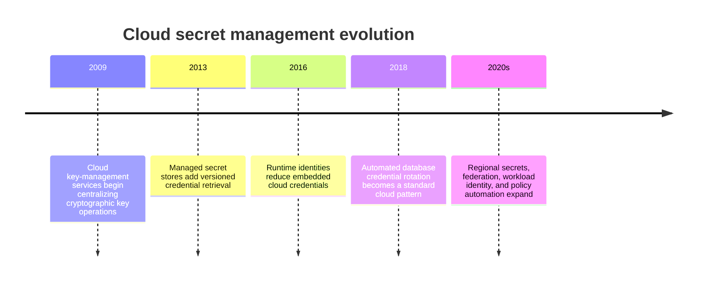
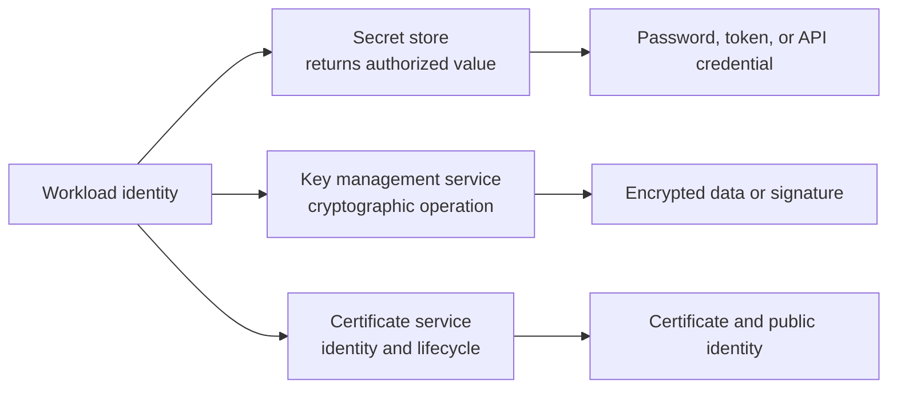
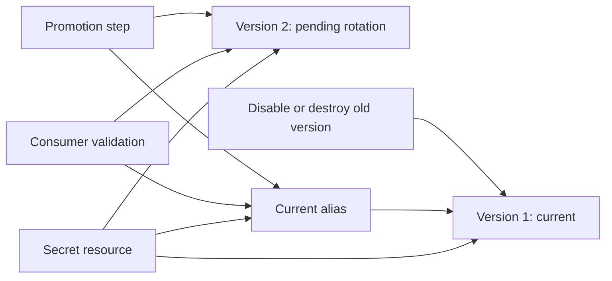
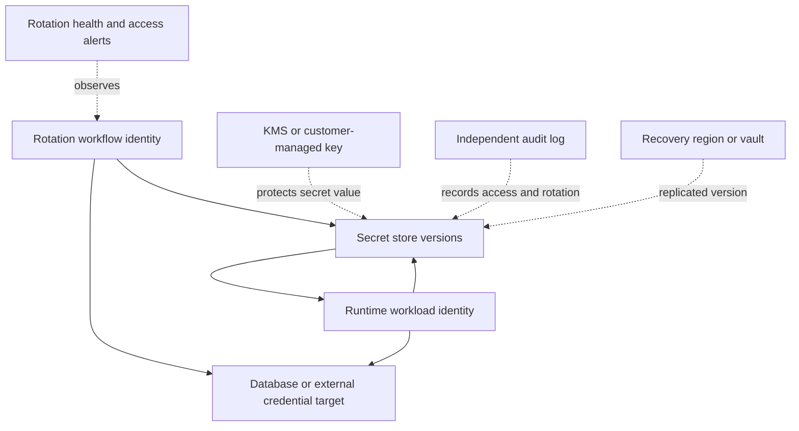

# Chapter: Cloud Secrets Management

Part: [09 — Cloud Computing](PART_OVERVIEW.md) · Status: Drafted

## 1. Introduction

Cloud secrets services store sensitive values such as database passwords, application programming interface (API) tokens, service credentials, and certificates, then control how workloads retrieve and rotate them. They reduce hard-coded credentials but create a runtime dependency on identity, network reachability, secret version state, encryption keys, and availability.

This chapter focuses on managed secret stores across Amazon Web Services (AWS), Microsoft Azure, and Google Cloud Platform (GCP): secret versions, access policy, workload retrieval, rotation, caching, replication, audit, and recovery. Part 05 Certificates owns Public Key Infrastructure (PKI) and certificate lifecycle mechanics; Part 09 IAM owns identity and authorization; key management services protect cryptographic keys and are distinct from storing secret values.

## 2. Historical Evolution

Applications once commonly stored database passwords in configuration files, deployment scripts, or environment variables managed outside a central lifecycle. As cloud workloads became elastic and distributed, secrets services added access policies, versioning, audit events, automated rotation integrations, replication, and runtime identity. The goal shifted from “hide the password” to “control its lifecycle, access, use, and replacement.”

Secret stores and key-management systems solve related but distinct problems. A secret store protects and serves values to authorized workloads; a key-management service performs cryptographic operations and controls key custody. Some products combine resource types under one vault while retaining separate APIs and permissions.

## 3. Why It Exists

Secrets are credentials and other values that grant access or expose sensitive configuration. If copied into source control, images, logs, or tickets, they can be retained and reused long after the original deployment. Centralized stores make access revocable and auditable, enable versioning and rotation, and keep secret material out of application artifacts.

Centralization does not eliminate risk. A compromised workload identity may still read every secret it can access; an unavailable secrets endpoint can block new instances or credential refresh; and a rotation process can break clients if the consumer is not prepared for the new value. Secret-management architecture must include the reader, issuer, target system, propagation delay, cache policy, audit, and rollback path.

## 4. Core Concepts

### 4.1 Secret values, cryptographic keys, and certificates

**Definition.** A secret value is sensitive data that an authorized application can retrieve, such as a password, token, or API key. A cryptographic key is material used to encrypt, decrypt, sign, or verify data and may be non-exportable. A certificate binds a public key to an identity and has issuance, validation, renewal, and revocation semantics. These resource classes can share a vault product but require different usage and lifecycle controls.

**Mechanism.** A secret store encrypts a value at rest and returns it over an authenticated channel to an authorized principal. A key management service (KMS) may instead perform encryption or signing without revealing the key bytes. Certificate services can issue, import, store, or renew certificate objects depending on provider features. A workload often needs a secret-value API for credentials, a key API for envelope encryption, and a certificate service for transport identity.

**Decision implications.** Use a secret store for runtime credentials, a key-management service for cryptographic operations, and a certificate authority or certificate manager for certificate issuance and renewal. Avoid placing non-exportable key material into a generic secret store when a key service can perform the operation directly.

**Common failure mode.** Teams store an encryption key as an ordinary secret, distribute it to application instances, and lose the audit and non-exportability benefits of a managed key service. Another failure is assuming a certificate stored in a vault is automatically renewed and deployed to every consumer.

**Scenario.** A service reads a database password from a secret store at startup, asks a key-management service to unwrap a data key, and presents a Transport Layer Security (TLS) certificate issued through a certificate lifecycle service. Each identity receives only the operation needed for its role.

### 4.2 Secret versions, aliases, and retrieval

A secret is a named resource with one or more versions. New versions can represent credential rotation or configuration change; version labels or aliases may point consumers to a current version. Retrieving “latest” differs from pinning a specific version: aliases ease rotation but can change without an application deployment, while pinned versions improve reproducibility but require explicit rollout.

Define whether consumers fetch by alias or explicit version, how they cache values, and how rollback selects a previous version. Version history is useful only if old values remain valid and access to historical versions is governed.

### 4.3 Workload identity and secret access

Secret retrieval should use a workload identity rather than a shared static cloud credential wherever supported. Cloud IAM grants that identity access to named secret resources or versions. Authentication and authorization are separate: the runtime must obtain a valid principal, and the secret service must authorize the requested read.

Scope access by workload and secret, separate secret administration from consumption, and audit each access. The IAM chapter owns role and federation mechanics; this chapter defines the secret-store access pattern. Do not inject a broad vault administrator role into every service.

### 4.4 Rotation as a coordinated state machine

Rotation changes a secret value and updates every system that validates or consumes it. A safe process has states: prepare a new credential, store a pending version, validate it against the target, move the consumer, confirm success, revoke the old credential, and retain a bounded rollback period. A one-step overwrite can invalidate consumers that have cached the old value.

```mermaid
stateDiagram-v2
    [*] --> ActiveOld
    ActiveOld --> NewPrepared: create new target credential
    NewPrepared --> PendingVersion: store pending secret version
    PendingVersion --> Validate: test target and consumer access
    Validate --> Promote: validation succeeds
    Validate --> ActiveOld: validation fails; discard pending version
    Promote --> Observe: move consumers to new version
    Observe --> RetireOld: healthy through observation window
    Observe --> Rollback: consumer errors or auth failures
    Rollback --> ActiveOld: restore old version and target credential
    RetireOld --> [*]: revoke old credential
```

**Decision implications.** Use overlapping credentials when the target permits them; otherwise coordinate a maintenance window or dual-user pattern. Define the observation period, rollback authority, stale-client handling, and revocation deadline. Automated rotation is only safe when every consumer can discover and adopt the new value.

**Common failure mode.** The target credential changes, but long-lived application instances continue using cached credentials. Rotation succeeds in the vault and fails in production because the consumers never refreshed or were not all updated.

**Scenario.** A database supports two application users. A rotation job creates a password for the inactive user, stores a pending version, runs a connectivity check, promotes the version, and waits for application health before disabling the previous user.

### 4.5 Caching, refresh, and secret exposure

Repeated secret lookups can add latency and service cost. A local cache reduces requests but increases staleness and secret-exposure duration. Cache behavior needs a maximum age, refresh jitter, error policy, memory protection, and a response to secret revocation. Never emit secret values in logs or traces.

Choose refresh timing based on rotation frequency, credential validity, service outage behavior, and connection-pool lifetime. A startup-only fetch may be simple but can prevent rapid revocation; fetching on every request may add latency and dependency pressure. Use bounded caching with an explicit security rationale.

### 4.6 Rotation automation and target coordination

Automated rotation can use provider-managed workflows, functions, or custom jobs. The rotation actor needs access to the secret store and the target system, while runtime consumers need read access only. Separate these identities and make rotation observable with a unique operation identifier.

The target must support a safe credential update strategy. Database dual users, API key overlap windows, and staged certificate deployment differ in how they avoid interruption. If no overlap is possible, use a coordinated maintenance window. Test rollback before automating rotation.

### 4.7 Secret replication, availability, and residency

Secret stores may replicate values across regions automatically, under customer-selected policy, or not at all. Replication improves availability but can cross a data-residency boundary and may have asynchronous propagation. Regional services can keep values local while requiring a separate failover process.

Verify the service's replication model, consistency, failover behavior, and billing. Ensure the target credential remains valid in the recovery region and that the recovery workload identity can access the replicated secret. A secret available globally is not useful if the target service or identity provider is unavailable.

### 4.8 Encryption at rest, customer keys, and service boundaries

Providers encrypt secret values at rest and in transit. Some services allow a customer-managed encryption key; that adds a key-service permission and availability dependency. The secret store and key-management service remain distinct: revoking the key can make secret versions inaccessible even though they remain stored.

Choose provider-managed encryption when it satisfies policy; use customer-managed keys for explicit custody, audit, or separation requirements. Document key rotation, key disablement, recovery, and the effects of a key-service outage on secret retrieval.

### 4.9 Audit, version lifecycle, and deletion

Audit records should show who created, accessed, changed, disabled, or destroyed a secret version, subject to provider service support. Retention and deletion controls determine whether a compromised value can be recovered, whether an old value remains usable, and how long sensitive history persists.

Use version labels or aliases for controlled promotion, disable obsolete versions before destruction when rollback is required, and set deletion protection or recovery windows for critical resources. Ensure security logs are stored independently from the identities that administer the secret store.

### 4.10 Cloud secrets service selection

Select a managed service by secret type, versioning, rotation integration, identity support, replication, region support, audit, access policy, network path, and cost. AWS Secrets Manager, Azure Key Vault, and Google Cloud Secret Manager overlap but differ in resource models, key integrations, replication configuration, and rotation workflows.

Keep application configuration separate from secret values where practical. Do not use a secret store as a general high-volume configuration database or as a substitute for a key-management service. Document retrieval volume, caching, refresh, rotation, deletion, and recovery in the decision record.

## 5. Internal Working

A workload obtains a cloud identity, calls the secret service over an authenticated endpoint, and requests a secret resource and version. The service evaluates IAM and resource policy, checks version state and encryption-key access, records an audit event, and returns the value over an encrypted connection. The application then uses the value to authenticate to its dependency.

Rotation adds a control workflow: a rotation actor creates or changes a target credential, writes a pending secret version, validates access, promotes the version, and eventually retires the old value. Target systems, consumers, caches, and the secret service may update at different times; the rotation state machine must account for that propagation.

## 6. Design Principles

- Keep secret values out of source, images, logs, and ordinary configuration stores.
- Use workload identity and narrow secret-level access.
- Separate secret administration, rotation, consumption, and audit roles.
- Version values and define consumer rollout behavior.
- Coordinate rotation with the target system and every consumer.
- Bound caches and choose a revocation response deliberately.
- Treat replication, encryption keys, and identity as recovery dependencies.
- Audit reads and changes without logging the secret value.
- Distinguish secret stores, key-management services, and certificate authorities.

## 7. Architecture Patterns

**Runtime retrieval.** A workload identity reads a named secret at startup or refresh time; the application keeps the value only in memory for a bounded period.

**Dual-credential rotation.** A rotation actor creates a new target credential while the old one remains valid, verifies consumers, then revokes the old credential.

**Federated automation.** A deployment system exchanges an external workload identity for short-lived cloud access and reads only the secrets required for deployment.

**Regional recovery.** A recovery workload accesses a regionally available secret version and corresponding target credential after residency and replication policy are verified.

## 8. Production Architecture

Production readiness includes rotation ownership, target overlap behavior, consumer refresh, key access, deletion protection, regional recovery, secret read quotas, and audit retention. Avoid a single shared rotation identity that can administer every application secret.

## 9. Implementation

1. Inventory credentials, owners, target systems, consumers, and expiration requirements.
2. Choose a managed secret store and separate it from key-management and certificate services.
3. Assign workload identities and secret-level read permissions.
4. Remove hard-coded values from source, images, and deployment variables.
5. Define version aliases, cache age, refresh behavior, and revocation response.
6. Automate rotation with distinct target and vault permissions.
7. Enable audit and alerts for access, changes, failed rotation, and key dependency.
8. Test outage, rollback, recovery-region access, and consumer adoption.

## 10. Complete Code Examples

- [Secret rotation window and expiry checker](../code/python/secrets-chapter/01_rotation_window.py)
- [Secret access policy analyzer](../code/python/secrets-chapter/02_access_policy.py)
- [Cache staleness and refresh planner](../code/python/secrets-chapter/03_cache_refresh.py)
- [Secret replication and residency checker](../code/python/secrets-chapter/04_replication_residency.py)

The examples use synthetic metadata and Python's standard library. They do not retrieve or print real secrets or call cloud APIs.

## 11. Performance

Secret retrieval adds network latency and service dependency to application startup or refresh. Measure lookup latency, token acquisition, cache hit rate, rotation propagation, and service throttling. Avoid synchronous secret retrieval for every application request unless the security model requires it.

Use bounded local caches with refresh jitter to avoid synchronized refresh storms. Ensure cache duration does not defeat revocation requirements, and test cold-start behavior when many instances start together.

## 12. Scalability

Secret services scale with secret count, version count, request rate, rotation frequency, and client concurrency. Large fleets can create a synchronized read spike at deployment or restart. Rotation workflows can also overload target databases if many credentials change simultaneously.

Use staged refresh, caching, request quotas, and controlled rotation waves. Monitor per-secret access patterns and remove unused secrets. Keep version proliferation and replication costs bounded by retention policy.

## 13. Security

Use least privilege, short-lived workload identity, encrypted transport, audit logging, and separation of duties. Restrict access to current secret versions and avoid broad vault-wide administrator grants for runtime identities. Protect rotation code and build systems because they often have write access to both the target and the secret store.

Secret values and cryptographic keys have different access models. Customer-managed keys create a dependency that can deny access to all protected versions if disabled or misconfigured. Do not log values, environment dumps, or complete connection strings.

## 14. Observability

Monitor secret reads, access denials, version changes, rotation attempts, target authentication failures, key-service errors, replication status, and rotation age. Alert on a secret approaching expiry, failed rotation, unusual read volume, disabled audit logs, or public policy changes.

Correlate rotation operation IDs with target-side audit events and application health. Avoid including secret values in telemetry. Track whether every consumer has adopted the intended version, not just whether the vault's version label moved.

## 15. Failure Scenarios

| Failure | Likely symptom | Architectural response |
|---|---|---|
| Secret service unavailable | New instances cannot retrieve credentials | Use bounded cache, restore endpoint access, and avoid unsafe fallback values |
| Rotation target update fails | Pending secret does not authenticate | Keep old credential active, abort promotion, and investigate target response |
| Consumer cache stale | Authentication failures after rotation | Refresh with jitter, observe adoption, and retain bounded overlap |
| Identity denied | Secret read fails despite service health | Inspect principal, resource policy, inherited scope, and key access |
| Encryption key unavailable | Stored secret cannot be decrypted | Restore key permissions and key-service availability through recovery plan |
| Secret replicated to wrong region | Residency or policy violation | Stop replication, restrict access, and follow data incident process |
| Old credential not revoked | Compromised value remains usable | Revoke after confirmed adoption and audit all prior uses |
| Rotation storm | Target service rejects many simultaneous changes | Stagger rotations and cap concurrent workflows |

Recovery must preserve both a valid target credential and a path for authorized workloads to retrieve it. A secret backup that cannot be decrypted or accessed by the recovery identity is not operationally useful.

## 16. Testing

Test rotation from old to pending to current, including failed target update, consumer adoption, rollback, and old-credential revocation. Verify every workload identity can read only intended secret versions. Simulate secret-service and key-service outages during startup and refresh.

Audit that logs never contain secret values. Test version deletion recovery windows, replication policy, residency, and recovery-region access. Load-test synchronized cold starts and secret refresh to validate quotas and caching.

## 17. Common Mistakes

- Putting secrets in source control, container images, or plaintext environment files.
- Rotating a vault value without updating or validating the target credential.
- Using one broad identity for all secret reads and writes.
- Treating version aliases as proof every consumer has refreshed.
- Caching indefinitely and defeating revocation.
- Confusing key-management services with secret-value stores.
- Logging full connection strings or secret payloads during troubleshooting.
- Replicating secrets across regions without checking residency and access policy.

## 18. Best Practices

- Use managed workload identity for retrieval and separate rotation identity for writes.
- Scope secret access by application and version where supported.
- Use overlapping credentials or controlled maintenance windows for rotation.
- Set bounded refresh and cache policies with jitter.
- Enable audit logs and alerts on access, rotation, policy, and replication changes.
- Protect backup and key dependencies from the same failure domain.
- Use secret expiration metadata and owners to drive review.
- Test recovery and revocation regularly.

## 19. Anti-Patterns

**Secret in source control.** The value may persist in history and clones after deletion. Revoke it, rotate affected credentials, and remove it from future distribution.

**Vault as configuration database.** High-volume non-sensitive settings can increase read cost and couple every application change to secret-service availability. Use a configuration service for ordinary parameters.

**Rotate without coordination.** Changing the stored value while the target still expects the old credential, or vice versa, causes outages. Rotation is a distributed state transition, not a single API update.

**One vault administrator for every workload.** Shared administrative access makes attribution and blast-radius containment difficult. Split duties and scope by application or environment.

## 20. Trade-off Analysis

| Decision | Benefits | Costs and risks | Choose when |
|---|---|---|---|
| Provider-managed encryption key | Simple setup and service integration | Less direct key custody control | Default encryption meets policy |
| Customer-managed key | Explicit key governance and audit | Key availability and permission dependency | Regulation or separation of duties requires it |
| Runtime secret fetch | Central revocation and rotation | Startup dependency and request cost | Workload can handle retrieval and cache policy |
| Local cache | Lower latency and service load | Stale value and slower revocation | Bounded staleness is acceptable |
| Automatic rotation | Reduced manual credential age | Target integration and rollout complexity | Target supports safe coordinated rotation |
| Global replication | Cross-region availability | Residency, propagation, and cost considerations | Data policy permits copies and recovery needs them |

## 21. Comparison Table

| Dimension | AWS Secrets Manager | Azure Key Vault | Google Cloud Secret Manager |
|---|---|---|---|
| Secret values | Versioned secrets and rotation integrations | Versioned secrets in vaults | Secret resources with versioned payloads |
| Cryptographic keys | AWS Key Management Service (KMS) integration | Keys and secrets in Key Vault; Hardware Security Module (HSM) tiers | Cloud Key Management Service (KMS) integration |
| Workload access | AWS IAM and resource policies | Microsoft Entra ID and Azure role/access policies | Google Cloud IAM and workload identity |
| Rotation | Lambda/custom rotation workflows | Event-driven/custom rotation patterns | Rotation schedules and event integrations |
| Regional model | Regional secret resources and replication options | Regional vault with service replication options | Global or regional Secret Manager service options |

Provider features and replication semantics differ. Distinguish storing a secret from invoking cryptographic operations, and verify version, access, rotation, and residency behavior in the chosen region.

## 22. Real-World Case Study

### Dual-user database credential rotation

AWS documents a rotation pattern for database credentials that alternates between two database users. A rotation workflow creates or updates the inactive user's credential, stores a pending secret version, tests connectivity, promotes the version, and later rotates the other user. This is a published provider-supported pattern rather than a claim about a specific customer's deployment.

The pattern creates an overlap window so existing connections can use the previous credential while new clients adopt the new one. It also makes the target database and secret store part of one coordinated lifecycle. The application still needs bounded caching, connection-pool refresh, and telemetry that reveals which credential version is in use without exposing the value.

The design fits targets that can maintain two valid principals. For a single-credential system, rotation may require a maintenance window or a service-specific extension. Teams should rehearse target failure, secret promotion rollback, client adoption, and old-credential revocation before enabling automatic rotation.

## 23. Interview Questions

1. How do secret management and key management differ?
2. What is the safe state sequence for rotating a database credential?
3. Why can a secret alias change while clients still use an old value?
4. How does caching improve availability and complicate revocation?
5. What identity should retrieve secrets at runtime versus rotate them?
6. How do replication and customer-managed encryption keys affect recovery?
7. What telemetry proves a rotation reached all consumers without exposing the secret?
8. When is a configuration service more appropriate than a secret store?

## 24. Hands-on Exercises

1. Run the rotation-window checker with short and long consumer cache lifetimes.
2. Run the access analyzer with a vault-wide read grant and narrow it to one secret.
3. Run the cache planner with different refresh periods and revocation objectives.
4. Run the replication checker with a region outside the allowed residency set.

## 25. Design Exercises

1. Design rotation for a database that supports overlapping credentials and an application with long-lived connection pools.
2. Design cloud access for a CI pipeline that needs one deploy-time token but no production database password.
3. Design secret-store recovery when the primary region or customer-managed key is unavailable.
4. Review a service that injects secrets as environment variables at startup and propose a refresh and revocation strategy.

## 26. Architecture Review Questions

- Are secrets, cryptographic keys, and certificates stored and managed by appropriate services?
- Are runtime and rotation identities separate and least-privileged?
- Does rotation coordinate the target system, secret version, cache, and consumers?
- Are secret versions, aliases, deletion windows, and rollback owners documented?
- Are caches bounded by both availability and revocation requirements?
- Are key availability, replication, data residency, and recovery dependencies understood?
- Are access, version changes, policy changes, and rotation failures audited?
- Can a compromised credential be revoked without relying on the compromised identity?

## 27. Summary

Cloud secret stores centralize credential values, versioning, access, audit, and rotation, but they add identity, network, key, and availability dependencies. Treat rotation as a coordinated state machine across the target and all consumers; use workload identity, bounded caches, separate key-management services, and tested recovery paths. A stored new value is not a completed rotation until workloads have adopted it and the old credential has been safely retired.

Further reading: [AWS Architecture](CH01_AWS.md), [Microsoft Azure Architecture](CH02_Azure.md), [Google Cloud Platform Architecture](CH03_GCP.md), [IAM](CH09_IAM.md), and [Certificates](../05_Networking_and_OS/CH15_Certificates.md).
