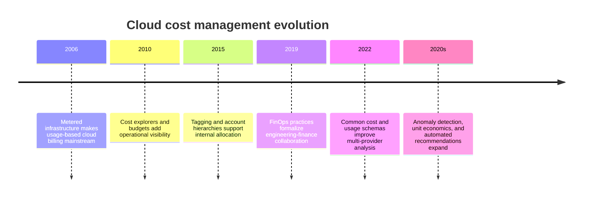
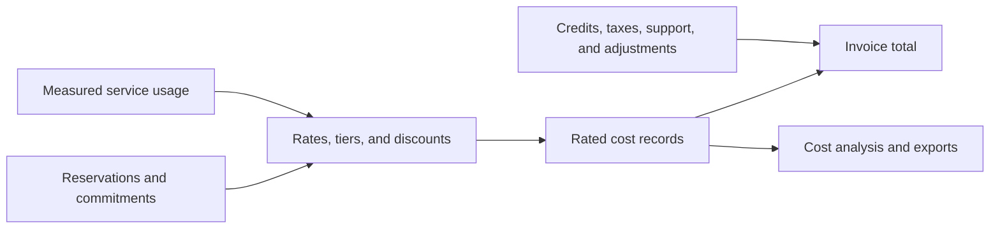
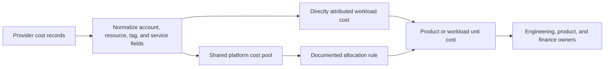
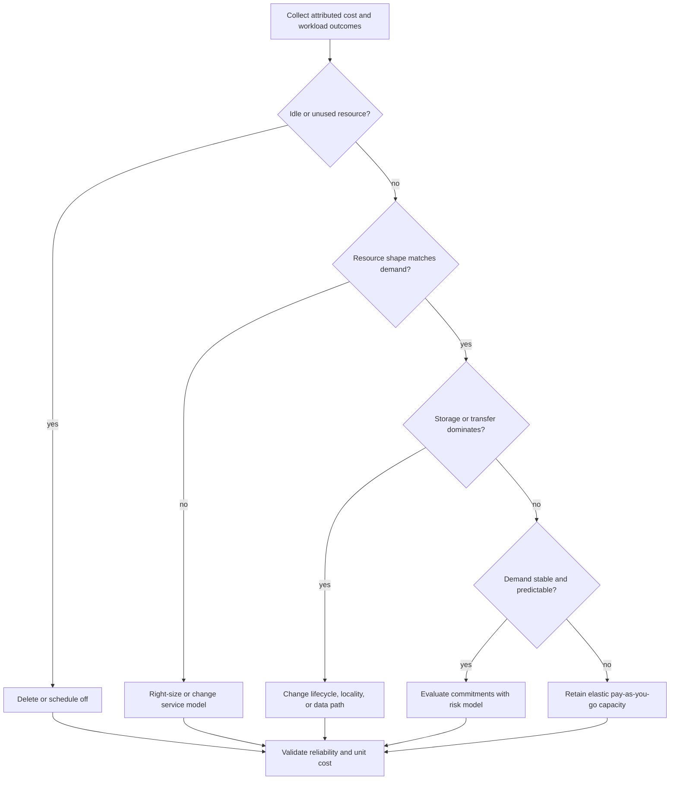
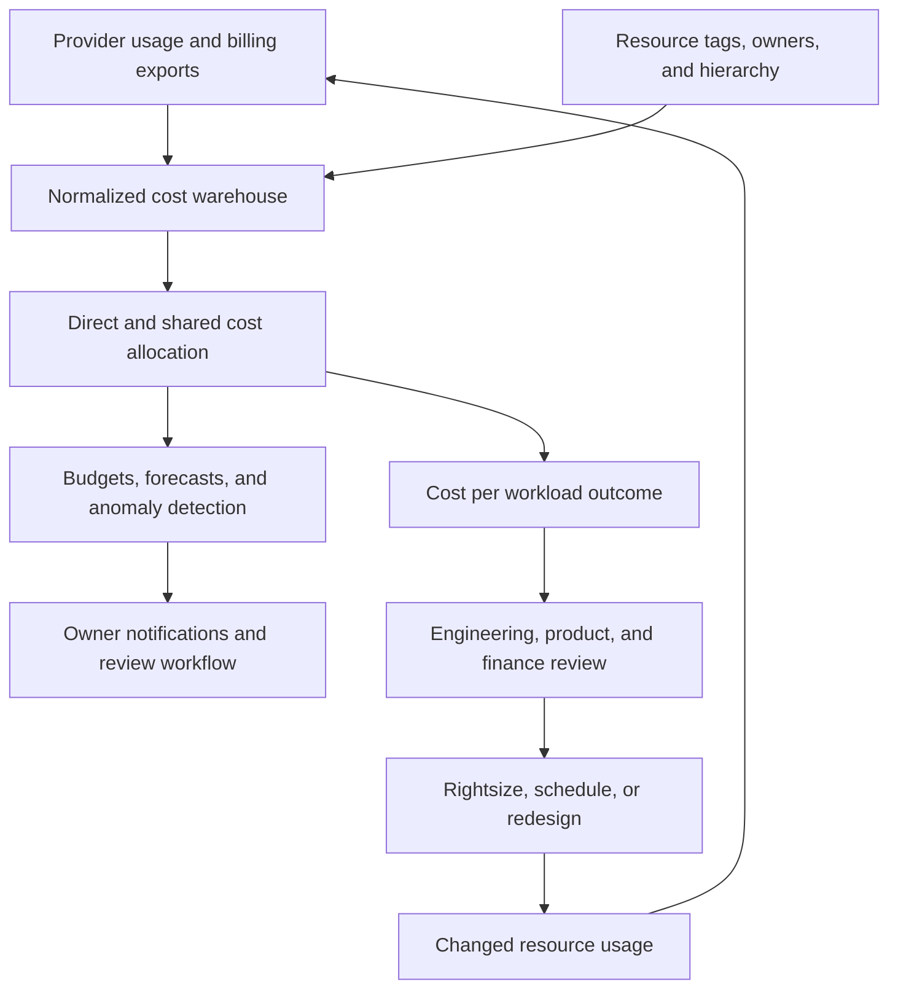

# Chapter: Cloud Cost Optimization

Part: [09 — Cloud Computing](PART_OVERVIEW.md) · Status: Drafted

## 1. Introduction

Cloud cost optimization is the architecture and operating discipline of aligning infrastructure spending with workload value, reliability, and performance requirements. It involves more than finding idle virtual machines: data acquisition, pricing dimensions, account ownership, shared services, commitments, storage lifecycle, network transfer, and application behavior all shape the bill.

This chapter focuses on cloud infrastructure cost: usage and billing data, allocation, budgets, forecasting, commitments, rightsizing, autoscaling, storage, data transfer, and unit economics across Amazon Web Services (AWS), Microsoft Azure, and Google Cloud Platform (GCP). Part 02 Pricing owns commercial pricing models for products and Software as a Service (SaaS); Part 11 owns the AWS Well-Architected Framework and its cost pillar. This chapter supplies the cross-provider cost-management methods and provider tool boundaries.

## 2. Historical Evolution

Cloud billing began as a metered alternative to capital purchases: usage was recorded and charged by time, quantity, or request. As organizations adopted multiple accounts, managed platforms, and data services, the challenge shifted from reading one invoice to allocating shared costs, forecasting variable usage, optimizing commitments, and connecting spend to business outcomes. Financial Operations (FinOps) emerged as a cross-functional practice that links engineering decisions with finance and product value.

The tooling has improved, but the central problem remains organizational: teams need trustworthy cost data, ownership, and authority to change the architecture that drives spend.

## 3. Why It Exists

Cloud consumption can grow faster than a periodic invoice reveals. Autoscaling, request-based services, data transfer, log ingestion, and forgotten environments can create spending that is difficult to attribute. Conversely, aggressive cost reduction can degrade resilience, security, or performance if it removes needed capacity or retention.

Cost optimization makes economic consequences visible during architecture decisions. It asks who benefits from a resource, which workload requirement it satisfies, how its cost changes with demand, and whether a cheaper operating model preserves the required service quality. A good cost model is therefore connected to workload metrics and business outcomes, not just resource inventory.

## 4. Core Concepts

### 4.1 Usage, rated cost, and invoice cost

**Definition.** Usage data records measured consumption, such as instance-hours, requests, storage, or data transfer. Rated cost applies a price and discount model to that usage. Invoice cost includes billing-period adjustments such as credits, taxes, support, marketplace purchases, and contractual terms. These data views can differ in timing and scope.

**Mechanism.** A provider collects service usage at service-specific intervals, applies rates, discounts, and commitments, then publishes cost data to analysis and billing systems. Some records arrive later than others; credits and taxes may be applied only at invoice generation. Therefore, a live cost dashboard is an operational estimate, not always the final bill.

**Decision implications.** Use near-real-time cost data for anomaly detection and optimization; use invoices and billing exports for reconciliation and finance close. Record data freshness and known exclusions in dashboards. Part 02 Pricing owns market and product pricing; this chapter focuses on consumption billing.

**Common failure mode.** An engineering dashboard is treated as the final amount due even though credits, late-arriving usage, marketplace charges, or support costs are absent. Another failure is comparing raw usage quantities across services without normalizing their price units.

**Scenario.** A team sees a mid-month compute-cost spike and uses usage records to find an autoscaling change. Finance later reconciles the period using invoice data that includes a negotiated discount and a support charge not present in the operational estimate.

### 4.2 Cost scope and ownership boundaries

Cloud providers attach charges to resources, accounts, subscriptions, projects, billing profiles, or other scopes. Organizational structure can simplify charge attribution, but no one hierarchy fits every company. Shared networking, security, observability, and data platforms create costs that must be allocated to the workloads they support.

Align scopes to ownership, environment, lifecycle, and reporting needs. Tags or labels add business context but may be missing, mutable, or unsupported on some charges. Establish fallback allocation rules for untagged usage and report the portion that cannot be attributed confidently.

### 4.3 Allocation, showback, and chargeback

Allocation maps provider charges to teams, applications, environments, or products. Showback reports costs to owners; chargeback transfers those costs into internal budgets or accounting. Shared platform costs may be split by measured consumption, reserved capacity, user count, or another disclosed rule.

Define tag/label standards, inheritance, ownership validation, and allocation policy. Keep actual provider charges separate from internal transfer pricing so teams can distinguish invoice cost from management allocation. Review allocation changes because moving a subscription or changing a tag can rewrite historical reporting in some tools.

### 4.4 Unit economics and cost per outcome

Unit economics expresses infrastructure spend relative to delivered workload value: cost per request, transaction, active user, report, image, or business event. The denominator must be meaningful and stable. Cost per compute hour can improve while cost per successful transaction worsens if retries or failures rise.

**Mechanism.** Attribute spend to a workload and divide it by an outcome measure over the same period and scope. Include shared costs and data transfer where material. Compare unit cost alongside latency, availability, error rate, and data quality so cost reduction does not reward lower service quality.

**Decision implications.** Select a denominator that product and engineering owners can influence and explain. Use cost-per-successful-operation rather than only per-request when failed requests still consume resources. Segment by customer tier or workload class only when it informs decisions and does not create excessive metric cardinality.

**Common failure mode.** Optimizing a cost metric while ignoring value or reliability—for example, scaling down workers and reducing spend while increasing queue delay beyond the customer objective.

**Scenario.** An image-processing service reports cost per successfully transformed image, split by image-size class. A memory adjustment increases per-instance price but reduces retries and processing time, lowering total cost per successful output.

### 4.5 Budgets, forecasts, and anomaly detection

A budget is a threshold or plan for a defined scope and period; a forecast estimates future spend from observed and expected usage. An anomaly detector flags behavior unlike a baseline. These mechanisms serve different purposes: budgets are policy signals, forecasts support planning, and anomaly alerts detect unusual change.

Configure alerts at scopes with named owners, use forecast thresholds for committed programs, and route high-confidence anomalies to responders with usage context. Do not assume an alert stops spending unless an explicit, safe action is attached. Cost records may be delayed, so alert latency and data freshness are part of the control design.

### 4.6 Optimization levers and decision sequence

Cost can be reduced through demand elimination, resource rightsizing, scheduling, autoscaling, service-model changes, storage lifecycle, data-transfer reduction, and purchase commitments. Start by removing waste and correcting architecture; only then commit to long-term pricing for stable demand.

Every optimization should have an owner, expected savings range, reliability impact, rollback plan, and measurement period. Avoid deleting resources based only on low utilization if they are a failover reserve, backup, or security control.

### 4.7 Commitments, reservations, and discount risk

Providers offer commitments, reservations, savings plans, or committed-use discounts that reduce effective rates in exchange for term, scope, or usage commitment. Benefits depend on matching actual usage to eligible services, regions, and families. Unused commitments can waste spend and limit flexibility.

Model stable baseline consumption separately from variable and experimental demand. Compare pay-as-you-go cost, commitment utilization, coverage, expiry, and break-even utilization. Treat capacity reservations and billing discounts as separate products unless the provider contract explicitly combines them.

### 4.8 Network and data-transfer economics

Cloud networking charges can include data egress, inter-region transfer, inter-zone traffic, gateway processing, NAT capacity, private endpoints, and load-balancing. The bill may not align with the application boundary that generated the traffic. Cross-provider transfer adds both cost and operational complexity.

Trace bytes by source, destination, region, and service. Place compute near high-volume data when residency and availability permit; use caching or compression where it reduces total cost without creating stale-data or security problems. The Networking and Storage chapters own the architecture mechanics; this chapter focuses on their cost consequences.

### 4.9 Storage, observability, and shared-service costs

Storage cost includes capacity, requests, retrieval, replication, backup, snapshots, and egress. Monitoring cost includes telemetry ingestion, metric cardinality, query scans, retention, and export. Shared security, connectivity, and platform services may not map directly to one workload and need transparent allocation.

Use lifecycle policy based on access history and recovery objectives. Sample or filter telemetry according to diagnostic needs, not by deleting audit evidence indiscriminately. Attribute shared costs with a published allocation rule and revisit it when usage patterns change.

### 4.10 Cloud cost governance and service selection

Cost governance assigns who can create expensive resources, which guardrails apply, how budgets are reviewed, and how exceptions are approved. Preventive controls can enforce allowed regions or resource families; detective controls identify anomalies and drift; corrective controls require owners and rollback safeguards.

Select services with total cost of ownership (TCO) in mind: compute, storage, transfer, operations, support, licensing, commitments, and exit. Provider calculators estimate cost only when workload assumptions are accurate. Compare costs alongside availability, performance, security, and team operating capacity.

## 5. Internal Working

A provider cost pipeline begins with metered resource usage and purchase records. Pricing systems apply rates, tiers, and commitment benefits; billing systems aggregate records into accounts and invoices; cost-management tools expose usage, forecasts, budgets, and exports. The data may refresh on a different cadence from service telemetry, and final invoice values can include later adjustments.

Organizations often export detailed cost records to a warehouse for allocation and unit-economics analysis. Normalization maps provider-specific dimensions into a shared schema, joins resource metadata and owners, applies shared-cost rules, then publishes reports and alerts. Versioning the allocation logic matters because changing a tag rule or hierarchy can alter historical attribution.

## 6. Design Principles

- Make cost visible to the teams that can change the architecture.
- Separate usage, rated cost, invoice cost, and internal allocation.
- Track cost with reliability and performance outcomes.
- Remove waste before committing to long-term discounts.
- Use budgets and anomaly alerts with named owners and response paths.
- Attribute shared platform spend transparently.
- Include data transfer, retention, requests, and support in estimates.
- Treat commitments as financial risk with utilization targets.
- Re-measure savings after changes and revert harmful optimizations.

## 7. Architecture Patterns

**Cost data export pipeline.** Provider billing exports flow to a central warehouse, normalize dimensions, apply ownership mapping, and publish reports by team and workload.

**Tag and label governance.** Infrastructure templates require owner, application, environment, and cost-center metadata; policy reports missing or invalid values.

**Shared-cost allocation.** Network, logging, and security platform charges are split by measurable usage or a published proxy rather than hidden in an unlabeled central account.

**Commitment coverage review.** A recurring review compares eligible baseline usage, commitment utilization, expiry, and workload changes before purchasing or renewing discounts.

## 8. Production Architecture

Production readiness includes data freshness, tag coverage, allocation ownership, anomaly routes, commitment risk review, and safeguards around automatic corrective actions.

## 9. Implementation

1. Identify billing scopes, workload owners, and the decisions cost data should support.
2. Enable detailed exports and record their refresh, retention, and access policy.
3. Standardize tags/labels and validate them in infrastructure deployment pipelines.
4. Allocate direct and shared costs with documented, versioned rules.
5. Define budgets, forecasts, anomaly thresholds, owners, and response actions.
6. Calculate unit cost alongside availability, latency, and success outcomes.
7. Evaluate rightsizing, scheduling, lifecycle, transfer, and commitment opportunities.
8. Measure realized savings and service-quality impact after each change.

## 10. Complete Code Examples

- [Cloud cost allocation and unit-cost calculator](../code/python/cost-optimization-chapter/01_unit_cost.py)
- [Budget and forecast alert checker](../code/python/cost-optimization-chapter/02_budget_forecast.py)
- [Commitment utilization and break-even analyzer](../code/python/cost-optimization-chapter/03_commitment_break_even.py)
- [Idle-resource and rightsizing opportunity scanner](../code/python/cost-optimization-chapter/04_rightsizing.py)

The examples use synthetic usage and normalized cost units. They do not call provider APIs or encode current pricing; use provider calculators and billing exports for real decisions.

## 11. Performance

Cost and performance interact through resource shape, concurrency, caching, placement, and managed-service tier. A smaller instance can increase latency or replica count; a higher-tier database may reduce retry and query cost; a cache can lower database load but add consistency and invalidation work.

Measure cost per successful outcome together with latency percentiles and availability. Avoid trading reliability for nominal resource savings unless the business explicitly accepts the resulting service level.

## 12. Scalability

Variable demand makes cost forecasting difficult. Autoscaling can reduce idle spend but may increase cost rapidly during bursts or failure loops. Capacity limits, queue buffering, and concurrency controls bound both downstream impact and spending.

Forecast from request volume, duration, data growth, and seasonal patterns. Test scale-to-zero and scale-out behavior, including cold starts, minimum replicas, and failover capacity. Budget for exceptional events and recovery regions instead of assuming average traffic.

## 13. Security

Billing exports reveal architecture, usage patterns, and business activity. Restrict access to billing data, protect cost warehouses, and ensure tags do not contain sensitive information. Cost controls should not weaken security by disabling logs, shortening mandated retention, or removing backup copies without review.

Automatic remediation can stop or delete resources, so scope permissions narrowly and require approvals for actions that affect production availability or data retention. Audit budget and policy changes.

## 14. Observability

Monitor spend, usage, budget variance, commitment utilization, tag coverage, export freshness, anomaly alerts, and cost per business outcome. Correlate cost changes with deployments, traffic, incidents, and architecture decisions. Track forecast accuracy so teams know when projections are systematically biased.

Alerts should identify owner, scope, likely driver, and next action. A cost anomaly without resource attribution or a response owner becomes noise rather than a control.

## 15. Failure Scenarios

| Failure | Likely symptom | Architectural response |
|---|---|---|
| Cost export delayed | Dashboard differs from current usage | Show data freshness and use service telemetry for immediate signals |
| Missing tags | Spend cannot be assigned | Enforce metadata at provisioning and report unallocated cost |
| Unexpected egress | Cost spike without resource growth | Trace destinations, regions, and replication paths |
| Commitment underutilized | Discount does not offset purchase | Adjust future commitments and re-evaluate workload baseline |
| Autoscaling storm | Spend and dependency load rise sharply | Cap concurrency, stop bad deployment, and preserve recovery capacity |
| Shared cost disputes | Teams reject allocation | Publish and version the split rule with measured drivers |
| Budget action disables production | Cost control creates outage | Require guarded approval for destructive remediation |
| Archive retrieval spike | Restore bill and latency increase | Review lifecycle assumptions and maintain an appropriate recovery tier |

Cost incidents need both financial and technical response. Stop unintended usage safely, preserve evidence, and ensure the corrective action does not delete data or undermine security controls.

## 16. Testing

Validate billing exports against invoices, test tag/label coverage, and reconcile allocation totals. Simulate budget alerts and anomaly thresholds using historical data. Test cost guardrails in audit mode before enforcement and verify their effect on production deployment paths.

Run commitment scenarios with lower-than-forecast usage, workload migration, region changes, and early termination. Measure realized savings after a rightsizing or storage-lifecycle change and check latency, availability, and recovery outcomes.

## 17. Common Mistakes

- Treating cost explorer totals as final invoice values.
- Comparing unit prices without matching billing units or discounts.
- Optimizing compute while ignoring network transfer, requests, and logs.
- Purchasing commitments against unstable demand.
- Allocating shared costs with undocumented or inconsistent rules.
- Removing redundancy or retention to meet a short-term budget target.
- Using budgets as a hard spend cap when the provider only sends alerts.
- Measuring savings without measuring workload outcomes.

## 18. Best Practices

- Assign owners to accounts, subscriptions, projects, and shared services.
- Export detailed cost data and show freshness and completeness.
- Require cost metadata in infrastructure templates.
- Review cost per successful workload outcome.
- Use anomaly alerts and forecast budgets with actionable routes.
- Remove idle resources and right-size before buying commitments.
- Include data transfer, backup, monitoring, and support in estimates.
- Reconcile realized savings with service quality after changes.

## 19. Anti-Patterns

**Cost-only optimization.** Reducing resource spend while degrading availability, security, or latency can destroy more business value than it saves. Evaluate quality and cost together.

**Commitment as a default.** A discount can conceal overprovisioning or lock in the wrong region and service family. Commit only against measured stable demand.

**Unowned shared platform spend.** Central services still support workloads; hiding them in a platform account prevents teams from understanding total cost.

**Automatic shutdown without safeguards.** Killing production or recovery resources based on a budget alert can cause data loss or an outage. Apply approvals and resource classifications.

## 20. Trade-off Analysis

| Choice | Benefits | Costs and risks | Choose when |
|---|---|---|---|
| More detailed cost exports | Better allocation and unit economics | Storage and pipeline operations | Decisions require workload-level attribution |
| More tagging | Flexible business context | Compliance drift and tag cardinality | Owners maintain a governed taxonomy |
| Commitments | Lower effective rates | Underuse and reduced flexibility | Baseline demand is stable and eligible |
| Autoscaling | Less idle capacity | Burst spend and quota dependency | Demand variation is predictable and bounded |
| Central shared services | Lower duplication and common controls | Allocation and blast-radius complexity | Platform ownership is explicit |
| Aggressive telemetry sampling | Lower ingestion cost | Less diagnostic detail | Low-value data can be sampled without losing audit evidence |

## 21. Comparison Table

| Dimension | AWS | Azure | Google Cloud |
|---|---|---|---|
| Cost analysis | Cost Explorer and Cost Optimization Hub | Cost Analysis and Advisor recommendations | Billing reports and cost recommendations |
| Budgets and alerts | AWS Budgets and anomaly detection | Cost budgets, forecasts, and anomaly alerts | Cloud Billing budgets and anomaly detection |
| Detailed exports | Cost and Usage Reports/data exports | Cost Details exports | Cloud Billing export to BigQuery |
| Allocation metadata | Cost allocation tags and cost categories | Resource tags and cost allocation rules | Labels, folders, and billing export dimensions |
| Commitment tools | Savings Plans and reservations | Savings plans and reservations | Committed use discounts and resource-based commitments |

Names and discount eligibility differ. Verify scope, data freshness, included charges, regional terms, and usage matching before comparing provider rates.

## 22. Real-World Case Study

### Azure Cost Management usage-to-invoice pipeline

Microsoft's [Cost Management documentation](https://learn.microsoft.com/en-us/azure/cost-management-billing/costs/overview-cost-management) describes a commerce pipeline in which services publish measured usage, a rating system applies price and discount terms, and billing systems generate invoices after credits and adjustments. Cost Analysis and exports expose operational cost records; tag inheritance and cost allocation rules help route shared costs to owners.

This documented provider pipeline illustrates why usage, rated cost, and invoice totals differ. It also shows that cost allocation is a governed transformation: tags and scope hierarchy supply context, while shared-cost rules determine how central services are reported. The portal's current estimate is useful for operations, but billing close may include later records or adjustments.

Organizations can apply the same separation in their own FinOps pipeline: preserve raw billing exports, version normalization and allocation logic, publish data freshness, and reconcile allocated totals against invoices. The provider documentation describes Microsoft's service, not a customer case or a guarantee that all billing data is immediately complete.

## 23. Interview Questions

1. How do usage, rated cost, invoice cost, and internal allocation differ?
2. What makes cost per successful transaction more useful than cost per VM-hour?
3. When does a commitment reduce cost, and when does it increase risk?
4. How would you allocate shared networking or observability costs?
5. Why can a cost dashboard differ from the final invoice?
6. Which cost categories are commonly missed in a cloud estimate?
7. How can autoscaling reduce idle spend but create cost volatility?
8. What controls prevent cost optimization from removing required resilience?

## 24. Hands-on Exercises

1. Run the unit-cost calculator and compare cost per request with cost per successful request.
2. Run the budget checker with an unexpected forecast spike and identify the responsible scope.
3. Run the commitment analyzer at different utilization rates and find the break-even point.
4. Run the rightsizing scanner and reject a savings recommendation that violates a reliability constraint.

## 25. Design Exercises

1. Design cost allocation for a company with shared network, observability, and security accounts plus product subscriptions.
2. Build a cost model for a variable-traffic event processor, including queue, functions, storage, logs, and egress.
3. Decide whether to purchase a one-year compute commitment using forecast error and workload migration scenarios.
4. Define guardrails that alert on spend growth but require review before stopping production resources.

## 26. Architecture Review Questions

- Is cost data fresh, complete, and reconciled with billing records?
- Are direct and shared charges allocated with documented rules and owners?
- Are budgets, forecasts, and anomalies routed to teams that can act?
- Are unit-cost metrics paired with availability, latency, and success measures?
- Have data transfer, logs, backups, support, and request charges been included?
- Are commitments backed by stable demand and utilization analysis?
- Are cost remediation actions safe for production and recovery resources?
- Are realized savings measured after implementation?

## 27. Summary

Cloud cost optimization connects usage and billing records to workload ownership, business outcomes, and architecture changes. Separate operational usage estimates from invoices, allocate shared costs transparently, and optimize waste before committing to discounts. Include transfer, storage, monitoring, and support in the model, and evaluate cost changes alongside service quality and recovery.

Further reading: [AWS Architecture](CH01_AWS.md), [Microsoft Azure Architecture](CH02_Azure.md), [Google Cloud Platform Architecture](CH03_GCP.md), [Cloud Architecture](../10_Cloud_Architecture/PART_OVERVIEW.md), and [AWS Well-Architected Framework](../11_AWS_Well_Architected_Framework/PART_OVERVIEW.md).
