# Chapter: Cloud Cost Optimization

Part: [09 — Cloud Computing](PART_OVERVIEW.md) · Status: Revised (in-depth rewrite)

## 1. Introduction

A cloud bill is the output of a data pipeline that the customer does not own. Services emit metered usage, a rating engine applies prices and discounts, a billing system assembles an invoice, and cost-management tools publish views of all three at different times and with different meanings. Every optimization decision an architect makes, from buying a three-year commitment to deleting an idle volume, is only as good as the architect's understanding of that pipeline. Teams that skip it end up optimizing a number they do not understand: a dashboard total that excludes credits, a "savings" figure computed at list price, or a per-team cost that silently omits the shared network the team depends on.

This chapter teaches cloud cost optimization as an engineering discipline built on that data model. After reading it you should be able to:

- Trace a charge from metered usage through rating, invoicing, and internal allocation, and explain why list, contracted, effective (amortized), billed, and net cost differ for the same line item.
- Choose and combine billing data sources on Amazon Web Services (AWS), Microsoft Azure, and Google Cloud, and use the FinOps Open Cost and Usage Specification (FOCUS) as a common schema.
- Design an allocation model whose primary key is the account, subscription, or project, with tags and labels as a secondary key, and with documented rules for shared costs such as a shared Kubernetes cluster or a shared network hub.
- Run showback or chargeback without distorting team incentives.
- Configure budgets, forecasts, and anomaly detection with realistic expectations about data latency, and design the response workflow that turns an alert into a contained cost.
- Decide how much to commit, in which product, at which sharing scope, using utilization, coverage, and break-even arithmetic.
- Rightsize and clean up resources from evidence rather than averages, and recognize when a recommendation is wrong.
- Express cost as cost per successful workload outcome and place design options on a cost versus objective frontier.

### 1.1 Scope and ownership boundaries

This chapter owns five concepts in the handbook's [concept registry](../CORE_CONCEPTS.md): the usage, rated cost, invoice, and allocation data model; cost allocation, showback, chargeback, and shared-service allocation; cost per successful workload outcome; commitment and reservation utilization risk; and the cost anomaly and budget response workflow. It also owns the provider billing and optimization tools that implement them.

Several neighboring chapters own adjacent material. This chapter recaps them briefly and links to them:

- **Data-transfer path pricing** (inter-zone, inter-region, network address translation (NAT) processing, endpoints, public IPv4) is taught in [AWS, Section 14](CH01_AWS.md#14-pricing-dimensions). Section 11 of this chapter recaps it and explains how to find transfer cost in billing data.
- **Capacity procurement trade-offs** between on-demand, committed, and interruptible capacity, including the difference between a price promise and a capacity promise, are taught in [Compute, Section 9](CH04_Compute.md#9-capacity-procurement). Section 8 of this chapter builds on that and owns commitment utilization and sharing risk.
- **Storage tier lifecycle and retrieval economics** are taught in [Storage, Section 7](CH06_Storage.md#7-storage-classes-and-lifecycle-tiering). Section 11 recaps them.
- **Telemetry cost and cardinality** are owned by [Monitoring](CH10_Monitoring.md). **Managed Kubernetes** pricing tiers are in [Kubernetes](CH08_Kubernetes.md). **Account vending and baseline guardrails** are in [Landing Zones](CH15_Landing_Zones.md).
- **Performance and capacity engineering**, such as profiling, load testing, and headroom models, belongs to [Part 19 Performance Engineering](../19_Performance_Engineering/PART_OVERVIEW.md). Rightsizing in Section 9 uses its results but does not re-teach them.
- **Architecture trade-offs** that combine cost with performance and sustainability across a workload belong to [Cloud Cost, Performance, and Sustainability Architecture](../10_Cloud_Architecture/CH13_Cloud_Cost_Performance_and_Sustainability_Architecture.md) in Part 10. The AWS Well-Architected cost pillar is in [Part 11](../11_AWS_Well_Architected_Framework/CH06_Cost_Optimization_Pillar.md). Commercial pricing of the products you sell is in [Pricing](../02_Design_Thinking_and_Product_Management/CH29_Pricing.md).

Provider facts in this chapter were checked against official documentation at the time of writing. Billing products change often: export schemas gain columns, commitment programs change their data models, and refund policies tighten. Treat every limit, cadence, and policy as "at the time of writing; verify current documentation", and follow the inline links. Prices in worked examples are illustrative unless the text names a source.

## 2. The foundational model: from usage to allocated cost

### 2.1 Five layers of cost data

A provider charge passes through five layers before it becomes a number on a team's report. Each layer adds information and each can introduce a discrepancy.

1. **Usage.** A service measures consumption in its own unit: instance-seconds, gibibyte-months (GiB-months) of storage, requests, gigabytes (GB) processed, or virtual central processing unit (vCPU) hours. Usage is reported by the service to the billing platform at service-specific intervals. Some services report within the hour; others report in daily batches.
2. **Rating.** The billing platform matches each usage record to a price item, often called a stock-keeping unit (SKU), meter, or usage type. It applies the list rate, any tiered or volume pricing, negotiated discounts, and commitment benefits, and produces a rated cost.
3. **Invoice.** At the end of the billing period, the provider aggregates rated cost, adds or subtracts credits, refunds, taxes, support fees, and marketplace charges, and issues an invoice. Corrections to a closed period arrive later as separate adjustment lines.
4. **Allocation.** Inside the customer's organization, cost is assigned to owners: teams, products, environments, or cost centers. Allocation uses the account hierarchy, tags or labels, and rules for shared costs. The provider does not do this for you, although it offers tools that help.
5. **Unit economics.** Allocated cost is divided by a measure of delivered value, such as successful orders or processed images, to produce a unit cost that product and engineering owners can act on.

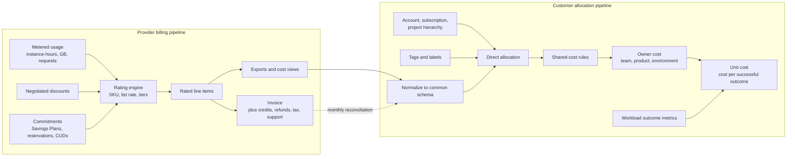

The diagram separates what the provider controls from what the customer controls. The provider decides when usage arrives, how it is rated, and what the invoice contains. The customer decides how cost is normalized, which keys allocate it, and which outcomes divide it. The dashed reconciliation edge is the invariant that keeps the customer pipeline honest: for every closed billing period, the sum of allocated cost must equal the invoice total, after accounting for the cost measure used (Section 2.3). Any gap is either an unallocated pool that must be reported or a bug in the pipeline.

Two implications follow. First, any number shown before the invoice closes is an estimate, because late usage, credits, and corrections have not arrived. Second, allocation is a customer-owned transformation and needs the same engineering discipline as any other data product: versioned rules, tests, and an owner.

### 2.2 Line items, SKUs, and the dimensions of a charge

Every detailed billing export is a table of line items. A line item records one charge for one combination of dimensions over one time interval, usually an hour or a day. The dimensions that matter most for architects are:

| Dimension | Meaning | AWS (Cost and Usage Report 2.0) | Azure (cost details) | Google Cloud (BigQuery export) |
|---|---|---|---|---|
| Billing scope | Who pays | Payer account, linked account | Billing account, billing profile, subscription | Billing account, project |
| Service and SKU | What was sold | Product code, usage type, operation | Meter category, meter ID | Service, SKU ID and description |
| Resource | Which resource emitted usage | Resource ID (when enabled) | Resource ID | Resource name (detailed export only) |
| Location | Where | Region, Availability Zone for some usage | Resource location, meter region | Location, region, zone |
| Quantity and unit | How much | Usage amount, pricing unit | Quantity, unit of measure | Usage amount and pricing unit |
| Cost measures | How much it cost | Unblended, net unblended, amortized | Cost (actual), amortized cost | Cost, credits array |
| Commitment linkage | Which commitment covered it | Reservation or Savings Plan Amazon Resource Name (ARN) | Benefit ID, pricing model | Credits by type, committed use discount (CUD) fields |
| Metadata | Owner context | Activated cost allocation tags | Tags, including inherited tags | Labels, project labels, tags |

The SKU or usage type is the most informative column for diagnosis because it encodes the mechanism. An AWS usage type such as a NAT gateway bytes-processed type, or a regional data-transfer type between two Regions, tells you exactly which path a byte took. A Google Cloud SKU description for inter-zone egress or a Compute Engine core SKU does the same. When a cost spike appears, grouping by SKU almost always identifies the cause faster than grouping by service.

A line item is not a resource. One virtual machine produces separate lines for compute time, each attached disk, the public IPv4 (Internet Protocol version 4) address, and data transfer. Conversely, some charges have no resource at all: support fees, taxes, commitment purchases, and many marketplace charges. This is why resource-level tags can never allocate the whole bill, and why every allocation design needs a rule for resource-less charges.

### 2.3 Cost measures: list, contracted, effective, billed, and net

The same usage line can carry several cost values. Confusing them is the most common cause of disputes between engineering and finance.

- **List cost** is quantity times the public on-demand rate. It is the baseline for measuring savings.
- **Contracted cost** (sometimes called negotiated cost) applies the customer's negotiated rates, such as an enterprise discount program, but not commitment benefits.
- **Effective cost**, also called **amortized cost**, spreads up-front and recurring commitment fees across the usage they cover, so that each hour of covered usage carries its share of the commitment price. Unused commitment appears as its own line. Effective cost answers "what did this workload really cost us?"
- **Billed cost** (AWS calls it unblended cost; Azure calls it actual cost) is the cash view: what appears on the invoice in the period when it was charged. An all-up-front commitment appears as one large purchase line in the purchase month and zero on the covered usage lines thereafter.
- **Net cost** is a cost measure after credits, refunds, and certain discounts have been subtracted. AWS exposes net unblended and net amortized cost; Google Cloud reports cost and a separate credits array that you subtract.
- **Blended cost** is an AWS-specific average rate across accounts in an organization for some services. It is useful for a few legacy reports and misleading for allocation, because one account's discount changes another account's rate.

FOCUS, the common schema discussed in Section 3.4, names these explicitly. Its specification describes `BilledCost` as the cash-based view of what an invoice issuer bills in a period, `EffectiveCost` as the accrual-based view recognized when resources are consumed, `ListCost` as the pre-discount baseline, and `ContractedCost` as pricing after negotiated discounts ([FOCUS cost comparison](https://focus.finops.org/docs/specification/v1-4/features/cost-comparison/)). Comparing `ListCost` with `ContractedCost` isolates negotiated savings; comparing `ContractedCost` with `EffectiveCost` isolates commitment savings.

**Worked example.** One virtual machine runs every hour of a 730-hour month. Its illustrative list rate is $0.20 per hour. The organization has a 5% negotiated discount, and it bought a one-year, all-up-front commitment that covers this machine at an effective $0.12 per hour, paid as $0.12 × 8,760 = $1,051.20 in January.

| Measure | January (purchase month) | February to December, each month | Year total |
|---|---|---|---|
| List cost | 0.20 × 730 = $146.00 | $146.00 | $1,752.00 |
| Contracted cost | 0.19 × 730 = $138.70 | $138.70 | $1,664.40 |
| Effective (amortized) cost | 0.12 × 730 = $87.60 | $87.60 | $1,051.20 |
| Billed cost | $1,051.20 purchase line, $0 usage | $0 | $1,051.20 |

The year totals of effective and billed cost agree, which is the reconciliation invariant. The monthly values do not. If the team that owns this machine were charged on billed cost, it would pay $1,051.20 in January and nothing for eleven months, and its January unit cost would look twelve times too high. That is why internal allocation and unit economics use effective cost, while treasury and accounts payable use billed cost. The savings decomposition is: negotiated discount $146.00 − $138.70 = $7.30 per month, commitment discount $138.70 − $87.60 = $51.10 per month, total $58.40 per month, 40% of list.

### 2.4 Credits, refunds, taxes, corrections, and marketplace charges

Several kinds of charges do not come from metered usage and behave differently in reports:

- **Credits** reduce cost. Promotional credits, service-level credits after a provider outage, and migration credits are common. They usually apply at the billing account and are not tied to the resource that caused the usage. A team whose sandbox ran on promotional credits will see a jump in "cost" when the credits expire, even though nothing changed technically. Report gross cost and credits separately so that the expiry is visible in advance.
- **Refunds** reverse a previous charge, for example after a support case. They often arrive in a later billing period than the charge they reverse.
- **Taxes** are computed on the invoice by the billing entity and depend on the customer's legal entity and jurisdiction. They are usually excluded from engineering allocation and handled by finance.
- **Corrections** fix a charge in a closed period. FOCUS marks them with `ChargeClass = "Correction"` when they apply to a previously invoiced period, which lets a pipeline route them to the right period rather than treating them as new spend ([FOCUS ChargeClass](https://focus.finops.org/docs/specification/v1-1/columns/cost-and-usage/charge-class/)).
- **Support fees** are often a percentage of total spend and have no resource. Allocate them proportionally to spend or keep them central.
- **Marketplace charges** come from third-party sellers through the provider's marketplace. They may be invoiced by a different issuer, and FOCUS notes that `BilledCost` can be zero in one provider's dataset for charges invoiced by another entity.

FOCUS groups all of these with a `ChargeCategory` column whose values are Usage, Purchase, Tax, Credit, and Adjustment ([FOCUS charge categorization](https://focus.finops.org/docs/specification/v1-4/features/charge-categorization/)). An allocation pipeline should route each category deliberately: usage to owners by key, purchases through amortization, tax and support to finance rules, credits by the policy the organization chooses (to the team that earned them, or centrally).

### 2.5 Reconciliation as a control

Reconciliation compares the customer's allocated totals with the provider invoice for each closed period. It is the test suite of the cost pipeline. A practical reconciliation has three checks:

1. **Completeness.** Sum of billed cost in the export for the period equals the invoice total, within a small tolerance for rounding and currency conversion. A larger gap means a missing account, a missing export, or a period that has not closed.
2. **Conservation.** Sum of allocated effective cost across all owners, plus the explicit unallocated pool, equals total effective cost. A pipeline that drops untagged rows fails this check, and the failure is silent unless the check exists.
3. **Stability.** Restating a closed period with the current rules changes owner totals only when a rule change was intentional and recorded. Unrecorded restatements usually come from tags or hierarchy that changed after the fact.

The third check matters because providers handle history differently. Google Cloud's export records the state of a resource when usage was recorded; adding a label to a project later does not change rows already exported ([Cloud Billing BigQuery tables](https://docs.cloud.google.com/billing/docs/how-to/export-data-bigquery-tables)). Azure tag inheritance, by contrast, rewrites usage records for the current month when the setting or the inherited tags change (Section 4.3). A pipeline that re-reads raw data each day will therefore see the current month's history move on Azure and stay fixed on Google Cloud. Snapshot closed periods so that published numbers do not drift.

## 3. Billing data sources

Each provider offers three kinds of billing data: an interactive analysis tool for exploration, a detailed export for pipelines, and APIs for automation. The detailed export is the system of record for allocation. The interactive tools are useful for investigation but should not be the basis of chargeback, because their filters, cost measures, and grouping rules are not versioned by you.

### 3.1 AWS: Data Exports, the Cost and Usage Report, and Cost Explorer

**AWS Data Exports** is the current mechanism for delivering billing data to an Amazon Simple Storage Service (S3) bucket. It offers several export types, including the **Cost and Usage Report (CUR) 2.0**, a **FOCUS** export, cost optimization recommendations, and a carbon emissions export. CUR 2.0 is a fixed schema with optional column selection and is partitioned by billing period. AWS documents that the billing and cost management exports refresh at least once a day once delivery starts ([Creating data exports](https://docs.aws.amazon.com/cur/latest/userguide/dataexports-create.html)), and the application programming interface (API) describes a refresh cadence that follows source data updates up to three times daily. The **legacy CUR** remains available and can be configured to refresh after a bill is finalized if AWS later applies refunds, credits, or support fees.

Practical points about the AWS export:

- Create the export in the **management (payer) account** of AWS Organizations to see all member accounts. A member account sees only its own data.
- Include **resource IDs** if you need resource-level allocation; they make the export much larger.
- Choose the time granularity (hourly or daily) according to the analysis. Commitment utilization analysis needs hourly data because Savings Plans and Reserved Instances apply hour by hour.
- **Split cost allocation data** adds per-pod rows for Amazon Elastic Kubernetes Service (EKS) and per-task rows for Amazon Elastic Container Service (ECS) when enabled (Section 5.5).
- Cost allocation tags appear as columns only after activation (Section 4.2).

**AWS Cost Explorer** is the interactive tool. It shows unblended, net unblended, amortized, net amortized, and blended cost, forecasts, Savings Plans and Reserved Instance utilization and coverage reports, and purchase recommendations. **AWS Cost Optimization Hub** aggregates rightsizing, idle-resource, and commitment recommendations across accounts and Regions ([Cost Optimization Hub](https://docs.aws.amazon.com/cost-management/latest/userguide/cost-optimization-hub.html)). **AWS Cost Categories** map accounts, tags, and services into business categories and can define split-charge rules for shared costs (Section 5.5).

### 3.2 Azure: Cost Management exports and cost analysis

**Microsoft Cost Management** is available at billing-account, billing-profile, management-group, subscription, and resource-group scopes, subject to the agreement type ([Cost Management overview](https://learn.microsoft.com/en-us/azure/cost-management-billing/costs/overview-cost-management)). Its **exports** write datasets on a schedule to an Azure Storage account. The current exports experience offers cost and usage details (actual and amortized), a **FOCUS** cost and usage dataset, price sheets, reservation details, reservation transactions, and reservation recommendations, and lets you choose the dataset schema version ([Cost Management exports tutorial](https://learn.microsoft.com/en-us/azure/cost-management-billing/costs/tutorial-improved-exports)). Microsoft announced support for the FOCUS 1.2 schema in exports ([Azure update](https://azure.microsoft.com/en-us/updates?id=496981)); check the schema index for the version you select.

Practical points about the Azure export:

- The available scopes, datasets, and features depend on the agreement: Enterprise Agreement (EA), Microsoft Customer Agreement (MCA), Microsoft Partner Agreement (MPA), or pay-as-you-go. Tag inheritance, for example, is available for EA, MCA, and MPA accounts with Azure plan subscriptions.
- Export the **amortized** dataset for allocation and the **actual** dataset for invoice reconciliation, or use the FOCUS dataset, which carries both `BilledCost` and `EffectiveCost`.
- Microsoft documents that cost and usage data is typically available within 8 to 24 hours ([Create and manage budgets](https://learn.microsoft.com/en-us/azure/cost-management-billing/costs/tutorial-acm-create-budgets)).

**Cost analysis** is the interactive view. Its smart views surface anomaly insights at subscription scope (Section 12.2). **Azure Advisor** provides cost recommendations, including rightsizing and reservation purchases (Section 9.3).

### 3.3 Google Cloud: Cloud Billing export to BigQuery

Google Cloud exports billing data to a BigQuery dataset that you own. The export produces several tables ([Cloud Billing BigQuery tables](https://docs.cloud.google.com/billing/docs/how-to/export-data-bigquery-tables)):

- **Standard usage cost** (`gcp_billing_export_v1_<BILLING_ACCOUNT_ID>`): account, invoice month, service, SKU, project, labels, location, cost, usage, credits, adjustments, and currency.
- **Detailed usage cost** (`gcp_billing_export_resource_v1_<BILLING_ACCOUNT_ID>`): everything in the standard table plus resource-level fields, such as the specific virtual machine or disk.
- **Pricing** (`cloud_pricing_export`): the list and contract prices applicable to the billing account, exported once a day.
- **FOCUS usage cost** (preview at the time of writing): a Google-provided immutable dataset with a FOCUS table, subject to a two-year time-to-live (TTL); copy it if you need longer history.
- **Committed use discount (CUD) metadata** (preview at the time of writing).

The export has properties an architect must design around:

- Google Cloud states there are **no delivery or latency guarantees** for the export, and that services report usage at varying intervals.
- On first enablement into a multi-region dataset (US or EU), the export backfills from the start of the previous month and can take up to five days to catch up. A single-region dataset gets no backfill. The dataset location cannot be changed after creation. Enable the export on day one of a new billing account, into a multi-region dataset, and never disable it.
- Rows reflect resource state when usage was recorded. Changing labels or the project hierarchy later affects only future rows.
- The schema can change. Google recommends querying through views so new columns do not break dashboards.
- For Google Kubernetes Engine (GKE), cluster-level breakdown in the detailed or FOCUS export requires enabling **GKE cost allocation**.

### 3.4 FOCUS as a common schema

The **FinOps Open Cost and Usage Specification (FOCUS)** is an open specification, maintained under the FinOps Foundation, that defines column names, value sets, and semantics for cost and usage data across providers. All three providers now publish a FOCUS dataset: AWS through Data Exports (the AWS documentation describes a FOCUS 1.0 table with additional AWS columns at the time of writing), Azure through Cost Management exports, and Google Cloud through a BigQuery FOCUS table in preview. The specification itself has moved through several versions; check which version each provider emits.

The columns most useful for the topics in this chapter are:

| FOCUS column | Use in this chapter |
|---|---|
| `BilledCost`, `EffectiveCost`, `ListCost`, `ContractedCost` | Cost measures and savings decomposition (Section 2.3) |
| `ChargeCategory`, `ChargeClass` | Route usage, purchases, tax, credits, adjustments, and corrections (Section 2.4) |
| `BillingAccountId`, `SubAccountId` | Allocation by account, subscription, or project (Section 4.1) |
| `ServiceName`, `SkuId`, `ResourceId`, `RegionId` | Diagnosis and resource-level allocation |
| `Tags` | Secondary allocation key (Section 4) |
| `CommitmentDiscountId`, `CommitmentDiscountStatus`, `CommitmentDiscountCategory` | Commitment utilization: used versus unused, usage-based versus spend-based (Section 8) |
| `PricingQuantity`, `ConsumedQuantity`, `ConsumedUnit` | Unit-cost denominators that are infrastructure quantities |

A minimal FOCUS query that reports effective cost by sub-account and charge category for one month, keeping unused commitment visible, looks like this:

```sql
SELECT
  ServiceProviderName,
  SubAccountId,
  ChargeCategory,
  CommitmentDiscountStatus,
  SUM(EffectiveCost) AS effective_cost,
  SUM(BilledCost)    AS billed_cost
FROM focus_cost
WHERE BillingPeriodStart = DATE '2025-03-01'
GROUP BY 1, 2, 3, 4
ORDER BY effective_cost DESC;
```

FOCUS reduces the work of a multi-cloud pipeline but does not remove it. Three caveats apply. First, providers document **deviations** from the specification and add provider-specific columns, so a column with the same name can still be populated differently. Second, sub-account semantics differ: an AWS linked account, an Azure subscription, and a Google Cloud project are not identical boundaries, as the provider chapters explain. Third, FOCUS standardizes cost data, not allocation policy. Shared-cost rules, owner mapping, and unit-cost denominators are still yours.

The design choice is whether to build the pipeline on FOCUS or on each provider's native export. Choose FOCUS when you run more than one provider or plan to, when you want tools to be portable, and when the FOCUS dataset contains every column your allocation needs. Choose the native export when you need columns FOCUS does not carry yet, such as some provider-specific commitment or Kubernetes split-cost fields, and accept per-provider transformation code. Many organizations ingest both: FOCUS as the reporting backbone and native columns joined in by line-item identifier where needed.

### 3.5 Billing data latency

Billing data is not real time, and each step in the pipeline adds delay. The table summarizes what the providers document at the time of writing:

| Step | AWS | Azure | Google Cloud |
|---|---|---|---|
| Detailed export refresh | At least daily, up to three times a day | Scheduled exports; data typically available in 8 to 24 hours | Regular intervals, no latency guarantee |
| Budget evaluation | Budgets update up to three times a day, typically 8 to 12 hours apart ([AWS Budgets](https://docs.aws.amazon.com/cost-management/latest/userguide/budgets-managing-costs.html)) | Evaluated every 24 hours; email normally within an hour of evaluation | Pub/Sub notifications multiple times per day; email when a threshold is crossed |
| Anomaly detection | Runs about three times a day after billing data is processed ([AWS Cost Anomaly Detection](https://docs.aws.amazon.com/cost-management/latest/userguide/manage-ad.html)) | Daily at subscription scope | Based on processed billing data; early near-real-time anomalies for some artificial intelligence (AI) services in preview |

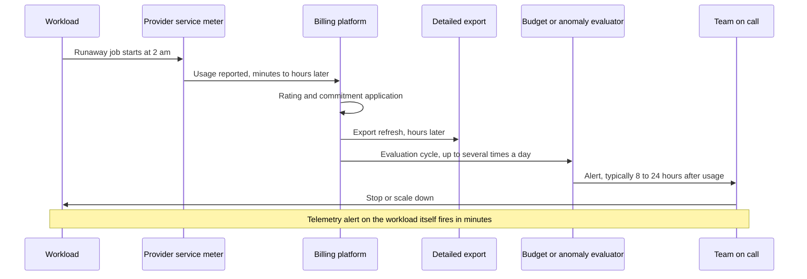

The sequence shows that a cost alert is a lagging signal. The latency is the sum of meter reporting, rating, export or evaluation cadence, and notification delivery, and each provider documents it as hours rather than minutes. The design implication is a two-tier control: **operational telemetry** (instance counts, function concurrency, bytes ingested, queries scanned) detects runaway usage in minutes, and **billing data** confirms cost, allocates it, and catches what telemetry does not instrument.

**Worked example: exposure window.** A misconfigured batch job launches accelerator instances that cost an illustrative $400 per hour in total, starting at 02:00. If the only control is a budget alert whose effective latency is 20 hours, the job accumulates 400 × 20 = $8,000 before anyone is notified, plus the time to respond. A metric alarm on running accelerator instance count, evaluated every 5 minutes, notifies within about 10 minutes: 400 × 10 / 60 ≈ $67. A service quota that limits the account to the expected number of accelerator vCPUs (Section 14.3) caps the burn rate itself, regardless of detection. The three controls are complementary: the quota bounds the rate, telemetry bounds the duration, and billing data proves the outcome.

### 3.6 Building the cost data platform

A production cost data platform has the same shape on every provider:

1. **Land raw exports** into storage owned by a dedicated billing or FinOps account, subscription, or project. Keep raw files immutable and versioned; they are the evidence for any dispute.
2. **Normalize** to one schema (FOCUS or an internal model), convert currency if needed, and attach the billing period and data freshness timestamp to every row.
3. **Enrich** with the owner directory: account-to-team mapping, tag normalization (case, synonyms, retired values), and Kubernetes namespace ownership.
4. **Allocate** with versioned rules for direct and shared cost, and produce an explicit unallocated pool.
5. **Publish** owner views, unit-cost tables, commitment utilization, and budget variance, each labeled with freshness and cost measure.
6. **Reconcile** each closed period against invoices (Section 2.5) and snapshot the result.

Billing data is sensitive. It reveals architecture, customer volumes, vendor relationships, and sometimes resource names that contain customer identifiers. Restrict write access to the export destination to the provider's export service identity, restrict read access to the cost platform and named finance and FinOps roles, and give teams views filtered to their own scope rather than raw tables. Tag values must never contain secrets or personal data, because they are copied into billing exports that many people read and that you cannot redact retroactively.

## 4. Allocation keys: hierarchy first, tags second

### 4.1 Why the account, subscription, or project is the strongest key

An allocation key is a field on a line item that maps it to an owner. The strongest key is the one that is present on every line, cannot be omitted by a careless deployment, and cannot be changed retroactively by a resource owner. On every provider that key is the administrative container: the AWS account, the Azure subscription (and, within it, the resource group), and the Google Cloud project. The provider chapters define these containers: [AWS accounts and Organizations](CH01_AWS.md#4-the-account-hard-isolation-and-blast-radius-boundary), the [Azure governance hierarchy](CH02_Azure.md), and the [Google Cloud resource hierarchy](CH03_GCP.md).

The container key is strong for structural reasons:

- **Completeness.** Every usage line carries its account, subscription, or project, including lines for resources that do not support tags and lines with no resource at all, such as some data-transfer and support-related charges.
- **Enforcement.** Creating a resource requires choosing a container. Choosing a tag is optional unless a policy enforces it.
- **Stability.** Moving a resource between containers is rare, deliberate, and often impossible without recreating it. Tags can be edited by anyone with write permission on the resource.
- **Alignment with other boundaries.** The same container is the boundary for identity, quotas, and blast radius, so a team that owns an account owns its cost, its permissions, and its limits together.

The consequence is a design rule: **allocate by container wherever ownership is exclusive, and reserve tags for the cases containers cannot express.** Those cases are shared containers (a platform account running several teams' workloads, a shared Kubernetes cluster, a shared data platform) and cross-cutting dimensions that do not match the container tree (cost center, product line, customer tier, or environment when one account holds several environments). This is one reason landing zones vend one account, subscription, or project per workload environment ([Landing Zones](CH15_Landing_Zones.md)).

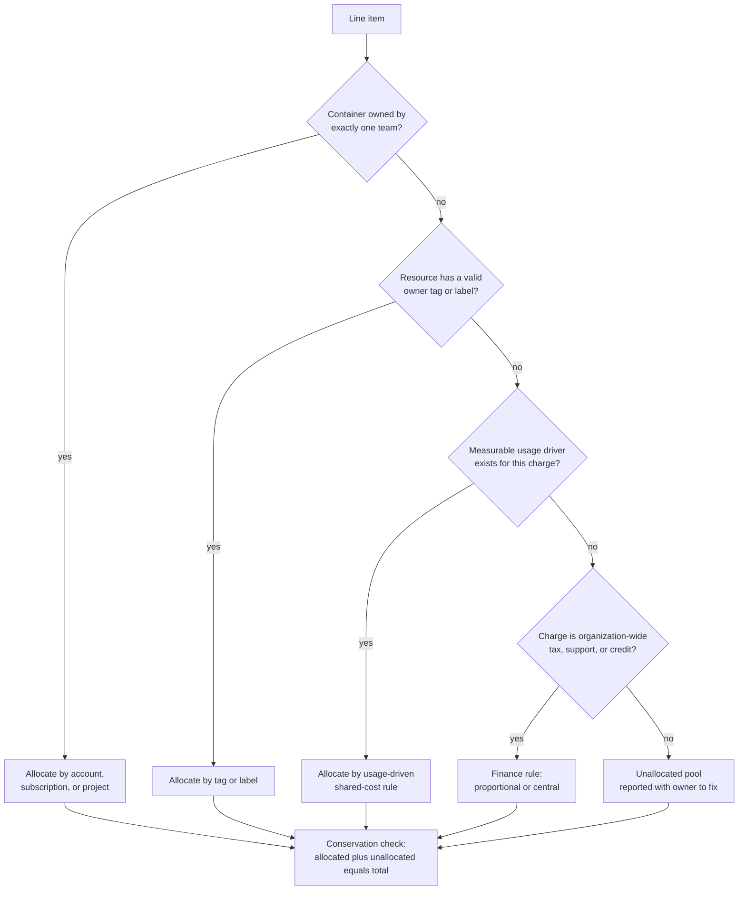

The decision tree is evaluated per line item, in order of key strength. Each branch is a weaker source of truth than the one above it, so the allocation report should show how much cost each branch handled. A pipeline where most cost reaches the tag branch is fragile, because a tagging lapse moves cost to the unallocated pool. A pipeline where most cost reaches the first branch is robust, and tags only refine the remainder. The final node is not optional: an explicit unallocated pool with a named owner who must reduce it is more honest than a rule that silently spreads unknown cost across everyone.

### 4.2 AWS cost allocation tags

AWS distinguishes resource tags from **cost allocation tags**. A resource tag is metadata on a resource. It appears in billing data only after it is **activated** as a cost allocation tag in the management account of the organization. There are two kinds: **user-defined** tags that you create, and **AWS-generated** tags such as `aws:createdBy`, which AWS applies to supported resources after you activate them.

Three properties shape the design:

1. **Activation is central.** Only the management (payer) account activates cost allocation tags for the organization. A team that adds a new tag key sees nothing in cost data until the FinOps owner activates it.
2. **Tags are not retroactive by default.** A tag applies to usage recorded while it was on the resource and activated. AWS added a **backfill** capability in 2024: you can request that activation apply to up to the previous twelve months, starting from the first day of a month, at most once every 24 hours ([Backfill cost allocation tags](https://docs.aws.amazon.com/awsaccountbilling/latest/aboutv2/cost-allocation-backfill.html)). Backfill applies the activation status to history; it cannot invent tag values that were not on the resources at the time.
3. **Tags are only one key.** **AWS Cost Categories** combine accounts, tags, services, and other dimensions into rule-based categories, such as "Product = Checkout if account is in the checkout organizational unit (OU), or if tag `app` equals `checkout`". Cost Categories also support split-charge rules for shared costs (Section 5.5).

To keep tag values consistent, AWS Organizations **tag policies** define allowed keys, capitalization, and values, and can enforce compliance for selected resource types:

```json
{
  "tags": {
    "costcenter": {
      "tag_key": { "@@assign": "CostCenter" },
      "tag_value": { "@@assign": ["CC-1001", "CC-1002", "CC-2001"] },
      "enforced_for": { "@@assign": ["ec2:instance", "ec2:volume"] }
    }
  }
}
```

The policy normalizes the key to `CostCenter` and, for the listed resource types, rejects tagging operations that use a non-compliant value. It does not force a tag to be present at creation; that requires a service control policy (SCP) or an infrastructure-as-code check that denies creation without the tag. Use enforcement sparingly at first, because a strict tag policy on a resource type that a deployment tool tags late can break deployments.

### 4.3 Azure tags and tag inheritance in Cost Management

Azure tags are name-value pairs on resources, resource groups, and subscriptions. Two Azure-specific mechanisms matter for cost.

**Azure Policy** can require a tag, append a default, or copy a tag from the resource group or subscription to the resource itself. Policy changes the resource, so the tag is visible in every tool that reads the resource.

**Tag inheritance in Cost Management** works on billing data instead. When enabled at an EA billing account, an MCA billing profile, or a subscription, it applies subscription and resource-group tags (and, for MCA, billing-profile and invoice-section tags) to the **usage records** of child resources, not to the resources ([Tag inheritance](https://learn.microsoft.com/en-us/azure/cost-management-billing/costs/enable-tag-inheritance)). Microsoft documents that:

- Updating the setting or the inherited tags takes about 8 to 24 hours to reach usage records.
- Changes apply to the **current month**: enabling inheritance on October 20 updates records from October 1 using the tags that existed on October 20. Earlier months are not changed.
- When a resource already has the same tag key, the resource's value wins by default; you can choose to let the inherited value override it.
- Purchases and resources that do not emit usage at subscription scope do not receive inherited tags.

Tag inheritance is usually the better choice for cost purposes, because it covers resources that do not support tags, needs no write access to resources, and cannot be broken by a deployment that overwrites tags. Azure Policy is the better choice when the tag must be visible outside billing, for example for automation that selects resources by tag. The two can be combined: Policy enforces tags on resource groups, and inheritance carries them to usage records.

Azure also offers **cost allocation rules** that move cost from a source subscription, resource group, or tag to targets, using even, proportional, or custom percentage splits. They are evaluated in Cost Management views and are available for EA and MCA accounts.

### 4.4 Google Cloud labels and tags

Google Cloud has two different metadata mechanisms with similar names, and confusing them is common.

- **Labels** are key-value pairs on individual resources and on projects. They are the primary billing metadata: resource labels and project labels appear in the standard and detailed billing exports. Labels are not inherited by child resources, with some service-specific exceptions, such as GKE propagating cluster labels to the virtual machines it creates.
- **Tags** (Resource Manager tags) are defined as tag keys and values at the organization or project level, bound to resources, and **inherited** down the resource hierarchy. Their main purpose is policy: Identity and Access Management (IAM) conditions and Organization Policy can reference them. Tags also appear in billing exports for several resource types, and Google documents that newly added or removed resource-level tags can take up to an hour to propagate to exports.

Two consequences follow. First, a label applied to a project after the fact does not change exported history; it affects only new rows. Second, because folders are not a label carrier, an organization that wants "business unit" on every row should put it on each project as a project label at vending time, or derive it from the project's ancestry, which the export carries in `project.ancestors`.

### 4.5 Tag limits and failure modes

Tags and labels fail in predictable ways:

| Failure | Cause | Consequence | Control |
|---|---|---|---|
| Missing tag | Resource created outside infrastructure-as-code, or by a service on the user's behalf | Cost falls to the unallocated pool | Container-first allocation; creation-time deny for key resource types; daily untagged-cost report |
| Inconsistent value | `prod`, `Prod`, `production` | One owner appears as three | Tag policies or Azure Policy allowed values; normalization table in the pipeline |
| Stale value | Team reorganized, tag not updated | Cost charged to a team that no longer owns it | Owner tags reference a stable identifier (cost center or team ID), not a person or team name |
| Untaggable charge | Data transfer, support, some managed-service lines | Never allocatable by tag | Container key or usage-driven rule |
| Late activation | AWS tag key not activated | Tag absent from cost data | Activate standard keys at organization creation; backfill where available |
| Sensitive value | Customer name or email in a tag | Data exposure through billing exports | Tag value standards; review in pull requests |
| Limit exhaustion | Too many tag keys on a resource | New tags rejected | Small, governed key set |

Per-resource limits exist on every provider: at the time of writing AWS allows 50 user-defined tags per resource, Azure 50 tag name-value pairs per resource, and Google Cloud 64 labels per resource, with length and character restrictions that differ by provider and service. Verify current limits in each provider's tagging documentation. The practical limit is lower than the technical one. A taxonomy of four to six mandatory cost keys (for example `CostCenter`, `App`, `Env`, `Owner`, and `DataClass`) is governable; twenty is not.

### 4.6 Measuring allocation coverage

Allocation coverage is the share of effective cost assigned to an owner with high confidence. It is the single best health metric for an allocation model.

**Worked example.** An organization spends $480,000 a month in effective cost.

- $396,000 is in accounts, subscriptions, or projects owned by exactly one team: allocated by container.
- $84,000 is in shared containers. Of that, $50,400 is on resources with valid owner tags, and $33,600 is untagged.

Container coverage is 396,000 / 480,000 = 82.5%. High-confidence coverage, container plus tag, is (396,000 + 50,400) / 480,000 = 93.0%. The remaining $33,600 (7.0%) either goes through a usage-driven rule or stays in the unallocated pool. If tags in the shared containers degrade from 60% to 40% compliance, high-confidence coverage falls only to (396,000 + 33,600) / 480,000 = 89.5%, because the container key carries most of the weight. A tag-only design with the same spend would have fallen by far more.

Report coverage monthly, by provider and by shared container, and set a target, such as 95% high-confidence coverage, with an owner for the gap.

## 5. Shared-cost allocation

### 5.1 What makes a cost shared

A cost is shared when one billed resource serves several owners. Typical shared costs are a multi-tenant Kubernetes cluster, a network hub with transit routing, NAT, and inspection firewalls, a central logging and monitoring platform, a shared database or data warehouse, security tooling, and organization-wide support fees. These costs are often large. In organizations with central platforms they can be a quarter or more of the bill, and leaving them unallocated hides the real cost of each product.

Shared-cost allocation has two goals that can conflict. **Accuracy** means each owner's share should reflect what it consumed. **Incentive alignment** means the rule should encourage behavior that lowers total cost. A rule that is perfectly accurate but impossible for teams to predict or influence fails the second goal; an even split that everyone understands fails the first.

### 5.2 Allocation methods

| Method | Rule | Strengths | Weaknesses | Use when |
|---|---|---|---|---|
| Even split | Divide equally among N consumers | Simple, predictable | Small consumers subsidize large ones; no incentive to reduce use | Cost is small, or consumers are similar in size |
| Proportional to direct spend | Share = consumer's direct cost / total direct cost | Uses data you already have; scales with team size | Penalizes teams for unrelated spend; a team with expensive graphics processing units (GPUs) pays more of the network hub | No usage driver is available, or for overhead such as support fees |
| Fixed percentage | Negotiated percentages, reviewed periodically | Predictable for budgeting | Drifts from reality between reviews | Cost is stable and a usage driver is expensive to measure |
| Usage-driven | Share = consumer's measured driver / total driver (requests, bytes, vCPU-hours, GiB-hours, queries) | Most accurate; teams can reduce their share by reducing use | Needs telemetry; driver choice is a design decision; measurement costs money | Cost is large and a driver is measurable |

Most organizations use a mix: usage-driven for large platforms with clear drivers, proportional for overheads, and even or fixed for small items. The rule for each shared pool should be written down with its driver, its data source, its review date, and its owner. That record is what ends disputes, because a team that disagrees can propose a better driver rather than argue about a number.

### 5.3 Worked example: a shared Kubernetes cluster

A platform team runs one production Kubernetes cluster for three product teams. The monthly effective cost is $36,000: $30,000 for worker nodes and $6,000 for cluster-level shared items (control plane fee, load balancers, NAT, and the observability agents' ingestion). The cluster's allocatable capacity, averaged over the month, is 400 vCPU and 1,600 GiB of memory.

The platform team splits node cost into a CPU price and a memory price in proportion to the provider's per-unit prices for the node family. With an 80/20 split, CPU costs $24,000 / 400 = $60 per vCPU-month and memory costs $6,000 / 1,600 = $3.75 per GiB-month.

Each workload is charged on the **greater of its requests and its usage**, averaged over the month. Requests reserve capacity whether or not it is used, so charging requests discourages over-requesting; charging usage when it exceeds requests prevents a team from under-requesting and bursting into capacity others paid for. AWS split cost allocation data uses the same "higher of request and utilization" basis when it has usage metrics ([Enabling split cost allocation data](https://docs.aws.amazon.com/cur/latest/userguide/enabling-split-cost-allocation-data.html)).

| Owner | CPU request / usage | Memory request / usage (GiB) | Charged CPU × $60 | Charged memory × $3.75 | Direct cost |
|---|---|---|---|---|---|
| Checkout | 120 / 90 | 400 / 300 | 120 → $7,200 | 400 → $1,500 | $8,700 |
| Search | 80 / 110 | 480 / 420 | 110 → $6,600 | 480 → $1,800 | $8,400 |
| Batch | 60 / 40 | 240 / 200 | 60 → $3,600 | 240 → $900 | $4,500 |
| System (DaemonSets, kube-system) | 30 / 30 | 120 / 120 | $1,800 | $450 | $2,250 |
| **Allocated** | 320 vCPU | 1,240 GiB | | | **$23,850** |

Idle capacity is the node cost not charged to anyone: $30,000 − $23,850 = $6,150, which equals 80 idle vCPU × $60 plus 360 idle GiB × $3.75. Idle is 20.5% of node cost.

The remaining pool to distribute is system overhead ($2,250), idle ($6,150), and cluster shared items ($6,000), a total of $14,400. Two policies are common:

**Policy A, spread everything proportionally to direct cost.** Total team direct cost is 8,700 + 8,400 + 4,500 = $21,600.

- Checkout: 14,400 × 8,700 / 21,600 = $5,800, total $14,500.
- Search: 14,400 × 8,400 / 21,600 = $5,600, total $14,000.
- Batch: 14,400 × 4,500 / 21,600 = $3,000, total $7,500.
- Sum: $36,000, which conserves the cluster cost.

**Policy B, the platform team owns idle.** Spread system and shared items ($8,250) proportionally and keep idle ($6,150) as a platform efficiency cost.

- Checkout: 8,700 + 8,250 × 8,700 / 21,600 = 8,700 + 3,322.92 = $12,022.92.
- Search: 8,400 + 3,208.33 = $11,608.33.
- Batch: 4,500 + 1,718.75 = $6,218.75.
- Platform: $6,150.00. Sum: $36,000.00.

For comparison, an **even split** would charge each team $12,000. Batch would pay $4,500 more than under Policy A for a third of Checkout's footprint, and Checkout would have no reason to lower its 30 idle requested vCPU.

The choice between A and B is an incentive decision. Policy A charges the full cluster to product teams, which is accurate in total but hides idle inside every team's bill, so nobody owns bin-packing. Policy B makes idle visible as a number the platform team is measured on, which motivates node right-sizing, autoscaler tuning, and consolidation, but leaves $6,150 outside product unit costs. A common compromise is Policy B for management reporting and Policy A for product unit economics, with both totals reconciling to the same $36,000. The repository's [unit-cost calculator](../code/python/cost-optimization-chapter/01_unit_cost.py) implements the proportional step in its simplest form: it spreads a $2,400 shared pool over two workloads in proportion to 60 and 40 shared-usage units, giving $1,440 and $960.

### 5.4 Worked example: a shared network hub

A network hub in a dedicated account provides transit routing between workload networks, centralized NAT, and an inspection firewall. Its monthly cost is $18,000: $4,000 of fixed hourly charges for attachments and endpoints, and $14,000 of per-GB data processing. The traffic mechanics and their prices are covered in [Networking](CH05_Networking.md) and [AWS, Section 14](CH01_AWS.md#14-pricing-dimensions); here the question is who pays.

The fixed portion is driven by the number of attachments, so it is split by attachment count. The variable portion is driven by bytes, so it is split by bytes processed per source network, measured from flow logs aggregated by attachment. In the month in question the hub processed 700 terabytes (TB), at an illustrative $0.02 per GB.

| Owner | Attachments | Fixed share | TB processed | Variable share | Total |
|---|---|---|---|---|---|
| Payments | 2 of 4 | $2,000 | 350 | 14,000 × 350 / 700 = $7,000 | $9,000 |
| Analytics | 1 of 4 | $1,000 | 280 | $5,600 | $6,600 |
| Web | 1 of 4 | $1,000 | 70 | $1,400 | $2,400 |
| **Total** | 4 | $4,000 | 700 | $14,000 | $18,000 |

Usage-driven allocation changes behavior here. When Analytics sees $5,600 a month for routing 280 TB of object-storage reads through the hub's NAT, the fix is visible: a private storage endpoint in its own network would remove most of those bytes from the hub. Under an even split, Analytics would pay $6,000 and see no connection between its data path and its bill. The measurement has its own cost, since flow logs are billed by volume, so sample or aggregate them at the attachment level rather than logging every flow at full fidelity.

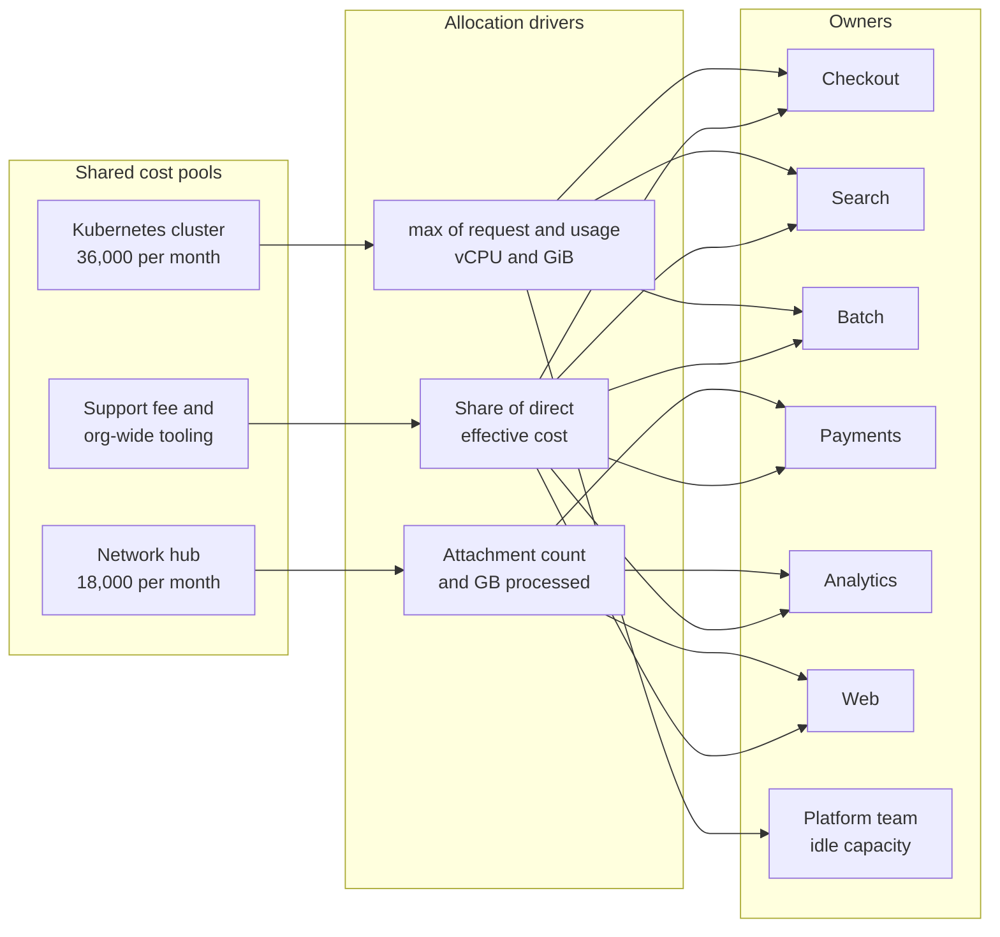

The diagram makes the allocation model inspectable: each pool has exactly one driver, and each driver names its data source. Every arrow from a driver to an owner corresponds to a row in a published table like the two above. The diagram also shows where idle capacity lands, which is the most argued-about edge in most organizations. Publishing this view, versioned with the rule set, lets a reviewer check that no pool is double-counted and that every pool reaches an owner.

### 5.5 Provider tools for shared costs

Each provider offers some shared-cost support. None replaces a customer-owned rule set, but each removes work.

- **AWS split cost allocation data** adds per-pod rows for EKS and per-task rows for ECS into CUR. For EKS it allocates instance cost by pod CPU and memory, and it can use actual utilization metrics from Amazon CloudWatch Container Insights or Amazon Managed Service for Prometheus to charge the higher of request and usage. It weights CPU and memory with a 9:1 ratio derived from AWS Fargate per-unit prices, and it covers accelerators for some instance types ([Split cost allocation data](https://docs.aws.amazon.com/cur/latest/userguide/split-cost-allocation-data.html)).
- **AWS Cost Categories split charges** distribute a category's cost to other categories using proportional, fixed, or even methods. The split appears in Cost Explorer and Cost Categories views, not as rewritten CUR line items, so a warehouse pipeline must reproduce it if it needs the same numbers.
- **Azure cost allocation rules** move cost from source subscriptions, resource groups, or tags to targets by even, proportional, or custom splits, for EA and MCA accounts.
- **Azure Kubernetes Service (AKS) cost analysis**, an add-on based on the OpenCost project, shows cluster and namespace costs in Cost Management for Standard and Premium tier clusters, reconciled with invoice data ([AKS cost analysis](https://learn.microsoft.com/en-us/azure/aks/cost-analysis)).
- **GKE cost allocation** adds namespace and Kubernetes label breakdowns to the detailed and FOCUS BigQuery exports once enabled on the cluster.

Kubernetes-native allocation tools such as OpenCost compute the same request-and-usage model from inside the cluster. They are useful when you run clusters on more than one provider, but their cost inputs must be reconciled against the provider export, because a tool that prices nodes at list rates will disagree with an effective-cost bill that includes commitment discounts.

## 6. Showback and chargeback

### 6.1 Definitions and the difference that matters

**Showback** reports allocated cost to owners without moving money. **Chargeback** moves allocated cost into the owners' budgets or ledgers, so it affects their financial results. The data is the same; the consequences differ. Showback asks teams to care; chargeback makes them accountable.

Chargeback has prerequisites that showback does not:

- **Coverage high enough to be fair.** Charging teams while 15% of cost is unallocated invites the question of who pays the 15%. A coverage target of about 95% before chargeback is a common working rule.
- **Rules teams can predict.** A team must be able to estimate its charge before it deploys. Usage-driven rules need published unit rates, such as $60 per vCPU-month in the cluster example.
- **A dispute process with a deadline.** Owners need a way to challenge an allocation within the period, and a FinOps owner who decides.
- **Stable history.** Closed periods must not be restated without notice (Section 2.5).

### 6.2 Which cost measure to charge

Charge **effective (amortized) cost**, not billed cost, so that commitment purchases do not land as spikes on one team (Section 2.3). Then decide who receives commitment savings. There are three options:

1. **Savings to the consumer.** Each team pays the effective rate on its covered usage. Teams see the real cost of their workload, and consumers benefit from commitments bought centrally.
2. **Savings to the purchaser.** Teams pay on-demand-equivalent cost and the central FinOps or platform budget keeps the difference. This funds the commitment program and keeps team unit costs stable when coverage changes, but overstates each team's real cost.
3. **Blended internal rate.** Teams pay a published internal rate per unit (for example, per vCPU-hour) that includes average commitment benefit. Predictable for teams; requires a central owner for variance.

Option 1 aligns unit economics with reality and is the usual default. Option 2 is common when commitments are bought centrally and the organization wants to show the commitment program's value separately. Whatever is chosen, unused commitment must land somewhere explicit, usually with the purchaser, so that over-commitment is visible as a cost rather than diluted across consumers.

### 6.3 Internal rates are not provider charges

A chargeback that uses internal rates (for example, $60 per vCPU-month for the shared cluster) is a management transfer price. Keep it separate from provider charges in reports. A team optimizing against an internal rate needs to know whether its savings reduce the provider bill or only move cost to another internal owner. Reducing requests in the shared cluster reduces the team's charge immediately, but reduces the provider bill only when the platform team removes nodes. That gap is why Policy B in Section 5.3 assigns idle to the platform team.

### 6.4 Maturity path

A reasonable progression is:

1. **Visibility.** Container-based showback with an explicit unallocated pool.
2. **Shared costs.** Usage-driven rules for the largest shared pools; coverage above 90%.
3. **Unit economics.** Owners see cost per successful outcome next to cost totals (Section 13).
4. **Chargeback.** Effective-cost chargeback with published rules and disputes, once coverage passes the agreed threshold.

Skipping to chargeback before stage 2 usually produces months of disputes about shared costs and erodes trust in the data, which is harder to recover than a delayed chargeback.

## 7. Budgets and forecasts

### 7.1 The budget model

A budget is a planned amount for a **scope** (billing account, account, subscription, project, resource group, tag, or service filter) over a **period** (month, quarter, year), measured in a **cost measure** (actual or billed, amortized, net), with one or more **thresholds**. Each threshold compares either **actual** spend to date or **forecasted** spend for the period against the budget, and triggers a **notification** and, on some providers, an **action**.

A budget is a policy signal, not a spending limit. None of the three providers stops consumption when a budget is exceeded unless you attach an action or automation that does so, and even then the action runs on lagging data (Section 3.5). Teams that read "budget" as "cap" are surprised in exactly the situations budgets exist for.

### 7.2 Provider budget mechanics

**AWS Budgets** tracks cost, usage, and commitment utilization or coverage. Cost budgets can use unblended, net unblended, amortized, net amortized, or blended cost and can include or exclude credits, refunds, support, and tax. Budget data updates up to three times a day, typically 8 to 12 hours apart ([Managing costs with AWS Budgets](https://docs.aws.amazon.com/cost-management/latest/userguide/budgets-managing-costs.html)). Alerts go to email or an Amazon Simple Notification Service (SNS) topic. **Budget actions** can apply an IAM policy or an SCP, or stop specific Amazon Elastic Compute Cloud (EC2) or Amazon Relational Database Service (RDS) instances, either automatically or after an approval step ([Configuring budget actions](https://docs.aws.amazon.com/cost-management/latest/userguide/budgets-controls.html)). The typical use is to attach a deny-provisioning SCP to a sandbox account when its budget is exhausted, which stops new spend without destroying existing resources.

**Azure budgets** in Cost Management can be set at management-group, subscription, resource-group, and billing scopes, with monthly, quarterly, or annual time grains and alert conditions on actual or forecasted cost. Microsoft documents that budgets are evaluated against cost data every 24 hours, that cost data is typically available within 8 to 24 hours, and that emails are normally sent within an hour of evaluation ([Create and manage budgets](https://learn.microsoft.com/en-us/azure/cost-management-billing/costs/tutorial-acm-create-budgets)). Budgets can trigger Azure Monitor **action groups**, which can call a webhook, an Azure Automation runbook, an Azure Function, or a Logic App; check the documentation for which budget scopes support action groups.

**Google Cloud budgets** are defined on a Cloud Billing account and can be filtered to projects, services, sub-accounts, and labels. The amount can be fixed or track last period's spend. Threshold rules apply to actual or forecasted cost, and emails go to billing administrators or Cloud Monitoring notification channels when a threshold is crossed. **Programmatic notifications** publish budget status to a Pub/Sub topic **multiple times per day**, including after all thresholds have been exceeded, which is a different cadence from threshold emails ([Programmatic notifications](https://cloud.google.com/billing/docs/how-to/budgets-programmatic-notifications)). Google's documentation states that budgets use estimated billing data that can change until the invoice is finalized, and its example of disabling billing on budget exhaustion warns that the delay between incurring cost and receiving notifications means spend can exceed the budget ([Disable billing with notifications](https://cloud.google.com/billing/docs/how-to/disable-billing-with-notifications)).

### 7.3 Programmatic budget response

The Google Cloud Pub/Sub path shows the general pattern of an automated budget response, which applies equally to AWS SNS and Azure action groups.

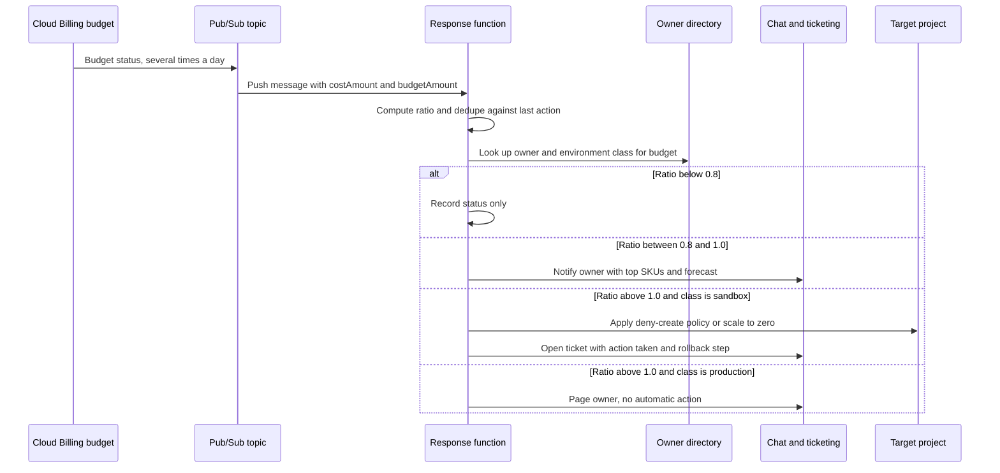

The diagram encodes three design decisions. First, the function **deduplicates**, because the topic delivers status repeatedly and an action must not run every time a message arrives. Second, the response depends on the **environment class** looked up from an owner directory: automatic containment is acceptable in a sandbox, where stopping resources loses nothing important, and unacceptable in production, where it could cause an outage that costs more than the overspend. Third, every automatic action is recorded with a **rollback step**, because the alert may be a false positive caused by a one-time purchase or late-arriving usage.

A minimal handler reads the message and decides; the containment call itself depends on what you want to stop:

```python
import base64
import json

def handle_budget(event: dict, context: object) -> None:
    payload = json.loads(base64.b64decode(event["data"]).decode("utf-8"))
    cost = float(payload["costAmount"])
    budget = float(payload["budgetAmount"])
    ratio = cost / budget if budget else 0.0
    budget_name = payload.get("budgetDisplayName", "unknown")
    if ratio >= 1.0 and budget_name.startswith("sandbox-"):
        contain_sandbox(budget_name)        # deny new resources, notify owner
    elif ratio >= 0.8:
        notify_owner(budget_name, cost, budget)
```

The function's own identity needs only the permissions its containment step requires, scoped to sandbox projects. Granting it billing administration or organization-wide project deletion would turn a cost control into a security risk.

### 7.4 Why budgets are not caps

Three mechanisms make budgets imprecise as limits:

1. **Data latency** (Section 3.5). The budget sees cost hours after usage.
2. **Estimated data.** Budgets evaluate estimated cost, which can change as credits, late usage, and corrections arrive.
3. **Resource-less and committed charges.** A commitment purchase or a support fee can cross a threshold instantly, and stopping workloads does not reverse it.

When a hard limit is genuinely required, combine controls that act on usage rather than on cost: **quotas** that cap how many resources can exist (Section 14.3), **policy** that restricts expensive SKUs and Regions, **service-level limits** such as function concurrency or BigQuery custom query quotas, and **budget actions** as a backstop. Google Cloud's example of disabling billing on a project when its budget is exhausted is a real hard stop, but it shuts down every service in the project and can delete some resources, so it is suitable only for disposable environments.

### 7.5 Forecasting

A forecast estimates period-end cost from what is known now. Three methods are common, in increasing order of effort and accuracy.

**Linear run-rate.** Divide spend to date by days elapsed and multiply by days in the period. The repository's [budget forecast checker](../code/python/cost-optimization-chapter/02_budget_forecast.py) does exactly this: $18,500 spent after 12 days of a 30-day month gives 18,500 / 12 × 30 = $46,250, which exceeds a $40,000 budget by $6,250 and raises an alert. As the script warns, the method ignores seasonality, credits, and late-arriving charges.

**Seasonal or provider forecast.** AWS Cost Explorer, Azure cost analysis, and Google Cloud reports provide forecasts based on historical patterns. They capture weekly cycles and trends but not events they cannot see, such as a planned launch.

**Driver-based forecast.** Model cost as baseline run-rate plus known events, adjusted for one-time items. Continuing the example, suppose the first 12 days included a $2,900 one-time load test, a five-day marketing campaign is scheduled for days 20 to 24 that historically raises variable spend by about 40%, and a $1,500 credit will apply at invoice.

1. Baseline daily rate without the load test: (18,500 − 2,900) / 12 = $1,300 per day.
2. Remaining 18 days at baseline: 18 × 1,300 = $23,400.
3. Campaign uplift: 5 days × 1,300 × 0.40 = $2,600.
4. Gross forecast: 18,500 + 23,400 + 2,600 = $44,500.
5. Net forecast after the credit: 44,500 − 1,500 = $43,000.

The driver-based forecast is still $3,000 over budget, but it is $3,250 lower than the linear estimate, and, more importantly, it explains *why*: the overrun is the campaign, which was planned. The right response is to adjust the budget for the campaign or accept the variance, not to cut capacity.

**Forecast accuracy** should itself be measured. A common metric is mean absolute percentage error (MAPE) between the forecast made at a fixed point (for example, day 10) and the final effective cost, tracked over six or more months. A MAPE that stays above roughly 10% usually means a missing driver, such as a batch workload with a monthly cycle, rather than a bad algorithm. Forecasts also feed commitment decisions (Section 8), so their bias matters: a forecast that is consistently high leads to over-commitment.

## 8. Commitments: utilization, coverage, and risk

### 8.1 Recap: a price promise, not a capacity promise

[Compute, Section 9](CH04_Compute.md#9-capacity-procurement) explains that providers sell three different promises: commitment discounts that lower the price of matching usage, capacity reservations that hold hardware without lowering the price, and interruptible capacity with no promise at all. It also shows, with a worked example, why committing to the floor of measured usage beats committing to the average. This section owns what happens after the purchase: how the discount is applied, how to measure whether it is working, how much risk it carries, and how sharing scope changes both.

### 8.2 Provider commitment products

| Provider | Product | What you commit to | Where the discount applies | Exit options at the time of writing |
|---|---|---|---|---|
| AWS | Compute Savings Plans | Hourly spend (in dollars per hour) for 1 or 3 years | EC2 across families, sizes, Regions, and operating systems; AWS Fargate; AWS Lambda | Not cancellable; plans of $100 per hour or less can be returned within 7 days in the same calendar month, subject to a return limit ([Returning a Savings Plan](https://docs.aws.amazon.com/savingsplans/latest/userguide/return-sp.html)) |
| AWS | EC2 Instance Savings Plans | Hourly spend for one instance family in one Region | That family in that Region, any size, operating system, or tenancy | As above |
| AWS | Reserved Instances (Standard, Convertible) | A specific instance attribute set | Regional (size-flexible within family for many cases) or zonal (also reserves capacity in one Availability Zone) | Standard can be sold on the Reserved Instance (RI) Marketplace; Convertible can be exchanged |
| Azure | Reservations | A specific resource type, region, and term | Instance size flexibility within a group; scope single resource group, subscription, management group, or shared | Exchanges and refunds allowed; canceled commitment limited to $50,000 in a rolling 12 months; Microsoft has announced that reservations bought after February 1, 2027 for services covered by savings plans will not be exchangeable ([Exchange policy changes](https://learn.microsoft.com/en-us/azure/cost-management-billing/reservations/reservation-exchange-policy-changes)) |
| Azure | Savings plan for compute | Hourly spend for 1 or 3 years | Eligible compute services across regions; same scope options | Cannot be canceled or exchanged; reservations can be traded in for a savings plan ([Savings plan cancellation](https://learn.microsoft.com/en-us/azure/cost-management-billing/savings-plan/cancel-savings-plan)) |
| Google Cloud | Resource-based CUDs | Quantity of vCPU, memory, GPUs, or local solid-state drive (SSD) in a region | Matching resources in the region; in the purchasing project, or across projects in the billing account when CUD sharing is enabled | Not cancellable |
| Google Cloud | Spend-based CUDs, including compute flexible CUDs | Minimum hourly spend for 1 or 3 years | Eligible services; compute flexible CUDs apply across Compute Engine, GKE, and Cloud Run ([Spend-based CUDs](https://docs.cloud.google.com/docs/cuds-multiprice)) | Not cancellable |

Two provider changes affect reporting and should be checked in your own data. Google Cloud moved spend-based CUDs to a new data model that represents savings as discounts on the consumption SKUs rather than as credits, which changes which columns carry the savings in the BigQuery export ([Spend-based CUD data model](https://cloud.google.com/docs/cuds-multiprice-datamodel)). Azure's 2027 exchange change shifts flexibility from reservations to savings plans for many services. Both are reasons to keep commitment analysis in versioned queries rather than in screenshots.

### 8.3 How commitments are applied

Commitments apply **hour by hour**. A spend commitment of $70 per hour covers up to $70 of discounted-rate usage in each hour; unused commitment in that hour expires and cannot be carried to the next hour. A resource commitment of 200 vCPU covers up to 200 vCPU in each hour.

Within an hour, AWS applies Savings Plans to the usage with the **highest savings percentage first**, then continues until the commitment is exhausted or no eligible usage remains ([How Savings Plans apply](https://docs.aws.amazon.com/savingsplans/latest/userguide/sp-applying.html)). Reserved Instances apply before Savings Plans. Across an AWS organization, the purchasing account's usage is covered first; remaining benefit flows to other accounts according to the organization's **RI and Savings Plans discount sharing** preferences, which can be organization-wide, prioritized to a group, or restricted to a group ([Discount sharing](https://docs.aws.amazon.com/awsaccountbilling/latest/aboutv2/ri-turn-off.html)). Azure applies reservations and savings plans within their configured scope, and Google Cloud applies resource-based CUDs within the purchasing project unless sharing is enabled.

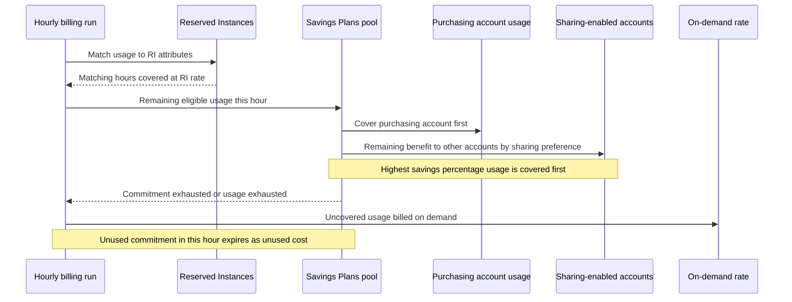

The sequence has two consequences for architects. First, **sharing scope changes who benefits and how much is used.** A plan bought in a production account with sharing disabled can sit partly unused overnight while a development account in the same organization pays on-demand rates. Second, **the "highest savings first" rule moves the benefit between workloads as the mix changes.** If a team adds usage with a higher discount percentage, the plan shifts to cover it and another team's previously covered usage becomes on-demand. Under consumer-receives-savings chargeback (Section 6.2), that second team sees a cost increase it did not cause. That is a reason to report commitment benefit centrally, even when charging effective cost to consumers.

### 8.4 Utilization and coverage

Two metrics describe a commitment portfolio, and they answer different questions:

- **Utilization** = commitment used / commitment purchased, per hour, then averaged. It answers "are we wasting what we bought?" Low utilization means over-commitment.
- **Coverage** = eligible usage covered by commitments / total eligible usage, measured in on-demand-equivalent cost. It answers "how much more could we commit?" Low coverage means under-commitment and paying on-demand for stable usage.

High utilization and low coverage is a safe but expensive position. High coverage and low utilization is the expensive mistake. The target is high utilization (often 95% to 100%) with coverage set to the stable part of demand.

**Worked example.** An organization's eligible compute usage, measured at on-demand rates, varies by hour between $90 and $210, with an average of $150 per hour. It holds a spend commitment of $70 per hour at a rate that gives a 30% discount, so the commitment covers $70 / 0.70 = $100 of on-demand-equivalent usage per hour when fully used.

- In an hour with $150 of usage, the commitment covers $100, utilization is 100%, coverage is 100 / 150 = 66.7%, and $50 is billed on-demand.
- In an overnight hour with $90 of usage, the commitment covers all $90, which consumes 90 × 0.70 = $63 of the $70 commitment. Utilization that hour is 63 / 70 = 90%, coverage is 100%, and $7 of commitment expires unused.

If overnight hours are a third of the month, monthly utilization is about (2/3 × 100%) + (1/3 × 90%) = 96.7%, and the $7 per hour of waste over 243 overnight hours is about $1,700 a month. That waste is the price of covering $10 more per hour than the overnight floor. Whether it is worth paying depends on what the extra coverage saves in daytime hours: each daytime hour gains $10 × 0.30 = $3 of savings over a plan sized to the $90 floor. Over 487 daytime hours that is about $1,461 a month, less than the $1,700 waste. The commitment is slightly too large. The general rule from [Compute](CH04_Compute.md#9-capacity-procurement) holds: commit to the floor.

### 8.5 Break-even arithmetic

A commitment pays for itself when the on-demand cost of the usage it actually covers exceeds what the commitment costs. If the commitment's effective rate is a fraction *r* of the on-demand rate, the break-even utilization is *r*.

The repository's [commitment break-even analyzer](../code/python/cost-optimization-chapter/03_commitment_break_even.py) commits to 8 instance-equivalents for 720 hours (5,760 capacity-hours) at a normalized rate of 0.68 of on-demand, for a fixed cost of 5,760 × 0.68 = 3,916.8 units:

| Utilization | Used hours | On-demand cost of used hours | Commitment cost | Result |
|---|---|---|---|---|
| 55% | 3,168 | 3,168 | 3,917 | Commitment loses 749 |
| 68% | 3,917 | 3,917 | 3,917 | Break-even |
| 80% | 4,608 | 4,608 | 3,917 | Commitment saves 691 |
| 100% | 5,760 | 5,760 | 3,917 | Commitment saves 1,843 |

Three refinements matter in real decisions:

- **Payment option.** All-up-front, partial-up-front, and no-up-front options carry different rates. Comparing them requires discounting future payments at the organization's cost of capital; an up-front payment that buys a few percent more discount can be worse than a monthly payment if capital is expensive.
- **Term and exit.** A three-year commitment with a deeper discount has a lower *r* (easier break-even) but a longer exposure. The useful question is: **how many months of usage must the commitment cover before it breaks even, if usage then disappears?** A three-year commitment at r = 0.50 with no exit costs 36 × 0.50 = 18 months of on-demand-equivalent spend in total. If the covered usage stops after month *m*, the commitment has displaced *m* months of on-demand spend. It breaks even only if *m* ≥ 18. If the workload might be retired or migrated within 18 months, the three-year term loses money; a one-year term at r = 0.65 costs 7.8 months of on-demand-equivalent and breaks even after 7.8 months.
- **Discount scope.** A narrower product with a deeper discount (EC2 Instance Savings Plan, resource-based CUD, Azure reservation) has a lower *r* but a higher chance of becoming unused after an architecture change.

### 8.6 The commitment versus consumption trade-off

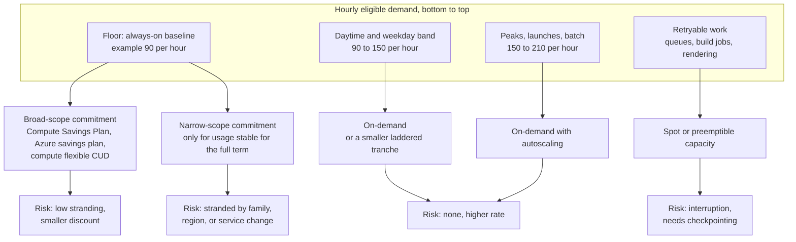

The diagram maps layers of demand to purchasing models. The bottom layer is the only one that should be committed, and the choice between broad and narrow scope is a bet on architecture stability over the term. The middle band is where most over-commitment happens, because average-based recommendations reach into it. The top and retryable layers belong to on-demand and interruptible capacity, whose mechanics are in [Compute](CH04_Compute.md#9-capacity-procurement). The trade-off is between discount depth and flexibility, and the right answer moves as the architecture roadmap firms up.

### 8.7 Over-commitment and stranding: a worked scenario

A team holds an EC2 Instance Savings Plan of $70 per hour for one general-purpose x86 instance family in one Region, bought for three years. In month 14 it migrates 40% of that fleet to an Arm-based family, which is a different instance family, to save 20% on compute.

- The plan covers only the original family. After migration, eligible usage in that family falls from about $100 to $60 per hour at on-demand-equivalent rates, which consumes $42 of the $70 commitment.
- Unused commitment is $28 per hour, about 28 × 730 = $20,440 per month, for 22 remaining months: roughly $450,000 of waste.
- The migration itself saves 20% of the moved usage: 0.20 × $40 × 730 ≈ $5,840 per month at on-demand rates, much less than the stranded commitment.

Unless other accounts in the organization run the same family and sharing is enabled, the migration loses money for almost two years, and the team that bought the plan will resist the migration. Three mitigations would have prevented this:

1. **Choose broad scope for multi-year terms.** A Compute Savings Plan would have followed the usage to the new family at a smaller discount.
2. **Ladder purchases.** Buying the commitment in four quarterly tranches of $17.50 per hour, each with its own expiry, means later tranches can be sized to the post-migration fleet.
3. **Make the roadmap an input.** A commitment review should list planned migrations, region moves, and service changes over the term, and size narrow-scope commitments only to usage those plans do not touch.

### 8.8 Sharing scope as a risk decision

Sharing scope trades utilization against accountability. Organization-wide sharing maximizes utilization because any eligible usage anywhere can absorb the commitment. It also means a team's cost can change when another team's usage changes (Section 8.3), and it means a commitment bought for production can quietly subsidize a development account. Restricted sharing makes each commitment's beneficiaries predictable but raises the chance of unused hours.

A practical policy is: buy commitments **centrally** in a dedicated account or at shared scope, share **organization-wide** to maximize utilization, report **utilization and coverage per commitment**, and allocate benefit to consumers through the effective-cost chargeback rule in Section 6.2, with unused commitment charged to the central purchaser. Restrict sharing only when there is a legal or contractual reason, such as separate legal entities that must not subsidize each other.

### 8.9 Commitment review procedure

A monthly or quarterly commitment review should produce a written decision with the following evidence:

1. **Hourly eligible usage** for at least the past 30 to 60 days, at on-demand-equivalent cost, with the floor (for example, the 5th or 10th percentile hour) identified.
2. **Current portfolio**: each commitment's utilization, coverage contribution, scope, and expiry date.
3. **Roadmap changes** over the proposed term that could move usage between families, Regions, or services.
4. **Proposed purchase** sized to the floor minus existing commitments and minus usage at risk from the roadmap, expressed as a tranche with its own expiry.
5. **Break-even** utilization and the months-to-break-even if usage disappears (Section 8.5).
6. **Approval** by the budget owner who will carry unused commitment.

Treat provider purchase recommendations as one input. They are generated from recent usage and do not know your roadmap.

## 9. Rightsizing with evidence

### 9.1 What rightsizing changes

Rightsizing is changing the capacity a workload pays for so that it matches the capacity the workload needs to meet its objectives. The change can take five forms, and each has a different risk:

| Change | Example | Typical saving | Main risk |
|---|---|---|---|
| Smaller size, same family | 8 vCPU to 4 vCPU general-purpose | Proportional to size, often 50% per step | CPU saturation at peak |
| Different family | General-purpose to memory-optimized, x86 to Arm | 10% to 40% | Compatibility, licensing, stranded narrow commitments |
| Fewer instances | 12 nodes to 9 behind a load balancer | Proportional to count | Loss of redundancy during a zonal failure |
| Schedule | Development fleet stopped nights and weekends | Up to about 70% for a 50-hour working week | Jobs or people that need it outside the schedule |
| Different service tier | Provisioned database to serverless tier, premium disk to standard | Varies widely | Different latency, scaling, and limits |

Rightsizing is a capacity decision expressed in money. The capacity side belongs to [Part 19 Performance Engineering](../19_Performance_Engineering/PART_OVERVIEW.md), which owns load testing, headroom models, and profiling. This section owns how provider tools turn utilization data into recommendations, how to judge those recommendations, and how to carry them out without breaking the workload or the commitment portfolio.

### 9.2 Evidence: percentiles, resolution, memory, and cycles

A rightsizing recommendation is only as good as its evidence. Four properties of the evidence decide whether a recommendation is safe.

**Percentiles, not averages.** Mean CPU utilization says almost nothing about whether a smaller machine will cope. A web tier that averages 15% can spend an hour a day at 70%, and halving its vCPU count puts that hour at 140% of capacity. Decisions should use a high percentile of utilization over the analysis window: the 95th percentile (p95) for workloads tolerant of brief saturation, the 99th (p99) or higher for latency-sensitive services. A percentile also tells you how much time you are choosing to ignore. With 5-minute samples over 32 days there are 32 × 288 = 9,216 samples. A p99 threshold ignores the top 92 samples, about 7.7 hours of the month. A p99.5 threshold ignores 46 samples, about 3.8 hours. Ask what happens during those hours. If they are a nightly batch job, the smaller machine may simply run the job longer. If they are the Monday-morning login peak, the smaller machine will fail its latency objective every week.

**Metric resolution.** Utilization is reported as an average over a sampling interval. A 5-minute average of 60% can hide 30 seconds at 100%. Google Cloud's machine type recommender, for example, works from average CPU utilization over 60-second intervals and notes that very brief spikes may not be captured ([Machine type recommendations](https://docs.cloud.google.com/compute/docs/instances/apply-machine-type-recommendations-for-instances)). For services where sub-minute saturation matters, use latency and queue-depth metrics as the acceptance criterion, not CPU alone.

**Memory needs an agent.** The hypervisor sees CPU time, network, and disk I/O, but it cannot see how a guest operating system uses its memory. On AWS, EC2 memory utilization reaches Amazon CloudWatch, and therefore AWS Compute Optimizer, only when the CloudWatch agent is installed and publishing it. On Google Cloud, the machine type recommender says that installing the Ops Agent improves recommendation accuracy, because it supplies guest memory metrics. On Azure, Azure Monitor Agent collects guest performance counters for your own analysis. A recommendation computed without memory data can propose a machine whose memory is smaller than the working set, which produces swapping, garbage-collection storms, or out-of-memory kills rather than a gentle slowdown. Memory failure is abrupt; CPU saturation is gradual. That asymmetry is why memory evidence is mandatory before any downsizing that reduces memory.

**Workload cycles.** The analysis window must contain the workload's longest regular cycle. A 14-day window captures weekly patterns but misses month-end billing runs and quarter-end reporting. Google Cloud's machine type recommender uses 8 days of data and states that it is less suited to workloads with infrequent spikes such as monthly peaks. AWS Compute Optimizer offers a 32-day lookback specifically to capture monthly cycles. For seasonal businesses, even 93 days may not contain the annual peak, and the decision needs last year's peak data or a load test.

A fifth property applies to every metric: **utilization is measured under the current configuration.** A database that uses 30% of its CPU may be waiting on disk I/O. Give it a faster volume and CPU rises. A Java service whose heap is fixed at 24 GiB shows 26 GiB of memory used no matter how much it needs. Rightsizing such a service starts with the runtime configuration, not the machine type.

### 9.3 Provider recommendation engines

All three providers generate rightsizing recommendations from their monitoring data. They differ in lookback, in the percentile and headroom they apply, in whether they consider memory, and in whether they account for your discounts.

**AWS Compute Optimizer** analyzes CloudWatch metrics for EC2 instances, EC2 Auto Scaling groups, Amazon Elastic Block Store (EBS) volumes, AWS Lambda functions, ECS services on Fargate, and Amazon Aurora and RDS databases, and since late 2024 it also produces idle-resource recommendations (Section 10). Its rightsizing preferences let you choose a lookback period of 14 days (the default), 32 days, or 93 days; the 93-day option requires the paid enhanced infrastructure metrics preference ([Rightsizing recommendation preferences](https://docs.aws.amazon.com/compute-optimizer/latest/ug/rightsizing-preferences.html)). For EC2 you can also set a CPU threshold of p90, p95, or p99.5, a CPU headroom of 0%, 20%, or 30%, and a memory headroom of 10%, 20%, or 30%. The default is p99.5 with 20% CPU and 20% memory headroom, which AWS describes as aiming to keep CPU below 80% for more than 99.5% of the time. Preferred-instance settings restrict recommendations to families you accept, for example those your Savings Plans or Reserved Instances cover. Recommendations are refreshed daily and surface in Cost Optimization Hub alongside commitment recommendations (Section 3.1).

**Azure Advisor** generates shutdown and resize recommendations for virtual machines (VMs) and virtual machine scale sets ([Advisor cost recommendations](https://learn.microsoft.com/en-us/azure/advisor/advisor-cost-recommendations)). At the time of writing Microsoft documents these criteria:

- The default lookback is 7 days, configurable to 14, 21, 30, 60, or 90 days, and a change can take up to 48 hours to appear.
- Shutdown recommendations use CPU and outbound network only: for example, p95 of maximum CPU summed across cores below 3% and outbound network below 2% over the window.
- Resize recommendations use CPU, memory, and outbound network, and target p95 CPU and network at or below 40% and p99 memory at or below 60% on the new SKU for user-facing workloads, and 80% for both on non-user-facing workloads. Advisor infers whether a workload is user-facing from its CPU pattern.
- Savings are computed at retail rates and ignore reservations and savings plans, and Microsoft warns that a cross-series resize can raise cost if a reservation covers the current series.

**Google Cloud recommenders** are delivered through the Recommender service. The machine type recommender for Compute Engine uses the previous 8 days of CPU and memory data, can recommend custom machine types, does not cover VMs in managed GKE node pools, memory-optimized families, or VMs with GPUs, and does not show recommendations worth less than $10 per month ([Machine type recommendations](https://docs.cloud.google.com/compute/docs/instances/apply-machine-type-recommendations-for-instances)). Its savings estimates are computed before sustained use discounts. Separate recommenders cover idle VMs, idle disks and addresses (Section 10.2), managed instance groups, Cloud SQL instances, and CUD purchases. Recommendations are available in the console, through `gcloud recommender recommendations list`, and as a BigQuery export, which lets you join them with billing data.

```bash
gcloud recommender recommendations list \
  --project=PROJECT_ID \
  --location=europe-west1-b \
  --recommender=google.compute.instance.MachineTypeRecommender \
  --format="table(content.overview.resourceName, primaryImpact.costProjection.cost.units)"
```

The three engines share two limitations that matter more than their differences. First, **none of them knows your objectives.** Advisor's user-facing heuristic and Compute Optimizer's headroom presets approximate them, but only you know whether a service has a 200-millisecond p99 latency objective or runs overnight with no deadline. Second, **their savings are estimates at list or retail rates.** A recommendation to move from a covered family to an uncovered one can save list-price dollars and lose effective-cost dollars. Use the engines to find candidates, and decide with your own evidence.

### 9.4 Worked example: a fleet that a CPU-only recommendation would break

A web application runs 12 general-purpose instances, each with 8 vCPU and 32 GiB of memory, at an illustrative $0.384 per hour. Over a 32-day window with 5-minute samples, the fleet shows:

| Metric (per instance) | Mean | p95 | p99 | Max |
|---|---|---|---|---|
| CPU utilization | 14% | 28% | 34% | 88% |
| Memory used, from the agent | 17 GiB | 18.5 GiB | 19 GiB | 21 GiB |

A recommendation based on CPU alone proposes 4 vCPU and 16 GiB at $0.192 per hour, halving cost. Check it against the evidence:

1. **CPU.** Halving vCPU roughly doubles utilization for the same work. Projected p95 is 56% and projected p99 is 68%, below an 80% ceiling. CPU passes.
2. **Memory.** The p99 working set is 19 GiB and the maximum is 21 GiB. A 16 GiB machine cannot hold it. Memory fails, and it fails abruptly.
3. **Alternative.** A memory-optimized machine with 4 vCPU and 32 GiB costs an illustrative $0.252 per hour. Projected memory use is 19 / 32 = 59% at p99, and CPU is the same as in step 1. Both pass.
4. **The maximum.** The 88% maximum comes from a nightly compression job that runs for about 6 minutes at 03:00 on each instance. At 88% of 8 vCPU it uses about 7 vCPU of work; on 4 vCPU it needs about 6 × 7.04 / 4 ≈ 10.6 minutes at full saturation. User traffic at 03:00 is at its daily minimum and has no latency objective breach in that window, so the longer run is acceptable. If it were not, the job could be moved to a separate scheduled task.
5. **Saving.** (0.384 − 0.252) × 730 × 12 = $1,156 per month, 34% of the fleet's $3,364 monthly list cost. The CPU-only recommendation would have shown $1,682 and caused an outage.
6. **Commitments.** The fleet is covered by an EC2 Instance Savings Plan for the general-purpose family in this Region. Moving to the memory-optimized family moves the usage out of that plan's scope. Unless other usage in the organization absorbs the freed commitment, the plan's utilization falls, and the effective-cost saving is smaller than $1,156 or even negative (Section 8.7). The decision record must name where the freed commitment goes. Had the fleet been on a Compute Savings Plan, the plan would have followed the usage to the new family.

The example shows the order of checks that prevents most rightsizing incidents: memory before CPU, peak before average, and commitments before savings.

### 9.5 Rightsizing decision flow

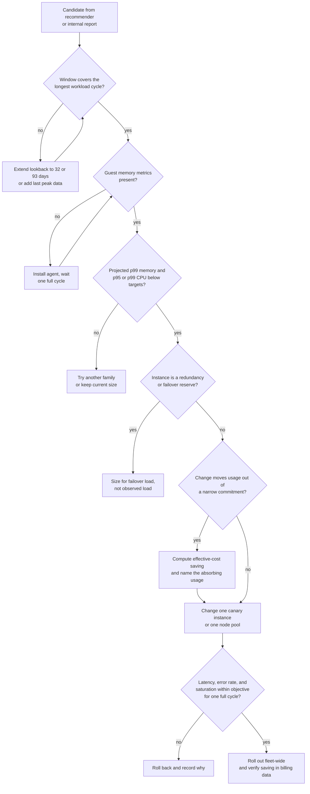

The flow encodes the evidence rules from Section 9.2 as gates and puts the two most common silent failures in their own branches: failover reserves, which are idle by design, and narrow commitments, which make a list-price saving into an effective-cost loss. The canary step matters because projected utilization is an extrapolation. Doubling utilization by halving vCPU assumes linear scaling, but lock contention, garbage collection, and per-core licensing can make the real result worse. The last step closes the loop in billing data, because a change that saves money in theory and is reverted by an autoscaler or a deployment template saves nothing.

### 9.6 Risks and failure modes

| Failure | Cause | Consequence | Control |
|---|---|---|---|
| Memory exhaustion after downsizing | Recommendation computed without guest memory | Out-of-memory kills, swap, outage | Require agent memory data (Section 9.2) |
| Peak missed | Lookback shorter than the business cycle | Month-end or seasonal failure | Lookback covers longest cycle; check last year's peak |
| Burstable credit exhaustion | Moving to a burstable type based on average CPU | Throttled to baseline under sustained load | Check credit balance model; Advisor's burstable criteria compare average and p95 with the baseline |
| Failover reserve shrunk | Standby or zone-spare capacity looks idle | Insufficient capacity during zonal failure | Tag reserves; size them for failover load |
| Narrow commitment stranded | Change of family, Region, or service | Effective cost rises despite smaller resources | Commitment check in the decision record |
| Licensing change | Per-core or per-socket software licenses | License cost or compliance breach | Include license terms in the review |
| Autoscaler fights the change | Minimum or desired capacity set in templates | Change reverted on next deployment | Change the template, not the running resource |
| I/O bottleneck moves | Smaller instance has lower EBS or network bandwidth | Latency rises although CPU is fine | Check instance-level storage and network limits ([Storage](CH06_Storage.md)) |

The repository's [rightsizing review helper](../code/python/cost-optimization-chapter/04_rightsizing.py) encodes a deliberately cautious version of these rules. It flags a resource as a cleanup candidate only when average CPU is below 5% and peak below 15% and the resource is not marked critical; a critical resource with the same profile, such as its `failover-reserve` sample, is sent for review of its reserve purpose instead. A resource with average CPU below 50% and peak below 90%, such as `api-prod` at 42% and 81%, gets "profile memory, latency, and redundancy before resizing," never an automatic resize. That is the right default for automation: tools should propose and humans with workload knowledge should decide.

### 9.7 Rightsizing containers and functions

Containers and functions move the rightsizing decision from machines to declared resources.

In Kubernetes, the cost driver is the **request**, because the scheduler reserves requested CPU and memory on a node whether or not the container uses it, and the shared-cluster allocation model in Section 5.3 charges on the greater of request and usage. Rightsizing therefore means lowering requests toward observed p95 or p99 usage, then letting the cluster autoscaler or node auto-provisioning remove the nodes that requests no longer need. The provider bill falls only at the second step, which is why Section 6.3 separates internal rates from provider charges. Vertical Pod Autoscaler recommendations, OpenCost, and the managed allocation tools in Section 5.5 supply the evidence; [Kubernetes](CH08_Kubernetes.md) owns the request and limit semantics.

For AWS Lambda, memory size also sets CPU share, so a larger setting can finish a CPU-bound function faster at the same or lower cost per invocation; Compute Optimizer recommends Lambda memory sizes. On other serverless platforms, minimum instances are the serverless form of idle capacity. [Serverless](CH11_Serverless.md) owns the execution models.

## 10. Idle and orphaned resources

### 10.1 Idle, orphaned, and forgotten

Rightsizing makes a used resource smaller. Idle-resource work removes resources that deliver nothing. Three kinds are worth distinguishing, because they are detected and cleaned up differently:

- **Idle** resources exist, are attached to something, and do no useful work: a load balancer with no healthy targets or no requests, a NAT gateway in a network whose workloads were moved, a database with no connections for weeks.
- **Orphaned** resources outlived the resource they belonged to: a volume left unattached when its instance was terminated without delete-on-termination, a snapshot of a volume that no longer exists, a public IP address left allocated after its VM was deleted, a disk image nobody launches.
- **Forgotten** environments are whole accounts, subscriptions, projects, or resource groups that someone created for an experiment and never removed. They are often the largest category by cost because they contain a little of everything.

Each kind keeps billing for a mechanical reason. Storage bills per GiB-month whether or not it is attached. Load balancers and NAT gateways on AWS and Azure bill per hour of existence plus per unit of traffic. Public IPv4 addresses bill per hour on all three providers at the time of writing; AWS has charged for every public IPv4 address, attached or not, since February 2024, as [AWS, Section 14](CH01_AWS.md#14-pricing-dimensions) explains. Google Cloud's Cloud NAT is the exception that proves the rule: it charges per VM using the gateway and per gigabyte processed, so an unused Cloud NAT costs little beyond its reserved addresses ([Networking](CH05_Networking.md#6-the-internet-edge-public-addresses-internet-gateways-and-nat)).

### 10.2 Detection signals and provider tools

| Resource | Idle or orphan signal | AWS | Azure | Google Cloud |
|---|---|---|---|---|
| Block volume | Unattached for N days | `describe-volumes` with status `available`; Compute Optimizer idle EBS | Resource Graph `diskState` Unattached | Idle disk recommender; disks with no users |
| Snapshot | Source volume deleted, or older than retention policy | Snapshot age and source; Recycle Bin rules | Snapshot age and source disk | Snapshot age; source disk deleted |
| Public IPv4 address | Allocated, not associated | Unassociated Elastic IP; VPC IP Address Manager public IP insights | Public IP with no IP configuration | Idle IP address recommender |
| Load balancer | No healthy targets or near-zero requests for N days | Trusted Advisor idle load balancer check (support-plan dependent); CloudWatch request count | Metrics on backend pool and data path | Load balancer request metrics |
| NAT gateway | Near-zero bytes processed for N days | Compute Optimizer idle NAT gateway | NAT Gateway byte metrics | Small cost unless addresses are reserved |
| VM | CPU and network near zero for N days | Compute Optimizer idle EC2 | Advisor shutdown recommendation | Idle VM recommender, 14-day default observation |
| Database | No connections for N days | Compute Optimizer idle RDS | Advisor and connection metrics | Cloud SQL idle instance recommender |
| Project or account | No meaningful activity, or owner departed | Account activity in audit logs | Subscription activity log | Unattended project recommender |

Google Cloud documents that idle recommendations for disks, IP addresses, and custom images begin 15 days after the resource is created and are refreshed every 24 hours ([Idle resource recommendations](https://docs.cloud.google.com/compute/docs/viewing-and-applying-idle-resources-recommendations)), and that idle VM recommendations use a 14-day observation period by default. AWS Compute Optimizer added idle recommendations for EC2, Auto Scaling groups, EBS volumes, ECS services on Fargate, and RDS in late 2024, and has since added NAT gateways and other resource types ([Idle resource recommendations](https://docs.aws.amazon.com/compute-optimizer/latest/ug/view-idle-recommendations.html)). Azure Advisor's shutdown recommendation (Section 9.3) covers idle VMs; for orphaned disks, addresses, and network interfaces most organizations run Azure Resource Graph queries.

Inventory queries are simple and worth running daily across every account, subscription, and project:

```bash
# AWS: unattached EBS volumes in one Region
aws ec2 describe-volumes --filters Name=status,Values=available \
  --query "Volumes[].{id:VolumeId,gib:Size,created:CreateTime}" --output table

# Google Cloud: persistent disks with no attached instance
gcloud compute disks list --filter="-users:*" --format="table(name,zone,sizeGb)"
```

```kusto
// Azure Resource Graph: unattached managed disks across subscriptions
Resources
| where type =~ 'microsoft.compute/disks'
| where properties.diskState =~ 'Unattached'
| project name, resourceGroup, subscriptionId, sku = tostring(sku.name),
          sizeGb = toint(properties.diskSizeGB)
```

Detection has two traps. First, **"idle" is a threshold, not a fact.** A disaster recovery database with no connections and a pilot-light environment with no traffic are idle by design. Second, **a metric of zero can mean missing data.** A VM that stopped sending metrics because its agent failed looks identical to one that has nothing to do. Cross-check idle signals with a second source, such as audit-log activity or flow logs, before acting.

### 10.3 Automated cleanup with safety

Cleanup automation removes cost reliably only if people trust it, and they trust it only if it never deletes something they needed. The lifecycle below makes every destructive step reversible for a period, and makes the irreversible steps explicit.

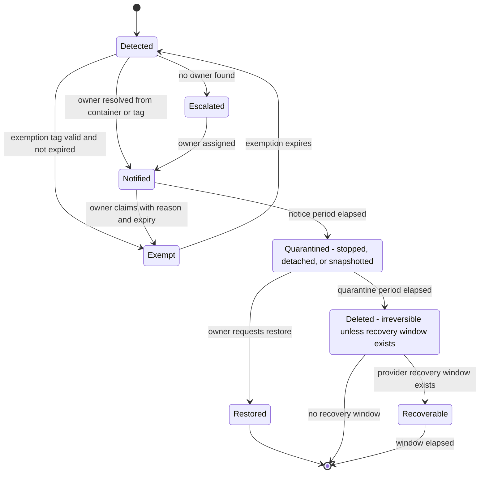

The state machine has four properties that a cleanup design needs:

1. **Owner first.** The owner is found from the container key and tags, using the same model as allocation (Section 4). Resources with no owner are escalated, not deleted, because an unowned resource in a production account is more likely to be a gap in the owner directory than true waste.
2. **Quarantine before delete.** Quarantine means the cheapest reversible state: stop a VM, snapshot and detach a volume, remove a load balancer's listener, apply a deny policy to a sandbox. A snapshot of a 500 GiB volume typically costs a fraction of the volume, depending on how much data it holds, and buys weeks of reversibility.
3. **Exemptions expire.** An exemption tag such as `cleanup-exempt-until=2025-09-30` with a reason is reviewed when it expires. Permanent exemptions accumulate until the exemption list is the waste list.
4. **Irreversible steps are labeled.** Some deletions cannot be undone. Releasing a public IP address is the clearest case: the address returns to the provider's pool, and any partner allowlist or Domain Name System (DNS) record that referenced it breaks permanently. Treat address release as a separate, human-approved action. Provider recovery windows reduce the risk for other resources: AWS Recycle Bin can retain deleted EBS snapshots and Amazon Machine Images (AMIs) under retention rules, a deleted Google Cloud project enters a pending-deletion period of about 30 days during which it can be restored, and a closed AWS account can be reopened during its post-closure period. Verify each window in current documentation before relying on it.

Notice and quarantine periods should scale with the environment class. A common policy is 3 days' notice and 7 days' quarantine in sandboxes, 7 and 14 in development, and no automatic action in production, where cleanup produces a ticket for the owning team.

### 10.4 Worked example: a monthly idle sweep

A first organization-wide sweep across 120 accounts finds the following, at illustrative list prices:

| Finding | Quantity | Illustrative rate | Monthly cost |
|---|---|---|---|
| Unattached general-purpose SSD volumes | 42 TiB | $0.08 per GiB-month | 42 × 1,024 × 0.08 = $3,440.64 |
| Snapshots older than the 90-day retention policy, no legal hold | 95 TiB (logical) | $0.05 per GiB-month | up to $4,864.00 |
| Unassociated public IPv4 addresses | 210 | $0.005 per hour | 210 × 0.005 × 730 = $766.50 |
| Load balancers with no requests for 30 days | 9 | $0.0225 per hour | 9 × 0.0225 × 730 = $147.83 |
| NAT gateways in decommissioned development networks | 3 | $0.045 per hour | 3 × 0.045 × 730 = $98.55 |
| Forgotten sandbox accounts | 6 | measured | $2,100.00 |
| **Total** | | | **up to $11,417.52** |

Two corrections make the estimate honest. Snapshots on all three providers are incremental: each snapshot stores only blocks changed since the previous one, and deleting a snapshot frees only blocks that no other snapshot references. The $4,864 is therefore an upper bound; the realized saving shows up in the next billing period and is often a fraction of it, which is why the sweep reports "estimated" and "verified" savings separately. Second, the 210 addresses include 14 referenced in partner allowlists, found by searching configuration repositories and the owner survey. Those were moved to an exemption with an owner rather than released.

The sweep also changes behavior. After it, the platform team sets delete-on-termination for data volumes in launch templates where data is disposable, adds a snapshot lifecycle policy with the 90-day retention, and turns the sweep into a daily job that feeds the state machine above. The first sweep found $11,400; the daily job keeps the number below $1,000 a month, which is the real saving.

### 10.5 Schedules for non-production

Many non-production resources are not idle; they are idle outside working hours. A development environment used 10 hours a day on 5 weekdays runs 50 of 168 hours, so stopping it outside those hours removes 70% of its compute cost. Storage, addresses, and anything that bills per hour of existence keep charging, so the realized saving is lower than 70% of the environment's total.

Schedules are implemented with provider schedulers (AWS Instance Scheduler, Azure Automation or the Start/Stop VMs v2 solution, Compute Engine instance schedules), autoscaling groups scaled to zero, or Kubernetes node pools scaled down with the workloads. The safety rules are the same as for cleanup: the schedule comes from a tag the owner controls, a person can override it for a night, and stopped is never confused with deleted.

## 11. Data transfer, NAT, and storage lifecycle in billing data

### 11.1 Recap: transfer price depends on the path

Data transfer is priced by the path a byte takes, not by the service that sent it. Traffic within a zone is usually free; traffic between zones, between Regions, and to the internet is charged at increasing rates; a NAT gateway adds a per-gigabyte processing charge on top of egress; and private endpoints to provider services replace NAT processing with either no charge (AWS gateway endpoints) or a smaller per-hour and per-gigabyte charge (interface and private endpoints). The full price map and worked estimates are in [AWS, Section 14](CH01_AWS.md#14-pricing-dimensions), and the routing mechanics that decide which path a byte takes are in [Networking](CH05_Networking.md#6-the-internet-edge-public-addresses-internet-gateways-and-nat) and its section on [private access to provider services](CH05_Networking.md#10-private-access-to-provider-services).

This chapter's concern is finding transfer cost in billing data and attributing it. Transfer is the hardest category to allocate because many transfer lines have no useful resource ID, the cost appears under the sending service rather than under "networking", and one architectural decision, such as a missing endpoint, can spread small charges across dozens of accounts.

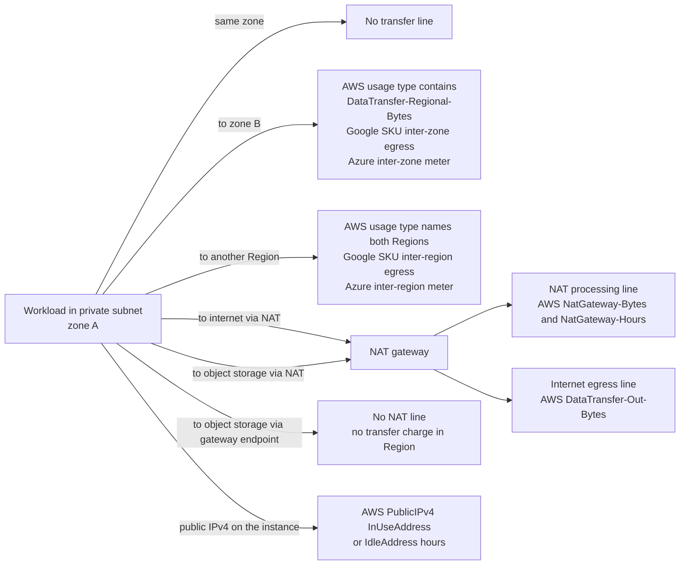

The diagram maps network paths to the billing lines they produce. It is a diagnostic map: when a transfer category rises, the usage type or SKU description tells you which edge the bytes took, and the edge tells you which architectural fix applies. The AWS usage-type fragments shown are prefixed with a Region code in real data (for example `USE1-`), and Azure meter and Google Cloud SKU names change over time, so production queries should match on stable identifiers from the provider's price list rather than on description text. Note the edge from the workload to object storage through NAT: it produces a NAT processing line but no egress line, because same-Region traffic from the NAT gateway to object storage is not charged as internet egress. The NAT processing charge is the whole cost of the missing endpoint, which is why it is so often overlooked.

### 11.2 Finding and attributing transfer cost

In a FOCUS dataset, transfer charges are rows whose `ServiceCategory` is `Networking` or whose `SkuId` and `ChargeDescription` identify a transfer meter, regardless of which `ServiceName` sold them. A first query groups them by sub-account and description:

```sql
SELECT
  SubAccountId,
  ChargeDescription,
  SUM(ConsumedQuantity) AS quantity,
  SUM(EffectiveCost)    AS effective_cost
FROM focus_cost
WHERE BillingPeriodStart = DATE '2025-03-01'
  AND (ServiceCategory = 'Networking'
       OR LOWER(ChargeDescription) LIKE '%data transfer%')
GROUP BY 1, 2
ORDER BY effective_cost DESC
LIMIT 50;
```

**Worked example.** The query shows one account where 184,320 GB crossed between Availability Zones in a month. AWS's published us-east-1 rate is $0.01 per GB charged on the sending side and $0.01 per GB on the receiving side, so each crossing gigabyte costs $0.02 and the month costs 184,320 × 0.02 = $3,686.40. Flow logs aggregated by source and destination subnet show that 85% of it is between an API tier in zone A and a cache cluster whose primary node is in zone B. Two fixes are possible. Zone-aware routing to cache replicas in the same zone removes most of the traffic at the cost of reading from replicas, which are slightly stale. Placing the primary in zone A removes it for that tier but recreates the problem for the tier in zone C. The team chooses replica reads for idempotent lookups and keeps primary reads for the few consistency-sensitive paths, cutting the line by about 70%, roughly $2,580 a month. The fix is an architecture decision with a consistency trade-off, which is why transfer cost needs an owner who understands the workload, not only a FinOps analyst.

Attribution rules for transfer follow Section 5: lines in exclusively owned containers go to the container's owner; lines in a shared network hub use the attachment-and-bytes rule from Section 5.4; and organization-wide internet egress through a central egress point is split by bytes from flow logs or firewall logs.

### 11.3 Recap: storage lifecycle economics

Storage classes trade a lower per-GiB-month price for higher retrieval charges, minimum storage durations, minimum billable object sizes, and, for offline archive classes, restore delays. [Storage, Section 7](CH06_Storage.md#7-storage-classes-and-lifecycle-tiering) owns the class models, lifecycle engines, and a worked calculation of when tiering pays. Three billing-data consequences belong here:

1. **Lifecycle has its own charges.** Transition requests are billed per request on S3 and Cloud Storage. Moving 50 million small objects to an archive class at an illustrative $0.05 per 1,000 transitions costs 50,000 × 0.05 = $2,500 once. If the objects average 64 KiB, they total about 3,052 GiB, and saving an illustrative $0.019 per GiB-month takes about 2,500 / (3,052 × 0.019) ≈ 43 months to repay. Small objects should be aggregated before tiering, or left in place.
2. **Early deletion and retrieval appear as separate lines.** Deleting or moving an object before its class's minimum duration produces an early-deletion charge, and reads from cold classes produce retrieval lines. A rise in either is a signal that a lifecycle rule is wrong, typically a transition age shorter than the real access pattern.
3. **Hidden storage is orphaned storage.** Noncurrent object versions in versioned buckets, incomplete multipart uploads, and soft-deleted blobs keep billing. They do not show up in object counts that list only current versions, so they belong in the idle sweep of Section 10, with lifecycle rules that expire noncurrent versions and abort incomplete uploads after a fixed number of days.

Storage lines carry the bucket or account name as the resource ID on all three providers, so container-based and tag-based allocation work well for storage. The exception is shared buckets, such as a data lake used by many teams, which need prefix-level usage from storage inventory reports (S3 Inventory or Storage Lens, Azure blob inventory, Cloud Storage Insights) as the driver for a usage-based split.

## 12. Cost anomaly detection and response

### 12.1 Anomalies versus budgets

A budget compares spend with a **plan**. An anomaly detector compares spend with **expected behavior** learned from history. The two catch different problems. A team that doubles its spend by launching an approved product stays inside a budget raised for the launch and triggers an anomaly; a team whose spend rises 3% a week for six months never triggers an anomaly and eventually breaches its budget. An organization needs both, plus the telemetry alarms from Section 3.5, which act in minutes.

An anomaly detector has three parts: a **forecast** of expected cost for each monitored series (usually daily, per service, account, or tag value), an **interval** around the forecast outside which a value is anomalous, and an **impact filter** that suppresses anomalies too small to act on. Azure's documentation classifies the changes worth investigating as new costs (a series starting from zero), removed costs (a series ending at zero), and changed costs ([Identify anomalies and unexpected changes](https://learn.microsoft.com/en-us/azure/cost-management-billing/understand/analyze-unexpected-charges)). The classification is useful on every provider, because each type has typical causes: new costs come from launches and mistakes, removed costs from decommissions and outages, and changed costs from scaling, configuration changes, and price or discount changes.

### 12.2 Provider anomaly detection

**AWS Cost Anomaly Detection** uses machine learning (ML) models over Cost Explorer data, accounting for weekly and monthly seasonality and natural growth ([AWS Cost Anomaly Detection](https://docs.aws.amazon.com/cost-management/latest/userguide/manage-ad.html)). You define **monitors** that evaluate each AWS service independently, or specific member accounts, cost allocation tags, or cost categories, and **alert subscriptions** with an absolute or percentage impact threshold, delivered individually through SNS (and from there to chat or Amazon EventBridge) or as daily or weekly email summaries. AWS documents at the time of writing that detection runs about three times a day after billing data is processed, evaluates net unblended cost, can take up to 24 hours to detect an anomaly after usage occurs, needs 24 hours after a new monitor is created, and needs 10 days of history before it can detect anomalies for a newly used service. Root-cause analysis ranks contributors by service, account, Region, and usage type. It does not monitor most AWS Marketplace charges, which need a budget instead.

**Azure Cost Management anomaly detection** runs for subscriptions and surfaces results as insights in Cost analysis smart views. Microsoft documents that it evaluates each subscription daily, compares the day's total with a forecast trained on the last 60 days, uses a deep-learning model (WaveNet) that differs from the Cost Management forecast, and runs 36 hours after the end of the day in Coordinated Universal Time (UTC) so that the data set is complete ([Identify anomalies and unexpected changes](https://learn.microsoft.com/en-us/azure/cost-management-billing/understand/analyze-unexpected-charges)). An **anomaly alert** rule sends an email once, at detection, summarizing resource-group changes. Creating one needs Cost Management Contributor or the `Microsoft.CostManagement/scheduledActions/write` permission, and the email is sent based on the creator's access when it is sent, so Microsoft suggests a service principal and the Scheduled Actions API where standing privileges are not allowed. Delivery is email, so automation means parsing the email (for example with Logic Apps) or polling the Cost Management query API. Anomaly alerts are not available in Azure Government at the time of writing.

**Google Cloud cost anomaly detection** runs on the Cloud Billing account and shows anomalies for its projects in an Anomalies dashboard with root-cause analysis ([View and manage cost anomalies](https://docs.cloud.google.com/billing/docs/how-to/manage-anomalies)). It evaluates usage cost at the billing account's on-demand rates, including negotiated pricing and spend-based CUD discounts but excluding credits such as resource-based CUD credits, promotions, and sustained use discounts. You can set thresholds by cost impact and by percentage deviation, give feedback on detected anomalies, and configure notifications. For some AI services, such as the Gemini API and Vertex AI, a preview of **early anomalies** uses near-real-time cost estimates to give daily service-level signals before billing is finalized. Viewing anomalies needs billing permissions, such as Billing Account Viewer for the whole account, or billing-specific permissions on a project.

Three differences matter in design. The cost measure differs: net unblended on AWS, the subscription's cost on Azure, and gross on-demand usage cost on Google Cloud, so a credit expiry or commitment change can look anomalous on one provider and invisible on another. The scope differs: AWS monitors can follow tags and cost categories that match your allocation model, Azure's built-in detection is per subscription, and Google's is per billing account with project drill-down. And the latency differs: from several times a day on AWS to more than 36 hours after the end of the day on Azure.

### 12.3 Designing detection that people act on

A detector that pages the wrong person, or the right person too often, is turned off within a month. Four rules keep it useful:

1. **Align monitors with allocation.** Each monitor should correspond to an owner from Section 4: an account, a cost category, or an owner tag. An anomaly in "Amazon EC2 across the organization" has no owner; an anomaly in "Cost category Product = Checkout" does.
2. **Set thresholds by impact, then by percentage.** A $50 jump in a $40-a-day sandbox is a 125% change and not worth a page. A 4% jump in a $30,000-a-day production estate is $1,200 a day and worth an investigation. Combine an absolute floor with a percentage condition.
3. **Annotate expected changes in advance.** Launches, load tests, migrations, and commitment purchases should be recorded with dates and expected cost in a change calendar, so triage can close expected anomalies quickly and so the record trains people to announce cost changes.
4. **Route to the owner and to FinOps.** The owner can explain and fix; the FinOps team sees patterns across owners, such as a price change that affects everyone.

**Worked example: choosing a threshold.** A product team's daily effective cost over 60 days has a mean of $1,300 and a standard deviation of $90 after removing weekly seasonality. An alert at three standard deviations fires above about $1,570 a day. A runaway job adding $400 a day is caught on its first full day. A slow leak adding $60 a day is not caught by the anomaly detector at all, because it shifts the baseline gradually. It is caught by the budget's forecasted-cost threshold (Section 7.5) after about two weeks, when 30 × 60 = $1,800 of monthly overrun becomes visible against a budget set with less than that margin. The detectors are complementary by design.

### 12.4 The anomaly and budget response workflow

Detection is half the control. The other half is a response workflow that turns an alert into a contained cost and a recorded cause. The workflow applies equally to anomaly alerts, budget threshold alerts, and telemetry alarms on cost drivers.

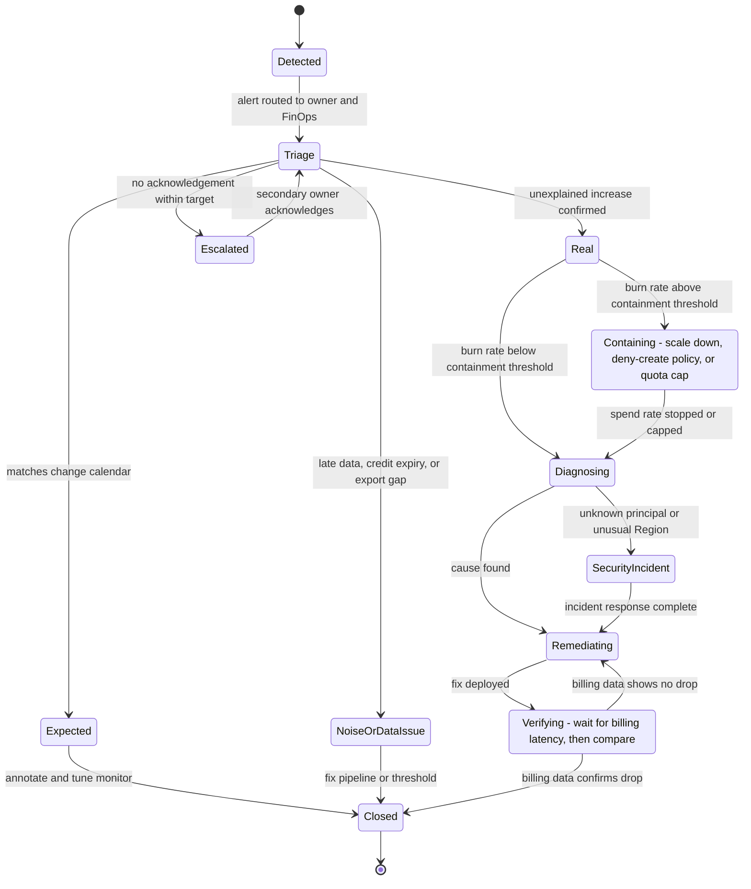

The state machine makes six decisions explicit:

- **Triage separates data problems from spend problems.** A spike that is really a late-arriving batch of usage, an expired credit, or a broken export needs a pipeline fix, not a workload fix. Checking the export's freshness timestamp (Section 3.6) is the first triage step.
- **Containment is conditional on burn rate.** A $40-a-day anomaly can wait for diagnosis during business hours. A $400-an-hour anomaly is contained first, using the cheapest reversible action: scale to zero, a deny-create policy, or a temporary quota cap (Section 14.3). Containment in production follows the environment-class rule from Section 7.3: page the owner rather than act automatically.
- **Escalation has a timer.** If the owner does not acknowledge within a target, such as 4 business hours for low severity and 30 minutes for high severity, the alert moves to a secondary owner. Departed owners are the most common reason anomalies are ignored.
- **Some anomalies are security incidents.** Unexpected accelerator instances in an unused Region, created by an unfamiliar principal, are the signature of compromised credentials used for cryptocurrency mining. The workflow hands these to security incident response instead of treating them as waste. [Monitoring](CH10_Monitoring.md) and [Alerting](../14_Observability/CH10_Alerting.md) own on-call routing and incident mechanics; this workflow uses them.
- **Verification waits for billing data.** A fix is confirmed only when billing data for a full period after the fix shows the drop. Because of the latency in Section 3.5, verification is scheduled one to two days after remediation, not checked immediately.
- **Closure records cause and cost.** Each closed anomaly records its cause category, total cost, time to detect, time to contain, and whether the monitor or threshold changed. Those records are how the organization learns which controls are missing.

### 12.5 Worked timeline: detection latency in practice

A deployment at 10:00 on Tuesday changes a log level to debug in a high-volume service. Log ingestion rises from 2 TB to 14 TB a day, at an illustrative $0.50 per GB ingested, adding about 12 × 1,024 × 0.50 = $6,144 a day, or $256 an hour.

| Time | Event | Cumulative excess |
|---|---|---|
| Tuesday 10:00 | Deployment | $0 |
| Tuesday 10:15 | Ingestion-volume alarm on bytes ingested fires (if configured) | about $64 |
| Wednesday early morning | AWS anomaly run after billing data is processed shows the Tuesday increase | about $4,500 to $5,500 |
| Thursday around 12:00 UTC | Azure-style daily detection, 36 hours after the end of Tuesday UTC | about $12,800 |
| Month end | Budget threshold breached, if nobody acted | tens of thousands of dollars |

With only billing-based detection, the cost of this mistake is one to two days of excess, $6,000 to $13,000. With an ingestion alarm, which [Monitoring, Section 9](CH10_Monitoring.md#9-retention-routing-and-cost) recommends for exactly this reason, it is about $64 plus response time. The anomaly detector is still valuable: it catches the cases nobody thought to instrument. But the timeline shows why the anomaly workflow must start from the assumption that the alert is late, and why containment should be the first question in triage.

### 12.6 Measuring the response

Four metrics show whether the workflow works, and they should be reported monthly beside spend:

- **Time to detect**: from the start of excess spend to the first alert. Long times mean missing telemetry alarms.
- **Time to contain**: from alert to the spend rate returning to baseline. Long times mean unclear ownership or missing containment actions.
- **Cost of anomalies**: excess spend summed over closed real anomalies. This is the number that justifies investment in controls.
- **Noise ratio**: anomalies closed as expected or as data issues, divided by all anomalies. A ratio above about one half means thresholds or the change calendar need work.

## 13. Cost per successful workload outcome

### 13.1 Definition

Total cost tells you how much you spent. It does not tell you whether the spending was efficient, because cost should rise when the business grows. **Cost per successful workload outcome** divides a workload's fully allocated effective cost by the number of outcomes it delivered that met its objectives:

> unit cost = (direct effective cost + allocated shared cost) / successful outcomes in the same period

Each term has a precise meaning:

- **Direct effective cost** is the amortized cost of the workload's own containers and tagged resources (Sections 2.3 and 4), so commitment purchases do not distort a month.
- **Allocated shared cost** is the workload's share of shared pools under the published rules (Section 5). Leaving it out makes workloads on shared platforms look cheaper than workloads that own their infrastructure.
- **Successful outcomes** are business-meaningful units that completed and met the workload's service-level objective (SLO): orders placed and confirmed, images processed within the deadline, API calls answered with a non-error response within the latency objective. [SLOs](../14_Observability/CH11_SLO.md) defines how the objective itself is set.

The word "successful" is the important part. A denominator of attempts or requests rewards a system for doing failed work cheaply. Retries, timeouts, and failed jobs consume resources and deliver nothing, so they belong in the numerator and not in the denominator. A unit cost built this way rises when reliability falls, which ties cost and reliability into one number that both finance and engineering can act on.

### 13.2 Worked example: allocation, unit cost, and the effect of failures

The repository's [unit-cost calculator](../code/python/cost-optimization-chapter/01_unit_cost.py) computes the base case for two workloads:

| Workload | Direct cost | Shared units | Shared cost ($2,400 × share) | Total | Successful outcomes | Cost per success |
|---|---|---|---|---|---|---|
| Orders | $7,200 | 60 | $1,440 | $8,640 | 120,000 orders | $0.07200 |
| Catalog | $4,100 | 40 | $960 | $5,060 | 500,000 lookups | $0.01012 |

The two unit costs are not comparable with each other, because an order and a catalog lookup are different outcomes. Each is comparable with its own history and with design alternatives for the same workload.

Now extend the Orders case to show why the denominator must count successes. In the following month, a dependency upgrade causes intermittent payment-provider timeouts. The order service retries each failed call up to three times, and 8% of orders still fail. Attempts rise to 132,000 for the same 120,000 customer intents, and successful orders fall to 110,400.

1. Variable cost scales with attempts. Suppose $5,000 of the $7,200 direct cost is variable. It rises to 5,000 × 132,000 / 120,000 = $5,500, plus about $700 of extra compute and log volume from the retries. Direct cost becomes 2,200 + 5,500 + 700 = $8,400.
2. Shared cost is unchanged at $1,440. Total cost is $9,840.
3. Cost per attempt is 9,840 / 132,000 = $0.0745, up 3.5% from $0.0720. It looks like normal growth.
4. Cost per successful order is 9,840 / 110,400 = $0.0891, up 23.8%. It shows the real problem.

Cost per attempt hides the incident; cost per successful outcome exposes it. The same metric also shows when a reliability investment pays: if a circuit breaker and a better timeout reduce failures to 1% at a cost of $300 a month, successful orders return to about 118,800 and unit cost falls to roughly (8,640 + 300) / 118,800 ≈ $0.0753.

### 13.3 Choosing denominators and handling fixed cost

A good denominator has four properties: it measures value the business recognizes, it is counted by the workload's own telemetry with the same period boundaries as billing data, it moves with the cost drivers, and the owning team can influence it. Typical choices:

| Workload type | Denominator | Notes |
|---|---|---|
| Transactional service | Successful business transactions (orders, payments) | Exclude test traffic and synthetic checks |
| API platform | Successful calls within the latency objective, per tier | Weight by tier when cost differs by tier |
| Batch or data pipeline | Records or jobs processed by the deadline | A late job is a failed outcome |
| ML inference | Successful predictions or tokens served within objective | Separate cost per training run from cost per inference |
| Multi-tenant software as a service (SaaS) | Active tenants or tenant-weighted usage | Feeds pricing and margin; see [Pricing](../02_Design_Thinking_and_Product_Management/CH29_Pricing.md) |

Three subtleties appear in every implementation:

- **Fixed cost makes unit cost fall with volume.** A workload with $6,000 of fixed cost and $0.02 of variable cost per outcome costs $0.08 per outcome at 100,000 outcomes and $0.035 at 400,000. A falling unit cost during growth is expected and is not evidence of optimization. Report **marginal cost** (the variable part) beside average unit cost, because marginal cost is what pricing and capacity decisions need.
- **Period alignment.** Billing data for the last days of a month is incomplete until the export catches up (Section 3.5). Compute unit cost for closed periods, or use the freshness timestamp to exclude incomplete days from both numerator and denominator.
- **Denominator integrity.** A unit-cost metric is a target for gaming. If a team can raise its denominator by counting retried requests or health checks, it will. The denominator query belongs in the same versioned, reviewed pipeline as the allocation rules.

### 13.4 Workload objective versus cost frontier

Every design option for a workload has a cost and a level of objective attainment: availability, latency, durability, recovery time. Plotting options on those two axes shows that some options are **dominated**: another option is cheaper and at least as good on the objective. The non-dominated options form the **frontier**. Optimization has two different moves, and confusing them causes most arguments between finance and engineering:

- **Moving to the frontier** removes waste without giving up any objective: rightsizing, cleanup, commitments, endpoints. Nobody should object to these.
- **Moving along the frontier** trades objective for cost or cost for objective. These are business decisions, and they need the owner of the objective in the room.

**Worked example.** A checkout service handles 3,000,000 successful orders a month at an average contribution margin of $4 per order. The team evaluates five designs. Availability here is the measured or modeled monthly availability of the order path, and lost orders are approximated as (1 − availability) × orders, which assumes outages are spread evenly over traffic; peak-hour outages cost more.

| Option | Design | Monthly cost | Availability | Lost orders | Lost margin | Cost plus lost margin | Cost per successful order |
|---|---|---|---|---|---|---|---|
| A | Single zone | $18,000 | 99.5% | 15,000 | $60,000 | $78,000 | 18,000 / 2,985,000 = $0.00603 |
| B | Three zones, current sizing | $24,000 | 99.95% | 1,500 | $6,000 | $30,000 | $0.00800 |
| C | Three zones, rightsized, Arm instances, floor commitment | $19,500 | 99.95% | 1,500 | $6,000 | $25,500 | $0.00650 |
| D | C plus warm standby in a second Region | $31,000 | 99.99% | 300 | $1,200 | $32,200 | $0.01033 |
| E | Active-active in two Regions | $44,000 | 99.995% | 150 | $600 | $44,600 | $0.01467 |

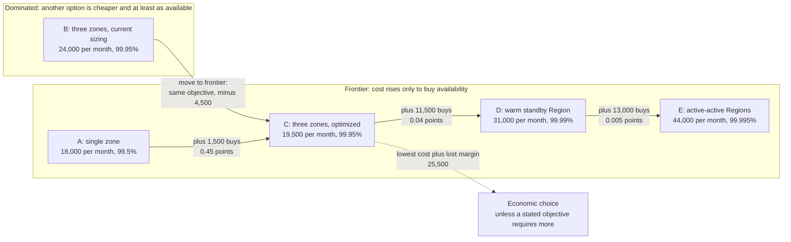

The diagram separates the two kinds of move. The dashed edge from B to C is pure optimization: same availability for $4,500 a month less, achieved with the rightsizing, commitment, and architecture techniques in Sections 8 and 9. The edges along the frontier are trades, and each buys less objective per dollar than the one before: $1,500 buys 0.45 percentage points of availability between A and C, while $13,000 buys 0.005 points between D and E. Under the lost-margin model, C has the lowest total of cost plus lost margin. Option D becomes the right choice if the business has a stated recovery objective for a regional outage, a contractual service level, or a regulatory requirement that C cannot meet, which is why the objective's owner must make that decision. The model ignores reputational cost and peak-hour concentration, both of which push toward D; state those assumptions in the decision record rather than hiding them in the numbers.

The frontier view also explains why cost per successful order is not minimized by the cheapest design. Option A has the lowest unit cost and the highest total economic cost, because its failures are paid for in lost orders rather than on the cloud bill. The workload-level trade-off across cost, performance, and sustainability is developed further in [Cloud Cost, Performance, and Sustainability Architecture](../10_Cloud_Architecture/CH13_Cloud_Cost_Performance_and_Sustainability_Architecture.md); this chapter supplies the billing data and the unit-cost measure that analysis depends on.

### 13.5 Operating unit economics

Unit cost becomes useful when it is published, owned, and reviewed:

1. **Publish** unit cost per workload weekly for closed days and monthly for closed periods, with the numerator's cost measure and the denominator's definition next to the number.
2. **Set direction, not absolute targets**, at first. "Cost per successful order should not rise faster than 2% a quarter at constant volume" is defensible; "$0.006 per order" invented before measurement is not.
3. **Review in architecture decisions.** Design reviews for significant changes should state the expected effect on unit cost and on the frontier position, and the post-implementation review should compare the result.
4. **Watch the denominator as closely as the numerator.** A unit-cost jump caused by falling successes is a reliability incident, and the anomaly workflow in Section 12.4 should route it to the service owner as one.

## 14. Governance: operating model, guardrails, and quotas

### 14.1 The FinOps Framework as an operating model

The FinOps Foundation publishes the **FinOps Framework**, an operating model for managing technology spend ([FinOps Framework](https://www.finops.org/framework/)). It is useful here less as a methodology to adopt wholesale than as a shared vocabulary for who does what. Its main elements at the time of writing are:

- **Principles**, such as teams collaborating, everyone taking ownership of their usage, and decisions being driven by business value.
- **Phases**: **Inform** (visibility, allocation, benchmarking, forecasting), **Optimize** (rates and usage), and **Operate** (continuous governance, automation, and improvement). The phases are iterative: an organization cycles through them repeatedly, and different workloads can be in different phases.
- **Domains**, which describe outcomes: Understand Usage and Cost, Quantify Business Value, Optimize Usage and Cost, and Manage the FinOps Practice. Each domain contains capabilities such as allocation, anomaly management, budgeting, unit economics, rate optimization, and workload optimization ([FinOps Domains](https://www.finops.org/framework/domains/)).
- **Personas**: the core personas are the FinOps practitioner, engineering, finance, product, procurement, and leadership. Allied personas such as information technology (IT) asset management, IT financial management, sustainability, IT service management, and security intersect with FinOps without being part of it ([FinOps Personas](https://www.finops.org/framework/personas/)).
- **Maturity** expressed as crawl, walk, and run for each capability, and **Scopes**, a recent addition that applies the framework to segments of technology spend such as public cloud, SaaS, licensing, and data centers.

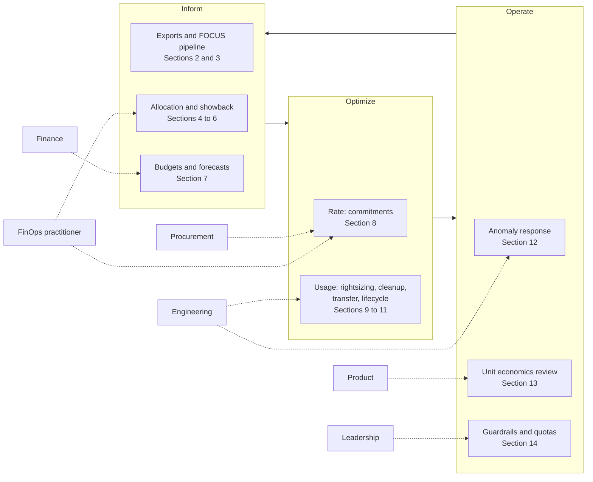

The diagram maps this chapter onto the framework's three phases and shows which persona leads each activity. The loop matters more than the boxes: optimization changes the data that Inform reports, and Operate's anomaly records and unit-cost reviews decide what to optimize next. The persona edges show the main division of labor. The FinOps practitioner runs the data platform and the commitment program, engineering owns usage optimization and anomaly response for its workloads, finance owns budgets and forecasts, procurement joins commitment and contract decisions, product owns unit-cost targets, and leadership sets the guardrail policy and arbitrates trade-offs along the frontier in Section 13.4. In a small organization one person may hold several personas; the activities still need an owner each.

The framework is vendor-neutral and does not prescribe tools. Its practical value for an architect is a checklist of capabilities and a way to describe maturity. "Allocation at walk: container keys and tags cover 93%, shared Kubernetes cost allocated by requests" is a statement a leadership team can track.

### 14.2 Policy guardrails

Policy guardrails stop expensive mistakes at creation time, before any billing data exists. They complement budgets and anomalies, which act after cost is incurred. The mechanisms and their evaluation order are owned by [Landing Zones](CH15_Landing_Zones.md) and the provider chapters; the cost-relevant uses are:

- **Allowed Regions.** Deny resource creation outside approved Regions. This limits data-residency risk and removes a common anomaly source: resources launched in an unmonitored Region by a compromised credential.
- **Allowed SKUs and families by environment.** Deny accelerator instances, very large instances, and premium storage tiers in sandbox and development scopes unless an exception exists.
- **Required tags or labels.** Deny or flag creation without the owner and cost-center keys (Section 4.5).
- **Commitment purchase rights.** Restrict who can buy Savings Plans, Reserved Instances, Azure reservations and savings plans, and Google Cloud CUDs. A commitment is a multi-year financial obligation that most identities should not be able to create.

An AWS service control policy for a sandbox OU that limits instance types and Regions looks like this:

```json
{
  "Version": "2012-10-17",
  "Statement": [
    {
      "Sid": "DenyNonApprovedInstanceTypes",
      "Effect": "Deny",
      "Action": "ec2:RunInstances",
      "Resource": "arn:aws:ec2:*:*:instance/*",
      "Condition": {
        "StringNotLike": { "ec2:InstanceType": ["t3.*", "t4g.*", "m7g.large", "m7g.xlarge"] }
      }
    },
    {
      "Sid": "DenyCommitmentPurchases",
      "Effect": "Deny",
      "Action": ["savingsplans:CreateSavingsPlan", "ec2:PurchaseReservedInstancesOffering"],
      "Resource": "*"
    }
  ]
}
```

A Region restriction uses the `aws:RequestedRegion` condition key with exemptions for global services; [IAM](CH09_IAM.md) explains how SCPs combine with identity policies. On Azure, the built-in **Allowed virtual machine size SKUs** policy and the **Allowed locations** policy, assigned with the `deny` effect at a management group, give the same controls, and reservation purchase is limited by the billing roles and the Reservation Purchaser role. On Google Cloud, the `gcp.resourceLocations` organization policy constraint restricts locations, custom organization policy constraints can restrict resource properties for supported resource types, and `compute.commitments.create` is the permission to control for CUD purchases.

Guardrails have their own failure mode: a rule that is too strict blocks legitimate work and creates an exception queue, and teams route around it. Roll out cost guardrails in audit mode first, measure what they would have blocked, and convert to deny when the false-positive rate is acceptable. [Landing Zones, Section 8](CH15_Landing_Zones.md#8-guardrail-rollout) owns that rollout procedure.

### 14.3 Quotas as spend guardrails

A quota limits how much of a resource can exist. It is the only control in this chapter that bounds the **rate** of spend directly and acts in real time, because it is enforced by the provider's control plane at creation, not by billing data hours later. Section 3.5 showed that a quota on accelerator vCPUs caps the burn rate of a runaway job regardless of detection; this section shows how to set quotas for that purpose.

The providers expose quotas differently:

- **AWS Service Quotas** holds per-account, per-Region limits, including vCPU-based quotas for On-Demand and Spot instances by instance-family category. Quotas are raised through requests; there is no general self-service mechanism to lower an account's quota below its default, so caps below the default are implemented with SCPs (Section 14.2). Service Quotas publishes usage metrics to CloudWatch, which can alarm as usage approaches a quota.
- **Azure quotas** are per subscription and Region, including total regional vCPUs and vCPUs per VM family. They are raised through requests, and quota usage can be monitored with alerts.
- **Google Cloud quotas** are per project, and often per Region, for resources such as CPUs and specific GPU models. Google Cloud lets you lower a quota value for a project, which makes a quota a true spending cap that you control. Some services, such as BigQuery, also offer custom quotas, for example on the bytes a project or a user can query per day, which bound on-demand query cost directly.

**Worked example: sizing an accelerator quota.** A research team's largest planned training run uses 2 instances with 8 GPUs each, 16 GPUs in total. At an illustrative $4 per GPU-hour, a quota of 16 GPUs bounds the maximum burn rate at 16 × 4 = $64 per hour, or $1,536 per day, whatever happens. The team asks for 24 to allow a debugging run alongside a training run. That raises the bound to $96 per hour, $2,304 per day. Compare the alternative: an organization that raised every project's GPU quota to 256 "to avoid tickets" has a bound of $1,024 per hour in each project, so a compromised credential could incur about $24,600 per day per project before the first billing alert. A quota set at 1.5 times the largest planned use, plus zero quota in Regions the team does not use, turns the worst case from open-ended to known.

Quotas create a scale-out risk that must be managed alongside the cost benefit. A quota set too close to demand blocks legitimate scaling during a traffic peak or a zonal failure, when the surviving zones must absorb load. The part-wide quality scenario applies: **Stimulus:** a zonal failure moves one third of a production service's load to two zones during peak. **Response:** autoscaling launches replacement capacity in the surviving zones without hitting a quota. **Measure:** quota headroom in each Region at forecast peak is at least the capacity of the largest zone plus 20%, verified monthly from quota-usage metrics, and a quota-usage alarm at 80% pages the platform team. Production quotas are therefore set for failure scenarios, while sandbox and research quotas are set as spending caps. The two purposes need different numbers, which is one more reason to separate environments into different accounts, subscriptions, or projects.

### 14.4 Sandbox lifecycle and auto-cleanup

Sandboxes are where cost control and developer freedom meet. A sandbox that requires a ticket for every experiment is not used; a sandbox with no limits becomes a forgotten environment (Section 10.1). A design that works in practice gives each sandbox five properties at vending time, through the account, subscription, or project vending workflow in [Landing Zones](CH15_Landing_Zones.md):

1. **An owner and an expiry date**, recorded as tags or labels on the container and in the owner directory. A default lease, such as 30 days, can be extended by the owner with one action.
2. **A budget with an action.** For example, $500 a month with notifications at 50% and 80%, and an action at 100% that applies a deny-create policy (an SCP through AWS Budgets actions, an Azure Policy assignment with the `deny` effect or a role-assignment change applied by an Azure Automation runbook from the budget's action group, or an IAM change through the Pub/Sub handler in Section 7.3). Existing resources keep running; new ones cannot be created.
3. **Guardrails** from Section 14.2, including allowed SKUs and Regions, and quotas sized as spending caps (Section 14.3).
4. **Schedules** that stop compute outside working hours by default (Section 10.5).
5. **Automatic end of life.** Seven days before expiry the owner is notified. At expiry the deny policy is applied and compute is stopped. After a quarantine period, the container is closed or deleted: an AWS account is closed (it can be reopened during the post-closure period), a Google Cloud project is deleted (restorable while pending deletion), or an Azure subscription is canceled after its resource groups are deleted.

Deleting the container is cleaner than deleting resources inside it. Resource-level cleanup must enumerate every resource type and misses new ones; closing the container removes everything, including resource types the cleanup tool has never heard of. That is the strongest argument for one sandbox per person or per experiment rather than a shared sandbox account. Open-source tools that delete every resource in an account exist and are useful for resetting sandboxes that are reused, but they are destructive by design and must be confined by their own credentials to sandbox scopes.

### 14.5 Cost checks in the delivery pipeline

The earliest point to catch a cost mistake is the pull request that introduces it. Infrastructure-as-code (IaC) cost estimation tools compare the priced resources in a plan before and after a change and post the difference as a review comment. They estimate fixed resources well (instance types, disks, load balancers) and usage-based charges poorly, because a plan does not know traffic. Use them to flag changes above a threshold, such as an estimated increase of more than $500 a month, for a second reviewer, and pair them with policy checks that fail the pipeline on missing tags or disallowed SKUs. The pipeline check and the creation-time guardrail are complementary: the pipeline gives fast feedback to the engineer, and the guardrail catches changes that bypass the pipeline.

## 15. Security and access to billing data

### 15.1 What billing access exposes and enables

Billing access is usually treated as low risk because it seems read-only. It is neither low risk nor only read. Billing data exposes the architecture (every service, Region, and resource ID), business volumes (from which revenue can sometimes be inferred), vendor relationships and discount levels, and any personal or customer data that someone put in a tag or resource name. Billing permissions can also **create obligations**: buying commitments, changing payment methods, and, on Google Cloud, linking new projects to a billing account so that they can spend. And the automation in this chapter acts on resources: budget actions attach deny policies, cleanup jobs delete, and containment functions scale workloads to zero.

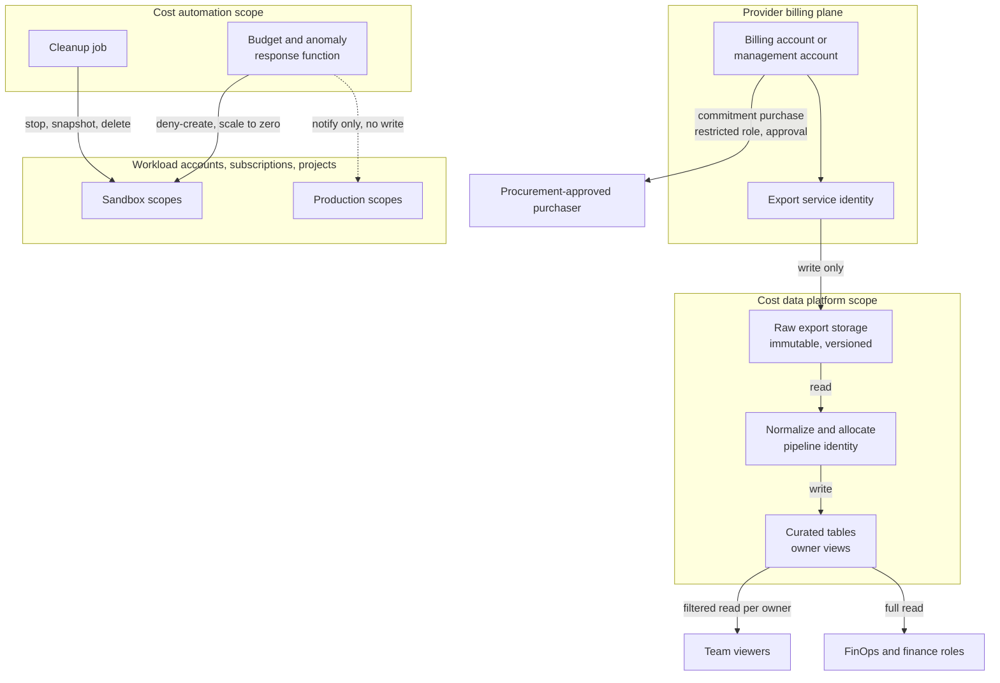

The trust-boundary diagram shows four zones and the narrow paths between them. The export service writes but cannot read; the pipeline reads raw data and writes curated tables; teams read only their own slice; automation can act on sandbox scopes and only notify production; and commitment purchase is a separate, approved path from the billing account. Each edge corresponds to one identity with one permission set. A design where one identity spans two zones, such as a cost dashboard service account that can also buy commitments, collapses the boundary.

### 15.2 Provider access models

- **AWS.** Billing and Cost Management uses fine-grained IAM actions in service namespaces such as `ce` (Cost Explorer), `budgets`, `cur` and `bcm-data-exports`, `billing`, `payments`, and `savingsplans`, which replaced the older `aws-portal` actions. IAM users and roles in the management account see billing pages only after the root user enables IAM access to billing information. Data Exports write to an S3 bucket whose bucket policy grants the export service principal write access; restrict reads to the pipeline role and deny deletes on raw objects. Member accounts see only their own cost data in Cost Explorer, subject to the management account's settings.
- **Azure.** Two role systems apply. Azure role-based access control (RBAC) roles, such as **Cost Management Reader** and **Cost Management Contributor**, grant cost visibility at management group, subscription, and resource group scopes. Billing roles on EA and MCA billing accounts, billing profiles, and invoice sections, such as billing account reader or invoice section owner, govern invoices, payment, and purchases. Reservation and savings plan purchase requires specific roles, including the Reservation Purchaser role. Exports write to a storage account; use private network access and managed identity where the export configuration supports it.
- **Google Cloud.** Billing roles are granted on the Cloud Billing account: **Billing Account Administrator**, **Billing Account Costs Manager**, **Billing Account Viewer**, and **Billing Account User**. The last one lets a principal link projects to the billing account, which is the permission to create new spending, so grant it only to the project-vending identity. The BigQuery export dataset is protected by BigQuery IAM; give teams **authorized views** or row-level access policies filtered to their projects rather than access to the raw tables.

### 15.3 Controls

1. **Least privilege by zone.** Map each identity to exactly one zone in the diagram above. Review billing-role grants quarterly; they accumulate because they look harmless.
2. **Separate visibility from purchase.** Viewing cost and buying commitments are different roles on every provider. Deny commitment purchase everywhere except a procurement-approved role (Section 14.2), and require a recorded review (Section 8.9) before use.
3. **Scope automation tightly.** A budget-response function needs permission to attach a deny policy to sandbox scopes, not organization administration. A cleanup job needs delete permission only on the resource types it cleans, only in the scopes it is assigned. Log every action with the triggering alert's identifier.
4. **Protect raw data.** Raw exports are evidence. Enable versioning and deletion protection, and restrict deletion to a break-glass role.
5. **Keep secrets and personal data out of tags.** Tag values are copied into billing exports, which are retained for years and read widely. A tag policy or pipeline check that rejects email-shaped or customer-name values prevents a data-exposure incident that cannot be fixed retroactively.
6. **Watch billing for security signals.** Cost anomalies in unused Regions, new accelerator SKUs, and new marketplace subscriptions are indicators of compromise. Route them to security as well as to the owner (Section 12.4).
7. **Mind the cost of the cost platform.** Billing APIs can be priced per request (the Cost Explorer API charges per paginated request at the time of writing), and dashboards that query raw tables on every page load in BigQuery or a data warehouse can cost more than the waste they find. Query curated, partitioned tables.

## 16. Failure scenarios and quality-attribute scenarios

### 16.1 Failure catalog

| Failure | Cause | Detection | Consequence | Mitigation |
|---|---|---|---|---|
| Export stops silently | Bucket policy changed, export deleted, or destination quota | Freshness check on latest row timestamp | Dashboards show a false drop in spend; anomalies missed | Alarm when freshness exceeds 36 hours; protect export configuration |
| Tag pipeline drops rows | Join on a renamed tag key | Conservation check (Section 2.5) | Cost vanishes from owners and from published totals | Conservation test fails the publish step |
| Commitment expiry cliff | Plans bought together expire together | Expiry calendar | Effective cost jumps by the discount on the covered usage the next hour | Ladder expiries; renewal review 60 to 90 days before expiry |
| Credit expiry | Promotional or migration credits end | Credits reported separately | Apparent cost jump with no technical change | Show gross and net cost; forecast credit end |
| Recommender-driven outage | Downsizing without memory data or peak coverage | Latency and error alarms after change | Service degradation | Decision flow in Section 9.5; canary |
| Cleanup deletes needed resource | Owner unknown or exemption missing | Restore requests | Data loss or broken allowlist | Quarantine, exemption expiry, irreversible steps approved by a person (Section 10.3) |
| Alert to departed owner | Owner directory stale | Unacknowledged alerts | Anomaly runs for days | Escalation timer; owners as teams, not individuals |
| Budget action blocks production | Action configured on wrong scope | Deployment failures | Outage caused by a cost control | Actions only on sandbox scopes; production notifies |
| Quota blocks scale-out | Quota set as a cap in a production scope | Quota-usage alarm, launch errors | Capacity shortfall during peak or zonal failure | Production quotas sized for failure (Section 14.3) |
| Restated history | Azure tag inheritance or rule change rewrites current month | Stability check | Teams see last week's numbers change | Snapshot closed periods; publish rule changes |

### 16.2 Quality-attribute scenarios

**Runaway spend contained.** *Stimulus:* a misconfigured job in a sandbox account starts launching accelerator instances at 02:00. *Response:* the accelerator quota in the sandbox, set as a spending cap, stops launches at the cap; a telemetry alarm on running instance count notifies the owner within 10 minutes; the budget action applies a deny-create SCP when the forecast crosses 100%. *Measure:* excess spend is bounded by the quota at no more than $64 an hour (Section 14.3), and total excess is below $1,000 before human action.

**Account compromise contained by organizational boundaries.** *Stimulus:* long-lived credentials for a development account leak and are used to launch compute in four Regions. *Response:* the Region-restriction SCP denies launches outside two approved Regions; per-account quotas cap the rest; Cost Anomaly Detection on the account's monitor flags the new usage type; the anomaly workflow routes it to security incident response. *Measure:* no resources are created outside approved Regions, excess spend is limited to the account's quota-bounded burn rate, and no other account's cost or quotas are affected.

**Quota or capacity limit during scale-out.** *Stimulus:* a launch-day traffic peak doubles production demand in one Region. *Response:* autoscaling adds capacity without hitting a quota, because production quotas include failure headroom. *Measure:* quota usage stays below 80% at peak; no launch is rejected for quota; the cost increase appears in the anomaly workflow as expected because the launch was on the change calendar, and it is closed within one business day.

**Commitment expiry.** *Stimulus:* Savings Plans covering $70 an hour of on-demand-equivalent usage reach the end of their term. *Response:* the commitment review 90 days earlier sized replacement tranches to the current floor and staggered their start dates. *Measure:* coverage on the day after expiry stays within 5 points of the prior month, and effective cost per vCPU-hour does not rise by more than 2%.

**Migration with reversible cutover.** *Stimulus:* a workload moves from one Region to another and runs in both for a four-week validation period. *Response:* double-running cost is budgeted in advance, tagged with a migration identifier, and annotated in the change calendar; the source environment's commitments are checked for stranding before the move. *Measure:* the migration's cost stays within its approved budget, anomalies from the migration are closed as expected, and the source environment is decommissioned within two weeks of cutover so double-running does not become permanent. [Cloud Migration](CH16_Cloud_Migration.md) owns the cutover mechanics.

## 17. Provider comparison

The table compares guarantees, scopes, and responsibilities rather than product names. Similar names do not imply similar behavior; every entry is at the time of writing and should be verified against current documentation.

| Concern | AWS | Azure | Google Cloud |
|---|---|---|---|
| System-of-record export | Data Exports (CUR 2.0, FOCUS) to S3, refreshed at least daily | Cost Management exports (actual, amortized, FOCUS) to Azure Storage | Cloud Billing export to BigQuery (standard, detailed, pricing, FOCUS preview) |
| Export latency promise | Refresh cadence documented, not a latency guarantee | Data typically available in 8 to 24 hours | Explicitly no delivery or latency guarantee |
| History behavior | Tag activation applies forward; backfill up to 12 months | Tag inheritance rewrites the current month | Rows fixed at recording time; labels apply forward |
| Strongest allocation key | Account | Subscription, then resource group | Project, with ancestry in export |
| Inherited metadata for cost | Cost Categories rules; no tag inheritance in CUR | Tag inheritance from subscription and resource group | Resource Manager tags inherited; labels not inherited |
| Shared Kubernetes allocation | Split cost allocation data for EKS and ECS in CUR | AKS cost analysis add-on in Cost Management | GKE cost allocation in detailed and FOCUS exports |
| Budget evaluation | Up to three times a day | Every 24 hours | Pub/Sub notifications several times a day |
| Built-in budget action | Apply IAM policy or SCP, stop EC2 or RDS instances | Action groups trigger runbooks, functions, Logic Apps | None built in; Pub/Sub to your function |
| Anomaly detection scope | Monitors per service, account, tag, or cost category | Per subscription | Per billing account with project drill-down |
| Anomaly cadence | About three times a day; up to 24 hours after usage | Daily, 36 hours after end of UTC day | On processed billing data; early anomalies for some AI services in preview |
| Anomaly cost measure | Net unblended | Subscription cost | Gross on-demand usage cost, credits excluded |
| Spend commitments | Compute and EC2 Instance Savings Plans; RIs | Savings plan for compute; reservations | Spend-based and compute flexible CUDs; resource-based CUDs |
| Commitment exit | Limited return window for small Savings Plans; RI Marketplace for Standard RIs | Reservation exchange and refund within limits; savings plans not cancellable | Not cancellable |
| Rightsizing engine | Compute Optimizer: 14, 32, or 93-day lookback; p90 to p99.5 threshold; memory needs CloudWatch agent | Advisor: 7 to 90-day lookback; p95 CPU, p99 memory targets; retail-rate savings | Recommender: 8-day window; Ops Agent improves memory data; excludes GKE-managed and GPU VMs |
| Idle detection | Compute Optimizer idle recommendations; Trusted Advisor checks | Advisor shutdown; Resource Graph queries | Idle VM, disk, address, image, and unattended project recommenders |
| Quota as a spending cap | Raise by request; cap below default with SCPs | Raise by request; cap with Azure Policy | Can lower project quota values; BigQuery custom quotas |
| Hard stop on spend | None; budget action plus SCP approximates one | None; action group automation approximates one | Disabling billing on a project stops all services in it |

Three patterns stand out. AWS gives the most configurable anomaly monitors and the only built-in budget actions, so it can be operated with less custom code. Azure's tag inheritance and cost allocation rules do more allocation work inside the provider, at the cost of a moving current month. Google Cloud puts raw data in BigQuery and expects you to build on it, which suits teams with data engineering capacity, and it is the only provider where you can lower a quota to make it a true spending cap.

## 18. Case study: a SaaS company on AWS and Google Cloud

### 18.1 Context and requirements

A business-to-business SaaS company runs its product on AWS and its analytics platform on Google Cloud. Monthly effective spend is about $620,000: $510,000 on AWS across 140 accounts and $110,000 on Google Cloud across 60 projects. Growth is 4% a month. Finance has three complaints: the monthly bill cannot be explained by product line, two cost spikes in the last quarter were found by finance at month end, and gross margin is falling although engineering says the platform is efficient. The engineering leadership's constraint is that nothing may reduce the checkout and API availability objective of 99.95%.

The FinOps lead, an architect, and a finance partner agree on four requirements:

- **R1.** At least 95% of effective cost allocated to an owner with high confidence within two quarters.
- **R2.** Anomalies above $1,000 a day detected and contained within one business day; runaway spend in non-production bounded by design.
- **R3.** Cost per successful API call and per active tenant published monthly for each product line.
- **R4.** At least 15% reduction in unit cost within a year, without moving any production workload off its availability frontier position.

### 18.2 Decisions

**Data platform on FOCUS, with native joins.** The team ingests the AWS FOCUS export and the Google Cloud FOCUS table into BigQuery, adding CUR 2.0 split cost allocation columns for EKS by line-item join. *Rejected:* two native pipelines, because every allocation rule would be written twice; and a commercial tool alone, because the team wanted the allocation rules in versioned code that finance could audit. Closed periods are snapshotted, and every published table carries a freshness timestamp.

**Container-first allocation.** An audit found 81% of spend in accounts and projects owned by one team. The team moved three mixed-use accounts to account-per-workload layouts during planned migrations, which raised container coverage to 88%. Tags cover the shared EKS clusters and the data lake. *Rejected:* a tag-only model, because about 9% of spend, mainly transfer and support, has no taggable resource.

**Shared-cost rules.** EKS clusters use split cost allocation on the greater of requests and usage, with idle assigned to the platform team (Policy B from Section 5.3) for management reporting and spread proportionally for product unit costs. The network hub uses attachment count and bytes (Section 5.4). Support fees are spread by direct cost. *Rejected:* an even split for the hub, because analytics produced 60% of its traffic and would have had no incentive to add storage endpoints.

**Commitment program.** Hourly eligible compute usage on AWS averages about $240 per hour on-demand-equivalent, with a 10th-percentile floor of $180. Existing Savings Plans cover $60 of it. The team buys Compute Savings Plans in three quarterly tranches of $30, $30, and $20 per hour of commitment, sized against the floor minus the roadmap's planned move of a batch service to Google Cloud, and enables organization-wide sharing. On Google Cloud it buys a compute flexible CUD for the analytics floor. *Rejected:* EC2 Instance Savings Plans for the deeper discount, because the roadmap includes a move to Arm instances that would have stranded them (Section 8.7).

**Rightsizing and cleanup.** The CloudWatch agent and the Ops Agent are deployed fleet-wide first, with a one-cycle wait before any memory-reducing change. Compute Optimizer runs with the 32-day lookback because invoicing jobs run monthly. The idle sweep becomes a daily job with the quarantine state machine of Section 10.3, automatic in sandboxes and ticket-only in production.

**Detection and response.** AWS anomaly monitors are defined per cost category matching the product lines, with a $500 absolute and 20% percentage threshold; Google Cloud anomaly thresholds are set to the same impact. Telemetry alarms cover the three largest variable drivers: log ingestion, NAT bytes, and BigQuery bytes scanned. BigQuery custom quotas cap bytes scanned per user per day in analytics sandboxes. Sandboxes get $500 budgets with deny-create actions and 30-day leases.

### 18.3 Validation evidence

- **Allocation.** After two quarters, high-confidence coverage is 96.1%, the unallocated pool is $24,000 and owned by the FinOps lead, and the conservation check has failed twice, both times catching a renamed tag before publication.
- **Commitments.** Utilization averaged 98.7% over the first two tranches, coverage of eligible compute rose from 25% to 71%, and the effective discount on covered usage is 27%. The new $80 per hour of commitment covers about 80 / 0.73 ≈ $110 per hour of on-demand-equivalent usage; with the existing $60, about $170 per hour is covered at a 27% discount, which saves roughly 170 × 0.27 × 730 ≈ $33,500 a month.
- **Rightsizing.** Of 412 recommendations, 236 were applied, 61 rejected for missing memory evidence that later showed working sets above the proposed size, and 18 rejected because they would have moved usage out of commitment scope. Verified saving is $41,000 a month. Two canaries were rolled back for latency regressions.
- **Cleanup and transfer.** The first sweep removed $14,000 a month; the daily job holds idle spend below $2,000. Storage endpoints in the analytics networks removed $9,800 a month of hub NAT processing, made visible by the bytes-based hub allocation.
- **Detection.** In the following quarter, 11 anomalies above threshold occurred. Seven were expected (launches on the change calendar), one was a credit expiry, and three were real. The worst real one, a debug log level in production, was caught by the ingestion alarm in 12 minutes and cost $310. Median time to contain the real anomalies was 2.5 hours.
- **Unit economics.** Cost per successful API call fell 19% over the year, of which about 11 points came from rate and usage optimization and 8 points from scale over fixed cost. The team reports both components separately, so the scale effect is not presented as optimization.

### 18.4 What the team would change

Assigning shared-cluster idle to the platform team made bin-packing a platform objective, but product teams then argued that their unit costs excluded real cost; the team now publishes both views and labels which one each report uses. The change calendar mattered more than the detector: once launches and load tests were announced in it, the noise ratio fell from about 60% to under 30%, and owners started to trust the alerts.

## 19. Common mistakes and anti-patterns

**Optimizing billed cost instead of effective cost.** *Cause:* dashboards built on the invoice view. *Consequence:* commitment purchases look like spikes, savings appear in the wrong months, and teams are charged unevenly. Use effective cost for allocation and unit economics, billed cost for treasury (Section 2.3).

**Tag-only allocation.** *Cause:* allocation designed around tags because they are flexible. *Consequence:* untaggable charges and tagging lapses fall into an unallocated pool that grows with every reorganization, or are silently dropped by pipeline joins. Allocate by container first (Section 4.1) and enforce the conservation check (Section 2.5).

**Even splits for large shared platforms.** *Cause:* even splits are easy to explain. *Consequence:* small consumers subsidize large ones and nobody can lower their share by changing behavior. Use usage drivers where cost is large and measurable (Section 5.2).

**Treating budgets as caps.** *Cause:* the word "budget". *Consequence:* overspend continues for a day or more after the threshold because evaluation lags usage. Use quotas and policy for hard limits (Section 7.4).

**Committing to the average.** *Cause:* purchase recommendations or averages taken at face value. *Consequence:* unused commitment in every low-demand hour. Commit to the floor, in tranches (Sections 8.4 and 8.9).

**Narrow commitments ahead of an architecture change.** *Cause:* buying the deepest discount without reading the roadmap. *Consequence:* stranded commitment that makes the architecture change uneconomic for the rest of the term (Section 8.7).

**Rightsizing from CPU averages.** *Cause:* recommendations without memory data, with a short window, or blind to failover reserves. *Consequence:* out-of-memory failures, missed monthly peaks, and too little capacity during the zonal failure a reserve exists for. Use percentiles, memory from agents, a window that covers the cycle, and tagged reserves (Sections 9.2 and 9.5).

**Deleting before quarantining.** *Cause:* cleanup scripts that delete on detection. *Consequence:* data loss, broken allowlists after address release, and loss of trust that ends the cleanup program. Use the quarantine state machine (Section 10.3).

**Relying on billing alerts for fast failures.** *Cause:* anomaly detection treated as real-time. *Consequence:* a day or more of excess before detection. Add telemetry alarms on cost drivers (Sections 3.5 and 12.5).

**Unit cost per request instead of per success.** *Cause:* request counts are easy to get. *Consequence:* retries and failures make unit cost look stable during incidents. Count successful outcomes (Section 13.2).

**Calling scale effects optimization.** *Cause:* average unit cost falls with volume when fixed cost is large. *Consequence:* the organization believes it optimized when it only grew. Report marginal cost and separate scale from optimization (Section 13.3).

**Billing roles granted broadly.** *Cause:* billing access seen as harmless. *Consequence:* exposure of architecture and volumes, and in some roles the ability to buy commitments or link projects for spending. Apply least privilege by zone (Section 15.3).

## 20. Design-review checklist

- Is the detailed export enabled on every billing account from day one, landing in immutable storage in a dedicated cost scope, with a freshness alarm, and does each report state its cost measure?
- Does every closed period pass completeness, conservation, and stability checks against the invoice, with an explicit unallocated pool that has an owner?
- Is the account, subscription, or project the primary allocation key, with tags only for shared containers and cross-cutting dimensions, and is high-confidence coverage measured against a target?
- For each shared pool: what is the driver, its data source, its review date, and who owns idle capacity? If chargeback is used, who receives commitment savings and who carries unused commitment?
- Do budgets with forecast thresholds exist for every owner scope, with budget actions confined to non-production scopes, and is there a telemetry alarm on each large variable cost driver?
- Are anomaly monitors aligned with owners, with absolute and percentage thresholds, a change calendar, an escalation timer, and a route to security?
- Does the commitment review use hourly data, size to the floor minus roadmap risk, ladder expiries, state break-even utilization and months to break even, and report utilization and coverage per commitment?
- Do rightsizing decisions use percentiles over a window that covers the longest cycle, guest memory metrics from agents, failover requirements, and a commitment-scope check, with canary rollout and verification in billing data?
- Does idle cleanup resolve owners, notify, quarantine before delete, expire exemptions, and require human approval for irreversible steps such as address release?
- Are transfer charges attributed by path, with private endpoints for high-volume provider-service traffic, and do storage lifecycle rules account for transition requests, minimum durations, noncurrent versions, and incomplete uploads?
- Is cost per successful outcome published per workload with its denominator definition and marginal cost, and are major design decisions placed on a cost versus objective frontier?
- Are Regions, SKUs, and commitment purchases restricted by policy, sandbox quotas set as spending caps, and production quotas set with failure headroom and usage alarms?
- Do sandboxes have owners, leases, budgets with actions, schedules, and automatic end of life by container closure?
- Are billing roles least-privilege by zone, purchase separated from visibility, automation identities scoped to their targets, and tags free of secrets and personal data?

## 21. Exercises

### 21.1 Interview questions

1. A finance partner says the January cloud cost for a team was twelve times its usual month. Engineering says nothing changed. Explain what probably happened and which cost measure each party should use.
2. A shared Kubernetes cluster costs $36,000 a month and has 20% idle capacity. Argue for and against charging idle to the product teams.
3. Explain why AWS applies Savings Plans to the usage with the highest savings percentage first, and how that rule can raise one team's cost when another team changes its workload.
4. A three-year commitment has an effective rate of 0.50 of on-demand and no exit. A workload may be retired in 15 months. Should you buy it? Show the arithmetic.
5. Azure Advisor recommends resizing a VM to a different series with a large saving. What two things must you check before accepting it?
6. Why does a cost anomaly detector not catch a slow leak, and which control does?
7. Define cost per successful outcome and explain why the denominator excludes failed attempts.
8. Which billing permissions can create financial obligations or new spending on each provider?

### 21.2 Hands-on exercises with the chapter code

1. Run the [unit-cost calculator](../code/python/cost-optimization-chapter/01_unit_cost.py). Change the shared units from 60 and 40 to request-based units of 70 and 30. How do the two workloads' costs per success change, and which allocation rule from Section 5.2 does each version represent?
2. Run the [budget forecast checker](../code/python/cost-optimization-chapter/02_budget_forecast.py) with the sample values, then reproduce the driver-based forecast from Section 7.5 by hand. Extend the function so it accepts one-time charges, planned uplift days, and credits, and confirm that it returns $43,000 for the Section 7.5 inputs.
3. Run the [commitment break-even analyzer](../code/python/cost-optimization-chapter/03_commitment_break_even.py). Add a utilization of 0.68 to confirm break-even, then change the commitment rate to 0.50 and find the new break-even utilization. Add a parameter for the month in which usage stops and compute the months to break even from Section 8.5.
4. Run the [rightsizing review helper](../code/python/cost-optimization-chapter/04_rightsizing.py). Add p99 CPU and p99 memory fields to each resource and a rule that blocks any downsizing recommendation when memory data is missing, as the decision flow in Section 9.5 requires.

### 21.3 Design exercises

1. Design the allocation model for an organization with 300 AWS accounts, 40 Azure subscriptions, and two shared GKE clusters. State the keys, the shared-cost rules, the unallocated-pool owner, and the coverage you expect in the first quarter.
2. Design the anomaly and budget response workflow for an organization whose largest risk is generative AI API spend that can grow by thousands of dollars an hour. Identify which signals arrive in minutes, which in hours, and where you would place quotas.
3. A team wants to migrate a 400-instance x86 fleet covered by a three-year EC2 Instance Savings Plan with 20 months remaining to Arm instances. Build the decision: stranded commitment, migration savings, sharing options, and a recommended timeline.
4. For a workload of your choice, list four design options, estimate monthly cost and objective attainment for each, place them on a frontier, and identify which moves are optimization and which are trade-offs that need the business owner.

## 22. Summary

A cloud bill is the output of a pipeline from metered usage through rating, invoice, and customer allocation, and every optimization decision depends on knowing which cost measure a number uses, when its data arrives, and how it reconciles with the invoice. Effective (amortized) cost is the basis for allocation and unit economics. Allocation works best with the account, subscription, or project as the primary key and tags as a secondary key, with written, usage-driven rules for shared costs and an explicit owner for idle capacity. Budgets and anomaly detection lag usage by hours, so they need telemetry alarms for fast failures, quotas and policy for hard limits, and a response workflow that contains by burn rate and verifies in billing data.

Commitments are price promises applied hour by hour: size them to the floor of demand, prefer broad scope for long terms, ladder expiries, and measure utilization and coverage separately. Rightsizing uses percentiles over a full cycle, memory data from agents, failover requirements, and commitment scope, and proceeds by canary. Idle resources are removed through owner-first notification, quarantine, and expiring exemptions. Transfer and storage lifecycle costs are found by usage type and SKU and fixed by architecture.

Cost per successful workload outcome ties cost to value. It rises when reliability falls, it separates scale effects from optimization when reported with marginal cost, and on a cost versus objective frontier it distinguishes waste removal from trade-offs that need the objective's owner. The FinOps operating model, policy guardrails, quota caps, sandbox lifecycles, and least-privilege billing access keep those gains from eroding.

## 23. Code examples

The examples use synthetic numbers and Python's standard library. They do not call cloud APIs or read billing data.

- [Unit-cost calculator](../code/python/cost-optimization-chapter/01_unit_cost.py) allocates a $2,400 shared pool to two workloads in proportion to their shared-usage units and computes total cost and cost per successful outcome, the calculation behind Sections 5.3 and 13.2.
- [Budget forecast checker](../code/python/cost-optimization-chapter/02_budget_forecast.py) projects period-end spend with a linear run-rate and flags a forecast at or above budget, the first forecasting method in Section 7.5, and reminds the reader that it ignores seasonality, credits, and late charges.
- [Commitment break-even analyzer](../code/python/cost-optimization-chapter/03_commitment_break_even.py) compares the on-demand cost of the hours actually used with the fixed cost of a commitment at 55%, 80%, and 100% utilization, illustrating the break-even rule in Section 8.5.
- [Rightsizing review helper](../code/python/cost-optimization-chapter/04_rightsizing.py) classifies synthetic resources as cleanup candidates, review items, or retain from average and peak CPU and a criticality flag, routing low-utilization critical resources to human review, as Sections 9.6 and 10.3 recommend.
