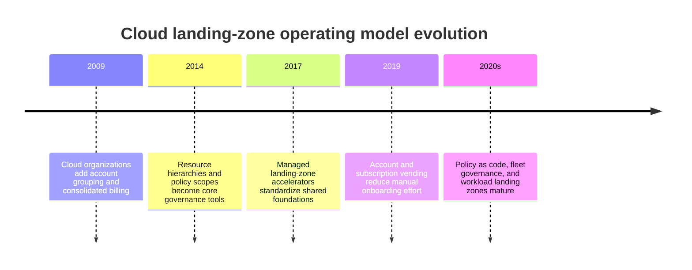
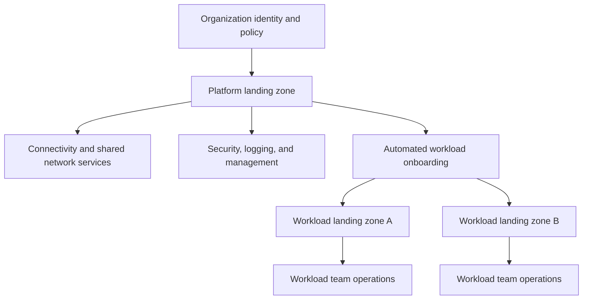
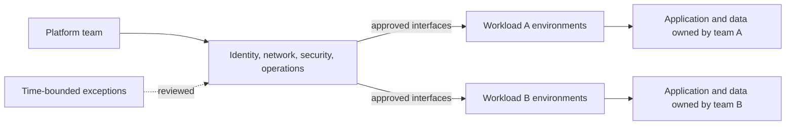
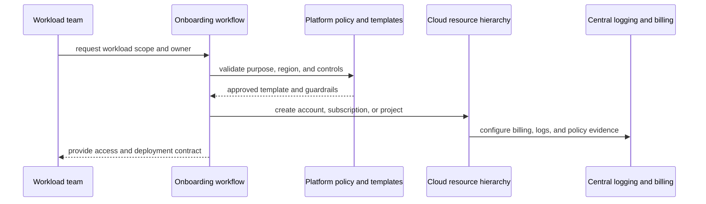
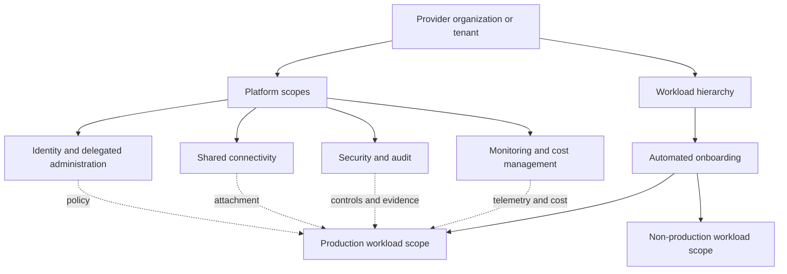

# Chapter: Cloud Landing Zones

Part: [09 — Cloud Computing](PART_OVERVIEW.md) · Status: Drafted

## 1. Introduction

A cloud landing zone is a governed foundation that prepares an organization to deploy and operate workloads in a cloud provider. It defines resource hierarchy, identity, networking, security guardrails, logging, cost ownership, and a repeatable path for onboarding workloads. A landing zone is not a single product or a one-time set of subscriptions; it is an operating model implemented through provider services and automation.

This chapter focuses on provider-specific landing-zone foundations across Amazon Web Services (AWS), Microsoft Azure, and Google Cloud Platform (GCP): account/subscription/project boundaries, shared platform capabilities, policies, workload onboarding, and lifecycle governance. Part 10 Cloud Architecture owns cross-provider organizational hierarchy and landing-zone composition. This chapter owns the underlying provider service mechanisms and setup choices.

## 2. Historical Evolution

Organizations initially created cloud accounts or projects ad hoc, often under individual users and without consistent logging, network ownership, or policy. As workloads and teams multiplied, cloud providers introduced organization hierarchies, policy inheritance, account or subscription vending, centralized billing, shared networks, and prebuilt landing-zone accelerators.

The shift is from manually creating cloud resources to continuously provisioning governed workload environments. A landing zone remains useful only while its policies, shared services, and onboarding path evolve with the organization.

## 3. Why It Exists

Cloud platforms make it easy to create isolated environments, but unconstrained growth leads to shadow accounts, inconsistent permissions, duplicate networking, unallocated cost, and missing audit evidence. A landing zone establishes safe defaults and a clear division of responsibilities between a platform team and workload teams.

The foundation should accelerate compliant delivery rather than become an approval bottleneck. A mature design provides repeatable self-service, inherited guardrails, shared services where justified, and an exception process that is explicit and reviewable. The goal is controlled autonomy, not maximal centralization.

## 4. Core Concepts

### 4.1 Landing-zone components and scope

**Definition.** A landing zone is a set of organizational, identity, network, security, management, and automation capabilities that allow workloads to be deployed within an agreed control framework. A platform landing zone provides shared capabilities; a workload landing zone contains resources owned and operated for a business workload.

**Mechanism.** The platform foundation defines where resources belong, how identities are granted, how networks connect, which policies apply, where logs go, how costs are allocated, and how a team obtains a new environment. The workload environment inherits baseline controls and supplies workload-specific configuration. Providers package these capabilities differently, but the operating responsibilities remain similar.

**Decision implications.** Centralize services when shared operation or policy clearly improves security, reliability, or economics. Keep application data and workload-specific operations with the owning team unless a regulatory or operational requirement says otherwise. Part 10 owns the cross-provider topology; this section names the provider implementation areas.

**Common failure mode.** A landing zone is treated as a diagram or accelerator deployment rather than a maintained service with owners, release cadence, support expectations, and an onboarding interface.

**Scenario.** A product team requests production and non-production environments through a platform workflow. Each environment receives a governed resource scope, audit forwarding, approved network attachment, and cost owner before workload deployment begins.

### 4.2 Resource hierarchy and policy inheritance

Cloud providers organize resources into policy and ownership hierarchies. AWS Organizations groups accounts into organizational units; Azure uses a tenant, management groups, subscriptions, and resource groups; Google Cloud uses an organization, folders, and projects. Policies and access grants can inherit through these scopes, but details and exceptions differ.

Design hierarchy around durable ownership and policy boundaries, not a copy of the company org chart. Keep hierarchy depth understandable, document who may create or move scopes, and test the effective policy a new workload receives. Provider-specific hierarchy semantics are introduced in CH01–CH03.

### 4.3 Workload isolation boundaries

Accounts, subscriptions, and projects can separate quotas, permissions, billing, resource lifecycle, and blast radius. Resource groups, labels, and namespaces serve different purposes and should not be mistaken for equivalent isolation boundaries. The correct boundary depends on workload ownership, regulatory scope, release lifecycle, and the operational cost of cross-scope access.

Use stronger boundaries when workloads have different administrators, risk profiles, quotas, or data-residency requirements. Avoid creating a new scope for every service by reflex; automate creation and policy so the boundary does not impose unmanaged overhead.

### 4.4 Platform and workload landing zones

A platform landing zone hosts shared identity, connectivity, security monitoring, and management services. A workload landing zone hosts one workload and its environments. The platform team owns shared services and guardrails; application teams own their code, data, and workload reliability within those controls.

Avoid placing workload data in platform scopes unless the service is genuinely shared and ownership is explicit. A platform team should publish service expectations and change processes so downstream teams can reason about the shared dependency.

### 4.5 Guardrails, policies, and exceptions

Guardrails constrain resource configuration or actions across a scope. AWS Control Tower controls and organization policies, Azure Policy assignments, and Google Cloud Organization Policy constraints implement different parts of this function. Identity grants and configuration policies are separate mechanisms; a compliant resource may still have overbroad access, and an authorized principal may still attempt a noncompliant configuration.

Start with audit/report modes where supported, measure existing violations, then enforce controls in stages. Define exception approver, risk owner, expiry, compensating controls, and revalidation. Make policy results visible to workload teams before blocking deployments.

### 4.6 Shared services and network foundations

Shared services may include connectivity, DNS, identity integration, security tools, logging, artifact registries, and build infrastructure. The network foundation may use a network account, hub-and-spoke, shared VPC, or provider-specific transit service. CH05 Networking owns network architecture; this section concerns how the landing zone assigns ownership and onboarding.

Use service boundaries with published interfaces, capacity expectations, incident owners, and change notices. Shared services become critical dependencies, so the landing zone needs redundancy and recovery plans. Do not centralize merely because a service can be centralized.

### 4.7 Identity and delegated administration

Landing zones define how workforce identities, platform operators, workload teams, deployment systems, and managed services receive access. Use groups and federated identities for people, workload identities for applications, and scoped administrative roles for platform operations. CH09 IAM owns the detailed evaluation and provider policy mechanics.

Separate directory or tenant administration, cloud resource administration, security audit access, and billing access. Use privileged elevation or monitored break-glass access for high-impact actions. A landing zone is incomplete if an account or project can be created without a named administrative owner.

### 4.8 Logging, security, and operational evidence

The foundation should establish audit logging, diagnostic settings, security posture collection, and a protected destination before workloads become production-critical. Retention, access, and regionality must match policy. CH10 Monitoring owns provider monitoring-service mechanics; Security owns cross-cutting threat and compliance architecture.

Create a baseline that records scope creation, policy changes, role assignments, network changes, and workload deployment. Validate log delivery, detect gaps, and prevent the same administrators from altering both production and all evidence of their actions.

### 4.9 Account/subscription/project vending and automation

Vending is a repeatable request-to-ready process that creates a governed workload scope, links billing, applies baseline policy, enables required services, configures logging, and grants initial access. Automation reduces inconsistent manual setup and makes the platform's policy executable.

Design idempotent workflows with approval boundaries, failure recovery, drift detection, and decommissioning. Keep human approval for high-risk exceptions, not for every routine conforming workload.

### 4.10 Landing-zone evolution and governance

Landing zones evolve as the organization adds providers, regulatory requirements, and new workload types. Use versioned templates, policy tests, staged rollout, and migration paths for existing scopes. Track adoption, exception age, drift, time-to-onboard, and platform incident impact.

An accelerator can speed initial setup but does not eliminate continuous governance. Assign ownership for upgrades, policy deprecation, provider feature changes, and support. The AWS Well-Architected framework remains a distinct Part 11 assessment module; this chapter focuses on foundation services.

## 5. Internal Working

A workload request enters a catalog or platform workflow, is checked against policy, and produces a provider resource scope from versioned templates. The provisioning system creates hierarchy objects, links billing, assigns baseline roles, enables logging, attaches networks, and applies policy. A readiness check validates that the workload team can deploy while guardrails and evidence are active.

Provisioning is not necessarily transactional: some resource providers reconcile asynchronously, and partial setup can leave a scope without logging or network access. The workflow should be idempotent, report partial failure, resume safely, and prevent production use until required controls pass.

## 6. Design Principles

- Treat the landing zone as a maintained platform service, not a one-time diagram.
- Separate platform ownership from workload ownership with explicit contracts.
- Use hierarchy for stable governance and scopes for meaningful blast-radius boundaries.
- Automate compliant onboarding and decommissioning.
- Apply guardrails progressively and make policy results visible.
- Establish identity, logging, network, and billing foundations before production.
- Centralize only where shared ownership improves outcomes.
- Make exceptions accountable, time-bounded, and auditable.
- Test upgrades and policy changes against representative workload scopes.

## 7. Architecture Patterns

**AWS Control Tower multi-account foundation.** Organizations and organizational units structure accounts; Control Tower controls and Account Factory standardize onboarding; shared network/security accounts provide common services.

**Azure platform and workload landing zones.** A management-group hierarchy applies guardrails; platform subscriptions host shared connectivity and operations; workload landing zones receive controlled autonomy.

**Google Cloud organization foundations.** Organization and folders define policy inheritance; management projects host shared functions; workload projects receive baseline access, billing, and service configuration.

**Policy-as-code vending.** A self-service workflow creates scopes from versioned templates, evaluates compliance, and returns access to the workload owner with an auditable record.

## 8. Production Architecture

Production readiness requires clear platform service owners, support targets, onboarding and exception paths, policy versioning, recovery of shared services, and a safe way to decommission scopes and data.

## 9. Implementation

1. Identify organization goals, regulatory boundaries, workload owners, and provider scope.
2. Define hierarchy and delegated administration model.
3. Establish identity, connectivity, security monitoring, audit, and billing foundations.
4. Set guardrails in report mode, measure drift, then stage enforcement.
5. Build an automated vending path for workload scopes and initial access.
6. Document platform service interfaces, quotas, availability, and support ownership.
7. Onboard representative workloads and validate deployment, logging, policy, and cost evidence.
8. Add lifecycle, exception review, decommissioning, and continuous platform change management.

## 10. Complete Code Examples

- [Landing-zone scope decomposition planner](../code/python/landing-zones-chapter/01_scope_planner.py)
- [Baseline control coverage checker](../code/python/landing-zones-chapter/02_guardrail_coverage.py)
- [Workload vending request validator](../code/python/landing-zones-chapter/03_vending_validator.py)
- [Landing-zone maturity scorecard](../code/python/landing-zones-chapter/04_maturity_score.py)

The examples use synthetic organization inputs and Python's standard library. They do not provision cloud resources or evaluate provider policies.

## 11. Performance

Landing-zone operations affect developer lead time and platform throughput. Synchronous approvals, slow account creation, repeated manual network changes, and centralized quotas can become delivery bottlenecks. Measure time-to-ready, provisioning failure, policy-denial resolution, and workload-team satisfaction alongside platform reliability.

Automate predictable tasks, cache reusable configuration where safe, and avoid provisioning every possible shared service before a workload needs it. Maintain capacity and quota for platform services that serve many workload scopes.

## 12. Scalability

Governance complexity grows with workload count, policy depth, provider count, exceptions, and shared dependencies. A hierarchy that is simple for a handful of accounts may become hard to reason about at hundreds. Scale policy through tested modules, standard templates, ownership metadata, and automated drift reporting.

Avoid both a single undifferentiated scope and an account/project-per-component rule with no lifecycle automation. Create boundaries when isolation, ownership, quota, or billing needs justify them; scale vending and review processes as the number of requests grows.

## 13. Security

Secure foundations begin with identity and policy boundaries, protected audit destinations, private connectivity options, approved regions, and encryption/key ownership. Grant platform operators only the scope they manage and keep workload permissions separate. The Security, IAM, Networking, and Secrets chapters own their detailed control mechanics.

Test guardrails against deployment templates, restrict policy exclusions, and monitor administrative changes. A platform must preserve secure emergency access without leaving broad permanent administrator grants in every workload scope.

## 14. Observability

Monitor onboarding duration, provisioning failures, policy nonconformance, exceptions, access changes, shared service health, quota pressure, cost allocation coverage, and decommissioning backlog. Correlate these signals with platform template versions so teams can distinguish a workload issue from a foundation regression.

Alert platform teams on shared dependencies and systemic policy drift. Report per-workload status to owners without exposing other teams' sensitive telemetry. CH10 Monitoring owns the provider collection and alert services.

## 15. Failure Scenarios

| Failure | Likely symptom | Architectural response |
|---|---|---|
| Vending workflow partially fails | Scope exists without required logs or policy | Mark not ready, resume idempotently, and block production deployment |
| Policy update blocks workloads | Deployments fail across many scopes | Stage rollout, diagnose scope inheritance, and use reviewed exceptions |
| Shared network outage | Multiple workloads lose connectivity | Restore shared service, use tested alternate paths, and communicate ownership |
| Central audit destination unavailable | Evidence pipeline has gaps | Buffer or fail closed per policy; alert on missing telemetry |
| Identity platform unavailable | Operators and workloads cannot authenticate | Use approved emergency access and recover identity dependency |
| Quota exhaustion | New workloads or recovery scopes cannot provision | Monitor quota headroom and test regional capacity |
| Tag/policy drift | Cost or compliance reports become incomplete | Detect drift, assign owner, and remediate through templates |
| Abandoned scope | Unknown spend and unmanaged resources persist | Identify owner, quarantine safely, and follow decommissioning policy |

The landing zone itself needs a recovery plan. If shared identity, DNS, network, or artifact services are unavailable, workload recovery and account vending may fail even when the workload region is healthy.

## 16. Testing

Test hierarchy creation, inherited policies, role assignment, billing linkage, logging, network attachment, and workload deployment from a newly vended scope. Validate both compliant and noncompliant templates. Test exception expiry and decommissioning in non-production before enforcing policy broadly.

Run failure exercises for central network, identity, audit, and provisioning dependencies. Measure time-to-recover and verify a new workload can still be onboarded during partial platform failure if business continuity requires it.

## 17. Common Mistakes

- Treating the landing zone as a provider accelerator instead of an operating model.
- Copying a vendor reference hierarchy without matching organizational ownership.
- Over-centralizing services and creating an unowned shared bottleneck.
- Enforcing policies before measuring their impact on existing workloads.
- Allowing exceptions without an owner, expiry, or compensating control.
- Creating scopes without billing, audit, identity, and network baselines.
- Treating tags as a substitute for resource hierarchy or access controls.
- Forgetting lifecycle and decommissioning for abandoned scopes.

## 18. Best Practices

- Publish a platform service catalog and workload onboarding contract.
- Automate account, subscription, or project vending from reviewed templates.
- Keep hierarchy shallow and aligned to policy and ownership boundaries.
- Apply guardrails progressively and test them continuously.
- Separate platform, security, billing, and workload administration.
- Include logging, budget ownership, and network access in the initial baseline.
- Track exceptions, drift, and time-to-onboard as platform health signals.
- Revisit shared-service boundaries as organization scale changes.

## 19. Anti-Patterns

**Approval queue as the platform.** Manual review of every normal resource request does not scale and encourages bypasses. Automate compliant paths and reserve human decisions for exceptions.

**One hierarchy for every concern.** Billing, policy, network, and team ownership may not share identical boundaries. Use scopes deliberately and document cross-scope relationships.

**Big-bang guardrail enforcement.** Enabling deny policies without inventory and staged rollout can interrupt production. Measure, notify, remediate, then enforce.

**Shared services without service ownership.** A central DNS, network, or logging account becomes an untracked dependency if no team owns its availability, capacity, and changes.

## 20. Trade-off Analysis

| Decision | Benefits | Costs and risks | Choose when |
|---|---|---|---|
| More workload scopes | Isolation, quota, and billing boundaries | Vending and policy operations grow | Ownership or risk differs materially |
| Centralized platform services | Consistent controls and less duplication | Shared failure domain and team bottleneck | Central expertise improves security or economics |
| Strong default guardrails | Reduced misconfiguration risk | Exceptions and deployment friction | Policy is testable and requirements are stable |
| Self-service vending | Faster onboarding and consistency | Automation maintenance and template governance | Workload volume justifies investment |
| Provider accelerator | Faster initial setup | Defaults may not match organization requirements | Baseline is close and customizations are understood |
| Custom landing-zone implementation | Tailored governance and integration | Higher design and maintenance burden | Unique enterprise or regulatory needs require it |

## 21. Comparison Table

| Dimension | AWS | Azure | Google Cloud |
|---|---|---|---|
| Hierarchy foundation | Organizations, organizational units, accounts | Tenant, management groups, subscriptions | Organization, folders, projects |
| Account/project vending | Control Tower Account Factory and customization | Subscription vending and landing-zone accelerators | Google Cloud Setup foundation options and project automation |
| Guardrail mechanisms | Control Tower controls, service control policies, organization policies | Azure Policy and management-group assignments | Organization Policy and IAM inheritance |
| Shared platform model | Network/security/log archive accounts | Platform landing zone subscriptions and workload landing zones | Management projects and shared service projects |
| Common automation | Control Tower, Service Catalog, infrastructure templates | Bicep/Terraform, deployment accelerators | Terraform and foundation setup workflows |

These product capabilities are not equivalent. Compare hierarchy inheritance, control coverage, exception management, billing scopes, and account/project lifecycle in the target provider.

## 22. Real-World Case Study

### AWS Control Tower Account Factory and controls

AWS's [Control Tower documentation](https://docs.aws.amazon.com/controltower/latest/userguide/what-is-control-tower.html) describes a multi-account landing zone built on AWS Organizations, Service Catalog, and IAM Identity Center. Account Factory provisions accounts from configurable templates; controls provide ongoing preventive, detective, or proactive governance; and dashboards report account and control status.

The pattern combines vending and governance: workload teams can obtain standardized accounts while central administrators maintain organization-wide controls. The design still requires an account ownership model, shared networking/security services, policy exceptions, and drift management. Control Tower orchestrates AWS services; it does not decide which workloads deserve separate accounts or how every service should be configured.

Organizations adopting this pattern should test account customization, control updates, enrollment of existing accounts, and recovery of shared services. Keep application deployment permissions distinct from account-factory permissions, and ensure the controls report useful evidence rather than merely showing that a template ran.

## 23. Interview Questions

1. What responsibilities belong in a platform landing zone versus a workload landing zone?
2. How do account, subscription, and project boundaries differ across providers?
3. Why is a landing zone more than a one-time accelerator deployment?
4. How do preventive, detective, and report-only controls differ operationally?
5. What is account/subscription/project vending, and what should it automate?
6. When should networking or security be centralized versus delegated?
7. How do you design an exception process that preserves guardrails?
8. What shared services must be included in landing-zone disaster recovery?

## 24. Hands-on Exercises

1. Run the scope planner for two environments and separate production from non-production ownership.
2. Run the guardrail checker with missing logging and region controls; add a time-bounded exception.
3. Run the vending validator with a missing owner or billing contact and make the request fail safely.
4. Run the maturity scorecard for a manually provisioned organization and prioritize the next automation step.

## 25. Design Exercises

1. Design an AWS multi-account foundation with separate security, network, logging, and workload accounts.
2. Design Azure platform and workload landing zones for three business units with different data policies.
3. Design a Google Cloud organization hierarchy with proof-of-concept, production, and advanced production foundation paths.
4. Design a self-service onboarding process that includes policy, identity, network, billing, monitoring, and decommissioning.

## 26. Architecture Review Questions

- Are hierarchy scopes aligned to stable policy, ownership, and blast-radius needs?
- Does every production scope have an owner, billing relationship, logging, and recovery path?
- Are policy inheritance and exceptions tested before enforcement?
- Are account/project vending templates versioned and idempotent?
- Do workload teams understand shared-service interfaces and support ownership?
- Are platform dependencies monitored and included in disaster recovery?
- Can cost and compliance evidence be attributed to each workload?
- Is the platform reducing time-to-onboard without encouraging control bypasses?

## 27. Summary

A landing zone is a maintained platform that combines hierarchy, identity, network, security, operations, billing, and workload onboarding. Provider services implement these foundations differently, but the organization still owns operating boundaries, exceptions, shared-service reliability, and workload autonomy. Automate compliant provisioning, stage guardrails, and treat the platform itself as a production system with explicit owners and recovery plans.

Further reading: [AWS Architecture](CH01_AWS.md), [Microsoft Azure Architecture](CH02_Azure.md), [Google Cloud Platform Architecture](CH03_GCP.md), [Cloud Architecture](../10_Cloud_Architecture/PART_OVERVIEW.md), and [AWS Control Tower](https://docs.aws.amazon.com/controltower/latest/userguide/what-is-control-tower.html).
