# Chapter: Cloud Landing Zones

Part: [09 — Cloud Computing](PART_OVERVIEW.md) · Status: Revised (in-depth rewrite)

## 1. Introduction

A team that opens its first cloud account can deploy a database in minutes. A company that opens its five-hundredth account needs to know, for every one of them, who owns it, who pays for it, which rules apply to it, where its audit logs go, how it reaches the corporate network, and how it will be shut down. A **landing zone** is the governed foundation that answers those questions before a workload arrives. It combines a resource hierarchy, identity integration, policy guardrails, centralized logging and security tooling, network connectivity, shared platform services, billing ownership, and the automation that creates and maintains all of it.

The earlier provider chapters taught the primitives. [AWS](CH01_AWS.md) covered Amazon Web Services (AWS) Organizations, organizational units (OUs), service control policies (SCPs), and resource control policies (RCPs). [Azure](CH02_Azure.md) covered the Microsoft Entra tenant, management groups, subscriptions, Azure Policy, and Azure role-based access control (RBAC). [Google Cloud Platform](CH03_GCP.md) covered the Google Cloud Platform (GCP) organization, folders, projects, Organization Policy, and VPC Service Controls (VPC stands for virtual private cloud). [Networking](CH05_Networking.md) covered hub-and-spoke, Shared VPC, and transit designs. This chapter assembles those primitives into a running platform and teaches the parts that only exist once you operate many scopes at once: vending, progressive guardrail rollout, exceptions, the onboarding contract, drift, upgrades, and decommissioning.

After working through the chapter you should be able to:

- Name the components of a landing zone, the baseline accounts, subscriptions, or projects that host them, and the team that owns each.
- Compare the provider products, AWS Control Tower with its account-vending options and the Landing Zone Accelerator on AWS, Azure landing zones built from the Cloud Adoption Framework, and the Google Cloud foundation options, by what they create, what they leave to you, and how they are upgraded.
- Design an account, subscription, or project vending workflow with explicit inputs, validation, baseline application, handoff, and idempotent recovery, and size its throughput against provider quotas.
- Roll out a new guardrail through audit, warn, and enforce stages using canary scopes, and run an exception process in which every exception expires.
- Write an onboarding contract that separates what the platform guarantees from what the workload team owns.
- Detect and remediate drift, upgrade a landing zone between versions, adopt an existing (brownfield) estate, and retire a scope without losing the records you must keep.

### 1.1 Scope and ownership boundaries

This chapter owns provider landing-zone products and patterns. Other chapters own the material it builds on, and the chapter recaps that material briefly and links to it.

| Topic | Owner | What this chapter does |
|---|---|---|
| AWS accounts, OUs, SCPs, RCPs, Control Tower basics | [AWS](CH01_AWS.md) | Uses them as building blocks; teaches Control Tower operation, vending, and drift |
| Azure tenant, management groups, Azure Policy effects, exemptions | [Azure](CH02_Azure.md) | Uses them; teaches the Azure landing-zone architecture, vending, and the exemption lifecycle |
| Google Cloud organization, folders, projects, Organization Policy, VPC Service Controls | [Google Cloud Platform](CH03_GCP.md) | Uses them; teaches the foundation blueprints and project vending |
| Network topology, routing, private endpoints, hybrid links | [Networking](CH05_Networking.md) | Recaps the topology and teaches how a landing zone allocates and attaches networks |
| Identity and Access Management (IAM) policy evaluation, federation, workload identity | [IAM](CH09_IAM.md) | Recaps; teaches identity integration as a landing-zone component |
| Provider monitoring and cross-account log access | [Monitoring](CH10_Monitoring.md) | Recaps; teaches the log-archive and security-tooling scopes |
| Cost allocation and showback | [Cost Optimization](CH14_Cost_Optimization.md) | Recaps; teaches billing linkage at vending time |
| Workload migration execution | [Cloud Migration](CH16_Cloud_Migration.md) | Links; this chapter covers brownfield adoption of the foundation itself |
| Cross-provider organizational architecture | [Organizational Hierarchy and Landing Zones](../10_Cloud_Architecture/CH02_Organizational_Hierarchy_and_Landing_Zones.md) (Part 10) | Supplies the provider facts that Part 10 composes |
| Security foundations, threat modeling, zero trust | [Part 15 Security](../15_Security/PART_OVERVIEW.md) | Recaps the controls a landing zone hosts and links to their owners |
| Infrastructure as code (IaC) tooling and pipelines | [Terraform](../13_DevOps/CH08_Terraform.md) and [GitOps](../13_DevOps/CH12_GitOps.md) (Part 13) | Assumes them as the delivery mechanism |

Provider facts drift. Product versions, quotas, and defaults in this chapter were checked against provider documentation at the time of writing and are marked where they change often. Verify current quotas and product behavior before you design to a number.

## 2. The foundational model: a landing zone as a governed product

### 2.1 Definition

A landing zone is the set of organizational, identity, policy, logging, security, network, shared-service, billing, and automation capabilities that a workload environment inherits before its owners deploy anything. Two properties distinguish it from a collection of accounts that happen to have similar settings:

1. **Inheritance.** A new scope receives its baseline from the structure it is placed in and from the automation that created it, not from a checklist a person follows. If the baseline is not applied automatically, it will not be applied consistently at scale.
2. **Ownership.** Every component has a named owner, a version, and a change process. The landing zone is a product the platform team ships to workload teams, with a published interface, support expectations, and releases.

A landing zone is therefore neither a diagram nor a one-time accelerator deployment. An accelerator can create a correct foundation in an afternoon. Keeping it correct for five years, across reorganizations, provider feature changes, regulatory changes, and thousands of scope requests, is the real work, and it is what most of this chapter is about.

### 2.2 The eight components and their owners

| Component | What it provides | Typical owner | Primary provider mechanism |
|---|---|---|---|
| Resource hierarchy | Places to attach policy, access, and billing; the structure every scope inherits from | Platform team, with security approval for changes | AWS Organizations OUs; Azure management groups; Google Cloud folders |
| Identity integration | Workforce sign-in, group-based access, privileged elevation, break-glass access, pipeline identities | Identity team with platform team | AWS IAM Identity Center; Microsoft Entra ID with Privileged Identity Management (PIM); Cloud Identity or Google Workspace |
| Policy guardrails | Limits on actions and configurations that no workload team can remove | Platform and security teams | SCPs, RCPs, declarative policies, Control Tower controls; Azure Policy; Organization Policy, IAM deny policies |
| Logging and security services | Tamper-resistant audit trail, posture management, threat detection, central investigation | Security operations | AWS CloudTrail, AWS Config, Amazon GuardDuty, AWS Security Hub; Azure Monitor, Microsoft Defender for Cloud, Microsoft Sentinel; Cloud Logging aggregated sinks, Security Command Center |
| Network connectivity | Internet Protocol (IP) address allocation, hub or transit attachment, hybrid links, Domain Name System (DNS), egress inspection | Network team | Transit Gateway, VPC sharing, Amazon VPC IP Address Manager (IPAM); hub virtual network or Virtual WAN, Azure Virtual Network Manager; Shared VPC, Network Connectivity Center |
| Shared platform services | Artifact registries, build runners, secrets and key services, observability backends | Platform team, per-service owners | Provider registries, key management services, monitoring workspaces |
| Billing and cost ownership | Payer linkage, cost owner, budgets, allocation tags or labels | Finance operations with platform team | Consolidated billing; billing account, billing profile, and invoice section; Cloud Billing account linkage |
| Automation | Vending, baseline application, drift detection, upgrades, decommissioning | Platform engineering | Control Tower Account Factory, Account Factory for Terraform; Azure subscription vending modules; Terraform project factories |

The table is the first thing to agree with stakeholders. Most landing-zone failures trace to a component with no owner: a log archive that nobody monitors for delivery gaps, an IP address plan kept in one engineer's spreadsheet, or an exception list that only grows.

### 2.3 Platform landing zones and application landing zones

Microsoft's Cloud Adoption Framework (CAF) names a distinction that applies to every provider. A **platform landing zone** is a scope that hosts shared capabilities: the hub network, the log archive, security tooling, identity services. An **application landing zone** is a scope vended to a workload team for one workload and one environment. The platform team operates platform landing zones. Workload teams operate application landing zones within the guardrails inherited from above.

The distinction decides three things:

- **Who has write access.** Workload teams never hold write access to platform scopes. A compromised workload pipeline that could change the hub route table could redirect every other workload's traffic.
- **Which policy applies.** Platform scopes often need permissions that application scopes must not have, such as creating public IP addresses for the egress firewall or modifying organization-wide log sinks. Putting them under a different branch of the hierarchy lets the policy differ without exceptions.
- **What the change process is.** A change to a platform scope affects every consumer. It goes through the platform's release process with staged rollout. A change in an application scope is the workload team's business, subject to guardrails.

### 2.4 A reference hierarchy with baseline scopes

The hierarchy is designed around policy, not around the company's organization chart, because teams reorganize more often than control requirements change. The provider chapters explain the inheritance rules. The diagram below shows the provider-neutral shape most landing zones converge on, with the baseline scopes that the platform owns.

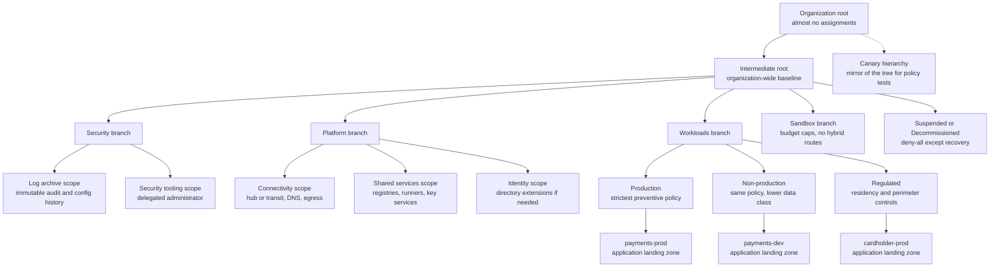

This is the topic map's first required view: organizational hierarchy and baseline scopes. Read it as a set of policy boundaries. The root carries almost nothing because every scope in the organization inherits from it, including scopes that land there by mistake. The intermediate root carries the organization-wide baseline, such as region restrictions and audit protection, and lets a parallel canary tree exist so that policy changes can be tested on a realistic hierarchy before they reach production. The security branch holds the two scopes whose integrity everything else depends on, and its change process is the strictest. The platform branch holds shared infrastructure. The workloads branch splits only where policy differs: production and non-production often carry the same preventive policies, so that a deployment tested in non-production does not fail in production for a policy reason, while the regulated branch adds residency and data-perimeter controls. Sandbox and suspended branches exist so that experimentation and retirement have a policy home of their own.

The providers express this shape with different units:

| Element | AWS | Azure | Google Cloud |
|---|---|---|---|
| Root and intermediate root | Organization root; a top-level OU per policy domain (AWS has no single intermediate root object) | Tenant root group; an intermediate root management group named for the organization | Organization node; top-level folders |
| Security branch | Security OU with Log Archive and Audit accounts (the names Control Tower uses) | Platform management group with Management and Security subscriptions | `common` or `bootstrap` folder with logging and security projects |
| Platform branch | Infrastructure OU with Network and Shared Services accounts | Platform child management groups: Connectivity, Identity, Management, Security | Network host projects and shared services projects |
| Application landing zones | Accounts in Workloads child OUs | Subscriptions in Landing zones child groups such as Corp and Online | Projects in environment or business-unit folders |
| Retirement branch | Suspended OU with deny-all SCP | Decommissioned management group | A folder with restrictive Organization Policy; projects then deleted |

The mapping is structural, not a claim of equivalence. An AWS account is a full identity namespace; an Azure subscription trusts a tenant-wide directory; a Google Cloud project holds its own service accounts but gets its billing from a separately linked billing account. Those differences move the boundary of what a compromised scope can reach, which is why the next section treats baseline scopes per provider.

## 3. Baseline accounts, subscriptions, and projects

### 3.1 Why baseline scopes exist

Baseline scopes exist to enforce separation of duties with the provider's strongest boundary. The person who administers a production workload must not also be able to delete the record of what they did. The team that operates the hub network must not be able to read the payments database. A workload team that misconfigures its own scope must not be able to break routing for everyone else. Putting each of these functions in a dedicated account, subscription, or project means that crossing the boundary requires an explicit, audited trust decision instead of a policy mistake inside a shared scope.

The second reason is blast radius for the platform itself. If the log archive and the security tooling share a scope with a hundred workloads, a single over-broad role in that scope reaches all of them. Small, single-purpose baseline scopes with very few administrators are easy to reason about and easy to monitor.

### 3.2 The log archive

The log archive is the scope that stores the organization's audit trail and configuration history. Its defining property is that nobody who administers a workload can modify or delete what is in it.

- **AWS.** An organization trail in AWS CloudTrail records management events for every account and delivers them to an Amazon Simple Storage Service (Amazon S3) bucket in the Log Archive account. AWS Config configuration history and snapshots also land there. In Control Tower landing zone version 4.0, AWS Config and CloudTrail logging are separate optional integrations, and the Config and CloudTrail buckets can be in different accounts; earlier versions wrote both to one bucket in the Log Archive account ([Control Tower 4.0 key changes](https://docs.aws.amazon.com/controltower/latest/userguide/key-changes-lz-v4.html)). The bucket uses S3 Object Lock or a bucket policy that denies deletion, and an SCP on the Security OU denies changes to the bucket policy except from a break-glass role.
- **Azure.** Activity Log diagnostic settings at management-group and subscription scope, and resource diagnostic settings deployed by Azure Policy `deployIfNotExists` assignments, send logs to a Log Analytics workspace in the Management subscription and, for long retention, to a storage account with an immutability policy.
- **Google Cloud.** An aggregated log sink at the organization or a top-level folder, with `includeChildren` set, routes audit logs from every project to a log bucket in a central logging project. A locked retention policy on the log bucket prevents deletion before the retention period ends. Admin Activity audit logs are always on; Data Access audit logs for most services must be enabled explicitly, which is a baseline decision the landing zone makes once at the organization.

Two design questions recur. First, **retention**: the log archive's retention is set by the longest regulatory requirement, often several years, and it outlives the accounts whose logs it holds. Decommissioning a workload scope never deletes its records from the archive (Section 13). Second, **delivery monitoring**: a log archive that silently stops receiving events is worse than none, because it creates false assurance. The platform alarms on missing deliveries per source scope, which the [Monitoring](CH10_Monitoring.md) chapter treats as telemetry-loss detection.

### 3.3 The security tooling scope and delegated administration

Security services operate across the whole organization but should not be administered from the organization's root scope. Every provider supports some form of **delegated administration**: a member scope is designated as the administrator for a security service and can see findings and manage configuration for all member scopes, without holding the root scope's broader powers.

- **AWS.** The management account designates a member account, typically the one Control Tower calls Audit or Security Tooling, as delegated administrator for Amazon GuardDuty, AWS Security Hub, Amazon Inspector, Amazon Macie, IAM Access Analyzer, AWS Config aggregation, and other services. Once delegated, the service is managed from that account, and the management account is left almost empty. This matters because SCPs do not apply to the management account, so any work done there runs without guardrails ([AWS](CH01_AWS.md) Section 5.1).
- **Azure.** Microsoft Defender for Cloud is enabled by Azure Policy at the intermediate root management group, and Microsoft Sentinel runs on a Log Analytics workspace in the Security or Management subscription. Security operators receive Security Reader or Security Admin at management-group scope, ideally as PIM-eligible assignments. The CAF reference hierarchy now includes a Security management group under Platform for security information and event management (SIEM) tooling ([CAF management groups](https://learn.microsoft.com/en-us/azure/cloud-adoption-framework/ready/landing-zone/design-area/resource-org-management-groups)).
- **Google Cloud.** Security Command Center is activated at the organization level, and security operators receive roles on the organization for findings. Supporting resources, such as a BigQuery dataset for exported findings and Cloud Key Management Service (Cloud KMS) keys for log encryption, live in a security project in the common folder.

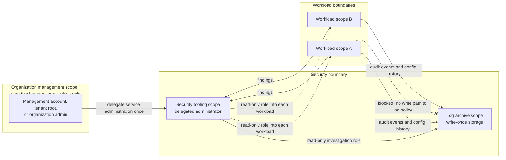

The diagram is a trust-boundary view of centralized logging and security. Data flows from workload scopes into the security boundary, never the other way except for read-only investigation roles. The management scope's only regular action is the one-time delegation; after that it is a break-glass location. The crossed edge is the property to test: a principal in a workload scope, even one with full administrative rights there, has no permission that reaches the log archive's storage policy. In AWS that is enforced by the bucket policy and an SCP; in Azure by RBAC on the Management subscription plus immutability; in Google Cloud by IAM on the logging project plus a locked bucket retention policy. If any workload role can write to the archive's policy, the separation fails.

### 3.4 The connectivity scope

The connectivity scope owns the shared network: the AWS Transit Gateway or shared VPC owner account, the Azure hub virtual network or Virtual WAN hub with Azure Firewall and private DNS zones, or the Google Cloud Shared VPC host projects. It also owns hybrid connectivity (VPN and dedicated interconnect circuits), DNS resolvers and forwarding rules, and central egress inspection. Section 5 covers how the landing zone allocates addresses and attaches workloads; the topology itself belongs to [Networking](CH05_Networking.md).

Large estates often split connectivity by region or by environment, for example separate production and non-production Shared VPC hosts. The Google Cloud enterprise foundations blueprint offers both a dual Shared VPC and a hub-and-spoke network stage for this reason. Splitting reduces the blast radius of a bad route or firewall change, at the cost of more scopes to operate.

### 3.5 Shared services and identity scopes

A shared services scope hosts capabilities that many workloads consume but none owns: container registries, artifact repositories, build runners, golden image pipelines, and sometimes central key management. Each service in it needs its own owner and service objective, because the scope collects dependencies that become critical for every workload's deployment and recovery. A registry outage stops every deployment; a lost key service stops every decryption. [Containers](CH07_Containers.md) discusses registry availability as a recovery dependency.

An identity scope is needed only when the landing zone runs directory infrastructure inside the cloud, such as Active Directory Domain Services domain controllers for legacy workloads. CAF reserves an Identity management group and subscription for that purpose. AWS designs place AWS Directory Service or self-managed domain controllers in a shared services or identity account. Most cloud-native estates do not need one, because workforce identity lives in an external identity provider (IdP) and workload identity is native to the provider.

### 3.6 Baseline scopes compared

| Function | AWS | Azure | Google Cloud |
|---|---|---|---|
| Organization administration | Management account; no workloads; SCPs do not apply to it | Tenant root group and intermediate root; Owner held only through PIM | Organization node; Organization Administrator held by a small group |
| Audit log storage | Log Archive account, organization trail to S3 | Management subscription, Log Analytics workspace and immutable storage | Logging project, organization aggregated sink to a locked log bucket |
| Security tooling | Audit or Security Tooling account as delegated administrator | Security subscription with Sentinel; Defender for Cloud by policy | Security project; Security Command Center at organization level |
| Network | Network account owning Transit Gateway, shared subnets, IPAM | Connectivity subscription owning hub or Virtual WAN | Shared VPC host projects, one or more per environment |
| Shared services | Shared Services account | Shared services subscriptions under Platform, or in Corp | Shared services projects in the common folder |
| Identity infrastructure | Identity or shared services account if directory services are needed | Identity subscription | Usually none; Cloud Identity is external to projects |
| Bootstrap automation | Account that runs the landing-zone pipeline, for example the Account Factory for Terraform (AFT) management account | Platform automation subscription or management subscription | Bootstrap or seed project holding Terraform state and the foundation pipeline |

### 3.7 Quality scenario: a compromised workload account is contained

The part-wide scenario of an account compromise contained by organizational boundaries is the acceptance test for the baseline scopes.

| Element | Value |
|---|---|
| **Stimulus** | An attacker steals a deployment pipeline credential that holds administrator rights in `orders-prod` and attempts to disable logging, delete evidence, reach the hub network configuration, and pivot into other production scopes |
| **Environment** | Baseline scopes as in Section 3.6; organization guardrails deny stopping or modifying the organization trail, aggregated sink, or diagnostic settings; no role in any workload scope trusts principals from `orders-prod`; the connectivity scope grants workload teams only attachment-request permissions |
| **Expected response** | Attempts to stop or alter logging are denied by guardrails above the scope; the log archive keeps recording the attacker's calls; changes to hub routing fail because the stolen principal has no permission in the connectivity scope; threat detection in the security tooling scope raises a finding; responders move `orders-prod` to the suspended branch, which applies a deny-all guardrail |
| **Measure** | Zero successful write calls outside `orders-prod` in the organization audit trail; no gap in audit delivery from `orders-prod`; detection within the 15-minute objective; containment by scope move within 30 minutes of detection; the move itself recorded in the log archive |

The scenario fails if any of three things exist: a guardrail assigned at the workload scope itself, which the scope's administrator can remove; a trust edge from the workload into another scope; or a log destination that the workload scope can write policy for. Section 3.3's diagram is the design that removes all three. Note that a scope move is a fast containment tool only if the suspended branch's deny-all policy exempts the incident-response role, so responders can still investigate.

## 4. Provider landing-zone products

Each provider ships products that create a landing zone for you. They differ in how much they decide, how they are customized, and how they are upgraded. Choosing one is a decision about who maintains the foundation code over time.

### 4.1 AWS Control Tower

**What it creates.** AWS Control Tower is a managed orchestration service in the management account. It configures AWS Organizations, IAM Identity Center, CloudTrail, AWS Config, and AWS CloudFormation StackSets to produce a landing zone: a set of OUs, shared accounts for log archive and audit, an organization trail, identity integration, and an account factory. It does not replace Organizations. Every Control Tower guardrail is an Organizations policy, a Config rule, or a CloudFormation hook that you could inspect yourself ([AWS](CH01_AWS.md) Section 5.6).

**Landing zone versions.** Control Tower versions its landing zone separately from the service. When AWS releases a new landing zone version, existing landing zones keep running the old one until an administrator runs an update, after which OUs and accounts may need re-registration or baseline updates to pick up the new configuration ([configuration update management](https://docs.aws.amazon.com/controltower/latest/userguide/configuration-updates.html)). Version 4.0, released in late 2025, is a structural change: the landing zone manifest becomes optional, AWS Config and the security roles become configurable service integrations instead of always-on components, Control Tower no longer creates or requires a Security OU of its own, and a controls-only experience lets organizations use Control Tower's control catalog without adopting its full account structure ([Control Tower 4.0 key changes](https://docs.aws.amazon.com/controltower/latest/userguide/key-changes-lz-v4.html)). An upgrade from 3.3 or earlier must keep the AWS Config and security-role integrations enabled during the upgrade itself; they can be disabled afterwards if desired. The practical lesson is that a landing-zone version is a dependency with its own release notes and migration guide, and the platform team plans upgrades like any other platform release (Section 12).

**Controls.** Control Tower controls have two independent attributes: **behavior** and **guidance**.

| Behavior | Implementation | When it acts | What it cannot do |
|---|---|---|---|
| Preventive | SCPs, RCPs, and declarative policies in Organizations | At application programming interface (API) authorization time, in every Region | Inspect resource configuration beyond what IAM condition keys expose |
| Detective | AWS Config rules, and Security Hub controls in the Control Tower service-managed standard | After a resource exists, on configuration change or schedule | Stop the change; it reports noncompliance |
| Proactive | CloudFormation hooks | Before CloudFormation provisions a resource | See resources created outside CloudFormation, such as by the console or Terraform's direct API calls |

Guidance classifies controls as **mandatory** (always on, cannot be disabled, such as protections for Control Tower's own resources), **strongly recommended**, or **elective**. A platform team chooses strongly recommended and elective controls per OU. Because controls are enabled on OUs, the OU tree is again the unit of policy, and an account moved between OUs carries controls with it unevenly: the [drift documentation](https://docs.aws.amazon.com/controltower/latest/userguide/drift.html) notes that SCP-based and Config-rule-based controls from the previous OU must be removed manually after a move, while hook-based controls are replaced when a new hook control is enabled on the destination.

**Account Factory.** The built-in Account Factory provisions accounts through AWS Service Catalog, enrolls them in a registered OU, applies the OU's baselines and controls, and grants IAM Identity Center access. At the time of writing, Account Factory can run up to five account-related operations (provision, update, or enroll) at the same time ([Control Tower limits](https://docs.aws.amazon.com/controltower/latest/userguide/limits.html); verify current quotas). Account Factory Customization (AFC) adds blueprints, CloudFormation templates or Terraform configurations packaged as Service Catalog products, that run in a new account during provisioning.

**Account Factory for Terraform (AFT).** AFT is an AWS-supported, open-source Terraform pipeline deployed into a dedicated AFT management account. Account requests are Terraform files committed to an account-request repository. A request is written to an Amazon DynamoDB table, processed first in, first out, and passed to Control Tower's Account Factory. After the account exists, AFT runs AWS Step Functions and AWS CodePipeline stages for *provisioning customizations* (pre-baseline integration such as registering the account in a configuration management database), *global customizations* (applied to every account), and *account customizations* (applied to accounts that reference a named customization) ([AFT architecture](https://docs.aws.amazon.com/controltower/latest/userguide/aft-architecture.html)). AFT is the usual choice when the organization already standardizes on Terraform and wants account requests to go through pull-request review. Its own concurrency settings default to five account-factory actions and five customization pipelines, the values AWS has tested ([Control Tower limits](https://docs.aws.amazon.com/controltower/latest/userguide/limits.html)).

**Customizations for AWS Control Tower (CfCT).** CfCT is an AWS solution that deploys CloudFormation templates and SCPs from a manifest file to accounts and OUs, triggered by Control Tower lifecycle events such as a completed account creation. It suits CloudFormation-centric teams that want baselines beyond Control Tower's controls without adopting Terraform.

**Landing Zone Accelerator on AWS (LZA).** LZA is an AWS solution built on the AWS Cloud Development Kit (CDK) that deploys a much broader, configuration-driven foundation, often on top of Control Tower. It is controlled by YAML (YAML Ain't Markup Language) configuration files: `accounts-config.yaml`, `global-config.yaml`, `iam-config.yaml`, `network-config.yaml`, `organization-config.yaml`, and `security-config.yaml` are mandatory, and `customizations-config.yaml` and `replacements-config.yaml` are optional ([LZA configuration files](https://docs.aws.amazon.com/solutions/latest/landing-zone-accelerator-on-aws/using-configuration-files.html)). Adding an account entry to `accounts-config.yaml` creates the account; the network file can describe Transit Gateways, inspection VPCs, and IPAM pools. LZA ships sample configurations aligned to compliance frameworks and is common in regulated and public-sector estates. Its trade-off is that the platform team operates a large CDK application and its pipeline, and must upgrade it with the solution's releases.

**Choosing among them.** These options compose rather than compete. A common pattern is Control Tower for the organization structure and controls, AFT for vending, and either AFT customizations or LZA for network and security baselines. The decision turns on the team's IaC language, how much of the network and security baseline should come from a maintained AWS solution versus the team's own modules, and the regulatory starting point.

### 4.2 Azure landing zones

**The design areas.** CAF organizes landing-zone design into eight design areas: Azure billing and Microsoft Entra tenant; identity and access management; management group and subscription organization; network topology and connectivity; security; management; governance; and platform automation and DevOps ([What is an Azure landing zone](https://learn.microsoft.com/en-us/azure/cloud-adoption-framework/ready/landing-zone/)). The design areas are a checklist of decisions, not deployable code. Each one produces choices that the implementation encodes, such as the billing agreement that permits programmatic subscription creation, the hub topology, or the Log Analytics workspace design.

**The reference management-group hierarchy.** The Azure landing-zone reference architecture defines management-group *archetypes*, each with a standard set of policy assignments ([CAF management groups](https://learn.microsoft.com/en-us/azure/cloud-adoption-framework/ready/landing-zone/design-area/resource-org-management-groups)):

- **Intermediate root**, directly under the tenant root group, parent of everything the architecture creates.
- **Platform**, with children **Security** (SIEM tooling such as Sentinel), **Management** (Log Analytics workspace and automation), **Connectivity** (Virtual WAN or hub networks, Azure Firewall, private DNS zones), and **Identity** (domain services if needed).
- **Landing zones**, with workload-agnostic policies, and children **Corp** (workloads connected to the corporate network through the hub), **Online** (internet-facing workloads), and **Local** (Azure Local hybrid workloads).
- **Sandboxes**, isolated from Corp and Online with lighter policy.
- **Decommissioned**, for canceled landing zones awaiting deletion.

The guidance explicitly recommends against management groups for development, test, and production. Environments are separate subscriptions under the same archetype, so that a policy tested in a development subscription is the policy that production will enforce. It also recommends keeping the hierarchy to three or four levels, configuring a default management group for new subscriptions (often Sandboxes) so that nothing lands under the tenant root, and enabling RBAC authorization for management-group creation, because by default any principal in the tenant can create management groups.

**Implementations.** Microsoft's deployable implementations have converged on Azure Verified Modules (AVM), a program of Microsoft-maintained Bicep and Terraform modules with common quality standards. The Azure Landing Zones IaC accelerator bootstraps a repository, pipeline, and identities, then deploys the platform landing zone with AVM-based Bicep or Terraform modules; the reference management groups, policy definitions, and assignments are published as a versioned ALZ Library that both languages consume ([Azure landing zone documentation](https://azure.github.io/Azure-Landing-Zones/)). Older implementations, the "classic" ALZ Bicep modules and the Terraform `caf-enterprise-scale` module, are on deprecation paths in favor of the AVM-based ones; check each repository's notice before starting new work on them. A portal-based accelerator also exists for organizations that want a guided deployment without starting from code.

**Subscription vending.** Application landing zones are created by the subscription vending pattern module, published in AVM for Bicep (`avm/ptn/lz/sub-vending`) and as a Terraform module. Given a billing scope, a management-group target, and parameters, it creates the subscription through the subscription alias API, places it in the right management group, creates and peers a spoke virtual network (or connects it to a Virtual WAN hub), creates role assignments for the workload team, and can register resource providers and create a user-assigned managed identity for the team's pipeline ([subscription vending module](https://azure.github.io/Azure-Landing-Zones/sub-vending/bicep/)). The identity running vending needs a subscription-creator role on the billing scope, such as an invoice section under a Microsoft Customer Agreement (MCA) or an enrollment account under an Enterprise Agreement (EA). That billing permission is separate from any Azure RBAC role, and missing it is the most common first-run failure.

**Policy as the guardrail engine.** Azure landing zones put most guardrails in Azure Policy assignments at management-group scope, using the effects and exemptions taught in [Azure](CH02_Azure.md) Section 6. Several reference assignments ship with effects or enforcement modes chosen so that brownfield subscriptions are audited rather than broken on day one, which is the first stage of the rollout model in Section 8.

### 4.3 Google Cloud foundation options

**Google Cloud Setup.** The console's guided Google Cloud Setup flow configures a foundation in steps and offers three options at the time of writing: **Proof of concept** (organization, billing, and resource hierarchy), **Production** (adds logging, monitoring, and Security Command Center settings), and **Advanced production** (adds networking and Cloud KMS with Autokey). The flow compiles choices into Terraform configuration that can be deployed from the console or downloaded and managed in the organization's own pipeline ([Google Cloud Setup](https://docs.cloud.google.com/docs/enterprise/cloud-setup)). It is the fastest way to a sound starting point for a new organization. Downloading the Terraform is the step that turns it into a maintained landing zone; a foundation that only exists as console clicks cannot be versioned or reviewed.

**The enterprise foundations blueprint.** Google's enterprise foundations blueprint, formerly the security foundations guide, is an opinionated reference architecture with a Terraform implementation in the `terraform-example-foundation` repository. It is deployed in ordered stages, each a separate Terraform root with its own state and pipeline:

| Stage | Purpose |
|---|---|
| `0-bootstrap` | Creates the seed and continuous integration and continuous delivery (CI/CD) projects, Terraform state buckets, and service accounts for later stages; run once by a human |
| `1-org` | Organization-level resources: common folder, logging and security projects, aggregated log sinks, organization policies |
| `2-environments` | Environment folders (development, non-production, production) and per-environment shared projects |
| `3-networks-*` | Either dual Shared VPC per environment or hub-and-spoke networking, with hierarchical firewall policies and DNS |
| `4-projects` | Business-unit folders and workload projects attached to the networks, plus per-business-unit infrastructure pipelines |
| `5-app-infra` | An example workload deployed through the infrastructure pipeline |

The stage separation is a security design: each stage's service account has only the permissions that stage needs, and the blueprint recommends separate pipelines for foundation, infrastructure, and application layers so that a workload pipeline cannot change organization policy ([blueprint deployment methodology](https://cloud.google.com/architecture/security-foundations/deployment-methodology)). The blueprint's summary also warns that a self-service billing account may need a project-quota increase before later stages can create their projects, which is a vending quota concern (Section 7.6).

**Cloud Foundation Toolkit (CFT).** CFT is Google's library of Terraform modules that the blueprint composes, including the `project-factory` module that creates a project, links billing, enables APIs, removes the default network, attaches the project to a Shared VPC host, and grants initial roles. Teams that do not adopt the whole blueprint often use CFT modules to build their own foundation.

**Cloud Foundation Fabric and FAST.** Cloud Foundation Fabric is a separate Google-maintained collection of Terraform modules. Its FAST toolkit builds a complete organization through stages modeled on security boundaries: an organization-setup stage (which in recent releases replaced separate bootstrap and resource-management stages), then networking, security, VPC Service Controls, and project-factory stages driven largely by YAML factories. Stage names and layout have changed across releases, so pin a release and read its stage index before planning. FAST suits teams that want a factory-driven foundation where adding a project, folder, or firewall rule is a YAML change.

**Choosing among them.** Google Cloud Setup for a quick, reviewed start; the enterprise foundations blueprint where a documented, security-reviewed reference matters, for example to show auditors; CFT modules or FAST where the team wants to own a modular foundation and evolve it. All three end in Terraform, so the long-term operating model is the same: a pipeline, state, and versioned modules.

### 4.4 Adopt a product or build your own

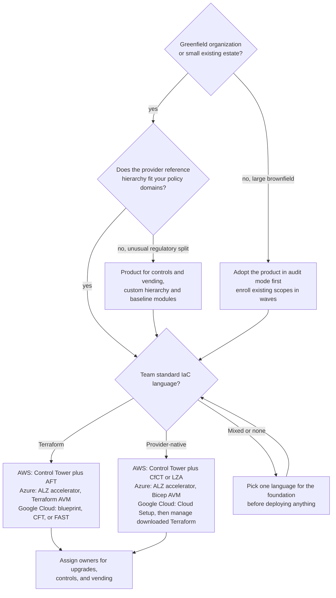

The decision tree shows that the product choice is mostly about *maintenance*, not about initial features. Every path ends with assigning owners for upgrades, because a product's defaults age: new provider services appear without guardrails, and new landing-zone versions change structure. A fully custom foundation, with no provider product, is justified when the organization needs a hierarchy or control model the products cannot express and has a platform team large enough to maintain the equivalent of the product's code. Most organizations do better adopting the product and customizing at its extension points (AFT customizations, AVM module parameters, blueprint stages), because the product's maintainers then absorb part of the upgrade work.

Products do not decide the hard questions. None of them decides which workloads deserve their own scope, who approves exceptions, what the onboarding contract promises, or how a scope is retired. The rest of the chapter covers those.

## 5. Network connectivity and IP address management

### 5.1 Recap: the topology choices

[Networking](CH05_Networking.md) teaches the three ownership patterns in depth. AWS VPC sharing lets a network account share subnets with participant accounts through AWS Resource Access Manager, while Transit Gateway or AWS Cloud WAN connects many workload VPCs. Azure uses a hub virtual network or Virtual WAN hub in a Connectivity subscription with spokes in workload subscriptions, and Azure Virtual Network Manager can enforce connectivity and security admin rules across many virtual networks. Google Cloud Shared VPC lets a host project own the network while service projects consume its subnets. In all three, the central team owns transit, hybrid links, DNS, and egress inspection, and workload teams attach under a contract.

The landing zone's job is to make that attachment a vended, repeatable step rather than a ticket to the network team, and to make sure every address range it hands out is unique across the organization and the corporate network.

### 5.2 How a workload attaches

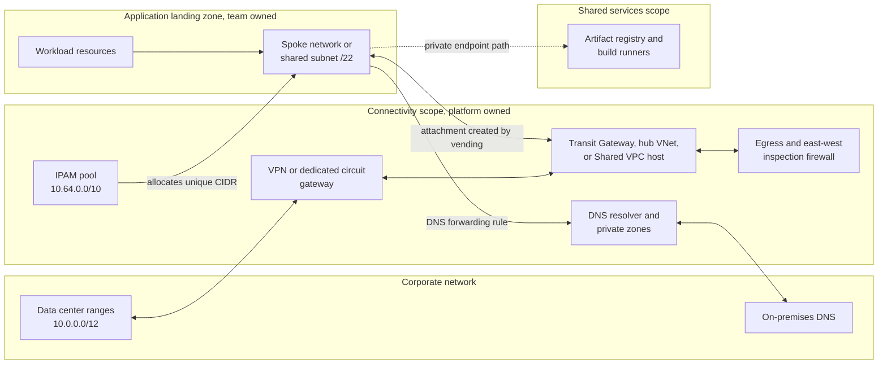

This is the topic map's second required view: shared-service connectivity. The workload team owns only the right-hand box. The vending workflow allocates a Classless Inter-Domain Routing (CIDR) block from the IPAM pool, creates the spoke network or shares subnets into the new scope, attaches it to the hub, points its DNS at the central resolver, and routes its outbound traffic through inspection. Shared services, such as the artifact registry, are reached over private endpoints, so builds and deployments do not depend on public internet paths. Two implications follow. First, the attachment and the routes are created by the platform's identity, not by the workload team, so a compromised workload scope cannot add a route to another spoke. Second, every shared component in the middle box is a dependency of every workload. Its availability objective must be at least as high as the most demanding workload's, and its failure modes belong in each workload's recovery plan.

### 5.3 IP address management as a vending step

Address planning is the hardest network decision to reverse, because renumbering a subnet means moving every workload in it ([Networking](CH05_Networking.md) Section 4). The landing zone turns the address plan into a service:

- **One registry is the source of truth.** Provider IPAM services enforce allocation inside the cloud: Amazon VPC IPAM allocates VPC CIDRs from pools shared across the organization and audits overlaps; Azure Virtual Network Manager provides IP address management pools; Google Cloud subnet allocation is done in the host project and tracked by the foundation's Terraform. None of them knows on-premises allocations unless they are imported, so the enterprise registry stays authoritative and the cloud pools are carved from blocks it has reserved.
- **Allocation sizes are standard.** Offering two or three spoke sizes, for example `/24`, `/22`, and `/20`, makes allocation automatic and fragmentation predictable. A request for anything else is an exception.
- **Allocation is recorded with ownership.** The allocation carries the scope ID, the owner, and the environment, so that decommissioning can return it to the pool (Section 13).

**Worked sizing example.** A platform reserves `10.64.0.0/10` for cloud workloads across two regions. A `/10` contains 2^(32−10) = 4,194,304 addresses. The standard spoke is a `/22`, which contains 2^(32−22) = 1,024 addresses. The number of `/22` blocks in a `/10` is 2^(22−10) = 4,096. The platform splits the `/10` into two regional `/11` pools, each holding 2,048 standard spokes. If the organization expects 600 application landing zones within three years, each with one spoke per region, it uses 600 of 2,048 blocks per region, about 29 percent, leaving room for growth and for occasional `/20` allocations (each consuming four `/22` blocks). On AWS, a `/22` spoke split across three Availability Zones with two tiers gives six subnets of `/25` (128 addresses each, of which AWS reserves five), which is enough for most container and virtual-machine workloads; a Kubernetes workload with per-pod VPC addresses will need the `/20`. On Google Cloud with Shared VPC, the same arithmetic applies to subnets in the host project rather than to separate networks.

The failure to avoid is letting teams pick their own ranges "for now." The first overlap appears when two teams need to talk to each other or to a newly acquired company, and fixing it requires renumbering a live workload.

## 6. Identity integration

### 6.1 Recap and boundary

[IAM](CH09_IAM.md) owns policy evaluation, federation protocols, workload identity, and cross-scope trust. [Authentication](../15_Security/CH02_Authentication.md) and [RBAC](../15_Security/CH04_RBAC.md) in Part 15 own the provider-neutral foundations. This section covers the decisions a landing zone makes once for every scope it vends.

### 6.2 Workforce access

Humans sign in through the organization's IdP, such as Microsoft Entra ID or Okta, and receive access through groups, never through individual assignments.

- **AWS.** IAM Identity Center is federated to the IdP with Security Assertion Markup Language (SAML) 2.0, and users and groups are provisioned with System for Cross-domain Identity Management (SCIM). The landing zone defines *permission sets*, such as `WorkloadAdmin`, `WorkloadReadOnly`, and `PlatformOperator`, and vending assigns a group to a permission set in the new account. IAM Identity Center creates a role in the account for each assigned permission set. At the time of writing IAM Identity Center supports up to 7,000 accounts in an organization by default, a number that matters at large scale ([Organizations quotas](https://docs.aws.amazon.com/organizations/latest/userguide/orgs_reference_limits.html); verify current quotas).
- **Azure.** Identities already live in the Entra tenant that every subscription trusts. Vending creates role assignments for the workload team's groups at the new subscription's scope, never at management-group scope, because CAF guidance is to keep workload-team access at subscription or resource-group scope and to use management-group assignments only for platform teams under PIM.
- **Google Cloud.** Cloud Identity or Google Workspace holds users and groups, often synchronized from the corporate directory with Google Cloud Directory Sync or federated with Workforce Identity Federation. Vending binds the team's groups to roles on the new project.

The landing zone standardizes the *role catalog* as well as the mechanism. Five or six well-designed roles per scope, used everywhere, make access reviews possible. Custom roles per team make them impossible.

### 6.3 Privileged and emergency access

High-impact roles, such as organization administrator, management-group Owner, or Organization Policy administrator, are held only through just-in-time elevation: Entra PIM on Azure, temporary elevated access tools or approval workflows built on IAM Identity Center on AWS, and Privileged Access Manager or approval workflows on Google Cloud. Elevation requires justification and is logged to the archive.

Break-glass accounts exist for the case where the IdP or the elevation system is unavailable. They authenticate directly with the provider, not through the federated IdP, use phishing-resistant credentials kept under dual control, and trigger an alert on any sign-in. Guardrails that exempt a break-glass role, such as the SCP in [AWS](CH01_AWS.md) Section 5.3, must name that role exactly. A broad exemption such as "any role with admin in its name" is a privilege-escalation path.

### 6.4 Pipeline and platform identities

Three kinds of non-human identity need separate treatment:

1. **The landing-zone pipeline identity** can create scopes, assign policy, and change the hierarchy. It is the most privileged identity in the estate. It runs only from the bootstrap scope, uses short-lived federated credentials from the pipeline platform (for example OpenID Connect (OIDC) federation from the CI/CD system), and its changes require reviewed merges.
2. **The vending identity** creates scopes and baselines but cannot change organization-wide policy. Splitting it from the landing-zone pipeline identity means a bug or compromise in the vending workflow cannot remove guardrails.
3. **Workload deployment identities** are created by vending inside each application landing zone, scoped to that zone, and federated to the team's pipeline. They hold no rights outside their zone.

The identity and key rotation scenario applies to all three. Because they use federated, short-lived credentials, rotation means rotating the federation trust or the signing key of the pipeline platform, not distributing new secrets. The test is that revoking the trust for one workload's pipeline stops that pipeline within minutes and affects no other zone. [Secrets Management](CH13_Secrets_Management.md) covers rotation of the secrets that cannot be federated.

## 7. Account, subscription, and project vending

### 7.1 What vending is

Vending is the repeatable, automated process that turns a request into a ready application landing zone: the scope exists in the right place in the hierarchy, billing is linked, baseline policy and security services are active, logs flow to the archive, the network is attached, and the owning team has access. "Ready" is a verifiable state, not the moment the create call returns. A scope that exists but whose log delivery has not started is not ready, and production deployment into it must be blocked.

Vending replaces two bad alternatives. The first is the ticket queue, where an engineer creates each scope by hand from a runbook; it is slow, inconsistent, and does not scale past a few dozen scopes. The second is unrestricted self-creation, where any developer can create a project or subscription; it is fast but produces scopes with no owner, no baseline, and no billing owner. Vending is fast like self-creation and consistent like a good runbook, because the runbook is code.

### 7.2 The request contract

A vending request is a small, structured document. It is validated before anything is created, and it is stored as the record of why the scope exists. The [vending validator example](../code/python/landing-zones-chapter/03_vending_validator.py) checks the minimum set: name, owner, environment, billing owner, data classification, and region, and rejects an environment outside `dev`, `test`, and `prod`. A production-grade request carries more:

```yaml
# application landing zone request, stored in the vending repository
name: payments-prod
archetype: corp                 # selects hierarchy placement and policy set
environment: prod
owner_group: grp-payments-admins
technical_contact: payments-oncall@example.com
billing_owner: cc-4410-payments
data_classification: restricted
regions: [westeurope, northeurope]
network:
  size: /22                     # standard sizes only
  connectivity: hub             # hub, isolated, or internet-only
budget_monthly_usd: 18000
expires: null                   # required for sandbox archetype
```

The validation stage checks four kinds of rule:

- **Schema and completeness.** Required fields exist and have allowed values. This is what the example code demonstrates.
- **Referential integrity.** The owner group exists in the directory and has at least two members; the billing owner is a valid cost center; the name is unique and matches the naming convention.
- **Policy fit.** The regions are allowed for the data classification; a `restricted` request cannot use the sandbox archetype; a `prod` request needs a named on-call contact.
- **Capacity.** The IPAM pool has a free block of the requested size, and the provider quotas for new scopes have headroom (Section 7.6).

A request that passes all four needs no human approval. Human review is reserved for requests that ask for something outside the standard, such as an unusual network size or an archetype that relaxes policy. That rule is what keeps vending from becoming a slower ticket queue.

### 7.3 The workflow

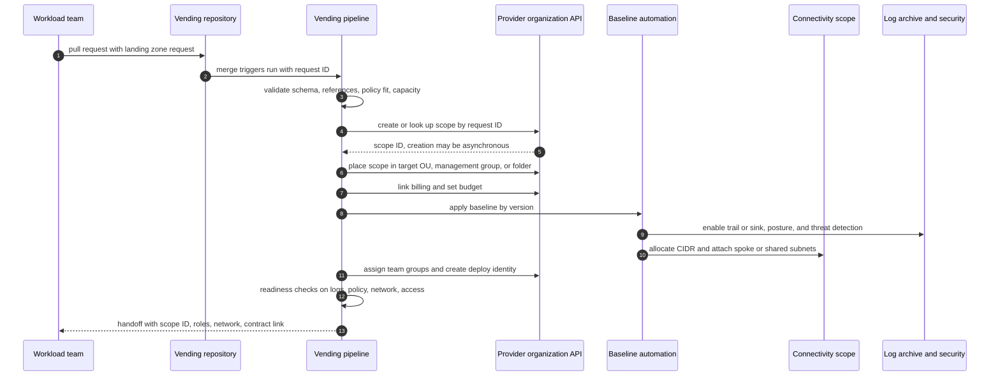

This is the topic map's third required view: the onboarding workflow. Several properties are visible in the sequence. The request enters through a reviewed repository, so the history of every scope is in version control. Validation (step 3) happens before any create call, so a rejected request leaves nothing behind. Scope creation (step 4) looks up the scope by request ID before creating it, which is the key to idempotency. Placement in the hierarchy (step 6) happens before baseline application, so that inherited guardrails are active before anyone can deploy. The baseline is applied *by version* (step 8), so the platform knows which baseline every scope has and can upgrade it later. Readiness checks (step 12) verify outcomes, such as an actual log event arriving in the archive from the new scope, rather than trusting that each step returned success. The handoff (step 13) delivers the onboarding contract (Section 10), not only credentials.

### 7.4 Idempotency and partial failure

Scope creation is not transactional. The AWS `CreateAccount` call returns a request status that completes asynchronously, Azure subscription creation through the alias API is a long-running operation, and Google Cloud project creation returns an operation to poll. Baseline steps depend on other services that can throttle or fail independently. A vending run will sometimes stop halfway, and the design has to make re-running it safe.

Three techniques make the workflow idempotent:

1. **A stable request key.** The request ID or scope name is attached to the scope at creation, as an account tag, a subscription alias name (the Azure alias is itself the idempotency key, because creating the same alias twice returns the existing subscription), or the project ID, which is globally unique and fixed at creation in Google Cloud. Every run starts by looking up the scope by that key.
2. **Declarative baseline steps.** Each step describes desired state, typically as Terraform, Bicep, or CloudFormation, and applying it twice produces the same result. Imperative steps such as "send welcome email" are made conditional on a recorded flag.
3. **A recorded state per request.** The pipeline stores the request's current state so that a rerun resumes from the failed step and a dashboard shows stuck requests.

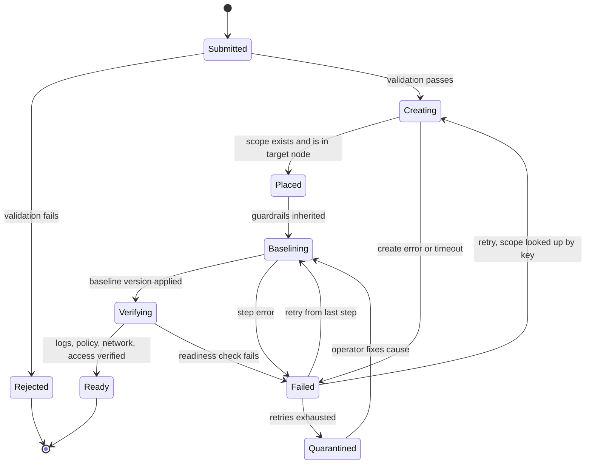

The state machine shows two safety rules. A scope cannot reach `Ready` without passing `Verifying`, and the team receives deploy permissions only at `Ready`, so a half-built scope cannot host production workloads. A scope whose retries are exhausted goes to `Quarantined`, a branch of the hierarchy with deny-all policy, rather than being left in its target node with an incomplete baseline. Retries look the scope up by its key, so a timeout after the provider has in fact created the account does not produce a second, orphaned account. That orphan case is the most common vending defect in practice: a pipeline that retries `CreateAccount` blindly after a timeout creates two accounts, one of which is never baselined and is discovered months later on an invoice.

### 7.5 Provider mechanics that shape the workflow

| Step | AWS | Azure | Google Cloud |
|---|---|---|---|
| Create the scope | Control Tower Account Factory (Service Catalog product), AFT request, LZA `accounts-config.yaml`, or Organizations `CreateAccount` | Subscription alias API through the AVM subscription vending module | `projects.create` through the CFT project factory or FAST project factory |
| Unique key | Account email address and account name; AFT request file | Alias name | Project ID |
| Hierarchy placement | Target OU in the request; Control Tower enrolls into a registered OU | Management-group association in the module | Parent folder at creation |
| Billing linkage | Automatic under consolidated billing | Billing scope (invoice section or enrollment account) chosen at creation; needs a billing role | Explicit link to a Cloud Billing account; needs Billing Account User |
| Baseline | Control Tower baselines and OU controls; AFT global and account customizations; StackSets | Inherited policy; `deployIfNotExists` remediations; module-created resources | Inherited Organization Policy; project factory removes default network, enables APIs |
| Network | Share subnets or create VPC from IPAM pool and attach to Transit Gateway | Spoke virtual network peered to hub or connected to Virtual WAN | Attach as Shared VPC service project; grant `compute.networkUser` on subnets |
| Access | IAM Identity Center assignments of groups to permission sets | Role assignments for groups at subscription scope | IAM bindings for groups on the project |

The rows explain the most common provider-specific failures. On AWS, account email addresses must be unique, so the vending system generates them from a pattern on a domain the platform controls, such as `aws+payments-prod@example.com`, and keeps that mailbox monitored because it can receive root-user recovery messages. On Azure, the vending identity needs a billing role that is administered in the billing account, outside Azure RBAC, and without it the alias call fails with an invoice-section permission error. On Google Cloud, the billing link is a separate call with a separate permission, and a project created without it cannot enable most APIs.

### 7.6 Worked example: vending throughput and quota headroom

An organization is moving 640 existing workloads onto AWS over twelve months, each needing a production and a non-production account, and also onboards about 15 new accounts a week for new products and sandboxes. The platform team uses Control Tower with AFT.

**Demand.** Migration needs 640 × 2 = 1,280 accounts. New demand is 15 × 52 = 780 accounts per year. The landing zone needs about 2,060 workload accounts in year one, plus about 10 baseline and platform accounts.

**Throughput.** Account Factory runs at most five account operations concurrently, and AFT's tested default is also five ([Control Tower limits](https://docs.aws.amazon.com/controltower/latest/userguide/limits.html); verify current quotas). AWS does not publish an end-to-end provisioning duration, so the team measures its own: in a pilot, an account takes a median of 30 minutes from request to Control Tower enrollment, and global plus account customizations take another 20 minutes, running in the separate customization pipelines. Provisioning, the slower stage, sets throughput: 5 concurrent × (60 ÷ 30) = 10 accounts per hour. The customization stage handles 5 × (60 ÷ 20) = 15 per hour, so it is not the bottleneck.

At 10 accounts per hour, the 1,280 migration accounts need 128 hours of provisioning. Running only during an 8-hour supervised window on working days, that is 16 working days. Spread over a year of migration waves, average demand is about 25 accounts a week for migration plus 15 new, or 40 accounts a week. That is 4 hours of provisioning weekly, well inside capacity. The constraint is burst: a migration wave of 120 workloads needs 240 accounts, or 24 provisioning hours, so accounts must be requested at least three working days before the wave starts. The team writes that lead time into the migration runbook, which [Cloud Migration](CH16_Cloud_Migration.md) owns.

**Quotas.** Several limits apply, at the time of writing (verify current quotas):

| Limit | Value | Source | Consequence |
|---|---|---|---|
| Accounts in a new organization | 10 by default, increasable | [Organizations quotas](https://docs.aws.amazon.com/organizations/latest/userguide/orgs_reference_limits.html) | Request an increase to about 3,000 before the first wave, giving roughly 45 percent headroom over 2,070 |
| Accounts created concurrently in Organizations | 5 | Organizations quotas | Matches the Control Tower limit; other tools calling `CreateAccount` compete for the same five slots |
| Accounts in a Control Tower organization | 10,000 | [Control Tower limits](https://docs.aws.amazon.com/controltower/latest/userguide/limits.html) | Not binding in year one |
| Accounts in one OU for registration | 1,000, lower with many governed Regions and optional controls | [Control Tower limits](https://docs.aws.amazon.com/controltower/latest/userguide/limits.html) | A single `Workloads/Prod` OU would reach about 1,030 accounts. Split production by business unit into child OUs with identical controls |
| Accounts supported by IAM Identity Center | 7,000 | Organizations quotas | Not binding in year one; relevant at the scale in Section 15 |
| SCPs attached per OU | 10 | Organizations quotas | Control Tower's managed SCPs count toward this; consolidate custom statements |

The OU registration limit is the finding the team would have missed without the arithmetic. Hitting it during a migration wave would block enrollment for every account still in the queue. Splitting OUs is cheap before accounts exist and disruptive after, because moving accounts between OUs creates drift that must be resolved account by account (Section 11).

The same exercise on Azure checks the billing agreement's subscription-creation limits, Azure Resource Manager throttling for the vending identity, and the per-subscription role-assignment budget; on Google Cloud it checks the project-creation quota for the vending service account and the number of projects a billing account can link. Neither provider's limits are reproduced here, because they depend on agreement type and change; the [Azure](CH02_Azure.md) and [Google Cloud Platform](CH03_GCP.md) chapters show where to find them. The method is the same: count demand, measure duration, find the concurrency limit, and request increases a wave ahead.

## 8. Guardrail rollout

### 8.1 Recap: guardrail mechanisms

The provider chapters teach how each guardrail engine evaluates. In short: AWS SCPs and RCPs set permission ceilings on principals and resources in member accounts and never grant anything ([AWS](CH01_AWS.md) Section 5); Azure Policy evaluates resource configuration in the request and at rest, with effects such as `audit`, `deny`, `modify`, and `deployIfNotExists` ([Azure](CH02_Azure.md) Section 6); Google Cloud Organization Policy constrains resource configuration on create and update, and IAM deny policies cap permissions ([Google Cloud Platform](CH03_GCP.md) Sections 8 and 9). The difference between a guardrail and a permission grant is owned by [IAM](CH09_IAM.md).

For rollout, the useful classification is by *when* a guardrail acts:

| Type | Acts | AWS | Azure | Google Cloud |
|---|---|---|---|---|
| Preventive (authorization) | At API call, on the action | SCP, RCP | Deny assignments, `denyAction` | IAM deny policies, principal access boundaries |
| Preventive (configuration) | At API call, on the resulting configuration | Declarative policies for supported services; SCP condition keys where they exist | Policy `deny` | Organization Policy constraints, custom constraints |
| Proactive | Before IaC provisions | CloudFormation hooks, Control Tower proactive controls | Pipeline checks with Bicep what-if and policy evaluation | Terraform plan validation with policy libraries |
| Detective | After the resource exists | AWS Config rules, Security Hub controls | Policy `audit`, `auditIfNotExists` | Security Command Center findings, Cloud Asset Inventory analysis |
| Remediating | After detection, changes the resource | Config remediation actions | `modify`, `deployIfNotExists` remediation tasks | Automation triggered by asset feeds or findings |

A mature landing zone uses all five for important rules. The preventive layer stops the change. The proactive layer tells a team at plan time, before a failed deployment. The detective layer finds what existed before the rule and what was created by a path the other layers miss. The remediating layer fixes the common cases automatically.

### 8.2 Why rollout needs a method

A new preventive guardrail is a production change with organization-wide blast radius. Its failure mode is not a security gap but an outage: deployments that worked yesterday fail today, in many teams at once, often in pipelines that run at night. The causes are predictable. Existing resources violate the rule, so their next update fails. IaC templates rely on a provider default that the rule forbids. A vendor integration or a provider-managed service performs an action the rule denies. The rule's condition is subtly wrong, for example a Region restriction that forgets global services.

The method that avoids these outages is to separate *learning what the rule would do* from *making the rule bite*, and to widen enforcement in rings.

### 8.3 Audit, warn, enforce

**Audit.** The rule is evaluated but has no effect on requests. Results go to compliance reports and logs. Provider support differs:

- Azure Policy has a native audit stage. Assign the definition with effect `audit` (when the definition parameterizes its effect), or assign with `enforcementMode` set to `DoNotEnforce`, which evaluates and reports compliance without applying the effect.
- Google Cloud Organization Policy supports a `dryRunSpec`: violations are logged as dry-run audit entries, but nothing is blocked. VPC Service Controls perimeters have a dry-run configuration with the same purpose. Policy Simulator can estimate the effect of some changes against existing resources.
- AWS SCPs and RCPs have **no** dry-run mode. The audit stage for an AWS preventive rule is a detective equivalent: an AWS Config rule, a Security Hub control, or an analysis of CloudTrail data that finds the calls the SCP would have denied. Attaching the SCP to a policy-staging OU containing representative test accounts is the closest thing to a dry run.

**Warn.** The rule tells the person making the change, without blocking it. CloudFormation hooks support a `WARN` failure mode that reports a violation and lets provisioning continue. In Azure and Google Cloud, the warn stage is usually implemented in pipelines: a plan-time policy check posts a comment on the pull request or emits a pipeline warning. Warn exists because audit results go to the platform team, while warnings go to the people who must change their templates.

**Enforce.** The rule blocks noncompliant requests. The Azure effect becomes `deny`; the Google Cloud policy moves from `dryRunSpec` to `spec`; the AWS SCP is attached to the target OU.

### 8.4 Canary scopes and rings

Enforcement widens through rings of the hierarchy, each a real set of scopes with real deployments:

1. **Ring 0, the canary hierarchy.** A mirror of the production tree with platform-owned test scopes and synthetic deployments of the standard templates. In Azure this is a separate canary intermediate root; in Google Cloud a canary folder tree; in AWS a policy-staging OU. Ring 0 catches mistakes in the rule itself.
2. **Ring 1, sandboxes and platform-owned non-production.** Real usage, low impact, and engineers who expect change.
3. **Ring 2, non-production workloads.** Most teams' templates are exercised here first. Teams have had warnings for weeks.
4. **Ring 3, production workloads.** Enforcement reaches everything except scopes with approved exceptions.

Rings map to hierarchy nodes. That is a reason to keep production and non-production as separate nodes even when their policies are identical at steady state: during a rollout, they are not identical for a few weeks. Where the hierarchy does not split the way rollout needs, Azure Policy resource selectors can roll out by location or resource type within one assignment, and Google Cloud Organization Policy rules can be conditioned on tags such as `env=prod`.

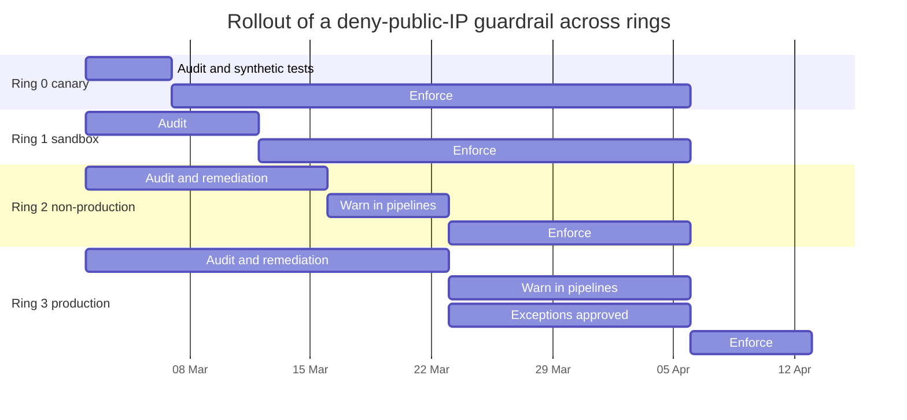

The timeline shows that audit starts everywhere on day one. Collecting evidence is harmless, and production needs the longest lead time to remediate. Enforcement moves outward ring by ring, and each ring's enforcement starts only after the previous ring has been enforced long enough to surface surprises. Production enforcement waits for both the warn period and the exception decisions, so that on the day the rule bites, every remaining violation is either fixed or covered by an approved, expiring exception. The durations are an example; the rule is that each gate is passed on evidence (Section 8.5), not on a date.

### 8.5 Gates between stages

Each move to a wider ring or stronger stage needs evidence:

| Gate | Evidence required |
|---|---|
| Audit to warn | Violation count per scope is known; each violating scope has an owner notified; false positives investigated and the rule corrected |
| Warn to enforce in a ring | Violations in the ring are zero or covered by approved exceptions; standard templates pass; no unexplained denials in Ring 0 |
| Enforce in ring N to ring N+1 | No incident attributed to the rule in ring N for the soak period; denial logs reviewed; support tickets triaged |
| Any stage to rollback | Unplanned denial rate above threshold, or a critical deployment blocked without an available exception |

Rollback must be quick. The rule is deployed as code, and reverting the commit or switching the enforcement parameter restores the previous state. The platform rehearses rollback in Ring 0 before production enforcement.

### 8.6 Worked example: enforcing IMDSv2 across 800 AWS accounts

The security team wants every new Amazon Elastic Compute Cloud (Amazon EC2) instance to require Instance Metadata Service version 2 (IMDSv2), which uses session tokens and blocks a class of server-side request forgery attacks against instance credentials.

**The rule.** A preventive SCP denies `ec2:RunInstances` on instances unless the metadata option requires tokens:

```json
{
  "Version": "2012-10-17",
  "Statement": [
    {
      "Sid": "RequireImdsV2OnLaunch",
      "Effect": "Deny",
      "Action": "ec2:RunInstances",
      "Resource": "arn:aws:ec2:*:*:instance/*",
      "Condition": {
        "StringNotEquals": {"ec2:MetadataHttpTokens": "required"}
      }
    }
  ]
}
```

An alternative is an EC2 declarative policy that sets the account-level default for new instances to require IMDSv2. A declarative policy changes the default rather than denying the call, which breaks fewer templates, but it does not tell a team that its template is wrong. Many organizations use both: the declarative default for safety, and the SCP in the strictest OUs.

**Audit.** The SCP has no dry run, so the team enables a detective check (the AWS Config managed rule for IMDSv2, or the equivalent Security Hub control) organization-wide. On day 3 it reports 2,400 instances without IMDSv2 required, in 210 of 800 accounts. A CloudTrail query over 30 days finds 9,500 `RunInstances` calls that did not set `MetadataHttpTokens` to `required`, from 340 distinct IAM roles. Those calls would fail under the SCP. They are the real blast radius, because they are the launches that would break, not just the instances that exist.

**Classification.** The 340 roles fall into groups: 260 are deployment pipelines using three shared launch templates or modules, fixed centrally by updating the modules and announcing the new version; 55 are autoscaling groups whose launch templates teams must update; 20 are a vendor's appliance that requires IMDSv1 and needs an exception; 5 are a provider-managed integration that launches instances on the customer's behalf through a service-linked role. SCPs do not affect service-linked roles, so those 5 are unaffected.

**Rings and arithmetic.** Ring 0 (6 accounts) enforces on day 7 after synthetic launches of each standard template pass. Ring 1 (120 sandbox accounts) enforces on day 14. By day 28, non-production violations have fallen from 4,100 calls per week to 60. The remaining 60 come from 4 roles whose owners have been contacted. Ring 2 (330 accounts) enforces on day 35. Production (344 accounts) runs in warn mode through a CloudFormation hook and pipeline checks until day 49, when weekly violating calls are 0 apart from the vendor appliance, which has an exception expiring in 90 days (Section 9). Enforcement in production takes effect within minutes of attachment.

**Validation evidence.** A test launch without IMDSv2 in a production account is denied with an explicit SCP denial in the error. The Config rule shows new noncompliant instances at zero per week. The exception register shows one active exception with an expiry date and an owner.

### 8.7 Quality scenario: a guardrail rollout breaks deployments

| Element | Value |
|---|---|
| **Stimulus** | An Azure Policy `deny` assignment requiring a `costCenter` tag on resource groups is promoted to the Landing zones management group. Its condition also matches resource groups created implicitly by a managed service, which does not set the tag. Deployments of that service fail in 37 subscriptions within an hour |
| **Environment** | The rule passed Ring 0, but the canary hierarchy contained no deployment of that managed service |
| **Expected response** | Pipeline failures surface the policy assignment name in `RequestDisallowedByPolicy` errors; the platform's denial-rate alert fires; the on-call engineer sets the assignment's enforcement mode to `DoNotEnforce` from the rollback runbook; the rule is fixed to exclude the managed service's resource groups, and the canary hierarchy gains a test deployment of that service |
| **Measure** | Alert within 15 minutes of the first denial spike; rollback complete within 30 minutes of the alert; zero data loss, because the rule only blocked creates; post-incident, Ring 0 coverage includes every managed service that creates resources on the customer's behalf |

The scenario shows why the canary hierarchy must run representative deployments, not just exist, and why every rule needs a tested rollback that does not require writing new code during an incident. It also shows that `modify` would have been the better effect for this rule: adding a default tag through `modify` runs before `deny` and would have kept the managed service working ([Azure](CH02_Azure.md) Section 6.3).

## 9. The exception lifecycle

### 9.1 Why exceptions need a lifecycle

Every guardrail will meet a legitimate case it does not fit: a vendor appliance, a legacy system mid-migration, a regulatory test. Refusing all exceptions pushes teams to work around the landing zone. Granting exceptions informally, by excluding a scope from an assignment, erodes the guardrail until nobody knows what it covers. The middle path is an exception process in which every exception has an owner, a reason, a compensating control, a scope that is as narrow as possible, and an expiry date.

### 9.2 How an exception fits into policy inheritance

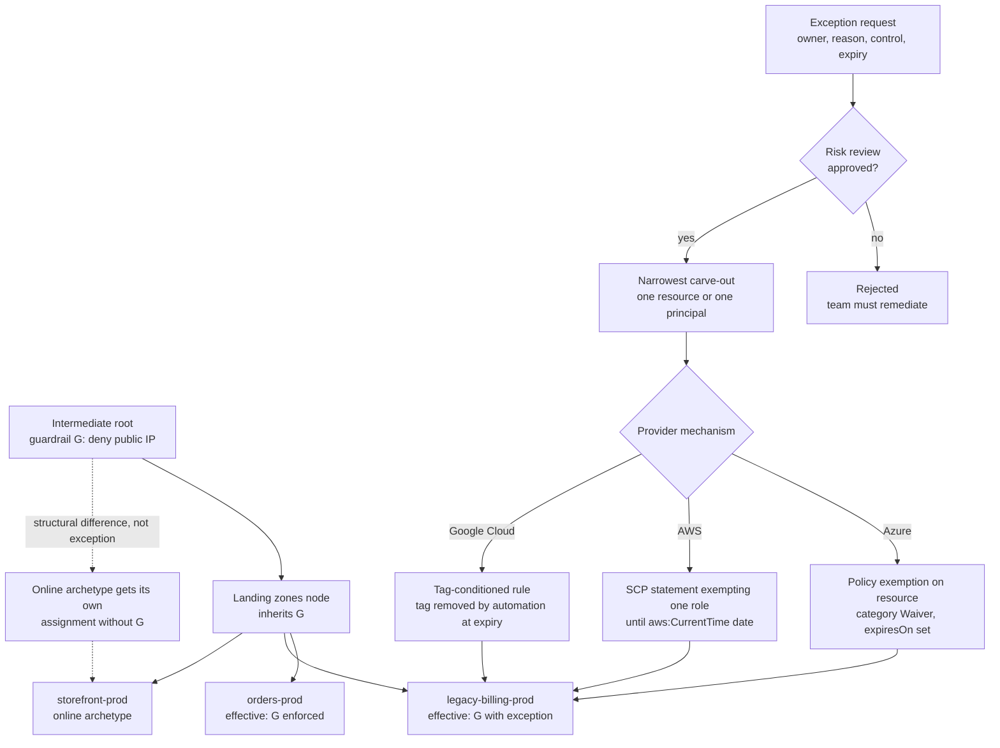

This is the topic map's fourth required view: policy inheritance and exception flow. The guardrail is assigned high in the tree and inherited by every landing zone. An exception does not move the guardrail or remove it from a branch; it carves a narrow, recorded hole for one resource or principal in one scope, through the provider's exception mechanism. Structural differences, such as internet-facing workloads that legitimately need public IP addresses, are handled differently: they get their own archetype with a different assignment, because they are permanent and apply to a class of workloads. Confusing the two is a common mistake. A permanent difference recorded as an exception is renewed forever and pollutes the exception metrics. A temporary need handled as a structural exclusion never expires and disappears from compliance reports.

### 9.3 Provider mechanisms

**Azure** has the most complete native mechanism. A policy exemption is a separate resource referencing an assignment, with a category of `Waiver` or `Mitigated`, an optional `expiresOn`, and metadata. Exempt resources are still evaluated and appear as Exempt in compliance, and creating an exemption requires permission on the referenced assignment, so a subscription Owner cannot exempt itself from a management-group assignment ([Azure](CH02_Azure.md) Section 6.4).

```json
{
  "properties": {
    "policyAssignmentId": "/providers/Microsoft.Management/managementGroups/contoso-landingzones/providers/Microsoft.Authorization/policyAssignments/deny-public-ip",
    "exemptionCategory": "Waiver",
    "expiresOn": "2026-06-30T00:00:00Z",
    "displayName": "Legacy billing gateway public IP until migration wave 7",
    "metadata": {
      "requestedBy": "grp-billing-admins",
      "approvedBy": "security-architecture",
      "ticket": "RISK-2291",
      "compensatingControl": "Azure Firewall DNAT allow list of 3 partner ranges"
    }
  }
}
```

The exemption is created at the scope of the single public IP resource, not at the subscription.

**AWS** has no exception object for SCPs. Exceptions are expressed in the policy. The narrowest form exempts one role by Amazon Resource Name (ARN), and the expiry is enforced by the `aws:CurrentTime` condition key. Because conditions within one statement are combined with AND, the exception needs two deny statements: one that denies everyone except the exception role, and one that denies the exception role after the expiry date.

```json
{
  "Version": "2012-10-17",
  "Statement": [
    {
      "Sid": "RequireImdsV2ExceptVendorRole",
      "Effect": "Deny",
      "Action": "ec2:RunInstances",
      "Resource": "arn:aws:ec2:*:*:instance/*",
      "Condition": {
        "StringNotEquals": {"ec2:MetadataHttpTokens": "required"},
        "ArnNotLike": {"aws:PrincipalArn": "arn:aws:iam::444455556666:role/vendor-appliance-deployer"}
      }
    },
    {
      "Sid": "VendorExceptionExpires20260630",
      "Effect": "Deny",
      "Action": "ec2:RunInstances",
      "Resource": "arn:aws:ec2:*:*:instance/*",
      "Condition": {
        "StringNotEquals": {"ec2:MetadataHttpTokens": "required"},
        "ArnLike": {"aws:PrincipalArn": "arn:aws:iam::444455556666:role/vendor-appliance-deployer"},
        "DateGreaterThan": {"aws:CurrentTime": "2026-06-30T00:00:00Z"}
      }
    }
  ]
}
```

The pattern has two costs. It consumes SCP character budget, so exceptions are collected in a dedicated exceptions SCP rather than scattered. And a role-name exemption is only as strong as the control over who can create or assume that role, so the exception record names the account, and an organization guardrail prevents other accounts from creating a role with the same name. For Control Tower detective controls and Security Hub findings, exceptions are suppressions with a note and a review date, tracked in the same register.

**Google Cloud** Organization Policy rules can be conditioned on tags, so an exception is a tag value bound to one project or resource, plus a rule that relaxes the constraint where the tag is present. Organization Policy conditions do not test time, so expiry is enforced by automation that removes the tag binding at the expiry date and alerts the owner beforehand.

```yaml
name: organizations/123456789012/policies/compute.vmExternalIpAccess
spec:
  rules:
  - condition:
      expression: "resource.matchTag('123456789012/policy-exception', 'ext-ip-legacy-billing')"
    allowAll: true
  - denyAll: true
```

Binding the tag must itself be restricted: the `policy-exception` tag key's user role is held only by the platform's exception automation. Otherwise any project owner could bind the tag and exempt themselves. IAM allow bindings, by contrast, can carry a `request.time` condition, so time-limited access grants are native in Google Cloud IAM even though time-limited configuration exceptions are not.

### 9.4 The lifecycle as a state machine

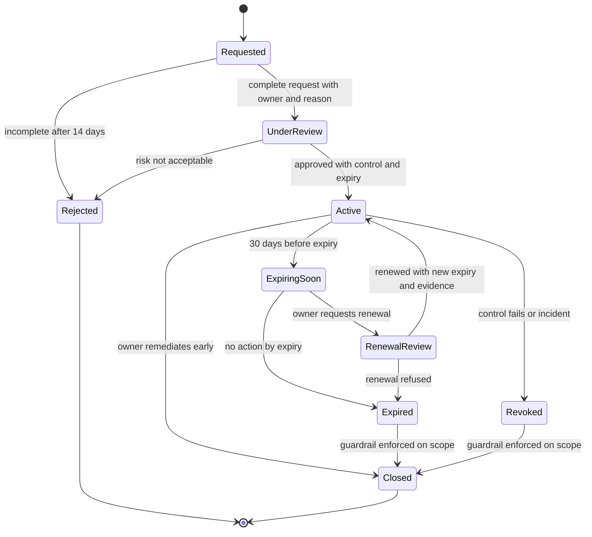

The state machine encodes four rules. No exception reaches `Active` without an expiry, so "permanent exception" is not a state; a permanent need goes back to the archetype design in Section 9.2. Expiry is the default outcome: if nobody acts, the exception expires and the guardrail applies, which puts the burden on the team that benefits from the exception rather than on the platform team to chase it. Renewal is a fresh review with new evidence, such as migration progress, not a click. Revocation exists because a compensating control can fail; if the firewall allow list that justified a public IP is found open to the internet, the exception is revoked immediately.

Typical policy values are a maximum initial duration of 90 days for production waivers, a maximum of two renewals before escalation to a risk committee, and a review service objective of five working days. The [guardrail coverage example](../code/python/landing-zones-chapter/02_guardrail_coverage.py) shows the complementary check: which required controls each scope is missing. An exception register should be reconciled against that output, so that every missing control is either being remediated or covered by an active exception.

### 9.5 Exception metrics

The exception register is a health signal for the landing zone. Four numbers matter: the count of active exceptions per guardrail (a guardrail with many exceptions is probably wrong or premature), the age distribution (old exceptions indicate renewals without remediation), the renewal rate, and the count of violations with no exception (drift, Section 11). A landing zone where active exceptions grow faster than scopes is losing control.

## 10. Shared platform services and the onboarding contract

### 10.1 The platform as a set of services

A landing zone exposes services to workload teams: vending, connectivity, DNS, the log archive and security tooling, identity integration, artifact registries and build runners, key management, and observability backends. Each service needs what any internal product needs: an owner, an interface, a service objective, a support channel, a change-notice policy, and a capacity plan. A service without those is a shared dependency that fails without warning.

Centralize a service only when central operation clearly improves security, reliability, or cost. Hybrid connectivity and egress inspection usually qualify, because duplicating them per workload is expensive and makes policy inconsistent. A central database service usually does not, because its operational needs vary by workload, and a shared instance becomes a shared failure domain and a shared capacity limit.

### 10.2 The onboarding contract

The handoff in the vending workflow delivers a contract. Part 10's [Organizational Hierarchy and Landing Zones](../10_Cloud_Architecture/CH02_Organizational_Hierarchy_and_Landing_Zones.md) explains why the contract must define both sides; this section gives its provider-level content.

| Area | The platform guarantees | The workload team is responsible for |
|---|---|---|
| Scope and hierarchy | Scope created in the requested archetype; guardrails inherited and documented; no unannounced moves | Keeping owner, contacts, and data classification current; requesting archetype changes through vending |
| Identity | Group-based roles from the standard catalog; deploy identity federated to the team's pipeline; break-glass procedure | Group membership and access reviews; not creating long-lived keys; least privilege inside the zone |
| Guardrails | Published guardrail list with rationale; rollout with at least the announced warn period; exception process with review objective | Responding to findings within the published time; remediating before exceptions expire |
| Network | Unique address range; hub attachment, DNS resolution, egress path; published availability objective for hub and hybrid links | Subnet design within the range; security groups or network security groups (NSGs) inside the zone; not creating unapproved internet paths |
| Logging and security | Audit trail to the archive with retention; threat detection and posture findings routed to the team | Application logs and their retention; investigating findings in the zone; not disabling agents or diagnostic settings |
| Shared services | Registry, runners, and key services with published objectives and change notices | Using supported versions; handling the published maintenance windows |
| Cost | Billing linkage, budget alerts at the requested threshold, cost data access | Spend within budget; tagging or labeling to the standard; shutting down unused resources |
| Reliability | Platform services designed to the published objective, with incident communication | The workload's own reliability, backups, and recovery, including dependence on platform services |
| Lifecycle | Baseline upgrades announced in advance and applied in rings; decommissioning workflow | Declaring end of life; data export or retention decisions; confirming decommissioning |

The contract does three jobs. It tells the workload team what it can rely on, so it can design recovery around platform service objectives instead of assumptions. It tells the platform team what it must not change silently, which disciplines its own release process. And it settles the boundary in incidents: if a workload's deployment fails because its template used an unsupported API version, the workload team fixes it; if a guardrail changed without notice, the platform team rolls it back.

### 10.3 Platform service objectives

Platform objectives must be at least as strong as the strongest workload objective that depends on them, or workloads must design around them. If the hub has a 99.9 percent monthly availability objective, about 43.8 minutes of allowed unavailability in a 30.4-day month (0.001 × 30.4 × 24 × 60 ≈ 43.8), a workload with a 99.95 percent objective cannot depend solely on hub-routed connectivity to a partner. It needs either a second path or a design in which that dependency's failure degrades a feature instead of the service. Publishing the number is what lets the workload team make that decision.

The same reasoning applies to the vending service itself. If disaster recovery for a workload involves creating a new scope in another region, vending is part of the recovery path, and its objective, quota headroom, and dependency on the provider's organization control plane must be included in that workload's recovery plan.

## 11. Drift detection and remediation

### 11.1 What drift is

**Drift** is any difference between the landing zone as declared in code and the landing zone as it exists. A landing zone drifts from the day it is deployed, because people with legitimate access make changes during incidents, provider features change defaults, and automation from other teams touches shared resources. Drift is not always wrong. A firewall rule added at 3 a.m. to restore a partner link may be correct and simply not yet in code. The problem is drift that nobody knows about, because the platform then makes decisions, such as an upgrade or a scope move, based on a state that does not exist.

Five kinds of drift need different detection:

| Kind | Example | Typical detector |
|---|---|---|
| Structural drift | An account moved between OUs outside vending; a management group deleted; a project moved to another folder | Provider landing-zone product, hierarchy inventory compared with the vending record |
| Guardrail drift | An SCP edited in the console; a policy assignment's enforcement mode switched; an Organization Policy overridden at a folder | Product drift scans, IaC plan of the policy repository |
| Baseline resource drift | A CloudTrail trail stopped in one Region; a diagnostic setting deleted; a log sink filter narrowed | Detective controls: AWS Config rules, Azure Policy `auditIfNotExists`, Security Command Center findings |
| Compliance drift | Resources that violate a guardrail, either created before it existed or through a path it does not cover | Compliance reports, posture findings |
| State drift | Terraform or Bicep state no longer matches reality, so the next apply would revert or fail | Scheduled `terraform plan`, Bicep what-if, CloudFormation drift detection |

The first three affect the landing zone itself and are the platform team's responsibility. Compliance drift in an application landing zone is usually the workload team's to fix under the onboarding contract (Section 10.2), with the platform team supplying the finding. State drift is the one most often ignored, and it is dangerous because it turns a routine upgrade into an unplanned change: an apply that "fixes" drift nobody reviewed can remove the emergency firewall rule mentioned above.

### 11.2 AWS: Control Tower drift and landing-zone repair

AWS Control Tower detects a defined set of governance drift types automatically ([drift documentation](https://docs.aws.amazon.com/controltower/latest/userguide/drift.html); [types of governance drift](https://docs.aws.amazon.com/controltower/latest/userguide/governance-drift.html)):

- **Account and OU drift**, such as an enrolled account moved between OUs, an account removed from a registered OU, or a managed SCP modified or detached. Control Tower scans its managed SCPs, RCPs, and declarative policies daily, using Organizations API calls from the management account that count against the Organizations request-rate limit.
- **Landing zone drift**, which affects the foundational OUs and shared accounts: a deleted foundational OU, disabled trusted access, or a missing required IAM role. Role drift makes the landing zone unavailable in the console until it is resolved.
- **Control drift** for controls implemented as RCPs, declarative policies, and Security Hub controls in the Control Tower service-managed standard.
- **Inheritance drift**, where an account's enabled baselines or controls differ from those of its parent OU.

Notifications go to Amazon Simple Notification Service (Amazon SNS) topics aggregated in the audit account in earlier landing-zone versions. For landing zone 4.0 and later, AWS documents that drift notifications move to Amazon EventBridge in the management account, so a platform upgrading to 4.0 must move its drift alerting at the same time (Section 12.2). Control Tower sends one notification per drift item and does not repeat it until the item is fixed and recurs, so the alert pipeline must create a ticket from the first notification rather than relying on reminders.

Repair follows the drift type. A single moved account is fixed with **Update account** in the console or by updating its Account Factory provisioned product. Many moved accounts in one OU are fixed by **re-registering the OU**, which reapplies baselines and controls to every enrolled account in it, subject to the 1,000-account registration limit in Section 7.6. Landing zone drift is fixed by **updating or resetting the landing zone**, and while the landing zone is drifted, the console's enroll-account feature does not work, so vending must fall back to Service Catalog provisioning. That dependency belongs in the vending runbook.

Control Tower explicitly does **not** report drift in other services, such as CloudTrail, AWS Config, IAM Identity Center, or CloudFormation, and does not detect changes to the resources inside a baseline. Those gaps are covered by other detectors:

- **AWS Config conformance packs** deployed organization-wide from the delegated administrator evaluate baseline resources, for example that the organization trail is logging, that log buckets block public access, and that IMDSv2 is required. Config rules run on configuration change or on a schedule, and the aggregator in the security tooling account gives one view across accounts.
- **CloudFormation StackSets drift detection** compares stack instances deployed by AFT customizations, CfCT, or LZA with their templates.
- **A scheduled plan of the foundation code** detects state drift for everything managed by Terraform. Run `terraform plan -detailed-exitcode` nightly in each foundation root; exit code 2 means changes are present, and the plan output is attached to a drift ticket instead of being applied.

### 11.3 Azure: policy compliance, remediation, and deployment protection

Azure Policy is both a guardrail engine and the main drift detector, because `audit` and `auditIfNotExists` results report every resource that does not match. Its evaluation timing shapes drift response ([Azure Policy compliance data](https://learn.microsoft.com/en-us/azure/governance/policy/how-to/get-compliance-data)): a new or changed assignment is applied to its scope in about five minutes and then evaluated, with no fixed completion time for large scopes; a created or updated resource has a compliance result about 15 minutes later; a subscription created or moved within the hierarchy is evaluated against subscription-level policy in about 30 minutes; and every assignment is re-evaluated once every 24 hours. An on-demand scan can be started for a subscription or resource group with `az policy state trigger-scan`. A drift detector that reads compliance state immediately after a change will therefore report stale results, and drift dashboards should show the evaluation timestamp.

Compliance across thousands of subscriptions is queried with Azure Resource Graph rather than per subscription:

```kusto
policyresources
| where type == "microsoft.policyinsights/policystates"
| where properties.complianceState == "NonCompliant"
| summarize nonCompliant = count() by assignment = tostring(properties.policyAssignmentName), subscriptionId
| order by nonCompliant desc
```

**Remediation.** Policies with `deployIfNotExists` or `modify` act automatically on new and updated resources, but existing noncompliant resources are fixed only by a **remediation task**, which runs the policy's deployment or modification using the assignment's managed identity. At the time of writing a remediation task can process up to 50,000 resources ([Azure Policy limits](https://learn.microsoft.com/en-us/azure/azure-resource-manager/management/azure-subscription-service-limits); verify current quotas). The landing zone creates remediation tasks automatically for baseline settings, such as diagnostic settings and Defender for Cloud plans, and requires a human decision for remediation that changes workload behavior, such as disabling public network access on a storage account.

**Preventing drift in platform resources.** Azure deployment stacks can attach deny settings (`denyDelete` or `denyWriteAndDelete`) to the resources they manage, so that a person with Owner rights on the connectivity subscription cannot delete the hub firewall outside the pipeline. Deny settings exclude named principals, which must include the pipeline identity and the break-glass identity. This turns some drift from "detected after the fact" into "prevented," at the cost of making emergency changes go through an explicit exclusion.

### 11.4 Google Cloud: configuration validation and posture drift

Organization Policy is preventive, so a compliant organization policy cannot be quietly bypassed by a project owner. Drift in Google Cloud appears instead in the foundation's own configuration (a policy edited outside Terraform, a sink filter changed, an IAM binding added at a folder) and in resources that existed before a constraint was set, because most constraints apply only on create and update.

Three detectors cover these cases:

- **Scheduled plans of each foundation stage.** Because the enterprise foundations blueprint and FAST are separate Terraform roots per stage, each stage gets its own nightly plan. Drift in `1-org` (organization policies, sinks) is reviewed by the security team; drift in the network stages by the network team.
- **Plan-time configuration validation.** `gcloud beta terraform vet` evaluates a Terraform plan against a policy library of constraints before apply, which catches a change that would violate the foundation's rules even if the pipeline identity has permission to make it. The command's release status should be checked before relying on it.
- **Security Command Center posture.** The security posture service lets the platform define a posture made of Organization Policy constraints and Security Health Analytics detectors, deploy it to the organization, folders, or projects, and receive drift from that posture as findings ([security posture overview](https://docs.cloud.google.com/security-command-center/docs/security-posture-overview)). At the time of writing it requires the Premium or Enterprise tier, allows one posture deployment per organization, folder, or project, and limits an organization to 1,000 posture deployments, which matters if the design deploys postures per project (Section 15). Google's documentation also notes that Security Health Analytics is disabled for some new activations in favor of Compliance Manager, so confirm which detector service your tier uses before building on it.

Cloud Asset Inventory complements all three. Its real-time feeds publish changes to selected asset types, such as `cloudresourcemanager.googleapis.com/Project` parent changes or IAM policy changes on folders, which lets the platform alert on structural drift within minutes instead of waiting for a nightly plan.

### 11.5 The drift review loop

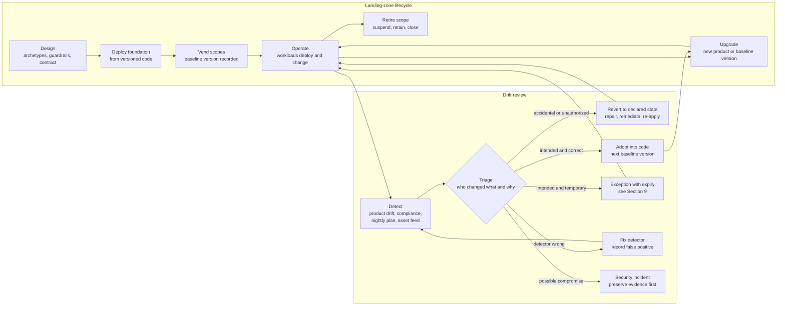

This is the topic map's fifth required view: the landing-zone lifecycle and drift review. The left half is the lifecycle every scope and the foundation itself pass through. The right half is the loop that keeps the declared state and the real state together. Every drift item ends in exactly one of five outcomes, and each outcome has an owner. Reverting restores the declared state. Adopting changes the declared state, and it goes through the upgrade path, so an emergency change made by hand becomes a reviewed change in the next baseline version rather than a permanent undocumented difference. A temporary need becomes an exception with an expiry. A false positive fixes the detector. A change made by an unknown principal goes to incident response before anyone reverts it, because reverting first destroys the evidence of what an attacker did.

Two rules keep the loop working. First, **drift has an age and an objective**. A typical target is that structural and guardrail drift is triaged within one working day and resolved within five, and that baseline resource drift in the log archive or security tooling scope is treated as a security incident. Second, **automated reversion is limited to settings whose correct value is never in dispute**, such as an organization trail being on or a log sink existing. Automatically reverting network or IAM changes in platform scopes looks attractive and causes outages, because the change being reverted is often an emergency fix.

### 11.6 Worked example: a month of drift

An AWS estate of 1,200 accounts runs Control Tower, AFT, an organization conformance pack of 40 rules, and nightly Terraform plans for 14 foundation roots. In one month the detectors report:

| Source | Items | Outcome |
|---|---|---|
| Control Tower account moved between OUs | 18 | 15 moves by a reorganization script outside vending, fixed by re-registering two OUs; 3 adopted by updating the vending record |
| Control Tower managed SCP modified | 1 | Console edit during an incident; reverted, and the emergency change re-proposed through the policy repository |
| Conformance pack noncompliance on baseline rules | 260 | 240 in workload accounts, routed to owners; 20 in platform accounts, fixed by the platform team |
| Nightly plan changes in foundation roots | 9 | 6 adopted into code, 2 reverted, 1 false positive caused by a provider API returning reordered lists |
| Organization trail stopped in one Region | 1 | Treated as a security incident; caused by a mis-scoped automation role in the Audit account; role permissions narrowed |

The arithmetic that matters is drift age. The 18 account moves were open for a median of 4 days, during which those accounts still carried Config-rule controls from their previous OUs and lacked the destination OU's baselines, so their compliance reports described the wrong rules. The reorganization script is the root cause, so the fix is to route OU changes through the vending pipeline (Section 7), not to re-register OUs every month. The platform tracks the rate of structural drift per 1,000 accounts per month, 15 here, and sets a target of fewer than 2 once the script is retired.

## 12. Landing-zone upgrades and versioning

### 12.1 Three version streams

A landing zone runs on three version streams at once, and an upgrade plan must name all three:

1. **The provider product version.** Control Tower landing zone versions, the LZA solution release, the ALZ Library release and AVM module versions, the enterprise foundations blueprint or FAST release. These are written by the provider, arrive on the provider's schedule, and sometimes change structure.
2. **The platform's baseline version.** The set of guardrails, baseline resources, and vending defaults that the platform team publishes, for example `baseline 3.5`. Every vended scope records which baseline version it received (Section 7.3, step 8).
3. **The tooling versions.** Terraform and provider plugin versions, CDK versions for LZA, pipeline runner images. These change the behavior of the code without changing the code.

The platform's baseline version is the one workload teams see. A useful convention is semantic versioning with landing-zone meaning: a **major** version can make a previously valid deployment fail, such as a new `deny` guardrail or a removed network route; a **minor** version adds capability or detective controls without blocking anything; a **patch** fixes defects. Major versions require the warn period promised in the onboarding contract. Provider product upgrades are wrapped inside baseline versions, so that "upgrade Control Tower to 4.0" ships as a baseline release with its own notes, rings, and rollback plan.

### 12.2 AWS: Control Tower and LZA upgrades

A Control Tower landing zone stays on its version until an administrator updates it, through the console or the `UpdateLandingZone` API with a target version and manifest. The update applies to the landing zone's own resources, such as the shared accounts and foundational OUs. Enrolled accounts in other OUs receive new baselines only when their OU is re-registered or each account is updated, so a landing-zone update is really two operations: the update itself, then a rollout of re-registrations through the OU tree ([configuration update management](https://docs.aws.amazon.com/controltower/latest/userguide/configuration-updates.html)). The second operation is the one that takes time at scale and is subject to the 1,000-account registration limit per OU.

The move to version 4.0 shows why upgrades need a plan rather than a button. Version 4.0 makes the manifest optional, turns AWS Config and the security roles into configurable integrations, and stops requiring a Control Tower Security OU (Section 4.1). An upgrade from 3.3 or earlier must keep the Config and security-role integrations enabled during the upgrade ([Control Tower 4.0 key changes](https://docs.aws.amazon.com/controltower/latest/userguide/key-changes-lz-v4.html)), and drift notifications move from SNS in the audit account to EventBridge in the management account (Section 11.2). A platform that upgrades without rebuilding its drift alerting gets a quiet dashboard, which looks like success.

LZA is upgraded by deploying a new solution release through its pipeline. Each release can change the configuration schema, so the upgrade starts by validating the existing YAML files against the new release in a non-production LZA deployment, a second organization or a canary configuration, before the production pipeline runs.

### 12.3 Azure: ALZ Library and module versions

In the AVM-based Terraform implementation, the policy library and the module are versioned separately ([updating the module and library](https://azure.github.io/Azure-Landing-Zones/terraform/howtos/update/)). The library version is pinned in the `alz` provider:

```hcl
provider "alz" {
  library_references = [
    {
      path = "platform/alz"
      tag  = "2025.01.0"   # pin; change only through a baseline release
    }
  ]
}

module "alz" {
  source  = "Azure/avm-ptn-alz/azurerm"
  version = "0.10.0"     # pin; module upgrades may require a provider upgrade
  # ...
}
```

Library tags are date-based. The documentation states that breaking changes can occur when the year or month changes and that patch releases do not contain breaking changes. Each provider release also carries a default library reference, so an unpinned configuration can change policy when only the provider was upgraded. Pin both, and treat a library month change as a candidate major baseline version until the plan proves otherwise.

The upgrade review is a `terraform plan` read as a policy change. A new library release typically adds policy definitions, changes assignment parameters, and sometimes changes default effects. Each changed assignment is classified with the Section 8 rules: additions in `audit` mode go straight to all rings; changes to `deny` or `deployIfNotExists` go through the canary intermediate root first. Bicep implementations follow the same model with module versions from the Bicep public registry.

### 12.4 Google Cloud: blueprint and FAST releases

The enterprise foundations blueprint and FAST publish tagged releases with upgrade notes. Because both are staged, an upgrade proceeds in stage order: bootstrap, organization, environments, networks, then projects. Each stage is planned and applied separately, and a stage is not upgraded until the one before it is stable, because later stages read outputs from earlier ones. Major releases have renamed or merged stages (FAST's organization-setup stage replaced separate bootstrap and resource-management stages, Section 4.3), which can require Terraform state moves. A state move is a change to the platform's most sensitive data and is rehearsed against a copy of the state first.

Teams that built from CFT modules have a different problem: each project-factory or network module has its own semantic version, and the foundation may run several versions at once. The platform records module versions per scope in the same inventory as the baseline version, so that an upgrade can target "every project created with project-factory below version N."

### 12.5 Change management and canary rollout

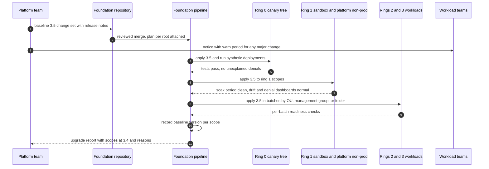

The sequence applies the guardrail rollout model to the whole baseline. The release starts as a reviewed change with a plan for every affected root, so reviewers see the actual difference, not a description. Workload teams receive notice before anything changes. Ring 0 runs synthetic deployments of the standard templates, which is the step that would have caught the tag-policy outage in Section 8.7. Each later ring is applied in batches that map to hierarchy nodes, with readiness checks per batch, so a failure stops the rollout at a known boundary. The last step records the baseline version per scope, which is what makes the next upgrade and the maturity evidence in Section 19 possible.

Rollback differs by change type. Policy and configuration changes roll back by reverting the commit and re-applying. Structural changes, such as a hierarchy reorganization or a Control Tower landing-zone version update, often cannot be rolled back cleanly and should be planned as one-way changes. Those changes need a rehearsal in a separate test organization, which is the strongest argument for keeping one. A test organization costs little, because it contains only platform-owned accounts with synthetic workloads.

### 12.6 Worked example: rolling a baseline across 1,200 accounts

Baseline 3.5 adds two AFT global customizations (a new Config rule set and an IAM role for a backup service) to an estate of 1,200 accounts. AFT re-runs global customizations through its customization pipelines, which default to 5 concurrent runs. A pilot shows 20 minutes per account.

- Throughput: 5 × (60 ÷ 20) = 15 accounts per hour.
- Total pipeline time: 1,200 ÷ 15 = 80 hours.
- Rings: Ring 0 has 10 accounts (under 1 hour), Ring 1 has 150 (10 hours), Ring 2 has 500 (about 33 hours), Ring 3 has 540 (36 hours).

At 80 hours, the rollout cannot happen in a maintenance window, and it does not need to, because the change is minor and additive. It runs continuously over about a week, with soak periods between rings. Raising AFT's customization concurrency would shorten it, but AWS tested the default of 5, and higher values increase the chance of API throttling in shared services such as Organizations and IAM Identity Center; the team raises it to 8 only after a Ring 1 test shows no throttling. During the rollout, the estate runs two baseline versions, so vending must create new accounts at 3.5 from the moment Ring 0 passes, otherwise the backlog of accounts at 3.4 grows while the rollout runs.

## 13. Decommissioning accounts, subscriptions, and projects

### 13.1 Why retirement is a platform workflow

Scopes outlive their purpose. Sandboxes expire, products are retired, migrations leave empty source scopes, and acquisitions are consolidated. A scope that is abandoned rather than retired keeps costing money, keeps its access grants, keeps its network attachment and address range, and keeps its attack surface. Abandoned scopes are attractive to attackers because nobody is watching them. At the same time, retirement is the one lifecycle step that can destroy records the organization is legally required to keep. The landing zone therefore treats decommissioning as a vended workflow with the same properties as creation: a request, validation, ordered steps, idempotent retries, and an evidence record.

### 13.2 The retirement workflow

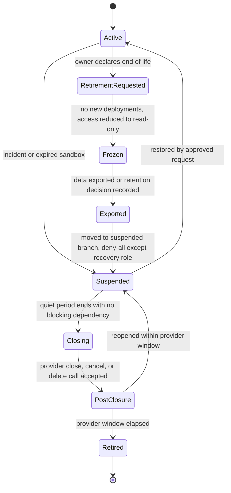

The state machine separates three things that are often collapsed into "delete the account." **Freezing** stops change while the workload team confirms that nothing still depends on the scope; it reduces access to read-only and blocks new deployments with a guardrail. **Exporting** forces a recorded decision about every data store: copy it somewhere that will outlive the scope, keep it under a documented retention period, or destroy it on purpose. **Suspension** moves the scope to the suspended branch of the hierarchy (Section 2.4), where a deny-all guardrail stops all activity except the incident-response and recovery roles. The scope sits there for a quiet period, typically 30 days for production and 7 days for sandboxes, so that a forgotten dependency, such as a partner still calling an endpoint, appears as an alert instead of an outage after the data is gone.

Only then does the provider closure call happen. Each provider keeps a closed scope recoverable for a period, shown as `PostClosure`, and the workflow records the date on which recovery becomes impossible.

The platform-side cleanup runs between `Suspended` and `Closing`:

- Detach the network: remove the Transit Gateway attachment, hub peering, or Shared VPC service-project association, delete DNS records and forwarding rules, and return the CIDR block to the IPAM pool (Section 5.3), marked as unavailable for a cool-down period so that stale firewall rules elsewhere do not grant access to the next owner.
- Remove access: delete group assignments, revoke the workload deploy identity's federation trust, and remove the scope from any cross-scope trust policies in other scopes.
- Remove platform registrations: security tooling member lists, cost allocation mappings, configuration management records, and budgets.
- Resolve exceptions: close every exception attached to the scope (Section 9.4).

### 13.3 Provider closure semantics

| Aspect | AWS account | Azure subscription | Google Cloud project |
|---|---|---|---|
| Closure action | `CloseAccount` from the management account, or close as root user; for Control Tower accounts, unmanage first by terminating the Account Factory provisioned product | Cancel the subscription, then delete it when allowed | `projects.delete` shuts the project down and schedules deletion |
| State during recovery window | `SUSPENDED`; can be reopened within 90 days, the post-closure period | Disabled: virtual machines deallocated, storage read-only; reactivation possible, for non-pay-as-you-go through support within 90 days | Pending deletion; can be restored within 30 days |
| Final deletion | Permanent after the post-closure period | Delete option available 3 days after cancellation (7 for field and partner channel subscriptions); automatic deletion 90 days after cancellation; Microsoft states that data is kept 30 to 90 days | Permanently deleted after 30 days |
| Quota effects | A closed account remains in the organization and counts toward the account quota during the post-closure period; closures are limited to the higher of 250 or 20 percent of member accounts per rolling 30 days, up to 1,000 | Not documented as a quota concern for vending | Soft-deleted projects count against the project quota until fully deleted |
| Blockers | A closed member account cannot be removed from the organization until it is permanently closed | Resources such as immutable blobs can prevent deletion; custom roles referencing the subscription should be updated before cancellation | A lien on the project prevents deletion until removed |

Sources, at the time of writing (verify current behavior): [AWS account closure](https://docs.aws.amazon.com/accounts/latest/reference/manage-acct-closing.html), [Organizations `CloseAccount`](https://docs.aws.amazon.com/organizations/latest/APIReference/API_CloseAccount.html), [Azure subscription cancellation](https://learn.microsoft.com/en-us/azure/cost-management-billing/manage/cancel-azure-subscription), and [Google Cloud project management](https://docs.cloud.google.com/resource-manager/docs/creating-managing-projects).

Two rows change designs. The AWS quota row means that closed accounts keep consuming organization capacity for 90 days, and a large cleanup is rate-limited. The Google Cloud lien row is a safety tool: the platform places a lien on every production and log project at creation, so a mistaken delete call fails until the lien is removed through a reviewed change.

### 13.4 Data retention and key destruction

Retiring a scope never shortens a retention obligation. Three kinds of record are involved:

1. **Audit records** of the scope's activity already live in the log archive (Section 3.2) and stay there for the archive's full retention, typically several years, regardless of when the scope closes. This is the main reason the archive is a separate scope. If audit logs were stored inside each workload scope, closing the scope would destroy its audit history.
2. **Business data** in the scope's databases, buckets, and backups must be exported to a retained location or deliberately destroyed. Legal holds override both. The export decision is recorded per data store in the retirement request.
3. **Encryption keys** need special care. Destroying a key makes every copy of data encrypted with it unreadable, including backups and exports that were never re-encrypted. AWS Key Management Service (AWS KMS), Cloud KMS, and Azure Key Vault all impose a waiting period or soft-delete period before key material is gone, which is the last chance to catch a key still needed by an exported copy. The retirement workflow checks that no retained dataset depends on a key before scheduling its deletion. [Secrets Management](CH13_Secrets_Management.md) covers key lifecycle mechanics.

Retention periods themselves are set by legal and compliance owners. The platform's job is to make sure no retirement step can bypass them.

### 13.5 Evidence and a worked closure

Each retirement produces a record: request and approver, owner confirmation, export decisions per data store, network and IPAM release, access removals, the closure call and its timestamp, and the date after which recovery is impossible. Auditors ask for exactly this list when they sample retired scopes.

**Worked example.** After a sandbox policy change, the platform must close 300 expired sandbox accounts in an organization with 1,200 member accounts. The closure quota is the higher of 250 or 20 percent of members: 0.20 × 1,200 = 240, so the quota is 250 per rolling 30 days. The cleanup takes two windows: 250 accounts in the first 30 days and 50 in the next. The 300 closed accounts then remain in the organization for 90 days, so for that period the organization's account count does not fall. If vending is close to the account quota, the platform requests a quota increase before starting, or removes sandbox accounts from the organization before closing them, which frees quota immediately but requires each account to be able to stand alone with its own payment method. Most platforms choose the quota increase, because standalone accounts outside the organization are no longer governed.

## 14. Brownfield adoption

### 14.1 The adoption problem

Most landing zones are not built on an empty organization. They are built over an estate that grew without one: hundreds of accounts created by different teams, subscriptions under the tenant root group, projects with no folder, a default VPC or network in every scope, overlapping address ranges, and access granted to individuals. Adopting that estate means bringing every existing scope under the hierarchy, guardrails, logging, and vending records without breaking the workloads running in it. [Cloud Migration](CH16_Cloud_Migration.md) owns moving workloads; this section covers moving the scopes themselves under governance.

The governing rule is the same as for guardrail rollout: **observe before you enforce**. An existing scope placed under a branch with production `deny` policies on day one will fail its next deployment in ways nobody predicted. The adoption sequence therefore puts every scope under audit first and enforces in waves.

### 14.2 The adoption sequence

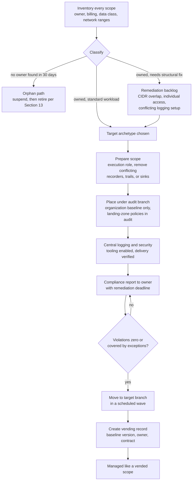

The flow has three properties worth noting. Orphans leave early: a scope with no owner after a fixed search period is suspended, not adopted, because adopting it creates a managed scope that nobody will maintain. Central logging comes before any enforcement, so that the platform can see what each scope does before it changes the rules. And the last step creates a vending record, so the adopted scope becomes indistinguishable from a vended one for upgrades, drift review, and retirement. Without that record, the estate has two classes of scope forever.

### 14.3 Provider mechanics

**AWS.** Accounts outside the organization join by invitation, after leaving any previous organization. Accounts already in the organization are enrolled in Control Tower either individually or by registering their OU, which enrolls all accounts in it. Enrollment prerequisites cause most brownfield failures ([enrollment prerequisites](https://docs.aws.amazon.com/controltower/latest/userguide/enrollment-prerequisites.html)): the `AWSControlTowerExecution` role must exist in the account unless enrollment happens through OU registration or the auto-enroll setting; the account should not have an existing AWS Config configuration recorder or delivery channel, which must be removed or adapted following AWS's procedure for existing Config resources; and an existing account-level CloudTrail trail will duplicate charges with the organization trail unless it is removed. The Config recorder condition is the common blocker, because many brownfield accounts have their own recorders feeding local tools. The platform script that prepares an account records what it removed, so that the workload team's tooling can be pointed at the organization aggregator instead.

**Azure.** Existing subscriptions move into the management-group hierarchy without changing their resources, and subscription-level policy evaluation runs about 30 minutes after the move (Section 11.3). The ALZ guidance supports brownfield adoption by deploying the hierarchy and policies alongside existing subscriptions, then moving subscriptions in, with assignments in audit or `DoNotEnforce` mode where needed. Two cases are harder. Subscriptions in another Microsoft Entra tenant must be transferred to the landing zone's tenant, which deletes their existing Azure role assignments and requires managed identities and Key Vault access policies to be rebuilt, so tenant consolidation is planned as a migration, not a move. Subscriptions created under a different billing agreement can be governed by the hierarchy but may need a billing transfer before the vending pipeline can manage their billing linkage.

**Google Cloud.** Projects move between folders within an organization, and the move changes which IAM policies and Organization Policies they inherit at once, so a project moved into the production folder immediately receives that folder's constraints. Constraints apply to new and updated resources, so existing resources are not deleted, but the next update to a noncompliant resource can fail. Projects in another organization are migrated with the project migration process, which requires Organization Policy constraints on both sides to permit it (`resourcemanager.allowedExportDestinations` on the source and `resourcemanager.allowedImportSources` on the destination). Projects with no organization, created by individuals with personal accounts, are the hardest case: ownership must be transferred to an organization identity before the project can be moved.

### 14.4 Worked example: adopting 380 existing AWS accounts

An organization has 380 member accounts in a flat OU structure and decides to adopt Control Tower with AFT.

**Inventory.** Of 380 accounts, 41 have no identifiable owner after 30 days of searching, 64 have their own Config recorders, 112 have account-level trails, and 23 use VPC ranges that overlap the corporate network or each other.

**Orphans.** The 41 orphans are moved to the suspended OU. Over the 30-day quiet period, alerts from 4 of them reveal live dependencies: two hold a forgotten DNS zone and two run a batch job that a finance team still uses. Those 4 get owners. The remaining 37 are retired.

**Enrollment capacity.** 343 accounts need enrollment. Enrollment runs at the Account Factory concurrency of 5, and the pilot shows 25 minutes per enrollment, giving 5 × (60 ÷ 25) = 12 accounts per hour, or about 29 hours of enrollment in total. The team runs enrollment in waves of about 50 accounts, each wave preceded by the preparation script and followed by a log-delivery check, so seven waves at about 4 to 5 hours each.

**Enforcement.** Every wave lands first in a `Workloads/Adopting` OU with the organization baseline and detective controls only. Accounts move to their target OU after their owners clear violations. Six weeks after the last wave, 301 accounts are in target OUs, 42 remain in `Adopting` with open remediation, and the 23 overlapping-range accounts have a migration plan because renumbering is a workload change. The `Adopting` OU has its own expiry: any account still there after 90 days goes to an exception review.

## 15. Scaling to thousands of scopes

### 15.1 Control-plane limits

At a few dozen scopes, provider control-plane limits are invisible. At a few thousand, they decide the hierarchy, the vending design, and the drift tooling. The table collects the limits that most often bind, at the time of writing (verify current quotas; several are adjustable).

| Provider | Limit | Value | Design consequence |
|---|---|---|---|
| AWS | Accounts per organization | Default 10, increasable | Request increases a wave ahead of vending demand (Section 7.6) |
| AWS | Accounts per OU for Control Tower registration | 1,000, lower with many governed Regions | Split large OUs into children with identical controls |
| AWS | Accounts in a Control Tower organization | 10,000 | Plan a second organization only if this is in sight |
| AWS | Accounts supported by IAM Identity Center | 7,000 | Below Control Tower's 10,000; the identity layer binds first |
| AWS | Account closures per rolling 30 days | Higher of 250 or 20 percent, up to 1,000 | Large cleanups are rate-limited (Section 13.5) |
| Azure | Management groups per directory | 10,000 | Rarely binding; depth is the real constraint |
| Azure | Management-group depth | 6 levels, excluding tenant root and subscriptions | Keep the hierarchy to three or four levels as CAF recommends |
| Azure | Policy or initiative assignments per scope | 200 | Group policies into initiatives; never assign per subscription at scale |
| Azure | Exemptions per scope | 1,000 | Exemption sprawl at one management group has a hard ceiling |
| Azure | Exclusions (`notScopes`) per assignment | 400 | Do not use exclusions as an exception mechanism |
| Azure | Role assignments per subscription | A few thousand, see [RBAC limits](https://learn.microsoft.com/en-us/azure/role-based-access-control/troubleshoot-limits) | Assign groups, not individuals; large shared subscriptions hit this first |
| Google Cloud | Child folders per parent | 300 | Large business units need an intermediate folder level |
| Google Cloud | Folder nesting depth | 10 levels | Rarely binding |
| Google Cloud | Projects per organization | Quota (`projects_count`), increasable; soft-deleted projects count | Request increases ahead of vending; account for 30-day deletions |
| Google Cloud | Security posture deployments per organization | 1,000 | Deploy postures at folders, not per project |

Sources: [Organizations quotas](https://docs.aws.amazon.com/organizations/latest/userguide/orgs_reference_limits.html), [Control Tower limits](https://docs.aws.amazon.com/controltower/latest/userguide/limits.html), [CAF management groups](https://learn.microsoft.com/en-us/azure/cloud-adoption-framework/ready/landing-zone/design-area/resource-org-management-groups), [Azure Policy limits](https://learn.microsoft.com/en-us/azure/azure-resource-manager/management/azure-subscription-service-limits), [Google Cloud project quotas](https://docs.cloud.google.com/resource-manager/docs/creating-managing-projects), and [security posture overview](https://docs.cloud.google.com/security-command-center/docs/security-posture-overview).

A second class of limit is not a count but a rate. AWS Organizations is a global service whose request-rate limits are shared by everything calling it from the management account, including Control Tower's own daily drift scans ([drift documentation](https://docs.aws.amazon.com/controltower/latest/userguide/drift.html)). Azure Resource Manager throttles requests per principal and scope, so a single vending identity creating hundreds of subscriptions and role assignments can throttle itself. Google Cloud Resource Manager API calls are subject to request-rate quotas charged to the project that hosts the vending service account. In all three, a reconciliation job that lists the whole hierarchy every few minutes is the usual cause of throttling that then breaks vending.

### 15.2 Design techniques for scale

- **Policy by archetype, never by scope.** Assign guardrails to hierarchy nodes and let scopes inherit them. A design that assigns policy to each subscription or project hits per-scope limits, multiplies drift, and makes upgrades proportional to the number of scopes.
- **Shallow, wide hierarchies with intermediate levels only where limits demand them.** A `Workloads/Prod` node with 1,500 children is split by business unit because of the Control Tower registration limit or the Google Cloud 300-folder limit, not for organizational reasons, and the split nodes carry identical policy.
- **Inventory from the provider's aggregated view.** Use the AWS Config aggregator and Organizations listings in the security tooling account, Azure Resource Graph, and Cloud Asset Inventory, rather than per-scope API calls. These services are built for organization-wide queries.
- **Events instead of polling.** Drive drift and lifecycle automation from Control Tower lifecycle events and EventBridge, Azure Event Grid events for subscriptions and policy state changes, and Cloud Asset Inventory feeds. Polling scales with the number of scopes; events scale with the number of changes.
- **Retry with backoff and jitter, and shard the pipeline.** Vending and upgrade jobs back off on throttling errors and run in shards by hierarchy node, so a throttled shard does not stall the whole estate.
- **Plan the identity layer as the first ceiling.** At 7,000 accounts, IAM Identity Center's documented limit binds before Control Tower's 10,000. An estate on track to pass it needs a decision years ahead: a second organization, consolidation of small accounts, or a request to AWS for guidance on higher limits.

### 15.3 Quality scenario: vending quota exhaustion

| Element | Value |
|---|---|
| **Stimulus** | A migration wave requests 240 new Google Cloud projects in one week; the organization's project quota has 150 remaining, because 120 projects deleted last month still count during their 30-day soft-delete period |
| **Environment** | The vending pipeline checks capacity before creating anything (Section 7.2); quota headroom is monitored |
| **Expected response** | Capacity validation rejects requests beyond the remaining quota with a clear reason, instead of creating some projects and failing others mid-baseline; a headroom alert fired two weeks earlier when remaining quota fell below 25 percent; the platform requests a quota increase; accepted requests proceed in priority order agreed with the migration team |
| **Measure** | Zero partially created projects; headroom alert at least 10 working days before exhaustion; quota increase requested within one working day of the alert; migration wave start moved by no more than the time to approval |

The scenario generalizes to every provider. The defect it prevents is a vending pipeline that discovers the quota by failing, which leaves half-built scopes and turns a capacity problem into a cleanup problem. The design that prevents it is a capacity check before creation, a headroom metric that counts soft-deleted or post-closure scopes, and a lead time written into the migration runbook.

## 16. Security and audit evidence

### 16.1 Securing the platform itself

The landing zone concentrates privilege. The identities that run the foundation pipeline can change every guardrail, and the scopes that hold the log archive and security tooling are the ones an attacker most wants to blind. [Threat Modeling](../15_Security/CH12_Threat_Modeling.md) and [Zero Trust](../15_Security/CH08_Zero_Trust.md) in Part 15 own the general method; the landing-zone-specific controls are these:

- **The foundation repository is a production system.** Protected branches, required reviews from two teams for guardrail and hierarchy changes, signed commits or verified pipeline provenance, and no human with standing write access to the state storage. [Supply Chain Security](../15_Security/CH15_Supply_Chain_Security.md) covers the pipeline-integrity controls.
- **Pipeline identities are split by blast radius** as described in Section 6.4, and each one can only run from its own pipeline through federated credentials.
- **The management scope is nearly empty.** No workloads, no routine human sign-in, delegated administration for security services, and an alert on every sign-in.
- **Audit storage is tamper-evident.** CloudTrail log file integrity validation produces signed digest files that prove whether delivered log files were changed or deleted; Azure immutable blob storage with a locked time-based retention policy prevents deletion before expiry; a locked retention policy on a Google Cloud log bucket does the same.
- **Guardrails protect the guardrails.** An organization-level rule denies changes to the trail, sinks, diagnostic settings, delegated-administrator configuration, and the policy repository's own deployment roles, except from the named pipeline and break-glass identities.

### 16.2 The evidence catalog

Auditors and security reviewers ask the same questions of every landing zone. Answering them from live systems, rather than from screenshots collected the week before the audit, is what distinguishes a governed foundation from a documented one. The platform maintains an evidence catalog that maps each control objective to the artifact that proves it and the system that produces it.

| Control objective | Evidence artifact | AWS source | Azure source | Google Cloud source |
|---|---|---|---|---|
| Every scope is governed | Inventory of scopes with hierarchy node, owner, and baseline version; zero scopes outside the governed branches | Organizations listing, Control Tower enrollment status, vending records | Resource Graph subscriptions with management-group ancestry | Cloud Asset Inventory projects with folder ancestry |
| Audit logging is complete | Delivery per scope within the last 24 hours; integrity validation results | CloudTrail organization trail, digest validation | Diagnostic settings compliance, workspace ingestion by subscription | Aggregated sink status, log bucket ingestion by project |
| Guardrails are in force | Current guardrail definitions with commit history; compliance summary per node | SCP and RCP attachments, Control Tower control status, Config conformance results | Policy assignments and compliance state | Organization Policy and posture deployments, posture drift findings |
| Exceptions are controlled | Register with owner, reason, expiry, and approval for each active exception | SCP exception statements and suppression records | Policy exemptions with `expiresOn` | Tag bindings with expiry automation records |
| Privileged access is limited | List of standing and eligible privileged assignments; elevation logs | IAM Identity Center assignments, CloudTrail role sessions | PIM assignments and activation history | IAM bindings at organization and folders, Privileged Access Manager grants |
| Changes are reviewed | Merge records for foundation changes; drift tickets with outcomes | Repository and pipeline logs | Repository and pipeline logs | Repository and pipeline logs |
| Retired scopes kept their records | Retirement records with export decisions and closure dates | Retirement workflow plus closure events | Retirement workflow plus cancellation events | Retirement workflow plus deletion events |

The evidence is generated continuously and stored in the log archive or a reporting dataset next to it, so that a reviewer can ask "show me the state on 31 March" and receive an answer from records rather than a reconstruction.

## 17. Operations and observability of the platform

### 17.1 Platform service indicators

A landing zone needs its own service level indicators (SLIs) and service level objectives (SLOs), measured the way any production service is measured. [Monitoring](CH10_Monitoring.md) covers the provider telemetry; these are the indicators specific to the foundation:

| Indicator | Definition | Example objective |
|---|---|---|
| Vending lead time | Merge of a valid request to `Ready` | 95 percent within 4 hours |
| Vending success rate | Requests reaching `Ready` without manual intervention | 98 percent |
| Audit delivery coverage | Scopes with an audit event received in the last hour, divided by active scopes | 100 percent, alert on any gap over 1 hour |
| Drift age | Age of the oldest open structural or guardrail drift item | Under 5 working days |
| Exception age and count | Active exceptions per guardrail; count past their original expiry by renewal | No exception older than 270 days |
| Guardrail denial rate | Denied requests per hour per guardrail, by ring | Alert on a rise of 5 times the trailing weekly baseline |
| Baseline currency | Scopes on the current or previous baseline version | 95 percent within 30 days of a release |
| Quota headroom | Remaining capacity on each binding limit in Section 15.1 | Alert below 25 percent |

The guardrail denial rate deserves a word. It is the early-warning signal for the outage in Section 8.7, and it is also the signal of an attack, because an attacker probing a compromised scope generates denials. The alert therefore routes to both the platform on-call engineer and security operations, with the scope and principal in the payload.

### 17.2 The platform's failure domains

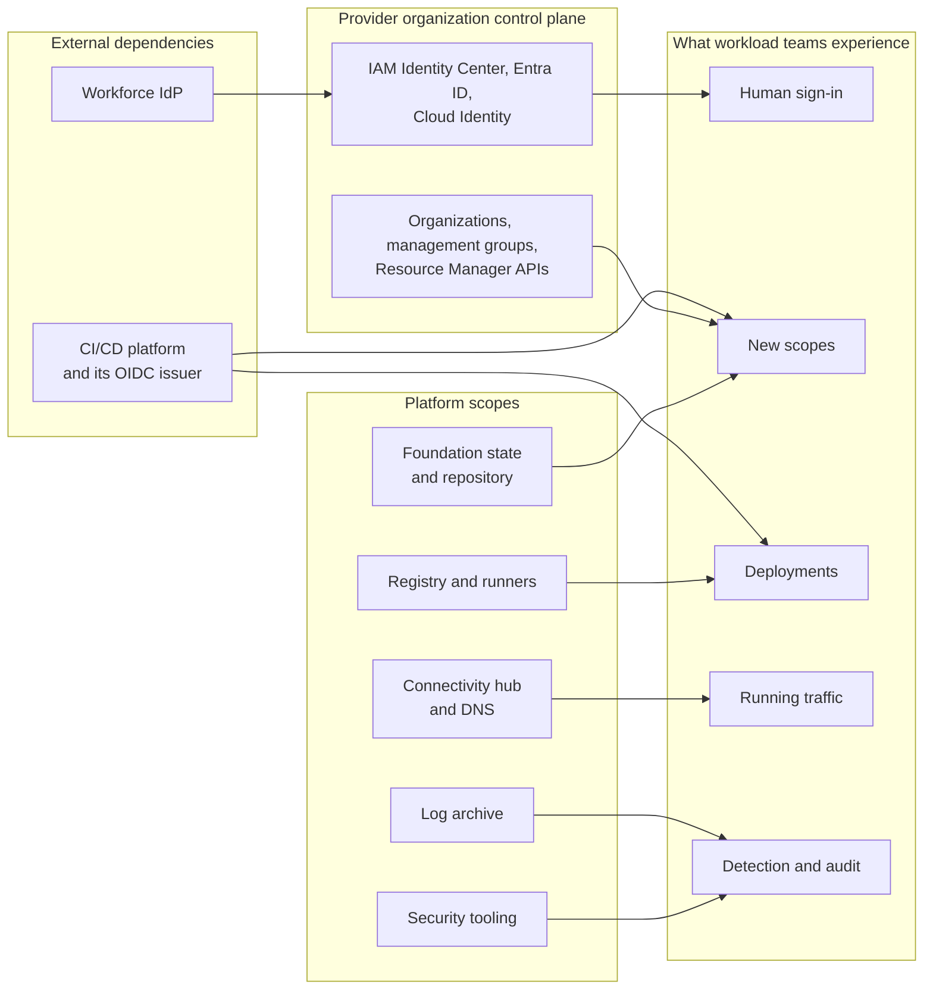

The failure-domain map shows which platform failures reach which workload experiences. The important observation is that **running traffic depends only on the connectivity hub**. An IdP outage, an organization API outage, a broken foundation pipeline, or a lost Terraform state blocks sign-in, vending, or deployment, but it does not take down workloads that are already running. A hub failure does, which is why the hub carries the highest availability objective and its own failure-domain design in [Networking](CH05_Networking.md). The map is also the template for runbooks: each box gets an entry stating what stops, what continues, who is paged, and what the workaround is.

### 17.3 Running the platform

- **On-call.** The platform team runs an on-call rotation with runbooks for vending failures, guardrail rollback, drift in security scopes, log delivery gaps, hub incidents, and break-glass use.
- **Change calendar.** Guardrail enforcement dates, baseline releases, and landing-zone product upgrades are published on a calendar that workload teams can subscribe to, which fulfills the onboarding contract's change-notice promise.
- **Capacity reviews.** Quarterly reviews of quota headroom, IPAM pool usage, hub throughput, and vending demand forecasts from the migration plan.
- **Game days.** Twice a year the team rehearses the four scenarios in Section 18 in the test organization or canary hierarchy, including a real break-glass sign-in.

## 18. Failure and quality scenarios

### 18.1 The scenarios at a glance

The part-wide scenarios that apply to a landing zone are collected here. Two are treated in full earlier, next to the mechanisms they test.

| Scenario | Where it is treated | Design element it tests |
|---|---|---|
| Account compromise contained by organizational boundaries | Section 3.7 | Baseline scopes, guardrails above the scope, suspended branch |
| Guardrail rollout breaks deployments | Section 8.7 | Rings, canary coverage, tested rollback |
| Vending quota exhaustion during scale-out | Section 15.3 | Capacity validation, headroom alerts, lead time |
| Identity provider outage | Section 18.2 | Break-glass access, independence of workload identity |
| Identity or key rotation | Section 6.4 | Federated, short-lived pipeline credentials |

### 18.2 Quality scenario: identity provider outage

| Element | Value |
|---|---|
| **Stimulus** | The corporate IdP that federates workforce sign-in to all three providers is unavailable for four hours during a production incident in `orders-prod` |
| **Environment** | Workforce access uses IAM Identity Center federated by SAML, Microsoft Entra ID federated to the external IdP, and Cloud Identity with third-party single sign-on; workloads use provider-native workload identities; pipelines use OIDC federation from a CI/CD platform whose own sign-in does not depend on the IdP |
| **Expected response** | Running workloads and pipeline deployments continue unaffected; two responders retrieve break-glass credentials under dual control and sign in directly to each provider; every break-glass sign-in raises an alert to security operations within 5 minutes; responders act only through the incident runbook; after the outage the break-glass credentials are rotated and every action taken is reviewed from the log archive |
| **Measure** | Zero workload errors attributable to the IdP outage; break-glass access established within 15 minutes; 100 percent of break-glass sessions alerted and reviewed within 2 working days; credentials rotated within 24 hours of the outage ending |

Each provider's break-glass path is different, which is why the runbook has three sections. On AWS, emergency access uses IAM users or roles that do not depend on IAM Identity Center, with phishing-resistant multi-factor authentication (MFA), held in a small number of accounts and named exactly in the guardrails that exempt them (Section 6.3). On Azure, Microsoft recommends cloud-only emergency access accounts in Entra ID that are excluded from federation and from Conditional Access policies that depend on the external IdP; they protect against an external IdP outage but not against an Entra ID outage, which is a provider-side failure the runbook can only wait out. On Google Cloud, the break-glass path uses super administrator or designated emergency accounts configured to sign in with Google credentials rather than through the third-party IdP; verify current single sign-on profile behavior for administrators, because it has changed over time.

The scenario also checks a design decision made in Section 6.4. Because pipelines use federation from the CI/CD platform rather than credentials issued by the workforce IdP, deployments continue during the outage. If the CI/CD platform's own sign-in depends on the IdP, runners keep working but humans cannot approve deployments, and the runbook must say whether emergency changes can be approved another way.

## 19. Maturity and evidence

A maturity model is useful when it sequences work and when every level is proven by evidence, not by assertion. The levels below describe how landing zones typically evolve; each column names the evidence that shows the level is reached.

| Capability | Level 1: initial | Level 2: managed | Level 3: governed product | Evidence for level 3 |
|---|---|---|---|---|
| Hierarchy and baseline scopes | Some structure; workloads in shared scopes | Reference hierarchy; separate log archive and security tooling | Archetypes by policy; canary tree; suspended branch | Inventory shows zero ungoverned scopes |
| Identity | Individual access, long-lived keys | Group-based roles from IdP | Role catalog, just-in-time elevation, tested break-glass | Elevation logs; last game-day record |
| Guardrails | Few, assigned ad hoc | Organization baseline enforced | Audit-warn-enforce rollout through rings with rollback | Rollout records with gate evidence |
| Exceptions | Exclusions without expiry | Register exists | Every exception expires; metrics reviewed | Register reconciled with coverage report |
| Vending | Tickets and runbooks | Automated creation | Validated requests, idempotent, readiness checks, quota-aware | Vending SLI dashboard |
| Drift | Found during incidents | Detectors enabled | Review loop with age objectives | Drift tickets with outcomes and ages |
| Upgrades | Never upgraded | Upgraded by project | Versioned baselines in rings; version per scope | Baseline currency SLI |
| Decommissioning | Scopes abandoned | Manual closure | Retirement workflow with retention decisions | Retirement records sampled by audit |

The [maturity score example](../code/python/landing-zones-chapter/04_maturity_score.py) shows the simplest useful form: a list of foundational capabilities marked present or absent, a count, and the missing items printed as improvement work. Its synthetic estate lacks automated vending, exception expiry, and decommissioning, which is a common real profile: organizations build the hierarchy and logging first and leave the lifecycle for later. The example's closing line makes the right point: the score sequences platform work and is not a compliance certification. A level claimed without the evidence in the last column is not reached.

## 20. Provider comparison

The table compares what each provider's landing-zone building blocks guarantee and what they leave to you. Similar names hide different guarantees, so read each row as "what the mechanism actually does."

| Dimension | AWS | Azure | Google Cloud |
|---|---|---|---|
| Strongest isolation unit | Account: separate identity namespace, resource namespace, and quota set | Subscription: separate resource, quota, and billing container; identities shared tenant-wide in Entra ID | Project: separate resource, quota, and service-account namespace; billing linked separately |
| Hierarchy for policy | OUs under the organization root; Control Tower registration limit of 1,000 accounts per OU | Management groups, 6 levels below the tenant root | Folders, 300 children per parent, 10 levels |
| Preventive guardrail engine | SCPs and RCPs cap permissions; declarative policies set service configuration; no dry run | Azure Policy `deny` evaluates resource configuration; `DoNotEnforce` gives a native audit stage | Organization Policy constrains configuration with `dryRunSpec`; IAM deny policies cap permissions |
| Guardrail reach over the top scope | SCPs do not apply to the management account | Policy applies at the tenant root group and below, including platform subscriptions | Organization Policy applies to the whole organization; organization administrators can change it |
| Native exception object | None for SCPs; exceptions are policy statements with conditions | Policy exemption with category, scope, and `expiresOn` | None; tag-conditioned rules plus expiry automation |
| Landing-zone product and maintainer | Control Tower is a managed service with versioned landing zones; AFT, CfCT, and LZA are AWS solutions you deploy and operate | ALZ is reference architecture plus Microsoft-maintained AVM modules and library; you run the code | Google Cloud Setup generates Terraform; the blueprint, CFT, and FAST are Google-maintained code you run |
| Vending idempotency key | Account email and name; AFT request file | Subscription alias name | Project ID |
| Native drift detection | Control Tower governance drift for its own resources, OUs, and controls; Config for resources | Policy compliance for everything assignable; deployment stack deny settings for prevention | Security Command Center posture drift (Premium or Enterprise); asset feeds; IaC plans |
| Upgrade model | Explicit landing-zone version update, then OU re-registration | Pin and move library tags and module versions; plan and apply | Move to a new blueprint or FAST release, stage by stage |
| Retirement window | 90-day post-closure; closed accounts count toward the quota | Disabled after cancellation; automatic deletion after 90 days | 30-day pending deletion; counts toward the project quota |
| Provider guarantees | Control Tower operates its orchestration and reports its drift types | Azure Policy evaluates and reports on its documented schedule | Organization Policy enforces on create and update; posture service reports drift |
| Customer responsibility in all three | Hierarchy design, guardrail content and rollout, exceptions, vending inputs, network and IP plan, retention decisions, upgrades, retirement | Same | Same |

The last row is the point of the table. Every provider gives you mechanisms and, in AWS's case, a managed orchestrator. None of them decides your archetypes, your exception policy, your onboarding contract, or your retention periods, and none of them operates the landing zone for you.

## 21. Case study: a logistics group adopts Azure landing zones

### 21.1 Context and requirements

A logistics group with about 6,000 employees runs most of its cloud estate on Azure. After four years of organic growth it has 280 subscriptions, of which 190 sit directly under the tenant root group, access is granted to individuals in about a third of them, and audit logs stay in each subscription's activity log. An acquisition brought 18 more subscriptions in a separate Entra tenant. The business plans to reach about 900 subscriptions in three years as it moves its warehouse-management and route-planning systems from its data centers.

Requirements agreed with stakeholders:

- Audit records kept for seven years, beyond the lifetime of any subscription.
- New subscriptions ready for deployment within one working day of an approved request.
- Customer data stays in two European regions.
- No guardrail change may break production deployments without at least four weeks of warning.
- Every scope has an owner, a cost center, and a data classification.

### 21.2 Decisions and rejected alternatives

| Decision | Chosen | Rejected and why |
|---|---|---|
| Hierarchy | CAF reference hierarchy: intermediate root, Platform with Security, Management, Connectivity, Identity; Landing zones with Corp and Online; Sandboxes; Decommissioned; plus a mirrored canary intermediate root | Management groups per environment (CAF advises against it, and it would let non-production policy diverge); management groups per business unit (the group reorganizes every two to three years) |
| Implementation | ALZ IaC accelerator with Terraform AVM modules, library and module versions pinned | Portal accelerator (no reviewable code); classic Terraform module (on a deprecation path) |
| Region restriction | Allowed-locations policy at the intermediate root for the two European regions, with a narrow exemption process for global services | Restriction per subscription (would hit per-scope assignment limits and drift) |
| Connectivity | Hub-and-spoke virtual networks with Azure Firewall in both regions, managed with Azure Virtual Network Manager; spokes vended as `/22` from a `/14` reserved by the enterprise IP plan | Virtual WAN (strong option; rejected because the network team needs custom routing through existing third-party appliances during the migration years, and planned to revisit after) |
| Vending | AVM subscription vending module run from a vending repository; YAML requests validated for schema, references, policy fit, and capacity; one MCA invoice section per business unit | Ticket queue (could not meet one working day at 900 subscriptions); developer self-creation (no owner or baseline) |
| Logging | Activity logs and resource diagnostics by policy to a Log Analytics workspace in Management, with export to immutable storage with a locked seven-year retention policy | Per-subscription workspaces (retention would end with the subscription) |
| Exceptions | Policy exemptions with mandatory `expiresOn`, maximum 90 days, two renewals, register reconciled weekly with compliance | Exclusions with `notScopes` (no expiry, limited to 400 per assignment, invisible in exemption reports) |
| Acquired tenant | Treated as a migration: subscriptions transferred in three waves, with role assignments and managed identities rebuilt from code | Keeping two tenants permanently (duplicate guardrails and identity) |

### 21.3 Adoption and rollout

The team inventoried all 298 subscriptions in the first month. Thirty-one had no owner after a 30-day search; they were moved to Decommissioned, and three were reclaimed during the quiet period when alerts showed live use. The remaining 28 were canceled. The other 267 moved into the hierarchy over ten weeks, landing first under Corp or Online with the reference assignments set to `DoNotEnforce` where they would have denied existing configurations.

Two findings changed the plan. First, a shared legacy subscription held about 3,700 role assignments, close to the per-subscription limit, because access had been granted to individuals for years; it was split into four subscriptions and access was moved to groups before migration waves added more. Second, compliance reports showed that 41 percent of storage accounts allowed public network access. Rather than enforce a `deny` immediately, the team assigned a `modify`-capable policy for new storage accounts, ran remediation tasks for non-production in batches below the 50,000-resource task limit, and gave production owners eight weeks before enforcement.

Enforcement moved through the rings described in Section 8.4. Ring 0 caught three defects in policy conditions, each fixed before reaching real workloads. Ring 2 enforcement of the storage rule caused one rollback, when a data-integration service that creates storage accounts on the customer's behalf was denied; the canary hierarchy gained a deployment of that service, and the rule was re-enforced two weeks later.

### 21.4 Validation evidence

Twelve months after the start:

- Zero subscriptions under the tenant root group, verified daily by a Resource Graph query that alerts on any result.
- Policy compliance across reference assignments rose from 61 percent to 96 percent; the remaining 4 percent is covered by 74 active exemptions with a median age of 41 days and none past a second renewal.
- Vending lead time: median 47 minutes, 95th percentile 2.6 hours, against the one-working-day requirement; 412 subscriptions vended, 3 needing manual intervention, all caused by missing billing roles on a new invoice section.
- Audit delivery coverage at 100 percent for 30 consecutive days, with a weekly integrity check of the immutable export.
- Drift: median structural drift age 2 days; 6 drift items adopted into code and 11 reverted over the year.
- A game day simulating the external IdP outage reached break-glass access in 9 minutes; the alert reached security operations in 2 minutes.

### 21.5 Residual risks and what the team would change

The hub-and-spoke design leaves the network team operating routing that Virtual WAN would manage; the decision is scheduled for review when the third-party appliances are retired. The single Entra tenant is now a larger shared dependency, so the team tests emergency access accounts quarterly instead of twice a year. In hindsight, the team would have created the vending record format before adoption, because 60 adopted subscriptions had to be revisited later to record their baseline version and data classification.

## 22. Common mistakes and anti-patterns

**Treating the accelerator as the landing zone.** *Cause:* a successful first deployment looks like a finished project. *Consequence:* nobody owns upgrades, drift, or vending, and two years later the foundation runs a deprecated module version with policies nobody can explain.

**Designing the hierarchy around the organization chart.** *Cause:* it is the structure everyone already knows. *Consequence:* each reorganization moves scopes between nodes, which creates drift, changes inherited policy, and on AWS leaves previous OU controls to be removed by hand.

**Putting workloads in the management scope.** *Cause:* it was the first account, subscription, or project that existed. *Consequence:* on AWS those workloads run without SCPs; on every provider they share a scope with the most powerful identities in the estate.

**Enforcing on day one in a brownfield estate.** *Cause:* pressure to show compliance quickly. *Consequence:* production deployments fail across many teams at once, and the guardrail is rolled back under pressure and loses credibility.

**Using exclusions as exceptions.** *Cause:* `notScopes`, an OU outside the guardrail, or a folder without the constraint is the quickest way to unblock a team. *Consequence:* the exception never expires, disappears from exception reports, and the excluded scope collects other workloads over time.

**Exceptions without expiry.** *Cause:* the request form makes expiry optional. *Consequence:* the register only grows, and guardrails with dozens of permanent exceptions no longer describe the estate.

**Retrying scope creation blindly.** *Cause:* treating create calls as synchronous and transactional. *Consequence:* orphaned scopes with no baseline, discovered later on an invoice or in an incident.

**Letting teams pick address ranges.** *Cause:* IPAM is seen as a network-team concern, not a vending step. *Consequence:* overlaps that surface only when two workloads need to connect, fixed by renumbering a live system.

**Storing audit logs inside workload scopes.** *Cause:* it is the default destination. *Consequence:* the scope's administrator can delete the record of their actions, and closing the scope deletes its audit history.

**Auto-reverting every drift item.** *Cause:* drift is assumed to be wrong. *Consequence:* emergency fixes are undone during the incident they were made for, and teams learn to work around the platform.

**Upgrading the product without the rollout.** *Cause:* reading a landing-zone update as a single operation. *Consequence:* the shared accounts run the new version while enrolled accounts keep old baselines, or drift alerting silently stops after a notification channel change.

**Deleting scopes instead of retiring them.** *Cause:* closure looks like the cleanup step. *Consequence:* data and keys needed for retention are destroyed, network ranges stay referenced by stale firewall rules, and quotas fill with closed scopes.

**No owner for the platform's own services.** *Cause:* shared services are built as a project. *Consequence:* the registry, hub, or log archive fails without an on-call owner, and every workload's recovery plan has a gap.

## 23. Design-review checklist

Each item should be answered with evidence, not intent.

### 23.1 Structure and ownership

- Does every landing-zone component in Section 2.2 have a named owning team, a version, and a change process?
- Is the hierarchy designed around policy differences, with a canary tree, a sandbox branch, and a suspended or decommissioned branch?
- Is the management scope free of workloads, with delegated administration for security services?
- Are audit logs stored in a separate scope that no workload principal can modify, with retention set by the longest requirement?

### 23.2 Vending

- Does every request pass schema, reference, policy-fit, and capacity validation before any create call?
- Is creation idempotent through a stable key, with a quarantine path for exhausted retries?
- Is `Ready` defined by verified outcomes, including an audit event received from the new scope?
- Is vending throughput sized against the documented concurrency and quota limits, with headroom alerts?

### 23.3 Guardrails and exceptions

- Does every new preventive guardrail pass through audit, warn, and enforce stages in rings with documented gates?
- Is rollback tested in the canary hierarchy before production enforcement?
- Does every exception have an owner, a compensating control, the narrowest possible scope, and an expiry?
- Is the exception register reconciled against guardrail coverage reports?

### 23.4 Lifecycle

- Are structural, guardrail, baseline resource, compliance, and state drift each covered by a detector?
- Does every drift item have an age, an owner, and one of the five outcomes in Section 11.5?
- Does every scope record its baseline version, and are product upgrades shipped as baseline releases through rings?
- Does retirement freeze, export, suspend, and only then close, with a record of retention decisions and the final recovery date?

### 23.5 Scale and operations

- Are the binding limits in Section 15.1 tracked with headroom, including scopes in post-closure or soft-delete states?
- Does automation use aggregated inventory and events rather than per-scope polling?
- Are platform SLIs published, and is the onboarding contract's change-notice promise met by a change calendar?
- Has break-glass access been exercised for each provider in the last six months?

## 24. Exercises

### 24.1 Interview questions

1. Explain why an AWS Control Tower guardrail cannot protect the management account, and what design follows from that.
2. A team asks for its own management group so that it can have a different set of policies for development. How do you respond, and what do you offer instead?
3. Describe how you would roll out a new preventive rule on AWS, given that SCPs have no dry-run mode.
4. What is the difference between an exception and a structural difference in policy, and why does the distinction matter for metrics?
5. A vending run times out after calling the provider's create API. What must the retry do, and what goes wrong if it does not?
6. Why should audit logs outlive the scopes that produce them, and how does each provider make that possible?

### 24.2 Hands-on exercises with the chapter code

1. Run the [scope planner](../code/python/landing-zones-chapter/01_scope_planner.py). Add a workload that is regulated but has no owner, and change `recommend_scope` so that it refuses to recommend a scope without an owner. Relate the change to the orphan path in Section 14.2.
2. Run the [guardrail coverage check](../code/python/landing-zones-chapter/02_guardrail_coverage.py). Add an exceptions dictionary keyed by scope and control, and change the output so that a missing control covered by an unexpired exception is reported separately from a gap.
3. Run the [vending validator](../code/python/landing-zones-chapter/03_vending_validator.py). Note that the second request is rejected for missing fields even though its empty `owner` would also be invalid. Add checks for empty values and for a region allowed by the data classification.
4. Run the [maturity score](../code/python/landing-zones-chapter/04_maturity_score.py). Replace each boolean with the evidence artifact from Section 19 and count a capability as present only when its evidence is supplied.

### 24.3 Design exercises

1. **Vending capacity.** A Google Cloud organization expects 1,500 projects in 18 months, with a peak of 200 projects in one migration week. Write the capacity checks for the vending pipeline, including the effect of 30-day soft deletion, and the lead time you would put in the migration runbook.
2. **Brownfield plan.** Design the adoption of 600 AWS accounts, 90 of which have existing Config recorders and 40 of which share an overlapping address range. Produce the wave plan and the evidence required to move each wave from audit to its target OU.
3. **Upgrade plan.** Plan the move of an Azure landing zone from one ALZ Library month release to the next, which adds 12 policy definitions and changes the effect of 3 assignments. Classify each change and assign it to rings.
4. **Retirement.** Write the retirement workflow for a production subscription that holds customer data under a seven-year retention requirement and keys in Azure Key Vault. Name every record produced.

## 25. Summary

A landing zone is the governed foundation that every workload scope inherits before anything is deployed: hierarchy, identity integration, guardrails, logging and security tooling, network connectivity, shared services, billing ownership, and the automation that creates and maintains them. It is a product with owners, versions, and a published contract, not a one-time deployment. The baseline scopes, a nearly empty management scope, a log archive no workload can modify, a security tooling scope with delegated administration, and a platform-owned connectivity scope, exist to make separation of duties and containment follow from structure.

Provider products differ in what they decide and who maintains them. AWS Control Tower is a managed orchestrator with versioned landing zones, extended by AFT, CfCT, and LZA. Azure landing zones are a reference architecture implemented with Microsoft-maintained AVM modules and a versioned policy library that you run. Google Cloud offers a guided setup that produces Terraform, and the enterprise foundations blueprint, CFT, and FAST as maintained code you operate. None of them decides archetypes, exceptions, the onboarding contract, or retention.

The work that lasts is lifecycle work. Vending turns validated requests into ready scopes idempotently and within quota. Guardrails move through audit, warn, and enforce in rings, with tested rollback. Exceptions always expire. Drift is detected by kind and reviewed to one of five outcomes. Upgrades ship as baseline versions through the same rings. Brownfield scopes are observed before they are enforced. Retirement freezes, exports, suspends, and only then closes, without shortening any retention obligation. At scale, the binding constraints are provider control-plane limits, so the design assigns policy by archetype, uses aggregated inventory and events, and watches quota headroom, including scopes that are closed but still counted.

## 26. Code examples

The examples are in [`code/python/landing-zones-chapter/`](../code/python/landing-zones-chapter/). They use only the Python standard library and synthetic data, do not call provider APIs, and illustrate decision logic rather than production tooling.

- [Scope planner](../code/python/landing-zones-chapter/01_scope_planner.py) recommends a dedicated scope under a `regulated/<owner>/<environment>` path for regulated workloads and a standard path otherwise, and reminds the reader to validate against quota, billing, and ownership needs (Sections 2.4 and 7.2).
- [Guardrail coverage check](../code/python/landing-zones-chapter/02_guardrail_coverage.py) compares each scope's assigned controls with a required baseline set and lists the missing ones, reporting `payments-prod` as missing owner metadata and `sandbox` as missing three controls (Sections 9.4 and 11.1).
- [Vending validator](../code/python/landing-zones-chapter/03_vending_validator.py) rejects a request that lacks any of the six required fields or uses an environment other than `dev`, `test`, or `prod`, the schema stage of the validation in Section 7.2.
- [Maturity score](../code/python/landing-zones-chapter/04_maturity_score.py) counts present foundational capabilities, reports three of six for its synthetic estate, and lists the gaps as improvement work, as discussed in Section 19.
