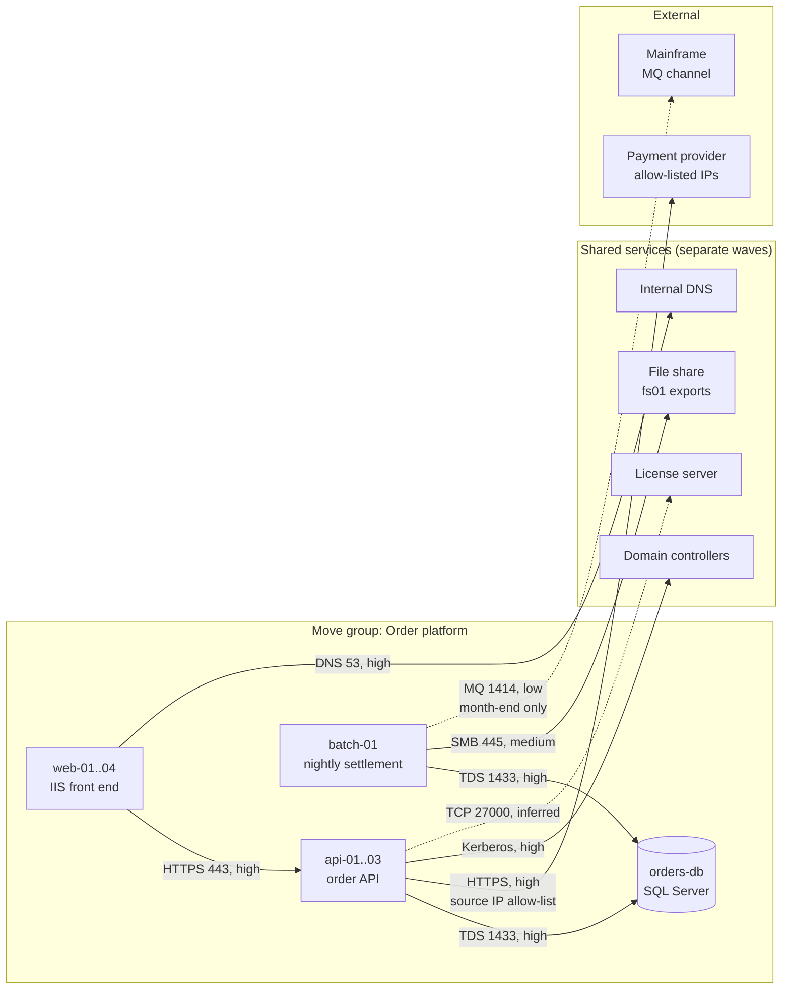
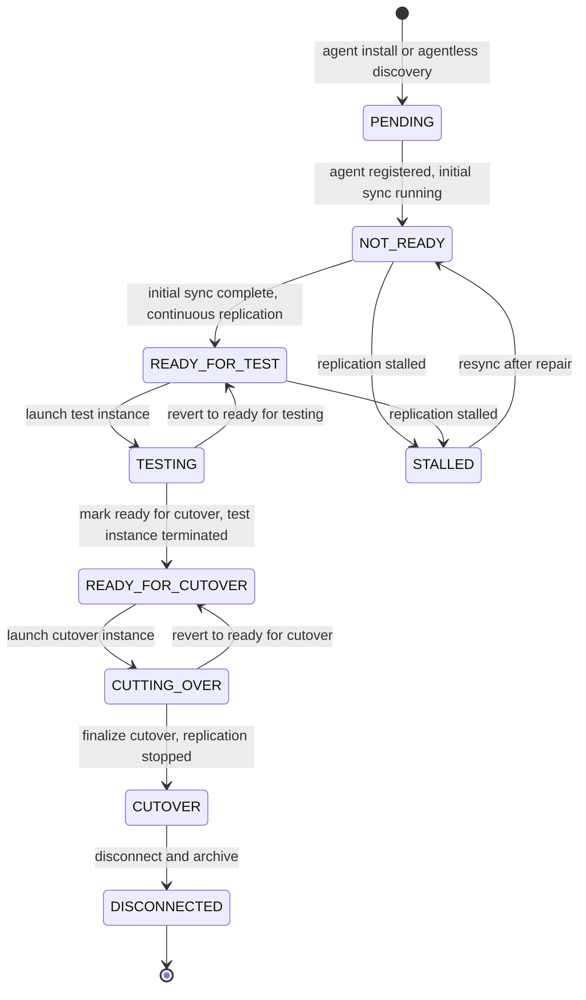
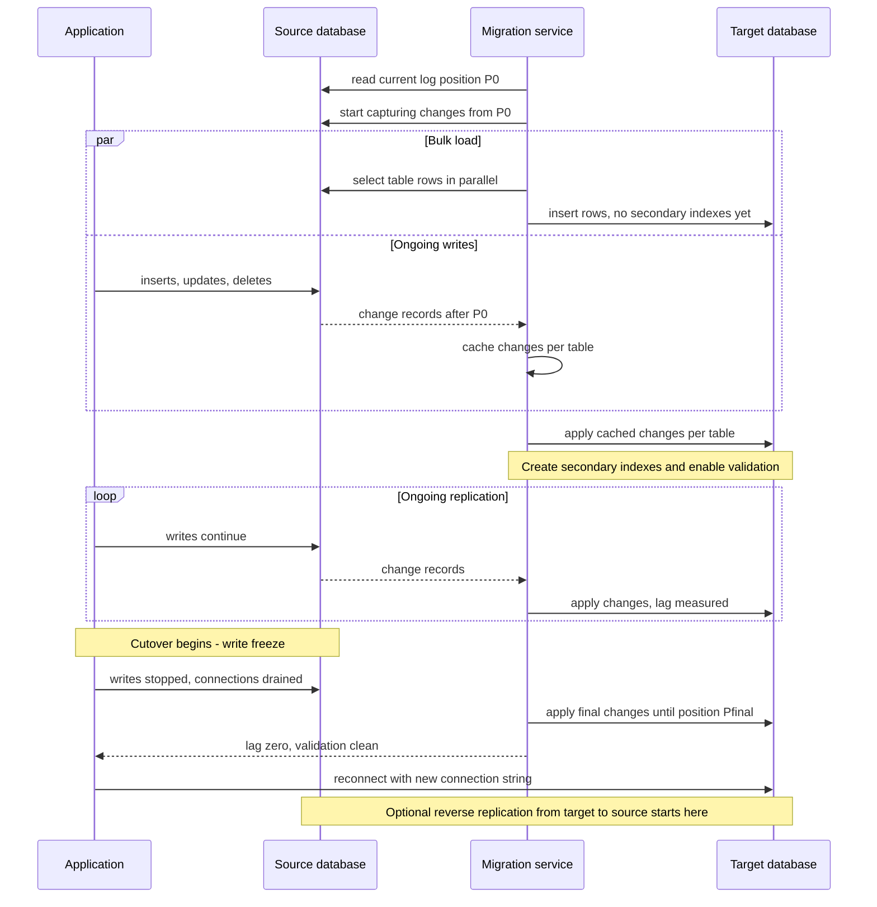
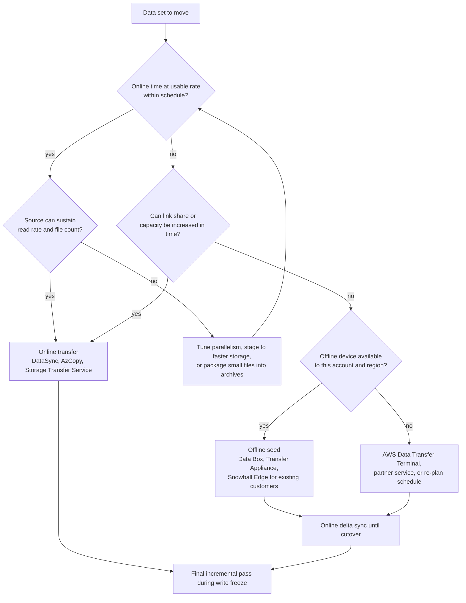
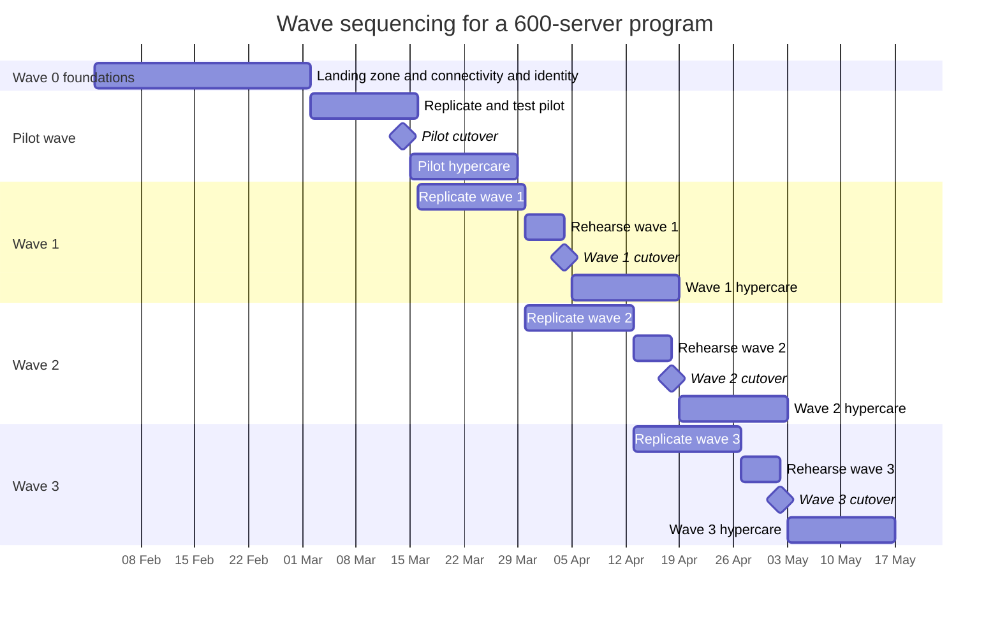
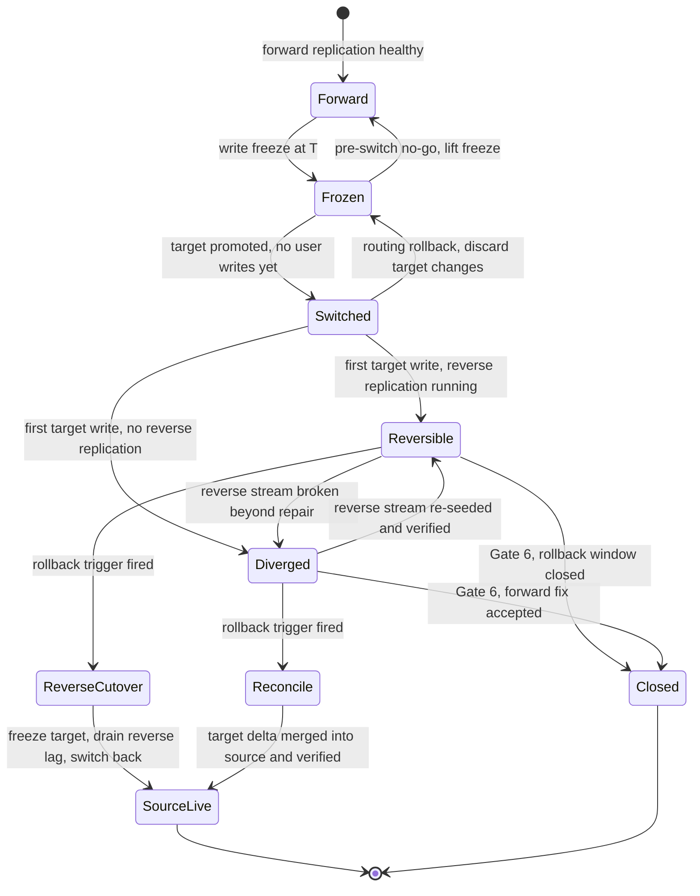
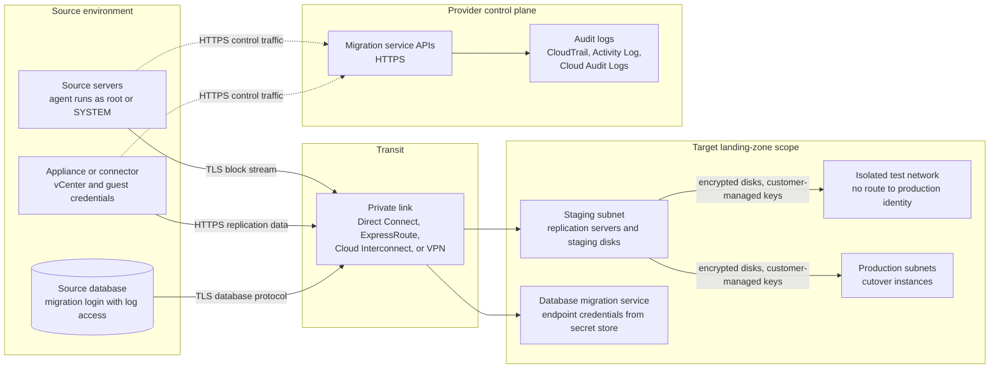
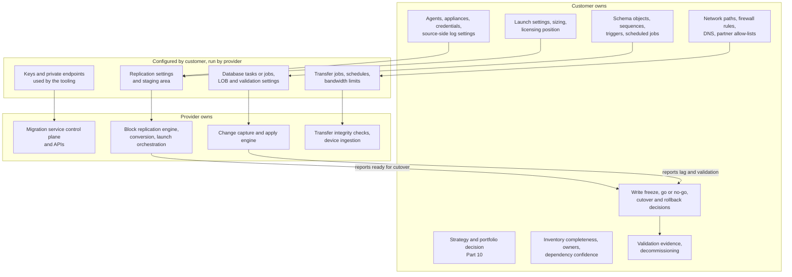

# Chapter: Cloud Migration Execution

Part: [09 — Cloud Computing](PART_OVERVIEW.md) · Status: Revised (in-depth rewrite)

## 1. Introduction

A cloud migration moves a running workload, its data, and the responsibility for operating it from a source environment to a target cloud. The source might be a VMware estate in a colocation facility, a fleet of physical servers, or another cloud provider. The target is a set of accounts, subscriptions, or projects prepared by a landing zone. Between the two sits a period in which both environments exist, data flows from one to the other, and someone must decide, at a specific minute, that the target is now authoritative.

Providers sell tooling for every step of that journey: discovery agents and appliances, assessment engines, block-level server replication, database change capture, network transfer services, and shippable storage devices. The tools are good at moving bytes. They do not know which batch job runs only at quarter end, whether the application tolerates a changed Internet Protocol (IP) address, or whether the business can accept twenty minutes of read-only mode. A tool reporting "replication healthy" is evidence that bytes are flowing. It is not evidence that the migration will succeed.

After working through this chapter you should be able to:

- Define migration execution phases with entry and exit gates, and say what evidence advances a workload from one phase to the next.
- Choose discovery methods on AWS, Azure, and Google Cloud, interpret the confidence of the dependency data they produce, and turn it into a dependency graph.
- Size targets from performance data rather than allocated capacity, and check licensing, operating system support, and quota headroom before the first launch.
- Explain how continuous block replication works in AWS Transform MGN, Azure Migrate, and Google Cloud Migrate to Virtual Machines, including what each lifecycle state means.
- Plan a database move as a bulk load followed by change data capture, and identify the objects (large objects, triggers, sequences) that break naive cutovers.
- Calculate transfer time from usable throughput and find the point at which an offline device beats the network.
- Group workloads into move groups and waves, write a cutover runbook with a go/no-go decision, and state the exact point after which rollback requires data reconciliation instead of a routing change.
- Validate a migration with reconciliation, business journeys, and performance baselines, then decommission the source with evidence.

**Scope and ownership.** This chapter owns provider migration *execution*: the tooling, the data movement, the cutover, the rollback, and the handoff. It owns two concepts in the book's registry: *provider migration execution gates* and the *migration rollback boundary*. Other material is recapped and linked:

- Migration strategy, the 7 Rs (retire, retain, rehost, relocate, repurchase, replatform, refactor), portfolio analysis, and modernization architecture belong to [Cloud Migration and Modernization Architecture](../10_Cloud_Architecture/CH14_Cloud_Migration_and_Modernization_Architecture.md) in Part 10. This chapter assumes a workload already has a chosen strategy, usually rehost or replatform, and asks how to execute it with a specific provider.
- Database engine internals, such as write-ahead logs, replication protocols, and isolation behavior, belong to Part 06, in particular [Replication](../06_Databases_and_Storage/CH07_Replication.md). This chapter uses those mechanisms through provider services.
- Deployment pipeline mechanics belong to Part 13, starting with [CI/CD](../13_DevOps/CH02_CI_CD.md) (continuous integration and continuous delivery) and [Blue-Green Deployment](../13_DevOps/CH15_Blue_Green_Deployment.md).
- Hybrid connectivity, private endpoints, and cloud Domain Name System (DNS) belong to [Cloud Networking](CH05_Networking.md). DNS time to live (TTL) behavior belongs to [DNS](../05_Networking_and_OS/CH08_DNS.md).
- Block, file, and object storage, snapshots, and replication scopes belong to [Cloud Storage Services](CH06_Storage.md).
- The governed foundation the migration lands in belongs to [Landing Zones](CH15_Landing_Zones.md).

Provider product names in this area have changed often and recently. In 2025 and 2026 AWS closed AWS Migration Hub and AWS Application Discovery Service to new customers, renamed AWS Application Migration Service to AWS Transform MGN, and restricted AWS Snowball Edge to existing customers. Microsoft retired Azure Data Box Heavy and folded its migration funding program into Azure Accelerate. Each such fact below is marked and linked. Verify product status before you commit a program plan to a tool.

## 2. The foundational model: migration as a controlled transfer of authority

### 2.1 Three planes, one decision

Every migration, whatever the tooling, has three planes running in parallel.

1. **The data plane** moves state. Disk blocks, database rows, files, and objects travel from source to target, first as a bulk copy and then as a stream of changes. Its health is measured in throughput and lag.
2. **The control plane** is the provider tooling that orchestrates the data plane: inventories, replication jobs, launch templates, test instances, and status dashboards. Its health is measured in job states.
3. **The authority plane** decides which environment is the system of record for each workload at each moment. It consists of people, a runbook, and a small number of switches: a DNS record, a connection string, a load balancer target, a feature flag, or a database role. Its health is measured in evidence and approvals.

Most migration failures are failures of the authority plane while the other two planes look healthy. A database replica can be in sync to the second while the order service still writes to the old primary because one connection string was missed. A server can boot cleanly in the target while its license server stays on premises behind a firewall rule nobody changed.

The single most important idea in the chapter follows from this model. **At any moment, each piece of state has exactly one writer.** Before cutover the source is the writer and the target is a follower. After cutover the target is the writer and, if you planned for rollback, the source becomes a follower through reverse replication. The cutover is the act of moving the writer role. Everything in the runbook exists to make that move safe, observable, and, for a bounded time, reversible.

### 2.2 Execution phases and gates

Providers describe migration in phases with different names. AWS describes programs as Assess, Mobilize, and Migrate and Modernize ([AWS Transform launch guide](https://docs.aws.amazon.com/transform/latest/launchguide/delivering-mig-program.html)). Azure Migrate's portal follows discover, assess, and migrate. Google Cloud Migration Center follows discover, assess, plan, and migrate. For execution, a finer set of phases is more useful, each with an explicit entry and exit gate. A *gate* is a checkpoint where named evidence must exist before the workload advances. Gates turn "I think we are ready" into "these six items are recorded and signed."

```mermaid
flowchart LR
    D["1 Discover<br/>inventory and dependencies"] --> G1{"Gate 1<br/>inventory confidence"}
    G1 -->|pass| A["2 Assess<br/>sizing, licensing, blockers"]
    G1 -->|fail| D
    A --> G2{"Gate 2<br/>target design approved"}
    G2 -->|pass| P["3 Prepare<br/>landing zone, quotas, network"]
    G2 -->|fail| A
    P --> G3{"Gate 3<br/>target ready"}
    G3 -->|pass| R["4 Replicate<br/>servers, data, files"]
    R --> T["5 Test<br/>test launch and rehearsal"]
    T --> G4{"Gate 4<br/>go or no-go"}
    G4 -->|go| C["6 Cutover<br/>freeze, drain, switch"]
    G4 -->|no-go| R
    C --> V["7 Validate<br/>reconcile and journeys"]
    V --> G5{"Gate 5<br/>accept or roll back"}
    G5 -->|accept| H["8 Hypercare<br/>rollback window open"]
    G5 -->|roll back| RB["Rollback<br/>to source"]
    H --> G6{"Gate 6<br/>close rollback window"}
    G6 --> X["9 Decommission<br/>and optimize"]
```



The diagram shows two properties that a simple "discover, assess, migrate" line hides. First, most gates loop back: failing Gate 4 sends the workload back to replication and testing, not forward to cutover with a list of known issues. Second, cutover is followed by two further decisions. Gate 5 is the acceptance decision during the cutover window. Gate 6 is a separate, later decision to close the rollback window and stop reverse replication, after which the source can be decommissioned. Teams that merge Gates 5 and 6 lose the ability to roll back the moment they accept, which is usually days earlier than they need to.

The table makes the gates concrete. Treat it as a template for your own program and add workload-specific criteria.

| Phase | Entry criteria | Exit evidence (gate) | Typical owner |
|---|---|---|---|
| Discover | Workload in approved portfolio with a strategy from Part 10 | Inventory with owner, data class, and a dependency graph where every edge has a confidence level; observation window covers at least one business cycle | Migration team with application owner |
| Assess | Inventory accepted | Target sizes from performance data, licensing decision recorded, operating system supported, blockers listed with owners | Cloud architect |
| Prepare | Target design approved | Landing-zone account or subscription vended, network paths tested from source, quotas raised with headroom, identity and secrets reachable, monitoring and backup policies attached | Platform team |
| Replicate | Target ready | Initial sync complete, steady-state lag measured over peak periods and within the cutover budget | Migration engineer |
| Test | Replication steady | Test instance passes smoke and integration tests in an isolated network; runbook rehearsed with timings recorded | Application team |
| Cutover | Go decision signed | Writes frozen, lag at zero, switches flipped, smoke tests pass | Cutover lead |
| Validate | Traffic on target | Reconciliation matches, business journeys pass, performance within baseline tolerance | Business owner |
| Hypercare | Accepted | Reverse replication healthy, incidents triaged, at least one full business cycle on target | Operations |
| Decommission | Rollback window closed | Source powered off, then deleted after retention period; temporary migration resources removed; costs attributed | Operations and finance |

The [readiness scorecard example](../code/python/cloud-migration-chapter/04_readiness_score.py) encodes a minimal version of this idea. It requires six evidence fields (owner, dependencies, target controls, data validation, monitoring, rollback plan) and reports a workload as ready only when none are missing. Its percentage score is useful for program reporting, but notice that the function's `ready` flag is binary: a workload with five of six items scores 83 percent and is still not ready. That is the correct behavior for a gate.

### 2.3 What a gate is not

A gate is not a tool status. "MGN shows READY_FOR_CUTOVER" means the replicated disks are current and a test launch was marked as done. It says nothing about whether the batch scheduler in the target points at the right file share. A gate is also not a meeting. A go/no-go meeting is where the evidence is reviewed, but the evidence must exist before the meeting and be recorded somewhere that survives it. Finally, a gate is not uniform across workloads. A stateless web tier needs a lighter Gate 4 than a ledger database. Scale the evidence to the consequence of being wrong.

## 3. Discovery and dependency mapping

### 3.1 What discovery must establish

Discovery answers four questions about every workload in scope.

1. **What exists?** Servers, virtual machines, databases, file shares, appliances, scheduled jobs, certificates, and the software on them, with versions.
2. **How is it used?** Central processing unit (CPU), memory, disk input/output operations per second (IOPS), throughput, network volume, and how those vary over a business cycle.
3. **What does it talk to?** Inbound and outbound connections by process and port, including connections to things that are not servers: SaaS endpoints, partner networks, mainframes, license servers, and DNS resolvers.
4. **Who owns it and what does it hold?** An accountable owner, the data classification, the business calendar, and the acceptable outage.

The first two questions can be answered well by tools. The third can be answered partly by tools. The fourth cannot be answered by tools at all. A discovery effort that produces a perfect machine inventory with no owners has produced a list of things nobody can approve for cutover.

### 3.2 Collection methods and what each can see

Discovery tools use four collection methods. They differ in what they can observe and how intrusive they are.

- **Hypervisor or platform API collection (agentless).** An appliance or collector connects to VMware vCenter, Microsoft Hyper-V, or a cloud provider application programming interface (API) and reads virtual machine (VM) configuration and performance counters. It sees every VM the credentials can read, with no change to the guests. It cannot see inside the guest: installed software, processes, or which process owns a connection, unless it also has guest credentials.
- **Guest-level collection.** The appliance logs in to each guest with supplied credentials (or uses VMware Tools guest operations) and runs inventory commands. This adds installed software, database instances, web applications, and, in some tools, Transmission Control Protocol (TCP) connection data. It requires credential management for thousands of machines, which is a security concern in its own right.
- **Agent-based collection.** An agent installed on each server reports configuration, performance, and network connections continuously. It works for physical servers and unusual hypervisors that APIs cannot reach, and it can capture short-lived connections that periodic polling misses. It requires software deployment, change approval, and an uninstall plan.
- **Import.** A spreadsheet or configuration management database (CMDB) export is loaded into the tool. It is fast and covers anything, but it is only as current and accurate as its source. Treat imported data as low confidence until corroborated.

The collection period matters as much as the method. Performance data collected for one week in July does not show December peak load. Connection data collected for two weeks will not show a dependency used by a monthly billing run. A practical rule is that the observation window must include at least one full cycle of the slowest regular business process that the workload participates in, or that process must be covered by interview evidence.

### 3.3 AWS discovery: Application Discovery Service and AWS Transform

AWS's long-standing discovery tool is AWS Application Discovery Service, which offers an Agentless Collector (an appliance deployed into VMware vCenter) and a Discovery Agent installed on servers, plus file import. The agent collects system configuration, performance, running processes, and network connections, which is what makes server-to-server dependency maps possible. The agentless collector reads VM inventory and utilization from vCenter. Application Discovery Service historically stored its data in AWS Migration Hub, which provided the unified dashboard and grouping of servers into applications.

Both services changed status in late 2025. [AWS Application Discovery Service was closed to new customers starting November 7, 2025](https://docs.aws.amazon.com/application-discovery/latest/userguide/application-discovery-service-availability-change.html), and [AWS Migration Hub stopped accepting new customers on the same date](https://docs.aws.amazon.com/mhj/latest/userguide/migrationhub-availability-change.html). Existing customers can continue to use them. AWS directs new programs to AWS Transform, launched in May 2025, which uses artificial intelligence (AI) agents to orchestrate discovery, assessment, wave planning, network conversion, and server rehosting. The [AWS Transform discovery tool](https://docs.aws.amazon.com/transform/latest/userguide/discovery-tool.html) discovers server inventory from VMware vCenter, Microsoft Hyper-V, and imported server lists, and AWS Transform assessments accept hypervisor exports, discovery-tool output, or existing inventory data.

For an architect, the practical consequences are these. If your organization already used Migration Hub before November 2025, existing tooling and data remain usable, but plan the program on the assumption that new capabilities arrive in AWS Transform. If you are new to AWS migration, start with AWS Transform for discovery and planning and use AWS Transform MGN (Section 5) for rehosting. In either case, confirm which connection-level dependency data your chosen path collects, because a VM inventory without process-level connections gives you sizing data but a weak dependency graph.

### 3.4 Azure discovery: the Azure Migrate appliance and dependency analysis

Azure Migrate discovery centers on the **Azure Migrate appliance**, a lightweight VM or physical server deployed on premises. It connects to vCenter, Hyper-V hosts, or physical servers, discovers inventory and performance data continuously, and sends metadata (not disk contents) to an Azure Migrate project. For environments where a continuously connected appliance is not allowed, Azure Migrate also supports a collector for point-in-time inventory and import from files such as RVTools exports.

Azure Migrate offers two forms of dependency analysis, and the difference matters for confidence.

- **Agentless dependency analysis** captures TCP connection data from servers through the appliance, using guest credentials, with no agent installed. [Microsoft documents](https://learn.microsoft.com/en-us/azure/migrate/common-questions-discovery-dependency-analysis) that connections with the same source server and process, and the same destination server, process, and port, are grouped into one dependency. Because the appliance polls, very short-lived connections between polls can be missed.
- **Agent-based dependency analysis** uses the Service Map solution in Azure Monitor with the Log Analytics agent and the Dependency agent installed on each server. It observes connections continuously and so catches short-lived flows. It is now a legacy path. The Log Analytics agent was retired in 2024, Standard Log Analytics charges apply to agent-based dependency data from July 1, 2024, Microsoft recommends agentless analysis ([Azure Migrate agent migration guidance](https://learn.microsoft.com/en-us/azure/migrate/azure-monitor-agent-migration)), and agent-based analysis is available only in the classic Azure Migrate view, which Microsoft has scheduled for deprecation by the end of 2026.

In practice, use agentless dependency analysis as the default on Azure, extend the observation window to compensate for polling gaps, and corroborate critical edges with firewall logs or flow logs.

### 3.5 Google Cloud discovery: Migration Center discovery client

Google Cloud Migration Center collects inventory through the **Migration Center discovery client**, which has two forms ([starting asset discovery](https://docs.cloud.google.com/migration-center/docs/start-asset-discovery)):

- The discovery client application installed on a Windows machine for **automated continuous collection**. It scans the infrastructure on a schedule and gathers configuration and performance data over time.
- The discovery client command-line interface (`mcdc`) for **automated one-time collection**. You run a scan, then export the collected data into Migration Center, which suits restricted environments and offline assessments.

The client collects at two levels. [At the hypervisor level it uses platform APIs; at the guest level it runs collection scripts](https://docs.cloud.google.com/migration-center/docs/discovery-client-data-and-security), which adds system, performance, and network data. For VMware sources, the vCenter statistics level determines how much performance history is available; Google's documentation notes that a complete total cost of ownership (TCO) report requires a higher statistics level and that performance data can take hours to appear after the level is changed. Migration Center also accepts file imports and can generate TCO and target-sizing reports.

### 3.6 Building a dependency graph with confidence levels

Raw discovery output is a list of observed connections. A dependency graph is a model built from it, and a model needs to record how sure you are about each edge. Use a small, explicit scale.

| Confidence | Evidence | Treatment in planning |
|---|---|---|
| High | Observed by tool over the full window and confirmed by the owner, or present in configuration (connection string, mount table) | Plan around it |
| Medium | Observed by tool but not confirmed, or confirmed by owner but not observed | Investigate before Gate 2; plan around it if unresolved |
| Low | Only in import data or tribal knowledge, or observed once | Must be resolved: test in the target, or ask until someone can confirm |
| Inferred-absent | Expected but not observed (for example, no backup traffic seen) | Treat as a finding: either the dependency is missing or the observation is |

The last row is the one teams skip. Absence of observed backup traffic, monitoring traffic, or authentication traffic usually means the observation missed something, not that the server is unmonitored and unauthenticated.



The diagram shows a typical result for one application. Solid edges were observed; dashed edges are low confidence or inferred. Three findings drive the plan. First, the database is shared by the API and the batch job, so those components must move together or the batch job will cross the hybrid link for every query. That is what makes them a *move group* (Section 8). Second, the payment provider allow-lists source IP addresses, so the cutover depends on an external party updating its allow-list. That is a lead-time item measured in weeks, not minutes. Third, the mainframe message queue (MQ) channel was observed once, at month end, and the license server connection was never observed but is implied by the installed software. Both are low confidence and must be resolved before Gate 2, typically by interviewing the owner and testing in the target.

The [wave planner example](../code/python/cloud-migration-chapter/01_wave_planner.py) takes a dependency map of this kind (as a dictionary from workload to the set of workloads it depends on) and produces waves by topological sorting: each wave contains workloads whose dependencies have all moved in earlier waves. It rejects unknown dependencies and raises an error when it finds a cycle. Both behaviors are deliberate. An unknown dependency means the inventory is incomplete. A cycle means the components cannot be ordered and must move together or be decoupled by an explicit coexistence design.

### 3.7 Worked example: is the observation window long enough?

A finance platform has these regular processes: hourly reconciliation, daily settlement at 02:00, weekly reporting on Sundays, monthly close on the first business day, and quarterly regulatory filing. The team ran agentless dependency analysis for 21 days, from the 4th to the 25th of a month.

- Hourly, daily, and weekly processes ran 504, 21, and 3 times respectively. Their connections are observed with high confidence.
- Monthly close did not run in the window. Its connections are not observed.
- Quarterly filing did not run. Its connections are not observed.

The team has two options. Extend the window to cover the 1st of the next month and accept that quarterly filing is covered only by interview (medium confidence at best). Or schedule the cutover so that the first quarterly filing after cutover happens during hypercare, with the rollback window still open, and treat it as a validation event. In practice teams do both: extend to cover the monthly close and plan the quarterly event as an explicit validation milestone.

### 3.8 Discovery security

Discovery creates one of the most sensitive data sets an organization holds: a map of every server, its software versions, its open ports, and the credentials used to log in to it. Apply the following controls.

- Use dedicated, least-privilege discovery accounts. On vCenter a read-only role is usually enough for inventory; guest-level collection needs guest credentials, which should be scoped and rotated after discovery ends.
- Store guest credentials only in the appliance or a vault, never in a spreadsheet shared with the migration team.
- Restrict access to the migration project, account, or Google Cloud project that stores the inventory. Treat it like a vulnerability scan result.
- Record when collection ends and remove appliances, agents, and credentials as a tracked task. An abandoned discovery appliance with domain credentials is an attractive target.

## 4. Assessment and target readiness

Assessment converts discovery facts into a target design and a list of blockers. It answers: what size and type of target, under which license, on which supported operating system, in which region, within which quotas, and at what cost. Each provider's assessment engine (AWS Transform assessments, Azure Migrate assessments, Migration Center reports) automates part of this. The architect's job is to check the assumptions those engines make.

### 4.1 Sizing: as-is versus performance-based

There are two ways to size a target virtual machine.

- **As-is (allocation-based) sizing** maps the source VM's allocated vCPUs and memory to the nearest target shape. A 16 vCPU, 64 GB VM becomes a 16 vCPU, 64 GiB instance. It is simple, safe for performance, and usually expensive, because on-premises VMs are habitually over-allocated: capacity was free once the hardware was bought.
- **Performance-based sizing** uses observed utilization, typically a high percentile over the collection window, multiplied by a safety margin, and maps the result to a target shape. Azure Migrate calls this margin a *comfort factor*. It produces smaller, cheaper targets and depends entirely on the quality of the performance data.

**Worked example.** A source VM is allocated 16 vCPUs and 64 GB of memory. Discovery over 30 days, which included a month-end close, reports a 95th-percentile CPU of 22 percent and a 95th-percentile memory use of 41 GB. The team uses a safety margin of 1.3.

- CPU need: 16 × 0.22 = 3.52 vCPUs. With margin: 3.52 × 1.3 = 4.6 vCPUs. Round up to the next shape: 8 vCPUs.
- Memory need: 41 × 1.3 = 53.3 GB. Round up: 64 GiB.
- The result, 8 vCPUs and 64 GiB, is a memory-optimized shape (a ratio of 8 GiB per vCPU). On AWS that points to an R-family instance, on Azure to an E-series VM, on Google Cloud to an N2 or N4 highmem shape.

Compared with as-is sizing, the vCPU count halves. Licensing that is charged per core, such as SQL Server, falls by the same ratio, which is often a bigger saving than the compute itself.

Three cautions apply. First, a percentile hides bursts: a VM at 22 percent for 95 percent of the time may sit at 100 percent for the other 5 percent, during exactly the batch job the business cares about. Check the maximum and the duration of peaks, not only the percentile. Second, a source vCPU and a target vCPU are not the same unit. A vCPU on an eight-year-old host is slower than one on a current-generation cloud processor, and on most cloud shapes a vCPU is one hyperthread, not one core. Third, sizing assumes the collection period was representative. If it was not, prefer as-is sizing for the first weeks and rightsize after observing the target, as Section 15 describes.

Storage needs the same treatment. Size disks from observed IOPS and throughput, not only capacity, and remember that cloud block volumes often tie performance to volume size or to a separately provisioned value. A 200 GB database disk that peaks at 9,000 IOPS needs a volume type and configuration that delivers 9,000 IOPS, which may differ from the cheapest 200 GB option. [Cloud Storage Services](CH06_Storage.md) owns the volume-type details.

### 4.2 Licensing: license-included versus bring your own license

Licensing decisions change both cost and the target architecture, so they belong in assessment, not after launch.

- **License-included** images bundle the operating system or database license into the hourly price. They are simple and portable across instance sizes.
- **Bring your own license (BYOL)** reuses licenses the organization already owns. Whether that is allowed depends on the vendor's terms, the license type, whether Software Assurance or an equivalent subscription is active, and sometimes the target infrastructure.

The provider-specific mechanics differ materially:

- On **Azure**, Azure Hybrid Benefit applies eligible Windows Server and SQL Server licenses with Software Assurance or qualifying subscriptions to Azure VMs and Azure SQL services. Azure Migrate assessments can model it.
- On **AWS**, license-included Windows and SQL Server are available on shared tenancy. BYOL for some Microsoft products requires dedicated infrastructure such as Amazon Elastic Compute Cloud (Amazon EC2) Dedicated Hosts, and depends on when and how the licenses were acquired. AWS Transform MGN launch settings let you choose license-included or BYOL for the launched instance.
- On **Google Cloud**, premium images carry license-included Windows Server and SQL Server; BYOL for some Microsoft licenses requires sole-tenant nodes.

Microsoft's product terms distinguish Azure from a set of "Listed Providers" that includes AWS and Google Cloud, and those terms have changed several times. Oracle publishes a separate policy for counting processor licenses on cloud vCPUs. Neither area is one an architect should decide alone. Record the licensing position for each workload as an assessment output, signed by whoever owns software asset management, and size the target with that position in mind. A performance-based reduction from 16 to 8 vCPUs means little if the license terms count the host, not the VM.

### 4.3 Operating system and platform support

Each server migration tool publishes a support matrix of source operating systems, kernel versions, boot modes (Basic Input/Output System (BIOS) or Unified Extensible Firmware Interface (UEFI)), disk types, and file systems. The tool must be able to read the source disks, and the conversion step must be able to make the image boot on the target hypervisor by injecting drivers (for example, AWS Nitro network and Non-Volatile Memory Express (NVMe) storage drivers, or Hyper-V drivers for Azure) and adjusting bootloader and network configuration.

Common blockers at this stage are end-of-support operating systems (which may migrate technically but leave you without vendor patches), unsupported kernel versions on Linux, shared disks used by failover clusters, raw device mappings, and very large disks beyond a target volume limit. Each blocker becomes a decision: upgrade before migration, replatform instead of rehost, or accept and isolate the risk with an exception owner and an expiry date. [Landing Zones](CH15_Landing_Zones.md) describes the guardrail exception lifecycle.

### 4.4 Quotas and capacity

Provider quotas are per account, subscription, or project, per region, and often per resource family. They exist to protect the provider and you from runaway provisioning, and they default to values that suit a new account, not a migration wave.

- AWS expresses Amazon EC2 On-Demand quotas in vCPUs per instance family group (for example, the "Running On-Demand Standard" group covers several families including M, R, C, and T). Amazon Elastic Block Store (Amazon EBS) has storage quotas per volume type and snapshot quotas per region. AWS Transform MGN has its own service quotas for replicating and launched servers ([MGN quotas](https://docs.aws.amazon.com/mgn/latest/ug/General-Questions-FAQ.html)).
- Azure enforces a total regional vCPU quota and per-VM-family vCPU quotas per subscription, plus managed-disk and storage-account limits.
- Google Cloud enforces regional CPU quotas, per-family CPU quotas such as N2 CPUs, and persistent disk quotas per project and region.

Quota numbers drift and differ by account; verify current quotas in each provider's quota console rather than relying on published defaults.

**Worked example: quota headroom for a wave.** A wave on AWS will launch 40 servers totaling 120 vCPUs, all in families covered by the Standard On-Demand quota. The account's quota is 256 vCPUs and 180 are already in use.

- Headroom: 256 − 180 = 76 vCPUs.
- Cutover instances need 120 vCPUs. That alone exceeds headroom by 44.
- Test instances: if the team launches test instances for all 40 servers and leaves them running during the test window, another 120 vCPUs are needed at the same time.
- Replication servers: AWS Transform MGN replication servers are Amazon EC2 instances (t3.small by default, 2 vCPUs, in the Standard family). Replication servers can be shared across source servers; in the worst case of one dedicated server per source, 40 × 2 = 80 vCPUs. Conversion servers also launch briefly during each test and cutover.
- Worst-case simultaneous need: 120 + 120 + 80 = 320 vCPUs against 76 available.

The team requests a quota of 600 vCPUs (current 180 plus the 320 worst case plus a margin for the next wave), terminates test instances before launching cutover instances, and confirms the increase at least two weeks before the test window. The general lesson: a migration temporarily needs more than the steady-state target, because staging, test, and production copies coexist.

### 4.5 Target readiness checklist

Before Gate 3 passes, the platform team should be able to demonstrate each of the following in the target account, subscription, or project:

- The landing-zone scope exists with the intended policies, budget, and tags; the migration tooling's roles are scoped to it.
- Network paths are tested from the source: replication ports to the staging subnet, application ports between moved and not-yet-moved components, and DNS resolution in both directions ([Cloud Networking](CH05_Networking.md) owns the hybrid design).
- Identity dependencies resolve: domain controllers or Microsoft Entra Domain Services reachable, service principals and managed identities created, secrets present in the target secret store ([Secrets Management](CH13_Secrets_Management.md)).
- Monitoring agents, log routing, and alert rules attach automatically to launched instances ([Monitoring](CH10_Monitoring.md)).
- Backup policies apply to target resources from the first hour.
- Quotas cover the worst-case wave need.
- Encryption keys exist and launched volumes use them.

## 5. Server migration with continuous block replication

### 5.1 The mechanism

Continuous block replication is the standard technique for rehosting servers with short downtime. It has five stages.

1. **Install or connect.** Either an agent on each source server or an appliance that uses hypervisor snapshots reads disk contents.
2. **Initial sync.** Every block of every replicated disk is copied to staging storage in the target cloud. This can take days for large servers.
3. **Change tracking and continuous sync.** After the initial copy, only changed blocks are sent. An agent intercepts writes at the block layer and streams them; a snapshot-based appliance uses the hypervisor's change tracking (VMware Changed Block Tracking, CBT) to find blocks changed since the last cycle.
4. **Point-in-time and conversion.** The tool takes consistent points in time of the staging disks. When you launch, a conversion step modifies a copy of the boot disk so it boots on the target hypervisor.
5. **Launch.** The tool creates a VM from the converted disks, using launch settings you supplied, either as a test instance (source keeps running and replicating) or as a cutover instance (the final copy).

The source keeps running throughout, so the downtime at cutover is only the time to stop the application, let the last changes replicate, launch, and switch traffic. The price is that you operate replication infrastructure for weeks, consume bandwidth continuously, and add an agent or snapshot load to production servers.

Block replication is *crash-consistent* by default: the target disk looks like a disk after a power failure. Most modern file systems and databases recover from that, but for databases the preferred pattern is to stop the database service cleanly before the final sync, or to migrate the database separately with database-native replication (Section 6) and use block replication only for the application servers.

### 5.2 AWS Transform MGN

AWS Transform MGN is the rehosting service formerly named AWS Application Migration Service; [AWS renamed it in June 2026](https://docs.aws.amazon.com/mgn/latest/ug/General-Questions-FAQ.html) to reflect that AWS Transform uses MGN replication to rehost servers. The short name MGN, the APIs, and the agent are unchanged. You can drive it from the AWS Transform agentic workflow or from the classic MGN console.

**Components.** The AWS Replication Agent installed on each source server (Windows or Linux, physical, virtual, or another cloud) reads disk writes and sends them over TCP port 1500 to **replication servers** in a **staging area subnet** you choose in the target account. Replication servers are lightweight Amazon EC2 instances; [by default they use the t3.small type](https://docs.aws.amazon.com/mgn/latest/ug/replication-server-settings.html), are shared across multiple source servers, and run only x86_64. AWS recommends a single dedicated staging subnet for all waves in an account. For write-intensive servers you can choose a dedicated replication server so one busy source does not slow others, or a larger replication server type to speed initial sync. Each source disk is mirrored to an Amazon EBS staging volume attached to a replication server, and MGN takes periodic EBS snapshots that serve as launch points. Control traffic goes to the MGN service endpoint over Hypertext Transfer Protocol Secure (HTTPS); both control and data paths can run privately over AWS Direct Connect or a virtual private network (VPN) with interface virtual private cloud (VPC) endpoints. The replication settings template sets these defaults for new servers; per-server settings override them.

**Launch.** When you launch, MGN starts a short-lived **conversion server** that makes the boot volume compatible with Amazon EC2 (drivers, bootloader, network configuration), then launches the instance from an **EC2 launch template** that MGN maintains for each source server. You edit that launch template to set instance type, subnet, security groups, AWS Identity and Access Management (IAM) instance profile, and tags, and you set MGN-specific launch settings such as instance right-sizing, whether to copy the source private IP address, the licensing mode, and post-launch actions (for example, AWS Systems Manager documents that install agents or remove source-side software).

**Lifecycle.** MGN tracks each source server through a lifecycle whose states appear in the console and API as `NOT_READY`, `READY_FOR_TEST`, `TESTING`, `READY_FOR_CUTOVER`, `CUTTING_OVER`, `CUTOVER`, and `DISCONNECTED`, plus `DISCOVERED`, `PENDING_INSTALLATION`, and `STOPPED` for servers that are not yet or no longer replicating ([MGN LifeCycle API](https://docs.aws.amazon.com/mgn/latest/APIReference/API_LifeCycle.html)).



The state machine (with `PENDING` standing for the discovered and pending-installation states, and `STALLED` for the data replication state MGN reports separately from the lifecycle) shows three facts that shape the runbook. First, test launches are repeatable: from `TESTING` you can revert and test again, and replication continues the whole time. Use that to rehearse. Second, launching the cutover instance does not end replication. Until you choose *finalize cutover*, the source still replicates and you can revert to `READY_FOR_CUTOVER`, which is a rollback point for the server image. Third, finalizing stops replication and removes the staging resources for that server; after that, the target instance is on its own. MGN has no failback to the source. [AWS documents](https://docs.aws.amazon.com/mgn/latest/ug/General-Questions-FAQ.html) that AWS Elastic Disaster Recovery (DRS), which shares replication technology with MGN, supports failback, while MGN does not. If server-level failback is a requirement, design for it explicitly rather than assuming it.

MGN sends Amazon EventBridge events when a launch completes, when a server first reaches `READY_FOR_TEST`, and when data replication becomes or stops being stalled. Wire the stalled event to an alert routed to the migration on-call; a stalled server that nobody notices is the most common reason a cutover slips.

### 5.3 Azure Migrate server migration

Azure Migrate offers agentless and agent-based replication, chosen per source type ([migration methods overview](https://learn.microsoft.com/en-us/azure/migrate/server-migrate-overview)).

**Agentless replication for VMware.** The Azure Migrate appliance, the same one used for discovery, runs a data replication agent and a gateway agent. [Microsoft's replication concepts page](https://learn.microsoft.com/en-us/azure/migrate/concepts-vmware-agentless-migration) describes the mechanism in detail:

- Initial replication takes a VMware snapshot and copies a full copy of the snapshot disks to managed disks in the target subscription.
- Delta replication cycles then take a new snapshot and use CBT to send only blocks changed since the last completed cycle. Each cycle creates a snapshot, uploads changes to a log storage account, releases the snapshot, and consolidates disks.
- The next delta cycle is scheduled at `min(max(1 hour, previous cycle duration / 2), 12 hours)`. A cycle that took 4 hours schedules the next one 2 hours later.
- When you migrate, an on-demand final delta cycle runs; you must shut down the source VM first to prevent data loss. The final cycle has the highest scheduling priority.
- Each cycle validates completeness with bitmaps of changed 512-byte sectors and integrity with per-block checksums; a mismatch fails the cycle, and the next cycle corrects it.
- Documented constraints at the time of writing include 52 disks replicating in parallel per appliance, 8 disks per ESXi host, and concurrent replication of up to 500 VMs with a scale-out appliance required beyond 300. Verify current limits.

Execution progress moves through three stages: *Preparation* (initial replication), *Testing* (delta sync, test migrations into an isolated virtual network), and *Completion* (production migration, then *Complete migration* to delete the intermediate seed disks). Two operational controls matter. Throttling uses a Windows `NetQosPolicy` on the appliance, and a *blackout window* configuration stops replication cycles during business hours. A migration triggered inside a blackout window fails because the final replication cannot run, so align blackout windows with the cutover schedule.

Snapshot-based replication has a side effect agents do not: each cycle creates a VMware snapshot whose size grows with churn until it is consolidated. On a nearly full datastore this can exhaust space and affect production VMs. Microsoft also warns that existing snapshots from backup products can block agentless replication setup. Check datastore free space and backup schedules before enabling replication.

**Agent-based replication.** For physical servers, VMs in other clouds, and VMware cases agentless cannot handle, Azure Migrate uses the Mobility service agent on each machine and an on-premises replication appliance that receives, caches, compresses, and forwards replication data. It supports a broader range of operating systems. The trade-off is agent deployment, an extra appliance to size and operate, and credentials for push installation.

Hyper-V sources use a Hyper-V replication provider installed on the hosts rather than agents in the guests.

### 5.4 Google Cloud Migrate to Virtual Machines

Migrate to Virtual Machines replicates VMs from VMware vSphere, AWS, and Azure into Compute Engine. For vSphere, you deploy the **Migrate Connector** appliance in the source data center to define a migration source. For cloud sources, the service uses the source cloud's APIs; [each replication cycle starts with a snapshot of the migrating VM's disks](https://docs.cloud.google.com/migrate/virtual-machines/docs/5.0/migrate/migration-progress-details), and older snapshots are deleted at the end of each cycle.

The workflow has four operations. *Replication* runs continuously in cycles. *Test-clone* creates a Compute Engine VM from replicated data without stopping the source, for testing in an isolated network. *Cut-over* [stops the source VM, performs a final replication, and creates the production instance](https://cloud.google.com/migrate/virtual-machines/docs/5.0/migrate/migrating-vms). *Finalize* ends the migration and removes replication resources. Groups let you replicate and cut over several VMs together, which maps directly onto move groups. Migrate to Virtual Machines can also migrate only disks, attaching them to a new VM you define.

Note the difference in cut-over semantics. Google's cut-over stops the source VM as part of the operation. AWS Transform MGN's cutover launch does not stop the source; the runbook must do that. Azure requires you to shut down the source before triggering migration. A runbook written for one provider is not portable to another without checking which step stops the source.

### 5.5 Worked example: will replication keep up?

An Azure wave replicates 40 VMware VMs with 24 TB of used disk. The replication link is a 1 Gbps ExpressRoute circuit, and the network team allows migration to use at most 50 percent during business hours and 90 percent overnight. Measured protocol efficiency (compression partly offsets encryption and protocol overhead) is about 90 percent of the allowed rate.

Initial sync:

- Daytime usable rate: 1,000 Mbps × 0.5 × 0.9 = 450 Mbps. Overnight: 1,000 × 0.9 × 0.9 = 810 Mbps.
- Assume 12 daytime hours and 12 overnight hours. Average rate: (450 + 810) / 2 = 630 Mbps.
- Bytes per day at 630 Mbps: 630 × 10⁶ × 86,400 / 8 = 6.8 × 10¹² bytes, about 6.8 TB per day.
- Initial sync: 24 / 6.8 = 3.5 days, ignoring appliance and per-host disk concurrency limits. With 8 disks per ESXi host and 52 per appliance, a cluster with few hosts and many disks may be bounded by concurrency, not bandwidth.

Steady state:

- Daily churn is measured at 3 percent of used capacity: 0.72 TB per day. Spread evenly, that is 0.72 × 10¹² × 8 / 86,400 = 67 Mbps, well under the daytime limit.
- Churn is not even. The nightly batch writes 200 GB in one hour. That hour needs 200 × 10⁹ × 8 / 3,600 = 444 Mbps, below the 810 Mbps overnight rate. Replication stays current.
- During month end, the batch writes 600 GB in one hour: 1,333 Mbps, above the link. Changes accumulate, the next delta cycle runs long, and by the scheduling formula the following cycle is delayed further. If cutover is scheduled for the morning after month end, the final delta cycle will be large and the downtime window long.

The plan therefore schedules cutover away from month end and sets a Gate 4 criterion: the last two delta cycles before cutover must each complete in under 30 minutes.

### 5.6 Choosing an approach and common failure modes

Choose agentless replication when the source is a supported hypervisor, guest changes are hard to approve, and snapshot load on datastores is acceptable. Choose agent-based replication for physical servers, other clouds, unsupported hypervisors, very high-churn servers where snapshots grow too large, or when you need continuous rather than cycle-based replication. On AWS, the agent is the primary path for MGN.

Failure modes to plan for:

- **Replication stalls** because of a network change, an expired credential, or a full staging disk. Alert on stall events and lag, not only on job failure.
- **The test launch boots but the application fails** because the application binds to a hard-coded IP address, a media access control (MAC) address-locked license, or a host name. Test launches exist to find these; do not skip them.
- **Changed host identity.** A launched Windows server keeps its computer account and security identifier, which is what you want for a rehost but means two machines with the same identity if the test instance can reach the domain. Run test launches in an isolated network with no route to production domain controllers, or with a dedicated test domain.
- **Leftover replication resources.** Staging volumes, replication servers, log storage accounts, and snapshots cost money until you finalize, complete, or stop replication. Track cleanup as a gate item.

## 6. Database migration

### 6.1 Why databases need their own path

Block replication moves a database server as a disk image, which works when the target is the same engine on a VM. It fails to meet most migration goals in three cases: the target is a managed database service (Amazon Relational Database Service (Amazon RDS), Azure SQL Managed Instance, Cloud SQL, AlloyDB), the target is a different engine, or the database is large and busy enough that a crash-consistent disk copy plus recovery is too slow or too risky. In those cases the migration uses the database's own change stream.

Part 06 owns the engine mechanics: how a write-ahead log or binary log records changes, how logical decoding turns physical log records into row changes, and why replication lag has transfer and apply components ([Replication](../06_Databases_and_Storage/CH07_Replication.md)). Here the question is how provider services use those mechanisms and what the migration team must handle that the services do not.

### 6.2 The governing pattern: bulk copy plus change data capture

Change data capture (CDC) reads committed changes from the source's transaction log, or from an engine feature that exposes them, and applies them to the target. The pattern that every provider database migration service implements is:

1. **Record a start position** in the source log (a log sequence number, system change number, or binary log position).
2. **Bulk load** a copy of each table. The load reads the tables while the source keeps accepting writes, so the copy is not from a single instant.
3. **Apply changes** captured since the start position. Because the start position precedes the load, applying them brings every table to a consistent, current state, provided the apply is idempotent with respect to rows that the load already copied in their newer form.
4. **Continue applying** in near real time until cutover.
5. **At cutover**, stop writes on the source, wait for the apply to reach the source's last committed position, then promote the target.



The sequence shows why the start position must be recorded before the bulk load. If the service started capturing after the load, any row changed during the load could be lost. It also shows the handoff from caching to ongoing replication: during the bulk load, changes for a table being loaded are held and applied after that table's load finishes. Finally, the last note marks the moment where a reversible design starts a second change stream in the opposite direction, which Section 10 depends on.

### 6.3 AWS Database Migration Service

AWS Database Migration Service (AWS DMS) runs tasks on a replication instance you size, or on DMS Serverless, which scales capacity automatically. A task connects a source endpoint to a target endpoint and runs in one of three modes: migrate existing data (full load), migrate existing data and replicate ongoing changes (full load and CDC), or replicate data changes only ([creating a data migration](https://docs.aws.amazon.com/dms/latest/userguide/dm-migrating-data-create.html)).

What DMS does and does not do determines most of the runbook.

- **Schema objects.** DMS creates only what it needs to move data: tables and primary keys, and in some cases unique indexes. It does not create secondary indexes, foreign keys, defaults, stored procedures, or triggers. Create the schema beforehand with native tools (for homogeneous moves) or with DMS Schema Conversion or the AWS Schema Conversion Tool (for heterogeneous moves), then let DMS load data into it. [DMS Schema Conversion](https://docs.aws.amazon.com/dms/latest/userguide/CHAP_SchemaConversion.html) converts source schemas and code to formats compatible with Aurora, Amazon RDS, or Amazon Redshift and reports objects it cannot convert, which become manual work items.
- **Load order.** During full load, foreign keys on the target make parallel table loads fail, and secondary indexes slow inserts. The usual sequence is to create tables without foreign keys and secondary indexes, run the full load, add indexes before or during cached-change apply, and add foreign keys at cutover or keep them disabled until replication ends.
- **Large objects (LOBs).** DMS has [three LOB modes](https://docs.aws.amazon.com/dms/latest/userguide/CHAP_Tasks.LOBSupport.html). Full LOB mode migrates every LOB regardless of size, slowly, by looking it up separately. Limited LOB mode pre-allocates memory up to a maximum size and loads in bulk; LOBs larger than the maximum are truncated with only a log warning. Inline LOB mode combines both, moving small LOBs inline and large ones by lookup. Limited mode's silent truncation is a classic data-loss defect; measure the largest LOB per column before choosing a maximum, and validate.
- **CDC prerequisites.** Each source engine needs its log configured for logical change extraction: Oracle supplemental logging and archive log mode, SQL Server MS-CDC or replication publishing on tables, MySQL row-based binary logging with adequate retention, PostgreSQL `wal_level=logical` with a replication slot. These changes often need a source restart and a change window, so schedule them in the Prepare phase.
- **Validation.** DMS data validation compares source and target rows after each table's full load and keeps comparing as CDC applies changes; validation-only tasks can run separately to avoid slowing the migration task ([DMS data validation](https://docs.aws.amazon.com/dms/latest/userguide/CHAP_Tasks.CustomizingTasks.TaskSettings.DataValidation.html)).

**Homogeneous data migrations** in AWS DMS move like-to-like databases (for example, PostgreSQL to Amazon RDS for PostgreSQL or Aurora PostgreSQL, MySQL to Amazon RDS for MySQL) using native database tooling managed by DMS, which preserves engine objects that heterogeneous tasks would not create. For an engine change, such as Oracle to Aurora PostgreSQL, the work splits into schema and code conversion (DMS Schema Conversion) and data movement (a DMS full load and CDC task). For some engines, native options also exist: Amazon RDS for SQL Server can restore native backups from Amazon Simple Storage Service (Amazon S3), and Amazon RDS and Aurora support native replication from external MySQL sources. Native paths often preserve more engine features and should be the first option for homogeneous moves.

### 6.4 Azure database migration paths

Azure's options depend on the target service, and the tooling has recently consolidated.

- **Azure Database Migration Service** (the current version) migrates SQL Server to Azure SQL Database, Azure SQL Managed Instance, and SQL Server on Azure VMs from the Azure portal, PowerShell, or the Azure CLI. The classic version of the service for SQL Server scenarios was [retired on March 15, 2026](https://azure.microsoft.com/updates?id=retirement-azure-database-migration-service-classic-sql-server-scenarios-deprecation), and the Azure SQL Migration extension retired with Azure Data Studio on February 28, 2026. Older runbooks that reference either need updating.
- **Managed Instance link** [uses Always On availability group technology to replicate changes in near real time](https://learn.microsoft.com/en-us/azure/azure-sql/managed-instance/managed-instance-link-migrate?view=azuresql) from SQL Server to Azure SQL Managed Instance. It allows read-only testing on the target, can run for weeks, and gives the shortest cutover of the SQL Server options. Its rollback behavior depends on the source version: from SQL Server 2016 to 2019, cutover drops the link; from SQL Server 2022 or later, you can choose to keep the link at failover and later fail back, subject to the target instance's update policy. That single version difference changes the rollback design (Section 10).
- **Log Replay Service** restores full, differential, and log backups uploaded to Azure Blob Storage onto SQL Managed Instance continuously, then completes at cutover. It suits environments where the link's network requirements cannot be met.
- **Open-source engines.** Azure Database for PostgreSQL flexible server includes a migration service with offline and online modes; online mode uses logical replication. Azure Database for MySQL supports Azure Database Migration Service and data-in replication from the source binary log. Verify current mode support for your source version.

### 6.5 Google Cloud Database Migration Service

Google Cloud's Database Migration Service supports [homogeneous migrations such as MySQL to Cloud SQL for MySQL and heterogeneous migrations such as Oracle to Cloud SQL for PostgreSQL](https://docs.cloud.google.com/database-migration/docs/supported-databases).

- **Homogeneous MySQL and PostgreSQL** migrations use the engines' native replication: binary log replication for MySQL and the `pglogical` extension for PostgreSQL. Destinations include Cloud SQL and, for PostgreSQL, AlloyDB for PostgreSQL. The migration job runs a full dump and load followed by continuous replication; at cutover you *promote* the destination, which stops replication and makes it a standalone primary.
- **SQL Server to Cloud SQL for SQL Server** works from backup files uploaded to Cloud Storage, with continuous migration applying differential and transaction log backups until promotion.
- **Heterogeneous** migrations from Oracle, and from SQL Server, to PostgreSQL destinations use a *conversion workspace* that converts schema and code objects such as stored procedures, triggers, and functions, with AI-assisted conversion in preview at the time of writing. [Oracle to AlloyDB migrations](https://cloud.google.com/database-migration/docs/oracle-to-alloydb) convert schema, tables, and code objects to PostgreSQL syntax and then migrate data. Google notes that one-time migrations perform only a dump and load with no CDC, and recommends disabling source writes during them.
- **Connectivity** options include IP allow-listing, a reverse Secure Shell (SSH) tunnel through a bastion VM, VPC peering, and Private Service Connect. The connectivity choice affects both security review and throughput.

### 6.6 Objects that break naive cutovers

Change streams carry row changes. Several database features are not row changes, or produce surprising row changes, and each needs an explicit runbook step.

- **Sequences and identity columns.** CDC replicates the values written into rows, not the sequence generator's current value. After cutover, the target's sequence may still start at 1 or at the value from the initial schema creation, and the first insert fails with a duplicate key or, worse, succeeds in a table without a unique constraint. The cutover step is to set every sequence and identity seed on the target above the source's maximum, with a gap (for example, the maximum plus 10,000) to make any later reconciliation unambiguous.
- **Triggers.** If target triggers are enabled during replication, they fire on replicated changes. A trigger that writes an audit row runs once on the source (whose audit row is also replicated) and again on the target, duplicating data. Disable target triggers during replication and enable them as a cutover step, after the final apply.
- **Cascading foreign keys.** A delete that cascades on the source replicates as several row deletes. If the target also has the cascading constraint enabled, the first replicated delete cascades and later ones fail on missing rows. Keep constraints disabled on the target until replication ends.
- **Large objects.** Covered above: truncation in limited LOB mode, slow lookups in full mode, and LOB columns without primary keys that cannot be looked up at all.
- **Tables without primary keys.** Most CDC tools need a primary or unique key to apply updates and deletes. Tables without one either cannot replicate changes or need a full key-less comparison. Discover them in assessment.
- **Unlogged and bulk-loaded data.** Operations that bypass the log (some bulk-load modes, unlogged tables, `TRUNCATE` in some configurations) may not appear in the change stream. Identify jobs that use them and either reschedule them away from replication or rerun them on the target.
- **Time zones, collations, and character sets.** Heterogeneous moves change sort order and comparison semantics. A query that returned rows in a stable order on the source may not on the target. Part 06's engine chapters own the details; the migration team owns finding the queries that depend on them.
- **Jobs and scheduled code.** SQL Server Agent jobs, Oracle scheduler jobs, and cron entries that call the database are not data. Inventory and recreate them, and disable the source copies at cutover so the job does not run twice.

### 6.7 Worked example: lag drain at cutover

A PostgreSQL order database replicates to Aurora PostgreSQL with AWS DMS. At the planned cutover time on a Saturday night, the source commits about 1,500 row changes per second. The DMS task's measured apply rate on the target is 2,500 changes per second. The CDC latency metric reports 90 seconds of lag.

- Backlog at the moment of freeze: 90 s × 1,500 changes/s = 135,000 changes.
- If the application is frozen (no new writes), the backlog drains at the full apply rate: 135,000 / 2,500 = 54 seconds.
- If the team instead lets writes continue while "waiting for lag to fall," the net drain rate is 2,500 − 1,500 = 1,000 changes per second, so the backlog drains in 135 seconds and then hovers near zero but never reaches a provable zero.
- If peak traffic were 3,000 changes per second, above the apply rate, lag would grow by 500 changes per second and never drain without a freeze.

This arithmetic justifies two runbook rules. Freeze writes before waiting for lag, because only a frozen source gives a final position you can prove the target has reached. And measure the apply rate under peak load during rehearsal; if it is below peak write rate, scale the replication instance or schedule cutover in a quieter window. The [cutover readiness example](../code/python/cloud-migration-chapter/02_cutover_readiness.py) expresses the go/no-go side of this: it blocks cutover when measured lag exceeds the recovery point objective (RPO) budget or when any named check, such as "write freeze" or "business approval," is false.

### 6.8 Database failure modes

- **Replication slot growth.** A PostgreSQL logical replication slot retains write-ahead log until the consumer confirms it. If a DMS task or a Google DMS job stops for a weekend, the slot keeps the log and the source disk can fill, stopping production. Alert on slot lag in bytes and drop slots when a migration is abandoned.
- **Binary log retention too short.** If MySQL binary logs are purged before CDC reads them, the task cannot resume and the full load must restart. Set retention longer than the longest plausible outage of the migration task.
- **Validation failures ignored.** A validation backlog that grows is a signal, not noise. Investigate mismatches before Gate 4; the common causes are LOB truncation, floating-point or timestamp precision changes, and character set conversion.
- **Long-running transactions.** A transaction open on the source for hours delays the point where CDC can confirm consistency and can stall the cached-change apply. Find and end such transactions before the cutover freeze.

## 7. Bulk data transfer

### 7.1 The throughput model

Files and objects (archives, media, data lake contents, backups) move with transfer services rather than replication. The single most common planning error is computing transfer time from the link's line rate. Usable throughput is lower, for four reasons.

1. **Share of the link.** Production traffic also uses the link. The network team will allow migration a fraction of it, often different by time of day.
2. **Protocol overhead and efficiency.** TCP and Transport Layer Security (TLS) headers, acknowledgments, and round-trip time on long paths reduce goodput. A single TCP stream across a high-latency path cannot fill a fast link; transfer tools use many parallel streams to compensate.
3. **Source and target limits.** The source storage array's read throughput, the number of files per second the source file system can enumerate, and the target's request rate can be lower than the network. Millions of small files are bounded by per-file operations, not bytes.
4. **Verification and retries.** Integrity checks read data again, failed transfers retry, and a final incremental pass rescans everything.

A usable planning formula is:

`usable throughput = min(link rate × allowed share, source read rate, target write rate) × protocol efficiency`

`transfer time = data size × 8 / usable throughput × (1 + retry and verification overhead)`

### 7.2 Worked example: online transfer time

The [transfer estimator example](../code/python/cloud-migration-chapter/03_transfer_estimator.py) computes the idealized case. With 20,000 GiB at a usable 500 Mbps:

- Bits: 20,000 × 1,073,741,824 bytes × 8 = 1.718 × 10¹⁴ bits.
- Seconds: 1.718 × 10¹⁴ / (500 × 10⁶) = 343,597 s.
- Hours: 343,597 / 3,600 = 95.4 hours, about 4 days.

The example's own output note says the figure excludes retries and incremental sync. A realistic plan adjusts it. Suppose the 500 Mbps came from a 1 Gbps link with a 50 percent share, and testing showed 85 percent protocol efficiency, plus 10 percent overhead for retries and verification:

- Usable: 1,000 × 0.5 × 0.85 = 425 Mbps.
- Time: 1.718 × 10¹⁴ / (425 × 10⁶) × 1.10 = 444,700 s = 123.5 hours, about 5.1 days.

That is 29 percent longer than the idealized figure. The example also compares a synthetic per-GiB online cost (0.02 × 20,000 = 400 units) with a flat appliance cost (250 units) and reports the appliance as cheaper. In a real comparison, include the egress charges at the source if it is another cloud, the appliance's shipping and daily fees, and the staff time for physical handling. In 2024 all three major providers announced arrangements to waive some internet egress charges for customers moving data off their platforms, with eligibility conditions; check current terms with the source provider before budgeting.

### 7.3 Online transfer services

- **AWS DataSync** copies between on-premises Network File System (NFS), Server Message Block (SMB), Hadoop Distributed File System (HDFS), and self-managed object storage, other clouds, and AWS storage services (Amazon S3, Amazon Elastic File System (Amazon EFS), Amazon FSx). An agent deployed near the source handles on-premises protocols. DataSync verifies integrity, supports scheduled incremental runs that copy only changes, and can cap bandwidth per task.
- **Azure**: AzCopy is a command-line tool for Blob and Azure Files that runs many parallel transfers, supports `sync` for incremental passes, and can cap bandwidth with `--cap-mbps`. Azure Storage Mover is a managed service with agents for moving file shares to Azure Storage. Azure File Sync can keep a file server synchronized with Azure Files during a long coexistence.
- **Google Cloud Storage Transfer Service** moves data into Cloud Storage from other clouds (Amazon S3, Azure Blob Storage), from uniform resource locators (URLs), between buckets, and from on-premises file systems through transfer agents you run. It handles retries and logging and supports scheduled incremental transfers. The `gcloud storage` CLI suits smaller, ad hoc copies.

### 7.4 Offline transfer devices

When the network cannot move the data in time, a device is shipped, filled locally, and returned to the provider for ingestion. Availability has changed:

- **AWS Snowball Edge** is, [effective November 7, 2025, available only to existing customers](https://docs.aws.amazon.com/snowball/latest/developer-guide/doc-history.html). AWS directs new customers to DataSync for online transfer, **AWS Data Transfer Terminal** (physical locations where you bring your own storage devices to upload at high speed) for physical transfer, or AWS Partner solutions.
- **Azure Data Box**: the next-generation devices offer [usable capacities of 120 TB and 525 TB](https://learn.microsoft.com/en-us/azure/databox/data-box-overview); Data Box Disk covers smaller sets; Data Box Heavy has been retired, and the older 80 TB Data Box is being retired as the next-generation models reach each region. [Data Box limits](https://learn.microsoft.com/en-us/azure/databox/data-box-limits) include maximum file counts per device, which matter for small-file data sets.
- **Google Cloud Transfer Appliance** comes in models (TA40 and TA300 classes) with different usable capacities and network ports; check the [current specifications](https://docs.cloud.google.com/transfer-appliance/docs/4.0/specifications) and regional availability.

Offline transfer adds steps the network does not: ordering and lead time, physical custody and chain-of-custody records, local copy speed, shipping in both directions, provider ingestion time, and device encryption key handling. Keep a manifest of files and checksums written at the source, and verify against it after ingestion.

### 7.5 Worked example: where offline beats online

An organization must move 400 TB (decimal terabytes) of imaging archive. The best usable network rate is 800 Mbps.

- Bytes per day online: 800 × 10⁶ × 86,400 / 8 = 8.64 × 10¹² bytes, so 8.64 TB per day.
- Online time: 400 / 8.64 = 46.3 days, before retries.

Offline with one 525 TB-class device:

- Lead time to receive the device: assume 3 days.
- Local copy at an effective 7 Gbps from the storage array: 400 × 10¹² × 8 / (7 × 10⁹) = 457,000 s = 5.3 days.
- Return shipping: 2 days. Provider ingestion: assume 4 days.
- Total: 3 + 5.3 + 2 + 4 = 14.3 days.

The data changes while the device is in transit. With 0.3 percent daily change, 14.3 days produce 400 × 0.003 × 14.3 = 17.2 TB of changes, which must move online: 17.2 / 8.64 = 2.0 days. End to end the offline path takes about 16.3 days against 46.3 online.

The crossover point is where online time equals offline fixed time. With roughly 9 days of fixed overhead (lead, shipping, ingestion) plus local copy time, and 8.64 TB per day online, online wins below roughly 80 to 100 TB in this setup. The crossover moves with the link speed: at 8 Gbps usable (86 TB per day), online wins up to several hundred terabytes, which is why offline devices matter mostly for constrained sites.



The decision tree makes two points explicit. Online transfer is the default and the first response to "too slow" is to remove bottlenecks or increase the link share, not to order hardware. And every offline path ends in an online delta and a final incremental pass during the write freeze, so online tooling and network access are needed in all cases.

### 7.6 Consistency of file data at cutover

Files have no transaction log, so file migration consistency comes from a write freeze and a final incremental pass. The final pass must scan the full tree to find changes, and that scan takes time proportional to the file count, not to the changed bytes. Measure the duration of an incremental pass with no changes; that duration is the floor for the file-share portion of the downtime window. For trees with hundreds of millions of files, consider moving the share earlier and redirecting writers to the target, with the source kept read-only, so the final cutover does not include a full scan.

## 8. Wave planning and move groups

Discovery produces a dependency graph. Assessment produces target designs. Wave planning turns both into a calendar: which workloads move together, in what order, on which dates. A program of several hundred servers is not cut over in one weekend, and it is not cut over one server at a time. It moves in *waves*, each a batch of workloads that go through replicate, test, cutover, and hypercare together.

Wave architecture at the portfolio level, meaning dependency closure across the estate, coexistence contracts, and which cohorts the business accepts moving together, belongs to [Cloud Migration and Modernization Architecture](../10_Cloud_Architecture/CH14_Cloud_Migration_and_Modernization_Architecture.md). This section takes that cohort plan as input and covers its execution with provider tooling: move groups at the component level, ordering, capacity arithmetic, and the evidence each wave must produce.

### 8.1 Move groups: what must cut over together

A **move group** is a set of components that must cut over in the same window. Two components belong in the same move group when separating them, even for a few days, causes one of the following:

- **Unacceptable latency.** A chatty synchronous dependency, such as an application server that issues hundreds of queries per page, would cross the hybrid link after one side moves.
- **Broken writes or transactions.** Two components write the same database, or a distributed transaction spans them, and the database cannot have writers in both environments.
- **Shared identity or address.** Components share a host name, a virtual IP address, a cluster, or a license bound to a host.
- **A dependency cycle.** The [wave planner](../code/python/cloud-migration-chapter/01_wave_planner.py) cannot order components that depend on each other. It raises an error, and the fix is to put the cycle in one move group or to break it with an explicit coexistence design.

Components do *not* need to share a move group just because they communicate. Asynchronous integration through a queue, a file drop with a daily schedule, or a call to a shared service that remains reachable across the hybrid link (domain controllers, DNS, a monitoring platform) tolerates separation. Shared services usually move in their own waves, early, or stay where they are and are reached over the link until the end of the program.

**Worked example: the latency test for a move group.** The order platform from Section 3.6 renders an order page with 180 sequential database queries. Inside the data center the round-trip time between the API servers and the database is 0.3 ms. Across the hybrid link to the target region it is 9 ms.

- Same location: 180 × 0.3 ms = 54 ms of database wait per page.
- Split across the link: 180 × 9 ms = 1,620 ms per page, 30 times slower.
- The nightly settlement job makes 2,000,000 row-by-row calls. Same location: 2,000,000 × 0.3 ms = 600 s, 10 minutes. Split: 2,000,000 × 9 ms = 18,000 s, 5 hours, which overruns the batch window.

Neither split is acceptable, so the API servers, the batch server, and the database form one move group. The web tier makes 3 calls per page to the API. Split, it adds 3 × 9 = 27 ms, which the owner accepts. The web tier could move a week earlier or later without harm. Keeping it in the same move group anyway is a judgment call: it simplifies the runbook at the cost of a larger cutover. The team keeps it in the group because a single DNS switch then covers the whole application.

### 8.2 From dependency graph to waves

Wave planning has two inputs that work in opposite directions. The dependency graph says that a component should not move before the things it depends on are reachable in the target. Move groups say that tightly coupled components must move at the same moment. The procedure combines them:

1. **Collapse move groups.** Replace each move group with a single node whose dependencies are the union of its members' external dependencies.
2. **Order the collapsed graph.** Topological sorting gives waves in which each node's dependencies moved in an earlier wave, or remain reachable from the target. This is what the wave planner example does: for its sample input it returns `[["identity"], ["database"], ["api", "worker"], ["frontend"]]`.
3. **Pack waves to capacity.** Several independent nodes may sit at the same topological level. Combine or split them so each wave fits the cutover team's capacity, the quota headroom, the replication bandwidth, and the business calendar.
4. **Place a pilot wave first.** The first wave should contain low-risk workloads that still exercise every part of the toolchain: one Windows and one Linux server, a database with CDC, a file share, a DNS change, and a load balancer target change. A pilot that contains only stateless Linux web servers tests nothing that will fail later.

Step 2 deserves a caution. The wave planner's output for its sample places `database` in a wave before `api`. Taken literally, that moves the database first and leaves the API calling it across the hybrid link for a wave. Topological order answers "is the dependency available in the target?", not "is the latency acceptable?". That is why step 1 comes first. If `database` and `api` form a move group, they become one node, and the planner returns them in the same wave.

Three further rules shape the sequence. Foundations come first: the landing zone, hybrid connectivity, DNS forwarding, identity extension (Section 12.1), monitoring, and backup form a wave zero with its own gates. Complexity increases over time, so the runbook matures on simpler groups before the critical ones. And the business calendar wins: avoid month end, quarter end, peak trading, and audit windows, for the churn reasons shown in Section 5.5.

### 8.3 Wave entry and exit criteria

Each wave is itself gated. The per-workload gates of Section 2.2 still apply to each member; the wave gates add the program-level evidence.

| Wave stage | Entry criteria | Exit criteria |
|---|---|---|
| Wave planning | All members passed Gate 2; move groups confirmed with owners | Wave membership frozen; cutover date agreed with business; external lead-time items (partner allow-lists, certificates, license transfers) requested |
| Replication | Gate 3 passed for the wave's target scopes; quota covers worst-case need | Every member at steady state; lag within budget through at least one peak period |
| Rehearsal | Test launches pass smoke tests | Full runbook rehearsed end to end at least once with timings recorded; rehearsal defects closed or accepted |
| Cutover | Go decision signed; previous wave has passed its own Gate 5 with no open severity 1 incident | All members accepted at Gate 5, or rolled back with a recorded reason |
| Hypercare | Accepted | Incident rate back to baseline; reverse replication healthy; at least one full business cycle observed |
| Wave close | Rollback window closed per member (Gate 6) | Temporary migration resources removed; lessons recorded and applied to the next wave's runbook |

The rule in the cutover row, that wave *N+1* may not cut over until wave *N* has been accepted with no open severity 1 incident, prevents a common spiral. When a team cuts over the next wave while the previous one is still unstable, the same people work two incidents at once and both suffer.

### 8.4 Migration-wave sequencing

The waves overlap. While one wave is in hypercare, the next is in rehearsal and a third is replicating. The overlap is what gives a program its throughput, and it is also what makes capacity planning necessary.



The chart shows a two-week cadence: each wave replicates for two weeks, rehearses for a week, cuts over on a Saturday, and stays in hypercare for two weeks. Three facts follow. At steady state three waves are active at once, so staging, quota, and replication bandwidth must cover three waves, not one. Wave 1 cuts over on 4 April, after the pilot's hypercare ends on 28 March, so the pilot's lessons reach wave 1's rehearsal. And each later cutover falls inside the previous wave's hypercare, which is acceptable only because of the wave-entry rule above.

### 8.5 Worked example: program duration and capacity

A data center exit covers 600 servers. Rehearsals show that the cutover team can safely handle 40 servers per cutover weekend, in at most two cutover weekends per month. December is a change freeze. The pilot wave contains 10 servers.

- Servers after the pilot: 600 − 10 = 590.
- Waves at 40 servers: 590 / 40 = 14.75, so 15 waves.
- Months at two waves per month: 15 / 2 = 7.5 months.
- Add one month for wave zero and the pilot, and one month for the December freeze: about 9.5 months.

The data center contract ends in 9 months. The plan fails by about two weeks before any slippage. The team has three levers, and the arithmetic shows what each buys.

- **Bigger waves.** At 50 servers per wave, 590 / 50 = 11.8, so 12 waves and 6 months, for a total of 8 months. This needs evidence that the team can run 50 servers per weekend, which a larger rehearsal must provide.
- **More cutover weekends.** Three per month gives 15 / 3 = 5 months, 7 months in total, but removes the hypercare gap between waves.
- **Fewer servers.** The Part 10 portfolio decided which servers retire. If assessment finds 60 more servers that can be retired or consolidated, 530 / 40 = 13.25, so 14 waves and 7 months, 9 months in total.

Replication capacity must also fit. With three waves active, about 120 servers replicate at once. At 600 GB of used disk per server, each wave's initial sync is 24 TB, which Section 5.5 showed needs 3.5 days of the available link share. Two initial syncs in the same week need 7 days of link time inside a 14-day replication stage: it fits, with little room for a resync, so the team staggers them.

### 8.6 Wave planning failure modes

- **Coupling discovered during cutover.** A component outside the move group turns out to share a database. Cause: low-confidence edges were not resolved at Gate 2. Consequence: an emergency decision to move it unrehearsed or to accept hybrid latency.
- **Shared services moved too late.** Identity, DNS, and monitoring stay on premises until the final wave, so every migrated workload depends on the link for authentication. A link outage then becomes an outage of everything already migrated.
- **An unrepresentative pilot.** The pilot succeeds because it contained nothing hard, and the first real database cutover fails in wave 3.
- **Waves sized by count, not by risk.** Forty stateless web servers and four core databases are not equivalent waves. Weight waves by runbook steps and by consequence, not by server count.

## 9. The cutover runbook

The cutover is the authority-plane event of Section 2.1: the moment the writer role moves from source to target. A runbook makes that moment repeatable. It is written before the first rehearsal, timed during rehearsals, and executed line by line on the night.

### 9.1 Runbook anatomy

Each runbook step records the same fields. A step without a verification is a hope; a step without a rollback action is a one-way door that nobody chose consciously.

```yaml
- id: CUT-14
  title: Set order_id sequence above source maximum
  owner: dba-oncall
  planned_start: T+00:09
  rehearsed_duration_minutes: 2
  precondition: CUT-12 complete (CDC apply reached final source position)
  action: >
    SELECT setval('orders_order_id_seq', <source max order_id> + 10000);
  verification: >
    nextval on target returns a value greater than source max plus 10000
  rollback: none required (target not yet serving writes)
  abort_if: verification fails twice
```

The time field is relative to T, the start of the write freeze, so the runbook survives a change of date. The `rehearsed_duration_minutes` field comes from the last rehearsal, not from an estimate. The `rollback` field changes meaning as the runbook proceeds: early steps roll back by doing nothing, later steps roll back by reversing a switch, and after the rollback boundary (Section 10) the field names the reconciliation procedure instead.

A cutover runbook is usually organized in five blocks: *preparation* (days before T up to the pre-freeze go/no-go), *freeze and drain*, *switch* (promotion, cutover-only steps, connection strings, reverse replication), *verify* (smoke tests, reconciliation, journeys, Gate 5), and *open* (routing users to the target and watching the first hour of real traffic). The following subsections take them in order.

### 9.2 Preparation: DNS TTL lowering and lead-time items

Clients find services through DNS records, and resolvers cache each record for its time to live. DNS mechanics, including how recursive resolvers apply TTLs, belong to [DNS](../05_Networking_and_OS/CH08_DNS.md). The migration consequence is simple arithmetic. If a record has a TTL of 3,600 seconds and you change it at T, compliant resolvers may serve the old answer until T + 3,600 seconds, an hour of clients still sending traffic to the source.

The fix is to lower the TTL in advance, and the advance must be at least the *old* TTL, because resolvers that cached the record just before you lowered it keep the old TTL.

- Current TTL: 3,600 s. Target TTL during cutover: 60 s.
- The lowered TTL takes full effect 3,600 s after the change. Lowering it at T − 1 h is the bare minimum.
- In practice, lower it at T − 48 h. That covers the old TTL with a large margin, gives time to verify from several networks that resolvers return the new TTL, and survives a cutover postponed by a day.
- After the switch, compliant resolvers converge within 60 s. Restore a longer TTL after the rollback window closes, not on the night, because a rollback needs the short TTL too.

Two classes of client ignore this arithmetic. Some runtimes cache DNS results in process: the Java virtual machine applies its own cache policy (`networkaddress.cache.ttl`), and some older libraries cache for the life of the process. And connection pools hold established TCP connections regardless of DNS. A pool connected to the source database keeps using it after the record changes. Both are handled the same way: the source must refuse new work after the freeze, and application processes are restarted after the connection string swap. Do not rely on DNS alone to move a stateful client.

Other preparation items with lead times measured in days or weeks: partner allow-list updates for new egress IP addresses (Section 12.3), certificates issued for new host names, license transfers, firewall changes in networks the team does not own, and support contacts at the provider and at software vendors confirmed for the cutover night.

### 9.3 Freeze and drain

The write freeze stops every writer to the migrating state. A freeze is only as complete as the inventory of writers, which is why discovery's connection data matters here. Writers include the application, scheduled jobs, queue consumers, integration and extract, transform, and load (ETL) tools, reporting tools that write back, administrative scripts, and people with direct database access.

Freeze mechanisms, roughly from gentlest to firmest:

- Put the application in maintenance mode and stop schedulers and queue consumers. Queues continue to accept messages, which are processed by the target after cutover.
- Make the database refuse writes. On SQL Server, `ALTER DATABASE <name> SET READ_ONLY WITH ROLLBACK IMMEDIATE` rolls back open transactions and blocks new writes. On PostgreSQL, setting `default_transaction_read_only` affects only new sessions, so the runbook must also terminate existing sessions or revoke write privileges from application roles.
- Block the database port to everything except the replication path, at the host firewall or a network security group.

Verify the freeze from the data, not from the application. The source's log position (the log sequence number on SQL Server and PostgreSQL, the binary log position on MySQL) must stop advancing, apart from internal housekeeping records. Record that position as P-final in the runbook. Then wait until the migration service reports that it has applied changes up to P-final, which Section 6.7 showed takes about a minute at a measured apply rate. Block replication follows the same logic: stop the application services on the source servers, then let the final delta reach the target (on Azure, by shutting down the source VM and triggering migration; on Google Cloud, through the cut-over operation; on AWS, by waiting for MGN lag to reach zero after stopping services, then launching the cutover instance).

### 9.4 Switch: connection string swaps and cutover-only steps

After the final apply:

1. **Promote the target database.** In AWS DMS, stop the task. In Google Cloud Database Migration Service, promote the destination. With Managed Instance link, fail over. Promotion makes the target writable.
2. **Run the cutover-only steps from Section 6.6**: set sequences and identity seeds above the source maximum with a gap, enable triggers, enable or validate foreign keys, and enable target-side scheduled jobs while disabling their source copies.
3. **Start reverse replication** from the target position recorded at promotion, if the rollback design uses it (Section 10.4). It must be running before the first write reaches the target, including writes made by smoke tests.
4. **Swap connection strings.** Change the configuration that tells each client where the database, file share, or service lives.

Connection strings hide in more places than application configuration files. A complete inventory includes the application's configuration store or secret store, ETL job definitions, business intelligence (BI) tools and their saved data sources, Open Database Connectivity (ODBC) data sources on desktops and servers, cron entries and scheduled scripts, monitoring probes, and partner integrations. The cleanest design reads the endpoint from one place, for example a DNS name or a secret store entry, so the swap is one change. Where that is impossible, the runbook lists every location as its own step with its own verification, and the discovery connection data provides the evidence that the list is complete: after the swap, the source database should see no login attempts except from the reverse replication task.

### 9.5 Smoke tests and the go/no-go decisions

A cutover has two decisions, and mixing them up causes most bad nights.

**The pre-freeze go/no-go (Gate 4)** happens before T. Its question is: is it safe to start? Measurable criteria include:

- Every server in the move group is in the tool's cutover-ready state, with block replication lag under 60 seconds (or, on Azure agentless, the last two delta cycles each under 30 minutes, the criterion from Section 5.5).
- Database CDC latency under 120 seconds for the last hour at current load, and zero unresolved validation mismatches on critical tables.
- The rehearsed downtime multiplied by a contingency factor, plus the rollback duration, fits inside the agreed window (the arithmetic in Section 9.7).
- The reverse replication task exists and was exercised in rehearsal.
- No open severity 1 or 2 incident in the source or target environment, and every role in the runbook has a named, reachable person, including the business approver.
- External lead-time items are confirmed done, such as the partner allow-list.

**The acceptance decision (Gate 5)** happens after the switch and before users return. Its question is: is the target correct? Measurable criteria include:

- Reconciliation results match (Section 11.2): row counts for every table, checksums for the changed ranges of critical tables.
- Every priority 1 business journey passes (Section 11.3).
- During smoke tests, the error rate is no more than the baseline rate plus a small agreed tolerance, and p95 latency (the 95th percentile) on the key transactions is within tolerance of the baseline.
- Reverse replication is running with lag under 60 seconds.

The [cutover readiness example](../code/python/cloud-migration-chapter/02_cutover_readiness.py) models either decision: a lag figure compared with an RPO budget, plus a set of named checks, any of which blocks. Its sample shows both outcomes, a ready result with 8 seconds of lag against a 15-second budget and a blocked result with two blockers: lag over budget and a failed `business approval` check.

Smoke tests sit between the switch and Gate 5. They are fast, scripted checks of wiring: health endpoints answer, a test user logs in, a synthetic write lands in the expected table, and partner calls succeed from the new egress addresses. Business journeys (Section 11.3) then prove behavior.

### 9.6 Cutover timeline

The timeline below is the rehearsed plan for the order platform's move group, with T at 22:00 on a Saturday.

```mermaid
gantt
    title Order platform cutover night, T is 22:00
    dateFormat HH:mm
    axisFormat %H:%M
    section Preparation
    Confirm short DNS TTL is live :done, p0, 20:00, 15m
    Launch stateless app cutover instances :p1, 20:30, 30m
    Pre-freeze go or no-go :milestone, g4, 21:00, 0m
    section Freeze and drain
    Freeze writes and stop jobs :f1, 22:00, 5m
    Verify freeze and record P-final :f2, after f1, 3m
    Drain database CDC lag :f3, after f2, 1m
    Final file share incremental pass :f4, after f2, 12m
    section Switch
    Promote and run cutover-only steps :s1, after f3, 8m
    Start reverse replication :s2, after s1, 8m
    Reconcile critical tables :s3, after s1, 10m
    Swap connection strings and restart :s4, after s3, 8m
    section Verify and open
    Smoke tests and priority 1 journeys :v1, after s4, 15m
    Acceptance decision Gate 5 :v2, after v1, 5m
    DNS switch and open traffic :v3, after v2, 1m
```



The chart makes the critical path visible. Three activities run in parallel with it and do not add downtime: the final file pass (12 minutes, finishing at 22:20, before the connection swap at 22:27 needs it), reverse replication setup, and the launch of stateless application instances before T. Stateless application servers can launch before the freeze because their disks hold code and configuration that does not change during the evening; only their connection strings change, at 22:27. Servers that hold state must instead take their final delta after the freeze.

### 9.7 Worked example: downtime arithmetic

Downtime runs from the start of the freeze to the moment users can write again on the target. From the timeline's rehearsed durations:

- Critical path: freeze 5 + verify 3 + drain 1 + promote and cutover-only steps 8 + reconcile 10 + connection swap 8 + smoke tests and journeys 15 + Gate 5 decision 5 + DNS convergence 1 = 56 minutes, from 22:00 to 22:56.
- Serial sum including the parallel file pass (12) and reverse replication setup (8): 76 minutes. Parallelism saves 20 minutes.

The business approved a 2-hour (120-minute) window. Is 56 minutes safe? Rehearsal times are a best case. The team applies a contingency factor of 1.5 to the critical path, the ratio between the slowest and fastest of its three rehearsals: 56 × 1.5 = 84 minutes.

The window must also contain a rollback. Before the DNS switch, rollback means reversing the connection string swap, restarting applications, and lifting the source freeze; rehearsal measured 15 minutes. The **latest no-go time** is the window end minus the rollback duration: 22:00 + 120 − 15 = 23:45. The planned Gate 5 decision ends at 22:55. With the contingency factor applied to the 55 minutes before it, it ends by about 23:23 (55 × 1.5 = 82.5 minutes), which leaves 22 minutes of slack before the latest no-go time. If any step overruns so that Gate 5 cannot be decided by 23:45, the runbook says roll back, not "push through."

Two downtime figures are worth separating in the report to the business. The *write outage* is 56 minutes, during which no orders are accepted. The *read outage* can be much shorter. This application can serve read-only pages from the frozen source until the DNS switch, so browsing customers see a read-only banner for 55 minutes and at most about a minute of errors while resolvers converge. The RPO for the cutover is zero, because the freeze and drain guarantee that every committed source write reached the target before it became writable. The recovery time objective (RTO) for a rollback before the switch is 15 minutes.

## 10. Rollback and the migration rollback boundary

### 10.1 Definition

The **migration rollback boundary** is the point after cutover when returning traffic to the source requires data reconciliation or restoration rather than a routing reversal. Before the boundary, rolling back means flipping the same switches the cutover flipped, in reverse order: DNS, connection strings, load balancer targets, and the source's write freeze. That takes minutes and loses nothing, because the source still holds every committed write. After the boundary, the target holds committed writes the source does not have, and a routing reversal would silently discard them.

The boundary is crossed by the **first committed write on the target that does not also reach the source.** Notice two things about that definition. First, the boundary is a property of the data, not of the clock or the runbook step. A target that has been "live" for an hour but received only reads has not crossed it. Second, reverse replication moves the boundary instead of removing it. While a healthy reverse stream carries every target write back to the source, routing back is still possible, as a second, reverse cutover. The boundary is crossed when that stream stops or falls behind beyond repair.

Writes that cross the boundary are not only business transactions. Session tables, audit and log tables, `last_login` timestamps, job run histories, cache tables persisted in the database, files uploaded to a share, and consumed sequence values are all writes. And some effects cross a boundary no reverse replication can carry: an email sent to a customer, a payment instruction sent to a bank, a message published to a partner. Rollback can return the system of record to the source; it cannot unsend a message. The rollback design must list such external side effects and say how each is reconciled.

### 10.2 The cutover and rollback state machine



Read the diagram from the top. `Forward` and `Frozen` are the states of Section 9.3. `Switched` is the short interval after promotion in which the target is writable but has received no writes that matter; smoke tests that write synthetic data either run after reverse replication starts or are explicitly discarded by the routing rollback. The routing rollback edge from `Switched` back to `Frozen` is the cheap rollback and the reason the runbook delays real writes until Gate 5.

The first real write takes the workload into one of two states. In `Reversible`, reverse replication carries target writes back to the source, so a rollback is a *reverse cutover*: freeze the target, drain the reverse lag, switch back, and the source is the writer again (`SourceLive`). In `Diverged`, there is no reverse stream, and the only way back is `Reconcile`: extract the target's changes, merge them into the source, verify, and switch. That path takes hours to days and needs decisions about conflicting rows.

Two edges deserve attention. `Reversible` can decay into `Diverged` if the reverse stream breaks, for example because someone changed the target schema during hypercare. Monitoring reverse replication is therefore as important after cutover as forward replication was before it. And both long-lived states end at `Closed` through Gate 6, the separate decision to close the rollback window from Section 2.2. From `Diverged`, the only sensible close is to accept forward fixing: problems found after that point are fixed in the target.

### 10.3 Rollback modes compared

| Mode | Available in state | Typical duration | Data risk | Prerequisites | Choose when |
|---|---|---|---|---|---|
| Routing rollback | `Frozen`, `Switched` | Minutes (15 in Section 9.7) | None | Source kept intact and frozen; switches reversible | Gate 5 fails |
| Reverse cutover | `Reversible` | Similar to the forward cutover (30 to 60 minutes) | None if reverse lag drains to zero | Reverse replication running and monitored; source capacity retained; source objects (triggers, sequences) prepared | Serious defect found during hypercare, rollback window open |
| Reconcile and switch | `Diverged` | Hours to days | Conflicts, manual decisions, possible loss of target-side changes | Identifiable target-created rows (sequence gap), change timestamps or audit trail, business decisions on conflicts | Defect is severe and forward fix is not possible |
| Forward fix | Any after switch | Depends on the defect | Defect persists until fixed | Ability to deploy fixes to the target quickly | Defect is contained, workaround exists, or rollback is costlier than the defect |

Forward fixing is a legitimate choice when rolling back a day of business activity costs more than the defect. Make the decision in advance, with a time box: "If a severity 1 defect cannot be fixed forward within 60 minutes, roll back while the rollback window is open."

### 10.4 Reverse replication as a rollback strategy

Reverse replication is CDC in the opposite direction: from the new primary in the cloud to the old primary in the source. It is the mechanism that keeps a workload in `Reversible`. Providers support it unevenly.

- **AWS DMS.** Create a second task, CDC only, with the cloud database as its source endpoint and the original database as its target, starting at the target's log position recorded at promotion. The cloud database must have logical change capture enabled, which on Amazon RDS and Aurora is a parameter group setting such as `rds.logical_replication` for PostgreSQL, and that setting may need a reboot, so enable it before the cutover night. The original database must accept writes from the DMS user and must have its own triggers and cascading constraints disabled, for the same reasons as in Section 6.6. For a heterogeneous migration, for example Oracle to Aurora PostgreSQL, the reverse task must map types back, and conversions that were lossless forward may not be lossless in reverse. Test the reverse task in rehearsal with real data shapes.
- **Azure SQL Managed Instance link.** From SQL Server 2022 or later, the failover can keep the link and later fail back to SQL Server, subject to the managed instance's update policy (Section 6.4). From SQL Server 2016 to 2019, failover drops the link, and there is no built-in reverse stream. A migration from SQL Server 2019 that needs a reversible cutover should either upgrade the source to SQL Server 2022 before migrating or design a different reverse mechanism and test it.
- **Google Cloud Database Migration Service.** Promotion ends the migration job's replication, and the service does not provide a reverse job. Reverse replication must use engine-native replication from the Cloud SQL or AlloyDB destination back to the original server, for example MySQL replication with the original server as an external replica, or PostgreSQL logical replication from the destination. Support depends on the engine, version, and destination features; verify outbound replication support for your destination before you depend on it.
- **Servers.** None of the three server migration services fails back. AWS Transform MGN has no failback (AWS DRS does); Azure Migrate's migration path does not fail back to VMware; Google Cloud Migrate to Virtual Machines does not either. For stateless servers this does not matter: keep the source VMs intact, with services stopped, and route back to them. For servers that hold state on local disks, that state needs its own reverse sync, which is a strong argument for moving the state off the server (to the database or a file share with its own transfer path) before migration.

Reverse replication has its own hazards:

- **Replication loops.** If the forward task still runs when the reverse task starts, changes can loop. Stop the forward task at promotion, as a verified runbook step, before starting the reverse task.
- **Schema changes during the rollback window.** A column added on the target breaks the reverse task or is silently dropped on the way back. Freeze schema changes for the window, or apply each change to both sides.
- **Source capacity and jobs.** The source must keep enough compute, storage, and licenses to take the load back, and jobs disabled at cutover must stay disabled while it is a follower.
- **Identity collisions.** The sequence gap from Section 6.6 keeps target-created identifiers out of the source's range, so a reverse cutover followed by new source writes does not collide.

### 10.5 Worked example: what reverse replication is worth

The order platform peaks at 400 orders per minute. Each order writes 12 rows across 5 tables and updates the status of about 2 older orders. Three hours after opening traffic, the team finds that the target's tax calculation rounds differently in one jurisdiction, and the business decides to roll back.

Without reverse replication (`Diverged`):

- New orders on the target: 3 h × 60 min × 400 = 72,000 orders, 72,000 × 12 = 864,000 new rows.
- Updates to pre-existing orders: 72,000 × 2 = 144,000 updates to rows the source also has.
- New rows are identifiable because their identifiers are above the source maximum plus the gap. Updates are not identifiable by key; finding them needs an `updated_at` column or an audit table. If either is missing, the only option is a full-table comparison.
- The merge must decide what to do when a status was changed on the target and the source copy is stale, which is every one of the 144,000 updates. These are mechanical if the rule is "target wins," but each table needs that rule decided and tested.
- Rehearsed extract-and-merge speed for this schema: about 2,000 rows per second for inserts and 300 per second for keyed updates. Inserts: 864,000 / 2,000 = 432 s. Updates: 144,000 / 300 = 480 s. Plus comparison and verification, which in rehearsal took about 4 hours for the affected tables. Realistic total, including decisions and sign-off: 6 to 10 hours of outage.

With reverse replication (`Reversible`), measured lag 20 seconds:

- Freeze target writes: 5 minutes. Drain reverse lag: under 1 minute. Stop the reverse task and re-enable source jobs and triggers: 5 minutes. Swap connection strings and restart: 8 minutes. Smoke tests: 15 minutes.
- Total: about 34 minutes, RPO zero.

The cost of reverse replication was a DMS task running for two weeks, a few hours of engineering to prepare the source as a target, and rehearsal time. Against a 6- to 10-hour outage with manual merges, that is cheap insurance. The general conclusion: for any workload whose rollback after divergence would be expensive, a reversible cutover with reverse replication should be the default, and choosing to go without it should be a recorded risk acceptance.

### 10.6 Rollback triggers and the rollback window

A rollback decision under pressure goes better when the triggers are written down beforehand. Measurable triggers include:

- Error rate on priority 1 transactions above the baseline rate plus 1 percentage point for 15 consecutive minutes.
- p95 latency on priority 1 transactions above 1.5 times the baseline for 30 minutes after warm-up.
- Any reconciliation mismatch on a financial table that cannot be explained within 30 minutes.
- A priority 1 business journey failing without a workaround.
- Reverse replication broken with no repair estimate inside the rollback window. This one is different: it does not trigger a rollback, it triggers a decision to roll back now or accept `Diverged` and fix forward.

Each trigger names who decides. Usually the cutover lead decides during the cutover window and the business owner decides during hypercare, with the cutover lead's recommendation.

The **rollback window** is how long the workload stays in `Reversible`. It should cover at least one full cycle of the slowest business process that could reveal a defect, which is the same reasoning as the discovery observation window in Section 3.7. For the order platform that means the first month-end close after cutover. Longer windows cost more (reverse replication, retained source capacity, schema freeze), so the window ends with Gate 6, a deliberate decision with its own evidence: no open defects that would require rollback, the slowest business process has completed on the target, and the business owner signs.

## 11. Validation

Validation produces the evidence for Gate 5 and for the hypercare exit. It answers three questions in order: is the data the same, does the system behave the same for the business, and does it perform at least as well. A replication tool's "healthy" status answers none of them.

### 11.1 Layers of validation

| Layer | Question | Evidence | When |
|---|---|---|---|
| Infrastructure | Did everything launch and connect? | Instances running, agents reporting, health checks green | Test launches and cutover |
| Data | Is every committed source write present and unchanged in the target? | Row counts, aggregates, checksums, file manifests | Before T, at cutover, after hypercare |
| Functional | Do business processes produce the right outcomes? | Business journey results signed by the owner | Rehearsal and Gate 5 |
| Performance | Is the target at least as fast for the same work? | Baseline comparison of latency, throughput, batch durations | Rehearsal, Gate 5 for key paths, hypercare |
| Operational | Can the target be run and recovered? | Alerts fire, logs arrive, a backup restores | Before Gate 5 for alerts; before Gate 6 for restore |

Each layer catches defects the others miss. A database can reconcile perfectly while the application points at the wrong file share. A journey can pass while the target is three times slower. Keep the layers separate in the runbook and in the evidence record.

### 11.2 Data reconciliation: counts, aggregates, and checksums

**Row counts** per table are the first check and the weakest. They catch missing tables and failed loads, but not truncated LOBs, changed precision, or rows replaced by other rows. Use them on every table, because they are cheap.

**Aggregates** add sensitivity at low cost: sums of numeric columns, minimum and maximum of keys and timestamps, and counts of distinct values in key columns. A `sum(total_amount)` that differs by 0.01 per million rows points straight at a precision change.

**Checksums** compare content. The usual technique divides a table into key ranges ("chunks"), computes a hash of the canonical text of every row in key order within each chunk, and compares chunk hashes between source and target. Matching chunks are done. Mismatched chunks are compared row by row. A PostgreSQL form, run identically on both sides for each range:

```sql
SELECT count(*) AS row_count,
       sum(total_amount) AS amount_sum,
       md5(string_agg(md5(concat_ws('|', order_id, customer_id, status,
                                    total_amount, updated_at)),
                      '' ORDER BY order_id)) AS chunk_hash
FROM orders
WHERE order_id >= 1000000 AND order_id < 2000000;
```

This works directly only for homogeneous migrations, where both engines render values as identical text. For heterogeneous migrations the query must normalize values before hashing: timestamps converted to Coordinated Universal Time (UTC) in one text format, numerics cast to a fixed scale, strings in one character set, and nulls rendered as an explicit marker. Without normalization every chunk mismatches and the check is useless. AWS DMS data validation (Section 6.3) performs a row comparison of this kind during the migration; Google publishes an open-source Data Validation Tool for comparing source and target tables; on any provider, a team-owned script like the query above gives evidence the team controls and can rerun after hypercare.

**Worked example: fitting checksums into a cutover.** The orders table holds 2.4 billion rows. With 1 million rows per chunk there are 2,400 chunks. Rehearsal measured 6 seconds per chunk on each side, with 8 parallel workers.

- Full comparison: 2,400 × 6 / 8 = 1,800 s, 30 minutes per side, run concurrently on both sides.
- Thirty minutes is too long for the critical path in Section 9.7. So the team runs the full comparison during the week before T, while forward replication runs, and compares chunks whose `updated_at` maximum has not changed since the comparison started. Chunks that changed are recomputed.
- At cutover, only chunks changed since the last full pass need recomputing. On a Saturday night that is about 40 chunks: 40 × 6 / 8 = 30 s.
- The "reconcile critical tables" step in the runbook (10 minutes) covers counts for all tables, aggregates for financial tables, and checksums for changed chunks of the five critical tables, with margin.

**Files** are reconciled against the manifest written at the source (Section 7.4): file count, total bytes, and a per-file checksum for files changed since the previous pass. Online transfer services verify integrity per transfer; the manifest checks that the right set of files was transferred.

### 11.3 Business journey tests

A **business journey** is an end-to-end path a user or a process follows to achieve an outcome: place an order and receive a confirmation, run the nightly settlement and produce a balanced ledger, generate a regulatory report that matches last month's format. Journeys are defined by the business owner, not the migration team, because only the owner knows which outcomes matter and what "correct" looks like.

Write each journey with a priority, an expected result that can be checked, and the data it uses:

- **Priority 1** journeys must pass at Gate 5. A failure triggers rollback or a recorded forward-fix decision.
- **Priority 2** journeys must pass during hypercare. A failure is a severity 2 defect.
- **Calendar journeys**, such as month-end close and quarterly filing, cannot run on the cutover night. They are scheduled as hypercare milestones inside the rollback window (Sections 3.7 and 10.6).

Journeys that write data or trigger external effects use flagged test accounts that reconciliation can exclude, with payments and emails routed to sandboxes or suppressed by a feature flag. A cutover-night journey that charges a real card is a production incident.

### 11.4 Performance baseline comparison

A performance comparison needs a baseline captured from the source *before* cutover, under comparable load: the same day of the week and hour, the same batch schedule, and enough samples to be stable. Capture at least:

- p50, p95, and p99 latency of each priority 1 transaction.
- Throughput (requests or transactions per second) at peak.
- Duration of each scheduled batch job.
- Error rate.
- Database top queries by total time, with their plans.

Then compare the target under the same conditions, with a tolerance agreed in advance.

**Worked example.** The baseline p95 latency for checkout is 420 ms. The agreed tolerance is +15 percent, a limit of 420 × 1.15 = 483 ms. On the target after an hour of warm-up, p95 is 510 ms, 21 percent over the baseline. The trigger in Section 10.6 (1.5 times baseline, 630 ms) is not reached, so this is a defect, not a rollback.

The investigation compares query plans. One query that used an index on the source uses a sequential scan on the target, because the optimizer's statistics were never gathered after the bulk load. Running `ANALYZE` (on SQL Server, `UPDATE STATISTICS`) brings p95 to 395 ms. Gathering statistics belongs in the runbook after the final apply, before Gate 5; this team added it as a step for the following waves.

The nightly settlement batch took 38 minutes on the source and 52 minutes on the target. Its disk throughput peaked at 400 MB/s on the source storage array, while the target volume was configured for less. Section 4.1's warning about volumes that tie performance to size or provisioned values applied. Raising the volume's provisioned throughput brought the batch to 35 minutes.

Two cautions. The first hour after cutover is not representative: caches are cold, connection pools are filling, and the database buffer pool is empty, so compare after a warm-up period. And differences in the other direction also need explaining. A batch that is suddenly much faster may be faster because it is processing fewer rows than it should.

## 12. Identity, licensing, and network cutover

Three dependencies cause more failed cutovers than data does: the server cannot authenticate, the software refuses to run, or the traffic cannot find its way. All three are usually invisible in replication status.

### 12.1 Identity

A rehosted Windows server keeps its computer account, its security identifier, and its domain membership. That is what lets it keep working, provided it can reach a domain controller from the target.

- **Domain controller reachability.** Extend the directory into the cloud before the first wave: domain controller VMs in the target, or a managed directory service (AWS Managed Microsoft AD, Microsoft Entra Domain Services, or Google Cloud Managed Service for Microsoft Active Directory) with a trust to the on-premises forest. Then define Active Directory sites and subnets for the cloud address ranges, so migrated servers authenticate against nearby domain controllers instead of crossing the hybrid link for every logon.
- **Kerberos and host names.** Kerberos service principal names (SPNs) and Linux keytabs are bound to host names. Changing a host name breaks service authentication until they are updated, often showing up as a fallback to weaker authentication or an obscure "access denied" from a database.
- **Time.** Kerberos rejects tickets when clocks differ by more than the allowed skew, five minutes by default in Active Directory. A migrated server with no consistent time source fails authentication intermittently.
- **Stored credentials and certificates.** Service account passwords in configuration files keep working after a rehost; replacing them with instance roles or managed identities is a post-migration optimization (Section 15). Certificates bound to changed host names or IP addresses must be reissued before cutover.

### 12.2 Licensing at cutover

The licensing decision was made at assessment (Section 4.2). Cutover is where it is implemented and where hidden license mechanisms fail.

- **Windows activation.** License-included Windows instances activate against activation servers run by the provider, using Microsoft's Key Management Service (KMS) protocol. (This KMS is unrelated to cloud key-management services such as AWS KMS.) If the target network forces all outbound traffic through an on-premises firewall that blocks those endpoints, instances fail to activate and eventually show activation warnings. Test activation in the target network during the test launch.
- **BYOL tracking.** Where licenses are brought, record which instances use them, on which dedicated hosts or sole-tenant nodes if those are required, and remove the license assignment from the source when it is decommissioned. On AWS, License Manager can track license rules and usage for brought licenses.
- **Hardware-bound licenses.** Some software binds its license to a MAC address, a host ID, a disk serial number, or a USB dongle. All of these change in the target. The test launch finds them; the fix usually requires a new license key from the vendor, which has a lead time.
- **License servers.** Network license servers, such as FlexNet servers, must be reachable from both environments during coexistence, and either move early or stay until the last dependent workload has moved.
- **Dual running.** During coexistence, the same workload runs in two places. Some license terms allow that for a limited period; for example, Azure Hybrid Benefit includes a [180-day migration allowance for Windows Server and SQL Server](https://azure.microsoft.com/en-us/pricing/hybrid-benefit/) that covers running in both places. Other vendors' terms may not. Confirm dual-running rights for the length of the rollback window.

### 12.3 Network cutover

Network cutover has one big decision and many small ones.

**Keep the IP address or change it.** Keeping a server's private IP address avoids updating hard-coded addresses, firewall rules, and allow-lists; AWS Transform MGN can copy the source private IP into the launch settings, and Azure Migrate lets you set a static target IP. But the hybrid network cannot route one range to two places, so keeping addresses forces whole subnets to move together and ties wave composition to network layout instead of to dependencies. Layer 2 network extension removes that constraint for VMware relocation, at the cost of hairpinned traffic and one more component to remove later. Changing addresses (re-IP) frees wave planning but requires that clients find servers by name and that rules and allow-lists be updated. Most programs re-IP and use test launches in an isolated network to find hard-coded addresses.

**Egress addresses and partner allow-lists.** Partners that allow-list source IP addresses must add the target's egress addresses. Give the target stable egress addresses (a network address translation (NAT) gateway with Elastic IP addresses on AWS, Azure NAT Gateway with a public IP or prefix, or Cloud NAT with manually assigned static addresses on Google Cloud), request the partner change weeks ahead, and ask the partner to allow both old and new addresses for the length of the rollback window.

**Worked example: lead time.** The payment provider from Section 3.6 processes allow-list changes in two change windows per month and needs 10 business days' notice. If the request is made on the 1st and the windows fall on the 10th and the 24th, the 10-day notice misses the 10th, so the change lands on the 24th. A cutover planned for the 15th must move or route payment calls through the old egress path over the hybrid link until the 24th, which adds latency and a dependency on the source network. The fix is to treat allow-list requests as a wave-planning exit criterion (Section 8.3), not a cutover task.

**Hybrid DNS.** During coexistence, names must resolve in both directions: cloud workloads resolving on-premises names and on-premises clients resolving cloud names. Provider resolvers provide the forwarding points (Amazon Route 53 Resolver inbound and outbound endpoints, Azure DNS Private Resolver, and Cloud DNS forwarding zones and inbound server policies). [Cloud Networking](CH05_Networking.md) owns the design. The cutover-specific task is to decide which zone is authoritative for each migrated name and to change it in exactly one place.

**Smaller items** that cause cutover failures: firewall rules for application ports between moved and not-yet-moved components, stateful firewalls that drop asymmetric return traffic, a smaller maximum transmission unit (MTU) on VPN tunnels that breaks large packets for some protocols, and load balancer health checks that probe a path the migrated application no longer serves.

## 13. Security of migration tooling and data in transit

### 13.1 Why migration tooling is a high-value target

For a few months, migration tooling holds more privilege than almost anything else in the estate. Replication agents run as root or SYSTEM on every server in scope. Discovery and replication appliances hold vCenter credentials and guest credentials. Database migration logins can read every table and the transaction log. The cloud identities used by the migration services can create instances from replicated disks and read the snapshots that contain production data. An attacker who controls the migration tooling controls a copy of everything being migrated.



The diagram marks four trust boundaries: the source environment, the transit network, the target landing-zone scope, and the provider control plane. Every arrow that crosses a boundary must be encrypted and authenticated, and every credential shown inside a box must be scoped to that box. The dashed lines are control traffic, which goes to provider service endpoints and can use private endpoints instead of the public internet. The diagram also shows where production data lives outside production: staging disks, snapshots, and test instances. Those copies carry the same data classification as the source and need the same controls.

### 13.2 Controls

**Identity and credentials.** Scope migration identities to the target landing-zone scope and the migration services, starting from the providers' managed policies and removing what you do not need. On AWS, the MGN agent installer needs AWS credentials to register; give it short-lived credentials from a dedicated role, and delete any long-lived access key after installation. Store database endpoint credentials in the secret store (AWS DMS endpoints can reference AWS Secrets Manager secrets, for example), and create a dedicated migration login on each source database with only the privileges CDC requires. Treat appliance credentials as Section 3.8 described for discovery.

**Encryption in transit.** Block replication services encrypt replication traffic in transit; MGN's agent-to-replication-server stream uses TLS, and the Azure Migrate appliance and Migrate Connector send data over HTTPS. Database migration services encrypt only if the endpoint connection is configured for TLS, and some engines' defaults are unencrypted. Make TLS an explicit endpoint setting and verify it from the database side, for example by checking that the migration session reports an encrypted connection. Prefer private connectivity (AWS Direct Connect, Azure ExpressRoute, Google Cloud Interconnect, or a VPN) and private service endpoints, and configure replication servers to use private IP addresses for data replication.

**Encryption at rest.** Choose the key for staging and launched disks in the replication settings: an AWS Key Management Service (AWS KMS) customer managed key for MGN staging volumes, a disk encryption set for Azure managed disks, and a customer-managed encryption key where the Google Cloud service supports one. Check that the migration service's role has permission to use the key before replication starts; a missing key grant is a common reason replication fails to start. [Secrets Management](CH13_Secrets_Management.md) owns the key-service mechanics.

**Isolation of test copies.** Test launches contain production data. Run them in an isolated network with no route to production domain controllers, payment providers, or partners, apply the same access controls as production, and terminate them after the test.

**Supply chain and detection.** Download agents and appliance images only from documented provider endpoints, verify published hashes or signatures where offered, and record the version on each server. Provider audit logs record migration API calls; alert on test or cutover launches outside the change calendar, snapshot sharing outside the organization, and migration roles used from unexpected networks.

**Teardown.** Removal is a security control. After Gate 6, uninstall agents, delete appliances, revoke credentials, drop migration logins and replication slots, and remove replication firewall rules, each as a tracked task (Section 15.3).

## 14. Observability of migration

Migration observability has three audiences: the engineers who keep replication healthy, the cutover team on the night, and the program leadership who need to know whether the plan is on track.

### 14.1 Replication and data movement signals

| Signal | Source | Why it matters | Alert when |
|---|---|---|---|
| Block replication lag and backlog | MGN per-server data replication state; Azure Migrate replication health and last cycle time; Migrate to Virtual Machines cycle status | Determines cutover downtime | Lag above cutover budget for longer than a peak period; any stall event |
| Delta cycle duration (snapshot-based tools) | Azure Migrate cycle history | Long cycles lengthen the final delta | Two consecutive cycles above the Gate 4 criterion |
| CDC latency | AWS DMS `CDCLatencySource` and `CDCLatencyTarget` metrics; replication delay for Google Cloud Database Migration Service jobs; Managed Instance link replica lag | Source latency means the service is slow to read; target latency means it is slow to apply | Above RPO budget for 15 minutes |
| Validation mismatches | DMS validation state per table; reconciliation job output | Data correctness | Any new mismatch on a critical table |
| Source log retention pressure | PostgreSQL replication slot lag, MySQL binary log retention versus task position, SQL Server log reuse wait | A stopped consumer can fill the source disk (Section 6.8) | Retained log above a set size or growing for an hour |
| Staging capacity | Staging volume use, Azure log storage, datastore free space for snapshots | Full staging stops replication; full datastores affect production | Above 80 percent |
| Transfer throughput | DataSync, AzCopy, and Storage Transfer Service job metrics | Confirms the planning rate of Section 7.1 | Below 70 percent of planned rate for a day |

For PostgreSQL sources, the slot check is one query, worth running on a schedule:

```sql
SELECT slot_name,
       active,
       pg_size_pretty(pg_wal_lsn_diff(pg_current_wal_lsn(), restart_lsn)) AS retained_wal
FROM pg_replication_slots;
```

An inactive slot with growing retained write-ahead log is an outage in progress.

The distinction between source and target CDC latency is diagnostic. In AWS DMS, `CDCLatencySource` measures the gap between the last event read from the source and the current time, and `CDCLatencyTarget` measures the gap between the oldest change not yet committed on the target and the current time. Rising source latency with flat target latency points at reading: log access, network, or a long-running source transaction. Rising target latency points at applying: target capacity, missing indexes on the target, or LOB lookups.

### 14.2 Cutover-night observability

On the night, the runbook itself is a telemetry source. Record the actual start and end time of every step in a shared, timestamped channel or tool, so the cutover lead can compare against the rehearsed durations of Section 9.7 and see slippage against the latest no-go time as it happens. A single dashboard should show, side by side, source write activity (which must be flat after the freeze), final replication positions, target health checks, error rates, and p95 latency for priority 1 transactions with the baseline drawn on the same chart.

Monitoring itself must cut over. Source monitoring will page for servers that are intentionally down; maintenance silences fix that, but silences must expire at the end of the window so that a source that unexpectedly starts accepting writes is noticed. Target alert rules must be active before Gate 5 and routed to the on-call rotation, not to the migration team's channel only. [Monitoring](CH10_Monitoring.md) owns alert design.

### 14.3 Program-level signals

Leadership needs a few measures per wave: workloads by gate status against the plan, servers stalled or over lag budget, planned versus rehearsed downtime with open rehearsal defects, cutover outcomes (accepted, rolled back, fixed forward) against approved windows, and migration and dual-running cost against budget. A wave that is green on tool status but red on rehearsal defects is not on track.

## 15. Post-migration optimization and source decommissioning

### 15.1 Rightsizing after observation

Section 4.1 recommended as-is or cautious sizing where performance data was weak, with rightsizing after the workload has run on the target. Rightsizing uses target metrics, which are better evidence than source metrics: they come from the real target hardware, at real load, including at least one business cycle.

**Worked example.** The memory-optimized server from Section 4.1 launched with 8 vCPUs and 64 GiB. After four weeks including a month-end close, its 95th-percentile CPU is 18 percent, its peak CPU during the close is 55 percent for 40 minutes, and its peak memory use is 47 GiB.

- At 4 vCPUs, the same work would be about 36 percent at the 95th percentile and would saturate during the close (55 percent × 2 = 110 percent). Reject.
- Memory at 47 GiB peak with a 1.3 margin is 61 GiB, so 64 GiB stays.
- Decision: keep 8 vCPUs and 64 GiB. The source-side estimate was right, and the observation confirms it. A different server in the same wave, at 6 percent p95 and 14 percent peak, halves from 8 to 4 vCPUs.

The example is a reminder that rightsizing is a measurement, not a reflex. Rightsizing changes take effect on restart, so schedule them as ordinary changes after the rollback window closes, when the source baseline is no longer needed for comparison.

### 15.2 Other optimizations after migration

- **Commitments.** Buy savings plans, reservations, or committed use discounts only after usage stabilizes, rightsizing is done, and the rollback window is closed. Committing during the migration commits to sizes that may change. [Cost Optimization](CH14_Cost_Optimization.md) owns commitment strategy.
- **Storage and identity.** Revisit volume types with target measurements, tier cold data, and replace stored service account passwords with instance roles or managed identities, as Section 12.1 deferred.
- **Resilience.** A rehosted server lands in one zone, as it ran in one data center. Decide which workloads need multi-zone designs.
- **Modernization.** Rehost is often the first step of a longer modernization. The decisions about which workloads to replatform or refactor next belong to [Cloud Migration and Modernization Architecture](../10_Cloud_Architecture/CH14_Cloud_Migration_and_Modernization_Architecture.md); this chapter's contribution is to hand over measurements, defects, and dependency data from the migration.

### 15.3 Decommissioning the source

Decommissioning starts with Gate 6 and proceeds in steps, each with evidence:

1. **Close the rollback window.** Record the Gate 6 decision and stop reverse replication.
2. **Finalize migration tooling.** Mark servers as finalized or disconnected and archived in AWS Transform MGN, complete the migration in Azure Migrate (which deletes intermediate seed disks), and finalize in Migrate to Virtual Machines. Delete DMS tasks and replication instances. Drop replication slots and migration logins on the source databases.
3. **Take a final source backup** and retain it for the period your retention policy or regulator requires. This is the last restorable copy of the pre-migration state.
4. **Power off, then wait.** Keep source servers powered off but intact for a short period, typically one to two weeks. Anything that breaks during that period, a forgotten report or an integration nobody listed, reveals a missed dependency while the server can still be turned back on. Teams call this a scream test.
5. **Remove references.** Delete source DNS records, monitoring targets, backup jobs, firewall rules, and load balancer pools; remove source entries from the CMDB; and remove Active Directory computer objects only for servers whose identities did not move with them. A rehosted Windows server reuses its computer account, so deleting the "old" object deletes the new server's identity.
6. **Delete and dispose.** Delete source VMs and storage after the retention period. For owned hardware, sanitize media according to the organization's policy, commonly based on NIST (National Institute of Standards and Technology) Special Publication 800-88, and keep certificates of destruction.
7. **End contracts.** Stop support and maintenance contracts, release licenses or transfer them, and end colocation, circuit, and power contracts on their notice periods, which can be months long.

### 15.4 Worked example: the cost of a slow decommission

A wave of 40 servers ran on premises at an allocated cost of 40,000 per month (hardware depreciation, licenses, support, colocation space, and power). The same servers cost 32,000 per month in the cloud. During migration, staging and replication infrastructure added 3,000 per month.

- During the rollback window, both run: 40,000 + 32,000 + 3,000 = 75,000 per month, 2.3 times the target run rate.
- Each month the source is kept after Gate 6 costs about 40,000 that buys nothing but an unused rollback option.
- If the colocation contract has a 3-month notice period that was not given until Gate 6, the program pays 3 × 40,000 = 120,000 after the workloads have moved, unless the notice was planned to land on the decommission date.

The cost of dual running is one reason teams close rollback windows too early. The better response is to plan notice periods and decommission tasks into the wave plan so that the window can be as long as the risk requires and no longer.

## 16. Migration costs and provider funding programs

### 16.1 What a migration costs

A migration budget has more lines than the target run rate. The main elements:

- **Tool fees**, per replicating server after a free period on some services.
- **Migration infrastructure**: replication and conversion servers, staging volumes and snapshots, database replication instances, and transfer agents, charged at normal rates from the first day of replication.
- **Test instances**, which Section 4.4 showed can double compute during a wave.
- **Network**: hybrid circuit capacity, data transfer charges, and egress if the source is another cloud (see the egress waiver note in Section 7.2). Offline devices add fees and shipping.
- **Dual running** of source and target for the rollback window (Section 15.4), usually the largest temporary cost.
- **People, partners, and licensing changes**, including dedicated hosts that BYOL terms may require.

### 16.2 Provider tool pricing

At the time of writing:

- **AWS Transform MGN** can be used without the MGN service charge for 2,160 hours per source server, which is 90 days of continuous replication; after that, an hourly per-server charge applies. Infrastructure that MGN provisions, such as replication servers and EBS staging volumes, is charged at your account's normal rates during the free period too ([MGN pricing](https://aws.amazon.com/application-migration-service/pricing/)).
- **Azure Migrate** server migration is free for the first 180 days for each machine, after which a monthly per-instance charge applies; Azure resources consumed by replication and test migrations are charged normally ([Azure Migrate pricing](https://azure.microsoft.com/en-us/pricing/details/azure-migrate/)).
- **Google Cloud Migrate to Virtual Machines** is provided [at no charge for migrations into Google Cloud](https://cloud.google.com/migrate/virtual-machines/pricing); Compute Engine instances, storage, and networking used for test-clones and cut-overs are charged normally.
- **Database migration services** charge differently from each other: AWS DMS charges for replication instance hours or for DMS Serverless capacity, Azure Database Migration Service has pricing tiers, and Google Cloud Database Migration Service prices homogeneous and heterogeneous migrations differently. Check the current pricing page for your migration type.

Verify current pricing before budgeting; free periods and tiers change.

**Worked example: when the free period runs out.** A team installs the MGN agent on all 600 servers in the first month "to get replication started," and the last wave cuts over in month 9.

- Wave 15 servers replicate for about 8 months, roughly 240 days, against a 90-day free period, so about 150 days, 3,600 hours, of each server's replication is charged.
- Staging volumes for all 600 servers exist for the whole period. With 600 GB of used disk per server, that is 360 TB of staging storage held for months, at the normal volume price, plus snapshots.
- If instead each wave's agents are installed about 3 weeks before its cutover, every server finishes within the free period, and staging storage at any time covers only the three active waves from Section 8.4, about 120 servers, or 72 TB.

The lesson applies to all three providers: replication is not free even when the tool is, and starting replication early buys nothing except cost and more things to keep healthy.

### 16.3 Provider funding programs

All three providers run programs that fund part of a migration for qualifying customers. They are commercial agreements, not technical services, and their terms are negotiated, change often, and depend on spend commitments. Describe them carefully in a business case and confirm terms with the provider's account team.

- **AWS Migration Acceleration Program (MAP).** [MAP](https://aws.amazon.com/migration-acceleration-program/) uses a three-phase framework of Assess, Mobilize, and Migrate and Modernize, and helps offset the initial cost of migration through funding delivered with AWS Partners or AWS Professional Services. Funding commonly takes the form of partner funding in the early phases and AWS credits during migration, tied to the migrated workloads' spend. MAP requires that migrated resources be tagged with the `map-migrated` tag key, in the exact case and format the [MAP tagging guide](https://docs.aws.amazon.com/MAP/latest/userguide/FAQs.html) specifies, with values derived from the agreement's Migration Program Engagement (MPE) ID. Put the tag into MGN launch templates and infrastructure-as-code from the first wave; resources launched untagged may not count.
- **Azure Accelerate.** In 2025 Microsoft brought Azure Migrate and Modernize, Azure Innovate, and Cloud Accelerate Factory together as [Azure Accelerate](https://azure.microsoft.com/en-us/blog/introducing-azure-accelerate-fueling-transformation-with-experts-and-investments-across-your-cloud-and-ai-journey/). It combines assessment support, partner delivery funding, Azure credits for eligible projects, and, through Cloud Accelerate Factory, deployment assistance from Microsoft experts at no additional cost, usually delivered jointly with an Azure partner. Older documents and partner material still use the name Azure Migrate and Modernize.
- **Google Cloud Rapid Migration and Modernization Program (RaMP).** [RaMP](https://cloud.google.com/solutions/cloud-migration-program) combines assessment, planning, partner or Google delivery, and financial incentives for migrations to Google Cloud. Migration Center supports a RaMP assessment that identifies eligible workloads; at the time of writing the [RaMP user guide](https://docs.cloud.google.com/migration-center/docs/ramp-user-guide) states that the estimated projected annual run rate must be at least US$60,000 per workload to qualify.

Three cautions for the architect. First, funding milestones create schedule pressure. A program that skips rehearsals to hit a funding date has traded a credit for a risk; the gates still apply. Second, funding often favors volume moved per period, which can bias a portfolio toward rehosting everything. The rehost-or-modernize decision belongs to Part 10's strategy, made on technical and business grounds, with funding as one input. Third, tagging and tracking requirements are technical work. Treat them as landing-zone policy, for example by enforcing the tag with the guardrails from [Landing Zones](CH15_Landing_Zones.md), so the funding evidence is complete without manual cleanup.

## 17. Provider responsibility boundary and comparison

### 17.1 Who is responsible for what

Provider migration services take over a well-defined set of mechanisms and none of the decisions. The diagram shows the boundary.



The middle column is where most incidents start: settings the customer chooses and the provider executes, such as an LOB mode, a staging subnet, a bandwidth cap, or a key the service cannot use. The bottom arrows are the important ones. The provider's services report status into the customer's decisions, and the decisions stay with the customer. No provider service decides that the write freeze is complete, that every connection string was swapped, or that the business accepts the result. The provider's own shared responsibility model (owned by the provider chapters, [AWS](CH01_AWS.md), [Azure](CH02_Azure.md), and [Google Cloud Platform](CH03_GCP.md)) applies to the migration services exactly as it applies to any other service.

### 17.2 Provider comparison

| Aspect | AWS | Azure | Google Cloud |
|---|---|---|---|
| Discovery and planning | AWS Transform discovery and assessment for new customers; Application Discovery Service and Migration Hub closed to new customers since November 2025 | Azure Migrate appliance, agentless dependency analysis recommended; agent-based analysis is legacy | Migration Center discovery client, continuous or one-time; TCO and sizing reports |
| Server rehost service | AWS Transform MGN, agent-based continuous block replication (agentless for vCenter also available) | Azure Migrate, agentless snapshot and CBT cycles for VMware, agent-based Mobility service for physical and other clouds | Migrate to Virtual Machines, Migrate Connector for vSphere, cloud APIs for AWS and Azure sources |
| Who stops the source at cutover | The runbook; cutover launch does not stop the source | The runbook, before triggering migration | The cut-over operation stops the source VM |
| Test launches | Repeatable from `TESTING`; replication continues | Test migration into isolated virtual network, repeatable | Test-clone, repeatable |
| Server failback | None (AWS DRS offers failback for disaster recovery) | None in migration path | None |
| Cleanup operation | Finalize cutover, then disconnect and archive | Complete migration deletes seed disks | Finalize removes replication resources |
| Database migration | AWS DMS full load, full load and CDC, or CDC only; homogeneous data migrations with native tooling | Azure Database Migration Service, Managed Instance link, Log Replay Service, PostgreSQL migration service | Database Migration Service: native replication for MySQL and PostgreSQL, backup-based for SQL Server, conversion workspaces for heterogeneous |
| Schema conversion | DMS Schema Conversion and AWS Schema Conversion Tool | Engine-specific tools; heterogeneous paths more limited | Conversion workspaces for Oracle and SQL Server to PostgreSQL |
| Built-in data validation | DMS data validation, including validation-only tasks | Varies by path | Varies by path; Google's open-source Data Validation Tool |
| Reverse replication for rollback | Second DMS task, CDC only, target to source | Managed Instance link failback from SQL Server 2022 or later | No reverse job; engine-native replication from destination |
| Online file and object transfer | AWS DataSync | AzCopy, Azure Storage Mover, Azure File Sync | Storage Transfer Service, `gcloud storage` |
| Offline transfer | Snowball Edge for existing customers only; AWS Data Transfer Terminal | Data Box (120 TB and 525 TB next generation), Data Box Disk | Transfer Appliance |
| Rehost tool fees | Free for 2,160 hours per server, then hourly | Free for 180 days per machine, then monthly | No charge for the service |
| Funding program | MAP, with `map-migrated` tagging | Azure Accelerate | RaMP |

The table shows that the guarantees differ in ways that change runbooks. The step that stops the source is in a different place on each provider. Server failback is absent everywhere, so server rollback is always a routing decision against an intact source. Reverse database replication ranges from a supported product feature (Managed Instance link from SQL Server 2022), through a pattern built from the same service (a reverse DMS task), to an engine-level design the team owns (Google Cloud). A program plan that is copied from one provider to another without reworking these rows will fail on the cutover night.

## 18. Failure and quality scenarios

### 18.1 Quality-attribute scenarios

Each scenario states a stimulus, the environment, the expected response, and a measurable success criterion. They become rehearsal objectives and Gate 4 evidence.

| Scenario | Stimulus and environment | Expected response | Success criterion |
|---|---|---|---|
| Migration with reversible cutover | Three hours after opening traffic, a priority 1 defect is found; rollback window open, reverse replication lag under 60 s | Reverse cutover per runbook: freeze target, drain reverse lag, switch back, re-enable source jobs | Writes accepted on source within 45 minutes of the decision; reconciliation shows every committed target write present on source; zero duplicate identifiers |
| Replication stall before cutover | 36 hours before T, replication stalls for 6 servers after a firewall change | Stall event alerts migration on-call; change reverted; replication resumes | Alert within 15 minutes; lag back within budget before the Gate 4 decision, or the wave is postponed with no partial cutover |
| Quota limit during wave launch | Cutover instance launch fails for 4 of 40 servers with an insufficient vCPU quota error | Runbook pauses before the freeze; quota already requested with headroom (Section 4.4) | Prevented: headroom check is a Gate 3 item; if it fails anyway, the no-go decision is taken before T, with zero downtime incurred |
| Migration identity compromise | A migration role's credentials are exposed in a build log | Credential revoked; audit logs reviewed for snapshot sharing or unexpected launches | Revocation within 30 minutes; role scoped to the migration landing-zone scope, so no access outside it; no snapshot shared outside the organization |
| Key or credential rotation during replication | The DMS source endpoint password rotates on schedule during CDC | Endpoint reads the secret store; task reconnects with the new credential | CDC latency stays within RPO budget; zero task failures attributed to rotation, proved once in rehearsal |
| Zonal failure in target during hypercare | The zone hosting the rehosted servers loses power | Workloads recover per their target design, or the team decides to roll back to source using the open rollback window | Recovery or rollback within the workload's RTO; decision recorded within 30 minutes |

The zonal scenario is worth reflecting on. A rehost lands each server in one zone, as Section 15.2 noted. During hypercare, the rollback window is in effect the workload's disaster recovery plan, which is one more reason not to close it before the target has its own resilience design.

### 18.2 Failure walkthrough: the writer nobody listed

A finance team's reporting tool writes adjustment rows into the general ledger database once a week, on Monday mornings, through an ODBC connection configured on four analysts' desktops. Discovery ran for 21 days and did observe the connections, but from desktop addresses the team filtered out as "clients."

- **Saturday night:** cutover succeeds. The ledger is promoted on the target, reverse replication runs, and Gate 5 passes.
- **Monday 09:10:** analysts post adjustments. Their ODBC data sources still point at the source server. The source database had been placed in read-only mode by the freeze, so the writes fail with an error the reporting tool shows as "connection problem."
- **Monday 09:40:** an analyst asks an administrator to "fix the database." The administrator, seeing a read-only database, sets it back to read-write. The adjustments succeed on the source.
- **Monday 10:00:** reverse replication now writes target changes into a source that also accepts its own writes. Two rows conflict on the same key, and the reverse task logs apply errors.

Three layers should have caught it. Discovery should have treated connections from client ranges as dependencies, flagged under the low-confidence rule of Section 3.6. The freeze should have blocked writes at the network level, not only with a database setting an administrator can reverse, and source write activity should have been alerted on (Section 14.2). And process should have made any change to the follower source a production change needing the cutover lead's approval.

The fix: freeze the source again, export the 37 adjustment rows, reapply them on the target through the application, repair the reverse task, and update the four ODBC data sources. It took two hours. On a busier system the same mistake would have pushed the workload into `Diverged` (Section 10.2).

## 19. Case study: an insurer leaves its colocation facility for Azure

### 19.1 Context and requirements

A regional insurer runs 380 VMware VMs and 12 physical servers in a colocation facility whose contract ends in 12 months. Part 10's portfolio work has already chosen Azure as the target and has classified the estate: 45 VMs retire, the claims platform rehosts its application tier and replatforms its database to Azure SQL Managed Instance, and the rest rehost. This chapter's work starts from those decisions.

Requirements and constraints the migration team recorded:

- **Claims platform.** SQL Server 2019 database of 3.2 TB with a peak of 1,200 transactions per second. RPO of zero at cutover. Maximum downtime of 3 hours on a Saturday night.
- **Rollback.** The business requires the ability to return to the source for 30 days after cutover, because the first quarter-end close must run on the target before the source can go.
- **Document archive.** 60 TB in 85 million files on Windows file servers, written by the claims application as claims are processed.
- **Partners.** Two repair-shop networks and one bank allow-list the insurer's source IP addresses.
- **Network.** One 2 Gbps ExpressRoute circuit. Migration may use 20 percent during business hours and 60 percent overnight.

### 19.2 Discovery and wave plan

The team deployed the Azure Migrate appliance with agentless dependency analysis and ran discovery for 45 days, deliberately including a month-end close. Owners confirmed every edge marked medium or low. Two findings changed the plan. A fax server nobody had listed received claim documents from the claims application over SMB, and the reporting tool used by actuaries wrote to the claims database from desktops, the same pattern as Section 18.2. Both went into the claims move group's runbook.

After the 45 retirements, 335 VMs and 12 physical servers remained. Rehearsals showed the cutover team could handle 40 servers per weekend. The wave plan:

- Wave zero (month 1 to 2): hub network, two domain controller VMs in Azure with Active Directory sites for the Azure ranges, DNS Private Resolver, monitoring, backup, and the landing-zone scopes for each environment.
- Pilot (month 3): 12 servers including one Windows and one Linux application, a small SQL Server database, a file share, and a DNS and load balancer change.
- Waves 1 to 8 (months 3 to 9): about 42 servers each at up to two waves per month, with no cutover in the quarter-end weeks.
- Document archive: its own small wave in month 7 (Section 19.3).
- Claims move group: its own wave in month 7, two weeks after the archive wave, once the team had five waves of experience.

The arithmetic: (347 − 12) / 42 = 7.98, so 8 waves. At two per month that is 4 months of cutovers. Quarter-end freezes and the two dedicated waves stretch it to about 6 months, finishing in month 9 and leaving three months of margin against the contract, enough to absorb one slip of the claims wave past a quarter end.

### 19.3 Decisions and rejected alternatives

**Server replication.** Azure Migrate agentless replication for the VMware VMs, because the change board would not approve a guest agent on 335 servers and the datastores had room for snapshot growth. The 12 physical servers used agent-based replication with the replication appliance. Rejected: agent-based for everything, which would have added months of change approvals.

**Claims database and reversibility.** The rollback requirement drove the most important decision. Managed Instance link from SQL Server 2019 drops the link at failover and has no way back (Section 10.4). The team considered four options:

| Option | Reversible after first write? | Downtime | Decision |
|---|---|---|---|
| Managed Instance link from SQL Server 2019 | No: the workload enters `Diverged` | Minutes | Rejected: fails the 30-day rollback requirement |
| Log Replay Service | No | Longer cutover; no reverse path | Rejected |
| Upgrade the source to SQL Server 2022 first, then Managed Instance link with failback | Yes, subject to the managed instance's update policy | Minutes | Chosen |
| Rehost the database VM and reverse with engine-level replication | Possible but complex | Minutes | Rejected: operates SQL Server on VMs, contrary to the Part 10 replatform decision |

The in-place upgrade to SQL Server 2022 was carried out in month 4 as its own change, with its own rehearsal and rollback, two months before the migration. The managed instance was created with an update policy compatible with failback to SQL Server 2022, and failback to the source was tested in rehearsal with production-sized data.

**Document archive.** The team compared online and offline transfer.

- Overnight usable rate: 2,000 Mbps × 0.6 × 0.85 = 1,020 Mbps for 12 hours: 1,020 × 10⁶ × 43,200 / 8 = 5.5 TB.
- Daytime usable rate: 2,000 × 0.2 × 0.85 = 340 Mbps for 12 hours: 1.8 TB.
- Total: 7.3 TB per day, so 60 / 7.3 = 8.2 days of online transfer.
- Data Box with a 120 TB device: about 5 days of lead time, 1.1 days of local copy at 5 Gbps, 2 days of shipping, and about 3 days of ingestion, roughly 11 days before the online delta.

Online transfer with AzCopy incremental `sync` passes, bandwidth-capped with `--cap-mbps` during the day, finished in 9 days. Offline transfer was rejected because it was slower for this data size and link.

The final incremental pass was the real problem. An incremental scan of 85 million files with no changes took 50 minutes in testing, which would have consumed more than a quarter of the 3-hour window. Following Section 7.6, the team moved the archive in its own small wave two weeks before the claims cutover: the claims application, still on premises, was reconfigured to write new documents to Azure Files over ExpressRoute, and the source shares became read-only. Document writes are a few per second and tolerate the added 9 ms, so the latency test of Section 8.1 passed. The claims cutover then had no file-share step at all.

**Network.** Every server was re-IP'd, because each subnet mixed servers from several waves. Partner traffic left through Azure NAT Gateway with a reserved public IP prefix, requested six weeks ahead, with old and new addresses allowed until the rollback window closed.

### 19.4 The claims cutover

Three rehearsals measured the critical path at 58, 61, and 64 minutes. With a contingency factor of 1.5 on the slowest rehearsal, 64 × 1.5 = 96 minutes, plus a 20-minute routing rollback, gave 116 minutes against a 180-minute window. The latest no-go time was 22:00 + 180 − 20 = 00:40.

On the night:

- 21:00: Gate 4 passed. Link replica lag under 5 seconds, all 38 claims-tier VMs ready, reverse failback path tested within the last 7 days, partner allow-lists confirmed.
- 22:00: freeze. The application was put in maintenance mode, the database port was blocked at the network security group except for the link, and the actuaries' desktop subnet was blocked explicitly.
- 22:09: planned failover on the Managed Instance link completed with the link kept for failback. Sequences reset with a gap of 10,000, triggers and SQL Agent jobs moved to the target, statistics updated.
- 22:31: reconciliation passed. Row counts on all 412 tables matched; aggregates and changed-chunk checksums on 9 critical tables matched.
- 22:40 to 23:02: connection strings in Azure App Configuration and on the two ETL servers swapped; 14 priority 1 journeys passed.
- 23:11: Gate 5 accepted; DNS switched. Downtime was 71 minutes, within the window and slower than rehearsal because two journeys needed reruns after a test account lockout.

### 19.5 Validation evidence and hypercare

- **Performance.** p95 claim lookup latency was 290 ms against a 310 ms baseline. The nightly reserve calculation batch took 120 minutes against a 95-minute baseline, above its 15 percent tolerance (109 minutes). Investigation showed the managed instance's storage configuration was below the batch's peak I/O demand; adjusting it brought the batch to 88 minutes within the week.
- **Data.** A second full checksum comparison ran on day 3, through the failback link's secondary, and matched.
- **Rollback use.** The claims wave did not roll back. Wave 4 did: an engineering application whose license was bound to a USB dongle failed its smoke test. The team rolled back by routing, which took 12 minutes because nothing had been written on the target, and rescheduled the application after obtaining a network license.
- **Quarter end.** The quarter-end close ran on day 19 as a calendar journey and passed. Gate 6 was signed on day 32, the failback link was removed, and the source moved to decommissioning.

### 19.6 Decommissioning and cost

The two-week scream test surfaced one forgotten dependency, a regional printer server polling the old fax server's share, repointed in an afternoon. The 3-month colocation notice was given in month 6 for a month 9 exit, so no rent was paid after the last decommission. Replication started about 3 weeks before each wave, so every server finished inside Azure Migrate's free period. The program used partner delivery funding under Azure Accelerate, with the required tagging enforced by landing-zone policy from wave zero.

The lessons the team recorded for the next program: upgrade or redesign for reversibility before migration, not during it; move very large file trees ahead of the application; and treat desktop clients as writers.

## 20. Common mistakes and anti-patterns

- **Trusting tool status as readiness.** Cause: dashboards show "ready for cutover," and the team treats that as Gate 4. Consequence: cutovers that fail on missed connection strings, licenses, or allow-lists the tool never knew about.
- **Computing transfer time from line rate.** Cause: dividing data size by the circuit speed. Consequence: schedules 30 to 50 percent short, discovered mid-wave (Section 7.2).
- **Waiting for lag to reach zero without freezing writes.** Cause: reluctance to take downtime. Consequence: lag hovers near zero but never provably reaches it, and the cutover RPO is unknown (Section 6.7).
- **Forgetting cutover-only database steps.** Cause: CDC moves rows, and the team assumes it moved everything. Consequence: duplicate keys from unreset sequences, double audit rows from enabled triggers, and scheduled jobs running in both places (Section 6.6).
- **Merging acceptance and rollback-window closure.** Cause: treating Gate 5 as the end. Consequence: reverse replication is never set up or is stopped on the first day, and a defect found at month end has no cheap way back (Section 2.2).
- **No reverse replication for a workload that needs reversibility.** Cause: reverse replication was not designed or the source version cannot support it. Consequence: the first post-cutover defect forces a multi-hour reconciliation or a forced forward fix (Section 10.5).
- **Schema changes during the rollback window.** Cause: development continues on the target. Consequence: reverse replication breaks or silently drops columns, and the workload moves into `Diverged` without anyone deciding to.
- **Starting replication for the whole estate at once.** Cause: wanting to "get the data moving." Consequence: free periods expire, staging storage grows, and hundreds of replication streams need monitoring months before cutover (Section 16.2).
- **Splitting a chatty move group.** Cause: waves sized by server count. Consequence: latency multiplied by query count, batch windows overrun (Section 8.1).
- **Unrepresentative pilot.** Cause: choosing the easiest workloads. Consequence: the first hard workload fails in a later wave, without rehearsed fixes.
- **Leaving migration tooling in place.** Cause: no decommissioning tasks for tooling. Consequence: agents running as root on servers, appliances with domain credentials, and replication slots that fill a source disk months later.
- **Deleting the source's directory objects after a rehost.** Cause: treating the old server's computer account as belonging to the old server. Consequence: the migrated server loses its domain identity (Section 15.3).
- **Letting funding dates drive skipped gates.** Cause: a funding milestone. Consequence: risk moved from the budget to the cutover night.

## 21. Design-review checklist

Use the checklist at Gate 2 for the plan and again at Gate 4 for the evidence.

**Discovery and planning**

- Does every workload have an owner, a data classification, and an acceptable outage recorded?
- Did the observation window cover the slowest regular business process, or is that process covered by interview and a hypercare milestone?
- Does every dependency edge have a confidence level, and are all low-confidence and inferred-absent edges resolved?
- Are move groups justified by latency, shared writes, shared identity, or cycles, with the latency arithmetic shown?
- Are waves sized by risk and runbook steps, with the pilot exercising every tool and switch type?

**Target readiness**

- Are targets sized from performance data with peaks checked, or explicitly as-is with a rightsizing plan?
- Is the licensing position recorded and signed, including dual-running rights for the rollback window?
- Do quotas cover the worst-case simultaneous need for test, cutover, and replication resources?
- Are domain controllers, DNS forwarding, time sync, and Windows activation tested from the target?

**Data movement**

- Does every data set have exactly one transfer path and one validation method?
- Are CDC prerequisites on the source (log settings, retention, slots) in place, with alerts on retained log size?
- Is the LOB mode chosen from measured LOB sizes, and is validation enabled?
- Is replication started no earlier than needed for each wave?

**Cutover and rollback**

- Does the runbook list every writer and every connection string location, with a verification step for each?
- Were DNS TTLs lowered at least the old TTL ahead, and verified?
- Is the critical path, with contingency and rollback duration, inside the approved window, and is the latest no-go time written down?
- Are cutover-only steps (sequences, triggers, constraints, jobs, statistics) in the runbook?
- Is the rollback mode for each workload chosen (routing, reverse cutover, reconcile, forward fix), and is reverse replication tested where required?
- Are the rollback triggers measurable, with a named decision owner?
- Is the rollback window's length tied to a business cycle, with Gate 6 evidence defined?

**Validation, security, and operations**

- Are reconciliation, journeys, and performance baselines defined before cutover, with tolerances?
- Are migration identities least-privilege, credentials short-lived or vaulted, transit encrypted, and staging disks encrypted with the intended keys?
- Are test copies isolated from production identity and partners?
- Are replication stall, lag, retained log, and staging capacity alerts routed to an on-call rotation?
- Is decommissioning planned, including tooling removal, contract notice periods, and media sanitization?

## 22. Exercises

### 22.1 Interview questions

1. Define the migration rollback boundary. Why is it a property of the data rather than of the runbook, and how does reverse replication change where it falls?
2. A dashboard shows every server in a wave as ready for cutover. List five things that can still make the cutover fail and the evidence that would catch each.
3. Why must the DNS TTL be lowered at least one old TTL before cutover? Which clients does TTL lowering not help, and what handles them?
4. Explain why a CDC-based database migration records a log position before the bulk load starts.
5. Compare where the source is stopped in AWS Transform MGN, Azure Migrate, and Migrate to Virtual Machines, and say how that affects a runbook written for one of them.
6. A team says it will roll back "by switching DNS back" three days after cutover. What questions do you ask?
7. When is forward fixing the right choice over rollback, and how do you make that decision in advance?
8. Why can starting replication early increase both cost and risk?

### 22.2 Hands-on exercises with the chapter code

1. Run the [wave planner](../code/python/cloud-migration-chapter/01_wave_planner.py) with its sample. Then model the move group from Section 8.1 by replacing `database`, `api`, and `worker` with a single `order-platform` node. What waves result, and why is that output safer for latency than the original?
2. Add a dependency from `identity` to `frontend` in the wave planner's input and run it. Explain the error and two ways to resolve it in a real program.
3. Run the [cutover readiness check](../code/python/cloud-migration-chapter/02_cutover_readiness.py) with the lag and RPO values from Section 6.7 (90 seconds of lag before the freeze, 54 seconds of drain). What RPO budget would you set for the pre-freeze go/no-go, and which named checks from Section 9.5 would you add?
4. Use the [transfer estimator](../code/python/cloud-migration-chapter/03_transfer_estimator.py) to reproduce the idealized figure from Section 7.2, then extend the calculation by hand with the link share, protocol efficiency, and retry overhead. By what percentage does the idealized figure understate the realistic one?
5. Run the [readiness scorecard](../code/python/cloud-migration-chapter/04_readiness_score.py). Which evidence items from the gate table in Section 2.2 are missing from its six fields, and how would you add them without changing the binary `ready` rule?

### 22.3 Design exercises

1. A retailer must move a PostgreSQL 14 database of 6 TB from a data center to Cloud SQL for PostgreSQL with a 30-minute downtime window and a 14-day rollback requirement. Design the replication, the reverse path, the cutover runbook's critical path, and the rollback triggers. Show the downtime arithmetic.
2. An organization on AWS must migrate 900 servers in 10 months from two data centers. The team can cut over 50 servers per weekend. Produce a wave plan with a pilot, cadence, quota plan, and replication-start schedule that keeps every server inside MGN's free period. State what you would cut if the schedule fails.
3. A media company must move 1.2 PB of video archive from a site with a 1 Gbps link to Azure, with 0.1 percent daily change. Compare online and offline options with current Azure Data Box capacities, compute end-to-end time for each, and design the final cutover for the share.

## 23. Summary

A cloud migration transfers authority over state from a source to a target. The data plane moves blocks, rows, and files; the control plane is the provider tooling; the authority plane is people, a runbook, and a few switches. Most failures happen in the authority plane while the other two look healthy, which is why the chapter organizes execution as gates that require recorded evidence rather than tool states.

Discovery turns observed connections into a dependency graph with confidence levels, over a window long enough to see the slowest business process. Assessment sizes targets from performance data, records the licensing position, checks operating system support, and plans quota for the temporary peak of test, cutover, and replication resources. Servers move by continuous block replication in AWS Transform MGN, Azure Migrate, and Migrate to Virtual Machines, which differ in mechanism and in where the source is stopped. Databases move by bulk load plus CDC, and the objects that CDC does not carry (sequences, triggers, constraints, jobs, statistics) become explicit cutover steps. Files move by transfer services, with offline devices worth their fixed overhead only on constrained links.

Wave planning collapses tightly coupled components into move groups, orders the result by dependency, and packs waves to the team's measured capacity. The cutover runbook freezes writes before draining lag, swaps every connection string, and fits its critical path, contingency, and rollback inside the approved window, with a latest no-go time written down. The migration rollback boundary is crossed by the first target write that does not reach the source; before it, rollback is routing, and reverse replication extends that cheap rollback for the length of the rollback window. Validation reconciles data, runs business journeys, and compares performance to a baseline. After the rollback window closes at Gate 6, the program rightsizes from target measurements, removes its own tooling, and decommissions the source with evidence, on contract notice periods planned months earlier.

## 24. Code examples

The examples use synthetic data and Python's standard library. They do not call cloud APIs.

- [Wave planner](../code/python/cloud-migration-chapter/01_wave_planner.py) builds dependency-ordered waves from a workload dependency map by topological sorting, and raises an error for unknown dependencies or cycles, the behavior discussed in Sections 3.6 and 8.2.
- [Cutover readiness check](../code/python/cloud-migration-chapter/02_cutover_readiness.py) blocks a cutover when replication lag exceeds the RPO budget or any named check, such as a write freeze or business approval, has failed, the go/no-go logic of Sections 6.7 and 9.5.
- [Transfer estimator](../code/python/cloud-migration-chapter/03_transfer_estimator.py) computes idealized online transfer hours from data size in GiB and usable bandwidth, and compares a per-GiB online cost with a flat appliance cost, the starting point that Section 7.2 adjusts for link share, protocol efficiency, and retries.
- [Readiness scorecard](../code/python/cloud-migration-chapter/04_readiness_score.py) scores six evidence fields, lists the missing ones, and reports a workload as ready only when none are missing, the binary gate rule from Section 2.2.
